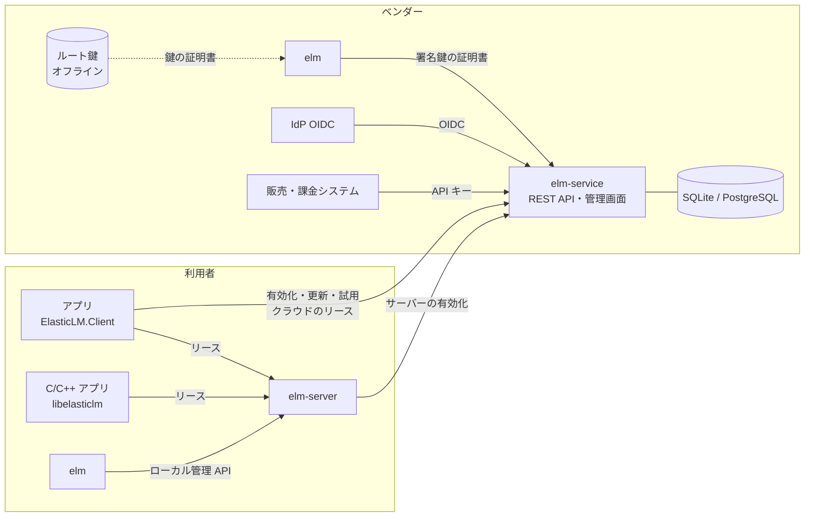
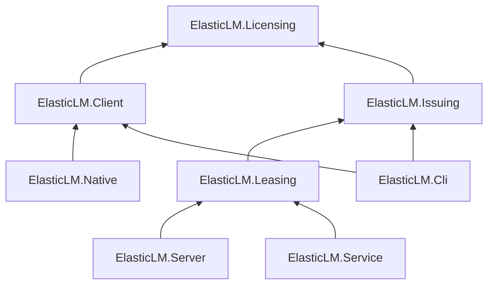
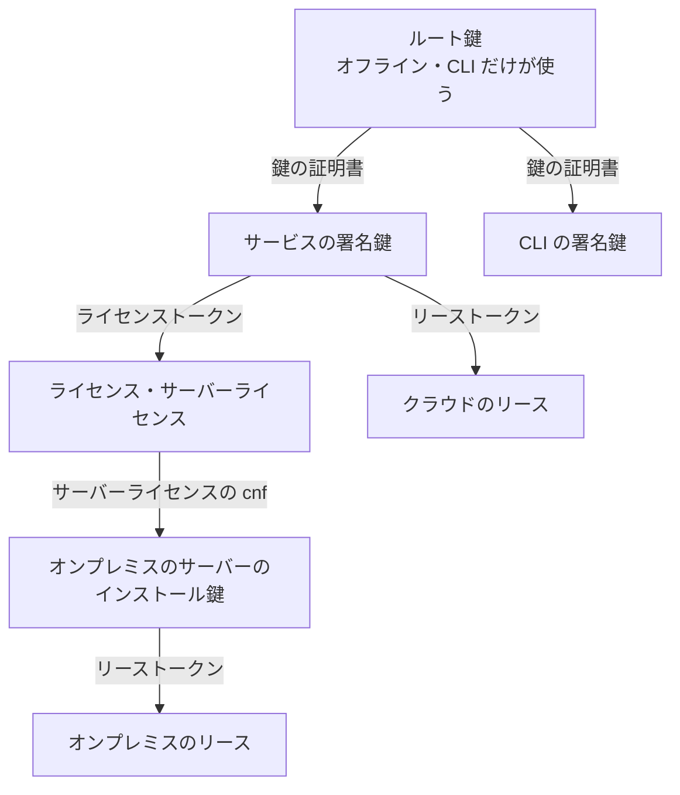
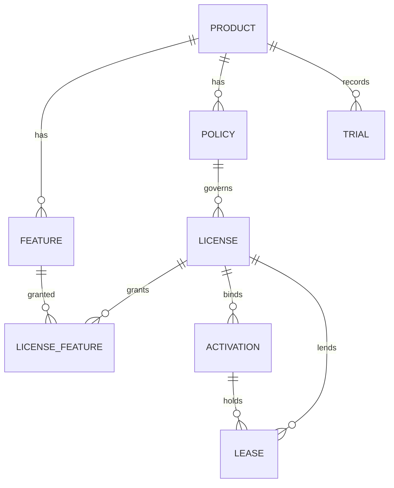
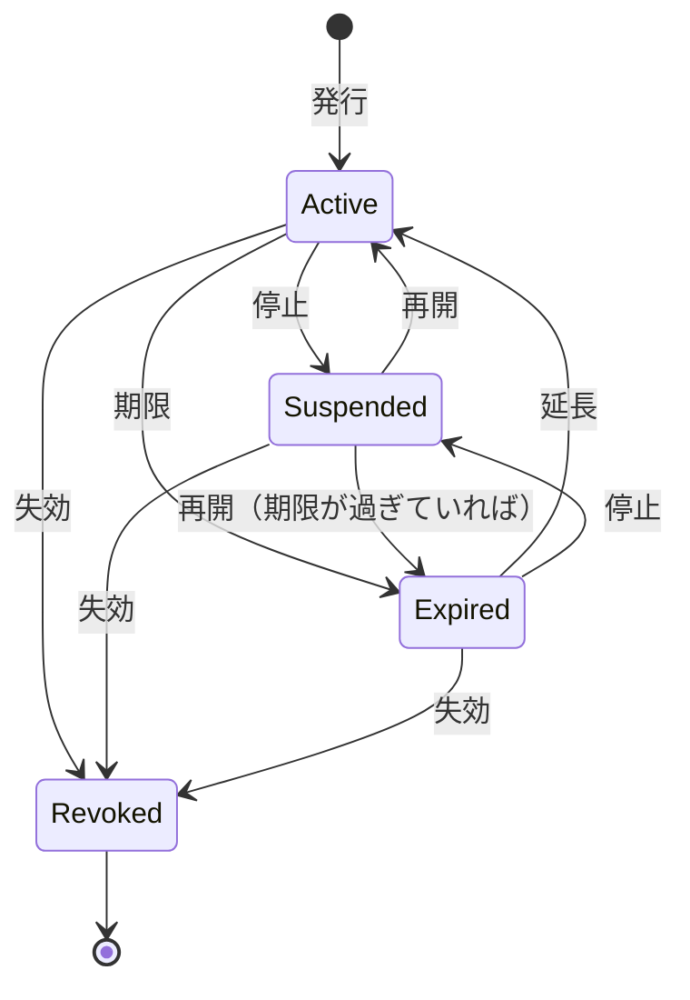
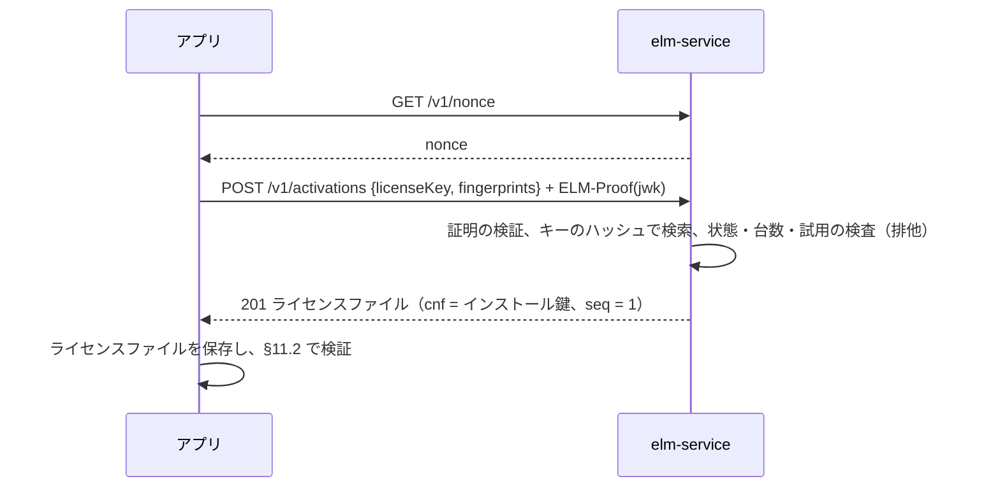
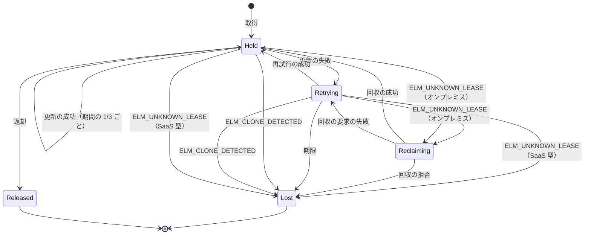

# ElasticLM 設計書

ElasticLM の正本の設計。要件・脅威モデル・形式・プロトコル・契約・段階をここに書く。進め方は `.cursor/rules/design-docs.mdc`、作業の順序は [roadmap.md](./roadmap.md)、採らなかった案は [design-decisions.md](./design-decisions.md) にある。

本書の §0 は Grill で持ち主が決めた前提、§1 以降はそれを具体化した設計である。§1 以降と §0 が食い違うときは §0 が正しく、本書を直す。

## 0. 決定済みの前提

2026-10-26 の Grill（Round 1）で持ち主が決めた。

| # | 項目 | 決定 |
| --- | --- | --- |
| 0.1 | 対象 | `net10.0` だけ。NativeAOT と単一バイナリで配布できること |
| 0.2 | 構成 | 中核は、署名付きライセンスをオフラインで検証するライブラリ（依存なし、AOT 対応、端末への紐づけは任意）。その上に、オンプレミスのフローティングライセンスサーバー（単一バイナリ）と、SaaS 型の有効化サービスを載せる |
| 0.3 | v1 の範囲 | 最初の公開（v1）に、オフライン検証・オンプレミスのフローティングサーバー・SaaS 型の有効化サービスの三つを含める |
| 0.4 | 署名 | ECDSA P-256。運ばれるバイト列そのものに署名し、JSON の正規化に頼らない。アルゴリズムと鍵 ID を示す欄を持ち、将来のアルゴリズム（ML-DSA など）へ移れるようにする。秘密鍵は実行ファイルに埋め込まない |
| 0.5 | 通信 | HTTPS と JSON（ASP.NET Core の Slim ビルダー、System.Text.Json のソース生成）。gRPC は使わない。全クライアントが持つ共有秘密は使わない。貸出は、サーバーが署名した期限付きのリースをハートビートで延長する |
| 0.6 | オンプレミスの状態 | 貸出の状態はメモリに持ち、データベースは持たない。サーバーが再起動したら、クライアントが借り直す |
| 0.7 | 端末の識別 | OS 標準のマシン ID（Windows: MachineGuid、Linux: `/etc/machine-id`、macOS: IOPlatformUUID）。紐づけは任意。使い方は 0.32 で具体化した |
| 0.8 | クライアント | .NET の SDK と、C / C++ から呼ぶネイティブライブラリ（C ABI、NativeAOT の共有ライブラリ）。Round 3 で C ABI も v1 に含めた（0.19） |
| 0.9 | 配布物 | NuGet パッケージ（検証ライブラリ、クライアント）、サーバーの単一バイナリ、CLI（鍵の生成・署名・内容の表示） |
| 0.10 | ライセンス | MIT |

SaaS 型を v1 に含めたことで、0.6（データベースを持たない）はオンプレミスのサーバーに限った決定になる。

### 0.A SaaS 型の前提

2026-10-26 の Grill（Round 2）で持ち主が決めた。

| # | 項目 | 決定 |
| --- | --- | --- |
| 0.11 | 運用者 | ソフトウェアのベンダー（ElasticLM の利用者）が自分で立てる OSS のサービス。単一バイナリまたはコンテナで配る。ElasticLM として商用 SaaS を運営する前提にはしない |
| 0.12 | テナント | 1 デプロイを 1 ベンダーが使い、その中で複数の製品を扱う。複数ベンダーの相乗りは v1 の範囲外 |
| 0.13 | 機能 | ライセンスキーの発行、端末単位の有効化と解除（台数上限つき）、ファイルを介したオフライン有効化、失効、管理用の REST API と CLI |
| 0.14 | フローティング | クラウドからの同時利用数の貸出も v1 に含める。貸出の仕組みはオンプレミスのサーバーと共通にし、状態の持ち方だけを変える |
| 0.15 | 保存先 | SQLite と PostgreSQL。ORM を使わない薄い層の上に載せる（SQL の組み立ては 0.81） |
| 0.16 | 管理 API の認証 | 機械向けの API キー（範囲を絞れ、サーバーはハッシュだけを持つ）と、人向けの OIDC の両方。CLI はデバイス認可フロー（RFC 8628） |
| 0.17 | オフラインのトークン | ライセンスごとのポリシーで決める。既定は期限付き（30 日）でオンラインで更新し、期限後も猶予期間内は使える。期限なしのトークンは CLI での手動発行と、期限のないライセンスの `Unbound` のライセンスファイル（0.86 で足した）に限る |
| 0.18 | 対象外の脅威 | クライアント側のバイナリの改ざん（検証処理を書き換えて飛ばすこと）と難読化は対象外と明記する。守るのはライセンスの偽造、リクエストの偽造と再送、席数を超えた利用 |

### 0.B v1 の範囲の追加

2026-10-26 の Grill（Round 3）で持ち主が決めた。Round 1・2 の推奨のうち、作業量だけを理由に外していたものと、検討から漏れていたものを見直した結果である。

| # | 項目 | 決定 |
| --- | --- | --- |
| 0.19 | C ABI | C / C++ のアプリも対象に含め、ネイティブライブラリを v1 に含める |
| 0.20 | 管理画面 | v1 に含める。静的な SPA をサービスのバイナリに埋め込む。Blazor はサーバー側の NativeAOT で使えないため採らない（§20.4） |
| 0.21 | 借り出し | フローティングの席を期限付きで端末に固定して持ち出す機能を v1 に含める |
| 0.22 | 試用ライセンス | ライセンスのポリシーの一種として v1 に含める。1 台 1 回の制限は SaaS 型が管理する |
| 0.23 | 監査ログ | 発行・解除・失効などの管理操作を、操作者つきで記録する |
| 0.24 | 利用状況の記録 | オンプレミスのサーバーと SaaS 型が、利用のイベントを 1 行 1 件の JSON で出力する |
| 0.25 | オンプレミスの冗長化 | v1 では作らない。根拠は §13.6 |
| 0.26 | 仮想マシンの複製 | 対策は §10.4 |
| 0.27 | Webhook | v1 の後の段階（ロードマップ A-1） |

### 0.C 形式と方式

2026-10-26 の Grill（Round 4）で持ち主が決めた。調査の出典は各節に書く。

| # | 項目 | 決定 |
| --- | --- | --- |
| 0.28 | トークン形式 | JWS コンパクト形式（ES256）を用途を絞った形で使う（§8） |
| 0.29 | リクエスト認証 | 端末ごとの鍵ペアで、DPoP（RFC 9449）の形の証明を各リクエストに付ける。本文のハッシュを証明に含める（§12.2） |
| 0.30 | 管理画面のログイン | BFF。サービスが OIDC の認可コードフロー（PKCE）を行い、ブラウザには HttpOnly の Cookie だけを渡す（§15.3） |
| 0.31 | SQLite | ソースの版とハッシュを固定し、各 OS 向けに静的ライブラリとしてビルドして実行ファイルに組み込む（§14.2） |
| 0.32 | 端末の識別 | 本当の識別は有効化のときに作る端末ごとの鍵（インストール鍵）。OS のマシン ID はアプリごとの値でハッシュした補助の手がかりにする（§10） |
| 0.33 | 暗号化 | ライセンスファイルは署名だけで、暗号化しない |
| 0.34 | 時計の巻き戻し | 発行時刻が未来のトークンを拒否し、最後に確認した時刻を端末に保存して、それより戻った時計を拒否する（§11.4） |
| 0.35 | 利用ログ | 区切りごとにサーバーの鍵で署名を挟み、改ざんを検出できる JSON Lines にする（§18.1） |
| 0.36 | ポリシー | 真偽値の組ではなく、名前付きの選択肢（列挙）の集まりにする（§9.3） |

### 0.D 設計のレビューで決めたこと

2026-10-26 の Grill（Round 5）で持ち主が決めた。D0 の設計の独立したレビューで見つかった、要件と受け入れる危険に関わる点である。

| # | 項目 | 決定 |
| --- | --- | --- |
| 0.37 | オンプレミスのサーバーの信頼 | サーバーライセンスに期限（ポリシーで設定、既定 30 日）を持たせ、SaaS 型のサービスから更新させる。更新のたびに複製を検出する。サーバーの鍵の取り出しは受け入れる脅威とし、クライアント側でリースがサーバーライセンスの範囲内かを確かめて被害を抑える（§5.4, §9.6, §12.7.5） |
| 0.38 | 借り出しと再起動 | 借り出しの記録だけを、追記だけの署名つきファイルに残し、再起動で戻す（§13.4）。データベースは持たない（0.6 のまま） |
| 0.39 | 鍵の証明書の期限 | トークンを発行した時点（`iat`）で証明書が有効だったかで判定する。漏れた鍵は、トラストストアの無効にした鍵 ID の一覧で、アプリの更新により無効にする（§7.5, §11.2） |
| 0.40 | 借り出しの早期返却 | 認める。回数の上限をポリシーで決める。残る危険は受け入れる（§5.4, §12.7.4） |
| 0.41 | ネットワークのない端末の更新 | オフライン有効化と同じファイルのやり取りでトークンを更新できる。サーバーライセンスの更新にも使う（§12.8.3） |

### 0.E M3b で決めたこと

2026-10-26 の Grill（Issue #21）で持ち主が決めた。

| # | 項目 | 決定 |
| --- | --- | --- |
| 0.42 | .NET のクライアントの形 | C ABI（§17.2）と同じ形の `LicenseClient` と `Lease`。状態の変化はイベントで知らせる。回収の時間中の取得は `Retry-After` を返し、自分では待たない（§12.7.3） |
| 0.43 | オンプレミスでの複製の扱い | サーバーライセンスに必須の `clone`（`deny` / `flag`）を持たせる。`deny` で止めたリースは期限まで残し、更新と回収に `ELM_CLONE_DETECTED` を返す（§8.4.2, §10.4） |
| 0.44 | 回収の形 | 1 回の要求で 64 件までのリーストークンを送り、リースごとの結果を返す。回収したリースはトークンと `seq` を引き継ぐ（§13.4） |
| 0.45 | TLS の受け入れ方 | OS の検証に通るか、相手の公開鍵の拇印がピンした `cnf.jkt` と一致すれば受け入れる。クライアントに方式の設定は持たせない（§13.5） |
| 0.46 | 頻度の制限 | `TimeProvider` で動く IP ごとのトークンバケットを `elm-server` に持つ。BCL の制限器は `TimeProvider` を受け取らない（https://github.com/dotnet/runtime/issues/106447 ）（§13.8） |
| 0.47 | 再試行と複製の見分け | `seq` が 1 小さい要求に同じトークンを返すのは、その要求が、今のトークンを出した要求の証明の `jti` を「応答のなかった要求」として名指したときだけにする。D0 の「1 小さければ再試行」のままでは、同じタイマーで動く複製の VM が 1 席を分け合っても検出できない（設計のレビュー、Issue #21）（§10.4） |

### 0.F M3c で決めたこと

2026-10-26 の Grill（Issue #25）で持ち主が決めた。

| # | 項目 | 決定 |
| --- | --- | --- |
| 0.48 | 早期返却の回数の上限 | サーバーライセンスに必須のクレーム `brl`（0〜1,000）を持たせる。ポリシーの `BorrowReturnLimit` を運ぶ。`elm license issue --borrow-returns` の既定は 2（§8.4.2, §12.7.4） |
| 0.49 | 借り出しの保存 | クライアントが借り出しのトークンを、サーバーライセンスの写しとサーバーの公開鍵とともに、インストール鍵の場所の `borrows/` に保存する。オフラインで読み込んで §12.7.5 で確かめる（`BorrowLeaseAsync`、`GetBorrowedLeases`）（§12.7.4） |
| 0.50 | 管理 API の待ち受け | 別のポートのループバックだけで HTTP。256 ビットの管理者トークン。ループバック以外の `admin.listen` では起動しない。ほかの端末からの管理は v1 の範囲外（§13.7） |
| 0.51 | 端末の範囲のフォルダー | Windows では、Administrators・SYSTEM・作った利用者だけの ACL を付けて作る。DPAPI の端末の範囲はその端末のどの利用者でも開けるため、守りは ACL が担う（§10.2） |
| 0.52 | 壊れた借り出しの記録 | `elm-server --set-aside-broken-records` で、壊れたファイルを `borrows-broken-<日時>.jsonl` に移し、`chain.reset` と警告を残して起動する。その記録の借り出しは期限まで数えない（§13.4） |

2026-10-27 の M3c の設計のレビュー（Issue #25）で持ち主が決めた。

| # | 項目 | 決定 |
| --- | --- | --- |
| 0.53 | すでにある端末の範囲のフォルダー | 鍵を書く前と読む前に、フォルダーと親の所有者と ACL（Linux と macOS はモード）を確かめ、ほかの利用者が読めるか置き換えられるなら止める（§10.2） |
| 0.54 | 借り出しの記録の、署名のない末尾 | 最後の署名の後の `borrow.started` は読み、`borrow.returned` は読まない（§13.4） |
| 0.55 | ファイルをまたぐ鍵 | 前のファイルの最後の鍵と違う鍵で続くファイルは誤りとする。同じ `lic` の別の鍵（サーバーの移設）は警告にする。起動時の借り出しの記録は、自分の鍵か同じ `lic` のものだけを読む（§13.4, §18.1）。`elm-service` のログは例外で、別の鍵でも、トラストストアがその時刻に `log` で保証すれば警告にする（署名鍵の入れ替え。鍵は再起動でしか替わらず、古い鍵が新しい鍵を保証する `key.changed` を書けない。ベンダーのルートが両方を保証する。0.95、M4d3 の設計のレビュー、持ち主が受けた） |
| 0.56 | 管理者による借り出しの返却 | オンプレミスでは断る（`409`、`ELM_RETURN_NOT_ALLOWED`）。クラウドでは返す（状態がベンダーのデータベースにあり、利用者の管理者が記録を書き換える経路がないため。§12.7.6、M4d1 の設計レビュー）。新しいログのファイルの名前は最新のファイルより前に並べない。残る経路（ファイルの削除、時計、記録を退ける操作）は §5.4 で受け入れる（§12.7.4, §13.7, §18.1） |
| 0.57 | 早期返却の数え方 | インストール鍵ごとと、マシン指紋ごとに数え、どれかが `brl` に達したら断る。借り出しにはマシン指紋を必須にする（§12.7.4） |
| 0.58 | 拒否の記録 | `lease.denied` と管理 API の認証の失敗は、1 分ごとに種類ごとの件数を 1 行で書く（§13.7, §18.1） |
| 0.59 | ログの書き込みの失敗 | そのファイルを閉じ、次の書き込みで `chain.reset` から新しいファイルを始める。再読み込みは、借り出しの記録に `key.changed` を書けてからライセンスを替える（§13.1, §18.1） |
| 0.60 | 形式と上限の書き足し | 借り出しのファイルに `ver: 1`、`borrows/` は 1,000 ファイルまで。`GetBorrowedLeases` もサーバーのピンを確かめる。脅威の表にサーバーの端末のほかの利用者を足す（§5, §12.7.4） |

2026-10-27 の M4 の Grill（Issue #38）で持ち主が決めた。

| # | 項目 | 決定 |
| --- | --- | --- |
| 0.61 | M4 の分け方 | M4a（土台）、M4b（オンラインの有効化と `ElasticLM.Client`）、M4c（オフラインのファイルとサーバーライセンスの更新）、M4d（クラウドのリース）の 4 行に分け、この順に進める。各行の細かい設計（エンドポイント、形式、検査の順）は、その行の始まりの Grill で決め、PR の前に独立した設計のレビューを当てたうえで、その行の実装と同じ PR に入れる。要件・脅威モデル・段階の変更は、今までどおり先に設計の PR で入れる（§22、`.cursor/rules/design-docs.mdc`） |
| 0.62 | 保存先の範囲 | SQLite と PostgreSQL の両方を M4a で入れる。PostgreSQL は 15〜18 に対応し（0.81 で 14 を外した）、CI は 18 で確かめる（§14.2） |
| 0.63 | 最初の管理者 | `elm-service setup` が、`bootstrapOwner` に結びついた `owner` の API キーを作って一度だけ表示する。期限は 90 日で、何度でも流せる（§14.6） |
| 0.64 | クラウドのリースの規則 | `LeaseEngine` の規則の判定を純粋な関数に取り出し、メモリとデータベースの実装で共有する（M4d、§14.4） |
| 0.65 | 管理 API の分け方 | 実体を作る行が、その実体の管理 API も持つ（§14.5） |
| 0.66 | ログインのない管理者のキー | 90 日ログインのない管理者のキーを止める規則は、ログインを入れる M5 で入れる（§14.6）。M5 の分け方（0.97）で、CLI のログインを入れる M5a に置く |
| 0.67 | ID の形 | 管理の実体の ID は UUID 第 7 版。一覧のカーソルに ID の順を使う（§14.2, §14.5） |
| 0.68 | ポリシーの変更 | 種類と `Binding` を除いて変えられ、次に出すトークンから効く（§9.3） |
| 0.69 | スキーマの移行 | 4 桁の番号のファイル、`schema_migrations` に版と SHA-256、版ごとのトランザクション。書き換えたファイルでは起動しない。PostgreSQL は助言ロックで一度だけ流す（§14.2） |
| 0.70 | 監査ログの連なり | 32 バイトの 0 から始め、列の値を長さつきで並べたバイト列の SHA-256。追記は直列。連なりを確かめる管理 API。古い行を消すときは起点を残す（§18.2） |

2026-10-27 の M4a の Grill（Issue #42）で持ち主が決めた。

| # | 項目 | 決定 |
| --- | --- | --- |
| 0.71 | M4a の分け方 | M4a1（保存先、SQLite の静的ビルド、PostgreSQL、移行、設定、署名鍵の読み込み、`setup` と API キー、監査ログ、3 OS の NativeAOT）と M4a2（製品・機能・ポリシー・ライセンスとその管理 API、署名鍵の状態、`Unbound` のライセンスファイル）に分ける（0.82 で M4a2 を M4a2 と M4a3 に分けた）（§22） |
| 0.72 | SQLite のビルド | `vendor/sqlite/` の版と SHA-256 を固定したアマルガムから、ビルドのたびに各 OS の C コンパイラーで静的ライブラリを作って組み込む。ビルド済みのライブラリはリポジトリに置かない（§14.2） |
| 0.73 | 管理 API の形 | `elm-server` と同じ素の JSON（camelCase、`problem+json` と `ELM_` のコード、`?after=&limit=` で 200 件まで）（§14.5） |
| 0.74 | サービスの設定 | `elm-server` と同じく、JSON の設定ファイルと `ELM_` の環境変数（環境変数が勝つ）。秘密は環境変数かファイルで、設定ファイルに直接書かない（§14.8） |
| 0.75 | 署名鍵 | 起動時に 1 本を読む。証明書が今の時刻とライセンス・リースの用途を持たなければ起動しない。入れ替えは再起動。状態の API は鍵 ID・証明書の期限・用途を返し、期限まで 30 日を切ったら警告する（§14.8） |
| 0.76 | `Unbound` のライセンスファイル | M4a2（0.82 で M4a3 に分けた）で、管理 API から端末に紐づかないライセンスファイルを出す。`Unbound` のオンラインの有効化は M4b の Grill で受け付けないと決めた（0.88、§9.3） |
| 0.77 | 監査ログのバイト列 | 10 列を決まった順に、4 バイトのビッグエンディアンの長さと UTF-8 で並べ、`NULL` は長さ `0xFFFFFFFF`、`prev` は 32 バイトのまま（§18.2） |
| 0.78 | 許可の一覧 | M4a1 と M4a2（0.82 で M4a3 に分けた）の許可を §14.6 の表のとおりにし、M4b 以降の許可はその行で足す（§14.6） |
| 0.79 | M4a1 のエンドポイント | API キーの作成・一覧・停止、監査ログの一覧・確認、`/health`。認証の失敗は 1 分ごとの件数で書く。本文・応答・誤りの形を §14.5 に書き、管理の実体がないときのコード `ELM_NOT_FOUND`（54）を §19 に足す（PR #43 のレビュー）（§14.5, §19） |
| 0.80 | `setup` の出力 | キーだけを標準出力に 1 行で書き、説明は標準エラーに書く。終了コードは 0 / 1 / 2（§14.6） |
| 0.81 | SQL の組み立て | `elm-service` の SQL は AuraORM（型で検査するクエリビルダー）で組み立て、SQLite と PostgreSQL を 1 つの実装で扱う。移行は SQL のファイルのまま流す。AuraORM が 15 から対応し、14 は 2026-11-12 にサポートが終わるため、PostgreSQL は 15〜18 にする（PR #47）（§14.2, §21） |
| 0.82 | M4a2 の分け方 | M4a2（製品・機能・ポリシーとその管理 API、署名鍵の状態）と M4a3（ライセンスとライセンスキー、状態の操作、`Unbound` のライセンスファイル）に分ける（§22） |
| 0.83 | 製品と機能の ID | 製品と機能は、API のパスで使う UUID 第 7 版の `id`（0.67）と、トークンの `prd` と `feat[].id` に入る `code`（§9.1 の形）を持つ。`code` は作った後は変えない（§9.1） |
| 0.84 | ポリシーの API の形 | §9.3 の全項目を M4a2 で保存して検査し、効き目はそれを使う行で入れる。列挙は camelCase の文字列、期間は秒の整数、`Perpetual`・`Unlimited`・`Disabled`・`Overage: None` は `null`。値の範囲は §14.5 の表（§9.3, §14.5） |
| 0.85 | ライセンスの管理 | ライセンスはポリシー・機能の一覧・`name`・`meta` を持ち、上書きできるのは `maxActivations` と期限だけ。顧客の実体は作らない。キーは作成時に一度だけ返し、再発行しない。状態の操作は停止・再開・失効・延長で、`Expired` は保存せずに計算する。許されない遷移と一意の値の重なりは `409` と `ELM_CONFLICT`（55）（§9.4, §14.5, §19） |
| 0.86 | `Unbound` のライセンスファイルの期限 | トークンの `exp` はライセンスの期限と同じにし、期限なしなら省く（期限なしのトークンを出す場所に足し、0.17 と §5.4 を改めた。PR #51 のレビュー）。`Unbound` には期限の起点になる有効化がないので、`Unbound` と `FromFirstActivation` の組は拒む（§9.3, §14.5） |
| 0.87 | 管理の実体の削除と同時の変更 | 製品・機能・ポリシーは消さない（発行済みのトークンが参照する）。`PATCH` は送ったメンバーだけを置き換え、版の検査（`If-Match`）は付けない（§14.5） |
| 0.88 | M4b の分け方とオンラインの有効化 | M4b を M4b1（`elm-service` のオンラインの有効化・更新・解除・試用、複製の検出、その管理 API）と M4b2（`ElasticLM.Client` の対応。始めに別の Grill）に分ける。有効化 ID は応答の本文で渡し、トークンの形式は変えない。`Unbound` のライセンスはオンラインで有効化しない（`409` と `ELM_CONFLICT`）。試用はキーのないライセンスとその有効化で表し、製品の機能をすべて持つ。管理者の解除は `DeactivationLimit` に数えない。`Deny` で止めた有効化は、最後の `seq` を持つ写しか管理者だけが解除できる。解除も `retry` を読む。1 つのインストール鍵はライセンスごとに 1 つの有効化を持つ（試用の後に買ったライセンスを同じ鍵で有効化できる）。この 3 点は Grill の答えを PR #61 の設計のレビューと実装で改め、持ち主が受けた。知らない有効化は `ELM_ACTIVATION_NOT_FOUND`（56）（§5.4, §10.4, §12.4〜§12.6, §12.6.1, §12.9, §14.5〜§14.8, §18.2, §19） |
| 0.89 | `ElasticLM.Client` の有効化 | M4b2 で、`elm-service` 向けの新しいクラス `ActivationClient` を置く（オンプレミスの `LicenseClient` とは相手と TLS の確かめ方が違うので分け、インストール鍵の保管は共有する。C ABI の対応は M6）。有効化は鍵のフォルダーの `activation.json` に持ち、`activation.lock` で同じ端末のプロセスの要求を 1 つずつにする。トークンの `refresh` から自動で更新し、送る前に `jti` を記録して、応答をなくした要求を送り直せるようにする。受け取ったファイルは確かめてから保存する（§12.6.2）。M4b2 の設計のレビューで、有効化の本文に `product` を足してサービスが製品の違うキーを断り、試用でない有効化があるときの別の有効化を手元で断り、解除でインストール鍵を消さないことにした（持ち主が受けた。§5.4, §12.6, §12.6.1）。受け取ったファイルは時計の守りを使わずに確かめ、その `iat` で守りを上書きする（§11.4） |
| 0.90 | M4c の分け方とオフラインの要求 | M4c を M4c1（`elm-service` のオフラインの要求と `elm offline process`）、M4c2（`ElasticLM.Client` のオフラインのファイル）、M4c3（`elm-server` のサーバーライセンスの有効化と更新。`ActivationClient` を使う）に分ける。要求ファイルは公開の `POST /v1/offline` と管理の `POST /v1/admin/offline`（`activation.offline`）で受け、中身は同じ処理にする。同じ要求には残した同じ応答を返し（ライセンスと有効化の状態が通るときだけ）、`nonce` が同じで中身の違う要求は断る（`offline_requests` の表、有効化ごとに 1 行）。期限の切れた要求は、前の要求の `nonce` を `retry` に入れた新しい要求で取り直す。管理の入口は 1 回ごとに監査ログに書く。応答はオンラインと同じ発行の応答で、拡張子は `.elmresp`。要求に `prd` と `retry` を足し、オフラインの解除でもインストール鍵を残す（§8.4.4, §8.4.5, §12.8, §12.8.4。M4c の Grill と設計のレビュー、持ち主が受けた） |
| 0.91 | `ElasticLM.Client` のオフライン | M4c2 で、`ActivationClient` に、オフラインの要求の作成（有効化・更新）、応答の取り込み、解除の証明の作成と破棄を足す。中身は文字列でやり取りし、見せ方（ファイル、QR コード）はアプリが決める（Cryptlex はファイルのパスを受け取る）。`ServiceUrl` を任意にし、ないクライアントはオンラインの操作を手元で断る。待っている要求（ライセンスキーを除いた中身と、キーの SHA-256）と渡していない解除の証明を `activation.json` に持ち、書き出すたびに同じ中身から組み立て直す。置き換えた要求の `nonce` は、その種類の答えのない要求の一覧に入れる。期限の前でも `renew` で作り直せる。オフラインの取り込みは時計の守りを上書きしない。オンラインで新しいファイルを保存したら待っている要求を捨て、解除の証明が残るうちは有効化を断る。更新の時期は `Check` の `ExpiresAt` と `RefreshWindow` でアプリが判断する（§12.8.5。M4c2 の Grill と設計のレビュー、持ち主が受けた） |
| 0.92 | `elm-server` のサーバーライセンス | M4c3 で、`elm-server` のサーバーライセンスを `elm-service` で有効化・更新・解除する。有効化と手動の操作（オンラインの有効化・更新・解除、オフラインの要求・取り込み・解除の証明）は `elm server` のコマンドがサーバーのデータのフォルダーで `ActivationClient` を直接使って行い、ライセンスファイル（設定 `license`）を書いて、動いているサーバーに再読み込みを頼む。ライセンスがなければ起動しない決まり（§13.1）を変えずに最初の有効化ができるためである。自動の更新は、`service.url` を持つサーバーの中の `ActivationClient` が行い、成功のたびにファイルを書いて再読み込みする。ファイルが正本で、有効化を持つ間は有効化のライセンスが優先する。`kind: server` でないファイルは保存しない。動いているサーバーでの解除と、自動の更新をするサーバーでのオフラインの要求は断る（§13.7、M4c3 の Grill と設計のレビュー、持ち主が受けた） |
| 0.93 | M4d の分け方とクラウドのリース | M4d を M4d1（規則の取り出し、`elm-service` のクラウドのリース、リースの管理 API）、M4d2（`LicenseClient` の SaaS 型のモード）、M4d3（サービスの利用ログとその管理 API）に分ける。`LeaseEngine` の判定を `LeaseRules`（純粋な関数）に取り出し、オンプレミスとサービスが同じ関数を使う。クラウドの取得はライセンスキーで名指し（ID は秘密でないため）、本文に `product` を持つ。回収は持たない（状態はデータベースに残る）。`floating` が `cloud` のポリシーのライセンスだけが貸し、借り出しの上限はポリシーの `BorrowLimit`、残す席は 0。`cloud` のポリシーは試用でもサーバーでもなく、そのライセンスは機能ごとに `seats` を必ず持ち、有効化しない（`409`）。`fromFirstActivation` の期限は最初の取得で決める。リースの期限はライセンスと機能の期限で切り、猶予は足さない。取得・更新・返却は監査ログに書かず（利用ログは M4d3）、複製の検出（`lease.clone`）と、管理 API の一覧と強制返却（借り出しも返す。0.56 の例外）は書く（§12.7.6。M4d の Grill と設計レビュー、持ち主が受けた） |
| 0.94 | `LicenseClient` の SaaS 型のモード | M4d2 で、既存の `LicenseClient` に `LicenseClientOptions.LicenseKey` を足し、値があれば `elm-service` からリースを借りる（別のクラスにしない。0.42 の形をそのまま使う）。TLS は OS の信頼で確かめ、ピンは持たない。URL は `ActivationClient` と同じく https か、ループバックの http だけ。`ExpectedServerLicenseId` は断る。ライセンスキーはメモリーにだけ持ち、取得の本文にだけ入れる。リースは応答の `certificates` で確かめ（§12.7.5 の手順 1・2・6）、借り出しのファイルは `license` と `key` の代わりに `certificates` を持つ（`ver` は 1 のまま）。更新の `ELM_UNKNOWN_LEASE` はすぐに `Lost`、`429` の `Retry-After` は取得の `RetryAfter` に入れる（§12.7.1, §12.7.3, §12.7.4。M4d2 の Grill、持ち主が受けた）。設計の独立レビューを受けて、リース ID の形（`[A-Za-z0-9_-]` の 22 文字）を検証と発行で確かめ（§8.4.3）、両方のクライアントはリダイレクトに従わず（§12.1）、中継が偽る問題の応答とキーの読み取りを §5.4 で受け入れた（持ち主が受けた） |
| 0.95 | `elm-service` の利用ログ | M4d3 で、`elm-service` がクラウドのリースと借り出しの利用ログを、ノードごとのファイルに書く（設定 `usageLog.directory`、なければ書かない。ファイル名にノード名 `node.name`、既定はホスト名）。署名はサービスの署名鍵で、利用ログを書くときは証明書に `log` が要る。各ファイルの最初の行は署名鍵の証明書を持ち、`key.changed` は使わない（鍵は起動のときだけ読む）。`SignedLog` と `LogVerifier` は「サーバーライセンスと鍵」か「証明書」のどちらでも確かめ、製品の確かめはサーバーの形だけにする（`elm log verify` の `--product` はサーバーのログだけ、`--node` でノードを選ぶ）。書くのはリースと借り出しのイベント（期限切れは掃除が消した行から）と拒否の数とサービスの開始と停止で、有効化・管理の操作・複製の検出は監査ログだけに書く。管理 API はそのノードのファイルの一覧・取得・区切りで、全ノードの記録を集めるのは運用者（§14.5, §14.8, §16, §18.1。M4d3 の Grill、持ち主が受けた）。設計の独立レビューを受けて、別の `log` の鍵で続くファイルを警告にし（0.55 の例外）、最初の行にノード名を入れて検証で照らし、同じ名前のノードの起動を断り、署名鍵を持つ者による書き直しを §5.4 で受け入れた（持ち主が受けた） |
| 0.96 | 管理画面の技術 | W0 で、管理画面の SPA を Preact 11 と TypeScript で書き、Vite 8 でビルドする（Preact 用の Vite のプリセットは使わない）。テストは Vitest と happy-dom。ビルドの道具は Node.js 24 と pnpm 12 に版を固定し（pnpm は Corepack がハッシュで確かめる）、`pnpm-lock.yaml` から `pnpm install --frozen-lockfile` で入れ、公開から 1 日たたない版を入れない。ビルドの結果はリポジトリに入れず、`build.ps1` と CI がビルドする。CI は秘密を持たない別のジョブで 1 回ビルドし、`dist` を 3 つの OS のジョブに渡す（M5c、0.97）。Preact、Svelte 5、Vue 3、SolidJS、フレームワークなしの 5 つを同じ試作で比べ、持ち主の希望（依存が少なく、小さく、書きやすい）で選んだ。pnpm は持ち主の問いから npm と比べて選んだ。設計の独立レビューを受けて、Node.js を 22 から 24 にし（22 は 2027-04-30 にサポートが終わる）、依存の乗っ取り（T21）の守りと受け入れる残り（§5.4）を書いた（§5.2, §5.3, §5.4, §15.2, §21、ADR 0001。W0 の Grill と Issue #94 の結果、持ち主が受けた） |
| 0.97 | M5 の分け方 | M5 を M5a（管理者の土台と CLI のログイン: JwtBearer、`elm admin`、管理者の一覧と無効化の API、最後のログイン、90 日ルール）、M5b（管理画面のログイン: BFF、データベースのセッション、Data Protection の鍵の保存、`X-ELM-CSRF`、Keycloak のテスト）、M5c（管理画面の土台: `web/admin/` のビルドとゲート、CI の SPA のジョブ、埋め込みと配信、大きさの計測、最初の画面）、M5d（残りの画面）の 4 行に分け、この順に進める。各行の細かい設計は、その行の始まりの Grill で決め、PR の前に独立した設計のレビューを当てて、その行の実装と同じ PR に入れる（0.61 と同じ）。`elm admin` は `login`・`logout` と汎用の `request` だけにする（§16）。OIDC のテストは、テストの中の偽の IdP（3 つの OS）と、CI の Linux の Keycloak の 2 段にする（§15.3）。M5b の画面のログインも、M5a と同じ「最後のログイン」を更新する。各行の Grill で決める点は §14.6 に挙げる（M5 の Grill、持ち主が受けた）。設計の独立レビューを受けて、Keycloak のテストを M5a から始め（デバイス認可フローと JwtBearer、M5b で認可コードのフローを足す）、画面を §15.1 の日々の操作と `support` の操作、管理者・API キー・セッションまでにした（持ち主が受けた） |
| 0.98 | 管理者の土台と CLI のログイン | M5a で、管理 API が `elm_` で始まらない Bearer を OIDC のアクセストークンとして JwtBearer で確かめる（署名は RS256・PS256・ES256、`typ`、発行者、`audience`、サービスの時計での期限。ライブラリーの既定に頼らない）。`iss` と `sub` で管理者を探すか作り、役割を `oidc.roleClaim` と `oidc.roleMap` から決め、対応がなければ役割を `none` にする（`bootstrapOwner` は `owner`）。監査ログの `actorId` は管理者の ID。最後のログインは、認証された要求で 1 時間に 1 回まで書く。90 日の規則は、OIDC があるときだけ、キーを使うたびに「最後のログイン・管理者を作った時刻・キーを作った時刻」の最も遅い時刻と比べる（`apiKeys.inactiveAdminDays`、既定 90、0 で切る）。管理者の一覧・無効化・有効化の API は `admin.read`・`admin.update` で `owner` だけが持ち、自分・`bootstrapOwner`・最後の `owner` は無効にできない。`elm admin login` はデバイス認可フロー（RFC 8628）でトークンを得て、インストール鍵と同じ守り方のユーザーの範囲のファイルに置く。`request` は保存したログインを、その URL と同じオリジンにだけ使い、応答の本文をそのまま書き、転送を追わない。`elm offline process` は、資格がなければ今までどおり公開の入口に送る（§5.3 T13, §5.4, §14.5, §14.6, §14.8, §16, §18.2。M5a の Grill と設計の独立レビュー、持ち主が受けた、Issue #102） |
| 0.99 | 管理画面のログイン（BFF） | M5b で、`/auth/login` と `/auth/callback` を ASP.NET Core の OpenIdConnect のハンドラーに任せ（認可コードと PKCE、`query` で戻す、既定の値に頼らず明示する）、ID トークンを確かめた後に、データベースのセッションと Cookie `__Host-elm-session` を自分で作る（ASP.NET の Cookie 認証は使わない）。画面のログインは、秘密を持つクライアント `oidc.webClientId` とその秘密、鍵暗号化鍵がそろい、`publicUrls` の最初の URL（パスは `/`）が https か、ブラウザを使わない試験のためのループバックの http のときだけ有効にし、画面はその URL だけで配る。役割のクレームは ID トークンとアクセストークンの両方に求める。ログインの時間切れはサービスの `TimeProvider` で確かめる。戻り先は常に `/`。セッションは操作がなければ既定 30 分、最長既定 12 時間（`session.idleMinutes`、`session.maxHours`）。Cookie で認証する状態を変える要求は、`X-ELM-CSRF: 1` と、`Origin` があれば同じオリジンであることを求める。セッションの一覧と取り消しは `owner` だけ。管理者の無効化でその人のセッションを消す。Data Protection の鍵は、鍵暗号化鍵で AES-256-GCM で暗号化してデータベースに置き、サービスがデータベースのロックの下で作る（§5, §14.5, §14.6, §14.7, §14.8, §15.3, §18.2。M5b の Grill と設計のレビュー、Issue #109、#110） |
| 0.100 | 管理画面の土台と最初の画面 | M5c で、画面のログインが有効なときだけ、`elm-service` が `/` で `index.html` を、`/assets/*` で Vite のハッシュつきのファイルを、埋め込みのリソースから配る。画面の中の行き先は `#` の後ろで表し、サーバーは知らないパスに `index.html` を返さない。画面の応答は CSP（`default-src 'self'; base-uri 'none'; form-action 'self'; frame-ancestors 'none'; object-src 'none'`）、`nosniff`、`no-referrer` を持ち、`index.html` は `no-cache`、`/assets/*` は 1 年の `immutable`。`/` はセッションを求めず、画面が API の `401` を受けて `/auth/login` へ移る。`GET /v1/admin/me` で自分の役割と許可を返し（監査ログの例外）、許可のない操作を画面で出さない。ライセンスの一覧に、名前の部分一致 `?q=` と、画面がキーから作る SHA-256 の `?keyHash=` を足す（キーを URL に載せない。設計のレビューで持ち主が決めた）。最初の画面はライセンスの一覧・検索・詳細・失効。CI は秘密を持たない Linux のジョブで SPA を 1 回ビルドして `dist` を渡し（そのジョブの actions はコミットの SHA で固定する。設計のレビューで持ち主が決めた）、`dist` がなければ `ElasticLM.Service` のビルドが止まる。テストは Vitest と happy-dom と .NET の配信のテストで、CSP の違反は PR ごとに手元のヘッドレスの Chrome で確かめる（§5.3, §14.5, §14.6, §15.2, §15.3, §18.2, §21。M5c の Grill と設計のレビュー、Issue #116） |

## 1. 目的と利用者

### 1.1 目的

.NET（と C / C++）で作られたアプリのベンダーが、自分の製品のライセンスを発行し、利用者の端末で確かめ、同時利用数を数えられるようにする。そのための部品一式を、NativeAOT の単一バイナリと NuGet パッケージで OSS として配る。

前身（`_ElasticLM`, `_ElasticLM2`）は FlexLM 風のフローティングサーバーだけを目指し、認証が成り立っていなかった（[design-decisions.md](./design-decisions.md)）。本設計は、ライセンスの偽造・リクエストの偽造と再送・席数を超えた利用を、暗号で防ぐことを第一にする。

### 1.2 登場する人と物

| 名前 | 説明 |
| --- | --- |
| ベンダー（発行者） | ElasticLM を使って製品のライセンスを発行する組織。ルート鍵を持ち、SaaS 型のサービスを運用する |
| ベンダーの管理者 | ベンダーの社員。管理画面・CLI・管理 API で発行や解除を行う。役割（§14.6）で権限が分かれる |
| ベンダーのシステム | ベンダーの販売・課金システムや CI。API キーで管理 API を呼ぶ |
| 利用者（顧客） | 製品を買った組織または個人 |
| 利用者の管理者 | 利用者の社内でオンプレミスのライセンスサーバーを運用する人 |
| アプリ | ベンダーの製品。検証ライブラリかクライアント（.NET または C ABI）を組み込む |
| 攻撃者 | §5.2 |

### 1.3 配る物

| 配布物 | 形 | 使う人 |
| --- | --- | --- |
| `ElasticLM.Licensing` | NuGet パッケージ。オフラインの検証 | アプリ |
| `ElasticLM.Client` | NuGet パッケージ。有効化・リース・借り出し・試用の通信 | アプリ |
| `libelasticlm` | NativeAOT の共有ライブラリ（`.dll` / `.so` / `.dylib`）と C ヘッダ | C / C++ のアプリ |
| `elm-server` | オンプレミスのライセンスサーバー。単一バイナリ | 利用者の管理者 |
| `elm-service` | SaaS 型の有効化サービス（管理画面を含む）。単一バイナリとコンテナイメージ | ベンダー |
| `elm` | CLI。鍵・発行・検査・管理 API の操作 | ベンダーと利用者の管理者 |

## 2. 用語

英語の表記は `.agents/skills/english-writing/SKILL.md` の用語表に合わせる。

| 用語 | 意味 |
| --- | --- |
| ルート鍵（root key） | ベンダーがオフラインで保管する署名鍵。署名鍵の証明書だけに署名する（§7） |
| 署名鍵（signing key） | ライセンスやリースに署名する鍵。ルート鍵が証明書で認める |
| 鍵の証明書（key certificate） | 署名鍵の公開鍵・用途・期限に、ルート鍵が署名したトークン（§8.4.1） |
| トラストストア（trust store） | アプリが信じるルート鍵の公開鍵の集まり。アプリに組み込む |
| ライセンス（license） | ある利用者に、ある製品の機能を、あるポリシーで使わせる権利。SaaS 型のデータとしての実体 |
| ライセンスキー（license key） | 人が入力する、ライセンスを指す秘密の文字列（§9.5） |
| ライセンストークン（license token） | ライセンスの中身を署名鍵で署名したトークン。オフラインで検証できる（§8.4.2） |
| ライセンスファイル（license file） | ライセンストークンと、それを検証するための鍵の証明書を一つにまとめたファイル（§8.5） |
| インストール鍵（installation key） | 端末上のアプリが最初の有効化か借り受けのときに作る鍵ペア。端末の本当の識別子（§10.2） |
| マシン指紋（machine fingerprint） | OS のマシン ID をアプリごとの値でハッシュした補助の手がかり（§10.3） |
| 有効化（activation） | ライセンスとインストール鍵を結びつけ、台数を 1 つ使うこと |
| リース（lease） | フローティングの席を、期限付きで 1 つのインストール鍵に貸すこと。サーバーが署名したリーストークンで表す（§8.4.3） |
| 借り出し（borrow） | 期限の長いリース。ネットワークから離れても使える（§12.7） |
| 回収（reclaim） | 再起動したサーバーに、まだ有効なリースを申告して席を取り戻すこと（§13.4） |
| 証明（proof） | リクエストごとにインストール鍵で署名する DPoP 形式の JWS（§12.2） |
| 管理者トークン | オンプレミスのサーバーの、ローカル管理 API に使う秘密（§13.7） |

## 3. 機能要件

### 3.1 オフラインの検証（`ElasticLM.Licensing`）

1. ライセンスファイルを読み、トラストストアのルート鍵から署名鍵の証明書、ライセンストークンの順に検証する（§11.2）。
2. 期限・猶予期間・発行時刻・対象の製品・機能・端末の紐づけを、§11.2 の順で判定し、結果を理由つきで返す。
3. 時計の巻き戻しを検出する（§11.4）。
4. ネットワークにも、ファイル以外の外部資源にも触れない。時計は `TimeProvider` から読む。

### 3.2 クライアント（`ElasticLM.Client`）

1. SaaS 型のサービスに対して、オンラインの有効化・解除・トークンの更新・試用の開始を行う（§12.4〜§12.6、§12.9）。
2. オフライン有効化・更新・解除のファイルを作り、応答ファイルを取り込む（§12.8）。
3. オンプレミスのサーバーと SaaS 型のサービスに対して、リースの取得・更新・返却・借り出し・返却を行う（§12.7）。プロトコルは両者で同じ。
4. リースを期限の 1/3 ごとに自動で更新し、失敗したら §12.7.3 の規則で再試行する。
5. インストール鍵を作り、OS ごとの方法で保管する（§10.2）。

### 3.3 オンプレミスのライセンスサーバー（`elm-server`）

1. サーバーライセンス（§9.6）を読み、その機能と席数の範囲でリースを貸す。
2. 貸出の状態はメモリだけに持つ。再起動の後は回収で状態を戻す（§13.4）。
3. 借り出しを、ベンダー・利用者の管理者・残す席数の三段の上限で制御する（§12.7.4）。
4. 応答のない端末の席を、リースの期限で解放する。
5. 利用ログを出す（§18.1）。借り出しを署名つきの記録に残し、再起動で戻す（§13.4）。
6. サーバーライセンスを、オンラインかファイルのやり取りで更新する（§9.6, §12.8.3）。
7. 利用者の管理者向けに、状態の表示・強制返却・ライセンスの再読み込みを、ローカル管理 API と `elm` で提供する（§13.7）。
8. TLS の証明書を、運用者が渡すか、サーバー自身の鍵で自己署名する。後者のとき、クライアントはサーバーライセンスに書かれた公開鍵で TLS の相手を確かめる（§13.5）。

### 3.4 SaaS 型の有効化サービス（`elm-service`）

1. 製品・機能・ポリシー・ライセンスを管理し、ライセンスキーを発行する（§9）。
2. 端末単位の有効化と解除、台数上限、オンラインのトークン更新、試用、オフライン有効化、失効を提供する（§12）。
3. クラウドからのフローティング（リースと借り出し）を、オンプレミスと同じプロトコルで提供する。状態はデータベースに持つ（§14.4）。
4. オンプレミスのサーバーの有効化（サーバーライセンスの発行）を提供する（§9.6）。
5. 管理用の REST API（§14.5）、管理画面（§15）、監査ログ（§18.2）、利用ログ（§18.1）を提供する。
6. 管理 API は API キーと OIDC の両方で認証し、役割で認可する（§14.6）。
7. SQLite と PostgreSQL のどちらでも動く（§14.2）。
8. 仮想マシンの複製を検出する（§10.4）。

### 3.5 CLI（`elm`）

1. ルート鍵と署名鍵の生成、鍵の証明書の発行（§7.3）。
2. ライセンストークンの発行（SaaS 型を使わない運用のため）と、トークン・ファイル・利用ログの内容表示と検証（§16）。
3. 管理 API の操作。人はデバイス認可フロー、機械は API キーで認証する。
4. オンプレミスのサーバーのローカル管理 API の操作。

### 3.6 ネイティブライブラリ（`libelasticlm`）

1. `ElasticLM.Licensing` と `ElasticLM.Client` の機能を C ABI で公開する（§17）。
2. メモリの所有権・スレッド・エラーの規則を §17 のとおりに守る。

## 4. 非機能要件

### 4.1 配布の形

- 実行ファイル（`elm-server`, `elm-service`, `elm`）は NativeAOT の単一バイナリで、横に置くファイルなしで動く。設定ファイルは任意。
- 対象の RID: `win-x64`, `win-arm64`, `linux-x64`, `linux-arm64`, `linux-musl-x64`, `osx-arm64`, `osx-x64`。`libelasticlm` も同じ。
- NuGet パッケージは `IsAotCompatible` で、アプリの NativeAOT 公開で警告を 0 件に保つ。

### 4.2 大きさと速さ

数値は目標で、各行の PR で測る（`.cursor/rules/open-ends.mdc`）。D0 の調査で、Windows（win-x64、.NET 10.0.13）の NativeAOT について次を実測した。

| 物 | D0 の実測 | 目標 |
| --- | --- | --- |
| HTTPS・JwtBearer・Npgsql・SQLite（静的リンク）・埋め込みファイルを持つ ASP.NET Core | 25.3 MB | `elm-service` 40 MB 以下 |
| OIDC と Cookie 認証を持つ Slim ビルダーのサーバー | 17.6 MB | — |
| `webapiaot` テンプレート | 12.2 MB | `elm-server` 30 MB 以下 |
| HttpClient と ECDSA を持つ共有ライブラリ | 4.7 MB | `libelasticlm` 8 MB 以下 |

| 処理 | 目標 |
| --- | --- |
| ライセンスファイル 1 件の検証（鍵の証明書を含む、2 回目以降） | 1 ms 以下（参照機: GitHub Actions の `ubuntu-latest`） |
| `elm-server` の起動から待ち受けまで | 1 秒以下 |
| `elm-server` が同時に持つリース | 10,000 件で、更新の p99 が 50 ms 以下、メモリ 200 MB 以下（2 vCPU） |
| `elm-service` の有効化（SQLite、1 ノード） | 50 件/秒を持続して p99 が 200 ms 以下 |

10,000 件のリースを既定のリース期間 10 分・更新間隔 1/3 で持つと、更新は $10000 / 200\,\mathrm{s} = 50$ 件/秒になる。

M3b（Issue #21）の実測（Windows、win-x64、NativeAOT。参照機での計測は V1 の行）:

- `elm-server` の大きさは 11.4 MB（11,430,912 バイト）。
- 起動から待ち受けまで、サーバーの記録では 51 ms。プロセスの起動から最初の HTTPS の応答までを外から測ると、5 回で 524〜639 ms だった（PowerShell の `Invoke-WebRequest` の待ちを含む）。
- 更新 1 件のサーバー側の処理は、証明の検証が約 120 µs、リースの規則と新しいトークンの署名が 322〜415 µs（4 回の実行、各 1,000 回の平均）で、合わせて約 0.45〜0.54 ms（`samples/VerifyLicense --self-test`）。50 件/秒なら 1 コアの約 2.7 % 以下である（$50 \times 0.54\,\mathrm{ms} = 27\,\mathrm{ms/s}$）。10,000 件を同時に持つときの p99 とメモリは V1 で測る。

M4a1（Issue #46）の実測（Windows、win-x64、NativeAOT。参照機での計測は V1 の行）:

- `elm-service` は 19.8 MB（19,784,192 バイト。AuraORM を入れる前は 19,079,168 バイト）。§4.2 の目標 40 MB 以下に収まる。横に SQLite のライブラリは置かない。
- 起動から待ち受けまで、サービスの記録で 185〜225 ms（SQLite、移行の済んだデータベース、3 回）。
- PostgreSQL 18 では、起動から待ち受けまでサービスの記録で 270〜463 ms（GitHub Actions の `ubuntu-latest`、linux-x64、同じ端末のコンテナー、移行の済んだデータベース。CI の `aot` の「Measure elm-service on PostgreSQL」の 2 回の実行で、各 3 回の起動: 463 / 437 / 446 ms と 270 / 291 / 281 ms）。runner は実行ごとに違う端末なので幅が広い。参照機の値は V1 の行で測る。端末が違うので、上の SQLite の値とは比べない。
- 監査ログを書く管理 API の 1 件（API キーの作成。認証の検索、キーと監査ログの行の追記、1 つのトランザクション）は 1.05〜1.11 ms（SQLite、JIT の Release、ループバックの HTTP を含む、3 回の実行で各 200 件の平均）。同じビルドで SQLite を先行書き込みログ（WAL）にしないと 3.7〜5.0 ms になる。WAL ではコミットごとのディスクへの書き出しが 1 つのファイルで済むためで、WAL にする前の手書きの SQL の版は 3.1〜3.5 ms だった。

M4a2（Issue #54）の実測（同じ条件）:

- `elm-service` は 20.4 MB（20,441,088 バイト）。同じ日に発行した M4a1 の最終版（コードは main の `e6a56ca` と同じで、PR #47 のレビュー後の修正を含む。19,786,240 バイト）より 654,848 バイト大きい。上の M4a1 の 19,784,192 バイトは、PR #47 のレビュー前の版で測った値である。ILC のマップで分けると、応答の JSON のソース生成（7 つの型と context）が約 195 KB、3 つの表のレコードとその AuraORM の型付けが約 140 KB、管理 API の処理と保存先が約 110 KB で、残りは新しく使う BCL の部分（`JsonDocument` など）と型の情報である。§4.2 の目標 40 MB 以下に収まる。
- ポリシーの作成 1 件（本文の読み取りと検査、製品の検索、ポリシーと監査ログの行の追記、1 つのトランザクション）は 1.02〜1.14 ms（SQLite、JIT の Release、ループバックの HTTP を含む、3 回の実行で各 200 件の平均）。M4a1 の API キーの作成（1.05〜1.11 ms）と同じ程度である。

M4a3（Issue #58）の実測（同じ条件）:

- `elm-service` は 20.9 MB（20,909,056 バイト）。M4a2 の最終版（main の `23dd023`、20,467,712 バイト）より 441,344 バイト大きい。ILC のマップで分けると、ライセンスの JSON のソース生成（応答の型、保存する機能の配列、`meta` の辞書）が約 138 KB、管理 API の処理と保存先が約 111 KB、サービスで新しく使う発行と検証の部品（`LicenseIssuer` と、発行したファイルを確かめる `LicenseVerifier`）が約 50 KB、表の型付けが約 21 KB で、残りは新しく使う BCL の部分と型の情報である。§4.2 の目標 40 MB 以下に収まる。
- ライセンスの作成 1 件（本文の読み取りと検査、ポリシーと機能の検索、キーの生成、ライセンスと監査ログの行の追記）は 1.20〜1.34 ms（SQLite、JIT の Release、ループバックの HTTP を含む、3 回の実行で各 200 件の平均）。
- `Unbound` のライセンスファイル 1 件は 2.19〜2.71 ms（同じ条件）。うち発行（`LicenseIssuer.Issue`）が、署名だけで 0.35〜0.39 ms、出したファイルをトラストストアで確かめるまで含めて 0.96〜1.13 ms（各 200 回の平均、3 回）で、残りはライセンス・ポリシー・製品の読み取りと監査ログの行の追記、HTTP である。

M4b1（Issue #60）の実測（同じ条件）:

- `elm-service` は 21.6 MB（21,575,680 バイト）。M4a3 の最終版（main の `8b482ea`、20,912,640 バイト）より 663,040 バイト大きい。ILC のマップで分けると、端末の要求と管理 API の処理、保存先のコード（GC の情報を含む）が約 157 KB、新しい型（行、要求と応答の型、非同期の状態機械）の型の情報と AuraORM のジェネリックのインスタンスが約 190 KB、新しく使う BCL の部分（LINQ など）が約 50 KB、メタデータが約 24 KB で、残りはハッシュ表と凍結したオブジェクトの領域、セクションの詰め物である。§4.2 の目標 40 MB 以下に収まる。
- 有効化（§12.6.1）を 50 件/秒で 60 秒（3,000 件、各件は新しいインストール鍵、1 つのライセンス）、3 回: p50 は 4.28〜4.35 ms、p99 は 8.66〜10.39 ms、最大は 27.5〜46.7 ms（SQLite、JIT の Release、ループバックの HTTP を含む）。端末は前もってノンスを得ておき、証明を作るところから応答までを測った。1 件は、証明の検証、`jti` の記録、キーとポリシーと製品の読み取り、ライセンスの行のロックと数え上げ、ファイルの署名と、トラストストアでの確かめ、有効化と監査ログの行の追記である。§4.2 の目標（p99 200 ms 以下）に収まる。参照機での計測は V1 の行で行う。

M4b2（Issue #66）の実測（Windows、win-x64、JIT の Release、ループバックの `elm-service`（SQLite）を相手に、各 200 件の平均、3 回の実行で各 3 回）:

- `ActivationClient.Check` 1 回は 402〜426 µs で、ライセンスファイルの検証の目標（1 ms 以下）に収まる。毎回 `activation.json` を読み直す時間を含む。
- 有効化 1 回は 21.7〜23.5 ms。うちインストール鍵の作成（鍵の生成、DPAPI、フォルダーの ACL）が 11.8〜12.4 ms、ノンスの取得が残りの一部で、更新と同じ部分が約 7 ms である。
- 更新 1 回は 6.9〜7.2 ms。送信と応答が約 3.8 ms、`activation.json` の書き込み 3 回（送る前、応答の後、保存）が各 0.54〜0.57 ms、時計の守りの書き込みが約 0.9 ms、受け取ったファイルの確かめが約 0.3 ms、ロックの開閉が約 0.07 ms である。保存したファイルを時計の守りつきでもう一度確かめて次の更新の時刻を出していた最初の版は、その確かめに約 8 ms かかって 16 ms だったので、確かめ終えたファイルから時刻を出すようにした（16 ms → 7 ms）。
- `ElasticLM.Client` の NuGet パッケージは 87,481 バイトで、main（`c40136a`）の 69,281 バイトより 18,200 バイト大きい。

M4c3（Issue #78）の実測（Windows、win-x64）:

- `elm-server` の NativeAOT の実行ファイルは 13.6 MB（13,629,440 バイト。main（`a69008c`）の 12,022,784 から +1,606,656 バイト、+13.4%）。目標の 30 MB 以下に収まる。マップのファイル（`-p:IlcGenerateMapFile=true`）で比べると、増えた分は、サーバーライセンスを更新する `ActivationClient` が使う `HttpClient` の一式（`System.Net.Http` が 0 から 420,419 バイト、名前の解決・ソケット・`System.Net.Primitives` で 61,766 バイト、それらの型の記述 `ConstructedEEType` が 275,180 バイト）と、`ElasticLM.Client` の `ActivationClient`（11,337 から 111,974 バイト）である。それまでの `elm-server` は HTTP の受け手（Kestrel）だけで、送り手を持たなかった。
- `elm` は 8.0 MB（8,025,600 バイト。main の 7,458,304 から +567,296 バイト）。`elm server` のサーバーライセンスのコマンドが `ActivationClient` を使うためである。

M4d1（Issue #82）の実測（Windows、win-x64）:

- `elm-service` の NativeAOT の実行ファイルは 21.9 MB（21,929,984 バイト。main（`e3ff4f7`）の 21,664,768 から +265,216 バイト、+1.2%）。目標の 40 MB 以下に収まる。マップのファイルで分けると、次のとおりである。
  - サービスのリースのコード: +132,913 バイト。内訳は、JSON の型（`LeaseItem`、`LeasePage`）が 56,716、行と問い合わせ（`LeaseRow`、`LeaseReturnRow`）が 50,318、要求の処理と本文の解析が 26,507。
  - サービスのほかの型: +54,991 バイト。
  - サービスで新しく使う `LeaseVerifier`、`LeaseIssuer`、`LeaseRules`: 合わせて +9,446 バイト。
  - 残り: メタデータとハッシュ表など。
- 取得と更新の往復（JIT の Release、ループバック、100 台の端末で各 100 回の平均、1 回の実行で 3 回。接続は先に温め、トークンの検証はしない）。値は 2 回目と 3 回目で、1 回目は JIT の温まりを含むので除く。

  | 要求 | `elm-service`（SQLite、HTTP） | `elm-server`（メモリー、HTTPS） |
  | --- | --- | --- |
  | 取得 | 3.15〜3.22 ms | 1.49〜1.76 ms |
  | 更新 | 2.73〜2.89 ms | 1.01〜1.06 ms |
  | 返却 | 2.02〜2.08 ms | 0.73〜0.76 ms |

- 差の約 1.6〜1.9 ms のうち、約 1.2 ms はデータベースの仕事である（同じ実行で別に測った）。
  - `jti` の記録のコミット: 0.43 ms。
  - ライセンスの行のロック、席の `SUM`、行の書き込みのトランザクション: 0.55〜0.60 ms。
  - ロックの前の読み取り 4 つ: 0.13〜0.16 ms。
  - `elm-server` は状態をメモリーに持ち、要求ごとのコミットがない。
- ほかに、サービスは出したトークンを返す前に確かめる（ECDSA の検証 1 回。M3b の証明の検証で約 120 µs）。
- 残りの 0.3〜0.5 ms は分けていない。上の目標の表にクラウドのリースの行はなく、いちばん近い `elm-service` の有効化の目標（p99 200 ms 以下）から十分に遠いためである。

M4d2（Issue #86）の実測（PR #87 の head `dfa97f0` のコード。Windows、JIT の Release、ループバック、1 回の実行の中の値）:

- SaaS 型のリースの確かめ（`LeaseVerifier.VerifyHosted`、証明書を覚えた 2 回目以降）は 1 回 130.6〜131.5 µs（各 1,000 回の平均、3 回）。§4.2 の検証の目標 1 ms 以下に収まる。
- `LicenseClient` の取得・更新・返却。各 100 件の平均を、同じ実行の中で SaaS 型とオンプレミスを交互に 3 回取った。1 回目は JIT の温まりを含むので、2 回目と 3 回目を回ごとに書く。

  | 要求 | SaaS 型 2 回目 | オンプレミス 2 回目 | SaaS 型 3 回目 | オンプレミス 3 回目 |
  | --- | --- | --- | --- | --- |
  | 取得 | 3.50 ms | 1.42 ms | 4.14 ms | 1.39 ms |
  | 更新 | 3.69 ms | 1.24 ms | 3.74 ms | 1.33 ms |
  | 返却 | 2.12 ms | 0.62 ms | 2.15 ms | 1.03 ms |

  - SaaS 型は `elm-service`（SQLite、HTTP）、オンプレミスは `elm-server`（メモリー、HTTPS）が相手である。TLS の仕事はオンプレミスの側にだけある。
  - 更新は、100 件のタイマーを一度に動かし、全件が終わるまでの時間を件数で割った値である。M4d1 の、生の要求を 1 件ずつ送る計測とは測り方が違う。
  - どちらのクライアントも、受け取ったトークンを確かめる（SaaS 型は上の 130.6〜131.5 µs、オンプレミスの確かめはこの行では測っていない）。
  - 回ごとの差は、取得 2.08〜2.75 ms、更新 2.41〜2.45 ms、返却 1.12〜1.50 ms である。M4d1 の実測（上、別の実行）では、相手の側の差のうち約 1.2 ms がサービスのデータベースのコミットと読み取りだった。この行では差をそれ以上分けていない。目標の表にクラウドのリースの行はなく、いちばん近い `elm-service` の有効化の目標（p99 200 ms 以下）から十分に遠いためである。
  - 表は、オンプレミスを先に流した実行の値である。リース ID の確かめとリダイレクトの設定を足す前のコードで、サービスを先に流した実行もしたが、差は同じ程度だった（実行が違うので、値は並べない）。
- `ElasticLM.Client` の NuGet パッケージは 101,027 バイトで、main（`6b39be7`）の 97,845 バイトより 3,182 バイト大きい。

M4d3（Issue #90）の実測（PR の head `d69a3bd` のコード。Windows、1 回の実行の中の値）:

- `elm-service` の NativeAOT の実行ファイルは 22.1 MB（22,136,832 バイト。main（`b4ddb8b`）の 21,931,008 から +205,824 バイト、+0.94%）。目標の 40 MB 以下に収まる。マップのファイルで分けた内訳（合わせて 188,490 バイト、残りはセクションの詰め物）:
  - サービスの利用ログ（`ServiceUsageLog`、管理 API、その JSON）: +66,832
  - サービスのほかの型: +46,787
  - 新しく使う BCL の部分（ファイル、正規表現など）: +31,806
  - ElasticLM のほかの部分: +23,685
  - 署名つきのログ（`SignedLog`、`LogVerifier`、`LogKeyMaterial`。サービスでは新しく使う）: +11,282
  - メタデータ: +8,098
- 利用ログの 1 行（`SignedLog.Append`、100 行ごとの署名とディスクへの書き出しを含む、各 10,000 行の平均）:
  - M3c と同じ測り方（`samples/VerifyLicense --self-test`、NativeAOT、サーバーの形、3 つのメンバーの行、3 回）で 6.7〜7.4 µs。M3c の 6.7〜7.5 µs と同じで、サーバーの形の書き手は変わっていない。
  - サービスの形とサーバーの形を同じ実行で比べた値（JIT の Release、`lease.acquired` の 7 つのメンバーの行、交互に 3 回）: サービスの形が 7.77〜8.65 µs、サーバーの形が 7.87〜10.25 µs。10.25 µs は最初の回の値で、JIT の温まりを含む（2 回目と 3 回目は 7.87〜8.51 µs）。2 つの形の差はない（違うのは最初の行だけ）。この値は測り方（JIT のビルド、7 つのメンバーの行）が M3c と違うので、M3c の値とは比べない。M3c と比べるのは上の同じ測り方の値である。
- 取得と更新の往復（JIT の Release、ループバック、SQLite、100 台の端末で各 100 回の平均。利用ログを書くサービスと書かないサービスを交互に 3 回立てた。2 回目と 3 回目を書く）: 取得は書くとき 2.73〜3.14 ms、書かないとき 2.95〜3.00 ms。更新は書くとき 2.39〜2.69 ms、書かないとき 2.36〜2.56 ms。1 行の約 8 µs は、同じ側の回ごとの揺れ（0.05〜0.41 ms）に隠れて見えない。

M5c（Issue #116）の実測（コミット `3d7c620` のコード。Windows、win-x64）:

- `elm-service` の NativeAOT の実行ファイルは 28.9 MB（28,874,752 バイト。main（`6e0d5bf`）の 28,557,824 から +316,928 バイト、+1.1%）。警告は 0 件。目標の 40 MB 以下に収まる。マップのファイルで分けた内訳（マップの中は合わせて +297,012 バイト、残りの 19,916 バイトはセクションの詰め物）:
  - `System.Private.CoreLib`、`Microsoft.Extensions`、ASP.NET Core のほかの部分（新しく使う汎用の型）: +104,490
  - 型の記述・汎用の辞書などの実行時の表: +85,988
  - 静的なファイルの配信（`UseStaticFiles`）: +29,061、埋め込みのファイルの置き場所（`ManifestEmbeddedFileProvider`）: +9,820
  - 埋め込んだリソース（管理画面の `dist` と、その一覧）: +25,128
  - サービスのコード（画面の配信、`/v1/admin/me`、ライセンスの検索）: +17,682
  - メタデータ: +15,385、どのアセンブリにも分けられない生成コードと GC の情報: +9,458
- 管理画面の `dist` は 3 つのファイルで 23,119 バイト（`index.html` 393、JS 22,130、CSS 596）、brotli で 8,395 バイト。上限の圧縮後 1 MB（§15.2）に収まる。
- `elm` は 8,110,592 バイトで、main と同じ。

M5b（Issue #109）の実測（コミット `99b9c6f` のコード。Windows、win-x64）:

- `elm-service` の NativeAOT の実行ファイルは 28.6 MB（28,557,824 バイト。main（`c9f95d6`）の 27,478,016 から +1,079,808 バイト、+3.9%）。警告は 0 件。目標の 40 MB 以下に収まる。マップのファイル（`-p:IlcGenerateMapFile=true`）で分けた内訳（マップの中は合わせて +1,011,804 バイト、残りの 68,004 バイトはセクションの詰め物）:
  - `System.Private.CoreLib`、`Microsoft.Extensions`、ASP.NET Core のほかの部分（新しく使う汎用の型）: +341,345
  - 型の記述・汎用の辞書・静的なデータなど、アセンブリに分けられない実行時の表: +314,054
  - サービスのコード（画面のログイン、セッション、Data Protection の鍵の置き場所、設定）: +113,237
  - OpenIdConnect のハンドラー: +84,502、ASP.NET Core の認証のほかの部分（リモートの認証、Cookie の組み立て）: +41,551
  - メタデータ: +40,503
  - Data Protection（M5a で既に入っていた分に足す鍵の管理）: +23,148
  - `Microsoft.IdentityModel.*`（OpenID Connect のプロトコルの確かめ）: +21,703、暗号（AES-GCM）: +11,284、`System.Net`: +3,409
  - どのアセンブリにも分けられない生成コードと GC の情報: +17,068

M5a（Issue #102）の実測（PR の head `b022680` のコード。その後のコミットはテストだけ。Windows、win-x64）:

- `elm-service` の NativeAOT の実行ファイルは 27.5 MB（27,478,016 バイト。main（`806fec1`）の 22,136,832 から +5,341,184 バイト、+24.1%）。警告は 0 件。目標の 40 MB 以下に収まる。マップのファイル（`-p:IlcGenerateMapFile=true`）で分けた内訳（マップの中は合わせて +4,838,932 バイト、残りの 502,252 バイトはセクションの詰め物）:
  - IdP の discovery と JWKS を取る `HttpClient` の一式（`System.Net`）: +815,412
  - `System.Private.CoreLib`、`Microsoft.Extensions`、`System.Text`、ASP.NET Core のほかの部分（新しく使う汎用の型）: +856,142
  - `Microsoft.IdentityModel.*` と `System.IdentityModel.Tokens.Jwt`（トークンの確かめ）: +466,224
  - メタデータ: +250,534
  - ASP.NET Core の認証（JwtBearer）: +99,097、Data Protection（認証が登録する。鍵は書かない、§14.6）: +136,457
  - 暗号（RSA と PSS の署名の確かめ）: +233,258
  - サービスのコード（OIDC、管理者の API、設定）: +195,097、ElasticLM のほかの部分: +11,629
  - どのアセンブリにも分けられない生成コードと実行時の表（`MethodCode`、凍結したオブジェクト、GC の情報、型の記述など）: +1,775,082
- `elm` は 8.1 MB（8,110,592 バイト。main の 8,044,032 から +66,560 バイト、+0.8%）。警告は 0 件。`elm admin` は、既にある `HttpClient` と `ElasticLM.Client` の守ったファイルを使う。

M3c（Issue #25）の実測（同じ条件）:

- `elm-server` は 12.0 MB（12,021,760 バイト。M3b の 11,430,912 から +0.6 MB）。
- `elm` は 7.4 MB（7,418,368 バイト）。M2 の 4.44 MB から +3.0 MB で、`elm server` が管理 API を呼ぶ HttpClient と `ElasticLM.Client` による。§4.2 に `elm` の目標はない。
- 更新 1 件のサーバー側の処理のうち、リースの規則と新しいトークンの署名は 287〜322 µs（M3b の 322〜415 µs に当たる部分）、証明の検証は 109〜138 µs で、合わせて約 0.40〜0.46 ms（3 回の実行、各 1,000 回の平均、`samples/VerifyLicense --self-test`）。
- 利用ログの 1 行（100 行ごとの署名と、署名ごとのディスクへの書き出しを含む）は 6.7〜7.5 µs（3 回の実行、各 10,000 行の平均）。署名ごとに書き出す前の 3.1〜3.6 µs の約 2 倍で、更新 1 件（約 0.40 ms）の約 2 % である。

### 4.3 安全性

- §5 の脅威モデルの対策をすべて満たす。`.cursor/rules/security.mdc` を守る。
- 暗号は `System.Security.Cryptography` だけを使う。
- 秘密鍵・秘密・ライセンスキーの平文をログに書かない。

### 4.4 プライバシー

- OS のマシン ID の生の値を端末の外へ出さない。送るのはマシン指紋（§10.3）だけである。
- クライアントが送る端末情報（ホスト名、OS のユーザー名）は、ポリシーで残すかどうかを選べる（§9.3 の `ClientInfoStrategy`）。既定は残さない。オンプレミスのリースではサーバーがポリシーを持つ。SaaS 型の有効化では、クライアントが有効化の前にポリシーを知らないので、送るかどうかはアプリの設定（`SendClientInfo`、既定は送らない）で決め、サービスは `HostAndUser` のときだけ残して、ほかは捨てる（§12.6.1, §12.6.2）。

### 4.5 可用性

- アプリは、リースの期限内、オフラインのトークンの期限と猶予期間の内では、サーバーにつながらなくても動き続ける。
- オンプレミスのサーバーの可用性は §13.6 のとおり、冗長化なしで満たす。
- SaaS 型のサービスは、PostgreSQL を使えば複数ノードで動かせる（§14.3）。

## 5. 脅威モデル

### 5.1 守るもの

| 資産 | 説明 |
| --- | --- |
| ルート鍵・署名鍵 | 漏れれば任意のライセンスを作れる |
| ライセンスの効力 | 期限・機能・台数・席数の制限 |
| ライセンスキー | 知れば有効化できる |
| インストール鍵 | 知れば、その端末になりすませる |
| 管理 API の権限 | 発行・解除・失効ができる |
| 管理者のログイン（アクセストークン、リフレッシュトークン） | `elm admin login` が管理者の端末に置く（M5a）。知れば、その管理者として管理 API を使える。リフレッシュトークンは期限が長い |
| 管理画面のセッション（Cookie `__Host-elm-session`） | 画面のログイン（M5b）で管理者のブラウザに置く。知れば、その管理者として、セッションの期限まで管理 API を使える。データベースには値の SHA-256 だけを置くので、データベースやその控えを読めても、セッションとしては使えない |
| Web のクライアントの秘密 | 画面のログインで、サービスが IdP のトークンのエンドポイントにクライアントとして名乗るための秘密（M5b）。環境変数かファイルで渡す（§14.8）。秘密だけでは、管理者のログインのコードを使えない（PKCE の `code_verifier` は守った `state` の中にあり、戻りの URL は IdP に登録してある）。IdP がそのクライアントにほかの発行の形（クライアントの資格情報、パスワードの直接の送信、トークンの交換）を許していれば、秘密だけでトークンを得られ、それが管理 API の `aud` と役割を持てば管理 API を使える（T13） |
| Data Protection の鍵と鍵暗号化鍵 | ログインの途中の `state` と `nonce` の Cookie を守る（M5b。相関の Cookie は `state` を通して結びつく）。鍵はデータベースに鍵暗号化鍵で暗号化して置く。両方を知れば、ログインの途中の `state` を読め（ほかの管理者の `code_verifier` を含む）、偽れる |
| 利用ログ・監査ログ | 課金や紛争の証拠になる |

### 5.2 攻撃者

| 記号 | 攻撃者 | 持っているもの |
| --- | --- | --- |
| A1 | 不正な利用者 | アプリ、正規のライセンスファイルかライセンスキー、自分の端末の管理者権限 |
| A2 | ネットワーク上の攻撃者 | 通信の盗聴・改ざん・再送 |
| A3 | 利用者の社内の別の人 | オンプレミスのサーバーに届くネットワーク |
| A4 | 管理 API への外部の攻撃者 | インターネットからサービスに届く |
| A5 | 退職した、または権限を越えようとするベンダーの管理者 | 過去の資格情報、低い役割 |
| A6 | オンプレミスのサーバーの端末のほかの利用者 | その端末へのローカルのログオン（管理者権限なし）、ループバックへの要求（ブラウザーからの要求を含む） |
| A7 | 管理画面の npm の依存（`preact` とビルドの道具）を乗っ取った者 | そのパッケージの新しい版を公開できる（公開者の資格情報の盗用、保守者の交代） |
| A8 | ベンダーの管理者の端末のほかの利用者 | その端末へのローカルのログオン（管理者権限なし） |
| A9 | 管理者が使う IdP の、別のアプリ（RP やリソースサーバー）を持つ者 | 管理者がそのアプリに渡したトークン（ID トークンや、そのアプリ向けのアクセストークン） |
| A10 | 管理画面と同じホスト名の別のポート、または同じ登録可能ドメインの別のホストでサービスを動かす者 | 管理者のブラウザに Cookie を置ける。同じホスト名なら、そのホストの Cookie を受け取れる |

### 5.3 脅威と対策

| # | 脅威 | 攻撃者 | 対策 |
| --- | --- | --- | --- |
| T1 | ライセンスの偽造・改ざん | A1 | ES256 の署名を、運ばれたバイト列のまま検証する。鍵はトラストストアのルート鍵から証明書でたどったものだけを使う（§8, §11.2） |
| T2 | アルゴリズムの差し替え（`none`、別アルゴリズム） | A1, A2 | ヘッダーの `alg` は鍵の記録と一致するときだけ受け付ける。`alg` で鍵やアルゴリズムを選ばない（§8.2） |
| T3 | トークンの種類の取り違え（リースをライセンスとして使う等） | A1 | `typ` で種類を固定し、検証する関数ごとに 1 つの `typ` だけを受け付ける（§8.2） |
| T4 | 別の端末へのライセンスの持ち出し | A1 | 端末に紐づくトークンはインストール鍵の拇印（`cnf.jkt`）とマシン指紋を持つ。リースと更新は、その鍵の証明がなければ受け付けない（§10, §12.2） |
| T5 | 期限切れのライセンスを時計を戻して使う | A1 | §11.4 |
| T6 | リクエストの再送 | A2, A3 | 証明はサーバーのノンスと本文のハッシュを持ち、`jti` を一度だけ受け付ける（§12.2） |
| T7 | リクエストの偽造 | A2, A3 | 状態を変えるリクエストはすべてインストール鍵の証明を持つ。共有秘密は使わない |
| T8 | 席数を超えた利用 | A1, A3 | 席の数え上げを排他して行う（§13.3, §14.4）。要求の席数は 1 以上（§12.7.2）。再起動の後は回収の時間内に新しい貸出を止め、借り出しは記録から戻す（§13.4）。クライアントはリースがサーバーライセンスの範囲内かを確かめる（§12.7.5） |
| T9 | 仮想マシンの複製で台数を増やす | A1 | §10.4 |
| T10 | オフライン有効化の応答の使い回し | A1 | 応答は要求のインストール鍵に紐づく。同じ要求には残した同じ応答を返し、ノンスが同じで中身の違う要求は断る（§12.8, §12.8.4） |
| T11 | 試用の繰り返し | A1 | 製品とマシン指紋の組で 1 回に限る（§12.9） |
| T12 | 署名鍵の漏えい | — | 漏れた鍵の ID をトラストストアの無効の一覧に入れたアプリの版を配り、正当なライセンスをオンラインの更新で新しい鍵に移す（§7.5）。ルート鍵はオフラインに置く（§7.2）。証明書の期限は新しい署名を止めるだけで、漏れた鍵が `iat` を偽ったトークンは止めない（0.39） |
| T13 | 管理 API の不正利用 | A2, A4, A5, A8, A9 | API キーは範囲と期限を持ちハッシュだけを保存する。全操作を監査ログに残す（§14.6, §18.2。例外は §14.5）。IdP で止めれば、次のトークンは出ない（出したアクセストークンは期限まで、その管理者の API キーはサービスでの無効化か 90 日の規則まで残る、§5.4）。OIDC のアクセストークン（M5a）は、署名・発行者・期限を確かめ、`aud` に `oidc.audience` を求める。ヘッダーの `typ` は `at+jwt`、`application/at+jwt`、`JWT` のどれかだけを受ける。RFC 9068 §4 は、受け取る側に `at+jwt` か `application/at+jwt` だけを受け、ほかの値のトークンを断るよう求めるが、Entra ID のアクセストークンの `typ` は常に `JWT` なので（https://learn.microsoft.com/en-us/entra/identity-platform/access-token-claims-reference ）、`JWT` も受ける。これは §4 からの意図した逸脱で、ID トークンを受けない守りは `aud`（下の起動の確かめ）が受け持つ。`oidc.audience` が CLI のクライアント ID と同じなら起動しない。これで、別のアプリ向けのトークンと ID トークンを使い回せない（A9）。無効の管理者と、役割の対応のない利用者を断る。`elm admin login` のトークンは、インストール鍵と同じ仕組み（§10.2。DPAPI の付加エントロピーは別）で管理者の端末のユーザーの範囲に置く（A8）。保存したときのサービスと同じオリジンにだけ送り、転送を追わない（A2）。細かい形は M5a が §14.6 と §16 に書く（Issue #103）。画面のログイン（M5b）は、認可コードを PKCE で守り（途中でコードを奪っても使えない、A2）、ID トークンの署名・発行者・期限・`nonce` を確かめ、`aud` に `oidc.webClientId` を求める。`oidc.audience` が `oidc.webClientId` と同じなら起動しない（1 つのアプリの登録を Web のクライアントと管理 API の両方にする設定の誤りでは、ID トークンとアクセストークンの `aud` が同じになり、ID トークンを管理 API に使える）。役割のクレームは、ID トークンとアクセストークンの両方に入れるよう IdP を設定する（片方にないと、ログインのたびに役割が `none` と元の役割を行き来する）。Web のクライアントの秘密は環境変数かファイルで渡す（§14.8）。IdP では、Web のクライアントに認可コードのフローだけを許す（Keycloak はサービスアカウントと Direct access grants を切る: https://www.keycloak.org/docs/latest/server_admin/index.html#con-basic-settings_server_administration_guide 。Entra ID はアプリ自身にアプリのロールを与えない: https://learn.microsoft.com/en-us/entra/identity-platform/v2-oauth2-client-creds-grant-flow ）。秘密が漏れても、ほかの発行の形でトークンを得られないためである。IdP で止めても、出したセッションは期限まで残る（§5.4）。サービスで管理者を無効にすれば、その人のセッションも消える。細かい形は M5b が §15.3 に書く（Issue #110） |
| T14 | 管理画面への CSRF・XSS | A4, A10 | BFF でブラウザにトークンを渡さない。Cookie は `__Host-`・`HttpOnly`・`Secure`・`SameSite=Lax`。状態を変える API は独自ヘッダーを要求し、`Origin` があればそれが `publicUrls` の最初の URL と同じオリジンであることを求め、GET は状態を変えない。CSP を厳しくする（§15）。画面のログイン（M5b）では、画面は `publicUrls` の最初の URL だけで配り、`redirect_uri` は要求のホストではなくその URL から作り、ログイン後の戻り先は常に `/` にする（開いた転送をしない）。ログイン CSRF（攻撃者のログインを管理者のブラウザに押し込む）は、相関の Cookie と `state` の一致、PKCE、`nonce` で防ぐ。ログインの途中の Cookie（相関と `nonce`）にも `__Host-` と `Path=/` を付け、別のサブドメイン（A10）からは置けないようにする。ログインのたびに新しい乱数のセッションを作り、ブラウザが送った前のセッションの行は消す（前に置かれた値が、ログインの後に管理者のセッションにならない）。同じホスト名の別のポートからの押し込みは防げない（§5.4）。細かい形は M5b が §15.3 に書く（Issue #110） |
| T15 | 利用ログの改ざん | A3 | 区切りごとの署名と、ファイルをまたぐ連なり（§18.1）。サーバーの鍵を持つ利用者の管理者（A1）による書き直しは防げない（§5.4）。`elm-service` のログは、署名鍵の証明書（`use: log`）で確かめ、各ファイルの署名された最初の行が書いたノードを名指す。署名鍵とそのパスフレーズを持つ者による書き直しは防げない（§5.4、0.95） |
| T16 | 大きな入力やトークンでの資源の枯渇 | A2, A3, A4 | 入力の大きさ・深さ・数に上限を置く（§8.6, §14.7）。リクエストの頻度を制限する（§13.8） |
| T17 | オンプレミスのサーバーのなりすまし | A1, A3 | クライアントはサーバーライセンスをルート鍵からたどって検証し、`kind: server` であること、設定で指定したサーバーであることを確かめ、リースをその公開鍵で検証する。OS の検証に通らない TLS の接続では、接続のたびに TLS の公開鍵とサーバーライセンスの公開鍵の一致を確かめる（§13.5）。OS が信頼する証明書を持つ中継（社内の TLS の検査など）は通信を見られ、署名のない応答（問題の応答）を偽れる。リースは偽れないが、偽の `ELM_CLONE_DETECTED` でリースを失わせることはでき、これは通信を止めることと同じ妨害として受け入れる |
| T18 | 試用・通常のライセンスを使った偽のサーバー | A1 | クライアントは `kind: server` 以外のライセンスを持つサーバーのリースを受け付けない（§11.2, §12.7.5） |
| T19 | 他人の有効化の解除・更新 | A2, A3 | 有効化に関わるすべての要求で、証明の鍵が有効化のインストール鍵と一致することを求める（§12.5, §12.6, §12.8） |
| T20 | ローカルの管理 API・管理者トークン・データのフォルダーの不正利用 | A6 | 管理 API はループバックだけで待ち受け、256 ビットのトークンを一定時間で比べる。認証の失敗は件数だけを書く。データのフォルダーは Administrators・SYSTEM・作った利用者に限り、ほかの利用者が先に作ったフォルダーは使わない（0.50, 0.51, 0.53, 0.58, §10.2, §13.7） |
| T21 | 管理画面の依存の乗っ取り | A7 | 悪い版のコードは、`dist` に入れば管理者のブラウザで管理者のセッションのまま動き（CSP `default-src 'self'` は同じオリジンのコードを止めない）、ビルドの道具ならビルドの機械で動く。依存は `pnpm-lock.yaml` の版と完全性のハッシュに固定し、`pnpm install --frozen-lockfile` で入れる。依存のビルドスクリプトは走らせない（`strictDepBuilds: true` を明示する）。公開から 1440 分たたない版は解決で断る（`minimumReleaseAge` を明示して厳格にする）。pnpm は Corepack が `packageManager` のハッシュで確かめる。lock の差分は PR でレビューする。CI は SPA を、秘密も `id-token` も持たない別のジョブでビルドし、`dist` だけを .NET のジョブに渡す（§15.2、0.96） |

### 5.4 受け入れる脅威

| 脅威 | 受け入れる理由 |
| --- | --- |
| アプリのバイナリを改ざんして検証を飛ばす | クライアント側では原理的に防げない（0.18）。難読化も対象外 |
| 端末の管理者がインストール鍵と状態ファイルを別の端末へ写す | 端末の管理者権限を持つ攻撃者からは、OS の保護でも守り切れない。写した端末が同時に動けばサーバー側で検出する（§10.4）。オフラインだけで動く写しは検出できない |
| 端末の管理者が OS のマシン ID を書き換える | マシン指紋は補助の手がかりで、本当の識別はインストール鍵である（0.32）。ただし試用の 1 台 1 回はマシン指紋に頼るため、書き換えれば試用を繰り返せる（§12.9） |
| 利用者の管理者がオンプレミスのサーバーの鍵を取り出す | 管理者は端末の root を持つ。鍵があれば、席数を無視したリースの署名と、利用ログの書き直しができる。被害は、クライアントがリースをサーバーライセンスの範囲（期間・機能・席数・期限）に限ること（§12.7.5）と、サーバーライセンスの期限（既定 30 日、0.37）で抑える |
| オンプレミスのサーバーの端末を複製する | 複製は、サーバーライセンスの更新でサービスが更新番号の巻き戻りとして検出する（§10.4）。次の更新までの間（既定で最長 30 日）は検出できない |
| 返却・早期返却の後もリーストークンを残して使う | トークンは期限まで有効である。通常のリースは期間が短い（既定 10 分）ため、被害は 1 期間分に限られる。借り出しは早期返却の回数をポリシーで絞り、インストール鍵ごとと、マシン指紋ごとに数える（0.40, 0.57）。マシン ID を書き換えれば数え直せるのは、上のマシン ID の行と同じである |
| 利用者の管理者が借り出しの席を空ける | 借り出しの記録のファイルを消す、時計を進める、`--set-aside-broken-records` を使う、で空けられる。管理者はサーバーの鍵も取り出せる（上の行）ため、防ぎ切れない。管理 API では空けられない（0.56）。痕跡は利用ログに残り（`records.set_aside`、`chain.reset`、欠けたファイル）、被害は借り出しの期限（`borrow`）までに限られる |
| 有効化を持つ利用者が、再有効化か `Flag` の複製の検出を繰り返して監査ログの行を増やす（§12.6.1） | 行を書けるのは、ライセンスの有効化のインストール鍵を持つ利用者だけで、鍵ごとの頻度の制限（既定 2 件/秒）で抑える。行は鍵の拇印を持つので、ベンダーは管理者の解除でその有効化を外せる。行の保管は `audit.retentionDays` で決める |
| 新しい要求の後に、古いオフラインの要求ファイルを渡す | サービスが残す応答は有効化ごとに最後の 1 つだけなので（§12.8.4、R5）、新しい要求が処理された後に古い要求ファイル（メールの写し、別の USB の写し、処理の順の入れ替わり）を渡すと、新しい要求として処理され、`seq` が 2 以上小さいので複製と判定される。`Deny` では、正しい 1 台の有効化が止まり、管理者の解除で戻る。オンラインの要求は 5 分で切れるノンスを持つので起きず、7 日生きるファイルに固有である。古いほうも残すと表が増え、増え方を有効化の数で抑えた R5 と引き換えになる。利用者は、新しい要求を作ったら古い要求ファイルを捨てる（M4c2 のアプリは、古い要求を作り直すときに知らせる）。PR #71 のレビューで、持ち主が受けた |
| 解除の後に、残しておいたライセンスファイルを使う | 解除はインストール鍵を消さない（§12.6.2、0.89）。`activation.json` の写しを戻せば、トークンの期限と猶予（既定で 30 日と 7 日）まで使える。鍵を消しても、端末の利用者は鍵のファイルごと写せるので守りにならず、同じフォルダーの借り出し・ピン・時計の守りを壊す。オフラインの解除の「鍵の写しを残すことは防げない」（§12.8.2）と同じで、回数は `DeactivationLimit` で絞る |
| OS が信頼する証明書を持つ中継が、`elm-service` の問題の応答を偽る（T17 と同じ中継） | 署名のない問題の応答は偽れる。偽の `ELM_ACTIVATION_NOT_FOUND` は手元の有効化を消す（§12.6.2）。通信を止めるだけならトークンの期限と猶予まで使えるのに対し、すぐに使えなくなるが、害は利用者自身の端末の妨害に限られ、有効化し直せば戻る。管理者が外した端末をすぐに止めるために消す（M4b2 の設計のレビュー、持ち主が受けた）。SaaS 型のリース（0.94）でも同じで、偽の `ELM_UNKNOWN_LEASE` や `ELM_CLONE_DETECTED` は、期限まで使えるはずのリースをすぐに `Lost` にする。害は利用者自身の端末の妨害に限られ、取り直せば戻る。同じ中継は、取得と有効化の本文のライセンスキーも読める。キーだけでは席もトークンも得られず（ベンダーの署名が要る）、中継は端末とベンダーの間の TLS を握る利用者側の装置なので、受け入れる（M4d2 の設計のレビュー R4、持ち主が受けた） |
| `elm-service` の署名鍵とパスフレーズを持つ者が、利用ログを書き直す | 署名鍵で署名し直せば、どの行も書き直せる。署名鍵はベンダーの運用者が持つ秘密で（§14.8）、漏れれば発行するライセンスも偽れる。利用ログだけを守る手段はない。別の `log` の鍵で続けたファイルは警告で見え（0.55 の例外）、別のノードのファイルを差し込めば、最初の行の `node` で誤りになる（M4d3 の設計のレビュー、持ち主が受けた） |
| 最新のログのファイルを消すか、最後の署名の後で切り詰める | 次のファイルがまだないため、連なりでは分からない。途中で切れた最後の行だけは警告になる。利用ログは監査のためで、席の数え上げは利用ログに頼らない（§18.1） |
| 無効の鍵の一覧はアプリの更新でしか届かない | 漏れた署名鍵で `iat` を偽ったトークンは、無効の一覧を持つ版に更新していないアプリでは止められない（§7.5）。この表の「オフラインのトークンは期限まで失効が届かない」と同じく、失効リストを配らない決定から受け入れる |
| 時計の守りの状態を消すか書き換える | 状態を消しても、時計はトークンの `iat` より前には戻せない（§11.4）。実際の上限はトークンの期限なので、短い `TokenLifetime` で抑える |
| `allow` / `deny` のホスト名とユーザー名を偽る | クライアントが申告する値で、確かめられない。確実なのは IP の範囲の規則だけである（§13.8） |
| オフラインのトークンは期限まで失効が届かない | CRL のような失効リストを配る製品は調べた範囲になく、期限の短いトークンとオンラインの更新で失効を届ける（Keygen: https://keygen.sh/docs/api/cryptography/ 、Cryptlex: https://cryptlex.com/docs/sdks-and-apis/best-practices ）。期限はポリシーで短くできる |
| 期限なしのトークンは失効できない | CLI の手動発行と、期限のないライセンスの `Unbound` のライセンスファイルに限る（0.17, 0.86）。CLI は発行時に警告を出し、`elm-service` では出すたびの監査ログの行（`exp` なし）が記録になる |
| 借り出しの権利を持つ利用者が、新しいインストール鍵と指紋で借り出しと早期返却を繰り返し、`lease_returns` の行を増やす（§12.7.6） | 行はライセンスごとに数え、30 日で消える。1 回の早期返却は証明と頻度の制限（送信元ごと、鍵ごと、§14.7）を通り、行は鍵 1 つと指紋 8 個までの 9 行である。増やせるのは自分のライセンスの行だけで、ほかのライセンスの判定には響かない |
| データベースに書ける者が監査ログを書き直す | 連なりは、行の書き換え・削除・番号の付け替えを、`audit_state` の先頭と起点に照らして見つける（§18.2）。しかしデータベースに書ける者は、すべてのハッシュを計算し直して `audit_state` も書き換えられる。末尾を切って先頭を戻すことも、古い行を消して起点を動かすこと（保管期間による削除と見分けがつかない）もできる。この者はほかの表も書き換えられるので、連なりだけでは守れない。署名した先頭や外への書き出しのような、データベースの外の起点は入れない |
| `elm admin login` の `--url` を選び間違える（M5a） | 悪いサービスが本物の IdP の発行者とクライアント ID を返すと、利用者は本物の IdP でログインし、`elm` はそのアクセストークンを悪いサービスに送る。悪いサービスは、そのトークンで本物の管理 API を、その管理者の役割で期限まで使える。リフレッシュトークンは送らないが、管理者がその URL に要求するたびに新しいアクセストークンが渡る。悪いサービスが偽の発行者を返し、偽の IdP のページで資格情報を打たせることもできる。IdP の画面には手がかりがなく、手がかりは `elm` がログインを待つ前に表示するサービスの URL と発行者だけである。サービスの側では防げない、利用者の選択として受け入れる（§16、Issue #103） |
| デバイスコードの遠隔のフィッシング（RFC 8628 §5.4、M5a） | CLI のクライアント ID は、認証のない `GET /v1/admin/oidc` から誰でも読める。攻撃者が自分でデバイスフローを始め、本物の確認の URL とユーザーコードを管理者に送って承認させれば、本物のサービスへのトークンを得る。守りは IdP の承認の画面（承認しているのがデバイスであることを示す）とコードの寿命にあり、サービスと CLI では防げない。運用者は、IdP の承認の画面にクライアントの名前を出す（Issue #103） |
| IdP のグループから外された管理者の役割が残る（M5a） | サービスは IdP から変更を知らされない。役割は、その管理者が次に OIDC で来たときに書き直す（対応する値がなければ役割を `none` にし、API キーも許可を失う。§14.6 は M5a が書く）。それまでは、前の役割の API キーが使える。グループから外す前に出たアクセストークンは古いクレームを持つので、期限まで古い役割で通る。来ない間の上限は、最後のログインから 90 日（`apiKeys.inactiveAdminDays`）で、`owner` は無効にできる（Issue #103） |
| `elm admin logout` の後もアクセストークンが期限まで使える（M5a） | サービスはアクセストークンを JwtBearer で手元で確かめ、IdP に問い合わせない（イントロスペクションをしない）ので、IdP で取り消しても届かない。`logout` はリフレッシュトークンを取り消す（RFC 7009）。IdP が `revocation_endpoint` を示さなければ、リフレッシュトークンは IdP の側に残り、前に写されたログインのファイルはその寿命まで使える。アクセストークンとリフレッシュトークンの寿命は、IdP の設定で短くする（Issue #103） |
| 盗まれた管理画面のセッションの Cookie が、期限まで、どの IP からも使える（M5b） | セッションは送信元の IP にも端末の鍵にも紐づけない。IP に紐づけると、携帯の回線や出口の変わるプロキシで正しい管理者が切れる。Cookie は `HttpOnly` なので、画面の XSS からは読めない（T14）。紐づけで防げるのは、端末やブラウザのプロファイルからの盗み（マルウェア）と、T17 の TLS を中継する装置による盗み見である。Cookie を端末の鍵に結びつけるブラウザの仕組み（Device Bound Session Credentials: https://w3c.github.io/webappsec-dbsc/ ）は草案で、ブラウザの間でそろっていない。被害は、操作のない時間（`session.idleMinutes`、既定 30 分）と最長の時間（`session.maxHours`、既定 12 時間）で抑え、`owner` はセッションを一覧して取り消せる。`POST /auth/logout` は行を消す（Issue #110） |
| Cookie はポートを区別しない（M5b、A10） | 同じホスト名の別のポートで、ブラウザが安全とみなすサービス（https かループバック）を動かす者は、`__Host-elm-session` とログインの途中の Cookie を受け取り、上書きもできる（RFC 6265 §8.5: https://www.rfc-editor.org/rfc/rfc6265#section-8.5 ）。`__Host-` は `Secure`・`Path=/`・`Domain` なしを求め、別のサブドメインからの設定を防ぐが、ポートは分けない（draft-ietf-httpbis-rfc6265bis-22 §4.1.3.2: https://datatracker.ietf.org/doc/html/draft-ietf-httpbis-rfc6265bis-22#section-4.1.3.2 ）。この者は、管理者のセッションの値を読めるほか、自分の正しいセッションの Cookie か、自分のログインの途中の Cookie を管理者のブラウザに置ける。管理者は気づかずに攻撃者の管理者として操作する。サービスでは防げない。運用者は、管理画面に、信頼しないサービスと共有しないホスト名を与える（M5b の設計のレビュー、持ち主が受けた。Issue #110） |
| IdP で止めた、またはグループから外した管理者のセッションが、期限まで残る（M5b） | サービスは IdP から変更を知らされず、セッションの要求では IdP に問い合わせない。セッションが使う役割は管理者の行の今の役割で、次の画面のログインか、CLI のアクセストークンでの次の要求で書き直す（上の「IdP のグループから外された管理者の役割が残る」と同じ行の役割である）。それまでは前の役割で、最長 `session.maxHours`（既定 12 時間）残る。すぐに止めるには、`owner` がサービスで管理者を無効にする（その人のセッションも消える）か、セッションを取り消す（Issue #110） |
| データベースと鍵暗号化鍵を持つ者が、ログインの途中の `state` を読み、偽る（M5b） | Data Protection の鍵を復号できるので、見た `state` から `code_verifier` を読め、`state` を偽れる。ただし、ログイン CSRF には、それと合う相関と `nonce` の Cookie を管理者のブラウザに置くことが要り、それは `__Host-` で別のサブドメインからは防ぐ（T14。同じホスト名の別のポートからは、鍵がなくても押し込める、上の行）。`code_verifier` だけでは、コードと Web のクライアントの秘密がなければトークンを得られない。データベースに書ける者は、値を知るセッションの行を足せば管理 API を使えるので、「データベースに書ける者が監査ログを書き直す」の行と同じく、ログインの途中の状態だけを守る手段はない。鍵暗号化鍵はデータベースの外に置く（§14.8、Issue #110） |
| 画面のログアウトの後も IdP のセッションが残る（M5b） | `POST /auth/logout` はサービスのセッションを消し、IdP の `end_session_endpoint` への移動を画面に渡す。IdP がそれを示さないか、画面が移らないか、IdP が求める確認を利用者が押さなければ（`id_token_hint` を付けないので、Keycloak は確認の画面を出す、§15.3）、IdP のセッションは残り、共用のブラウザでは次の人が資格情報なしでログインできる。IdP のセッションは IdP のもので、サービスは消せない。ログインのたびに資格情報を求める（`prompt=login`）と SSO の便利さを失う。運用者は、共用の端末ではブラウザを閉じるか IdP でもログアウトするよう、利用者に勧める（M5b の設計のレビュー、持ち主が受けた。Issue #110） |

## 6. 全体構成

### 6.1 構成図



### 6.2 プロジェクト

`src/` のプロジェクトと依存の向き。矢印は参照の向きである。プロジェクトは、それを必要とする行の PR で作る（`docs/conventions.md`）。



| プロジェクト | 出力 | 責務 |
| --- | --- | --- |
| `ElasticLM.Licensing` | NuGet | JWS の用途を絞った形（§8）、トークンの型、トラストストア、検証（§11）、時計の守り（§11.4）、マシン指紋（§10.3）。外部の依存なし |
| `ElasticLM.Client` | NuGet | 通信（§12）、証明の作成、インストール鍵の保管（§10.2）、リースの自動更新 |
| `ElasticLM.Native` | `libelasticlm` | C ABI（§17） |
| `ElasticLM.Issuing` | 内部 | 署名側。鍵の読み込み、鍵の証明書・トークンの発行、証明の検証、ノンス |
| `ElasticLM.Leasing` | 内部 | リースの規則（席の数え上げ・借り出し・回収・期限）。状態の置き場は差し替えられる（メモリ／データベース） |
| `ElasticLM.Server` | `elm-server` | オンプレミスのサーバー（§13） |
| `ElasticLM.Service` | `elm-service` | SaaS 型のサービス（§14, §15） |
| `ElasticLM.Cli` | `elm` | CLI（§16） |

アプリが組み込むのは `ElasticLM.Licensing` と `ElasticLM.Client`（または `libelasticlm`）だけである。署名側のコード（`ElasticLM.Issuing` 以降）はアプリに入らない。

管理画面の SPA のソースは `web/admin/` に置き、ビルド結果を `ElasticLM.Service` に埋め込む（§15.2）。SQLite のソースとビルドスクリプトは `vendor/sqlite/` に置く（§14.2）。

### 6.3 運用の形

| 形 | 使う部品 | 説明 |
| --- | --- | --- |
| オフラインだけ | `elm`、`ElasticLM.Licensing` | ベンダーが CLI でライセンスファイルを作って渡す。サービスなし |
| SaaS 型の有効化 | `elm-service`、`ElasticLM.Client` | 利用者はライセンスキーで有効化し、トークンを定期的に更新する |
| クラウドのフローティング | `elm-service`、`ElasticLM.Client` | リースを SaaS 型のサービスから借りる |
| オンプレミスのフローティング | `elm-server`、`ElasticLM.Client`、（サーバーの有効化に `elm-service` か `elm`） | 利用者の社内のサーバーから借りる |

## 7. 鍵と信頼

### 7.1 鍵の階層



- アプリのトラストストアには、ルート鍵の公開鍵だけを入れる。署名鍵が変わってもアプリを作り直さなくてよい。
- 署名鍵は用途（`use`: `license`, `lease`, `log`）と期限を持つ証明書で認める。証明書の期限は既定で 1 年、上限は 2 年とする。期限はその鍵で新しく署名できる期間を表し、署名済みのトークンは期限の後も検証できる（§7.5）。
- オンプレミスのサーバーは自分のインストール鍵でリースに署名する。その鍵の権限は、署名鍵が発行したサーバーライセンス（§9.6）の `cnf` で与えられる。

この 2 段の階層は、Keygen がアカウントの公開鍵をアプリに直接埋め込む方式（https://keygen.sh/docs/api/cryptography/ ）と比べて、署名鍵の入れ替えと漏えいからの回復をアプリの更新なしで行うために選んだ。

### 7.2 鍵の置き場所

- ルート鍵: ベンダーが `elm` の実行時にファイルで渡す。PKCS#8 の PEM を、パスフレーズで暗号化して保管する（`EncryptedPrivateKeyInfo`、PBES2: PBKDF2-HMAC-SHA256 600,000 回と AES-256-CBC。回数は OWASP Password Storage Cheat Sheet の PBKDF2 の節にある PBKDF2-HMAC-SHA256 の値: https://cheatsheetseries.owasp.org/cheatsheets/Password_Storage_Cheat_Sheet.html#pbkdf2 ）。オンラインのサービスには置かない。
- サービスの署名鍵: 運用者がファイルか環境変数で `elm-service` に渡す（§14.8）。
- オンプレミスのサーバーのインストール鍵: サーバーが初回起動で作り、§10.2 の方法で保管する。
- どの秘密鍵も、実行ファイルのリソースや定数に入れない（`.cursor/rules/security.mdc`）。

### 7.3 鍵の入れ替え

1. 新しい署名鍵を作り、ルート鍵で証明書を発行する。
2. サービスに新旧両方の鍵を渡し、新しい鍵で署名を始める。古い鍵で署名済みのトークンは、その鍵が無効の一覧に入らない限り、証明書の期限の後も検証できる（§7.5）。
3. ルート鍵の入れ替えは、新しいルート鍵の公開鍵をトラストストアに加えたアプリの版を配ってから行う。トラストストアは複数のルート鍵を持てる。

### 7.4 鍵 ID

鍵 ID（`kid`）は、公開鍵の JWK 拇印（RFC 7638、SHA-256、base64url）とする。どの公開鍵からも同じ値が計算でき、`kid` の偽装は拇印の不一致で分かる。

### 7.5 証明書の期限と鍵の無効化

- 証明書は、トークンの `iat` が証明書の `nbf` から `exp` の間にあれば有効とみなす（0.39）。コード署名のタイムスタンプと同じ考え方で、期限なしのライセンスも証明書の期限の後に検証できる。
- 代わりに、漏れた署名鍵では `iat` を過去に偽ったトークンを作れる。これに対し、トラストストアは「無効にした鍵 ID」の一覧を持ち、その鍵の証明書と、その鍵で署名したトークンを拒否する（`ELM_KEY_REVOKED`）。一覧はアプリの更新で配る。
- 署名鍵が漏れたら、ベンダーは新しい署名鍵に入れ替え（§7.3）、漏れた鍵の ID を無効の一覧に入れたアプリの版を配り、正当なライセンスを新しい鍵で発行し直す。オンラインで更新する端末は、更新で新しい鍵のトークンに移る。

## 8. トークン形式

### 8.1 方針

JWS コンパクト形式（RFC 7515）を、ElasticLM 用に絞った形で使う。JOSE 一般の実装は行わない。選んだ理由と却下した案は [design-decisions.md](./design-decisions.md) にある。

### 8.2 ヘッダー

ヘッダーは、次の 3 つのメンバーだけを持つ JSON オブジェクトである。

| メンバー | 値 |
| --- | --- |
| `alg` | `ES256` だけ（v1） |
| `kid` | 署名した公開鍵の JWK 拇印（§7.4） |
| `typ` | §8.4 の種類のどれか |

検証の規則:

1. コンパクト形式（`.` で区切った 3 つの base64url）だけを受け付ける。JSON 形式は受け付けない。
2. ヘッダーに上の 3 つ以外のメンバー（`crit`, `jku`, `jwk`, `x5u`, `x5c` を含む）があれば拒否する（RFC 8725 §3.10 の鍵の注入を避ける）。
3. `kid` で鍵を引く。鍵の記録が持つアルゴリズムと `alg` が一致しなければ拒否する（RFC 8725 §2.1, §3.1）。
4. 検証する関数は受け付ける `typ` を 1 つだけ持ち、一致しなければ拒否する（RFC 8725 §3.11）。
5. 署名は IEEE P1363 形式（`r || s`、64 バイト）である（RFC 7518 §3.4）。DER は受け付けない。
6. 署名は、受け取った `header.payload` の ASCII バイト列に対して検証する。ペイロードは署名の検証が済むまで JSON として解釈しない。
   - 例外: `elm-proof+jws` と `elm-actreq+jws` で、検証する側が `kid` の公開鍵をまだ知らないとき（§12.2 の最初の要求、§12.8）だけ、次の順で読む。(1) §8.6 の上限の中でペイロードを読み、`jwk` だけを取り出す。(2) `jwk` の拇印がヘッダーの `kid` と一致し、点が P-256 の曲線上にあることを確かめる。(3) その鍵で署名を検証する。(4) 検証が済むまで、`jwk` 以外のクレームは使わない。
   - 例外: `elm-deact+jws`（§8.4.5）は、確かめる鍵が有効化のインストール鍵で、その有効化をペイロードの `act` が名指すので、次の順で読む。(1) §8.6 の上限の中でペイロードを読み、`act` だけを取り出す。(2) その有効化の鍵の拇印がヘッダーの `kid` と一致することを確かめる。(3) その鍵で署名を検証する。(4) 検証が済むまで、`act` 以外のクレームは使わない（M4c1 の設計のレビュー）。
   - `elm-cert+jws` の `jwk` は、ルート鍵（トラストストアにある）で署名を検証した後に読むので、この例外に当たらない。

ECDSA の署名は可鍛性を持つ（`(r, n - s)` も有効）。署名のバイト列を ID・キャッシュのキー・再送の判定に使わない。必要なら署名対象のバイト列のハッシュを使う。

将来の ML-DSA は RFC 9964 の `alg`（`ML-DSA-65` など）で表す。.NET 10 の `MLDsa` は `[Experimental]`（SYSLIB5006）で macOS では動かない（https://learn.microsoft.com/en-us/dotnet/standard/security/cross-platform-cryptography ）ため、v1 は ES256 だけとし、移行はロードマップ A-3 で扱う。

### 8.3 ペイロードの共通の決まり

- UTF-8 の JSON オブジェクト。System.Text.Json のソース生成で読み書きする。
- 時刻は UNIX 秒（整数）。
- すべての種類が持つクレーム: `ver`（形式の版。v1 は `1`、必須）、`iat`（発行時刻、必須）、`jti`（トークン ID、128 ビットの乱数を base64url、必須）。
- `exp`（期限）は、`elm-cert+jws`、`elm-lease+jws`、`elm-actreq+jws` で必須、`elm-license+jws` で任意（省略は期限なし）、`elm-proof+jws`、`elm-deact+jws`、`elm-log+jws` では持たない（鮮度はノンスと連番で保つ）。
- `iss`（発行者の `kid`）は、`elm-license+jws` と `elm-lease+jws` で必須、ほかの種類では持たない。
- 例外: `elm-actreq+jws` は `jti` の代わりに `nonce`（128 ビットの乱数）を持ち、`elm-deact+jws` は `jti` を持たない（§8.4.4, §8.4.5）。D0 の表のとおりで、M4c1 の設計のレビューでこの文を足した。
- 知らないクレームは無視する。`ver` が知らない値なら拒否する。
- 必須のクレームが欠けていれば拒否する。

### 8.4 トークンの種類

| `typ` | 署名する鍵 | 用途 |
| --- | --- | --- |
| `elm-cert+jws` | ルート鍵 | 鍵の証明書 |
| `elm-license+jws` | 署名鍵（`use: license`） | ライセンストークン |
| `elm-lease+jws` | 署名鍵（`use: lease`）かオンプレミスのサーバーのインストール鍵 | リーストークン |
| `elm-proof+jws` | クライアントのインストール鍵 | リクエストの証明（§12.2） |
| `elm-actreq+jws` | クライアントのインストール鍵 | オフライン有効化・更新の要求（§12.8） |
| `elm-deact+jws` | クライアントのインストール鍵 | オフライン解除の証明（§12.8） |
| `elm-log+jws` | 署名鍵（`use: log`）かオンプレミスのサーバーのインストール鍵 | 利用ログの区切りの署名と、借り出しの記録（§13.4, §18.1） |

ペイロードに公開鍵（`jwk`、EC P-256 の `kty`, `crv`, `x`, `y` だけ）を入れてよいのは、`elm-cert+jws`、`elm-proof+jws`、`elm-actreq+jws` だけである。検証する側は、`jwk` の拇印が対応する `kid`（証明書なら `sub`）と一致することと、点が P-256 の曲線上にあること（`ECDsa.ImportParameters` の検査）を確かめる。

#### 8.4.1 鍵の証明書（`elm-cert+jws`）

| クレーム | 型 | 意味 |
| --- | --- | --- |
| `sub` | string | 認める公開鍵の `kid` |
| `jwk` | object | 認める公開鍵（EC P-256 の `kty`, `crv`, `x`, `y` だけ） |
| `use` | string[] | `license`, `lease`, `log` のどれか以上 |
| `nbf` | int | 有効になる時刻 |
| `exp` | int | 期限（必須） |

検証では、`jwk` の拇印が `sub` と一致することを確かめる。

#### 8.4.2 ライセンストークン（`elm-license+jws`）

§8.3 のクレームに加えて、次を持つ。`exp` を省略できる（期限なし）のは、トークンの種類のうちこれだけである。`exp` のないライセンストークンは §11.2 の手順 11 で期限を判定せず、`grace` を使わない。

| クレーム | 型 | 必須 | 意味 |
| --- | --- | --- | --- |
| `lic` | string | 必須 | ライセンス ID |
| `prd` | string | 必須 | 製品 ID |
| `kind` | string | 必須 | `standard`, `trial`, `server`（§9.6） |
| `feat` | object[] | 必須（空でよい） | 機能。各要素は `id`（string、必須）、`ver`（string、任意。許す版の範囲 §9.2）、`seats`（int、`kind: server` のとき必須）、`exp`（int、任意。機能ごとの期限） |
| `cnf` | object | 端末に紐づくとき | `{"jkt": "<インストール鍵の拇印>"}` |
| `fp` | string[] | 端末に紐づき、`fpm` が `ignore` でないとき | マシン指紋（§10.3） |
| `fpm` | string | `fp` があるとき | 指紋の照合方法（§9.3 の `FingerprintMatching`） |
| `grace` | int | `exp` があるとき | 期限の後に使える秒数。`kind: trial` では 0 |
| `refresh` | int | オンラインで更新するとき | 更新を試み始める、期限までの残り秒数 |
| `seq` | int | 有効化から出したとき | 有効化の更新番号（§10.4）。`elm` の手動発行では省略 |
| `areq` | string | オフラインの応答のとき | 要求の `nonce`（§12.8） |
| `lease` | int | `kind: server` のとき | リースの期間の秒数（ポリシーの `LeaseDuration`）。回収の時間にも使う（§13.4） |
| `borrow` | int | `kind: server` のとき | 借り出しの上限の秒数。0 なら借り出しを許さない |
| `overage` | int | `kind: server` のとき | 席数を超えて貸せる割合（百分率）。0 なら超えない |
| `brl` | int | `kind: server` のとき | 30 日の間に借り出しを早期に返却できる回数。インストール鍵ごとと、マシン指紋ごとに数え、どれかが達したら断る（§9.3 の `BorrowReturnLimit`、§12.7.4、0.57）。0〜1,000。`elm license issue --borrow-returns` で指定し、既定は 2（M3c で足した） |
| `clone` | string | `kind: server` のとき | 複製を検出したときの扱い。`deny` か `flag`（§9.3 の `CloneStrategy`、§10.4）。`elm license issue --clone` で指定し、既定は `deny`（M3b で足した） |
| `meta` | object | 任意 | ベンダーが自由に入れる文字列の組。検証では解釈しない |

#### 8.4.3 リーストークン（`elm-lease+jws`）

§8.3 のクレームに加えて、次を持つ。`exp` は必須で、ないリーストークンは拒否する。

| クレーム | 型 | 必須 | 意味 |
| --- | --- | --- | --- |
| `lse` | string | 必須 | リース ID。128 ビットの乱数の base64url で、`[A-Za-z0-9_-]` の 22 文字（§14.2）。クライアントは借り出しのファイルの名前に使うので、ほかの形（`..` や絶対パスを含む）は `ELM_MALFORMED` で断り、発行も断る（M4d2 の設計のレビュー R1、持ち主が受けた） |
| `prd` | string | 必須 | 製品 ID |
| `lic` | string | 必須 | ライセンス ID（オンプレミスではサーバーライセンスの `lic`） |
| `feat` | string | 必須 | 機能 ID |
| `n` | int | 必須 | 借りた席の数（1 以上） |
| `cnf` | object | 必須 | `{"jkt": "<借りたインストール鍵の拇印>"}` |
| `brw` | bool | 必須 | 借り出しなら `true` |
| `srv` | string | 必須 | 発行したサーバーの `kid` |
| `slic` | string | オンプレミスのとき | 発行に使ったサーバーライセンスの `jti`（§13.5） |
| `seq` | int | 必須 | リースの更新番号。更新のたびに 1 増える |

#### 8.4.4 オフラインの要求（`elm-actreq+jws`）

| クレーム | 型 | 必須 | 意味 |
| --- | --- | --- | --- |
| `ver` | int | 必須 | `1`（§8.3） |
| `op` | string | 必須 | `activate` か `refresh` |
| `key` | string | `activate` のとき | ライセンスキー（§9.5） |
| `prd` | string | `activate` のとき | 製品の `code`（§9.1）。キーのライセンスの製品と違えば断る（M4c1） |
| `act` | string | `refresh` のとき | 有効化 ID |
| `seq` | int | `refresh` のとき必須、`activate` のとき任意 | 最後に受け取った更新番号（§10.4 の手順 4、オンラインの有効化の `seq` と同じ） |
| `retry` | string[] | 任意 | §10.4 の手順 2 の `jti`。16 件まで、各 1〜64 文字。オンラインの要求の応答をなくした後のオフラインの要求が、複製と判定されないためである（M4c1） |
| `fp` | string[] | 必須（作れた分） | マシン指紋。8 個まで |
| `jwk` | object | 必須 | インストール鍵の公開鍵 |
| `nonce` | string | 必須 | 128 ビットの乱数（base64url、22 文字） |
| `iat` | int | 必須 | 作った時刻 |
| `exp` | int | 必須 | `iat` + 7 日（604,800 秒）ちょうど |

ヘッダーの `kid` は `jwk` の拇印である（§8.2 の規則 6 の例外、§12.2 の証明と同じ）。`client` と `app` は持たない（サービスは `null` として保存する）。

#### 8.4.5 オフライン解除の証明（`elm-deact+jws`）

| クレーム | 型 | 必須 | 意味 |
| --- | --- | --- | --- |
| `ver` | int | 必須 | `1`（§8.3） |
| `act` | string | 必須 | 有効化 ID |
| `seq` | int | 必須 | 最後に受け取った更新番号 |
| `retry` | string[] | 任意 | §10.4 の手順 2 の `jti`。16 件まで、各 1〜64 文字（M4c1） |
| `iat` | int | 必須 | 作った時刻 |

ヘッダーの `kid` はインストール鍵の拇印で、`jwk` は持たない。サービスは有効化が覚えた公開鍵で確かめる。期限（`exp`）は持たない。解除した有効化はなくなるので、同じ証明の出し直しは `ELM_ACTIVATION_NOT_FOUND` になる（§12.8.4）。

#### 8.4.6 ログの署名（`elm-log+jws`）

| クレーム | 型 | 必須 | 意味 |
| --- | --- | --- | --- |
| `stream` | string | 必須 | `usage` か `borrows` |
| `n` | int | 必須 | 連番（ストリームの中で 1 から） |
| `prev` | string | 必須 | 前の署名の行（改行を含むバイト列）の SHA-256（base64url）。最初は空文字列 |
| `digest` | string | 必須 | 前の署名の行の次から、この行の前までの全行のバイト列（各行の改行を含む）の SHA-256（base64url） |
| `lines` | int | 必須 | `digest` に含めた行の数 |
| `iat` | int | 必須 | 署名した時刻 |

### 8.5 ライセンスファイル

ライセンスファイルは UTF-8 の JSON で、署名されたトークンと、それを検証するための鍵の証明書を一つにまとめる。ファイルの外側は署名されないが、中身の各トークンはそれぞれ署名で守られる。

```json
{
  "format": "elasticlm-license",
  "version": 1,
  "license": "<elm-license+jws>",
  "certificates": ["<elm-cert+jws>"]
}
```

拡張子は `.elmlic` とする。

### 8.6 上限

| 対象 | 上限 |
| --- | --- |
| 1 つのトークン | 16 KiB |
| ライセンスファイル | 64 KiB |
| `certificates` の数 | 4 |
| `feat` の数 | 256 |
| `fp` の数 | 8 |
| `meta` の組の数 | 32（キー 64 バイト、値 1 KiB まで） |
| JSON の入れ子の深さ | 8 |
| 要求の `fingerprints` の数 | 8（各 32 文字の 16 進） |
| 要求の `client` のホスト名・ユーザー名 | 各 255 バイト |
| 要求の `app` | 64 バイト |
| 回収の要求のリーストークンの数 | 64 |
| 更新の要求の `retry`（応答のなかった要求の `jti`） | 16 件、各 64 文字 |
| サーバーライセンスの `brl` | 0 以上、1,000 以下 |
| 取得の要求の `borrow` | 0 以上、100 年（3,162,240,000 秒）以下。範囲の外は `ELM_MALFORMED`、1 秒未満は `ELM_INVALID_ARGUMENT` |
| 署名つきのログの 1 行 | 1 MiB。超えれば `elm log verify` と記録の読み込みはそのファイルを誤りとする |
| クライアントが保存した借り出しのファイル | 256 KiB |
| クライアントが保存する借り出しのファイルの数 | 1,000 |
| 利用ログが 1 分に数える拒否の種類 | 100（超えた分は機能を省いて数える） |
| `borrow.reserve` | 0 以上、1,000,000 以下 |
| サーバーの公開鍵の JWK（`GET /v1/server/license` の `key`） | 1,024 バイト |
| リースの取得の `version` | 32 文字 |
| `elm-server` の応答（クライアントが読む大きさ） | 256 KiB |
| `elm-service` の発行の応答（`ActivationClient` と `elm offline process` が読む大きさ） | 256 KiB |
| `elm-service` のリースの応答（SaaS 型の `LicenseClient` が読む大きさ、0.94） | 256 KiB。`certificates` は 1〜4 個、各 16 KiB まで（1 つのトークンと同じ）。外れれば `ELM_MALFORMED` |
| オフラインの要求ファイル（`elm-service` と `elm offline process` が読む大きさ） | 64 KiB |
| 問題の応答の `detail`（クライアントがアプリに渡す長さ） | 512 文字。超えれば状態コードだけを伝える |
| サーバーのピンのファイル | 4 KiB |
| `elm-server` の設定ファイル | 64 KiB |
| `allow` と `deny` の項目 | 合わせて 1,000 |
| 頻度の制限が覚える送信元（IPv4 のアドレスか IPv6 の /64） | 100,000。超えたら新しい送信元は 1 つの溢れ用のバケットを分け合う（§13.8） |
| ノンスの文字列 | 128 文字（正しいノンスは 56 バイトの base64url で 75 文字） |
| 証明の `jti` | 64 文字 |
| インストール鍵のファイル | 16 KiB |
| 時刻のクレーム（`iat`, `exp`, `nbf`, 機能の `exp`） | 0 以上、253,402,300,799（9999-12-31T23:59:59Z、`DateTimeOffset` が表せる最後の秒）以下 |
| 期間のクレーム（`grace`, `refresh`, `lease`, `borrow`） | 0 以上、100 年（3,162,240,000 秒、1 年を 366 日として）以下 |
| `overage` | 0 以上、1,000（百分率）以下 |

時刻と期間の上限は、検証の中の足し算（`exp + grace` など）が桁あふれせず、時刻の型への変換が例外を投げないためのものである。

16 KiB は、将来の ML-DSA-87 の署名 4,627 バイト（RFC 9964）を base64url にした約 6.2 KB に、ヘッダーとペイロードを足しても収まる大きさとして選んだ。

## 9. ライセンスのモデル

### 9.1 実体



| 実体 | 説明 |
| --- | --- |
| 製品（product） | ベンダーの製品。管理 API の `id`（UUID 第 7 版）と、トークンの `prd` に入る `code`（英小文字・数字・`-` の 64 文字以内、全体で一意）を持つ（0.83） |
| 機能（feature） | 製品の中で個別に許す単位。`id` と、トークンの `feat[].id` に入る `code`（製品の中で一意）を持つ。`code` は作った後は変えない（0.83） |
| ポリシー（policy） | ライセンスの規則の雛形（§9.3） |
| ライセンス（license） | 利用者に与える権利。ポリシーと機能の組、台数・席数、期限を持つ |
| 有効化（activation） | ライセンスとインストール鍵の結びつき |
| リース（lease） | 席の期限付きの貸出 |
| 試用（trial） | 製品とマシン指紋の組で一度だけの記録 |

### 9.2 機能の版

機能の `ver` は、アプリが求める版を許すかどうかを決める。書き方は `>=2.0 <3.0` の形の範囲とし、版は `major.minor[.patch]` の数字だけとする。省略すればすべての版を許す。前身は「メジャーが同じで、ライセンスの版以上」の固定規則だったが、メジャー版をまたぐ許可を表せなかった。

### 9.3 ポリシー

ポリシーは次の選択肢を持つ。真偽値の組にせず、列挙で表す（0.36）。

| 項目 | 選択肢 | 既定 | 意味 |
| --- | --- | --- | --- |
| `LicenseKind` | `Standard`, `Trial`, `Server` | `Standard` | §9.6 |
| `Binding` | `Unbound`, `NodeLocked` | `NodeLocked` | 端末に紐づけるか |
| `MaxActivations` | 整数 | 1 | 有効化できる台数 |
| `DeactivationLimit` | 整数か `Unlimited` | `Unlimited` | 解除できる回数 |
| `ExpirationBasis` | `FromIssue`, `FromFirstActivation` | `FromIssue` | ライセンスの期限の起点 |
| `Duration` | 期間か `Perpetual` | `Perpetual` | ライセンスの期間 |
| `TokenLifetime` | 期間 | 30 日 | オフラインのトークンの期限（0.17） |
| `RefreshWindow` | 期間 | 20 日 | 期限までの残りがこれを下回ったら更新を試みる |
| `GracePeriod` | 期間 | 7 日 | トークンの期限の後に使える期間 |
| `FingerprintMatching` | `Ignore`, `Any`, `All` | `Any` | 指紋の照合（§10.3） |
| `CloneStrategy` | `Deny`, `Flag` | `Deny` | 複製を検出したとき（§10.4） |
| `Floating` | `None`, `OnPremises`, `Cloud` | `None` | フローティングの種類 |
| `LeaseDuration` | 期間（2 分〜24 時間） | 10 分 | リースの期間 |
| `Overage` | `None`, `Percent(n)` | `None` | 席数を超えて貸せる割合 |
| `BorrowLimit` | 期間か `Disabled` | `Disabled` | 借り出しの上限 |
| `BorrowReturnLimit` | 整数 | 2 | 1 つのインストール鍵が、30 日の間に借り出しを早期に返却できる回数（0.40） |
| `ClientInfoStrategy` | `None`, `HostAndUser` | `None` | ホスト名と OS のユーザー名を送るか（§4.4） |
| `TrialDuration` | 期間 | 14 日 | `LicenseKind: Trial` のときの期間 |

`Overage` で許す席数は $\lfloor \mathit{seats} \times (100 + \mathit{overage}) / 100 \rfloor$ とする（切り捨て）。これを超える要求は、その要求だけを断る。例外は席を減らしたライセンスの更新で、使う席（その更新のリースを含む）が許す席数を超えている間は、更新を `ELM_NO_SEATS` で断る（§13.1 のオンプレミスと同じ、§12.7.6）。Keygen は厳しい上限を超えると全席を無効にする（https://keygen.sh/docs/api/machines/ ）が、ElasticLM はすでに貸した席に影響させない。

`LicenseKind: Trial` のポリシーには次の制約がある。

- `Binding` は `NodeLocked`。`Unbound` のトークンは指紋を持たず、1 台 1 回を守れない（PR #51 のレビュー）。
- `FingerprintMatching` は `Any` か `All`。`Ignore` は選べない。起動ごとに変えられる指紋では 1 台 1 回を守れないためである。
- `GracePeriod` は 0。
- 製品は試用に使うポリシーを 1 つ指定する（`Product.TrialPolicy`）。指定がなければ、その製品は試用を出さない。

`Floating: Cloud` は `LicenseKind: Standard` のポリシーだけが選べる（`Trial` と `Server` は拒む）。そのライセンスは機能ごとに `seats`（1〜1,000,000）を必ず持ち、席はリースで貸す（§12.7.6）。有効化はしない（`409` と `ELM_CONFLICT`）。`seats` を持たない機能（`Cloud` にする前に作ったライセンス）は貸さない。

`LicenseKind: Server` のポリシーでは、`TokenLifetime` と `RefreshWindow` がサーバーライセンスの更新の周期になる（0.37）。`Binding` は `NodeLocked` に固定する。

`Binding: Unbound` のライセンスファイル（インストール鍵とマシン指紋を持たない）は、M4a3 で管理 API から出す（0.76, 0.82）。トークンの期限はライセンスの期限と同じにする（0.86）。`Unbound` には期限の起点になる有効化がないので、`Binding: Unbound` と `ExpirationBasis: FromFirstActivation` の組は拒む。Keygen にも、オフライン用にライセンスファイルを出す「チェックアウト」の操作がある（https://keygen.sh/docs/api/licenses/ 。端末の有効化が要るかは資料に書かれていない）。`Unbound` のライセンスはオンラインで有効化しない（`409` と `ELM_CONFLICT`、0.88）。インストール鍵に結びつかない有効化は、台数も複製も数えられないためである。

発行済みのライセンスがあるポリシーも、`LicenseKind` と `Binding` を除いて管理 API で変えられる（0.68）。変更は、次に出すトークン（更新・再有効化）から効き、すでに渡したトークンは期限まで今の値のままである。`LicenseKind` と `Binding` は、発行済みのトークンの形を変えるため変えられない。

### 9.4 ライセンスの状態



- 重なったときの状態は `Revoked` > `Suspended` > `Expired` > `Active` の順で 1 つに決める（§14.5）。停止は期限と別の理由なので、期限の過ぎたライセンスも止められ、再開の結果は期限によって `Active` か `Expired` になる。
- `Suspended` と `Revoked` のライセンスには、新しいトークンもリースも出さない。`Suspended` は戻せるが、`Revoked` は戻せない。
- 端末に渡したトークンは期限まで有効である（§5.4）。

### 9.5 ライセンスキー

- 形式: `ELM-` に続けて、Crockford の base32 の 5 文字を 4 組、`-` でつなぐ（例: `ELM-7Q2KX-M9D4R-HV0T8-3NPWZ`）。100 ビットの乱数を `RandomNumberGenerator` で作る。
- サービスは SHA-256 のハッシュだけを保存し、表示は発行のときに一度だけ行う。100 ビットの乱数なので、塩なしのハッシュで総当たりに耐える。
- 入力では大文字小文字と `-` の有無を区別しない。保存するハッシュは、大文字にして `-` を除いた形（`ELM` と 20 文字）の ASCII の SHA-256 である（M4a3）。

### 9.6 サーバーライセンス

オンプレミスのサーバーに与えるライセンスは、`kind: server` のライセンストークンである。

- `cnf.jkt` はサーバーのインストール鍵の拇印、`fp` はサーバーのマシン指紋。
- `feat` の各要素は `seats` を持ち、サーバーはその数までリースを貸す。
- 発行は、SaaS 型のサービスでのサーバーの有効化（オンラインかオフライン、§12.4, §12.8）か、`elm` の手動発行で行う。
- 期限は、サーバー用のポリシーの `TokenLifetime`（既定 30 日）である。`elm-server` は、期限までの残りが `RefreshWindow` を下回ったら、サービスにオンラインで更新を求める（§12.5）。つながらない環境では、利用者の管理者が `elm server refresh-request` で要求ファイルを作り、ファイルのやり取りで更新する（§12.8.3）。サービスは更新のたびに更新番号を調べ、複製を検出する（§10.4）。
- `elm` の手動発行のサーバーライセンスは更新の仕組みを持たない。期限なしにすると複製を検出できないため、発行時に警告を出す。

## 10. 端末の識別

### 10.1 方針

本当の識別子はインストール鍵である（0.32）。OS のマシン ID は書き換えや複製で重なるため、識別子にはしない。

| OS の ID | 性質 | 出典 |
| --- | --- | --- |
| Windows の MachineGuid | `HKLM\SOFTWARE\Microsoft\Cryptography` の値。レジストリの値なので管理者が書き換えられる。32 ビットのプロセスはリダイレクトされた別のビューを読むため、64 ビットのビューを指定して読む | https://learn.microsoft.com/en-us/windows/win32/winprog64/shared-registry-keys |
| Linux の `/etc/machine-id` | 初回起動で作られる。イメージは空で配るべきとされ、空でないイメージからの複製では重なる。生の値は秘密として扱い、アプリごとの鍵でハッシュして使うことが勧められている | https://www.freedesktop.org/software/systemd/man/latest/machine-id.html |
| macOS の IOPlatformUUID | IOKit の `IOPlatformExpertDevice` の `IOPlatformUUID` | https://opensource.apple.com/source/xnu/xnu-7195.141.2/iokit/IOKit/IOKitKeys.h.auto.html |

どの OS の ID も、複製や書き換えで重なりうるものとして扱う。設計はそれが重ならないことに頼らない。

### 10.2 インストール鍵

- 最初の有効化・リース・試用のときに、ECDSA P-256 の鍵ペアを作る。
- 保管の場所と方法:

| OS | 方法 | 場所 |
| --- | --- | --- |
| Windows | DPAPI（`CryptProtectData`、`LibraryImport` で `crypt32.dll` を呼ぶ）。範囲はユーザーか端末を選べる | ユーザー: `%LOCALAPPDATA%\ElasticLM\<製品 ID>\`、端末: `%ProgramData%\ElasticLM\<製品 ID>\` |
| Linux | ファイルの権限 `0600`（ディレクトリは `0700`） | ユーザー: `$XDG_DATA_HOME/elasticlm/<製品 ID>/`（未設定なら `~/.local/share/...`）、端末: `/var/lib/elasticlm/<製品 ID>/` |
| macOS | ファイルの権限 `0600` | ユーザー: `~/Library/Application Support/ElasticLM/<製品 ID>/`、端末: `/Library/Application Support/ElasticLM/<製品 ID>/` |

- 範囲（ユーザーか端末か）は、アプリが `ElasticLM.Client` の設定で選ぶ。既定はユーザーである。端末の範囲は書き込みに管理者権限が要るため、サービスとして動くアプリ向けとする。
- 鍵が読めない（壊れた、別ユーザーの DPAPI で保護された）ときは、新しい鍵を作らずにエラー `ELM_INSTALLATION_KEY_UNREADABLE` を返す。黙って作り直すと、台数を 1 つ余計に使うためである。アプリは利用者に再有効化を促す。
- 製品 ID は `^[a-z0-9-]{1,64}$`（§9.1）に限る。製品 ID はディレクトリの名前になるので、`..` や `/` でその外へ出られない。
- DPAPI には ElasticLM 用の付加エントロピー（`ElasticLM installation key v1`）を渡す。同じ利用者の別のアプリが DPAPI で守った値と取り違えないためである。
- Windows の端末の範囲のフォルダーは、Administrators・SYSTEM・作った利用者だけに読み書きを許し、継承しない ACL で作る（0.51）。DPAPI の端末の範囲は、その端末のどの利用者でも開けるため、ほかの利用者から鍵を守るのはこの ACL である。`%ProgramData%` は既定で一般の利用者も読める。ユーザーの範囲は `%LOCALAPPDATA%` の ACL がその利用者に限る。
- すでにある端末の範囲のフォルダーは、鍵を書く前と読む前に確かめる（0.53）。Windows では、フォルダーと親の所有者が Administrators・SYSTEM・今の利用者のどれかで、フォルダーが ACL を継承せず、許可の規則がこの 3 つだけを名指すこと。Linux と macOS では、フォルダーのモードがグループとほかに何も許さず、親がグループとほかに書き込みを許さないこと。外れれば `ELM_INSTALLATION_KEY_UNREADABLE` で止め、理由と直し方を示す。`%ProgramData%` には一般の利用者もフォルダーを作れるため、ほかの利用者が先に作ったフォルダーに鍵と管理者トークンを置かないためである。Win32-OpenSSH も、ホスト鍵を SYSTEM か Administrators の所有に限り、ほかの利用者が読めれば誤りとする（https://github.com/PowerShell/Win32-OpenSSH/wiki/Security-protection-of-various-files-in-Win32-OpenSSH 。そのときに起動まで止めるかは、この文書では確かめていない）。ユーザーの範囲は確かめない。
- 同じフォルダーに、サーバーのピン（`servers/`、§13.5）、借り出したリース（`borrows/`、§12.7.4）、`elm-server` の管理者トークン（`admin.token`、§13.7）と借り出しの記録（§13.4）を置く。

`ElasticLM.Client` の API（M3a、Issue #15 で出荷した形）:

```csharp
public enum KeyScope { User, Machine }

public sealed class InstallationKeyStore(string productId, KeyScope scope = KeyScope.User, string? directory = null)
{
    public string Directory { get; }
    public bool TryLoadOrCreate(out InstallationKey? key, out LicenseError? error);
    public bool TryLoad(out InstallationKey? key, out LicenseError? error);
    public void Delete();
}

public sealed class InstallationKey : IDisposable
{
    public string Thumbprint { get; }                      // §7.4。cnf.jkt の値
    public InstallationIdentity Identity(IReadOnlyList<string> fingerprints);
}
```

### 10.3 マシン指紋

マシン指紋は、OS の ID をアプリごとの値でハッシュした 16 バイトを、小文字の 16 進で表した文字列である。systemd の `sd_id128_get_machine_app_specific` と同じ作り方にする（https://github.com/systemd/systemd/blob/main/src/libsystemd/sd-id128/sd-id128.c ）。

$$
\mathrm{fp} = \mathrm{UUIDv4}\bigl(\mathrm{first}_{16}(\mathrm{HMAC\text{-}SHA256}(\mathit{key} = \mathrm{osid}_{16},\ \mathit{msg} = \mathrm{appid}_{16}))\bigr)
$$

- $\mathrm{osid}_{16}$: OS の ID の 16 バイト。Windows は MachineGuid（64 ビットのレジストリビューで読む）、Linux は `/etc/machine-id` の 32 桁の 16 進を復号した値、macOS は IOPlatformUUID。
- $\mathrm{appid}_{16}$: 製品 ID の SHA-256 の先頭 16 バイト。製品ごとに指紋が変わり、製品をまたいで端末を追跡できない。
- $\mathrm{UUIDv4}$: 7 バイト目を `(b & 0x0F) | 0x40`、9 バイト目を `(b & 0x3F) | 0x80` にする。

Windows では、2 つ目の指紋として SMBIOS の UUID（`GetSystemFirmwareTable('RSMB')`、管理者権限は不要）から同じ方法で作った値を加える。Linux の `/sys/class/dmi/id/product_uuid` は root しか読めないため使わない。

`FingerprintMatching` が `Any` なら、トークンの `fp` のどれか 1 つが現在の指紋と一致すれば通す。`All` ならすべて一致を要する。`Ignore` は照合しない。

OS の ID が読めないとき（ファイルがない、`uninitialized`、全ゼロ）は、その指紋を作らない。1 つも作れなければ、`Ignore` 以外のポリシーでは `ELM_FINGERPRINT_UNAVAILABLE` を返す。

読む時期: OS の ID は、プロセスの中で最初に指紋が要るときに読み、プロセスの終わりまで覚えておく。検証のたびには読まない。OS の ID が動いている間に変わることは想定しない。

コンテナ: `/etc/machine-id` のないコンテナ（`linux-musl-x64` のイメージに多い）では指紋を作れない。コンテナで動かすアプリと `elm-server` には、次のどちらかを使う。

1. ホストの `/etc/machine-id` を読み取り専用でマウントする。
2. ポリシーの `FingerprintMatching` を `Ignore` にして、インストール鍵だけで紐づける。インストール鍵を置くディレクトリは、コンテナを作り直しても残るボリュームにする。残さなければ、作り直すたびに台数を 1 つ使う。

### 10.4 仮想マシンの複製の検出

複製された端末は同じインストール鍵を持つため、サーバー側で更新番号の巻き戻りから検出する。OAuth のリフレッシュトークンの回転（RFC 9700 §4.14）と同じ考え方である。

1. 有効化（サーバーライセンスを含む）とリースは更新番号（`seq`）を持つ。サービスとサーバーは、更新のたびに 1 増やしてトークンに入れ、最後に出した値と、そのトークンを覚える。
2. クライアントは、更新・解除・再有効化の要求に、最後に受け取った `seq` を入れる。前の要求に応答が届かなかった（送ったが答えがない）ときは、その要求の証明の `jti` を、新しいトークンを受け取るまで覚えておき、再試行の本文の `retry` に入れる（新しいものを後ろに、16 件まで）。
3. 判定:
   - 要求の `seq` が最後に出した値と同じ: 正しい更新。`seq` を 1 増やして新しいトークンを出す。
   - 要求の `seq` が最後に出した値より 1 小さく、`retry` が「最後に出したトークンを出した要求の証明の `jti`」を含む: 前の応答が届かなかった再試行とみなし、最後に出したトークンをそのまま返す（冪等）。サーバーはそのため、トークンごとに、それを出した要求の `jti` を覚える。
   - 1 小さくても `retry` がその `jti` を含まなければ、複製とする。同じ時刻に更新する 2 つの写し（タイマーまで複製された VM）では、後から来た写しは 1 小さい `seq` を送るが、もう一方の写しの要求の `jti` は知りようがない。回収で戻したリース（§13.4）は出した要求が分からないので、1 小さい要求はすべて複製とする（0.47）。
   - それ以外（2 以上小さい、大きい、省略）: 別の写しが先に進んだとみなし、複製として扱う。
4. 同じインストール鍵での再有効化（§12.4）も、既存の有効化があれば 3 の判定を行う。`seq` を省いた再有効化は複製として扱う。ライセンスファイルをなくした正当な利用者は、管理者による解除の後に有効化し直す。最初の有効化の応答が届かなかったクライアントは、まだ `seq` を持たないので、`seq` を 0 にし、`retry` に最初の要求の `jti` を入れて送り直す（最後に出した `seq` は 1 なので、3 の「1 小さい」にあたる。0.88）。

検出したら、ポリシーの `CloneStrategy` に従う。`Deny` は、その有効化の新しいトークンとリースを止め、監査ログに記録し、エラー `ELM_CLONE_DETECTED` を返す。利用者は解除と再有効化で戻る。`Flag` は記録だけを行い、通常どおり応答する。

`Deny` で止めた有効化（0.88）:

- 更新と再有効化は、どの `seq` でも `ELM_CLONE_DETECTED` を返す。検出の記録は止めたときの 1 行だけで、止めた後の要求は書かない。
- 解除は、最後に出した `seq` を送った要求（先に進んだ写し）だけを受け付け、`DeactivationLimit` に数える。それ以外の `seq` は `409` と `ELM_CLONE_DETECTED` で断り、その写しは管理者の解除でだけ戻る。どの `seq` でも受け付けると、遅れた写しが止めた有効化を外して有効化し直し、もう一方を止め返せるので、2 つの写しが 1 台分の枠で交互に新しいトークンを得続け、`Deny` が `Flag` と同じになる（M4b1 の設計のレビュー）。
- 試用の有効化を止めたときは、試用のライセンスにキーがないので有効化し直せず、新しい試用は `ELM_TRIAL_USED` になる。試用はそこで終わり、管理者が試用の記録を消したときだけやり直せる（§12.9）。

オンプレミスのサーバーは、リースの更新で同じ判定を行う（メモリの状態に対して）。複製された 2 つのクライアントが同じリースを更新し合えば、2 回目で検出する。オンプレミスでの検出は、サーバーライセンスの `clone`（§8.4.2）に従う。

- `deny`: そのリースを「止めたもの」にして期限まで残し、`ELM_CLONE_DETECTED` を返す。止めたリースは、どの `seq` でも更新できず、回収もできない。返却も受け付けず（`409` と `ELM_CLONE_DETECTED`）、席は期限まで埋まったままにする。リースを消して席を空けると、もう一方の写しが手元のトークンで回収し直せてしまうためである（0.43）。クライアントはそのリースを `Lost` にする。
- `flag`: 記録だけを行い、通常どおり次のトークン（`seq` + 1）を返す。
- 回収（§13.4）で、サーバーがすでに持つリースのトークンが届いたときは、`seq` が同じなら同じクライアントとし、それ以外は複製とする。回収の要求は `retry` を持たないので、1 小さいトークンを同じ時刻に動く写しと見分けられない（0.47）。正当なクライアントが 1 小さいトークンで回収し直す流れはない（回収の応答を失ったクライアントは更新に戻る、§12.7.3）。

複製を「同時の利用」で検出する案は採らない。同じ端末で複数のプロセスが同じインストール鍵を使うのは正当であり、区別できないためである。

Windows の VM Generation ID は管理者権限が要り、Linux ではユーザー空間から読めない（https://learn.microsoft.com/en-us/windows/win32/hyperv_v2/virtual-machine-generation-identifier 、https://github.com/torvalds/linux/blob/master/drivers/virt/vmgenid.c ）。すべての OS で使えないため、v1 では使わない。

## 11. オフラインの検証

### 11.1 公開 API の形

M1（Issue #7）で出荷した形である。名前空間は `ElasticLM.Licensing`。

```csharp
public sealed class TrustStore
{
    public static TrustStore Create(ReadOnlySpan<string> rootPublicKeysPem, ReadOnlySpan<string> revokedKeyIds);
    public IReadOnlyCollection<string> RootKeyIds { get; }
}

public sealed class LicenseVerifier
{
    public LicenseVerifier(TrustStore trust, TimeProvider time, IClockGuard clockGuard, LicenseVerifierOptions? options = null);
    public LicenseVerificationResult Verify(ReadOnlySpan<byte> licenseFile, LicenseRequirement requirement);
}

public sealed class LicenseVerifierOptions
{
    public TimeSpan ClockSkew { get; set; }               // §11.3。既定 5 分、0〜1 時間
    public bool AcceptTrialAsStandard { get; set; }       // §11.2 の手順 8。既定 true
}

public readonly record struct LicenseRequirement(
    string ProductId,
    LicenseKind Kind,
    string? FeatureId,
    string? FeatureVersion,
    InstallationIdentity? Installation);

public abstract record LicenseVerificationResult
{
    public sealed record Valid(VerifiedLicense License, bool InGracePeriod) : LicenseVerificationResult;
    public sealed record Invalid(LicenseError Error) : LicenseVerificationResult;
}

public interface IClockGuard
{
    bool Observe(DateTimeOffset now, DateTimeOffset tokenIssuedAt, TimeSpan allowedSkew);
    void AcceptServerTime(DateTimeOffset serverTime) { }     // M4b2: オンラインの更新の後（§11.4 の手順 4）
}

public sealed class FileClockGuard(string path, ECDsa? installationKey = null) : IClockGuard;
public sealed class StatelessClockGuard : IClockGuard { public static StatelessClockGuard Instance { get; } }

public static class MachineFingerprint
{
    public static IReadOnlyList<string> Compute(string productId);
}

public sealed class InstallationIdentity(string keyThumbprint, IReadOnlyList<string> fingerprints);
public static class TokenTypes { /* §8.4 の typ の定数 */ }
public enum ErrorCode { /* §19 */ }
public static class ErrorCodes
{
    public static string ToWireName(ErrorCode code);
    public static bool TryParseWireName(string? wireName, out ErrorCode code);   // M3b: クライアントが問題の応答を読む
}
```

型の中身:

| 型 | 中身 |
| --- | --- |
| `LicenseKind` | `Standard`, `Trial`, `Server` の列挙（§9.3 の `LicenseKind`） |
| `CloneStrategy` | `Deny`, `Flag` の列挙（§9.3 の `CloneStrategy`）。`VerifiedLicense.CloneStrategy` はサーバーライセンスの `clone` で、それ以外は `null`（M3b で足した） |
| `InstallationIdentity` | インストール鍵の拇印と、現在のマシン指紋の組。指紋は `MachineFingerprint.Compute`（§10.3）で作り、インストール鍵は `ElasticLM.Client` が §10.2 で持つ。オフラインだけの運用で端末に紐づけないときは `null` |
| `VerifiedLicense` | 署名の検証と §11.2 の判定に通ったライセンストークンのクレーム（§8.4.2）を、型つきで持つ。検証を経ずには作れない |
| `LicensedFeature` | `VerifiedLicense.Features` の要素。機能 ID、版の範囲、席数、機能の期限 |
| `LicenseError` | §19 のエラーコードと、人が読む一文の組。一文は鍵やトークンの全体を含まない |
| `LicenseVerifierOptions` | 検証器ごとの設定。検証器は作るときに写しを取り、`ClockSkew` が範囲外なら `ArgumentOutOfRangeException` を投げる |

- 検証前の値と検証済みの値（`VerifiedLicense`）は別の型にする（`.cursor/rules/csharp.mdc`）。
- 失敗は例外ではなく `Invalid` と理由で返す。例外になるのは引数の誤り（空の製品 ID、`major.minor[.patch]` でない要求の版、範囲外の `ClockSkew`、不正なトラストストアの鍵）だけである。ファイルの中身がどう壊れていても（JSON の `null` を含む）、例外ではなく `Invalid` を返す。
- `TrustStore.Create` の鍵は、1 つの PEM ブロックに入った P-256 の SubjectPublicKeyInfo に限る。秘密鍵の PEM、複数のブロック、同じ鍵の重複は `ArgumentException` である。
- リースの検証の API（`LeaseVerifier`、`ServerIdentity` など）、`HttpTargetUri`、`KeyIds` も同じパッケージの公開面で、§12.2 と §12.7.5 に書く。
- `MachineFingerprint` の公開面は、この端末の指紋を返す `Compute` だけである。任意の値から指紋を作る関数は公開しない。
- `LicenseVerifier` は、検証に成功した証明書（その文字列）と、そこから作った鍵を、最初の 16 件まで覚えて使い回す。トラストストアは作った後に変えられないので、同じ文字列の結果は変わらない。上限を超えた証明書は呼び出しごとに検証し、呼び出しの終わりに鍵を破棄する。

### 11.2 検証の手順

次の順に調べ、最初に失敗した段の理由を返す。

1. ファイルの大きさと形式（§8.5, §8.6）。`certificates` が 0 個、または 5 個以上のファイルもここで `ELM_MALFORMED` とする。
2. ライセンストークンのヘッダーを読む（ペイロードはまだ読まない）。その `kid` が無効の一覧にあれば `ELM_KEY_REVOKED`。
3. 証明書の候補を集める。各証明書について、ヘッダーの `kid` がトラストストアのルート鍵で、無効の一覧になく、署名が正しく、`use` に `license` を持ち、`sub` がライセンストークンの `kid` と一致するものを候補にする。候補がなければ `ELM_UNTRUSTED_KEY`。候補にならなかった証明書は飛ばし、ファイル全体は失敗させない（入れ替えのために残した古い証明書が、ほかを巻き込まないため）。候補はどれも同じ鍵を証明するので、手順 4 はその鍵で 1 回だけ検証し、ペイロードは手順 4 の後に読む（§8.2 の規則 6）。
4. ライセンストークンの署名（§8.2）。違えば `ELM_BAD_SIGNATURE`。
5. 証明書の期間: 候補のうち、ライセンストークンの `iat` が `nbf` から `exp` の間（許容のずれ込み、§11.3）に入るものが 1 つもなければ `ELM_CERTIFICATE_EXPIRED`（§7.5）。鍵を変えずに証明書だけを更新すると、同じ鍵の証明書が期間を変えて並ぶ。並び順によらず、`iat` を含む期間の証明書を使う。
6. 発行時刻: `iat` が「現在 + 許容のずれ」より未来なら `ELM_CLOCK_TAMPERED`。
7. 時計の守り（§11.4）。巻き戻りを検出したら `ELM_CLOCK_TAMPERED`。
8. 種類: `kind` が要求の `Kind` と違えば `ELM_WRONG_KIND`。`Standard` を求める検証が `Trial` も受け付けるかは、検証器の設定 `LicenseVerifierOptions.AcceptTrialAsStandard` で選ぶ（既定は受け付ける）。アプリの中で要求ごとに変える理由がないため、検証器ごとの設定にした。`Server` は `Server` を求める検証だけが受け付ける。
9. 製品: `prd` が要求と違えば `ELM_WRONG_PRODUCT`。
10. 端末: `cnf` があれば、要求のインストール鍵の拇印と一致しなければ `ELM_WRONG_INSTALLATION`。`fp` を `fpm` で照合し、合わなければ `ELM_FINGERPRINT_MISMATCH`。
11. 期限: `exp` がなければ期限なしとして通す。`exp` を過ぎて `exp + grace` 以内なら `Valid` で `InGracePeriod = true`。`exp + grace` も過ぎていれば `ELM_EXPIRED`。
12. 機能: 要求の機能がなければ `ELM_FEATURE_NOT_LICENSED`、版が範囲外なら `ELM_FEATURE_VERSION_NOT_LICENSED`、機能の `exp` を過ぎていれば `ELM_FEATURE_EXPIRED`。

### 11.3 許容のずれ

端末とサーバーの時計の差として、既定で 300 秒を許す。アプリが設定で 0〜3,600 秒に変えられる。

### 11.4 時計の守り

1. §11.2 の手順 1〜6 に通ったトークンごとに（手順 7 で）、そのときの時刻と、トークンの `iat` の大きいほうを「最後に確認した時刻」として記録する。手順 8 以降で失敗するトークン（別の製品、期限切れ）でも記録する。署名と証明書を通ったトークンの `iat` なので、記録してよい。トークンの `iat` は署名鍵の時計なので、端末の時計を進めて戻しても、`iat` より前には戻せない。
2. 現在の時刻が「最後に確認した時刻 − 許容のずれ」より前なら、巻き戻りとみなす。
3. 状態はアプリが指定する場所（既定はインストール鍵と同じ場所、§10.2）に置く。インストール鍵があれば状態に署名し、署名が合わなければ書き換えとみなす。端末に紐づかないライセンスにはインストール鍵がないため、署名しない。状態が書き換えられた、消された、読めないときは、最後に確認した時刻を「検証中のトークンの `iat`」とみなして続ける。どの場合も、時計をトークンの `iat` より前には戻せない。
4. FlexNet Embedded は、時計を進めて使い、戻すと、本当の時刻が追いつくまで使えなくなると書いている（https://community.revenera.com/s/article/clock-windback-detection-with-an-flexnet-embedded-client ）。ElasticLM も同じ振る舞いになる。オンラインの更新に成功すれば、サーバーの時刻を「最後に確認した時刻」として上書きし、戻せる。上書きは `IClockGuard.AcceptServerTime(serverTime)` で行い、サーバーの時刻は、時計の守りを使わずに確かめた新しいトークンの `iat` である（M4b2、§12.6.2）。`FileClockGuard` は記録をその時刻に置き換えて書き、状態を持たない実装は何もしない。オフラインの応答の取り込み（§12.8.5）では渡さない。応答は運ぶ間に古くなりうるので、渡すと記録が戻るためである（M4c2 の設計のレビュー）。

5. 対象: 時計の守りは、ライセンストークンの検証と、リーストークン（借り出しを含む）の検証の両方で行う（§12.7.5）。借り出したリースはオフラインで端末の時計と比べるため、リースにも行わなければ、時計を戻して期限を延ばせる。
6. 書き込み: 状態は「最後に確認した時刻」が 60 秒以上進んだときだけ書き込む。書き込めない（ディレクトリがない、権限がない、ディスクが一杯）ときは、例外にせず、メモリの値とトークンの `iat` で守りを続け、次の 60 秒までは書き込みを試みない。書けない場所でも検証のたびにファイルの I/O が走らないためである。§4.2 の 1 ms の目標は、書き込まない検証で測る。書き込みは一時ファイルへの書き込みと置き換え（アトミックな改名）で行い、複数のプロセスが同時に書いても壊れた状態を残さない。読み込んだ値と書き込む値の大きいほうを残すので、どのプロセスの書き込みが残っても巻き戻らない。

`IClockGuard` はアプリが差し替えられる。状態を持たない実装（手順 1〜3 を行わず、§11.2 の手順 6 の `iat` の検査だけ）も用意する。

## 12. プロトコル

### 12.1 共通

- HTTPS 上の JSON。パスは `/v1/` で始める。
- エラーは RFC 9457 の `application/problem+json` で返し、`code` に §19 のエラーコードを入れる。遠くの呼び出し元には、§19 の分類以上の内部の理由を返さない。
- リクエストの本文は 64 KiB まで。超えれば `413` と `ELM_PAYLOAD_TOO_LARGE`。
- 時刻は UNIX 秒。
- ライセンスキーを送るクライアント（`LicenseClient`、`ActivationClient`、`elm offline process`）はリダイレクトに従わない。`3xx` は誤りの応答として扱う（`ELM_INTERNAL_ERROR`）。設定を誤ったプロキシの `307` や `308` に従うと、ライセンスキーを含む本文を別の送り先へ送り直してしまうためである。証明の `htu` で要求はそこで失敗するが、キーはもう届いている（M4d2 の設計のレビュー R5、持ち主が受けた）。
- サーバーは自分の公開 URL（`publicUrls`、§13.8, §14.8）を設定で持つ。証明の `htu` は、要求の `Host` ヘッダーではなく、この設定と比べる。リバースプロキシの後ろでも同じ値になるためである。公開 URL が複数あれば、どれかと一致すればよい。
- 問題の応答は `{"type": "about:blank", "title": <コード>, "status": <状態コード>, "detail": <一文>, "code": <コード>}` である。`Retry-After` を返すときは秒数で返す（`ELM_SERVER_RECOVERING`, `ELM_RATE_LIMITED`）。
- `elm-server` は、リースの要求（取得・更新・返却・回収）への応答に、成功でも失敗でもヘッダー `ELM-Nonce` で新しいノンスを付ける。クライアントは次の要求にそれを使い、`GET /v1/nonce` を呼ぶのは最初とノンスを失ったときだけになる。

`htu` の正規化（クライアントとサーバーの両方で同じ手順）:

1. スキームとホストを小文字にする。
2. 既定のポート（https の 443、http の 80）を省く。
3. パスに RFC 3986 §6.2.2 の構文の正規化を行う。予約されていない文字（英数字と `-` `.` `_` `~`）のパーセントエンコードを戻し（`%6C` → `l`）、`.` と `..` の区切りを畳む（RFC 3986 §5.2.4）。.NET では `System.Uri` の解析がこれを行い、`ElasticLM.Licensing` の `HttpTargetUri.Normalize` はその結果（`AbsolutePath`）を使う。他の言語の実装も同じ正規化を行う。
4. 残ったパーセントエンコードを大文字の 16 進にそろえる。
5. クエリと断片を除く。

M3a（Issue #15）のレビューで、手順 3 を「それ以外は変えない」から、`System.Uri` が実際に行う正規化に合わせて書き直した。`HttpTargetUriTests` が `%6C` と `/./`、`/x/../` の例でこの形を固定する。

### 12.2 証明（DPoP 形式）

状態を変えるリクエストと、端末に紐づく情報を返すリクエストは、ヘッダー `ELM-Proof` に `elm-proof+jws` を付ける。DPoP（RFC 9449 §4.2）の形に、本文のハッシュを加えたものである。

| ヘッダー | 値 |
| --- | --- |
| `alg` | `ES256` |
| `kid` | インストール鍵の拇印 |
| `typ` | `elm-proof+jws` |

検証する側が `kid` の公開鍵を知らない最初のリクエスト（有効化、リースの取得、回収、試用）では、ペイロードに `jwk`（公開鍵）を入れる。確かめ方は §8.4 の末尾のとおり。ヘッダーに `jwk` を置かないのは、§8.2 の規則 2 を全種類で同じにするためである。

| クレーム | 意味 |
| --- | --- |
| `jti` | 128 ビットの乱数 |
| `htm` | HTTP メソッド |
| `htu` | 要求の URI（クエリと断片を除く。RFC 9449 §4.2） |
| `iat` | 作った時刻 |
| `nonce` | サーバーのノンス |
| `bdy` | 本文の SHA-256 の base64url。本文がなければ空文字列の SHA-256 |
| `jwk` | インストール鍵の公開鍵（最初のリクエストだけ） |

検証の規則:

1. §8.2 のとおり署名を検証する。
2. `htm` と `htu` が実際の要求と一致する。
3. `bdy` が、受け取った本文のバイト列の SHA-256 と一致する。
4. `nonce` がサーバーの出した有効なノンスである。
5. `jti` が、ノンスの有効期間内に一度も使われていない。
6. `iat` は鮮度の判定に使わない。端末の時計がずれていても、鮮度はノンスで保つ。

ノンス:

- サーバーは `GET /v1/nonce` と、`401` の応答の `ELM-Nonce` ヘッダーでノンスを出す（RFC 9449 §8, §9 と同じ流れ）。`elm-server` はリースの要求へのすべての応答にも付ける（§12.1）。
- ノンスは、作った時刻と 128 ビットの乱数を、サーバーの秘密で HMAC-SHA256 したものを含む。有効期間は 300 秒。サーバーはノンス自体を保存しない。
- `jti` は、ノンスの有効期間のあいだ保存して重複を断る。オンプレミスはメモリ、SaaS 型はデータベース（一意制約）に置く。
- 複数ノードの SaaS 型では、HMAC の秘密を全ノードで共有する（§14.8）。
- 一度検証できた公開鍵は、`kid` ごとに 10,000 件まで覚えて使い回す。`kid` はその鍵の拇印なので、ほかの鍵で汚せない。覚えた鍵でも署名は毎回確かめる。M3a で、証明の検証が 1 件 460 µs から約 130 µs になった（NativeAOT、win-x64）。

API（M3a、Issue #15 で出荷した形）:

```csharp
// ElasticLM.Client: クライアントが証明を作る
public static class ProofBuilder
{
    public const string HeaderName = "ELM-Proof";
    public static string Create(InstallationKey key, string method, Uri target, string nonce,
                                ReadOnlySpan<byte> body, bool includePublicKey, TimeProvider time);
}

// ElasticLM.Issuing: サーバーがノンスを出し、証明を検証する
public sealed class NonceService(ReadOnlySpan<byte> secret, TimeProvider time)   // 秘密は 32 バイト以上
{
    public static readonly TimeSpan Lifetime;                                     // 300 秒
    public string Issue();
    public bool IsValid(string? nonce, out DateTimeOffset expiresAt);
}

public interface IReplayStore { ReplayCheck TryUse(string jti, DateTimeOffset expiresAt); }
public sealed class MemoryReplayStore(TimeProvider time, int capacity = 100_000) : IReplayStore { public void Purge(); }

public sealed class ProofVerifier(NonceService nonces, IReplayStore replays)
{
    public ProofResult Verify(string? proof, string method, Uri target, ReadOnlySpan<byte> body,
                              Func<string, ECParameters?>? knownKey = null);
    public ProofResult Verify(string? proof, string method, IReadOnlyList<Uri> targets, ReadOnlySpan<byte> body,
                              Func<string, ECParameters?>? knownKey = null);   // M3b: 公開 URL が複数のサーバー（§12.1）
}

// ElasticLM.Licensing: 両側で使う
public static class HttpTargetUri { public static string Normalize(Uri uri); }   // §12.1
public static class KeyIds { public static string Of(ECDsa key); }                // §7.4
```

### 12.3 端末の情報

有効化とリースの取得の本文は、次を持つ。

| フィールド | 意味 |
| --- | --- |
| `fingerprints` | マシン指紋（§10.3） |
| `seq` | 最後に受け取った更新番号（初回は省略） |
| `client` | `ClientInfoStrategy: HostAndUser` のときだけ、ホスト名と OS のユーザー名 |
| `app` | アプリの版（任意。監査と利用ログのため） |

### 12.4 オンラインの有効化



- 同じインストール鍵の 2 回目の有効化は、台数を増やさない。本文の `seq` を §10.4 の手順 3 で判定し、正しければ新しいライセンスファイルを返す。
- 台数を超えれば `409` と `ELM_ACTIVATION_LIMIT`。
- サーバーの有効化（`LicenseKind: Server` のライセンス）も同じ要求で行い、`elm-server` がインストール鍵で証明を付ける。サービスが出すサーバーライセンスの `clone` は、ポリシーの `CloneStrategy` から作る（§8.4.2）。

### 12.5 トークンの更新

- アプリは、トークンの期限までの残りが `refresh` を下回ったら、`POST /v1/activations/{id}/refresh {seq}` を証明つきで送る。
- サービスは、証明の鍵（`kid`）が有効化のインストール鍵の拇印と一致することを確かめる。違えば `ELM_PROOF_INVALID`。
- サービスは、ライセンスの状態と `seq`（§10.4）を調べ、新しいライセンスファイル（`seq` を 1 増やす）を返す。
- 同じ端末の複数のプロセスが同時に更新しないよう、クライアントはライセンスファイルの横のロックファイルで更新を直列にし、更新の直前に保存済みの最新のライセンスファイルを読み直して、その `seq` を使う。古い `seq` での更新が複製と誤って判定されるのを防ぐためである。
- 失敗しても、手元のトークンが期限と猶予期間の内なら、アプリは動き続ける。再試行は 1 時間ごと。

### 12.6 解除

- オンライン: `POST /v1/activations/{id}/deactivate {seq}` を証明つきで送る。`seq` を本文に置くのは、証明の `bdy` で守るためである（クエリは `htu` から除かれ、§12.1）。サービスは、証明の鍵が有効化のインストール鍵と一致することと `seq`（§10.4）を確かめ、台数を戻す。アプリはライセンスファイルを消す。インストール鍵は消さない（§12.6.2、0.89。M4b2 の設計のレビューで改め、持ち主が受けた。残した写しは §5.4）。
- 管理者による解除（管理 API、§14.5）は、証明なしで行える。
- `DeactivationLimit` を超えれば `ELM_DEACTIVATION_LIMIT`。数えるのは、ライセンスごとの端末からの解除（オンラインと M4c のオフライン）の通算で、管理者の解除は数えない（0.88）。運用の都合で端末を外すことを、回数で縛らないためである。
- オフラインの解除は §12.8。

#### 12.6.1 `elm-service` の端末の要求（M4b1）

M4b1（0.88）で、§12.4〜§12.6 と §12.9 を次の形で出す。

| 要求 | 本文 | 成功 |
| --- | --- | --- |
| `GET /v1/nonce` | — | `200` と `{"nonce"}`（`elm-server` と同じ形） |
| `POST /v1/activations` | `{licenseKey, product, fingerprints, seq?, retry?, client?, app?}` | 新しい有効化は `201`、同じ鍵の再有効化（再試行を含む）は `200`。本文は下の「発行の応答」 |
| `POST /v1/activations/{id}/refresh` | `{seq, retry?}` | `200`。発行の応答 |
| `POST /v1/activations/{id}/deactivate` | `{seq, retry?}` | `204`（本文なし） |
| `POST /v1/trials` | `{product, fingerprints, retry?, client?, app?}` | `201`、再試行は `200`。発行の応答 |

- 発行の応答は `{"activationId": "<UUID>", "license": <§8.5 のライセンスファイル>}`（`application/json`）。`license` は署名したファイルの JSON をそのまま置く。トークン（§8.4.2）は有効化 ID を持たないので、クライアントはファイルと一緒に ID を保存する。
- すべての応答（`GET /v1/nonce` も、成功も失敗も）は、ヘッダー `ELM-Nonce` で新しいノンスを持つ（§12.1）。
- すべての `POST` は `ELM-Proof`（§12.2）を持つ。有効化と試用の証明は `jwk` を持つ。更新と解除の証明の鍵は、有効化が覚えた公開鍵で確かめる（`jwk` は要らない）。

本文（上限は §8.6。本文は 64 KiB まで（超えれば `413` と `ELM_PAYLOAD_TOO_LARGE`）、入れ子の深さ 8、同じメンバーが 2 回あれば誤り。知らないメンバーは無視する。任意のメンバーの `null` は送らなかったものと同じに扱う）:

| メンバー | 型 | 必須 | 上限と、外れたとき |
| --- | --- | --- | --- |
| `licenseKey` | 文字列 | 有効化で必須 | §9.5 の形（大文字小文字と `-` の有無を問わない）。キーの形でない、か知らないキーは `404` と `ELM_LICENSE_NOT_FOUND`（同じ答えにして、形の違いから何も読み取らせない） |
| `fingerprints` | 文字列の配列 | 有効化と試用で必須 | 0〜8 個（重なりを除く前に数える）、各 32 文字の小文字の 16 進（§10.3）。同じ値は 1 つに数える。外れれば `ELM_MALFORMED` |
| `seq` | 0 以上の 64 ビットの整数 | 更新と解除で必須（`null` も誤り）、有効化で任意 | 最後に受け取った更新番号。最初の有効化の再試行は 0（§10.4 の手順 4）。外れれば `ELM_MALFORMED` |
| `retry` | 文字列の配列 | 有効化・更新・解除・試用で任意 | §10.4 の手順 2。16 件まで、各 1〜64 文字。外れれば `ELM_MALFORMED` |
| `client` | `{host, user}` | 任意 | `host` と `user` は両方とも必須の文字列で、各 255 バイトまで（UTF-8）。外れれば `ELM_MALFORMED`。ポリシーが `hostAndUser` のときだけ保存し、ほかは捨てる。クライアントは有効化の前にポリシーを知らないので、断ると有効化できなくなる |
| `app` | 文字列 | 任意 | 64 バイトまで（UTF-8）。外れれば `ELM_MALFORMED` |
| `product` | 文字列 | 有効化と試用で必須 | 製品の `code`（クライアントの製品 ID と同じ値、§9.1 の `^[a-z0-9-]{1,64}$`）。形が違えば `ELM_MALFORMED`。有効化では、キーのライセンスの製品と違えば `400` と `ELM_WRONG_PRODUCT`（M4b2 の設計のレビュー）。試用では、知らない製品は `404` と `ELM_TRIAL_NOT_OFFERED` |

有効化の検査の順:

1. 送信元ごとの頻度の制限（`rateLimit.clientPerIp`、`429` と `ELM_RATE_LIMITED`）。
2. 本文の大きさ（`413`）。
3. 証明（§12.2 の規則 1〜4。`401` と `ELM_PROOF_INVALID` か `ELM_NONCE_REQUIRED`）。
4. インストール鍵ごとの頻度の制限（`rateLimit.clientPerKey`、`429`）。
5. `jti` をデータベースに一意で書く（規則 5。書けなければ `401` と `ELM_REPLAYED`）。ここまでで断った要求の `jti` は書かない。
6. 本文の形（`400` と `ELM_MALFORMED`）。
7. キーのハッシュでライセンスを探す（`404` と `ELM_LICENSE_NOT_FOUND`）。ライセンスの製品の `code` が本文の `product` と違えば `400` と `ELM_WRONG_PRODUCT`。有効化を作る前に断るので、別の製品のアプリに入れたキーが、そのアプリから外せない台数を使わない（M4b2）。
8. ポリシーが `unbound` なら `409` と `ELM_CONFLICT`（0.88）。`floating` が `cloud` でも `409` と `ELM_CONFLICT`（席はリースで貸す、§12.7.6）。
9. ポリシーが `ignore` でなく指紋が 0 個なら `400` と `ELM_FINGERPRINT_UNAVAILABLE`。
10. ライセンスの行をロックし（§14.4）、その行の状態で断る: `Revoked` は `403` と `ELM_LICENSE_REVOKED`、`Suspended` は `ELM_LICENSE_SUSPENDED`、`Expired` は `ELM_EXPIRED`（§9.4 の順で決めた 1 つの状態）。
11. このライセンスに同じインストール鍵の有効化があれば、§10.4 の手順 3 で判定する。正しい `seq` なら、指紋・`client`・`app` を送られた値に替え、`seq` を 1 増やしたファイルを `200` で返す。再試行なら最後のファイルをそのまま `200` で返す。複製なら上の `CloneStrategy` に従う（`Flag` は記録して、正しい `seq` と同じに進める）。
12. 台数（ライセンスの `maxActivations`、なければポリシーの値）に達していれば `409` と `ELM_ACTIVATION_LIMIT`。数えるのは新しい有効化のときだけで、`maxActivations` を下げても今ある有効化は残る。
13. `fromFirstActivation` で期限がまだなく、`duration` があれば、ライセンスの期限を「今 + `duration`」に書く。2 台目以降と再有効化では動かさない。
14. ファイル（`seq` = 1）を出し、有効化と監査ログの行を同じトランザクションで書いて `201` で返す。

- 1 つのインストール鍵は、ライセンスごとに 1 つの有効化を持つ（ライセンスと拇印の組で一意）。同じ鍵で別のライセンス（試用の後に買ったライセンスなど）を有効化できる。
更新の検査の順:

1. 送信元ごとの頻度の制限。
2. 有効化 ID で有効化を探す（ロックせずに読む）。なければ、ID が UUID の形でなくても `404` と `ELM_ACTIVATION_NOT_FOUND`。証明より前に答えるので、ID があるかどうかは証明なしで分かるが、ID は 122 ビットの UUID 第 7 版で、有効化の中身は何も返さない。
3. 本文の大きさ（`413`）。
4. 証明（§12.2 の規則 1〜4、鍵は有効化が覚えた公開鍵）。証明の鍵が有効化のインストール鍵でなければ `401` と `ELM_PROOF_INVALID`（T19）。
5. インストール鍵ごとの頻度の制限、`jti` の記録、本文の形（有効化の 4〜6 と同じ）。
6. ライセンスの行をロックし、有効化を読み直す（消えていれば `404` と `ELM_ACTIVATION_NOT_FOUND`）。
7. ライセンスの状態（有効化の 10 と同じ）。
8. §10.4 の判定（有効化の 11 と同じ。新しいファイルを出しても監査の行は書かない）。`200` を返す。

解除の検査の順:

1〜6. 更新と同じ（本文は `{seq, retry?}`）。
7. §10.4 の判定。止めた有効化は、最後に出した `seq` のときだけ進め、それ以外は `409` と `ELM_CLONE_DETECTED`（記録は書かない）。`retry` が最後のファイルを出した要求の `jti` を含む「1 小さい」要求は、応答をなくした同じ写しなので進める。それ以外の `seq` の違いは複製として扱う（`Deny` は止めて `409`、`Flag` は記録して進める）。ライセンスの状態は問わない（台数を戻すだけで害がない）。
8. ライセンスの解除の回数が `DeactivationLimit` に達していれば `409` と `ELM_DEACTIVATION_LIMIT`。数えて足すのはロックの中なので、同時の 2 つの解除が上限を超えることはない。
9. 有効化を消し、回数を 1 増やし、監査ログの行を書く（1 つのトランザクション）。`204` を返す。`Deny` で止めたときの有効化の書き換えと `activation.clone` の行も、同じトランザクションで書く。

試用の検査の順:

1〜6. 有効化の 1〜6 と同じ（証明は `jwk` を持つ）。
7. 指紋が 0 個なら `400` と `ELM_FINGERPRINT_UNAVAILABLE`。
8. `product` の製品と、その試用のポリシーを探す。どちらかがなければ `404` と `ELM_TRIAL_NOT_OFFERED`。
9. `retry` があり、同じインストール鍵がこの製品の試用の有効化を持ち、その有効化が `seq` 1 のままで、`retry` がそのファイルを出した要求の `jti` を含めば、応答をなくした再試行として、そのファイルを `200` で返す（記録は書かない）。
10. 1 つのトランザクションで、ライセンス・試用・指紋・有効化・監査ログの行を書く（§12.9）。指紋のどれかがすでにあれば全体を戻して `409` と `ELM_TRIAL_USED`。`201` を返す。

トークン（§8.4.2）:

- `kind` はポリシーの `licenseKind`、`lic` はライセンス ID、`prd` は製品の `code`、`meta` はライセンスの `meta`。`feat` の各要素は、`id` が機能の `code`、`ver` がライセンスの `ver`（あれば）、`exp` が機能ごとの期限（あれば）、`seats` が `server` の席数である。
- `exp` は「今 + `TokenLifetime`」とライセンスの期限の早いほう。ライセンスの期限が近ければトークンはそこで切れ、その後の更新は `ELM_EXPIRED` で断る。`grace` は `GracePeriod`（試用は 0、§9.3）、`refresh` は `RefreshWindow`。`exp` をライセンスの期限で切ったときも `grace` は付け、アプリはライセンスの期限の後も `GracePeriod` の間は動く。`Unbound` のファイル（0.86）と同じく、猶予はオフラインの端末が更新の機会を待つための幅で、期限の短いポリシーには短い猶予を選ぶ。
- `cnf.jkt` は証明の鍵の拇印、`fp` は保存した指紋（`ignore` なら `fp` と `fpm` を持たない）、`fpm` はポリシーの照合、`seq` は有効化の更新番号。
- `server` のライセンスは、`lease`（`LeaseDuration`）、`borrow`（`BorrowLimit`、なければ 0）、`overage`（なければ 0）、`brl`（`BorrowReturnLimit`）、`clone`（`CloneStrategy`）を持つ（§12.4）。
- 値は、出すときのポリシーとライセンスから作る（0.68）。出したファイルはサービスのトラストストアで確かめてから返す（M4a3 のファイルと同じ）。

発行の失敗: 署名鍵のどの証明書も今の時刻を含まなくなった（起動の後に期限が過ぎた）か、出したファイルがトラストストアで確かめられないとき、発行は失敗する。有効化・更新・試用は `500` と `ELM_INTERNAL_ERROR`（「The service cannot sign a license file now.」）で答え、トランザクションを戻すので何も書かない。理由はサービスのログに書く。管理 API の `Unbound` のファイルも同じに答える（PR #61 のレビュー）。署名鍵の入れ替えは再起動で行う（§14.8、0.75）。

再試行と重なり:

- 応答の届かなかった更新は、新しい証明と `retry` で送り直す（§10.4）。同じ証明の送り直しは `ELM_REPLAYED` になる。
- 応答の届かなかった最初の有効化は、`seq` を 0 にし、`retry` に最初の要求の `jti` を入れて送り直す（§10.4 の手順 4）。応答の届かなかった試用は、`retry` に最初の要求の `jti` を入れて送り直す（試用の 9）。どちらも最後のファイルをそのまま `200` で返す。
- 応答の届かなかった更新の後の解除は、`retry` に更新の要求の `jti` を入れて送る（解除の 7）。
- 応答の届かなかった解除の送り直しは、有効化がもうないので `404` と `ELM_ACTIVATION_NOT_FOUND` になる。クライアント（M4b2）はそれを解除済みとして扱う。
- `jti` は、ほかの検査の前に自分のトランザクションで書いてコミットする（有効化の 5）。後の検査で断った要求の `jti` も残り、同じ証明では送り直せない。
- 同じライセンスへの同時の有効化は、ライセンスの行のロックで 1 つずつ数える（§14.4）。同じ指紋の同時の試用は、指紋の一意制約で 1 つだけが通る（下）。

監査ログ（§18.2）: 操作者の種類は `installation`、ID はインストール鍵の拇印。

| 操作 | 書くとき | `target` | `detail` |
| --- | --- | --- | --- |
| `activation.activate` | 新しい有効化と再有効化 | 有効化 ID | `{"licenseId", "seq", "reactivated"}` |
| `activation.deactivate` | 端末の解除 | 有効化 ID | `{"licenseId", "deactivations"}`（解除の後の回数） |
| `activation.clone` | 複製の検出（`result` は `Deny` で `ELM_CLONE_DETECTED`、`Flag` で `ELM_OK`） | 有効化 ID | `{"licenseId", "operation", "seq", "lastSeq", "strategy"}`。`operation` は `activate`・`refresh`・`deactivate`、`seq` は送られた値（なければ `null`） |
| `trial.create` | 試用 | 試用のライセンス ID | `{"productId", "activationId", "expiresAt"}` |

- 更新と、再試行に最後のファイルを返した要求は書かない（端末ごとに日に何度も来る）。断った端末の要求も書かない。証明を持てば誰でも送れるので、書けば監査ログを外から増やせる（管理の認証の失敗を件数で書くのと同じ理由、§14.5）。
- 書く行のうち、再有効化と `Flag` の検出の行は、有効化のインストール鍵を持つ利用者が繰り返し起こせる（`rateLimit.clientPerKey` まで）。これは受け入れる（§5.4）。

#### 12.6.2 `ElasticLM.Client` の有効化（M4b2）

M4b2（0.89）で、§12.4〜§12.6.1 と §12.9 のクライアントを、次の形で出す。

```csharp
public sealed class ActivationClientOptions
{
    public required string ProductId { get; init; }          // §9.1 の製品の code。鍵のフォルダーの名前にもなる
    public Uri? ServiceUrl { get; init; }                    // https。ループバックの http だけは試験のために許す。null ならオフラインだけ（M4c2）
    public required TrustStore Trust { get; init; }
    public KeyScope KeyScope { get; init; }                  // 既定 User（§10.2）
    public string? DataDirectory { get; init; }              // null なら §10.2 の既定
    public bool SendClientInfo { get; init; }                // client を送る（§4.4）
    public string? AppVersion { get; init; }                 // app。64 バイトまで
    public IClockGuard? ClockGuard { get; init; }            // null なら鍵の横の FileClockGuard（鍵で署名）
    public LicenseVerifierOptions? VerifierOptions { get; init; }
    public TimeProvider TimeProvider { get; init; }          // 既定 TimeProvider.System
}

public enum ActivationState { None, Active, RefreshFailing, Refused, CloneDetected }

public sealed class ActivationClient : IAsyncDisposable
{
    public static bool TryCreate(ActivationClientOptions options, out ActivationClient? client, out LicenseError? error);
    public ActivationState State { get; }
    public string? ActivationId { get; }
    public event EventHandler<ActivationStateChangedEventArgs>? StateChanged;   // Previous, Current, Error
    public Task<ActivationResult> ActivateAsync(string licenseKey, CancellationToken cancellationToken = default);
    public Task<ActivationResult> StartTrialAsync(CancellationToken cancellationToken = default);
    public Task<ActivationResult> RefreshAsync(CancellationToken cancellationToken = default);
    public Task<LicenseError?> DeactivateAsync(CancellationToken cancellationToken = default);
    public LicenseVerificationResult Check(string? featureId, string? version, LicenseKind kind = LicenseKind.Standard);
    public ValueTask DisposeAsync();                         // タイマーを止める。解除はしない

    // M4c2（§12.8.5）
    public Task<OfflineRequestResult> CreateActivationRequestAsync(string licenseKey, bool renew = false, CancellationToken cancellationToken = default);
    public Task<OfflineRequestResult> CreateRefreshRequestAsync(bool renew = false, CancellationToken cancellationToken = default);
    public Task<ActivationResult> ImportResponseAsync(string response, CancellationToken cancellationToken = default);
    public Task<OfflineRequestResult> CreateDeactivationProofAsync(CancellationToken cancellationToken = default);
    public Task<LicenseError?> ForgetDeactivationProofAsync(CancellationToken cancellationToken = default);
}

public abstract record ActivationResult
{
    public sealed record Activated(VerifiedLicense License) : ActivationResult;
    public sealed record Failed(LicenseError Error, TimeSpan? RetryAfter) : ActivationResult;
}

public abstract record OfflineRequestResult                 // M4c2（§12.8.5）
{
    public sealed record Created(string File, bool Replaced) : OfflineRequestResult;
    public sealed record Failed(LicenseError Error) : OfflineRequestResult;
}
```

- `TryCreate` は、インストール鍵があれば読み（読めなければ `ELM_INSTALLATION_KEY_UNREADABLE`）、指紋を `MachineFingerprint.Compute` で作り、保存した有効化を読んで更新を予約する。鍵がなければ作らず、最初の `ActivateAsync` か `StartTrialAsync` が送る前に、鍵とそのフォルダーを作る（§10.2 の「最初の有効化・試用のときに作る」）。鍵を持たないクライアントは、操作のたびに、同じ端末のほかのプロセスが作った鍵があれば読む。サービスには触れない。製品 ID の誤り、`ServiceUrl` が https でもループバックの http でもない、`AppVersion` が 64 バイトを超える、は `ArgumentException`。`ServiceUrl` が `null` のクライアントは、オンラインの操作（有効化・試用・更新・解除）を送らずに `ELM_INVALID_STATE`（「No service URL is set; use the offline requests.」）を返し、自動の更新のタイマーを置かない（M4c2）。
- 内部の設定（`elm-server` と `elm` だけが使う、M4c3）: `RequiredKind`（受け取るファイルの種類を 1 つに絞る。保存した有効化がその種類でなければ、どの操作も `ELM_INVALID_STATE`）、`CreateKey`（`false` なら鍵を作らない）、`LicenseKept`（新しいファイルを保存するたびに、そのバイト列で呼ぶ）。§13.7 のとおりに使う。
- 失敗は例外にせず `Failed` か `LicenseError` で返す。通信の失敗と打ち切りは `ELM_NETWORK_ERROR`、サービスの問題の応答は §19 のコード、手元のファイルが書けないときは `ELM_INTERNAL_ERROR` である。
- TLS はサービスの証明書を OS の信頼で確かめる（オンプレミスのピン（§13.5）は使わない）。要求は 30 秒で打ち切り、応答は 256 KiB まで読む（§8.6）。ノンスは前の応答の `ELM-Nonce`（128 文字まで）、なければ `GET /v1/nonce` を使い、`ELM_NONCE_REQUIRED` にはその応答の新しいノンスで 1 回だけ送り直す。
- 送るもの: 有効化と試用は、製品の `code`（`product`）、指紋（`Compute` のすべて）、`SendClientInfo` なら `client`（ホスト名と OS のユーザー名、どちらかが 255 バイトを超えれば送らない）、`AppVersion` があれば `app`。クライアントは有効化の前にポリシーを知らず、トークンも `ClientInfoStrategy` を持たないので、`client` を送るかはアプリが決め、残すかはサービスがポリシーで決める（§4.4）。

保存（鍵のフォルダー、§10.2 の ACL と権限の内）:

- `activation.json` は `{"activationId": <UUID か null>, "seq": <0 以上の整数>, "kind": <"standard"・"trial"・"server" か null>, "license": <§8.5 のファイルか null>, "retry": [<jti>, ...], "pending": [<jti>, ...], "unkept": <文字列か null>, "offline": <{"op", "nonce", "iat", "exp", "seq", "act", "key", "retry", "fp"} か null>, "deactivation": <elm-deact+jws か null>}` である。`offline` は待っているオフラインの要求、`deactivation` は渡していない解除の証明である（M4c2、§12.8.5）。`retry` は保存した有効化の更新と解除の、`pending` は有効化と試用の、答えのない要求の `jti` で、それぞれの要求の本文の `retry` になる。一覧を分けるのは、片方の成功がもう片方の `jti` を消さないためである（試用を持つ端末で、応答をなくした購入の有効化の `jti` を、試用の自動の更新の成功が消すと、購入の送り直しが複製と判定される。PR #67 のレビューの後の試験で見つけた）。`unkept` は、成功の応答で受けたのに保存できなかった最後のファイルの SHA-256（base64url、43 文字）である。読むときは `pending` がなければ空、`unkept`・`offline`・`deactivation` がなければ `null` とみなす。`seq` と `kind` は保存のときに確かめたトークンの値で、送るときは `seq` を使う。ライセンスキーは保存しない。待っているオフラインの有効化の要求も、キーの SHA-256（`offline.key`）だけを持つ（M4c2 の設計のレビュー）。
- 書くときは一時ファイルに書いてから置き換える（読み手は書きかけを見ない）。読み手は削除と置き換えを許す共有で開くので、Windows でも別のプロセスの `Check` が置き換えを止めない。書けなければ（ディスク、権限）、送る前なら送らずに、受け取った後なら `retry` を残したまま、`ELM_INTERNAL_ERROR` を返す。
- 読むのは 256 KiB まで。超えるか、この形（`activationId` は UUID、`retry` と `pending` は各 16 件まで各 1〜64 文字、`unkept` は 43 文字か `null`、`deactivation` は 16 KiB までの文字列、`offline.nonce` は 22 文字、`offline.op` は `activate` か `refresh`、`offline.act` は更新のときだけ UUID、`offline.key` は有効化のときだけ 43 文字、`offline.retry` は 16 件まで、`offline.fp` は 8 個まで各 32 文字の小文字の 16 進、`activationId`・`kind`・`license` はそろって値かそろって `null`）でなければ壊れているとし、`Check` は `ELM_MALFORMED` を返す。壊れたときの `ActivateAsync` と `StartTrialAsync` は有効化がないものとして送る。サービスにまだ有効化があれば、`seq` のない再有効化は複製になる（§10.4 の手順 4）ので、管理者の解除で戻る。
- `Check` は呼ばれるたびにファイルを読み直す。別のプロセスの更新と解除は次の `Check` から見える。
- `activation.lock` は OS のファイルのロック（Windows は共有モード、Linux と macOS は .NET の `flock`）で、同じ端末のプロセスの有効化・試用・更新・解除を 1 つずつにする。同じプロセスの同じクライアントの呼び出しは、その前にクライアントの中の排他で 1 つずつにする（自動の更新と手動の更新が自分のロックを待たない）。
- ロックはクライアントの時計で最長 10 秒待つ。取れなければ、呼ばれた操作は `ELM_INVALID_STATE`（「Another process of this device holds the activation lock.」）を返し、自動の更新は 1 時間後に回す。ほかのプロセスの要求は打ち切りまで最長 2 分ロックを持つので、その間の操作は断られ、アプリは後で呼び直す。待っている間も `CancellationToken` で止められる。ロックのファイルが開けない（権限）ときは `ELM_INTERNAL_ERROR`。
- ロックを取った後に `activation.json` を読み直し、その `seq` と `retry` で送る（§12.5）。
- 受け入れる限り: .NET の `DOTNET_SYSTEM_IO_DISABLEFILELOCKING` でロックを切った環境と、`flock` の効かないネットワークのファイルシステムでは、ロックが効かない。そのとき同時の更新は複製と判定されうる（§5.4）。

送り直しと記録（§10.4 の手順 2）:

- 証明を作るたびに、その `jti` を `retry` に書いてから送る（送った後に落ちても、次の要求が名指せる）。
- 問題の応答を受けた要求と、送る前に失敗した要求（名前の解決、接続、TLS）の `jti` は、`retry` から消す。サービスが受け取ったかわからない要求（送った後の打ち切りと切断）の `jti` は残す。成功の応答を受けた要求の `jti` も、そのファイルを保存するまで残す。保存できない（確かめに通らない、発行の応答でない、書けない）ときに消すと、サービスが `seq` を進めた後の次の要求が「1 小さく `retry` に `jti` がない」になり、複製と判定されるためである（署名鍵の入れ替えの後、新しいルートを持つ版が届く前の端末がこの順をたどる。PR #67 のレビュー）。保存できなかったファイルは、その SHA-256 を `unkept` に残す。次の成功の応答のファイルが同じなら、サービスはその要求を送り直しと判定していて（§10.4 の手順 3。最後の証明は前の要求のまま）、その要求の `jti` は効かないので消す。消さなければ、保存できない応答が 1 時間ごとの再試行で 1 件ずつ増え、16 時間で一覧が埋まって、更新も解除も送れなくなるためである（PR #67 の再レビュー）。新しいファイルを保存したら `unkept` を `null` にする。§10.4 の判定で効くのは、最後のファイルを出した 1 つの要求だけで、確かに断られた要求を残すと、オフラインが長いと 16 件を使い切って効く `jti` を押し出すためである（M4b2 の設計のレビュー）。
- わからない要求が 1 つの一覧に 16 件たまったら、その種類の要求はそれ以上送らずに `ELM_INVALID_STATE` を返す。古いものを落とすと、効く `jti` を失って複製と判定されうるためで、管理者の解除と有効化で戻る。
- 新しいファイルを保存したら、その要求の一覧を空にする。有効化と試用は両方を空にし（前の有効化を置き換えるため）、更新は `retry` だけを空にして `pending` を残す。
- 最初の有効化と試用の前は、`activationId`・`kind`・`license` が `null`、`seq` が 0 の `activation.json` に `pending` だけを持つ。応答をなくした最初の有効化の送り直しは `seq` 0 と `retry` を持ち、試用は `retry` を持つ（§12.6.1）。
- 解除の送り直しで `ELM_ACTIVATION_NOT_FOUND` を受けたら、解除済みとして扱う。

受け取ったファイル:

- 保存の前に、時計の守りを使わない検証器で、この端末の鍵と今の指紋、`ProductId` で確かめる（§11.2 の手順 7 の巻き戻りの判定を除く。署名鍵の時刻の `iat` が、端末の時計を確かめる側である）。種類は `Standard`・`Trial`・`Server` の順に試し、試用は `Trial` だけを受ける。通らなければ保存せず、検証器の誤りで `Failed` を返す。サービスの誤りや中継の改ざんで、使えないファイルが手元の正しいファイルを上書きしない。通らなかった有効化はサービスに残り、管理者が外す。
- 確かめに通れば、時計の守りに、そのトークンの `iat`（サービスの時刻）を「最後に確認した時刻」として渡す（`IClockGuard.AcceptServerTime`、§11.4 の手順 4）。端末の時計を進めて戻した利用者は、オンラインの更新で戻れる。

有効化があるときの操作:

- `ActivateAsync` は、試用でない有効化を持つときは送らずに `ELM_INVALID_STATE`（「An activation is kept; deactivate it before activating another license.」）を返す。別のライセンスで上書きすると、前の有効化がサービスに残り、手元から届かなくなるためである。試用を持つときは送り、成功すれば試用を置き換える（試用の後の購入。試用の有効化はサービスに残るが、試用のライセンスの 1 台だけである）。
- `ActivateAsync` は、いつも `seq` 0 と、保存した `retry` を送る。新しい有効化には `seq` は効かず、応答をなくした有効化の送り直し（試用を持つときの購入も）は、サービスの最初の `seq` の 1 小さいものとして判定される（§10.4 の手順 3、4）。
- `StartTrialAsync` は、有効化（試用を含む）を持つときは送らずに `ELM_INVALID_STATE` を返す。
- 有効化を持たないとき、`StartTrialAsync` は送り直しの `retry` だけを持って送る。

自動の更新（§12.5）:

- 保存したトークンの `exp` − `refresh` の時刻にタイマーを置く（`refresh` のないトークンは更新しない。保存したファイルが確かめに通らなければすぐに）。タイマーの待ちは 24 時間で区切り、来たら時刻を見直して置き直す（`TimeProvider.CreateTimer` の待ちの上限、約 49.7 日を超えないため）。新しいファイルを保存した後は、次の自動の更新まで少なくとも 1 時間待つ。`exp` はライセンスの期限を越えない（§12.6）ので、期限の近いライセンスと試用では、保存したトークンの更新の時刻がもう過ぎていて、すぐに送り直すと更新が止まらずに続くためである（PR #67 の CI で見つけた。1 時間あれば、管理者の延長も 1 時間以内に届く。持ち主が受けた）。
- タイマーの更新は、ロックの後に読み直したファイルの更新の時刻がまだなら送らずに置き直す（別のプロセスが先に更新したとき）。失敗すれば、有効化があるかぎり 1 時間後（`Retry-After` が長ければそれまで、ただし 24 時間まで）に置き直す。`CloneDetected` と、鍵が合わない（`ELM_PROOF_INVALID`）ときは、置き直さない（どちらも利用者か管理者の操作が要る）。
- タイマーは 1 回ずつで、走っている更新の間に来たタイマーは捨てずに覚え、その更新が終わったときに保存したファイルから置き直す（来たタイマーを飛ばすだけでは、自動の更新が止まったままになる。PR #67 のレビュー）。
- タイマーは `DisposeAsync` で止める。走っている更新の要求は取り消し（`jti` は記録済みなので、次の要求が名指せる）、終わるのを最長 5 秒待つ（§17.2 の寿命の規則）。`DisposeAsync` の後にイベントは起きない。
- `TryCreate` が置いたタイマーは、更新の時刻が来ていれば、アプリが `StateChanged` に登録する前に走りうる。アプリは `TryCreate` の後に `State` を読み、その後の変化をイベントで受ける。

断られたとき（状態とイベント）:

| 応答 | 操作 | 手元のファイル | 状態 |
| --- | --- | --- | --- |
| `ELM_ACTIVATION_NOT_FOUND` | 更新 | 消す（管理者が外した） | `None` |
| `ELM_CLONE_DETECTED` | 更新・再有効化・解除 | 残す | `CloneDetected`（自動の更新を止める） |
| `ELM_LICENSE_REVOKED`・`ELM_LICENSE_SUSPENDED`・`ELM_EXPIRED` | 更新 | 残す | `Refused` |
| `ELM_PROOF_INVALID` | 更新 | 残す | `RefreshFailing`（自動の更新を止める。鍵が替わった） |
| ほか（通信、`5xx`、`429`） | 更新 | 残す | `RefreshFailing` |
| 成功の応答を保存できない（確かめに通らない、発行の応答でない、書けない） | 更新 | 残す（`retry` に `jti` を残す） | `RefreshFailing` |
| `ELM_ACTIVATION_LIMIT`・`ELM_CONFLICT`・`ELM_WRONG_PRODUCT` など | 有効化・試用 | 変えない | 変えない |
| `ELM_DEACTIVATION_LIMIT` など | 解除 | 変えない | 変えない |

- 残したファイルは、トークンの期限と猶予の間、`Check` で使える（§5.4）。成功すれば `Active` に戻る。
- 状態の変化は `StateChanged` で、クライアントの排他の外で知らせる。ハンドラーの例外は、タイマーのスレッドでも呼び出しのスレッドでも無視する。ハンドラーの中から `DisposeAsync` を呼んでよい（走っている更新を待たずに止める）。

解除と確かめ:

- `DeactivateAsync` は、解除に成功すれば `activation.json` を消す。インストール鍵は消さない。同じフォルダーの借り出し（§12.7.4）、サーバーのピン（§13.5）、時計の守りの状態（§11.4）が鍵に結びつくためで、残した写しの扱いは §5.4 に書く。
- `Check` は通信せずに、保存したファイルを鍵・今の指紋・時計の守り（§11.4）で確かめる。有効化がなければ `ELM_LICENSE_NOT_FOUND`。

### 12.7 リースと借り出し

オンプレミスのサーバーと SaaS 型のサービスで同じプロトコルを使う（0.14）。

#### 12.7.1 取得・更新・返却

| 操作 | 要求 |
| --- | --- |
| 取得 | `POST /v1/leases {feature, version, count, borrow?}` + 証明 |
| 更新 | `POST /v1/leases/{id}/renew {seq, retry?}` + 証明（`retry` は §10.4 の手順 2） |
| 返却 | `DELETE /v1/leases/{id}` + 証明 |

- `count` は 1 以上で、その機能の席数以下。`borrow` を入れるなら 1 秒以上。外れれば `ELM_INVALID_ARGUMENT`（`borrow` が負か 100 年を超えれば、§8.6 の `ELM_MALFORMED`）。
- SaaS 型では、取得の本文にライセンスキーと製品の `code` を入れる（§12.7.6。ライセンス ID は秘密でないので、ID では取れない。M4d の Grill）。オンプレミスでは、サーバーライセンスの機能から貸す。
- 更新の `seq` は §10.4 の手順 3 で判定する。
- オンプレミスのサーバーは、リースの `exp` を自分のサーバーライセンスの `exp + grace` を超えない値に切り詰める（§12.7.5 の手順 5 を満たすため）。
- 応答は `{"lease": "<elm-lease+jws>", "certificates": ["<elm-cert+jws>"]}` である。SaaS 型は `use: lease` の署名鍵の証明書を `certificates` に入れ、オンプレミスは空にする（サーバーライセンスで検証するため）。借り出しをオフラインで使うときも、クライアントは手元の証明書で検証できる。
- 応答はヘッダー `ELM-Server-License` に、発行に使ったサーバーライセンスの `jti` を入れる（オンプレミスだけ）。リーストークンの `slic` にも同じ値が入る（§8.4.3）。
- クライアントは §12.7.5 で検証する。
- 更新と返却は、`cnf.jkt` のインストール鍵の証明がなければ断る（前身の「誰でも他人のセッションを返却できる」問題への対策）。
- 返却は冪等で、すでに返却されたリースには `204` を返す。
- 応答の状態コード: 取得は `201`、更新は `200`、返却は `204`。サーバーが知らないリースの更新は、証明を確かめる前に `404` と `ELM_UNKNOWN_LEASE` を返し、返却は `204` を返す。リース ID は 128 ビットの乱数なので、ID の有無を答えても他人のリースを探せない。
- 更新と返却の証明は `jwk` を持たない（借り出しの返却を除く。下を見よ）。サーバーは、リースを取得・回収したときの証明の公開鍵をリースとともに覚え、それで確かめる。
- 取得の本文の `borrow` は借り出しの秒数である（§12.7.4。M3c で足した）。1 秒未満は `ELM_INVALID_ARGUMENT`、上限を超えれば `403` と `ELM_BORROW_NOT_ALLOWED`。
- 借り出したリースの更新は `ELM_INVALID_ARGUMENT` で断る。早期返却が規則で断られたら `409` と `ELM_RETURN_NOT_ALLOWED` を返す。
- 借り出しの返却の証明は `jwk` を持つ。サーバーが再起動の後に記録から戻した借り出しは、取得の証明の公開鍵を知らないためである。
- 借り出しの取得は、本文の `fingerprints`（§10.3）を 1 つ以上要る（0.57）。なければ、期間の上限の判定の後に `400` と `ELM_FINGERPRINT_UNAVAILABLE` を返す。

API（`ElasticLM.Client`、M3b で出荷した形。0.42）:

```csharp
public sealed class LicenseClientOptions
{
    public required string ProductId { get; init; }
    public required Uri ServerUrl { get; init; }
    public required TrustStore Trust { get; init; }
    public string? ExpectedServerLicenseId { get; init; }   // §13.5 手順 3。null なら最初に見たものをピンする
    public string? LicenseKey { get; init; }                 // M4d2。あれば elm-service から借りる（下を見よ）
    public KeyScope KeyScope { get; init; }                  // 既定 User
    public string? DataDirectory { get; init; }              // インストール鍵とピンの場所。null なら §10.2 の既定
    public bool SendClientInfo { get; init; }                // ClientInfoStrategy: HostAndUser
    public string? AppVersion { get; init; }                 // 64 バイトまで
    public IClockGuard? ClockGuard { get; init; }            // null ならインストール鍵の横の FileClockGuard
    public LicenseVerifierOptions? VerifierOptions { get; init; }
    public TimeProvider TimeProvider { get; init; }          // 既定 TimeProvider.System
}

public sealed class LicenseClient : IAsyncDisposable
{
    public static bool TryCreate(LicenseClientOptions options, out LicenseClient? client, out LicenseError? error);
    public string InstallationKeyThumbprint { get; }
    public event EventHandler<LeaseStateChangedEventArgs>? LeaseStateChanged;
    public Task<LeaseResult> AcquireLeaseAsync(string featureId, string? version = null, int count = 1,
                                               CancellationToken cancellationToken = default);
    public Task<LicenseError?> ReleaseLeaseAsync(Lease lease, CancellationToken cancellationToken = default);
    public bool ResetServerPin(Uri serverUrl);
    public ValueTask DisposeAsync();                         // タイマーを止め、持っているリースを返却する
}

public sealed class Lease                                    // Id, FeatureId, Seats, Token (VerifiedLease), ExpiresAt, State, LastError
public enum LeaseState { Held, Retrying, Reclaiming, Lost, Released }
public abstract record LeaseResult { /* Acquired(Lease) / Failed(LicenseError Error, TimeSpan? RetryAfter) */ }
public sealed class LeaseStateChangedEventArgs : EventArgs  // Lease, Previous, Current, Error
```

- `TryCreate` はインストール鍵を読み込むか作り、マシン指紋を計算する。サーバーにはつながない。
- 要求は 1 つずつ送る（クライアントの中の排他）。イベントはタイマーのスレッドから、排他の外で呼ぶ。ハンドラーの中から `ReleaseLeaseAsync` を呼んでよい。タイマーのスレッドで投げられた例外は無視する（プロセスを落とさないため）。
- `DisposeAsync` の後にイベントは呼ばれない。

SaaS 型のモード（M4d2、0.94）: `LicenseKey` があれば、`ServerUrl` は `elm-service` の URL で、次のように動く。ほかの API と振る舞い（更新の間隔、再試行、イベント、`DisposeAsync` での返却）はオンプレミスと同じである。

- `TryCreate` は、URL が https か、ループバックの http でなければ、また `LicenseKey` が空か `ExpectedServerLicenseId` があれば `ArgumentException` を投げる。
- TLS は OS の信頼で確かめる。サーバーライセンスを取りに行かず（`GET /v1/server/license` はない）、ピンは書かない。`ResetServerPin` は消すピンがないので `false` を返す。
- 取得の本文に `licenseKey` と `product`（`ProductId`）を足す（§12.7.6）。キーはメモリーにだけ持ち、ファイルには書かない。更新と返却には送らない。
- 受け取ったトークンは、応答の `certificates` で `LeaseVerifier.VerifyHosted` により確かめる（§12.7.5 の手順 1・2・6）。`certificates` がないか、`null` か 16 KiB を超える要素を持つ応答は `ELM_MALFORMED`（§8.6）、0 個か 5 個以上は検証が `ELM_MALFORMED` で断る。各要素を 16 KiB までにするのは、借り出しのファイル（256 KiB まで）に必ず収めるためである。
- 更新が `ELM_UNKNOWN_LEASE` で断られたら、回収せずにすぐ `Lost` にする（§12.7.3）。

#### 12.7.2 席の数え上げ

- 機能ごとに、期限内のリースの `n` の合計を数える。合計 + 要求の `count` が `seats × (1 + Overage)` を超えれば `409` と `ELM_NO_SEATS`。
- 数え上げと追加は排他して行う（§13.3, §14.4）。

#### 12.7.3 更新の間隔と再試行



- クライアントは、リース期間の 1/3 ごとに更新する。既定の 10 分なら約 200 秒ごとである。
- 失敗したら、15 秒から始めて倍にし、60 秒を上限として、期限まで再試行する。Cryptlex が「期限の 30 秒以上前に同期せよ」と書く（https://cryptlex.com/docs/licensing-models/floating-licenses/hosted-floating-licenses ）ように、1 回の遅れで席を失わない間隔にする。
- 期限が来たら `Lost` にし、アプリに通知する。アプリが何をするか（保存を促す、機能を止める）はアプリが決める。
- `ELM_CLONE_DETECTED` は再試行しても変わらないので、すぐに `Lost` にする。それ以外の失敗（通信の失敗、`5xx`、サーバーのピンの不一致を含む）は期限まで再試行する。
- SaaS 型では、更新が `ELM_UNKNOWN_LEASE` で断られたら、すぐに `Lost` にする。サービスは状態をデータベースに持ち、再起動で失わないので、回収はない（回収の経路もない。`404`、0.93）。
- オンプレミスで更新が `ELM_UNKNOWN_LEASE` で断られたら `Reclaiming` にし、そのサーバーから借りているリースを 1 回の要求でまとめて回収する（0.44）。回収できたリースはそのまま、断られたリースは `Lost` にし、回収できたら更新をやり直す。回収の要求自体が失敗したら `Retrying` にする。

#### 12.7.4 借り出し

- 借り出しは `borrow` に期間を入れたリースの取得である。リーストークンの `brw` が `true` になる。
- 期間の上限は、次の最小値とする（FlexNet の `MAX_BORROW_HOURS` と `BORROW_LOWWATER` を参考にした: https://docs.revenera.com/fnp/2024r1/LicAdmin_Guide/Content/helplibrary/Initiating_License_Borrowing.htm ）。
  1. ポリシーの `BorrowLimit`（ベンダーが決める）
  2. サーバーの設定の `borrow.maxDuration`（利用者の管理者が決める。オンプレミスだけ）
- サーバーの設定の `borrow.reserve` 席は、借り出しに使わず残す。
- 借り出したリースは更新しない。期限まで有効である。
- 早期の返却は、同じインストール鍵の証明つきの返却で行う。次のときは断り（`ELM_RETURN_NOT_ALLOWED`）、期限まで待つ。
  - そのインストール鍵か、借り出したときのマシン指紋のどれかの、30 日の間の早期返却が、ポリシーの `BorrowReturnLimit` に達している（0.40, 0.57）。
  - 借り出した後にサーバーライセンスが変わった。「変わった」は内容で決める: `lic` が違う、または借り出した機能が新しいライセンスにない、その機能の `seats` かライセンスの `borrow`（§8.4.2）が減った。定期の更新で `jti` と `exp` が変わっただけでは「変わった」としない。RLM も、サーバーのライセンスが変わった後の早期返却を断る（https://docs.reprisesoftware.com/docs/admin/how-to-use-roaming.html ）。判定のため、借り出しの記録（§13.4）は、借り出した時点の `lic`、その機能の `seats`、ライセンスの `borrow` を持つ。
- オンプレミスでは、借り出しと早期返却を記録に残し、再起動で戻す（§13.4）。
- `borrow.reserve` の席を残せないときの借り出しは `409` と `ELM_NO_SEATS` で断る。通常のリースは残した席も使える。
- 30 日の回数は、インストール鍵ごとと、マシン指紋ごとに、早期返却の時刻から数える（0.57）。インストール鍵は作り直せるため、鍵だけで数えると、同じ端末で鍵を替えて数え直せる。数の表は、30 秒ごとの掃除で 30 日を過ぎた返却を消す。
- 管理者は借り出しを返却できない（`409`、`ELM_RETURN_NOT_ALLOWED`、0.56）。借り出しは、クライアントの早期返却か期限でだけ終わる。FlexNet の `lmremove` も、借り出しの回収をベンダーが許した割合でしか認めず、既定の 0 では断る（https://community.flexera.com/t5/FlexNet-Publisher-Knowledge-Base/Activation-borrow-reclaim-operation-is-not-allowed-204-14200/ta-p/229283 。コミュニティの記事で、公式の手引きでは確かめていない）。
- 早期返却の判定の「変わった」は、借り出しの記録の `lic`・その機能の `seats`・ライセンスの `borrow` と、今のサーバーライセンスを比べる。

クライアント（0.49。`ElasticLM.Client`、M3c で出荷した形）:

```csharp
public sealed class LicenseClient
{
    public Task<LeaseResult> BorrowLeaseAsync(string featureId, TimeSpan period, string? version = null, int count = 1,
                                              CancellationToken cancellationToken = default);
    public IReadOnlyList<Lease> GetBorrowedLeases();          // 要求を送らない
}

public sealed class Lease { public bool IsBorrow { get; } }
```

- 借り出したリースは更新しない。`DisposeAsync` は借り出しを返却しない（期限まで使うため）。
- 保存: インストール鍵の場所の `borrows/<リース ID>.json` に `{"ver": 1, "server": <正規化した URL>, "lease": <トークン>, "license": <サーバーライセンスのファイル>, "key": <サーバーの公開鍵の JWK>}` を、一時ファイルから置き換えて書く。読むときは `ver` が 1 でなければ使わず、知らないメンバーは無視する。フォルダーは 1,000 ファイルまでで、超える借り出しは保存しない。保存できなければ借り出しは失敗とする（`ELM_INTERNAL_ERROR`）。サーバーの席はその期限まで使われたままになる。
- `GetBorrowedLeases` は、このクライアントのサーバーの URL のファイルだけを読み、保存したサーバーライセンスと公開鍵から `ServerIdentity.TryVerify`（§13.5）と §12.7.5 で確かめる（時計の守りも含む）。サーバーのピン（`ExpectedServerLicenseId` を設定していればその `lic`、なければ保存したピンの `lic` と `cnf.jkt`）とも合わなければ使わない（0.60）。読むのは 1,000 ファイルまでである。期限の切れたファイルは消し、確かめられないファイル（書き換え・壊れ）は残して返さない。
- `ReleaseLeaseAsync` で早期に返却する。成功（サーバーが知らないときを含む）ならファイルを消して `Released` にする。断られたか届かなければ、ファイルと `Held` のままにしてエラーを返す。
- SaaS 型のモード（0.94）では、ファイルは `{"ver": 1, "server": <正規化した URL>, "lease": <トークン>, "certificates": [<証明書>]}` で、`license` と `key` を持たない。`GetBorrowedLeases` は同じ URL の、`certificates`（1〜4 個の文字列）を持つファイルだけを `VerifyHosted` で確かめる。ピンはない。ほかの規則（1,000 ファイル、期限切れは消す、確かめられないものは残して返さない）は同じである。`ver` を上げないのは、読み手が URL とモードで分かれ、知らないメンバーを無視するためである。期限の切れたファイルを消すのも同じ URL とモードのクライアントだけなので、ほかのモードや URL のファイルは、それを読むクライアントが動くまで 1,000 ファイルの上限に数えられたまま残る。

#### 12.7.5 クライアントによるリースの確かめ方

クライアントは、リーストークンを受け取ったときと、借り出したリースを使う前に、次を確かめる。1 つでも外れれば、そのリースを使わない（`ELM_LEASE_OUT_OF_BOUNDS`）。

1. 署名: オンプレミスでは、リーストークンの `slic` と同じ `jti` を持つ、検証済みのサーバーライセンス（`kind: server`、§13.5）の `cnf.jkt` の鍵で。SaaS 型では、ライセンスファイルと同じ方法（§11.2 の手順 2〜5、`use: lease`）で。
2. `prd` が自分の製品、`cnf.jkt` が自分のインストール鍵である。
3. オンプレミスでは、`lic` がサーバーライセンスの `lic` と一致し、`feat` がサーバーライセンスの `feat` にあって `n` がその `seats` 以下である。
4. 期間: `exp - iat` が、借り出しでなければサーバーライセンスの `lease`、借り出しなら `borrow` 以下である。
5. `exp` が、手順 1 のサーバーライセンスの `exp + grace` を超えない。
6. 時計の守り（§11.4）と、`iat` が未来でないこと（§11.2 の手順 6）。

これで、試用や通常のライセンスで立てた偽のサーバー（T18）や、鍵を取り出したサーバーの管理者（§5.4）が出すリースを、サーバーライセンスの範囲に限る。

手順 3〜5 はオンプレミスのリースだけに当てはまる。SaaS 型のリースはベンダーの署名鍵（`use: lease`）で署名され、手順 3〜5 が防ぐ「鍵を握った利用者側のサーバー」がいない。また SaaS 型のクライアントはポリシーの値を持たない。SaaS 型では手順 1・2・6 を行う（M3a、Issue #15 で決めた）。

API（`ElasticLM.Licensing`、M3a で出荷した形）:

```csharp
public sealed class ServerIdentity : IDisposable              // 検証済みのサーバーライセンスとサーバーの公開鍵
{
    public static bool TryCreate(VerifiedLicense license, ReadOnlySpan<byte> publicKeyJwk,
                                 out ServerIdentity? identity, out LicenseError? error);
    public VerifiedLicense License { get; }
    public string KeyId { get; }
}

public sealed record LeaseExpectation(string ProductId, string InstallationKeyThumbprint);

// M3c で足した: VerifiedLease.InstallationKeyThumbprint（cnf.jkt）、VerifiedLicense.BorrowReturnLimit（brl）

public sealed class LeaseVerifier(TrustStore trust, TimeProvider time, IClockGuard clockGuard,
                                  LicenseVerifierOptions? options = null)
{
    public LeaseVerificationResult VerifyOnPremises(string leaseToken, ServerIdentity server, LeaseExpectation expect);
    public LeaseVerificationResult VerifyHosted(string leaseToken, IReadOnlyList<string> certificates, LeaseExpectation expect);
}

public abstract record LeaseVerificationResult { /* Valid(VerifiedLease) / Invalid(LicenseError) */ }
```

- `ServerIdentity` はサーバーの鍵のオブジェクトを 1 度だけ作って持ち、そのサーバーのリースをすべてそれで確かめる。
- `LeaseVerifier` は、SaaS 型のリースの証明書を、`LicenseVerifier` と同じく検証器ごとに最初の 16 件まで覚える。
- リースの発行は `ElasticLM.Issuing` の `LeaseIssuer.Issue(ECDsa signingKey, LeaseSpec spec, TimeProvider time)` で行う。M3b で、発行の時刻を渡す `Issue(ECDsa signingKey, LeaseSpec spec, DateTimeOffset issuedAt)` を足した。サーバーは期間を切り詰める計算と同じ時刻で発行し、その間に秒が進んでも `exp` が §12.7.5 の手順 5 を超えないようにする。
- `ElasticLM.Issuing` の `KeyFiles` に、公開鍵を JWK で書き出す `ExportPublicJwk` と、PEM の文を鍵ごとに分ける `SplitPem` を足した（M3b。`elm-server` の `GET /v1/server/license` とトラストストアの読み込みで使う）。

#### 12.7.6 `elm-service` のクラウドのリース（M4d1）

M4d1（0.93）で、§12.7.1〜§12.7.4 を `elm-service` に出す。プロトコルはオンプレミスと同じで、状態をデータベースに持つ（§14.4）。回収（§13.4）はない。

規則の共有（決定 0.64）: `ElasticLM.Leasing` の `LeaseRules`（純粋な関数）が、機能の確かめ（付与・機能の期限・版の範囲）、席の上限（`floor(seats × (100 + overage) / 100)`）、空きの判定（使う席 + 求める数 ≤ 上限 − 残す席）、`count` と借り出しの期間と指紋の確かめ、早期返却の可否、`seq` による判定（§10.4 の手順 3: 正しい・再試行・複製）、期限（今 + 期間を、渡された上限で切る）を持つ。オンプレミスの `LeaseEngine` とサービスの両方がこれを呼び、同じ入力に同じ答えを返す。

| 要求 | 本文 | 成功 |
| --- | --- | --- |
| `POST /v1/leases` | `{licenseKey, product, feature, version?, count, borrow?, fingerprints?, client?, app?}` | `201`。`{lease, certificates}` |
| `POST /v1/leases/{id}/renew` | `{seq, retry?}` | `200`。`{lease, certificates}` |
| `DELETE /v1/leases/{id}` | なし | `204` |

- `certificates` は、サービスの署名鍵の証明書（`use: lease` を持つ、§14.8）である。ヘッダー `ELM-Server-License` は付けない。リーストークン（§8.4.3）は、`iss` と `srv` がサービスの署名鍵の ID、`lic` がライセンス ID、`prd` が製品の `code`、`slic` がない。
- サービスは、出したトークンを返す前にクライアントと同じ検証（§12.7.5 の手順 1、2、6）にかける。通らなければ（証明書の期限が切れたなど）`500` と `ELM_INTERNAL_ERROR` で答え、トランザクションを戻す。
- 本文の上限は §12.6.1 と §12.7.1 と同じ。`licenseKey` と `product` の形は有効化と同じ、`feature` は製品の `code` と同じ形、`version` は 32 文字まで、`count` は必須の整数、`borrow` は 0 以上の秒数で 100 年まで、`fingerprints` は 8 個まで。外れれば `ELM_MALFORMED`。
- リース ID は 128 ビットの乱数の base64url（22 文字、§14.2）。
- すべての応答（成功も失敗も）は、ヘッダー `ELM-Nonce` で新しいノンスを持つ（§12.6.1 と同じ）。
- 頻度の制限は、ほかの端末の要求と同じ（送信元ごとと、インストール鍵ごと、§14.7）。証明（§12.2）と `jti` の記録も同じである。

取得の検査の順:

1. 頻度の制限、本文の大きさ、証明（`jwk` を持つ）、インストール鍵ごとの頻度、`jti` の記録、本文の形（§12.6.1 の有効化の 1〜6 と同じ）。
2. キーのハッシュでライセンスを探す（`404` と `ELM_LICENSE_NOT_FOUND`）。製品の `code` が `product` と違えば `400` と `ELM_WRONG_PRODUCT`（席を使う前に断る）。
3. ポリシーの `floating` が `cloud` でなければ `409` と `ELM_CONFLICT`。
4. ライセンスの行をロックし（§14.4）、ライセンスの状態で断る（失効・停止・期限切れ、§12.6.1 の有効化の 10 と同じ）。
5. 機能の確かめ。ライセンスの `features` にその `code` があり `seats` を持つか（なければ `403` と `ELM_FEATURE_NOT_LICENSED`）、機能の期限（`ELM_FEATURE_EXPIRED`）、`ver` の範囲（`ELM_FEATURE_VERSION_NOT_LICENSED`。`version` の形が違えば `400` と `ELM_INVALID_ARGUMENT`）。
6. `count` は 1 以上で機能の `seats` 以下（`Overage` の分は含めない。外れれば `400` と `ELM_INVALID_ARGUMENT`）。借り出しは 1 秒以上（`ELM_INVALID_ARGUMENT`）、ポリシーの `BorrowLimit` 以下（なければ 0。`403` と `ELM_BORROW_NOT_ALLOWED`）、指紋が要る（`400` と `ELM_FINGERPRINT_UNAVAILABLE`）。
7. 期限の来ていないリースの席の和で、空きを判定する（`409` と `ELM_NO_SEATS`）。和には止めたリースと借り出しも入る。残す席は 0（`borrow.reserve` はオンプレミスの設定）。
8. `fromFirstActivation` で期限がまだなく、`duration` があれば、ライセンスの期限を「今 + `duration`」に書く（§12.6.1 の有効化の 13 と同じ）。
9. リースの期限を「今 + 期間」とし（期間はポリシーの `LeaseDuration` か借り出しの秒数）、ライセンスの期限と機能の期限の早いほうで切る（`GracePeriod` は足さない）。1 秒未満しか残らなければ `403` と `ELM_EXPIRED`。
10. トークン（`seq` 1）を出して確かめ、リースの行を書いて返す。クライアントの情報はポリシーの `ClientInfoStrategy` に従って残す。

更新の検査の順:

1. 送信元ごとの頻度の制限。
2. リース ID で、期限の来ていない行を探す（ロックせずに読む）。なければ `404` と `ELM_UNKNOWN_LEASE`。ID が 22 文字の base64url でなければ、データベースを読まずに同じ答えを返す。
3. 本文の大きさ、証明（鍵はリースが覚えた公開鍵。違えば `401` と `ELM_PROOF_INVALID`）、インストール鍵ごとの頻度、`jti` の記録、本文の形。
4. ライセンスの行をロックし、リースを読み直す（消えたか期限が来ていれば `404` と `ELM_UNKNOWN_LEASE`）。
5. 止めたリースは `409` と `ELM_CLONE_DETECTED`、借り出しは `400` と `ELM_INVALID_ARGUMENT`（借り出しは更新しない）。
6. ポリシーの `floating` が `cloud` でなければ `409` と `ELM_CONFLICT`。
7. ライセンスの状態、機能の確かめ（取得の 4 と 5 と同じ。機能を外したライセンスは `ELM_FEATURE_NOT_LICENSED`）。
8. 使う席（このリースを含む）が許す席数を超えていれば `409` と `ELM_NO_SEATS`（席を減らしたライセンス。§9.3 の例外、§13.1 と同じ）。
9. `seq` の判定。正しければ次のトークン（期間は今のポリシーの `LeaseDuration`、取得の 9 と同じに切る）、再試行なら最後のトークンをそのまま返す。複製は `CloneStrategy` に従い、監査ログに `lease.clone` を書く。`Deny` は行を止めて期限まで残し（席を持ったまま）`409` と `ELM_CLONE_DETECTED`、`Flag` は次のトークンを出す。

返却の検査の順:

1. 送信元ごとの頻度の制限。
2. リース ID で、期限の来ていない行を探す。なければ（期限の来たリース、ID の形でないものを含む）`204`（冪等。早期返却の記録はしない）。
3. 本文の大きさ、証明（リースの鍵で。証明が `jwk` を持っても、覚えた鍵で確かめる）、インストール鍵ごとの頻度、`jti` の記録。
4. ライセンスの行をロックし、読み直す（なければ `204`）。止めたリースは `409` と `ELM_CLONE_DETECTED`。
5. 借り出しなら早期返却の判定。30 日の早期返却の回数が、このライセンスのインストール鍵ごとと指紋ごとの最大で `BorrowReturnLimit` 未満で、かつライセンスの機能の `seats` とポリシーの `BorrowLimit` が借り出しのときから減っていない（機能を外したライセンスは `seats` 0 として扱う）。外れれば `409` と `ELM_RETURN_NOT_ALLOWED`。
6. 行を消し、借り出しなら早期返却を記録して `204`。

表:

| 表 | 列 |
| --- | --- |
| `leases` | `id`（主キー）、`license_id`、`feature`、`seats`、`key_id`・`key_x`・`key_y`（取得の証明の公開鍵）、`seq`、`last_token`、`issued_by`（最後のトークンを出した証明の `jti`）、`expires_at`、`borrow`（真偽）、`borrow_fingerprints`・`borrow_feature_seats`・`borrow_limit`（早期返却の判定のため、借り出しのときの値）、`stopped`、`client_host`・`client_user`・`app`、`created_at`。（`license_id`, `feature`, `expires_at`）と `expires_at` に索引 |
| `lease_returns` | `license_id`、`counter`（`key:<拇印>` か `fp:<指紋>`）、`returned_at`。主キーは 3 つの組（同じ秒の同じ返却は 1 回に数える）。`returned_at` に索引 |

- 期限の過ぎたリースの行と、30 日を過ぎた早期返却の行は、1 分ごとの周期の仕事（§14.4）で消す。席の数え上げとリースを探す読みは `expires_at > 今` に限るので、消す前の行は数えない。
- 早期返却の行はライセンスごとに数える。ほかのライセンスの返却は数えない。
- ライセンスを消すことはない（§9.5）ので、行が残るライセンスがなくなることはない。

管理 API（§14.5）:

| 要求 | 許可 | 中身 |
| --- | --- | --- |
| `GET /v1/admin/licenses/{id}/leases` | `lease.read` | ライセンスの期限の来ていないリース（止めたものを含む）の一覧（`after` はリース ID、`limit`）。各要素は `{id, feature, seats, keyId, seq, expiresAt, borrow, stopped, client, app, createdAt}`。知らないライセンスは `404` と `ELM_LICENSE_NOT_FOUND`、`after` の形が違えば `400` と `ELM_INVALID_ARGUMENT` |
| `DELETE /v1/admin/leases/{id}` | `lease.release` | 強制返却。ライセンスの行をロックし、行を消して、監査ログの行を同じトランザクションで書く。止めたリースと借り出しも返す（0.56 の例外）。早期返却としては数えない。知らないリースは `404` と `ELM_UNKNOWN_LEASE`。`204` |

監査ログ: 取得・更新・返却は書かない（端末ごとに数分おきに来る。記録は M4d3 の利用ログ）。書くのは複製の検出（`lease.clone`。`target` はリース ID、`detail` は `{"licenseId", "feature", "seq", "lastSeq", "strategy"}`、結果は `Deny` なら `ELM_CLONE_DETECTED`、`Flag` なら `ELM_OK`）と、管理 API の一覧（`lease.list`）と強制返却（`lease.release`。`target` はリース ID、`detail` は `{"licenseId", "feature", "seats"}`）である。

### 12.8 オフライン有効化

ネットワークにつながらない端末のために、ファイルを人が運ぶ。

#### 12.8.1 有効化

1. アプリが要求ファイル `elm-actreq+jws` を作る。ペイロードは、ライセンスキー、製品、マシン指紋、インストール鍵の公開鍵（`jwk`）、128 ビットの乱数 `nonce`、`iat`（§8.4.4）。アプリは要求を「待っている要求」として保存し、応答を取り込むまで、保存した要求をそのまま書き出し直す（新しい要求は作らず、署名もし直さない。ECDSA の署名は作るたびに変わり、サービスは同じ要求かどうかを署名の対象のハッシュで見るので、署名し直しても同じ要求だが、保存したものを使えば迷わない）。待っている要求の期限（7 日）が切れたら捨て、新しい要求を作る。新しい要求は、最後の `seq`（まだなければ 0）と、`retry` に前の要求の `nonce` を持つ。前の要求が処理されて応答だけをなくしていても、サービスはその `nonce` を「出した要求」と覚えているので、§10.4 の再試行として通る（M4c1 の設計のレビュー）。待っている要求があるうちにオンラインで要求するときも、その `nonce` を `retry` に入れる（M4c2）。
2. 利用者がファイルを、つながる端末から管理画面か `elm` でサービスに渡す（ベンダーの管理者が代わりに受けてもよい）。
3. サービスは署名と内容を検証し、オンラインの有効化と同じ検査をして、発行の応答（`{"activationId", "license"}`、§12.6.1）を返す。ライセンスファイルは要求のインストール鍵に紐づき、ライセンストークンのクレーム `areq` に要求の `nonce` を入れる。同じ要求には残した同じ応答を返し、`nonce` が同じで中身の違う要求は断る（§12.8.4）。運ぶ途中で応答をなくした利用者は、同じ要求ファイルを渡し直せばよい。
4. アプリは応答を取り込み、`areq` が待っている要求と一致するときだけ受け付け、待っている要求を消す。一致しなければ `ELM_REQUEST_MISMATCH`。

- 応答を別の端末で取り込んでも、インストール鍵が違うので使えない。同じ端末での取り込み直しは無害である。LicenseSpring が「使用済みの印」で防いでいる使い回し（https://docs.licensespring.com/license-entitlements/license-activation-types/air-gapped-license-activation ）は、鍵への紐づけと、ノンスごとに 1 つの応答で防ぐ。
- 要求ファイルの期限（`exp`、7 日）を過ぎた要求をサービスは断る（`ELM_REQUEST_EXPIRED`）。

#### 12.8.2 オフラインの解除

1. アプリは、有効化 ID と最後の `seq`（と `retry`）を持つ `elm-deact+jws`（§8.4.5）をインストール鍵で署名して書き出し、ライセンスファイル（`activation.json`）を消す。インストール鍵は消さない（オンラインの解除と同じ、§12.6、0.89。M4c の Grill）。
2. 利用者がファイルをサービスに渡すと、サービスは、署名の鍵（`kid`）が有効化のインストール鍵の拇印と一致することと、署名と `seq` を確かめて、台数を戻す（§12.8.4）。
   - アプリは、解除の証明を書き出した後、その証明が渡されたことを知らない。サービスにまだ有効化があるうちに同じ鍵で有効化し直すと、`seq` のない再有効化で複製になる（§10.4 の手順 4）。そのため、アプリは書き出した解除の証明を残し、残っているうちの有効化は手元で断る。利用者が解除を済ませたと伝えたとき（証明を捨てる操作）に限って有効化できる（M4c2、M4c1 の設計のレビュー）。
3. アプリが鍵の写しを残すことは防げない（§5.4）。`DeactivationLimit` で回数を絞れる。

#### 12.8.3 オフラインの更新

ネットワークのない端末と `elm-server` のトークンの更新（0.41）。

1. アプリ（または `elm server refresh-request`）が、`op: refresh`、有効化 ID、最後の `seq`（と `retry`）を持つ `elm-actreq+jws` を書き出す。
2. サービスは、署名の鍵が有効化のインストール鍵と一致することを確かめ、オンラインの更新（§12.5）と同じ検査（状態、`seq` による複製の検出）をして、新しいライセンスファイルを返す。`areq` は要求の `nonce` である。
3. 取り込みは §12.8.1 の手順 4 と同じである。

既定のトークンの期限 30 日と猶予 7 日のもとでは、つながらない端末も 37 日に 1 回ファイルを運べば使い続けられる。ベンダーは、つながらない顧客向けのポリシーで `TokenLifetime` を延ばせる。

#### 12.8.4 `elm-service` のオフラインの要求（M4c1）

M4c1（0.90）で、§12.8.1〜§12.8.3 を次の形で出す。

| 要求 | 認証 | 本文 | 成功 |
| --- | --- | --- | --- |
| `POST /v1/offline` | なし（要求ファイルの署名で確かめる） | 要求ファイルの中身（コンパクトな JWS の ASCII。前後の空白と改行は除く） | `elm-actreq+jws` は `200` と発行の応答（§12.6.1。新しい有効化も `200`）。`elm-deact+jws` は `204`（本文なし） |
| `POST /v1/admin/offline` | API キー（`activation.offline`、§14.5） | 同じ | 同じ |

- 2 つの入口の処理は同じで、違うのは認証と頻度の制限と監査ログの操作者だけである。公開の入口は、ベンダーの API キーを持たない利用者が、つながる端末から自分で渡すためにある。要求ファイルはインストール鍵で署名され、有効化ではライセンスキーを持つので、オンラインの有効化と同じだけ確かである。管理の入口は、ベンダーの管理者が代わりに受けるためにある。
- 本文は 64 KiB まで（超えれば `413` と `ELM_PAYLOAD_TOO_LARGE`）。`Content-Type` は問わない。応答はヘッダー `ELM-Nonce` を持たない（オフラインの要求は自分の `nonce` を持つ）。
- 要求の種類はヘッダーの `typ` で分ける。

共通の検査の順:

1. 公開の入口は送信元ごとの頻度の制限（`rateLimit.clientPerIp`、`429` と `ELM_RATE_LIMITED`）。管理の入口は §14.5 の認証・許可・頻度の制限。
2. 本文の大きさ（`413`）。
3. JWS の形（§8.2 の規則 1〜4）。`typ` が `elm-actreq+jws` でも `elm-deact+jws` でもなければ `400` と `ELM_MALFORMED`。

有効化と更新（`elm-actreq+jws`）の検査の順:

4. 署名を `jwk` で確かめる（`kid` は `jwk` の拇印）。通らなければ `400` と `ELM_PROOF_INVALID`。ファイルなので `401` は使わない。
5. ペイロードの形（§8.4.4、上限は §12.6.1 の本文と同じ: `fp` は 0〜8 個の各 32 文字の小文字の 16 進、`retry` は 16 件まで各 1〜64 文字、`prd` は §9.1 の形、`act` は UUID）。`op` に要るクレームがない、`exp` が `iat` + 604,800 でない、知らない `op` は `400` と `ELM_MALFORMED`。`ver` が `1` でなければ `400` と `ELM_MALFORMED`。知らないクレームは無視する。
6. 時刻: `iat` が今より 5 分（§11.3 の検証の `ClockSkew` の既定と同じ）を超えて先なら `400` と `ELM_MALFORMED`（「The request is issued in the future.」）。今が `exp` 以降なら `400` と `ELM_REQUEST_EXPIRED`。端末の時計が 7 日の幅の中でずれていても処理できる。
7. 公開の入口は、インストール鍵ごとの頻度の制限（`rateLimit.clientPerKey`）。
8. 対象を探す。有効化はキーのハッシュでライセンスを探し（`404` と `ELM_LICENSE_NOT_FOUND`）、製品の `code` が `prd` と違えば `400` と `ELM_WRONG_PRODUCT`、ポリシーが `unbound` か指紋が足りなければオンラインの有効化の 8 と 9 のとおりに断る。更新は `act` で有効化を探し（`404` と `ELM_ACTIVATION_NOT_FOUND`）、その鍵の拇印が `kid` と違えば `400` と `ELM_PROOF_INVALID`（T19）。
9. ライセンスの行をロックし、`offline_requests` を（`kid`, `nonce`）の組で見る。行があって要求のハッシュ（署名の対象 `header.payload` の SHA-256。ECDSA の署名は作り直すたびに変わり、他人が書き換えることもできるので、署名は比べない、§8.2）が違えば `409` と `ELM_REPLAYED`。同じなら、ライセンスの状態（有効化の 10）が通り、行の有効化がまだあって止められていない（`Deny`）ときだけ、残した応答を `200` で返す（何も書かない）。通らなければ、その状態のエラー（有効化がなければ `404` と `ELM_ACTIVATION_NOT_FOUND`、止めていれば `409` と `ELM_CLONE_DETECTED`）。応答をなくした直後にライセンスを失効させても、出し直しでトークンを受け取れないためである（M4c1 の設計のレビュー）。同時に来た同じ要求は、ロックの中で見直すので 1 つだけが処理される。
10. 有効化はオンラインの有効化の 10〜14、更新はオンラインの更新の 6〜8 と同じ検査をして、ファイルを出す。トークンの `areq` は要求の `nonce` である。有効化は `client` と `app` を `null` として保存する。更新は、オンラインの更新と同じく、指紋を保存し直さない（要求の `fp` は形だけを確かめる）。
11. 出した応答を、要求の `kid`・`nonce`・ハッシュ・`exp` とともに、その有効化の `offline_requests` の行に書く（行があれば置き換える。有効化と同じトランザクション）。`200` を返す。

- §10.4 の判定の「再試行」（`seq` が 1 小さく、`retry` が最後のファイルを出した要求の `jti` を含む）は、オフラインの要求では最後のファイルを返さず、正しい `seq` と同じに次のファイル（`seq` + 1）を出す。最後のファイルの `areq` はこの要求の `nonce` でないので、アプリが取り込めないためである。§10.4 の検出は変わらない。前の要求の応答を受け取った写し（応答を待つ間に複製された VM の元の側）があれば、その写しの次の要求は `seq` が 1 小さく、`retry` がこの要求の `nonce` を含まないので、複製と判定される（M4c1 の設計のレビュー）。
- オフラインで出したファイルの「出した要求」（§10.4 の手順 3 で `retry` と比べるもの）は、要求の `nonce` とする。
- 断った要求は `offline_requests` に書かない。停止したライセンスを管理者が再開した後に、同じ要求ファイルを渡し直せる。
- `offline_requests` は有効化ごとに 1 行で、オフラインで新しいファイルを出すたびに置き換える。端末が待つ要求は一度に 1 つ（§12.8.1）なので、残すのは最後の 1 つで足りる。ただし、書き出した要求ファイルは端末の外に残りうる。新しい要求が処理された後に古い要求ファイルを渡すと、複製と判定される（受け入れる脅威、§5.4）。行の数は有効化の数を超えず、1 行は応答の上限（256 KiB、§8.6）までである。認証のない入口から新しい `nonce` の要求を送り続けても、行は増えない（M4c1 の設計のレビュー）。
- 行は、要求の `exp` を過ぎたら周期の仕事（`proof_jtis` の掃除と同じ）で消す。過ぎた要求は手順 6 で断るので、消した後に同じ要求が通ることはない。有効化を消しても行は期限まで残るが、手順 9 で有効化がなければ返さない。
- 探すのは（`kid`, `nonce`）の組なので、要求ファイルを見た人が、同じ `nonce` を自分の鍵の要求に使っても、持ち主の要求は断られない。

表 `offline_requests`:

| 列 | 型 | 中身 |
| --- | --- | --- |
| `activation_id` | UUID（主キー） | 応答を出した有効化 |
| `key_id` | 文字列 | 要求の `kid` |
| `nonce` | 文字列 | 要求の `nonce`。（`key_id`, `nonce`）に索引 |
| `request_hash` | バイト列（32） | 要求の署名の対象（`header.payload` の ASCII）の SHA-256 |
| `license_id` | UUID | 対象のライセンス |
| `response` | バイト列 | 返した発行の応答（`application/json` の本文） |
| `expires_at` | 時刻 | 要求の `exp` |

解除（`elm-deact+jws`）の検査の順:

4. ペイロードの `act` を、署名を確かめる前に読む（UUID の形でなければ `400` と `ELM_MALFORMED`）。有効化を探し（`404` と `ELM_ACTIVATION_NOT_FOUND`）、ヘッダーの `kid` が有効化の鍵の拇印と違うか、有効化が覚えた公開鍵で署名が通らなければ `400` と `ELM_PROOF_INVALID`。オンラインの更新の 2 と同じく、ID があるかどうかは署名なしで分かるが、有効化の中身は何も返さない。
5. ペイロードの形（§8.4.5）と時刻（`iat` が 5 分を超えて先なら `400` と `ELM_MALFORMED`）。
6. 公開の入口は、インストール鍵ごとの頻度の制限。
7. ライセンスの行をロックし、有効化を読み直す（消えていれば `404` と `ELM_ACTIVATION_NOT_FOUND`）。
8. オンラインの解除の 7〜9 と同じ。`204` を返す。

- 解除の証明は `nonce` も期限も持たない。解除した有効化は消え、同じ鍵での有効化し直しは新しい有効化 ID になるので、同じ証明の出し直しは `404` になる。書き出したまま渡していない証明は、`seq` が最後の値のままなら後からでも効く（端末はもう有効化を持たないので害はない）。

監査ログ:

- 公開の入口: オンラインと同じ行（§12.6.1）に、`detail` の `"channel": "offline"` を足す。操作者はインストール鍵（`installation`、ID は拇印）。更新と、残した応答を返した要求と、断った要求は書かない（オンラインと同じ理由）。
- 管理の入口: ほかの管理 API と同じく、断った要求も含めて 1 回ごとに `activation.offline` の行を書く（§14.5, §18.2）。`target` は有効化 ID（分からなければ `null`）、`result` は答えたコード、`detail` は `{"operation", "channel": "offline"}`（`operation` は `activate`・`refresh`・`deactivate`、ファイルが読めなければ `null`）。有効化・解除・複製の検出の行（操作者は API キー）は、それに加えて書く（M4c1 の設計のレビュー）。

`elm offline process`（§16）:

- `elm offline process --url <サービスの URL> --in <要求ファイル> [--out <応答ファイル>] [--force] [--json]`。
- 環境変数 `ELM_API_KEY` があれば管理の入口に `Authorization: Bearer` で送る。なければ、`elm admin login` で保存したログインの URL が `--url` と同じオリジンならそのアクセストークンで管理の入口に送り（M5a、§16）、そうでなければ公開の入口に送る。
- `--url` は https（ループバックの http だけ許す、`ActivationClient` と同じ）。TLS は OS の信頼で確かめる。要求の時間切れは 30 秒、応答は 256 KiB まで（§8.6）。
- 入力は 64 KiB まで読み、ヘッダーの `typ` を見る（署名はサービスが確かめる）。`elm-actreq+jws` には `--out` が要り、`elm-deact+jws` に `--out` を渡せば引数の誤り。
- `--out` がすでにあれば、`--force` がなければ、送る前に引数の誤りで終わる（ほかのコマンドと同じく、黙って上書きしない）。
- 拡張子: 要求は `.elmreq`、解除の証明は `.elmdeact`、応答は `.elmresp`。名前は問わない。
- 出力: 有効化 ID、ライセンス ID、`seq` と書いたファイル（`--json` で `{"deactivated", "activationId", "licenseId", "seq", "file"}`）。ライセンス ID と `seq` は表示のためにトークンを確かめずに読む（確かめるのは取り込む端末）。終了コードは §16 のとおり（成功 0、サービスの拒否 1、引数の誤りと読めないファイル 2、つながらないとき 3）。サービスの拒否は、誤りコードと文を標準エラーに出す。

#### 12.8.5 `ElasticLM.Client` のオフライン（M4c2）

M4c2（0.91）で、§12.8.1〜§12.8.3 の端末の側を `ActivationClient`（§12.6.2）に足す。どの操作もオンラインと同じクライアントの排他と `activation.lock` の中で動き、ロックの後に読み直した `activation.json` を使う。

- 中身は文字列でやり取りする。要求ファイル（`.elmreq`）、解除の証明（`.elmdeact`）、応答（`.elmresp`）の保存、QR コード、クリップボードは、アプリが選ぶ。Cryptlex の `GenerateOfflineActivationRequest` などはファイルのパスを受け取る（https://cryptlex.com/docs/licensing-models/offline-licenses ）が、見せ方を縛らないため文字列にする。
- 要求ファイルはライセンスキーを含む。アプリは、ほかの人が読める場所に置かない。クライアントはキーを保存しない。
- どのメソッドも、`activation.json` が壊れていれば何もせずに `ELM_MALFORMED`（「The kept activation file is damaged.」）を返す。壊れたファイルからは解除の証明の有無も待っている要求も分からないためである（オンラインの操作は §12.6.2 のとおり有効化がないものとして送る）。鍵が読めなければ `ELM_INSTALLATION_KEY_UNREADABLE`。鍵がまだなければ、有効化の要求だけが鍵とフォルダーを作り（§10.2）、ほかは `ELM_INVALID_STATE`（取り込みは `ELM_REQUEST_MISMATCH`）を返す。

要求の作成（`CreateActivationRequestAsync`、`CreateRefreshRequestAsync`）:

1. 解除の証明が残っていれば `ELM_INVALID_STATE`（「A deactivation proof is kept; pass it to the service and forget it first.」）。有効化の要求は、試用でない有効化を持つときも `ELM_INVALID_STATE`（オンラインと同じ。試用を持つときは作る）。更新の要求は、有効化がなければ `ELM_INVALID_STATE`。
2. 同じ種類の待っている要求があり、`renew` でなく、期限（`exp`）の前で、有効化の要求ならライセンスキー（の SHA-256）も、更新の要求なら有効化 ID も同じで、その種類の一覧（有効化は `pending`、更新は `retry`）が要求を作ったときから変わっていなければ、保存した中身から同じ要求を組み立て直して返す（`Replaced` は `false`）。署名はし直すが、サービスは署名の対象のハッシュで同じ要求と見る（§12.8.4）。一覧が変わったのは、その後にオンラインの要求が応答をなくしたときである。その要求をサービスが処理していれば、古い要求は「1 小さく `retry` にない」で複製と判定されるので、作り直して両方を名指す（PR #75 のレビュー）。一覧は新しいファイルを保存するまで増えるだけなので、作ったときの写しと順に比べる。
3. そうでなく待っている要求があれば、その `nonce` を、答えのわからない要求として、その種類の一覧（有効化は `pending`、更新は `retry`）に入れ、新しいファイルを保存するまで残す。作り直した後の次の要求や、種類の違う要求に置き換えても、処理済みの要求を名指せるためである（M4c2 の設計のレビュー）。一覧がすでに 16 件なら、入れずに `ELM_INVALID_STATE`（オンラインと同じ文）。
4. 新しい要求を作る（§8.4.4）。`nonce` は 128 ビットの乱数、`iat` は今、`exp` は `iat` + 7 日、`fp` は `MachineFingerprint.Compute` のすべて、`retry` はその種類の一覧（16 件まで）。有効化の要求は `key`・`prd`・`seq` 0、更新の要求は `act` と保存した `seq` を持つ。キーを除いた中身とキーの SHA-256 を `activation.json` の `offline` に書いてから返す。待っている要求を置き換えたときは `Replaced` を `true` にする。アプリは利用者に、古い要求ファイルを捨てるよう知らせる（§5.4）。
- `renew` は、端末の時計が遅れていて、サービスが期限切れ（`ELM_REQUEST_EXPIRED`）で断る要求を作り直すためにある。期限の判断は端末の時計だけで行うので、利用者が作り直しを選べるようにする（M4c2 の設計のレビュー）。

応答の取り込み（`ImportResponseAsync`）:

1. 応答は発行の応答（§12.6.1）で、256 KiB まで。形が違えば `ELM_MALFORMED`。
2. 保存したファイルと有効化 ID とファイルが同じなら、何もせずに `Activated` を返す（取り込み直しは無害、§12.8.1）。
3. ファイルを、オンラインと同じく時計の守りなしで確かめる（§12.6.2 の「受け取ったファイル」）。通らなければ、何も変えずに検証器の誤りで `Failed`。
4. 待っている要求がないか、トークンの `areq` がその `nonce` と違えば `ELM_REQUEST_MISMATCH`。有効化 ID は比べない。更新の要求は保存した有効化について作られ、有効化を替える道（オンラインの成功、取り込み、解除の証明）はどれも待っている要求を捨てるので、`nonce` が合えば有効化も合う（変異の確かめで、比べる文が働かないことが分かった）。
5. オンラインの成功と同じに保存する（有効化の要求は `retry` と `pending` を空に、更新の要求は `retry` だけを空にする。`unkept` と `offline` は `null`）。状態を `Active` にし（変われば `StateChanged`）、`ServiceUrl` があれば次の自動の更新を、保存の後の少なくとも 1 時間の規則（§12.6.2）で置く。書けなければ `ELM_INTERNAL_ERROR` で、待っている要求はそのまま残す。
- 時計の守りには、トークンの `iat` を渡さない（§11.4 の手順 4 はオンラインだけ）。オフラインの応答は運ぶ間に何日も古くなりうるので、渡すと「最後に確認した時刻」が戻り、その分だけ時計を戻せるためである（M4c2 の設計のレビュー）。時計を進めて戻した端末は、オンラインの更新でだけ戻れる。

解除の証明（`CreateDeactivationProofAsync`、`ForgetDeactivationProofAsync`）:

- 証明が残っていれば、それをそのまま返す（`Replaced` はいつも `false`）。なければ、有効化がないとき `ELM_INVALID_STATE`。あれば、待っている要求の `nonce` をその種類の一覧に入れ（作成の 3 と同じ。16 件なら `ELM_INVALID_STATE`）、`act`・保存した `seq`・`retry` を持つ `elm-deact+jws`（§8.4.5）をインストール鍵で署名する。有効化（ライセンスファイルと `retry`）を消し、証明と `pending` だけを残して、状態を `None` にし（`StateChanged`）、タイマーを止める。インストール鍵は残す。証明だけが残るあいだ、`Check` は `ELM_LICENSE_NOT_FOUND`、`TryCreate` の後の `State` は `None` である。
- 証明が残るうちは、オンラインの有効化と試用、オフラインの有効化の要求を、`ELM_INVALID_STATE` と同じ文で断る（§12.8.2）。
- `ForgetDeactivationProofAsync` は、利用者が証明をサービスに渡したと伝えたときに呼ぶ。証明を消す（`pending` が残っていればそれだけを残し、なければ `activation.json` を消す）。証明がなければ何もしない。書けなければ `ELM_INTERNAL_ERROR`。

オンラインとの重なり:

- 待っているオフラインの要求があるうちのオンラインの要求は、その `nonce` を `retry` に足して送る（§12.8.1）。一覧と合わせて 16 件を超えるなら、送らずに `ELM_INVALID_STATE`（§12.6.2 の 16 件の規則に、足す `nonce` を数える）。オフラインの要求が処理されて応答だけが届いていなくても、§10.4 の再試行として通る。
- オンラインで新しいファイルを保存したら、待っているオフラインの要求を捨てる。その要求ファイルを後から渡すと複製と判定されうる（§5.4 の受け入れる脅威）。アプリには伝わらないので、オンラインとオフラインの両方を使わせるアプリは、利用者に古い要求ファイルを捨てるよう知らせる。新しい API は足さない（M4c2 の設計のレビュー、持ち主が受けた）。

`ServiceUrl` のないクライアント:

- オンラインの操作は手元で断り、自動の更新は置かない。更新の時期は、アプリが `Check` の返す `VerifiedLicense` の `ExpiresAt` と `RefreshWindow` で判断し（期限 − `RefreshWindow` を過ぎたら更新の要求を作るよう利用者に知らせる）、新しい API は足さない（M4c2 の Grill）。

### 12.9 試用

- `POST /v1/trials {product, fingerprints}` + 証明。オンラインだけで行う。`product` は製品の `code` である。
- サービスは、製品とマシン指紋の組（`fp` のどれか）で、過去の試用を探す。あれば `409` と `ELM_TRIAL_USED`（同じインストール鍵からでも。試用の要求は `seq` を持たないので、再有効化の判定は持ち込まない）。ファイルをなくした利用者は、管理者が試用の記録を消してからやり直す。
- なければ、製品の試用のポリシー（`Product.TrialPolicy`、§9.3）で、`TrialDuration` を期限とする `kind: trial` のライセンスファイルを返す。猶予期間は 0 で、機能はその時点の製品の機能すべて（版の範囲と機能ごとの期限なし）とする（0.88）。ポリシーは機能の一覧を持たないためである。試用のポリシーがない製品と知らない製品には `404` と `ELM_TRIAL_NOT_OFFERED` を返す。
- 試用は、キーのないライセンス（名前 `trial`、期限は今 + `TrialDuration`）とその有効化で表す（0.88）。更新・解除・複製の検出は通常の有効化と同じ道で行う。製品と指紋の組は表に一意で記録し、1 つのトランザクションでライセンス・試用・指紋・有効化・監査ログの行を書く。指紋は決まった順（文字列の順）に書くので、指紋を 2 つ共有する同時の試用が互いを待つことはない。どれかの指紋がすでにあれば全体を戻して `409` と `ELM_TRIAL_USED` を返す。
- OS のマシン ID を書き換えれば試用を繰り返せることは、受け入れる脅威である（§5.4）。
- 試用の有効化を解除したとき、または `Deny` で止めたときは、試用のライセンスにキーがないので有効化し直せず、試用はそこで終わる。管理者が試用の記録を消したときだけやり直せ、そのときは新しい `TrialDuration` の試用になる（§10.4）。
- 管理 API で試用のポリシーのライセンスを作ることもできる（キーを持ち、試用の記録は作らない）。特定の顧客に試用を延ばすときなどに使う。試用のライセンスにも `extend`・`PATCH`・状態の操作は効く。
- マシン指紋が 1 つも作れない端末には試用を出さない。Keygen が書くとおり、起動ごとに変わる識別子では「1 台 1 回」を守れない（https://keygen.sh/docs/choosing-a-licensing-model/timed-licenses/ ）。

## 13. オンプレミスのライセンスサーバー

### 13.1 起動

1. 設定ファイル（任意、JSON）と環境変数を読み、トラストストアを読む。
2. インストール鍵を読む。なければ作る（§10.2 の端末の範囲）。
3. サーバーライセンスを読み、§11.2 で検証する。`cnf.jkt` が自分のインストール鍵と一致しなければ起動しない。
4. 借り出しの記録を読んで検証する（§13.4）。
5. 管理者トークンを読む。なければ作る（§13.7）。
6. TLS の証明書を用意する（§13.5）。
7. 利用ログの新しいファイルを始める（§18.1）。
8. リースの規則に借り出しを戻し、回収の時間（§13.4）を始め、待ち受ける。

サーバーライセンスの検証に失敗したら、エラーを出して終了する。前身は「機能を絞って動き続ける」としていたが、管理者が失敗に気づかないため採らない。

- インストール鍵は設定の `product` の、端末の範囲の場所（`dataDirectory` で変えられる）に置く。サーバーライセンスがまだないときは、鍵を作ったうえで、その拇印とマシン指紋をエラーの文に出して終了する。管理者はそれをベンダーに渡して、サーバーライセンスを発行してもらうか、`elm server activate`（オフラインなら `activate-request`）で有効化する（§13.7、M4c3）。
- サーバーライセンスの検証には、インストール鍵の横のファイルの時計の守り（§11.4）を使う。状態はインストール鍵で署名する（§11.4 の手順 3）。M4c3 で、同じファイルを使う `ActivationClient`（署名する）に合わせて直した。署名のない前の版の状態は、手順 3 のとおりないものとして扱い、トークンの `iat` に戻り、次の書き込みで署名つきに置き換わる。サーバーの検証器と中の `ActivationClient` は、同じ 1 つの時計の守りを使う（§13.7）。
- 終了コードは、正常な停止が 0、起動できないときが 1、引数と設定の誤りが 2 である。起動の時間（起動から待ち受けまで）を、開始の記録に書く。
- 上の起動の順は M3c で決めた。
- 再読み込み（管理 API、§13.7）は、起動のときと同じ検査（製品、自分のインストール鍵、マシン指紋、トラストストア）を通ったファイルだけを使う。通らなければ古いサーバーライセンスを使い続け、`409` と検査のエラーコードを返す。通れば、借り出しの記録に `key.changed` を書けてから、利用ログに書き、新しいサーバーライセンスを使う（§18.1、0.59）。借り出しの記録に書けなければ、`409` と `ELM_INTERNAL_ERROR` を返して古いライセンスを使い続ける。利用ログに書けなければ運用の記録に書き、利用ログの次のファイルを新しいライセンスで始める。

動いている間のサーバーライセンス:

- 期限までの残りが `RefreshWindow` を下回ったら、オンラインの更新を試みる（§9.6）。周期と止めるときは §12.6.2 のとおり（M4c3、§13.7）。
- `exp` を過ぎて `exp + grace` 以内は通常どおり貸す。`exp + grace` を過ぎたら、新しい取得と更新を `ELM_EXPIRED` で断り、利用ログに記録する。すでに貸したリースは期限まで有効である。
- 再読み込み（更新や、管理者の操作による）で読む新しいファイルは、起動時と同じ検査をする。`cnf.jkt` が自分の鍵と違えば読み込まず、古いライセンスを使い続ける。
- 新しいライセンスで機能が減ったか席数が減ったときは、減った分のリースの更新を断り（`ELM_FEATURE_NOT_LICENSED` か `ELM_NO_SEATS`）、期限で自然に消す。すでに貸したリースを途中で取り消すことはしない。
- 早期返却の判定での「ライセンスが変わった」は、§12.7.4 の内容による定義に従う。

### 13.2 状態

メモリに次を持つ（0.6）。

- リース: ID、ライセンスの機能、`n`、インストール鍵の拇印と公開鍵（取得か回収の証明のもの。更新と返却の証明を確かめる、§12.7.1）、期限、`seq`、最後に出したトークン（`seq` が 1 小さい再試行に返す、§10.4）、止めたかどうか（§10.4）、借り出しかどうか。
- 使った `jti`: ノンスの有効期間（300 秒）のあいだ。上限は 100,000 件とし、超えたら新しい証明を `503` と `ELM_SERVER_BUSY` で断る。100,000 件は、§4.2 の 50 件/秒の 300 秒分（15,000 件）の約 6.7 倍である。
- 期限の切れたリースと `jti` は、30 秒ごとの掃除で消す。同じ掃除で、頻度の制限（§13.8）の、1 秒以上要求のない送信元も忘れる。

タイマーの寿命: 掃除・利用ログの区切り（§18.1）・サーバーライセンスの更新のタイマーは、`TimeProvider.CreateTimer` で起動時に作り、停止の処理（ホストの `ApplicationStopping`）で止めて破棄する。止めた後に、返却されていないリースは利用ログに `server.stopped` とともに件数だけを書く（状態は残さない）。

### 13.3 排他

機能ごとに 1 つの排他（`lock`）の中で、数え上げと追加を行う。全体で 1 つの排他にしないのは、機能をまたぐ要求を待たせないためである。前身の「全セッションを読み、全行を消して入れ直す」実装は排他がなく、同時の要求で席数を超えた。

### 13.4 再起動と回収

再起動したサーバーは、どのリースが有効かを知らない。

1. 起動から「回収の時間」のあいだ、新しいリースの取得を `503` と `ELM_SERVER_RECOVERING`（`Retry-After` つき）で断る。
2. その間、クライアントは手元の有効なリーストークンを `POST /v1/leases/reclaim` で申告する。サーバーは、トークンの署名が自分のインストール鍵であること、期限内であること、証明のインストール鍵が `cnf.jkt` と一致することを確かめて、状態に戻す。
3. 回収の時間は、サーバーライセンスの `lease`（リースの期間）とする。既定のポリシーなら 10 分である。回収した席と借り出しの記録から戻した席の合計が、すべての機能で席数に達したら、その時点で回収の時間を終える（それ以上の回収は来ないか、来ても席がないため）。
4. クライアントは、更新が `ELM_UNKNOWN_LEASE` で断られたら回収を送る。
5. 回収の時間が終わった後に届いた回収（ネットワークが遅れた端末、スリープから戻った端末）も、手順 2 と同じ検査をして受け付ける。ただし、その時点の空き席に収まるときだけで、収まらなければ `ELM_NO_SEATS` を返す。クライアントは回収が断られたら、そのリースを `Lost` にする（§12.7.3）。

回収の要求と応答（0.44）:

```text
POST /v1/leases/reclaim + 証明（jwk つき）
{"leases": ["<elm-lease+jws>", ...]}                       64 件まで。超えれば 400 と ELM_MALFORMED
200 {"results": [{"lease": "<ID>", "code": "ELM_OK"}, ...]}  要求と同じ順に 1 件ずつ。読めないトークンは lease を省く
```

- トークンは要求の順に 1 件ずつ処理する（全体を 1 つの単位にはしない）。回収の時間の中でも外でも、各トークンを機能の排他の中で、超過を含む空き席（§12.7.2）に収まるときだけ戻す。席数の減ったサーバーライセンスに入れ替えた後や、返却したリースのトークンを再起動の後に送り直されたときにも、席数を超えないためである。同じトークンが 1 つの要求に 2 度あれば、2 度目はすでに持つリースとして判定する（席は 1 度だけ数える）。
- 各トークンは §12.7.5 の手順で確かめる。ただし `slic` が今のサーバーライセンスと違ってもよい。そのサーバーの鍵でしか署名できないトークンであり、今のサーバーライセンスの範囲（機能・席数・期間・期限）には収まっている必要がある。サーバーが止まっている間にサーバーライセンスを入れ替えても、クライアントが席を失わないためである。
- リースごとの結果のコード: 読めない・形の誤り（`ELM_MALFORMED`）、署名の誤り（`ELM_BAD_SIGNATURE`）、期限切れ（`ELM_EXPIRED`）、サーバーライセンスの範囲外（`ELM_LEASE_OUT_OF_BOUNDS`）、製品の違い（`ELM_WRONG_PRODUCT`）、証明の鍵がトークンの `cnf.jkt` と違う（`ELM_WRONG_INSTALLATION`）、借り出しのトークン（`ELM_BORROW_NOT_ALLOWED`。借り出しは記録から戻すため）、空き席なし（`ELM_NO_SEATS`）、止めたリース（`ELM_CLONE_DETECTED`）。
- クライアントは、そのサーバーから借りているリースを 64 件ずつの要求に分けて回収する。
- 回収の時間中の取得への `Retry-After` は、回収の時間の残りを秒に切り上げたものである。
- サーバーがすでに持つリースのトークンは、`seq` が同じときだけ同じクライアントとし、それ以外は複製とする（§10.4）。
- 回収したリースは、トークンの `seq` と期限を引き継ぐ。次の更新は、その `seq` で行う。

検査の順（`elm-server`）:

1. すべての要求: IP の規則、頻度の制限（§13.8）。
2. 取得・回収: 本文の大きさ（64 KiB）、証明（§12.2）、本文の形と上限（§8.6）、ホスト名とユーザー名の規則（取得）、サーバーライセンスの期限、機能・機能の期限・版、`count`、借り出しの期間と指紋（取得）、回収の時間（取得）、席。まず貸せる機能かを見るため、知らない機能で長すぎる借り出しを頼めば `ELM_FEATURE_NOT_LICENSED` になる。
3. 更新: リースを知っているか（知らなければ証明の前に `404`）、本文の大きさ、証明（リースの公開鍵で）、本文の形、証明の鍵がリースの鍵か（違えば `ELM_PROOF_INVALID`）、止めたリースか、サーバーライセンスの期限、機能の期限、`seq`。
4. 返却: リースを知っているか（知らなければ証明の前に `204`）、本文の大きさ、証明、証明の鍵がリースの鍵か（違えば `ELM_PROOF_INVALID`）、止めたリースか。借り出しなら、早期返却の規則（§12.7.4）と、記録への書き込み。

借り出しの記録（0.38）:

- 借り出したクライアントはネットワークから離れているため、回収を送れない。そこで、借り出しと早期返却だけを記録に追記する。形は下の「借り出しの記録の形」である。
- 利用ログと同じ方法（§18.1、`stream: borrows`）で、サーバーのインストール鍵で署名する。借り出しは件数が少ないため、1 件ごとに署名の行を書く。
- 起動時に記録を読み、署名の連なりを確かめ、期限内で返却されていない借り出しを状態に戻してから、回収の時間を始める。連なりが壊れていれば起動を止め、管理者に知らせる（壊れた記録を退けて起動するのは `elm-server --set-aside-broken-records`。0.52）。
- 期限を過ぎた借り出しの行は、新しいファイル（起動のたびと日ごと）へ書き写さずに落とす（M3c で、起動のたびにも新しいファイルを始める形にした。下の「借り出しの記録の形」）。
- これはデータベースではなく、署名つきの追記だけの記録である（0.6 のまま）。

借り出しの記録の形（M3c）:

- データのフォルダー（§10.2）の `borrows-<UTC の日時>.jsonl`。§18.1 と同じ署名つきのログで、`stream: borrows`、1 行ごとに署名し、ディスクに書き出してから借り出しや返却を有効にする。書けなければ借り出しは `ELM_INTERNAL_ERROR` で断り、返却は `ELM_RETURN_NOT_ALLOWED` で断る。
- 行: `{"type": "borrow.started", "ts", "lease": <トークン>, "lic", "seats", "borrow": <秒>, "fp": [<マシン指紋>]}`（`lic`・`seats`・`borrow` は借り出した時点のサーバーライセンスの値、`fp` は取得の要求の値）と `{"type": "borrow.returned", "ts", "id": <リース ID>, "key": <拇印>, "fp": [<マシン指紋>], "at": <返却の時刻>}`。`fp` が 8 個以下の文字列の配列でなければ、指紋なしとして読む。
- 起動のたびと UTC の日が変わるたびに新しいファイルを始め、期限の切れていない借り出しと 30 日以内の早期返却の行を書き写す。そのため最新のファイルだけで状態が戻る。古いファイルは運用者が消す。
- 起動時は最新のファイルを §18.1 の手順で検証する。誤りがあれば起動しない（`--set-aside-broken-records` は 0.52）。記録のフォルダーやファイルを読めない、書けない、退けられないときも、理由を示して終了コード 1 で止める（§13.1）。トークンの署名は自分の鍵で確かめる。
- 記録の最後の鍵は、自分のインストール鍵か、同じ `lic` のサーバーライセンスの鍵でなければならない（0.55）。ほかのサーバーの記録は、壊れた記録と同じに扱う。
- 最後の署名の後の行（書いた直後の停止）のうち、`borrow.started` は読み、`borrow.returned` は読まない（0.54）。返却は署名がディスクに書き出されてから `204` を返すため、署名のない返却の行は、クライアントが成功を知らない返却か、フォルダーに書ける誰かが足した行である。借り出しを読むのは、席を数える側に倒れるためである。
- 記録とログの書き手のロックは、いつも記録のロックを先に取る。新しいファイルは、ログのロックの中で記録を書き写すためである。
- 戻す借り出しは、トークンが自分の鍵で署名され、期限が切れていないもの。今のサーバーライセンスの範囲（機能・席数・期間）は問わない。借り出した時点で正しく、期限まで席を使うためである。

この方式で、サーバーが状態を失っても、すでに貸した席を他の端末に貸し直さない。

### 13.5 TLS とサーバーの確かめ方

| 方式 | 説明 |
| --- | --- |
| 運用者の証明書 | 運用者が PEM か PFX を渡す。クライアントは OS の通常の検証を行う |
| 自己署名（既定） | サーバーが自分のインストール鍵で自己署名の証明書を作る。クライアントは次の手順で確かめる |

どちらの方式でも、クライアントは次を行う（オンプレミスのサーバーに対して。SaaS 型のモード（0.94）は、サーバーライセンスもピンも持たないので、手順 1〜3 を行わない）。

1. `GET /v1/server/license` でサーバーライセンスのファイルと、サーバーの公開鍵を受け取る（自己署名のときは TLS の検証を保留する）。応答は `{"license": <ライセンスファイル>, "key": <公開鍵の JWK（§8.4.1 と同じ EC P-256 の 4 メンバー）>}` である。サーバーライセンスには公開鍵の拇印（`cnf.jkt`）しかなく、リースの署名を確かめるには公開鍵そのものが要る（M3a、Issue #15 で足した）。
2. ルート鍵から §11.2 で検証する。要求の `Kind` は `Server` である（T18）。受け取った公開鍵の拇印が `cnf.jkt` と一致しなければ、`ELM_SERVER_PIN_MISMATCH` とする。
3. クライアントの設定は、接続するサーバーの URL と、期待するサーバーライセンスの `lic` を持つ。`lic` を設定しないときは、最初に受け取った `lic` と `cnf.jkt` を保存し、以後それと一致することを求める（最初の接続を信じる方式）。一致しなければ `ELM_SERVER_PIN_MISMATCH`。
4. 以後、そのサーバーのリーストークンを `cnf.jkt` の鍵で検証する（§12.7.5）。

サーバーライセンスの写しを取り直す時期: サーバーは定期の更新（§9.6）でサーバーライセンスを入れ替える。クライアントは、リースの応答のヘッダー `ELM-Server-License`（§12.7.1）の `jti` が手元の写しと違えば、手順 1〜3 をやり直して新しい写しを得る。古い写しは、それを `slic` で指すリース（借り出しを含む）が期限切れになるまで残す。

ピンの保存: 手順 3 で保存する `lic` と `cnf.jkt` は、インストール鍵と同じ場所（§10.2）に、サーバーの URL ごとに置く。サーバーを正当に入れ替えた（別の端末に移した）ときは `cnf.jkt` が変わるため、`ElasticLM.Client` の `ResetServerPin`（C ABI にも同じ関数）でピンを消してから接続し直す。`lic` を設定で指定していれば、入れ替えた後も `lic` が同じ限り、`cnf.jkt` の変化を受け入れて保存し直す。

自己署名のときは、さらに次を行う。

- 最初の接続: TLS の検証を保留したハンドシェイクで得た相手の公開鍵を覚えておき、手順 2 でサーバーライセンスを検証して `cnf.jkt` が分かった後に照合する。違えば、その接続で受け取ったものをすべて捨て、`ELM_SERVER_PIN_MISMATCH` で終える。
- 以後の接続: TLS の接続のたびに（接続の再利用・再接続を含め、`HttpClient` の証明書の検証のコールバックで）、OS の検証に通らない証明書なら、相手の公開鍵の拇印がサーバーライセンスの `cnf.jkt` と一致することを確かめる（0.45）。一致しなければ接続を切り、`ELM_SERVER_PIN_MISMATCH` を返す。
- 最初の接続（ピンも手元の写しもないとき）は、証明書を記録するだけで受け入れ、手順 2 の後に照合する（上の「最初の接続」）。OS の検証に通った証明書なら照合しない。照合で断ったときはピンを保存しない。

これで、社内に証明書の仕組みがなくても、サーバーのなりすまし（T17）を防ぐ。

Windows で PEM から読んだ鍵は一時的な鍵になり、SChannel の TLS で失敗することを D0 で確かめた（https://github.com/dotnet/aspnetcore/issues/40020 、https://github.com/dotnet/runtime/issues/23749 ）。PKCS#12 に書き出して読み直すと動く。M3b では、自己署名の証明書と PEM の運用者の証明書を、どの OS でも PKCS#12 に書き出して読み直す（道を 1 つにするため）。

M3b で決めたこと（0.45）:

- クライアントは、接続ごとに、OS の通常の検証に通るか、相手の公開鍵の拇印がピンした `cnf.jkt` と一致すれば受け入れる。クライアントに方式の設定は持たせない。サーバーの方式はサーバーの管理者が決め、アプリの開発者は知らないためである。正しい証明書を持つ別のサーバーにつながっても、リースは `cnf.jkt` の鍵でしか検証に通らない（§12.7.5）。
- 接続のたびの確かめで一致しなければ、`ELM_SERVER_PIN_MISMATCH` を返し、次の要求で手順 1〜3 をやり直す。`ExpectedServerLicenseId` を設定していれば、同じ `lic` の別の鍵を受け入れ直す。設定していなければピンが断る。
- クライアントは、受け取ったサーバーライセンスを、ルート鍵から §11.2 で検証し、`cnf.jkt` が受け取った公開鍵の拇印と一致することを確かめる。マシン指紋は確かめない。指紋はサーバーの端末のもので、サーバーが起動時に確かめる（§13.1）。`ElasticLM.Licensing` の `ServerIdentity.TryVerify` がこれを行う。
- ピンは、インストール鍵の場所の `servers/` に、正規化した URL（§12.1）の SHA-256 の名前で、`{"url", "lic", "jkt"}` の JSON として置く。書くときは一時ファイルから置き換える。読めない・壊れた・別の URL のピンは、サーバーを確かめる役に立たないので、`ELM_SERVER_PIN_MISMATCH` で断る。`ResetServerPin` で消せる。
- サーバーが `ELM-Server-License` で手元と違う `jti` を返したら、クライアントは手順 1〜3 をやり直し、新しい写しで応答のリースを確かめる。古い写しは、それを指すリースのために 8 件まで残す。

```csharp
// ElasticLM.Licensing（M3b で足した）
public sealed class ServerIdentity
{
    public static bool TryVerify(LicenseVerifier verifier, ReadOnlySpan<byte> licenseFile, ReadOnlySpan<byte> publicKeyJwk,
                                 string productId, out ServerIdentity? identity, out LicenseError? error);
}
```

### 13.6 冗長化を作らない根拠

0.25 の根拠を示す。

- クライアントは期間の 1/3 ごとに更新するので、サーバーが止まった時点でリースは少なくとも期間の 2/3 を残している。既定の 10 分なら約 6 分 40 秒である。
- `elm-server` は単一バイナリで、起動から待ち受けまで 1 秒以下を目標とする（§4.2）。OS のサービス管理（Windows サービス、systemd、launchd）で自動で再起動させる。
- 再起動のあとは回収（§13.4）で状態が戻る。
- したがって、プロセスの異常終了や更新のための再起動では、アプリは止まらない。止まるのは、サーバーの端末そのものが 6 分以上落ちたときである。
- `LeaseDuration` を延ばせば、この猶予は伸びる（上限 24 時間）。ただし回収の時間も同じだけ伸び、その間は、席がすべて回収されない限り新しい取得を断る（§13.4）。長いリースは「落ちても動き続ける時間」と「再起動の後に新しい利用者が待つ時間」を同時に伸ばす。ベンダーは、この両方を見てポリシーを決める。既定の 10 分では、どちらも最長 10 分である。

FlexNet の 3 台構成は 3 台中 2 台の合意を要し、安定した LAN が前提である（https://community.flexera.com/s/article/three-server-redundancy-basics ）。サーバーを独立に並べる方式は席数をサーバーごとに分ける。どちらも v1 の要件に対して重いため、冗長化はロードマップ A-2 とする。

### 13.7 ローカル管理

- 管理 API は既定で `127.0.0.1` だけで待ち受ける。
- 初回起動で 256 ビットの管理者トークンを作り、§10.2 の端末の範囲の場所に権限 `0600`（Windows は DPAPI）で保存する。`elm` はそれを読んで `Authorization: Bearer` に入れる。
- 操作: 状態の表示、リースの一覧、強制返却、サーバーライセンスの再読み込み、利用ログの区切りの強制、オフラインの更新の要求ファイルの作成と応答の取り込み（§12.8.3）。
- すべての操作を利用ログに記録する。

M3c で作った形（0.50。オフラインの更新の要求ファイルは M4c）:

- `admin.listen`（既定 `http://127.0.0.1:7071`）で、TLS なしの HTTP で待ち受ける。ループバック以外のアドレスや https を設定したら起動しない（`ELM_` の設定の誤り、終了コード 2）。管理 API はこの待ち受けだけで答え、リースのプロトコルは TLS の待ち受けだけで答える（ほかは `404`）。IP の規則と頻度の制限は管理 API に当てない。
- 管理者トークンはデータのフォルダーの `admin.token`（32 バイト。DPAPI の付加エントロピーは `ElasticLM admin token v1`）。要求の `Authorization: Bearer <base64url>` と一定時間で比べ、ないか違えば `401` と `ELM_UNAUTHORIZED`。
- エンドポイント: `GET /admin/v1/status`、`GET /admin/v1/leases`、`DELETE /admin/v1/leases/{id}`（強制返却。知らなければ `404` と `ELM_UNKNOWN_LEASE`、借り出しなら `409` と `ELM_RETURN_NOT_ALLOWED`。0.56）、`POST /admin/v1/license/reload`（§13.1）、`POST /admin/v1/log/seal`（利用ログの署名を今書く）。
- 認証された各操作を利用ログに `{"type": "admin.action", "action", "target", "result": <コード>}` で書く。認証の失敗は 1 行ずつ書かず、1 分ごとに `{"type": "admin.denied", "code": "ELM_UNAUTHORIZED", "count"}` で件数を書く（0.58）。ほかの利用者やブラウザーからループバックへ送る要求で、利用ログを際限なく増やせないためである。
- `elm server status|leases|release <ID>|reload|seal` が、`--data`（データのフォルダー）か `--product`（端末の範囲の既定の場所）から管理者トークンを読み、`--url`（既定 `http://127.0.0.1:7071`）を呼ぶ。要求の時間切れは 30 秒。終了コードは、成功 0、サーバーの拒否 1、引数の誤りとトークンが読めないとき 2、つながらないとき 3。

サーバーライセンスの有効化と更新（M4c3、0.92）:

- `elm server` の次のコマンドは、サーバーのデータのフォルダー（`--data`、なければ `--product` の端末の範囲の既定の場所）で `ActivationClient`（§12.6.2, §12.8.5）を直接使う。サーバーが止まっていても動く。管理者トークンを読むのと同じく、サーバーの利用者として、その機械で実行する（鍵のフォルダーの ACL、§10.2）。
  - オンライン（`--service <elm-service の URL>` が要る）: `activate <ライセンスキー>`、`refresh`、`deactivate`
  - オフライン: `activate-request --key <キー> --out <要求>`、`refresh-request --out <要求>`、`import <応答>`、`deactivate-proof --out <証明>`、`forget-proof`。要求の 2 つは `--renew` を受ける（§12.8.5）。
- どれも `--product`（必須。`ActivationClient` の製品 ID）と、トラストストア（`--trust` か `ELM_TRUST_ROOT_KEYS`、§16）を受け取る。ファイルを得る `activate`・`refresh`・`import` は `--license <ファイル>`（サーバーの設定 `license` と同じパス）が要る。管理 API は `--url`（既定 `http://127.0.0.1:7071`）。
- コマンドは鍵を作らない。鍵はサーバーが最初の起動で作る（§13.1。ライセンスがなければ、鍵を作ったうえで、拇印と指紋と `elm server activate` の案内を出して終わる）。鍵がなければ「Start elm-server once to make its installation key.」で終了コード 2。`--data` の誤りで別の鍵が有効化され、サービスの台数を使うのを防ぐ（M4c3 の設計のレビュー、R5）。
- 種類を `Server` に絞る（`ActivationClient` の内部の設定 `RequiredKind`、§12.6.2）。受け取ったファイルが `kind: server` でなければ保存せず `ELM_WRONG_KIND`（確かめに通らない成功の応答と同じ扱いで、`retry` と `unkept` に残す、§12.6.2）。サービスに残った有効化は、ベンダーの管理者が外す。
- 保存した有効化が `server` でない（同じ製品のアプリが端末の範囲の鍵を使い、`activation.json` を共有している）ときは、どのコマンドもサーバーの更新も何もせずに `ELM_INVALID_STATE`（「The kept activation is not a server license; give the server its own dataDirectory.」）を返す。サーバーにはアプリと別の `dataDirectory` を設定する（§13.8）。
- ファイルを得たら、`ActivationClient` を閉じて（ロックを放して）から、`--license` のパスに一時ファイルから置き換えて書き、管理 API の再読み込みを呼ぶ。
  - サーバーが動いていなければ（管理者トークンがない、つながらない）、「次の起動で読む」と出して成功で終える。
  - 再読み込みの応答のトークン ID が、書いたファイルのトークン ID と違えば、「The server reads another license file than --license.」で終了コード 1（設定 `license` と `--license` のずれ、R6）。
  - サーバーが新しいファイルを断れば（`409`）、その誤りを出して終了コード 1。
- `deactivate` と `deactivate-proof` は、サーバーが動いている（管理 API の状態の表示が答える）間は `ELM_INVALID_STATE`（「Stop elm-server before deactivating its license.」）で断る。解除したのに動き続けるサーバーが貸し続け、同じキーで別の機械を有効化して、最長 `exp + grace` の間、席が 2 倍になるのを防ぐ（R8）。成功したら、`--license` のファイルが有効化のライセンスと同じ中身のときだけ消す（手で入れたファイルは消さない）。止めたサーバーはライセンスがなく起動しない。ファイルの写しを残す道は §5.4 の「解除の後に残したライセンスファイル」と同じである。
- `activate-request` と `refresh-request` は、動いているサーバーが自動の更新をしている（状態の表示の `autoRefresh` が `true`）間は `ELM_INVALID_STATE`（「The server refreshes its license online; use elm server refresh.」）で断る。自動の更新が成功すると待っている要求は捨てられ、その古いファイルを渡すとサーバーライセンスが複製と判定されるためである（§5.4、R9）。
- 出力と終了コード（§16）:

| 結果 | 終了コード |
| --- | --- |
| 成功（サーバーが動いていない、を含む） | 0 |
| サービスの拒否、検証の誤り（`ELM_WRONG_KIND` など）、手元の状態（`ELM_INVALID_STATE`、壊れた `activation.json` の `ELM_MALFORMED`、`ELM_INSTALLATION_KEY_UNREADABLE`、ロック）、サーバーの再読み込みの拒否とファイルのずれ | 1 |
| 引数とファイルの誤り（URL の形、読めない応答ファイル、`--out` が既にある）、鍵がまだない | 2 |
| `elm-service` につながらない（`ELM_NETWORK_ERROR`） | 3 |

- サービスでは成功した後の失敗（`--license` に書けない）は、「The activation is kept, but the license file cannot be written: …. Fix the path and run elm server refresh.」で終了コード 1 にする。有効化は手元に残るので、`activate` を繰り返すと断られる。

サーバーの中の自動の更新:

- 設定 `service.url` があれば、起動のときに次を行う。
  - `license` のパスに書けるかを確かめる（その横に一時ファイルを作って消す）。書けなければ起動しない（設定の誤り、R6）。既定のパス（実行ファイルの横）にサービスのアカウントが書けない構成を、起動の時点で知らせるためである。
  - `ActivationClient` を作る（種類は `Server`）。時計の守りは、サーバーの検証器と同じ 1 つのインスタンス（鍵の横の署名つきのファイル）を渡す（R1）。2 つあると、片方だけが `AcceptServerTime` を受け、もう片方がメモリの古い値でファイルを戻すためである。`ActivationClient` は、新しいファイルを `LicenseKept` に渡す前に `AcceptServerTime` を呼ぶので、時計を進めて戻したサーバーも、その更新の再読み込みで戻る（PR #79 のレビュー）。別のプロセスの `elm server refresh` の道では、サーバーの守りに時刻が届かないので、再読み込みは `ELM_CLOCK_TAMPERED` で断られうる。そのときは、サーバーの中の `ActivationClient` の次の更新（`service.url` があるとき）か、サーバーの再起動で戻る。
  - `ActivationClient` が作れない（鍵が読めない）ときは、起動はして、運用のログと利用ログ（`license.refresh_failed`）に書く。保存した有効化がない（手で発行したライセンス）ときは、何もしない。
- 保存したファイルを持つかぎり、`ActivationClient` が §12.6.2 のとおり更新する（期限 − `RefreshWindow` から。失敗の後は 1 時間ごと、`Retry-After` があれば 24 時間までそれに従い、`CloneDetected` と `ELM_PROOF_INVALID` では止める）。
- 更新で新しいファイルを保存したら、`license` のパスに書いて再読み込みする（起動と同じ検査、§13.1。再読み込みは借り出しの記録と利用ログに `key.changed` を書いてから新しいライセンスを使う）。書けないか再読み込みが断れば、古いライセンスで貸し続け、1 時間ごとに、保存した有効化のファイルの書き込みと再読み込みをやり直す（R2）。起動のときも、保存した有効化のファイルが読み込んだライセンスより新しい（同じライセンスで `seq` が大きい）なら、書いて再読み込みする。
- 管理 API の再読み込みが成功したら（`elm server activate` などの後）、古い `ActivationClient` を閉じて（走っている更新を取り消して）から作り直し、保存した有効化を読み直して更新を置き直す。自分の更新の後の再読み込みでは作り直さない。手で入れたファイルを再読み込みしたときも作り直すので、有効化のトークンの更新の時刻がもう過ぎていれば、すぐに有効化のファイルに戻る。
- 状態の表示（`GET /admin/v1/status`）に `autoRefresh`（`service.url` があり、`ActivationClient` が有効化を持つ）を足す。
- `service.url` がなければ自動の更新はしない。管理者が `elm server refresh-request` と `import` で更新する。

利用ログ（§18.1）:

- `license.refreshed`: 自動の更新で新しいライセンスを使い始めたとき。`{"lic", "token", "seq"}`（新しいライセンスの ID、トークン ID、更新番号）。再読み込みの `key.changed` の後に書く。
- `license.refresh_failed`: `{"stage", "code"}`。`stage` は `service`（状態が `RefreshFailing`・`Refused`・`CloneDetected` に変わった）、`write`（ファイルに書けない）、`reload`（再読み込みが断った）、`start`（`ActivationClient` が作れない）。`None` に変わった（管理者が外した）ときは `stage` を `service`、`code` を `ELM_ACTIVATION_NOT_FOUND` とする。
- `elm server` のコマンドの操作は、サーバーの外で行うので利用ログに書かない。再読み込みは `admin.action` と `key.changed` で残る。

有効化を持つ間の手の入れ替え: 有効化を持つサーバーで、管理者が別のライセンスファイルを置いて再読み込みすれば、そのファイルを使うが、次の更新（作り直したクライアントの、すでに過ぎていればすぐの更新）で有効化のファイルに戻る。手で入れたライセンスに切り替える管理者は、先にサーバーを止めて `elm server deactivate` で解除する（M4c3 の Grill）。

ノンスの秘密: `elm-server` は、ノンスの HMAC の秘密（§12.2）を起動のたびに `RandomNumberGenerator` で作り、保存しない。`jti` の記録はメモリだけにあり再起動で消えるため、秘密を残すと、再起動の直前に使われた証明を再起動の後 300 秒以内に再送できてしまう。秘密を作り直せば、古いノンスはすべて無効になる。

### 13.8 設定

主な設定（JSON か環境変数）。環境変数は `ELM_` に、キーの道筋を大文字にして `.` を `_` にしたものを付ける（例: `rateLimit.perIp` は `ELM_RATELIMIT_PERIP`）。一覧は `;` で区切る。環境変数がファイルより優先する。ファイルの知らないキーは誤りとして起動しない（綴りの誤りを黙って無視しないため）。`elm-server --config <ファイル>` で読む。

| キー | 既定 | 意味 |
| --- | --- | --- |
| `product` | なし（必須） | 製品 ID。サーバーライセンスの `prd` と一致する必要がある。インストール鍵の場所もこれで決まる（M3b で足した） |
| `listen` | `https://0.0.0.0:7070` | 待ち受け。ホストは IP アドレス、`localhost`、`0.0.0.0`、`[::]` のどれか |
| `publicUrls` | `listen` から作る | クライアントが使う URL。証明の `htu` と比べる（§12.1） |
| `rateLimit.perIp` | 毎秒 20 件 | 送信元 IP ごとの要求の上限 |
| `license` | 実行ファイルと同じ場所の `server.elmlic` | サーバーライセンス |
| `trust.rootKeys` | なし（必須） | ベンダーのルート鍵の公開鍵（PEM のファイルのパス、または環境変数 `ELM_TRUST_ROOT_KEYS` に PEM）。`elm-server` は汎用のバイナリでベンダーのルート鍵を持たないため、運用者が渡す。未設定なら起動しない |
| `trust.revokedKeyIds` | なし | 無効にした鍵 ID の一覧（§7.5） |
| `tls.certificate` | なし（自己署名） | §13.5。PKCS#12 のファイル（パスワードは環境変数 `ELM_TLS_PASSWORD`）か、PEM の証明書 |
| `tls.key` | なし | `tls.certificate` が PEM のときの、PEM の秘密鍵（M3b で足した） |
| `dataDirectory` | §10.2 の端末の範囲 | インストール鍵と時計の守りの場所（M3b で足した） |
| `service.url` | なし | サーバーライセンスを自動で更新する `elm-service` の URL（https。ループバックの http は試験のため）。なければ自動の更新をしない。あれば、起動のときに `license` のパスへ書けることを確かめる（§13.7、M4c3 で足した）。同じ製品のアプリと `activation.json` を共有しないよう、サーバーには別の `dataDirectory` を設定する |
| `borrow.maxDuration` | ポリシーの上限 | §12.7.4。`d.hh:mm:ss` の形（例 `7.00:00:00`）、1 秒〜100 年 |
| `borrow.reserve` | 0 | §12.7.4。0〜1,000,000 |
| `log.usage` | `usage.jsonl` | §18.1。フォルダーと、拡張子を除いた名前が日ごとのファイルの名前になる（`usage-<UTC の日時>.jsonl`）。相対のパスはデータのフォルダーから |
| `admin.listen` | `http://127.0.0.1:7071` | §13.7。ループバックの http だけ（M3c で足した） |
| `allow` / `deny` | なし | IP 範囲での許可と拒否。ホスト名・ユーザー名の規則も書ける（`ClientInfoStrategy: HostAndUser` のとき）が、クライアントの申告で確かめられないため、確実に効くのは IP の規則だけである（§5.4） |

- `elm-server --set-aside-broken-records` は、壊れた借り出しの記録を退けて起動する（0.52、§13.4）。
- 環境変数の名前の規則の例外: `ELM_TRUST_ROOT_KEYS` はファイルのパスではなく PEM の文そのもので、`trust.rootKeys`（ファイル、環境変数では `ELM_TRUST_ROOTKEYS`）がないときに使う。`ELM_TLS_PASSWORD` は PKCS#12 のパスワードである。
- `publicUrls` を設定しないときは `listen` から作る。`listen` のホストが `0.0.0.0` か `[::]` なら、端末のホスト名（小文字）と `localhost` の 2 つの URL にする。クライアントが別の名前で接続するなら、`publicUrls` にその URL を書く（`htu` が一致しないため）。
- リバースプロキシの後ろでは、IP の規則と頻度の制限はプロキシの IP に当たる。`elm-server` は `X-Forwarded-For` を信じない（偽れるため）。プロキシの後ろに置くなら、IP の規則はプロキシで行い、`rateLimit.perIp` をプロキシの先の端末の数に合わせて上げる。NAT の後ろの多くの端末が 1 つの IP から来るときも同じである。
- 待ち受けの時間の上限は Kestrel の既定である（ヘッダーは 30 秒、本文は毎秒 240 バイトを下回れば切る、接続の保持は 130 秒）。遅く送るクライアントに資源を取られ続けないためである。
- クライアントは要求ごとに 30 秒で打ち切り、通信の失敗として扱う（`ELM_NETWORK_ERROR`、§12.7.3 の再試行）。ノンスが切れていれば（リースが長く、更新の間隔が 300 秒を超えるとき）、`ELM_NONCE_REQUIRED` の応答の新しいノンスで 1 度だけ送り直す。
- `allow` と `deny` の項目は、IP アドレス、CIDR の範囲、`host:<名前>`、`user:<名前>` のどれかである。IP の項目はリースのすべての要求に、ホスト名とユーザー名の項目は新しいリース（取得）だけに当てる。それを申告するのは取得の要求だけだからである。種類ごとに、拒否の項目に当たれば断り、許可の項目があってどれにも当たらなければ断る（`403` と `ELM_FORBIDDEN`）。申告のない取得は、ホスト名・ユーザー名の許可の項目に当たらない。ホスト名は大文字と小文字を区別しない。
- 頻度の制限（0.46）は、送信元ごとのトークンバケットである。送信元は IPv4 のアドレスか IPv6 の /64 である（IPv6 の端末は /64 の中のどのアドレスも使えるため）。毎秒 `rateLimit.perIp` 件まで、同じ数までのまとまった要求を許す。超えれば `429` と `ELM_RATE_LIMITED`、`Retry-After: 1` を返す。IP の規則と頻度の制限は、ほかのどの処理より先に行う。
- 覚える送信元は 100,000 件までで、満ちているときの新しい送信元は、全員で 1 つの溢れ用のバケットを分け合う。断らないのは、攻撃者が送信元を次々に変えて表を満たしても、正規のクライアントを締め出せないようにするためである。1 秒以上要求のない送信元は 30 秒ごとの掃除で忘れる。

## 14. SaaS 型の有効化サービス

### 14.1 構成

`elm-service` は ASP.NET Core の Slim ビルダー（`WebApplication.CreateSlimBuilder`）で作る。D0 の調査で、HTTPS（PEM の証明書）、JwtBearer（OIDC の設定情報の取得を含む）、Npgsql、SQLite、埋め込みファイルを持つ構成が、Windows の NativeAOT 公開で警告 0 件になることを確かめた。M4a1 で、`elm-service` を 3 OS（win-x64、linux-x64、osx-arm64）の CI で NativeAOT で発行し、警告 0 件、横にファイルを置かずに `setup` と起動と `/health` が動くことを確かめる（`.github/workflows/ci.yml` の `aot`）。

### 14.2 保存先

- SQL は AuraORM で組み立て、1 つの実装（`ServiceStore<TDialect>`）で SQLite と PostgreSQL を扱う（0.81）。AuraORM は型で検査する SQL のクエリビルダーで、呼んだ句がそのまま SQL になり、ない列や型の違う値はコンパイルの誤りになり、値はすべてパラメーターになる。変更の追跡や LINQ の翻訳は持たない。前身で足かせになった EF Core は使わない（[design-decisions.md](./design-decisions.md)）。移行（下）は SQL のファイルをそのまま流す。
- トランザクション: 書き込みは、SQLite では `BEGIN IMMEDIATE`（始めに書き込みのロックを取る）、PostgreSQL では read committed で行う。連なりの確認（§18.2）は 1 つの読み取りのスナップショットで行う（SQLite は遅延のトランザクション、PostgreSQL は repeatable read）。SQLite の `BEGIN` は同期の呼び出しで、ほかの書き手を待つ間（5 秒まで）スレッドプールのスレッドを 1 つふさぐ。SQLite は 1 ノードで使う（§14.3）ので受け入れる。
- PostgreSQL: Npgsql の `NpgsqlSlimDataSourceBuilder` を使う。Npgsql 8.0 以降は NativeAOT に対応する（https://www.npgsql.org/doc/compatibility.html ）。D0 で Npgsql 10.0.3 の公開が警告 0 件だった。
- SQLite: `Microsoft.Data.Sqlite.Core` と `SQLitePCLRaw.provider.e_sqlite3` を使い、SQLite 本体は `vendor/sqlite/` で版と SHA-256 を固定したアマルガムから、各 OS 向けの静的ライブラリにビルドして、`DirectPInvoke` と `NativeLibrary` で実行ファイルに組み込む（https://learn.microsoft.com/en-us/dotnet/core/deploying/native-aot/interop ）。D0 で SQLite 3.54.1 を win-x64 で組み込み、横に DLL のない 25.3 MB の実行ファイルで `sqlite_version()` が動くことを確かめた。M4a1 で 3 OS の CI に足した（§14.1）。
- SQLite のビルド（0.72）: `vendor/sqlite/` に、版と SHA-256 を固定したアマルガム（`sqlite3.c` と `sqlite3.h`）とビルドのスクリプトを置く。`build.ps1` と CI は、ビルドのたびに各 OS の C コンパイラー（Windows は MSVC の `cl`、Linux は `clang`、macOS は Xcode の `clang`）で静的ライブラリを作る。NativeAOT が同じ C の道具をすでに求めるため、新しく要る道具はない。ビルド済みのライブラリは、中身を確かめられないのでリポジトリに置かない。
- `vendor/sqlite/build.ps1` は、`SHA256SUMS` と合わないアマルガムをビルドしない。同じアマルガムから、NativeAOT が組み込む静的ライブラリと、JIT で動くとき（テスト、`dotnet run`）に読む共有ライブラリの 2 つを作る。共有ライブラリは発行に含めない。コンパイルの選択肢は `SQLITE_THREADSAFE=1`、`SQLITE_DQS=0`、`SQLITE_DEFAULT_MEMSTATUS=0`、`SQLITE_ENABLE_COLUMN_METADATA=1`（`Microsoft.Data.Sqlite` が使う）である（https://sqlite.org/compile.html ）。
- 値の持ち方: 時刻は UNIX 秒の整数（両方とも `bigint` 相当）、バイト列は SQLite の `BLOB` と PostgreSQL の `bytea`、真偽は SQLite の `INTEGER`（0 / 1）と PostgreSQL の `boolean` とする。SQLite の接続は外部キーを有効にし、ほかの書き手を 5 秒まで待つ。配列と組（ライセンスの `features` と `meta`）は、`ServiceJsonContext` のソース生成で書いた JSON の文字列の列（SQLite は `TEXT`、PostgreSQL は `text`）に持ち、SQL では中を読まない。PostgreSQL の `jsonb` は採らない（中を SQL で読まず、両方のエンジンで同じ形にするため）（PR #59 のレビュー）。SQLite のファイルは、移行のときに先行書き込みログ（WAL）にする。読み手が書き手を待たず、コミットごとの書き出しも減る（§4.2）。
- スキーマの移行は、版の番号つきの SQL ファイルを実行ファイルに埋め込み、起動時に順に流す。前身はマイグレーションが消えて新しい環境で表が作られなかったため、移行は起動時に必ず行い、テストで空のデータベースから最新まで流す。
- 移行の形（0.69）: ファイルは `0001_<名前>.sql` の 4 桁の番号から始め、SQLite 用と PostgreSQL 用を別のフォルダーに置く。流した版とファイルの SHA-256 を表 `schema_migrations` に記録し、流した後に書き換えたファイルがあれば起動しない。1 つの版は 1 つのトランザクションで流す。PostgreSQL では助言ロック（`pg_advisory_lock`）を取り、複数のノードが同時に起動しても一度だけ流す。SQLite には助言ロックがないので、各版の書き込みのトランザクションの中で記録を読み直し、ほかのプロセスが先に流した版は流さない（その版の SHA-256 が違えば起動しない）。
- PostgreSQL は 15〜18 に対応し、CI では 18 で同じテストを流す（0.62, 0.81）。Windows と macOS の CI は SQLite だけを流す。
- 管理の実体（製品、機能、ポリシー、ライセンス、有効化、API キーなど）の ID は UUID 第 7 版とし、SQLite では文字列、PostgreSQL では `uuid` 型で持つ（0.67）。一覧のカーソルには ID の順を使う。ライセンスキー（§9.5）とリース ID（§12.7）は今の形のままとする。

### 14.3 複数ノード

- SQLite は 1 ノードだけとする。
- PostgreSQL では複数ノードで動かせる。ノード間で共有するのはデータベースと、ノンスの HMAC の秘密・署名鍵・Data Protection の鍵（§14.8）である。
- 利用ログは各ノードが自分のファイル（`usage-<ノード名>-*.jsonl`）に書く（§18.1、0.95）。ノードごとに `node.name` を変える。

### 14.4 席と台数の排他

- PostgreSQL: ライセンスの行を `SELECT ... FOR UPDATE` で固定してから、数え上げと追加を同じトランザクションで行う。
- SQLite: `BEGIN IMMEDIATE` で書き込みを直列にする。
- クラウドのフローティングのリースも同じ表と排他で扱う。期限の切れたリースは、数え上げの条件（`expires_at > now`）で除き、掃除は 1 分ごとに行う。同じ掃除で、期限の切れた `jti`（§12.2）とノンスの有効期間を過ぎた記録も消す。掃除のタイマーは `TimeProvider.CreateTimer` で起動時に作り、停止の処理で止める。複数ノードでは各ノードが掃除してよい（消す条件が同じで、重なっても結果は変わらない）。掃除は期限の切れたリースを `DELETE ... RETURNING` で消し、消した行を受け取ったノードだけが利用ログに期限切れの行を書く（§18.1）。1 つの行を消すのは 1 つのノードだけなので、行は 1 回だけ書かれる。掃除はライセンスの行をロックしないので、返却・更新・強制返却は、自分が行を変えたときだけ利用ログに書く。

### 14.5 管理 API

- パスは `/v1/admin/` で始める。JSON で、一覧はカーソルで区切る。
- 対象: 製品、機能、ポリシー、ライセンス（発行・停止・再開・失効・延長）、有効化（一覧・解除）、リース（一覧・強制返却）、試用（一覧・消去）、オフライン有効化の処理、署名鍵の状態、API キー、監査ログ、利用ログ。
- 正確なエンドポイントの一覧は、その実体を作る行（M4a1〜M4d、0.65。管理者の一覧と無効化は M5a、セッションの一覧と取り消しは M5b、0.97）で決め、本節に表で書く。
- 形（0.73）: `elm-server` と同じ素の JSON。名前は camelCase、誤りは `application/problem+json` と `ELM_` のコード、一覧は `?after=<ID>&limit=<件数>`（200 件まで、既定 50）。JSON:API の形は、包みが深く、ソース生成の JSON の型が増えるので採らない。
- 認証は `Authorization: Bearer elm_...`（API キー、§14.6）。M5a から、OIDC のアクセストークンも同じヘッダーで受ける（JwtBearer）。M5b から、管理画面のセッションの Cookie と `X-ELM-CSRF` も受ける（§15.3）。管理 API のすべての操作を監査ログ（§18.2）に書く（例外は、秘密を返さない `GET /v1/admin/oidc`（M5a）と、呼び出し元自身の `GET /v1/admin/me`（M5c））。管理 API のすべての答えは `Cache-Control: no-store` を持つ（M5c。M5b から Cookie で認証する答えがあり、共有のキャッシュは `Authorization` のない要求の答えを残しうるため）。認証の失敗は、1 分ごとに件数を 1 行で書く（M3c の利用ログの `admin.denied` と同じ考え方）。

M4a1 のエンドポイント（0.79）:

| メソッドとパス | 許可 | 中身 |
| --- | --- | --- |
| `POST /v1/admin/api-keys` | `apikey.create` | 本文 `{name, permissions, expiresInDays}`。`201` で、キー本体は一度だけ返す。期限は既定 90 日、上限 365 日。作る人の許可を超える許可は `403` と `ELM_FORBIDDEN` |
| `GET /v1/admin/api-keys` | `apikey.read` | 一覧。キー本体は返さず、先頭 8 文字だけを返す |
| `DELETE /v1/admin/api-keys/{id}` | `apikey.revoke` | キーを止める。行は消さずに止めた時刻を記録する |
| `GET /v1/admin/audit` | `audit.read` | 監査ログの一覧 |
| `POST /v1/admin/audit/verify` | `audit.read` | 連なりを確かめ、`{intact, firstBroken}` を返す |
| `GET /health` | なし | データベースに届けば `200`。秘密は返さない |

要求の本文（M4a1、§12.1 の 64 KiB の上限の内側）:

| メンバー | 型 | 必須 | 上限と、外れたとき |
| --- | --- | --- | --- |
| `name` | 文字列 | 必須 | 1〜64 文字（Unicode のスカラー値で数える。64 文字なら UTF-8 で 256 バイトを超えない）。外れれば `400` と `ELM_INVALID_ARGUMENT` |
| `permissions` | 文字列の配列 | 必須 | 1〜32 件（重なりをまとめる前に数える）。§14.6 の表にない許可は `400` と `ELM_INVALID_ARGUMENT`。重なりは 1 つにまとめる。作る人が持たない許可は `403` と `ELM_FORBIDDEN` |
| `expiresInDays` | 整数 | 任意（既定 90） | 1〜365。外れれば `400` と `ELM_INVALID_ARGUMENT` |

- 本文が JSON でない、型が違う、入れ子が深すぎる（8 まで）、必須のメンバーがないか `null`、同じメンバーが 2 度ある、文字列が UTF-16 として正しくない（対になっていないサロゲート）ときは `400` と `ELM_MALFORMED`。知らないメンバーは無視する（版の違うクライアントが送っても壊れないため）。
- 一覧の `limit` は 1〜200（既定 50）。外れれば `400` と `ELM_INVALID_ARGUMENT`。`after` は、API キーでは ID（UUID 第 7 版）、監査ログでは行の番号 `n` である。知らない `after` は空の一覧ではなく、その値より後の行を返す。

応答（M4a1）:

| 応答 | 形 |
| --- | --- |
| 一覧 | `{"items": [...], "next": <次の after>}`。`next` がなければ、それ以上の行はない |
| API キーの 1 件 | `{"id", "name", "prefix": <先頭 8 文字>, "permissions", "createdBy": <管理者の ID>, "createdAt", "expiresAt", "revokedAt": <止めていなければ null>}`。時刻は ISO 8601 の UTC（`2026-10-27T00:00:00Z`） |
| `POST /v1/admin/api-keys` の `201` | API キーの 1 件に `"key": "elm_..."` を足したもの。キー本体はこの応答だけに入る |
| 監査ログの 1 件 | §18.2 の 10 列（`n`、`ts`、`actorType`、`actorId`、`action`、`target`、`result`、`ip`、`detail`、`prev`）と `hash`。`ts` は ISO 8601 の UTC（ハッシュに入る UNIX 秒へ一意に戻せる）、`prev` と `hash` は base64url、`detail` は保存した JSON の文字列をそのまま文字列として返す（例 `"detail": "{\"count\":12}"`）。解釈し直したオブジェクトでは、空白やメンバーの順が保存したものと違いうるため、§18.2 のハッシュを API の利用者が出し直せるよう、保存したバイト列を変えずに返す |
| `POST /v1/admin/audit/verify` | `{"intact": <真偽>, "checked": <確かめた行の数>, "firstBroken": <最初に食い違う行の n。なければ null>}` |

誤り（M4a1）:

| 場合 | 応答 |
| --- | --- |
| `Authorization` がない、知らないキー、止めたキー、期限の切れたキー | `401` と `ELM_UNAUTHORIZED`。どれかは区別して返さない |
| キーが許可を持たない | `403` と `ELM_FORBIDDEN` |
| 知らない `{id}`、UUID の形でない `{id}`（`DELETE /v1/admin/api-keys/{id}`）、すでに止めたキーの `DELETE` | 知らないか形が違えば `404` と `ELM_NOT_FOUND`。止めたキーの `DELETE` は冪等で `204` |
| 本文が 64 KiB を超える（`Content-Length` がなくても、読んだ量で数える） | `413` と `ELM_PAYLOAD_TOO_LARGE` |
| 頻度の制限 | `429` と `ELM_RATE_LIMITED`、`Retry-After: 1` |
| データベースの誤り | `500` と `ELM_INTERNAL_ERROR`。誤りはサービスのログに書く |
| `/health` でデータベースに届かない | `503`（本文なし） |

- 頻度の制限（§14.7）: すべての要求は、認証の前に送信元 IP ごとの制限（設定 `rateLimit.perIp`）を受ける。`/health` と認証に失敗した要求は、この制限だけを受ける。認証された要求は、API キーごと（OIDC のアクセストークンでは管理者ごと、M5a）の制限（設定 `rateLimit.perKey`）も受ける。どちらの制限の `429` も監査ログに書かない（拒んだ要求で記録を増やさないため）。
- `Authorization` のスキーム名 `Bearer` は、大文字と小文字を区別しない（RFC 9110 §11.1）。
M4a2 のエンドポイント（0.82〜0.84、0.87）:

| メソッドとパス | 許可 | 中身 |
| --- | --- | --- |
| `POST /v1/admin/products` | `product.write` | 本文 `{code, name}`。`201` で製品の 1 件。`code` がほかの製品と重なれば `409` と `ELM_CONFLICT` |
| `GET /v1/admin/products` | `product.read` | 一覧 |
| `GET /v1/admin/products/{id}` | `product.read` | 1 件 |
| `PATCH /v1/admin/products/{id}` | `product.write` | 本文 `{name, trialPolicyId}` のうち送ったもの。`trialPolicyId` に `null` を送れば外す。`code` を送れば `400` と `ELM_INVALID_ARGUMENT` |
| `POST /v1/admin/products/{id}/features` | `product.write` | 本文 `{code, name}`。`201` で機能の 1 件。`code` が同じ製品の機能と重なれば `409` と `ELM_CONFLICT` |
| `GET /v1/admin/products/{id}/features` | `product.read` | その製品の機能の一覧 |
| `PATCH /v1/admin/products/{id}/features/{featureId}` | `product.write` | 本文 `{name}`。`code` か `productId` を送れば `400` と `ELM_INVALID_ARGUMENT` |
| `POST /v1/admin/policies` | `policy.write` | 本文は下のポリシーの表。`productId` と `name` のほかは任意で、省けば §9.3 の既定。`201` でポリシーの 1 件 |
| `GET /v1/admin/policies` | `policy.read` | 一覧。`?productId=` で絞り込める |
| `GET /v1/admin/policies/{id}` | `policy.read` | 1 件 |
| `PATCH /v1/admin/policies/{id}` | `policy.write` | 送ったメンバー（`null` を含む）を置き換える。`productId`・`licenseKind`・`binding` を送れば `400` と `ELM_INVALID_ARGUMENT`（0.68）。置き換えた後の全体を下の制約で確かめる |
| `GET /v1/admin/signing-key` | `signingkey.read` | `{"keyId", "uses": ["license", "lease"], "expiresAt", "expiresSoon"}`。`expiresAt` は証明書の期限、`expiresSoon` は期限まで 30 日を切ったら `true`（0.75） |

製品と機能の本文:

| メンバー | 型 | 必須 | 上限と、外れたとき |
| --- | --- | --- | --- |
| `code` | 文字列 | 作成のとき必須 | §9.1 の形（英小文字・数字・`-`、1〜64 文字）。外れれば `400` と `ELM_INVALID_ARGUMENT`。作った後は変えられない |
| `name` | 文字列 | 作成のとき必須 | 1〜64 文字。外れれば `400` と `ELM_INVALID_ARGUMENT` |
| `trialPolicyId` | 文字列か `null` | `PATCH` だけ（製品だけ） | 同じ製品の `licenseKind: trial` のポリシーの ID（§9.3 の `Product.TrialPolicy`）。ほかは `400` と `ELM_INVALID_ARGUMENT`。作成の時点では製品の `trial` のポリシーがまだないので、作成の本文には置かない。試用そのものは M4b1（§12.9） |

ポリシーの本文（0.84。名前は §9.3 の項目の camelCase）:

| メンバー | 型 | 既定 | 範囲 |
| --- | --- | --- | --- |
| `productId` | 文字列 | 必須 | 製品の ID。ない製品は `400` と `ELM_INVALID_ARGUMENT` |
| `name` | 文字列 | 必須 | 1〜64 文字 |
| `licenseKind` | `standard`、`trial`、`server` | `standard` | — |
| `binding` | `unbound`、`nodeLocked` | `nodeLocked` | — |
| `maxActivations` | 整数 | 1 | 1〜100,000 |
| `deactivationLimit` | 整数か `null`（無制限） | `null` | 0〜100,000 |
| `expirationBasis` | `fromIssue`、`fromFirstActivation` | `fromIssue` | — |
| `duration` | 秒か `null`（無期限） | `null` | 1 日〜100 年 |
| `tokenLifetime` | 秒 | 30 日 | 1 時間〜100 年 |
| `refreshWindow` | 秒 | 20 日 | 0 以上、`tokenLifetime` 未満 |
| `gracePeriod` | 秒 | 7 日 | 0〜100 年 |
| `fingerprintMatching` | `ignore`、`any`、`all` | `any` | — |
| `cloneStrategy` | `deny`、`flag` | `deny` | — |
| `floating` | `none`、`onPremises`、`cloud` | `none` | — |
| `leaseDuration` | 秒 | 10 分 | 2 分〜24 時間 |
| `overage` | 百分率か `null`（超えない） | `null` | 0〜1,000 |
| `borrowLimit` | 秒か `null`（借り出しなし） | `null` | 1 秒〜100 年 |
| `borrowReturnLimit` | 整数 | 2 | 0〜1,000 |
| `clientInfoStrategy` | `none`、`hostAndUser` | `none` | — |
| `trialDuration` | 秒 | 14 日 | 1 日〜365 日 |

- 100 年は §8.6 の期間のクレームの上限（3,162,240,000 秒）である。範囲の外と知らない列挙の値は `400` と `ELM_INVALID_ARGUMENT`（M4a1 の知らない許可と同じ）、JSON として読めないときと型の違いは `400` と `ELM_MALFORMED`。
- 項目どうしの制約（§9.3）: `trial` は `fingerprintMatching` が `any` か `all`、`gracePeriod` は 0、`binding` は `nodeLocked`（1 台 1 回を指紋で守るため。`unbound` のトークンは指紋を持たない）。`server` は `binding` が `nodeLocked`。`unbound` と `fromFirstActivation` の組は拒む（0.86）。破れば `400` と `ELM_INVALID_ARGUMENT`。
- 効き目はその項目を使う行で入る（有効化と台数は M4b1、オンプレミスとクラウドのリースは M3 と M4d）。M4a2 は保存して検査し、返す。

応答（M4a2）:

| 応答 | 形 |
| --- | --- |
| 製品の 1 件 | `{"id", "code", "name", "trialPolicyId": <なければ null>, "createdAt"}` |
| 機能の 1 件 | `{"id", "productId", "code", "name", "createdAt"}` |
| ポリシーの 1 件 | `{"id", "createdAt", "updatedAt"}` と、上の表のすべてのメンバー（既定を使ったものも値を書く） |

- 一覧の形、`after` と `limit`、時刻の書き方は M4a1 と同じ。`after` は ID である。
- 知らない `{id}`・`{featureId}`・形の違う ID は `404` と `ELM_NOT_FOUND`。本文の中の ID（`productId`、`trialPolicyId`）が指す実体がなければ `400` と `ELM_INVALID_ARGUMENT` にする（パスの実体ではないため）。
- 製品・機能・ポリシーを消す操作はない（0.87）。
- 実体が持つメンバーのうち変えられないもの（製品と機能の `code`、機能の `productId`、ポリシーの `productId`・`licenseKind`・`binding`、ライセンスの `productId`・`policyId`・`expiresAt`）を `PATCH` に送れば、知らないメンバーのように無視せず、`400` と `ELM_INVALID_ARGUMENT`（「… cannot be changed.」。ライセンスの `expiresAt` は「expiresAt is changed by extend.」と、変える道を示す）にする。「知らないメンバーは無視する」は版の違うクライアントのための決まりで、既知のメンバーには当てない（PR #55 のレビュー）。
- `PATCH` は、変える行を書き込みのトランザクションの中で読み（PostgreSQL は自分自身への `UPDATE ... RETURNING` で行をロックする）、送ったメンバーを重ねて、その全体を確かめてから書く。別のメンバーを同時に変えた 2 つの `PATCH` は、どちらの変更も残る（PR #55 のレビュー）。
- 監査ログ（§18.2）: 作成の行の `detail` は送られたメンバー、変更の行の `detail` は変えたメンバーとその新しい値。`target` は実体の ID。

M4a3 のエンドポイント（0.85, 0.86）:

| メソッドとパス | 許可 | 中身 |
| --- | --- | --- |
| `POST /v1/admin/licenses` | `license.create` | 本文は下の表。`201` でライセンスの 1 件に `"key": "ELM-..."`（§9.5）を足したもの。キーはこの応答だけに入る |
| `GET /v1/admin/licenses` | `license.read` | 一覧。`?productId=`、`?policyId=`、`?state=`（`active`・`suspended`・`expired`・`revoked`）で絞り込める。M5c から、`?q=`（名前の部分一致。1〜100 文字、ASCII の文字だけ大文字と小文字を区別しない、`%` と `_` は文字として比べる）と `?keyHash=`（ライセンスキーの §9.5 の正規形の SHA-256 を base64url で 43 文字。保存したハッシュと比べる。キーそのものは URL に載せない: 要求の URL はサービスのログとプロキシのログに残るため）でも絞り込め、どの絞り込みも重ねられる。`q` は、C# で ASCII の大文字だけを小文字にし、`\`・`%`・`_` を `\` で逃がして、`lower(name) LIKE '%' \|\| q \|\| '%' ESCAPE '\'` で比べる（PostgreSQL では `lower(name COLLATE "C")` にして、ASCII の文字だけを小文字にする。SQLite の `lower` は初めから ASCII だけ）。`q` の長さは文字（Rune）で数え、制御文字を含むもの、空、2 回以上の指定は、`keyHash` の形の誤りと同じく `400` と `ELM_INVALID_ARGUMENT`。`q` には索引がなく、表をライセンスの ID の順に読んで合う行を集める（ライセンスの数だけ読むことがあるが、管理 API の 1 回の要求として受け入れる） |
| `GET /v1/admin/licenses/{id}` | `license.read` | 1 件 |
| `PATCH /v1/admin/licenses/{id}` | `license.update` | 本文 `{name, meta, maxActivations, features}` のうち送ったもの。`maxActivations` に `null` を送ればポリシーの値に戻す |
| `POST /v1/admin/licenses/{id}/suspend` | `license.update` | `Active` → `Suspended`。本文なし（`suspend`・`resume`・`revoke` は本文を読まないので、送られても無視する） |
| `POST /v1/admin/licenses/{id}/resume` | `license.update` | `Suspended` → `Active` |
| `POST /v1/admin/licenses/{id}/revoke` | `license.revoke` | `Active`・`Suspended`・`Expired` → `Revoked` |
| `POST /v1/admin/licenses/{id}/extend` | `license.update` | 本文 `{expiresAt}`。`Active` か `Expired` で、期限のあるライセンスの期限を延ばす |
| `POST /v1/admin/licenses/{id}/file` | `license.file` | `Unbound` のライセンスファイル（§8.5） |

ライセンスの本文:

| メンバー | 型 | 必須 | 上限と、外れたとき |
| --- | --- | --- | --- |
| `policyId` | 文字列 | 作成のとき必須 | ポリシーの ID。作った後は変えられない |
| `name` | 文字列 | 作成のとき必須 | 1〜256 文字（顧客名など。顧客の実体は作らない） |
| `features` | 配列 | 作成のとき必須 | 1〜256 個（§8.6）。各要素は `code`（ポリシーと同じ製品の機能、重なりなし）、`ver`（任意、§9.2 の範囲、64 文字まで）、`seats`（`server` か `floating: cloud` のときだけ必須で 1〜1,000,000、ほかで送れば誤り）、`expiresAt`（任意、機能ごとの期限。下の期限の決まり） |
| `maxActivations` | 整数か `null` | 任意 | 1〜100,000。`null` か省略はポリシーの値 |
| `expiresAt` | 時刻 | 任意（作成のときだけ） | 下の期限の決まり。時刻は秒までの UTC の 1 つの形（`2026-10-27T00:00:00Z`）だけを受け、ほかの形（小数の秒、`+00:00` など）は `ELM_MALFORMED`。機能の `expiresAt` と `extend` の `{expiresAt}` も同じ |
| `meta` | 文字列の組 | 任意 | §8.6（32 組、キー 64 バイト、値 1 KiB） |

- 期限（0.85）: `fromIssue` のポリシーでは、既定は作った時刻 + `duration`（`null` なら期限なし）。`expiresAt` で上書きでき、今より後でなければ `400` と `ELM_INVALID_ARGUMENT`。`fromFirstActivation` のポリシーでは、期限は最初の有効化（M4b1、§12.6.1 の手順 13）まで `null` で、`expiresAt` を送れば `400`。
- 機能ごとの `expiresAt` は今より後で、ライセンスに期限があればその期限以下（期限のないライセンスでは任意）。外れれば `400` と `ELM_INVALID_ARGUMENT`。`fromFirstActivation` のライセンスでは送れない（`400`）。`extend` は機能の期限を変えない（変えるなら `PATCH` の `features`）。
- `extend` の `expiresAt` は、今の期限と今の時刻の両方より後でなければ `400` と `ELM_INVALID_ARGUMENT`。期限のないライセンスは `409` と `ELM_CONFLICT`。
- 状態（§9.4）: `Suspended` と `Revoked` は時刻（`suspendedAt`、`revokedAt`）で持ち、`Expired` は保存せず、期限が今の時刻以前なら `Expired` とみなす。重なったときは `Revoked` > `Suspended` > `Expired` > `Active` の順で 1 つに決める（`state`、`?state=` の絞り込み、操作の可否はこの値に依る）。
  - `suspend` は `Active` か `Expired` で `suspendedAt` を書く（停止は期限と別の理由なので、期限の過ぎたライセンスも止められる）。`resume` は `Suspended` で `suspendedAt` を消し、結果は期限によって `Active` か `Expired` になる。
  - `extend` は `suspendedAt` と `revokedAt` がないときだけ受ける。`revoke` は `Revoked` 以外で受ける。
  - ほかの組（`Revoked` への操作、`Suspended` の延長など）は `409` と `ELM_CONFLICT`。同じ状態への操作（停止中の停止、失効の失効）は冪等で、`200` と今の 1 件を返し、監査ログに `result` `ELM_OK`、`detail` `{"unchanged": true}` の行を書く（M4a1 の止めたキーの `DELETE` と同じく、すべての操作を書く）。
- 変更は、次に出すトークンから効く（0.68 と同じ）。すでに渡したトークンは期限まで今の値のままである（§5.4）。
- `PATCH` は送ったメンバーだけを置き換え、版の検査はしない（0.87）。

`Unbound` のライセンスファイル（0.76, 0.86）:

- ポリシーが `unbound` で、ライセンスの状態が `Active` のときだけ出す（上の順で決めた状態）。ほかは `409` と `ELM_CONFLICT`。
- 応答は §8.5 のファイル（`application/json`、`Content-Disposition: attachment; filename="<ライセンス ID>.elmlic"`）。`certificates` は署名鍵の証明書。
- トークンは `kind`（ポリシーの `licenseKind`）、`lic`、`prd`（製品の `code`）、`feat`（機能の `code`・`ver`・期限）、`meta` を持ち、`cnf`・`fp`・`seq`・`refresh` は持たない。`exp` はライセンスの期限と同じで、期限がなければ省く。`exp` があれば `grace` はポリシーの `gracePeriod`。
- 出すたびに監査ログに書く。`detail` はトークンの `jti` と `exp`。

応答（M4a3）:

| 応答 | 形 |
| --- | --- |
| ライセンスの 1 件 | `{"id", "productId", "policyId", "name", "features", "maxActivations": <上書きがなければ null>, "state", "createdAt", "expiresAt": <なければ null>, "suspendedAt", "revokedAt", "meta", "deactivations"}`。`features` の各要素は本文と同じ形。`deactivations` は M4b1 で足した |
| 状態の操作の `200` | ライセンスの 1 件 |

- 知らないライセンスと形の違う ID は `404` と `ELM_LICENSE_NOT_FOUND`（§19）。
- 監査ログ: 作成の行の `detail` は送られたメンバー（キーは書かない）。変更・状態の操作の行は変えた値（変えなかった操作は `{"unchanged": true}`）。

M4b1 のエンドポイント（0.88）:

| メソッドとパス | 許可 | 中身 |
| --- | --- | --- |
| `GET /v1/admin/licenses/{id}/activations` | `activation.read` | ライセンスの有効化の一覧（`after` と `limit`）。知らないライセンスは `404` と `ELM_LICENSE_NOT_FOUND` |
| `GET /v1/admin/activations/{id}` | `activation.read` | 1 件 |
| `POST /v1/admin/offline` | `activation.offline` | オフラインの要求ファイルの処理（§12.8.4）。公開の `POST /v1/offline` と同じ処理 |
| `POST /v1/admin/activations/{id}/deactivate` | `activation.deactivate` | 管理者の解除（§12.6）。本文なし。証明も `seq` も求めず、止めた有効化も外せる。`DeactivationLimit` に数えない。`204` |
| `GET /v1/admin/trials` | `trial.read` | 試用の一覧（`after` と `limit`）。`?productId=` で絞り込める（UUID でなければ `400` と `ELM_INVALID_ARGUMENT`） |
| `GET /v1/admin/licenses/{id}/leases` | `lease.read` | クラウドのリースの一覧（§12.7.6） |
| `DELETE /v1/admin/leases/{id}` | `lease.release` | クラウドのリースの強制返却。借り出しも返す（§12.7.6、0.56 の例外） |
| `GET /v1/admin/usage-log/files` | `usagelog.read` | このノードの利用ログのファイルの一覧 `{node, items: [{name, size, modifiedAt}], next}`（古い順、§18.1）。`after`（ファイル名。その名前より後のもの）と `limit`（1〜200、既定 50）でページにする。`modifiedAt` はほかの時刻と同じ ISO 8601。利用ログを書かないノードは、3 つの操作とも `409` と `ELM_CONFLICT`（「This node writes no usage log; set usageLog.directory.」） |
| `GET /v1/admin/usage-log/files/{name}` | `usagelog.read` | 1 つのファイルの中身（`application/x-ndjson`）。名前はこのノードのファイルの一覧と照らし、パスとしては使わない。ない名前は `404` と `ELM_NOT_FOUND` |
| `POST /v1/admin/usage-log/seal` | `usagelog.seal` | 数えた拒否の行と区切りの署名を今すぐ書く。本文なし。`204` |
| `DELETE /v1/admin/trials/{id}` | `trial.delete` | 試用の記録（指紋）を消し、その指紋がもう一度試用できるようにする。試用のライセンスと有効化は残る。`204`。消した後の 2 回目は `404` と `ELM_NOT_FOUND`（消す物がない） |

| 応答 | 形 |
| --- | --- |
| 有効化の 1 件 | `{"id", "licenseId", "keyId", "fingerprints", "client": <{"host", "user"} か null>, "app": <なければ null>, "seq", "blockedAt": <止めていなければ null>, "createdAt", "updatedAt"}` |
| 試用の 1 件 | `{"id", "productId", "fingerprints", "createdAt"}`。`id` は試用のライセンスの ID |

- 知らない有効化と形の違う ID は `404` と `ELM_ACTIVATION_NOT_FOUND`、知らない試用は `404` と `ELM_NOT_FOUND`。`?productId=` に知らない製品を送れば空の一覧を返す。
- 監査ログ: 管理者の解除の行（`activation.deactivate`、操作者は `apikey`）の `detail` は `{"licenseId", "keyId"}`、試用の削除の行（`trial.delete`）の `target` は試用の ID で、`detail` はない。
- ライセンスの 1 件は、端末からの解除の回数 `deactivations` を持つ（M4b1。`DeactivationLimit` の残りを管理者が見るため）。一覧と 1 件の読み取りも、ほかの管理 API と同じく行を書く（`activation.list`、`activation.get`、`trial.list`）。
- 試用のライセンスはライセンスの一覧にも出る（名前 `trial`、キーなし）。

- TLS とリバースプロキシ: `listen` が http なら、API キーは平文で流れる。ループバック以外で待ち受けるなら https にするか、TLS を終端するリバースプロキシの後ろに置く。プロキシの後ろでは、送信元ごとの制限と監査ログの `ip` はプロキシの IP になる。`elm-service` は `X-Forwarded-For` を信じない（偽れるため。§13.8 と同じ）。プロキシの後ろに置くなら、`rateLimit.perIp` をプロキシの先の利用者の数に合わせて上げる。

M5a のエンドポイント（0.98）:

| メソッドとパス | 許可 | 中身 |
| --- | --- | --- |
| `GET /v1/admin/oidc` | なし（認証しない） | `elm admin login` のための OIDC の設定（§16）。`oidc.issuer` がなければ `404` と `ELM_NOT_FOUND`。送信元ごとの頻度の制限（`rateLimit.perIp`）だけを受ける。秘密を返さないので監査ログには書かない（下の「すべての操作」の例外）。`Cache-Control: no-store` |
| `GET /v1/admin/admins` | `admin.read` | 管理者の一覧（`after` は管理者の ID（UUID 第 7 版）、`limit`、ID の順） |
| `POST /v1/admin/admins/{id}/disable` | `admin.update` | 管理者を無効にする。本文なし。`204`。無効の管理者は OIDC でも API キーでも認証できない（§14.6）。M5b から、その管理者の画面のセッションも消す |
| `POST /v1/admin/admins/{id}/enable` | `admin.update` | 管理者を有効にする。本文なし。`204` |

| 応答 | 形 |
| --- | --- |
| OIDC の設定 | `{"issuer": <文字列、oidc.issuer のまま>, "clientId": <文字列>, "scopes": <文字列の配列>}` |
| 管理者の 1 件 | `{"id", "issuer", "subject", "role": <"owner"・"admin"・"support"・"viewer"・"none">, "enabled": <真偽>, "createdAt", "lastLoginAt": <なければ null>}`。`none` は役割の対応を失った管理者（§14.6） |

- 知らない管理者と形の違う ID は `404` と `ELM_NOT_FOUND`。
- 次の無効化は `409` と `ELM_CONFLICT` で断る: 自分（呼び出し元の API キーかアクセストークンの管理者）、`bootstrapOwner`（`setup` が最初の `owner` を作り直す道を残すため）、有効な最後の `owner`。
- すでにその状態の管理者への操作は、何も変えずに `204` を返し、監査ログの `detail` を `{"unchanged": true}` にする（M4a3 の状態の操作と同じ）。
- 監査ログ: `admin.list`、`admin.disable`、`admin.enable`（`target` は管理者の ID、`detail` は変えたときは `null`。M5b から、無効化で変えたときは `{"sessions": <消したセッションの数>}`）。無効化と有効化は、管理者の行と同じトランザクションで書く（§18.2）。
- 管理者の表に、最後のログインの列 `last_login_at`（UNIX 秒、なければ `NULL`）を足す（移行 `0007`）。

M5b のエンドポイント（0.99）:

| メソッドとパス | 許可 | 中身 |
| --- | --- | --- |
| `GET /v1/admin/sessions` | `session.read` | 有効なセッションの一覧（`after` はセッションの ID（UUID 第 7 版）、`limit`、ID の順）。期限か操作のない時間を過ぎて、まだ掃除していない行は含めない。`?adminId=<管理者の ID>` で絞り込める。形の違う `adminId` は `400` と `ELM_INVALID_ARGUMENT`、知らない管理者は空の一覧 |
| `DELETE /v1/admin/sessions/{id}` | `session.revoke` | セッションを消す。本文なし。`204`。知らない ID、形の違う ID、期限か操作のない時間を過ぎた行は `404` と `ELM_NOT_FOUND` |

| 応答 | 形 |
| --- | --- |
| セッションの 1 件 | `{"id", "adminId", "createdAt", "lastSeenAt", "expiresAt", "ip": <取れなかったときは null>}`。時刻は ISO 8601 の UTC。Cookie の値もハッシュも返さない |
| セッションの一覧 | 上の一覧の形（`{"items", "next"}`） |

- 画面の受け口（`/auth/login`、`/auth/callback`、`/auth/logout`）は管理 API の外にあり、§15.3 に書く。
- 頻度の制限は、ほかの管理 API と同じく、送信元ごとと呼び出し元ごとである（§14.7）。
- 監査ログ（セッションを作る・消す操作は、その行と同じトランザクションで書く、§18.2）:
  - `session.create`（`/auth/callback`）: `actorType` は `oidc`、`actorId` は管理者の ID、`target` はセッションの ID、`detail` は `{"replaced": <ブラウザが送った前のセッションを消したらその ID、なければ null>, "evicted": <管理者ごとの上限 50 で消したセッションの ID か null>}`。
  - `session.list`: `target` は `null`、`detail` は `{"adminId": <絞り込みの値か null>}`。
  - `session.revoke`: `target` はセッションの ID、`detail` は `{"adminId"}`。
  - `session.logout`（`/auth/logout`）: `actorType` は `oidc`、`actorId` は管理者の ID、`target` はセッションの ID、`detail` は `null`。
- 許可 `session.read`・`session.revoke` は `owner` だけが持つ（`admin.*` と同じ）。
- 管理者の無効化は、その管理者のセッションの行を同じトランザクションで消す（上の M5a の表）。

M5c のエンドポイント（0.100）:

| メソッドとパス | 許可 | 中身 |
| --- | --- | --- |
| `GET /v1/admin/me` | なし（認証された呼び出し元なら誰でも） | 呼び出し元の管理者と、今の要求に効く許可。`Cache-Control: no-store`。成功は監査ログに書かない（ほかの人の情報も秘密も返さず、画面を開くたびに呼ぶため。上の「すべての操作」の例外） |

| 応答 | 形 |
| --- | --- |
| 自分 | `{"id": <管理者の ID>, "issuer", "subject", "role": <"owner"・"admin"・"support"・"viewer"・"none">, "permissions": <文字列の配列、§14.6 の順>}`。API キーの呼び出しでは、`role` は管理者の役割、`permissions` はそのキーの許可（管理者の役割で絞った後のもの、§14.6） |

- 頻度の制限と認証の失敗の数え方は、ほかの管理 API と同じで、答えも同じ（`401` と `ELM_UNAUTHORIZED`、`403` と `ELM_FORBIDDEN`、`429` と `ELM_RATE_LIMITED`）。
- 監査ログに書かないのは `/me` の成功の行だけである。認証の途中で書く行（OIDC のアクセストークンの `admin.create`・`admin.role`・最後のログイン、§14.6 の 7 の役割の対応のない拒否）は、ほかの管理 API と同じく書き、拒否の行の操作の名前は `admin.me` である。
- 役割が後から `none` に書き直されたセッションや API キーでは、`200` で `"role": "none"`、`"permissions": []` を返す（役割の対応のないアクセストークンは、§14.6 の 7 のとおり `403`）。

### 14.6 管理の認証と認可

| 呼び出し元 | 方式 |
| --- | --- |
| 機械（販売・課金システム、CI） | API キー |
| 人（CLI） | OIDC のデバイス認可フロー（RFC 8628）で得たアクセストークンを JwtBearer で検証 |
| 人（管理画面） | BFF のセッション Cookie（§15.3） |

API キー:

- 形式は `elm_` に 256 ビットの乱数の base64url。サービスは SHA-256 のハッシュと、先頭 8 文字（表示用）だけを保存する。表示は作成のときに一度だけ。
- 範囲（許可の集合）と期限を持つ。期限は既定 90 日、上限 1 年とする。
- キーは作った管理者に結びつく。使うたびに、キーの許可と、作った管理者の現在の役割の許可の共通部分だけを認める。作った管理者を無効にすると（§14.6 の管理者の一覧）、そのキーも使えなくなる。サービスは IdP から退職を知らされないため、`owner` が管理者を無効にする操作と、90 日ログインのない管理者のキーを止める設定（既定で有効）を持つ。この設定は M5a で入れた（0.66、0.98）。設定の前と OIDC のないサービスでは、`owner` が管理 API でキーを止める。

役割と許可:

- 許可は `resource.action` の形（例: `license.read`, `license.revoke`）とし、Keygen の方式にならう（https://keygen.sh/docs/api/authorization/ ）。
- 役割: `owner`（すべて）、`admin`（API キーと役割の管理を除くすべて）、`support`（読み取り、解除、強制返却、オフライン有効化の処理）、`viewer`（読み取りだけ）。
- M4a1〜M4b1 の許可（0.78, 0.82, 0.88）。M4c 以降の許可と、`support` の強制返却・オフラインの処理の許可は、その実体を作る行で足す。

| 許可 | 中身 | 行 |
| --- | --- | --- |
| `apikey.read`、`apikey.create`、`apikey.revoke` | API キー | M4a1 |
| `audit.read` | 監査ログの閲覧と連なりの確認 | M4a1 |
| `product.read`、`product.write` | 製品と機能 | M4a2 |
| `policy.read`、`policy.write` | ポリシー | M4a2 |
| `license.read`、`license.create`、`license.update`、`license.revoke` | ライセンス（`update` は変更・停止・再開・延長） | M4a3 |
| `license.file` | `Unbound` のライセンスファイルを出す | M4a3 |
| `signingkey.read` | 署名鍵の状態 | M4a2 |
| `activation.read`、`activation.deactivate` | 有効化の閲覧と管理者の解除 | M4b1 |
| `activation.offline` | オフラインの要求ファイルの処理（§12.8.4） | M4c1 |
| `lease.read`、`lease.release` | クラウドのリースの閲覧と強制返却（§12.7.6） | M4d1 |
| `usagelog.read`、`usagelog.seal` | 利用ログのファイルの閲覧と、区切りの署名（§18.1） | M4d3 |
| `trial.read`、`trial.delete` | 試用の記録の閲覧と削除 | M4b1 |
| `admin.read`、`admin.update` | 管理者の一覧と、無効化・有効化（`owner` だけ） | M5a |
| `session.read`、`session.revoke` | 画面のログインのセッションの一覧と取り消し（`owner` だけ） | M5b |

  `owner` はすべて、`admin` は `apikey.*` と `admin.*` と `session.*` を除くすべて、`viewer` は `admin.read` と `session.read` を除く `*.read`、`support` は `admin.read` と `session.read` を除く `*.read` と `activation.deactivate` と `activation.offline` と `lease.release` を持つ（`admin.*` は M5a、`session.*` は M5b）。
- API キーの許可は、作った人の許可を超えられない。
- OIDC の利用者の役割は、IdP のクレーム（設定で指定。例: `groups`）から設定の対応表で決める。対応しない利用者は拒否する。
- サービスは、ログインした管理者の一覧（OIDC の `iss` と `sub`、役割、最後のログイン、有効か無効か）を持つ。無効の管理者は、IdP で認証できてもログインできない。
- 最初の `owner` は、起動時の設定（`bootstrapOwner`: IdP の `iss` と `sub`）で決める。
- 最初の API キーは、サービスのホストで `elm-service setup` を流して作る（0.63）。`bootstrapOwner` に結びついた `owner` の許可のキーで、期限は 90 日、作ったときに一度だけ表示する。何度でも流せ、流すたびに新しいキーを作って監査ログに残す（前のキーは消さない）。`bootstrapOwner` がなければ誤りで止める。出力（0.80）: キー本体だけを標準出力に 1 行で書き、キーの ID・期限・持ち主は標準エラーに書く（`elm-service setup > key.txt` でそのまま渡せる）。終了コードは、成功 0、データベースの誤り 1、設定の誤り 2。Keygen CE も、ホストで `setup` を流して最初の管理者を作る（https://keygen.sh/docs/self-hosting/ ）。

OIDC のアクセストークン（M5a、0.98）:

- 受けるのは `oidc.issuer` があるときだけで、なければ `elm_` で始まらない Bearer は `401` と `ELM_UNAUTHORIZED` である。
- 見分け方: `Bearer` の値が `elm_` で始まれば API キー、そうでなければアクセストークンとして JwtBearer（`Microsoft.AspNetCore.Authentication.JwtBearer`、§21）で確かめる。
- 確かめる順（要求ごと）:
  1. 送信元ごとの頻度の制限（§14.7）。
  2. `Authorization` が `Bearer ` で始まること。値が `elm_` で始まれば API キーの確かめ（§14.6）に進む。
  3. 値が 8,192 文字以下であること。長ければ `401`。
  4. トークンの確かめ（下）。
  5. `iss` と `sub` で管理者を探す。`bootstrapOwner` の `iss` と `sub` なら、役割はクレームによらず `owner` とする。
  6. 管理者がいて無効なら `401`。役割の対応より先に見るので、無効の管理者は役割の対応がなくても `401` である。
  7. 役割をクレームから決める（下）。対応がなければ `403` と `ELM_FORBIDDEN`。管理者がいれば役割を `none` に書き直す（`admin.role`）。いなければ行を作らず、監査ログの `actorId` は `null`、`detail` は `{"issuer", "subject"}` にする。
  8. 管理者がいなければ作り（`admin.create`、`detail` は `{"issuer", "subject", "role"}`）、役割が変わっていれば書き直す（`admin.role`、`detail` は `{"from", "to"}`）。
  9. 最後のログインを書く（下）。
  10. 管理者の ID ごとの頻度の制限（`rateLimit.perKey`）。
  11. 操作の許可。
- 2〜4 と 6 の失敗は、API キーと同じ 1 つの答え `401` と `ELM_UNAUTHORIZED` にし、1 分ごとの認証の失敗の件数（§14.5）に数える。IdP に届かず鍵を取れないときも同じで、理由はサービスのログに書く。
- トークンの確かめ（JwtBearer の既定の値に頼らず、次を明示する。`design-docs` の規則）:
  - 署名を求める（`RequireSignedTokens`）。アルゴリズムは RS256、PS256、ES256 だけ（`ValidAlgorithms`）。鍵は JWKS の鍵で、`kid` のないトークンは JWKS のすべての鍵で試す（`TryAllIssuerSigningKeys`）。
  - ヘッダーの `typ` は `at+jwt`、`application/at+jwt`、`JWT` のどれかだけを受ける（大文字と小文字を区別しない）。RFC 9068 §4 は、受け取る側に `at+jwt` か `application/at+jwt` だけを受け、ほかの値のトークンを断るよう求めるが、Entra ID のアクセストークンの `typ` は常に `JWT` なので（https://learn.microsoft.com/en-us/entra/identity-platform/access-token-claims-reference ）、`JWT` も受ける。これは §4 からの意図した逸脱で、ID トークンを受けない守りは `aud`（下の起動の確かめ）が受け持つ。JWS の形でない値と、暗号化したトークン（JWE）は断る。
  - `iss` が `oidc.issuer` と文字列で一致し（`ValidIssuer`）、`aud` が `oidc.audience` を含む（`ValidAudience`）。
  - `exp` を求め（`RequireExpirationTime`）、`exp` と `nbf` を、サービスの `TimeProvider` の今の時刻で、時計の差 60 秒まで認めて確かめる。期限の確かめは、ライブラリーの時計でなく、サービスの時計を渡す関数（`LifetimeValidator`）で行う。
  - クレームの名前を書き換えない（`MapInboundClaims = false`）。`sub` と `oidc.roleClaim` を、トークンのままの名前で読むためである。
  - `WWW-Authenticate` に誤りの説明を書かない（`IncludeErrorDetails = false`）。サービスはチャレンジを返さず、答えは上の `401` だけである。
  - `iss` と `sub` は、それぞれ 1〜255 文字の文字列で、制御文字を含まないこと。外れれば `401`。
- discovery と鍵:
  - discovery の URL は、`oidc.issuer` の末尾の `/` を除いて `/.well-known/openid-configuration` を足したもの（OpenID Connect Discovery 1.0 §4）。discovery の `issuer` が `oidc.issuer` と一致し、`jwks_uri` が https（ループバックの http は可）であること。違えば鍵を取れないものとして扱う。
  - 取り方: 転送を追わず、時間切れは 30 秒、応答は 256 KiB まで（外から来る入力）。https を求める（`RequireHttpsMetadata`。ループバックの http の発行者のときだけ外す）。
  - 12 時間ごとに取り直し（`AutomaticRefreshInterval`）、知らない `kid` を見たら取り直す（`RefreshOnIssuerKeyNotFound`、5 分に 1 回まで、`RefreshInterval`）。そのトークンの要求は `401` で、取り直しが終わった後の要求から通る（JwtBearer は取り直しを頼んだ要求を失敗させ、`Microsoft.IdentityModel` は前の鍵を持っている間、取り直しを裏で行う。M5a のテストで確かめた）。取り直しに失敗したら、前に取れた鍵を使い続け、5 分後にまた取りに行く。起動の後、一度も取れていない間は、すべてのトークンが `401` である。
- IdP の側の設定: アクセストークンの `aud` に `oidc.audience` が入るよう IdP を設定する。Keycloak はクライアントのスコープに audience のマッパーを足す（テストの realm もそうする）。Entra ID と Auth0 は、資源のスコープ（または `audience` の値）を `oidc.cliScopes` に入れないと、サービスのためのトークンを出さない。
- 役割: `oidc.roleClaim` はトップレベルのクレームの名前で、ネストしたパス（Keycloak の `realm_access.roles` など）は読まない（IdP の側で、トップレベルのクレームに出すマッパーを置く）。値は文字列か文字列の配列で、ほかの型の値は無視する。値が 100 個を超えるトークンは `401`。各値を `oidc.roleMap` で役割にし、複数あれば強い方（`owner` > `admin` > `support` > `viewer`）を取る。
- 最後のログイン: 認証が通り、`last_login_at` がないか今より 1 時間以上前なら、今の時刻を書く（要求ごとに書かない）。M5b の画面のログインも同じ列を書く。
- 同時の要求: 新しい `iss` と `sub` の最初の要求が 2 つ同時に来ても、管理者の行は 1 つだけ作る（`(issuer, subject)` の一意の制約で、あとの挿入は何もせず、両方が同じ行を読む）。`admin.create` は行を作った方だけが書く。役割の書き直しは、読んだ役割のままの行だけを変える条件つきの更新で、変えた方だけが `admin.role` を書く。
- 許可は役割の許可（上の表）で、API キーのように絞られない。役割 `none` は許可を持たない。
- 頻度の制限: 管理者の ID ごとに、API キーと同じ器（`rateLimit.perKey`）で数える。キーの ID と管理者の ID は別の UUID なので重ならない。
- 監査ログ: `actorType` は `oidc`、`actorId` は管理者の ID（§18.2）。`iss` と `sub` は `admin.create` の行の `detail` にある。
- `bootstrapOwner` と `oidc.issuer` が両方あれば、`bootstrapOwner.iss` は `oidc.issuer` と文字列で一致すること。違えば起動しない（終了コード 2）。
- `oidc.audience` が `oidc.cliClientId` と同じなら起動しない（終了コード 2）。そのクライアントの ID トークンが、アクセストークンとして通るのを防ぐ（T13）。
- Data Protection: 認証を足すと Data Protection が登録される（§14.8 の D0 の確かめ）。JwtBearer は Data Protection で何も守らないので、M5a は鍵を書かない。M5a のテストで、トークンを受ける前と後で、ホストの Data Protection のキーマネージャーが持つ鍵の数が変わらないことを確かめる（`ElmServiceOidcTests.Tokens_WriteNoDataProtectionKey`）。書かれたら、鍵暗号化鍵（`ELM_DATAPROTECTION_KEK`）を M5a に移して本節を直す。

90 日ログインのない管理者のキー（M5a、0.66、0.98）:

- 設定 `apiKeys.inactiveAdminDays`（既定 90、0〜3,650。0 で規則を切る）。規則は `oidc.issuer` があるときだけ効く（OIDC がなければログインする手段がない）。
- API キーで認証するたびに、「キーの管理者の `last_login_at`、管理者を作った時刻、キーを作った時刻」の最も遅い時刻にその日数を足した時刻が今以前なら、そのキーを断る。答えはほかの止め方と同じ `401` と `ELM_UNAUTHORIZED` で、理由（キーの ID と管理者の ID）はサービスのログに書く。
- キーを作った時刻も数え始めに入れるので、OIDC を入れた直後やアップグレードの直後に、作ったばかりのキーが止まることはない。締め出された `owner` は、ホストで `elm-service setup` を流せば、新しいキーをその日数の間使える。
- 止めた状態は書かない。管理者が OIDC でログインすれば、キーはまた使える。時計の仕事は作らない。`elm-service setup` はログインに数えない。

M5 の各行の Grill で決める点（0.97）:

- M5a（決めた形は 0.98、上の 2 つの節、§14.5、§16）:
  - 「最後のログイン」を何で更新するか。CLI のログインはサービスを通らず、サービスが見るのは Bearer の要求だけなので、新しいトークンの最初の要求で更新するか、要求のたびに更新するかを決める。`admins` の表に最後のログインの列を足す。
  - 90 日の規則を時計の仕事にするか、キーを使うときに確かめるか。一度もログインしていない管理者（`setup` のキーだけを使う `bootstrapOwner` を含む）の 90 日を何から数えるか。
  - OIDC の設定（発行者、`audience`、役割のクレームとその対応表、CLI のクライアント ID）。CLI はクライアントの秘密を持たない公開クライアントにする。
  - アクセストークンと `elm_` のキーの見分け方。OIDC の利用者の頻度の制限（§14.7。`iss` と `sub` ごとか）。
  - 管理者の一覧と無効化の許可。`owner` だけが持つ許可にし、「`admin` は `apikey.*` を除くすべて」の文を直す。
  - `elm admin` の形（§16）:
    - ログインの置き場所と形。アクセストークンとリフレッシュトークンは手元に置く秘密で、インストール鍵の守り方（§10.2）が候補である。
    - サービスの URL の渡し方。
    - 転送を追わない（§12.1 と同じ）。
    - 応答の本文をそのまま書く（ライセンスファイルと NDJSON の応答がある）。
    - `--body` のファイルは 64 KiB まで（§12.1）。
    - `ELM_API_KEY` とログインのどちらを使うか。`elm offline process` も同じ選び方にするか。
    - 終了コード。
  - JwtBearer のために認証を足すと、Data Protection が鍵を作る（§14.8 の D0 の確かめ）。M5a で鍵を書かないことを確かめるか、鍵暗号化鍵を M5a に移すかを決める。
  - JwtBearer を足した `elm-service` の大きさの差と、NativeAOT の警告（§21）。
  - 偽の IdP（discovery、JWKS、トークン、デバイス認可）と、CI の Linux の Keycloak（イメージをダイジェストで固定する）で、デバイス認可フローと JwtBearer を確かめる（§15.3）。
- M5c（決めた形は 0.100、§14.5 の「M5c のエンドポイント」、§15.2 の「M5c の形」）。
- M5b（決めた形は 0.99、§15.3 の「M5b の形」）:
  - 管理者を無効にしたら、その人のセッションをすべて消す（§15.3）。セッションの一覧と取り消しの許可は `owner` だけにする。
  - 画面のログインも、M5a と同じ「最後のログイン」を更新する。
  - OIDC のクライアントの秘密（§14.8。BFF は秘密を持つクライアント）と、セッションごとの頻度の制限。
  - ログインの後に戻る先。M5c までは画面がないので、M5b のテストは Cookie と API の段で止める。
  - OpenIdConnect を足した `elm-service` の大きさの差と、NativeAOT の警告（§21）。偽の IdP に認可のエンドポイントを足し、Keycloak のテストに認可コードのフローを足す。

### 14.7 入力の上限と頻度の制限

- 本文は 64 KiB まで（§12.1）。一覧の 1 ページは 200 件まで。
- 頻度の制限: 端末の要求（`/v1/nonce`、`/v1/activations`、`/v1/trials`、`/v1/offline`、`/v1/leases`）は送信元 IP ごと（`rateLimit.clientPerIp`）と、証明を確かめたインストール鍵ごと（`rateLimit.clientPerKey`）、管理 API は送信元 IP と、認証された API キー（OIDC のアクセストークンと画面のセッションでは管理者、M5a・M5b）ごとに制限する（§14.5）。端末と管理 API の送信元ごとの器は別で、端末の多い送信元が管理 API を止めない。値は設定で変えられる。
- `rateLimit.clientPerKey` の既定は 2 である。正しい端末の要求は、有効化 1 回と数日おきの更新なので、鍵ごとの器は小さくて足りる。1 つの有効化は GET のノンスと POST の 2 つの要求なので、送信元ごとの既定 20 は、1 秒に 10 台の有効化にあたる。クラウドのリース（§12.7.6）も同じ器を使う。更新も 2 つの要求で、端末ごとに期間の 1/3（既定 10 分なら約 200 秒）に 1 回なので、既定 20 で 1 つの送信元（NAT の後ろの事業所）から約 2,000 台が更新できる。それより多い送信元は `rateLimit.clientPerIp` を上げる。鍵ごとの既定 2 は、1 台が取得・更新・返却を順に送る限り足りる。
- 制限器は `elm-server` と同じ、`TimeProvider` で動くトークンバケット（0.46、`ElasticLM.Issuing` の `RateLimiter<TKey>`）である。ASP.NET Core の RateLimiting は `TimeProvider` を受け取らず、偽の時計でテストできない（[design-decisions.md](./design-decisions.md) の「BCL と ASP.NET Core の頻度の制限器」）。送信元は IPv4 のアドレスか IPv6 の /64、覚える送信元とキーは各 100,000 まで（§13.8 と同じ）。30 秒ごとの掃除で、1 秒以上要求のない送信元とキーを忘れる。
- `rateLimit.perKey` の既定（10）は `rateLimit.perIp` の既定（20）以下にする。管理 API の要求はまず送信元ごとの制限を受けるので、キーごとの制限が送信元ごとより大きいと、1 台から使うキーには効かない。

### 14.8 秘密の受け渡し

| 秘密 | 渡し方 |
| --- | --- |
| 署名鍵 | ファイル（PKCS#8 PEM。パスフレーズは環境変数）と、その鍵の証明書のファイル |
| ノンスの HMAC の秘密 | 環境変数かファイル。未設定なら起動しない（複数ノードで食い違わないため、黙って作らない） |
| OIDC のクライアントの秘密 | 環境変数かファイル（画面のログインの Web のクライアントの秘密、M5b。CLI のクライアントは秘密を持たない） |
| データベースの接続文字列 | 環境変数かファイル |
| Data Protection の鍵（画面のログインの途中の状態の保護） | データベースの表 `dataprotection_keys` に保存する（§15.3）。保存する鍵は、運用者が環境変数かファイルで渡す鍵暗号化鍵（256 ビット、`ELM_DATAPROTECTION_KEK`）で AES-256-GCM により暗号化する。鍵暗号化鍵は画面のログインを有効にするときだけ要り、画面のログインを使わないのに渡せば起動しない（M5b）。守るのはログインの途中の `state` と `nonce` の Cookie で、セッションの Cookie は守らない。D0 で、認証を足すと Data Protection が `%LOCALAPPDATA%` に鍵を作ることを確かめたため、置き場所を明示する |
| 公開 URL（`publicUrls`） | 設定。証明の `htu` と、OIDC のリダイレクト URI に使う（§12.1） |

鍵管理サービス（クラウドの KMS）からの署名鍵の利用は、ロードマップ A-4 とする。

- 設定（0.74）: `elm-server` と同じく、任意の JSON の設定ファイル（`elm-service --config <ファイル>`、64 KiB まで、知らないキーは誤り）と `ELM_` の環境変数で、環境変数が勝つ。上の表の秘密は環境変数かファイルで渡し、設定ファイルに直接書かない。

M4a1 の設定:

| キー | 環境変数 | 既定 | 意味 |
| --- | --- | --- | --- |
| `listen` | `ELM_LISTEN` | `http://127.0.0.1:8080` | 待ち受け。http か https。ホストは IP アドレス、`localhost`、`0.0.0.0`、`[::]` |
| `tls.certificate`, `tls.key` | `ELM_TLS_CERTIFICATE`, `ELM_TLS_KEY` | なし | https のときの PEM の証明書と鍵 |
| `database.provider` | `ELM_DATABASE_PROVIDER` | `sqlite` | `sqlite` か `postgres` |
| `database.connectionFile` | `ELM_DATABASE_CONNECTION`（接続文字列そのもの） | なし（必須） | 接続文字列のファイル（16 KiB まで、末尾の改行は除く） |
| `signing.key` | `ELM_SIGNING_KEY` | なし（必須。`setup` は読まない） | 署名鍵（暗号化した PKCS#8 PEM）。パスフレーズは `ELM_SIGNING_PASSPHRASE` |
| `signing.certificates` | `ELM_SIGNING_CERTIFICATES`（`;` 区切り） | なし（必須。`setup` は読まない） | 署名鍵の証明書のファイル。1〜4 個（§8.6）で、空のファイルは誤り。各ファイルの前後の空白と改行は除いて読む（`elm key certify` は末尾に改行を書く。M4d3 の設計のレビュー R1） |
| `trust.rootKeys` | `ELM_TRUST_ROOTKEYS`（`;` 区切り）、またはそれがないとき PEM の本文を `ELM_TRUST_ROOT_KEYS` | なし（必須） | 証明書を確かめるルート鍵（§13.8 と同じ） |
| `trust.revokedKeyIds` | `ELM_TRUST_REVOKEDKEYIDS`（`;` 区切り） | なし | 無効にした鍵の ID（§13.8 と同じ） |
| `bootstrapOwner.iss`, `bootstrapOwner.sub` | `ELM_BOOTSTRAPOWNER_ISS`, `ELM_BOOTSTRAPOWNER_SUB` | なし | 最初の `owner`（各 1〜255 文字、両方そろえる） |
| `rateLimit.perIp` | `ELM_RATELIMIT_PERIP` | 20 | 送信元ごとの毎秒の要求（1〜10,000） |
| `rateLimit.perKey` | `ELM_RATELIMIT_PERKEY` | 10 | API キーごと（OIDC のアクセストークンと画面のセッションでは管理者ごと、M5a・M5b）の毎秒の要求（1〜10,000） |
| `rateLimit.clientPerIp` | `ELM_RATELIMIT_CLIENTPERIP` | 20 | 端末の要求の、送信元ごとの毎秒の要求（1〜10,000、M4b1） |
| `rateLimit.clientPerKey` | `ELM_RATELIMIT_CLIENTPERKEY` | 2 | インストール鍵ごとの毎秒の要求（1〜10,000、M4b1） |
| `publicUrls` | `ELM_PUBLICURLS`（`;` 区切り） | `listen` がループバックのときだけ、待ち受けた `listen` の URL（http でもよい。手元の試験のため） | 端末が使う公開 URL。各要素は https でクエリと断片のない URL で、数の上限は設定ファイルの 64 KiB だけ。証明の `htu` をこれと比べる（§12.1）。`listen` がループバックでなければ必須で、ないか形が違えば起動しない（終了コード 2）。TLS を終端するプロキシの後ろでは、`listen` が http でも公開 URL は https である（M4b1） |
| `nonce.secretFile` | `ELM_NONCE_SECRET`（秘密そのもの） | なし（必須。`setup` は読まない） | ノンスの HMAC の秘密（base64 で 32 バイト以上）のファイル（16 KiB まで、末尾の改行は除く）。複数ノードは同じ値を持つ（§14.3、M4b1） |
| `audit.retentionDays` | `ELM_AUDIT_RETENTIONDAYS` | なし（消さない） | 監査ログを残す日数（1〜36,600）。1 時間ごとに、それより古い行を消す |
| `usageLog.directory` | `ELM_USAGELOG_DIRECTORY` | なし（利用ログを書かない） | このノードの利用ログのフォルダー（§18.1、M4d3）。設定すると、署名鍵の証明書に `log` が要り、なければ起動しない。書けないフォルダーでも起動しない |
| `node.name` | `ELM_NODE_NAME` | ホスト名（`[A-Za-z0-9-]` 以外の文字は `-` にし、64 文字で切る。残らなければ `node`） | このノードの名前。`[A-Za-z0-9-]` の 1〜64 文字で、利用ログのファイル名と最初の行に入る。フォルダーを共有するノードは別の名前にする。同じ名前のノードがフォルダーで利用ログを書いていれば起動しない（§18.1） |
| `oidc.issuer` | `ELM_OIDC_ISSUER` | なし（OIDC を使わない） | IdP の発行者（M5a）。https でクエリ・断片・利用者の情報のない URL で、2,048 文字まで（ループバックは http も可）。トークンの `iss` と文字列で比べる。設定すると `oidc.audience`、`oidc.cliClientId`、`oidc.roleMap` が必須 |
| `oidc.audience` | `ELM_OIDC_AUDIENCE` | なし | アクセストークンの `aud` に求める値（1〜255 文字）。`oidc.cliClientId` と同じにはできない |
| `oidc.cliClientId` | `ELM_OIDC_CLICLIENTID` | なし | `elm admin login` のクライアント ID（秘密を持たない公開クライアント、1〜255 文字） |
| `oidc.cliScopes` | `ELM_OIDC_CLISCOPES`（空白区切り） | `openid offline_access` | CLI が求めるスコープ（1〜20 個、各 1〜100 文字の空白のない印字可能な ASCII）。IdP によっては資源のスコープを足す（§14.6） |
| `oidc.roleClaim` | `ELM_OIDC_ROLECLAIM` | `groups` | 役割を読むトップレベルのクレームの名前（1〜255 文字） |
| `oidc.roleMap` | `ELM_OIDC_ROLEMAP`（`値=役割` を `;` 区切り。`;` と `=` を含む値は設定ファイルで書く） | なし | クレームの値と役割の対応（1〜100 組。値は 1〜255 文字、役割は `owner`・`admin`・`support`・`viewer`） |
| `apiKeys.inactiveAdminDays` | `ELM_APIKEYS_INACTIVEADMINDAYS` | 90 | ログインのない管理者のキーを止めるまでの日数（0〜3,650。0 で切る。`oidc.issuer` があるときだけ効く、M5a） |
| `oidc.webClientId` | `ELM_OIDC_WEBCLIENTID` | なし（画面のログインを使わない） | 画面のログイン（BFF）の、秘密を持つクライアントの ID（1〜255 文字、M5b）。`oidc.issuer` が要る。`oidc.cliClientId` とも `oidc.audience` とも同じにはできない |
| `oidc.webClientSecretFile` | `ELM_OIDC_WEBCLIENTSECRET`（秘密そのもの） | なし | その秘密のファイル（16 KiB まで、末尾の改行は除く。1〜1,024 文字の空白のない印字可能な ASCII） |
| `dataProtection.kekFile` | `ELM_DATAPROTECTION_KEK`（base64 の鍵そのもの） | なし | Data Protection の鍵暗号化鍵（base64 で 32 バイト）のファイル（16 KiB まで、末尾の改行は除く）。画面のログインを有効にするときだけ渡す（§15.3）。形が違えば終了コード 2 |
| `session.idleMinutes` | `ELM_SESSION_IDLEMINUTES` | 30 | 操作がなければセッションが切れるまでの分（5〜120） |
| `session.maxHours` | `ELM_SESSION_MAXHOURS` | 12 | セッションの最長の時間（1〜24） |

- 設定ファイルの値は、省けるが空にはできない。空の文字列と、リストの空か `null` の要素は誤りである（既定の値とはみなさない）。
- 終了コードは、正常な停止と `setup` の成功が 0、引数の誤りと設定の形の誤り（設定ファイルが読めないか形が違う、知らないキー、範囲の外の値、必須の値がない）が 2、それ以外で起動できないとき（設定が指すファイルが読めない、署名鍵や証明書が合わない、待ち受けられない、データベースの誤り）が 1 である。`setup` は署名の設定を読まない。
- 起動後の時計の仕事は、それぞれ前の実行が終わっていなければ、その回を飛ばす（M4b1）。時計が飛んだとき（停止から戻った端末など）に溜まった回がまとめて来ても、仕事は 1 つずつで、データベースの接続を回の数だけ取らない（PR #61 のレビュー）。
- 起動後の時計の仕事: 30 秒ごとに頻度の制限器の掃除（§14.7）、1 分ごとに認証の失敗の件数の書き込み（§14.5）と、ノンスの有効期間を過ぎた `jti` の記録の削除（§14.4、M4b1）、`audit.retentionDays` があれば 1 時間ごとに保管期間を過ぎた監査ログの削除（最初は起動の 1 時間後）、画面のログインが有効なら 1 時間ごとに期限か操作のない時間を過ぎたセッションの行の削除と、Data Protection の次の鍵の確かめ（§15.3、最初は起動の 1 時間後、M5b）。件数の書き込みが失敗したら件数を戻し、次の 1 分の行に足す。削除と鍵の確かめの失敗はサービスのログに書き、次の 1 時間に回す。停止では、走っている仕事の終わりを待ってから、残った件数を書く。
- ノンスの HMAC の秘密は M4b1 で足した。OIDC は M5a（CLI のアクセストークン）と M5b（BFF）で、Data Protection の鍵暗号化鍵は M5b で足す（0.97）。
- `jti` の記録（M4b1）: 証明の検証器（§12.2 の `ProofVerifier`）の記録は使わず、ほかの検査が通った後に表 `proof_jtis` に一意で書く。残す期間は「書いた時刻 + 300 秒 + 60 秒」で、ノンスの期限（ノンスを出した時刻 + 300 秒）より後になる。60 秒は、ノンスを出したノードと `jti` を書いたノードの時計の差の幅で、複数ノードの時計は NTP で 60 秒以内にそろえる前提である。複数ノードは同じ表を見る。`jti` の削除が失敗したらサービスのログに書き、次の 1 分に回す（表が大きくなるだけで、検査は変わらない）。
- 署名鍵（0.75）: 起動時に 1 本を読む（暗号化した PKCS#8 と、その鍵の証明書のファイル）。証明書が今の時刻を含まないか、ライセンスとリースの用途を持たなければ、起動しない。入れ替えは、ファイルを替えて再起動する（§7.5）。署名鍵の状態の API（M4a2）は、鍵 ID、証明書の期限、用途を返し、期限まで 30 日を切ったら警告を返す。期限が過ぎた後の発行（端末の要求と `Unbound` のファイル）は `500` と `ELM_INTERNAL_ERROR` になり、理由をサービスのログに書く（§12.6.1、M4b1）。

## 15. 管理画面

### 15.1 要件

- 日々の操作（顧客とライセンスの検索、発行、有効化の解除、失効、オフライン有効化の処理、監査ログの閲覧）を、エンジニアでない担当者が行える。
- 外部の CDN に頼らない。CSP は `default-src 'self'` を基本にし、インラインのスクリプトを使わない。
- 管理 API と同じ認可（§14.6）に従う。画面で隠すだけでなく、API が断る。
- 画面にするのは、上の日々の操作、`support` の操作（リースの閲覧と強制返却、試用の閲覧と削除）、管理者と API キー、セッションの一覧と取り消しである（0.97、M5c と M5d）。製品・機能・ポリシー、署名鍵の状態、利用ログのファイルは、エンジニアが行う準備と運用の作業として、v1 では管理 API と `elm admin request` で行う。

### 15.2 形

- 静的な SPA を `web/admin/` で作り、ビルド結果を `ElasticLM.Service` の埋め込みリソースにする。`ManifestEmbeddedFileProvider` と `UseStaticFiles` で配る。D0 で、この構成が NativeAOT で警告 0 件で、実行ファイルだけで `index.html` を返すことを確かめた。`MapStaticAssets` は埋め込みリソースに使えない（https://learn.microsoft.com/en-us/aspnet/core/fundamentals/map-static-files?view=aspnetcore-10.0 ）。
- SPA は Preact 11 と TypeScript で書き、Vite 8 でビルドする（W0、0.96、ADR 0001）。
  - JSX は Vite 自身が `preact` の JSX ランタイムに変換する（`oxc.jsx.importSource: 'preact'`）。Preact 用の Vite のプリセット（`@preact/preset-vite`）は使わない。プリセットは Babel を連れて入るパッケージを 56 個から 124 個にし、得られるのは状態を保ったままのホットリロードだけである（W0 の計測）。
  - 画面の型は `tsc` で確かめる。部品のテストは Vitest と happy-dom で、ブラウザを入れずに行う。
  - 実行時の依存は `preact` だけで、その先の依存はない。W0 の試作（一覧・検索・ページ・詳細・失効）の本番のビルドは、HTML・CSS・JS を合わせて 17,791 バイト、brotli で 6,771 バイトだった（上限は圧縮後 1 MB）。M5c の最初の画面（一覧・検索・詳細・失効）の `dist` は 3 つのファイルで 23,119 バイト、brotli で 8,395 バイトで、`elm-service` の実行ファイルは +316,928 バイトだった（§4.2）。
  - 文言は英語で、1 つのファイルにまとめる（日本語は v1 の後）。CSS は自前で書き、CSS のフレームワークも部品の集まりも入れない。
  - インラインのスクリプトとスタイルを使わない（§15.1）。W0 で、試作はヘッドレスの Chrome で `Content-Security-Policy: default-src 'self'` のもとで一覧から失効と `401` での `/auth/login` への移動まで動き、CSP の違反は 0 件だった。
  - フォームを送るときは、入力の値をフォームの要素から読む。W0 で、入力と送信を同じタスクで続けると、描き直しの前のフックの関数が古い入力の値で検索した。
- ビルドの道具は版を固定する。
  - Node.js は 24 系（LTS、サポートは 2028-04-30 まで、https://github.com/nodejs/Release ）の 1 つの版にし、`web/admin/.node-version` に書く。Vite 8.3.5 の `engines` は `node: ^20.19.0 || >=22.12.0` である（`npm view vite@8.3.5 engines`）。22 系は 2027-04-30 にサポートが終わるので使わない。
  - パッケージマネージャーは pnpm 12 で、`web/admin/package.json` の `packageManager` に `pnpm@<版>+sha512.<ハッシュ>` の形で版とハッシュを書く。pnpm は Node.js に同梱の Corepack で入れ、Corepack がその版とハッシュを確かめる（Corepack は Node.js 14.19.0 から 25.0.0 の前まで同梱され、ハッシュは「検証のため」に書く、https://github.com/nodejs/corepack ）。Node.js を 25 以降に上げるときは、pnpm の入れ方を決め直す。
  - 依存は `pnpm-lock.yaml` に版と完全性のハッシュで固定し、`pnpm install --frozen-lockfile` で入れる。
  - pnpm 12 は、`allowBuilds` に載せていない依存のビルドスクリプトを走らせず、`strictDepBuilds: true` ではそのような依存があればインストールを失敗させる（https://pnpm.io/settings/build 。既定も `true`）。`strictDepBuilds: true` も `web/admin/pnpm-workspace.yaml` に明示する。pnpm の既定が版で変わっても守りが残り、T21 が頼る設定を lock の横の 1 つのファイルで読めるようにするためである。W0 で、ビルドスクリプトを持つパッケージ（`pnpm@12.16.1`）の追加は `ERR_PNPM_IGNORED_BUILDS` で失敗した。
  - `minimumReleaseAge` は `web/admin/pnpm-workspace.yaml` に 1440（分）と明示する。既定値も 1440 だが、既定のままでは条件を満たす版がないときに新しすぎる版を入れる。明示すると `minimumReleaseAgeStrict` が `true` になり、解決が失敗する（https://pnpm.io/settings/dependency-resolution ）。
  - W0 で、Node.js 22 に同梱の npm 10.9.9 と npm 11.0.0 は依存の解決の途中で止まり、pnpm 9.12.1 は Rolldown のネイティブの部品を入れずにビルドが止まった。同梱の道具に任せず版を固定するのはこのためである。
- `build.ps1` は、`web/admin/` があれば、.NET のビルドの前に SPA をビルドし、`tsc` と Vitest を通す。Node.js の版が `.node-version` と違うか、Corepack がなければ誤りで止め、pnpm の版とハッシュは Corepack が `packageManager` で確かめる（M5c の形の `build.ps1`、設計のレビュー R12）。
- `web/admin/` があって `dist` がなければ、`ElasticLM.Service` のビルドは誤りで止まる（`build.ps1` を通さない `dotnet build`、`dotnet test`、`dotnet publish` でも、画面のない `elm-service` を作らない）。
- ビルドの結果はリポジトリに入れない。W0 で、同じ lock から `node_modules` と `dist` を消して入れ直し、ビルドする回を 3 回行い、3 回とも同じバイト列の `dist` になった（Windows、Node.js 22.23.4 と 24.22.2 で同じハッシュ）。lock には OS ごとのネイティブの部品が入るので、CI は `dist` を 1 つのジョブで 1 回だけビルドし、3 つの OS のジョブに同じ `dist` を渡す。
- CI の SPA のジョブは、秘密も `id-token` も持たない（T21）。.NET のジョブは `dist` だけを受け取り、Node.js の道具を動かさない。
- これらの組み込みは M5c で作る（0.97）。M5c は、Windows のパスの長さを CI と手元で確かめ、`AGENTS.md`・`CONTRIBUTING.md`・規則・規約に Node.js と pnpm を書く。

M5c の形（0.100）:

- 配る条件: 画面のログインが有効なとき（§15.3）だけ、`GET /` と `GET /assets/{ファイル}` で画面を配る。有効でないとき、ほかのメソッド（`HEAD` を含む）、`/assets/` の下のないファイルと配らない拡張子は、どれも `404` の画面である（§15.3 の画面の形: `text/plain`、`no-store`、`nosniff`、CSP `default-src 'none'; frame-ancestors 'none'`）。
- 順: 送信元ごとの頻度の制限（`rateLimit.perIp`、`/` と `/assets/*` も受ける）と、パスとメソッドの確かめ（§15.3 の `RefuseWebPath` に `/assets` の下を足す）、認証の仕組み（`UseAuthentication`）、`UseStaticFiles`、ルーティングの順に通す。`/assets/` の下で `UseStaticFiles` が答えなかった要求は、最後に `404` の画面を返す。
- `GET /`: 埋め込んだ `index.html`。セッションを求めない。M5b の仮の文を置き換える。
- `GET /assets/{ファイル}`: 埋め込んだ `dist/assets/` のファイル（ASP.NET Core の `UseStaticFiles`、`RequestPath` は `/assets`、ファイルの置き場所は `ManifestEmbeddedFileProvider` の `dist/assets`）。`Content-Type` は、対応を 5 つだけにした `FileExtensionContentTypeProvider`（`.js` は `text/javascript`、`.css` は `text/css`、`.svg` は `image/svg+xml`、`.woff2` は `font/woff2`、`.png` は `image/png`）で決め、`ServeUnknownFileTypes` は `false` にする（ほかの拡張子は配らない）。
- 画面の中の行き先は `#` の後ろで表す（`/#/licenses`、`/#/licenses/{id}`）。サーバーは知らないパスに `index.html` を返さない（返すと `/v1/`・`/auth/`・`/health` と取り合い、誤った URL も `200` になるため）。
- 画面の応答（`/` と `/assets/*`）のヘッダー:
  - `Content-Security-Policy: default-src 'self'; base-uri 'none'; form-action 'self'; frame-ancestors 'none'; object-src 'none'`
  - `X-Content-Type-Options: nosniff`、`Referrer-Policy: no-referrer`
  - `Cache-Control`: `index.html` は `no-cache`、`/assets/*` は 1 年の `public, max-age=31536000, immutable`（Vite がファイルの名前に中身のハッシュを入れるため）。
- ビルドの形: Vite の `base` は `/`、`build.assetsDir` は `assets`、`build.assetsInlineLimit` は `0`（既定の 4,096 バイトでは、小さな画像やフォントが `data:` の URL になり、CSP `default-src 'self'` が断る）。`public/` の置き場所は使わない。`dist` には `index.html` と `assets/` だけがあり、埋め込むのもその 2 つだけである。インラインのスクリプトとスタイルを作らない（W0 で、CSP `default-src 'self'` のもとで違反 0 件を確かめた形、§15.2）。
- ログインしていないとき: 画面は、API の `401` を受けて `/auth/login` へ移る。自動で移るのは 1 回だけで（`sessionStorage` に印を置き、`GET /v1/admin/me` が通れば消す）、続けて `401` なら、理由と「Sign in」のボタンを示して止まる（ログインが通っても Cookie が戻らないとき、たとえば http のループバックで `__Host-` の Cookie を断るブラウザで、IdP と行き来を繰り返さないため）。戻り先は常に `/` なので、`#` の行き先は失われる（§15.3）。
- ログアウトのボタンは `POST /auth/logout`（`X-ELM-CSRF: 1`）を送り、答えの `endSession` があればその URL へ、なければ `/` へ移る。
- API の呼び方: 同じオリジンへ `fetch` の既定の形（`mode` は `cors`、`credentials` は `same-origin`）で送り、`GET` でない要求には `X-ELM-CSRF: 1` を付ける（`mode` を `same-origin` や `no-cors` にすると、`Referrer-Policy: no-referrer` のもとで `Origin` が `null` になり、§15.3 が `403` で断る）。`403` は「許可がない」、ほかの誤りは答えの `detail` を示す。
- XSS への守り（T14）: ライセンスの名前・`meta`・機能などの API の値は、文字として描くだけにする。`dangerouslySetInnerHTML` を使わず、API の値から `href` や `src` を作らない。`meta` は `JSON.stringify` した文字を `<pre>` に入れる。
- 許可: 画面は最初に `GET /v1/admin/me` を読み、許可のない操作（M5c では失効）のボタンを出さない。API も断る（§15.1）。
- 最初の画面:
  - 一覧（`/#/licenses`）: 名前、製品の名前、状態、期限、作った日。状態と名前の部分一致（`q`）とキーで絞り込み、`next` で次のページを読む。キーは、画面が §9.5 の正規形（大文字にして `-` を除いた形）にして SHA-256 を取り（`crypto.subtle.digest`）、`keyHash` で送る。キーの形でなければ、送らずに誤りを示す。
  - 製品の名前: 一覧を開いたときに `GET /v1/admin/products` のすべてのページ（`limit=200`）を読み、その画面の間だけ覚える。`403`（`product.read` のない呼び出し元）か、製品が見つからないときは、製品の ID を示す。一覧を開くたびに、監査ログに `product.list` の行が書かれる。
  - 詳細（`/#/licenses/{id}`）: ライセンスのすべての項目と機能。
  - 失効: ライセンスの名前を示す確認のあとで `POST /v1/admin/licenses/{id}/revoke` を送る。`license.revoke` の許可がなければボタンを出さない。
  - ヘッダー: 自分の subject と役割、ログアウトのボタン。
  - 知らない行き先は「見つからない」の画面。
- 文言は英語で、1 つのファイルにまとめる（§15.2）。
- `build.ps1`: `web/admin/` があれば、.NET のビルドの前に、`node --version` が `web/admin/.node-version` と同じであることと、`corepack` のコマンドがあることを確かめ（どちらかが違えば止まる）、`corepack pnpm install --frozen-lockfile`、型の確かめ（`tsc -b`。各 tsconfig が `noEmit` を持つ）、Vitest、本番のビルドを走らせる。pnpm は `corepack pnpm` で呼び、Corepack に `packageManager` の版とハッシュを確かめさせる（`corepack enable` は要らず、明示して呼べば確認の問いを出さない。最初の 1 回は registry.npmjs.org から pnpm を取るので、ネットワークが要る。https://github.com/nodejs/corepack ）。CI の .NET のジョブは `-SkipWeb` で SPA の段を飛ばし、受け取った `dist` を使う。
- `ElasticLM.Service` のビルド: `web/admin/dist/index.html` がなければ、誤り「`web/admin/dist is missing. Run ./build.ps1, or run 'corepack pnpm install --frozen-lockfile' and 'corepack pnpm build' in web/admin.`」（`dist` がないことと、`./build.ps1` か `web/admin` での `corepack pnpm install --frozen-lockfile` と `corepack pnpm build` の 2 つの手）で止まる（.NET だけを触る人にも次の手を示す。§15.2）。`dist` は `GenerateEmbeddedFilesManifest` で埋め込む（`Microsoft.Extensions.FileProviders.Embedded`、§21）。
- CI の SPA のジョブ: Linux で、`permissions: contents: read` だけを持ち（秘密も `id-token` も持たない）、Node.js を `.node-version` の版で入れ、Corepack で pnpm を入れ、`--frozen-lockfile` で入れて、型の確かめ、Vitest、本番のビルドを走らせる。`dist` を成果物（`retention-days: 1`）として上げる。3 つの OS の .NET のジョブと NativeAOT のジョブは `needs` でこのジョブを待ち、同じ実行の成果物だけを受け取る（ほかの実行の成果物は使わない）。このジョブで使う `actions/setup-node` と `actions/upload-artifact`、受け取る側の `actions/download-artifact` は、コミットの SHA で固定し、版をコメントに書く（出力が配る実行ファイルに入るため。ほかのジョブの actions はタグのまま）。
- CI の NativeAOT のジョブの `elm-service` の動作の確かめ（3 つの OS）に、画面のログインの設定（仮の発行者。起動は IdP に問い合わせない）で起動し、`GET /` が `200` で CSP のヘッダーを持ち、`/assets/` の 1 つのファイルが `200` で正しい `Content-Type` を持つことを足す（実行ファイルだけで画面を配ることを確かめる）。
- Windows のパスの長さ: pnpm は `node_modules/.pnpm` の下の名前を、Windows で 60 文字（`virtualStoreDirMaxLength` の Windows の既定、Linux と macOS は 120、https://pnpm.io/settings ）に切る。Windows の `build.ps1` は、入れた後に `web/admin/` の下の最も長い相対パスを測り、160 文字（260 文字から、チェックアウトの場所に 100 文字を残した値）を超えれば止まる。PR には、手元の Windows で測った最も長い相対パスとその長さを書く。CI の Linux の SPA のジョブは、Windows と違う形で入れるので測らない。
- テスト:
  - Vitest と happy-dom（3 つの OS の `build.ps1` と CI の SPA のジョブ）: API の呼び方（`X-ELM-CSRF`、`fetch` の既定の形、`401` での 1 回だけの移動）、一覧と絞り込み（`keyHash` の作り方を含む）、詳細、失効の確認と許可によるボタンの有無、`#` の行き先、名前に `<script>` や `` を持つライセンスを文字として描くこと。
  - .NET（3 つの OS）: `/` と `/assets/*` の答えとヘッダー、`HEAD` とほかのメソッド、ないファイルと配らない拡張子の `404`、画面のログインがないときの `404`、`GET /v1/admin/me`、ライセンスの一覧の `q` と `keyHash`（SQLite と PostgreSQL で、`É` と `é`、`\`、`%`、`_` を含む）。
  - CSP の違反が 0 件であること: PR ごとに手元で、NativeAOT の `elm-service` を自己署名の証明書の https で待ち受けさせ、WSL コンテナの Keycloak（テストの realm）でログインして、ヘッドレスの Chrome で一覧から失効までを動かして確かめ、PR に書く（ブラウザは http のループバックで `__Host-` の Cookie を扱わないことがある、§15.3）。テストの realm の `elm-web` は、この確かめのために `https://127.0.0.1:18443/` の戻り先（`/auth/callback` とログアウトの後の `/`）も持つ。CI にはブラウザを入れない。
- 文書: `AGENTS.md`・`CONTRIBUTING.md`・`docs/conventions.md`・`.cursor/rules/engineering.mdc` に、`web/admin/`、Node.js 24、Corepack の pnpm、`build.ps1 -SkipWeb` を書く。

### 15.3 ログイン（BFF）

RFC 10017（OAuth 2.0 for Browser-Based Applications、BCP 212）は、業務アプリに BFF を強く勧めている（https://www.rfc-editor.org/info/rfc10017/ ）。

1. ブラウザが `/auth/login` を開くと、サービスが IdP へ認可コードフロー（PKCE、S256）で転送する。
2. IdP からの戻りを `/auth/callback` で受け、サービスがコードをトークンに交換し、ID トークンを検証して、役割を決める（§14.6）。
3. サービスはセッションを作り、Cookie `__Host-elm-session`（`HttpOnly`, `Secure`, `SameSite=Lax`, `Path=/`）だけをブラウザに渡す。アクセストークンはブラウザに渡さない。
4. セッションは、操作がなければ 30 分、最長 12 時間で切れる（既定。`session.idleMinutes` と `session.maxHours`）。
5. 状態を変える API の呼び出しは、ヘッダー `X-ELM-CSRF: 1` を要求する。独自ヘッダーは別のサイトのフォームやリンクからは付けられないため、`SameSite=Lax` と合わせて CSRF を防ぐ。GET の API は状態を変えない。

`SameSite=Strict` にしないのは、IdP からの戻り（別のサイトからの最上位の移動）の後の最初の画面で Cookie が送られず、ログインしていないように見えるためである。

セッションはデータベースに置く（複数ノードで共有するため）。Cookie の値は 256 ビットの乱数で、データベースには SHA-256 のハッシュだけを置く。`owner` は管理者のセッションを一覧して取り消せる。管理者を無効にすると、その人のセッションをすべて消す。

実装には ASP.NET Core の OpenIdConnect の認証ハンドラーを使う（D0 では Cookie の認証ハンドラーも確かめたが、M5b はセッションを自分で持ち、Cookie の認証ハンドラーは使わない。0.99）。公式の表は「その他の認証」を NativeAOT 非対応としている（https://learn.microsoft.com/en-us/aspnet/core/fundamentals/native-aot?view=aspnetcore-10.0 ）が、D0 で次を確かめた（.NET 10.0.13、win-x64）。

- `Microsoft.AspNetCore.Authentication.OpenIdConnect` 10.0.0 と Cookie 認証を持つ Slim ビルダーの公開で、トリムと AOT の警告が 0 件、実行ファイルは 17.6 MB。
- 未認証の要求が IdP へ `code_challenge_method=S256` つきで `302` 転送される。
- Cookie でのサインインと、その Cookie での認証が動く。

IdP からの戻りでのコードの交換と ID トークンの検証は、IdP がないため D0 では確かめていない。Keycloak を相手にした端から端までのテストを、M5a（デバイス認可フローと JwtBearer）と M5b（認可コードのフロー）の受け入れ条件に入れる。テストは 2 段にする（0.97）。普段のテストは、テストの中に立てる最小の偽の IdP（鍵はテストで作る）で 3 つの OS で回す。偽の IdP は、M5a で discovery、JWKS、トークン、デバイス認可のエンドポイントを持ち、M5b で認可のエンドポイントを足す。Keycloak は CI の Linux だけで、イメージをダイジェストで固定したコンテナに立て、ほかの OS では飛ばす（PostgreSQL のテストと同じ）。M5a の Keycloak のテストは、`start-dev` のコンテナにテストの realm を読ませ、デバイスのコードの承認を、Keycloak のログインの画面のフォームを HTTP で送って行う（ブラウザを使わない）。そこで動かなければ、コードの交換とセッションを BCL と `Microsoft.IdentityModel`（NativeAOT 対応）で書く案に切り替え、本節を直す。

M5b の形（0.99）:

- 有効にする条件: `oidc.issuer` に加えて、秘密を持つ Web のクライアント `oidc.webClientId` とその秘密（`ELM_OIDC_WEBCLIENTSECRET` か `oidc.webClientSecretFile`）、鍵暗号化鍵（`ELM_DATAPROTECTION_KEK` か `dataProtection.kekFile`）がそろうときだけ、画面のログインを有効にする。次のときは起動しない（終了コード 2）: Web のクライアントの ID か秘密の一方だけがある、`oidc.issuer` がないのに Web のクライアントがある、Web のクライアントがあるのに鍵暗号化鍵がない、画面のログインを使わないのに鍵暗号化鍵か `session.idleMinutes`・`session.maxHours` がある、`oidc.audience` が `oidc.webClientId` と同じ（ID トークンをアクセストークンとして使い回せないため。M5a の `oidc.cliClientId` と同じ確かめ）。
- 公開 URL: 画面は `publicUrls` の最初の URL だけで配る。その URL のパスは `/` に限る（`__Host-` の Cookie は `Path=/` を求め、ハンドラーの `CallbackPath` は要求のパスと比べるため）。戻りの URL（`redirect_uri`）は、その URL に `/auth/callback` を足したもの（`publicUrls` がなくループバックで待ち受けるときは、待ち受けた URL）。画面のログインが有効なとき、その URL が https でもループバックの http でもなければ、またはパスが `/` でなければ起動しない（終了コード 2）。画面のログインを使わないときは確かめない（パスを持つ `publicUrls` の M4 の設定はそのまま動く）。
- ループバックの http: ブラウザが http のループバックに `Secure` や `__Host-` の Cookie を送るかは、ブラウザで違う（Chrome は `Secure` の Cookie を受けるが `__Host-` と `__Secure-` の Cookie を断り、Firefox はどれも受け、Safari は `Secure` の Cookie を断る。https://github.com/httpwg/http-extensions/issues/2605 ）。そこで http のループバックは、ブラウザを使わない試験（テストの HTTP のクライアント）のためだけに受け、ブラウザで使うには https の公開 URL を求める。手元でブラウザで試すときも、自己署名の証明書で https にする。
- OpenIdConnect のハンドラーの設定（既定の値に頼らない。https://learn.microsoft.com/en-us/dotnet/api/microsoft.aspnetcore.authentication.openidconnect.openidconnectoptions?view=aspnetcore-10.0 ）:
  - `ResponseType` は `code`（既定は `id_token`）、`ResponseMode` は `query`（既定は `form_post` で、IdP が `/auth/callback` へ POST する。`code` と `query` の組では `query` が既定なので、ハンドラーは認可の要求に `response_mode` を入れない）、`UsePkce` は `true`（S256）、スコープは `openid` だけ（既定の `profile` を外す）。
  - `MapInboundClaims` は `false`、`ClaimActions` は空（既定の動きは、トークンを確かめた後に `iss`・`aud`・`azp`・`nonce` などのクレームを消すので、戻りで `iss` を読めない。M5b の実装で見つけた）、`SaveTokens` は `false`、`GetClaimsFromUserInfoEndpoint` は `false`、`UseTokenLifetime` は `false`、`DisableTelemetry` は `true`（既定では IdentityModel の版を IdP に送る）、`PushedAuthorizationBehavior` は `Disable`、`SkipUnrecognizedRequests` は `false`、`TimeProvider` はサービスの `TimeProvider`。
  - `CallbackPath` は `/auth/callback`、`RemoteAuthenticationTimeout` は 15 分（ログインを始めてから戻るまで）。
  - `RemoteSignOutPath` と `SignedOutCallbackPath` は空にして受けない（既定の `/signout-oidc` と `/signout-callback-oidc` は、サービスにない仕組みの受け口である）。どちらのパスも `404` になることをテストで確かめる。
  - `SignInScheme` は使わない。ハンドラーの仕事は ID トークンの確かめまでで、`OnTicketReceived` でセッションを作って応答を書き、`HandleResponse()` で Cookie の認証へのサインインに進ませない（下の「戻り」）。
  - 相関の Cookie（`CorrelationCookie`）と `nonce` の Cookie（`NonceCookie`）は、名前を `__Host-elm-correlation.` と `__Host-elm-nonce.`（ハンドラーが後ろに値を足す）、`HttpOnly`、`Secure`（常に）、`SameSite=Lax`（既定は `None`。`query` で戻るので、最上位の GET の移動には `Lax` で届く）、`Path=/`、寿命は `RemoteAuthenticationTimeout` と同じにする。どちらの Cookie も値は `N` である。守るのは、`state`（相関の ID、PKCE の `code_verifier`、`IssuedUtc`、`redirect_uri` を持つ）と、`nonce` の Cookie の名前に入る `nonce` で、どちらもハンドラーが Data Protection で守る（下）。相関の Cookie は `state` の中の相関の ID を通して結びつく。
  - `ProtocolValidator`: `RequireNonce` と `RequireTimeStampInNonce` は `true`、`NonceLifetime` は 15 分、`RequireStateValidation` は `false`（ハンドラーは `state` を自分で Data Protection で開いて相関の Cookie と照らし、検証器には `state` を渡さない。`true` にすると、検証器がすべての戻りを `state` がないとして断る。ハンドラーの既定も `false`。M5b の実装で見つけた）。`nonce` の時刻は IdentityModel が壁時計で比べる。時間切れの確かめは、下の「戻り」がサービスの `TimeProvider` で行い、`nonce` の時刻は余分の守りとして残す。
  - `ConfigurationManager` は M5a の JwtBearer と同じもの（§14.6 の discovery と鍵、`CheckedDiscovery`）を明示して渡し、`RequireHttpsMetadata` も M5a と同じにする（`Backchannel` だけを渡すと、ハンドラーは確かめのない自分の取り出し口を作る）。下の discovery の追加の確かめは、画面のログインが有効なときだけ同じ取り出し口に足す。そのため画面のログインが有効なら、追加の確かめに外れた discovery では、CLI のアクセストークンも `401` になる。
  - IdP とのやりとり（discovery、鍵、トークンのエンドポイント）は、M5a の取り出し口と同じ `HttpClient`（転送を追わない、30 秒、応答は 256 KiB まで、§14.6）を使う（`Backchannel`。既定の待ちは 60 秒）。IdP の 5xx の答えは、この `HttpClient` が `HttpRequestException` にし、IdP に届かないものとして扱う（下の「戻りの失敗」）。
  - クライアントの認証は `client_secret_post`（ハンドラーは秘密を要求の本文で送る）。
  - discovery は、M5a の確かめ（`issuer` と `jwks_uri`）に加えて、`authorization_endpoint` と `token_endpoint`、あれば `end_session_endpoint` が https（ループバックの http は可）であることを求める（秘密を送る先のため）。違えば IdP に届かないものとして扱う。
  - ID トークンは、署名（RS256・PS256・ES256）、`iss` が `oidc.issuer`、`aud` が `oidc.webClientId` を含む、`nonce`、`exp` と `iat` があること、サービスの `TimeProvider` での期限（時計の差 60 秒）で確かめる。`azp` があればそれが `oidc.webClientId` であることを、`aud` が複数なら `azp` があることを求める（OpenID Connect Core 1.0 §3.1.3.7: https://openid.net/specs/openid-connect-core-1_0.html#IDTokenValidation ）。ハンドラーの確かめは、`aud` が複数で `azp` がないときに警告を書くだけなので、`azp` は `OnTokenValidated` でサービスが確かめる。`iss` と `sub` は、M5a と同じく 1〜255 文字で制御文字を含まない。
- メソッド: `/auth/login` と `/auth/callback` は `GET` だけ、`/auth/logout` は `POST` だけを受け、ほかのメソッドはハンドラーに渡す前に `404` にする（ハンドラーはメソッドを問わずパスで受け、POST の本文を、サービスの上限 64 KiB（§12.1）でなく Kestrel の 1 MiB まで読むため）。
- ログインの開始 `GET /auth/login`: 送信元ごとの頻度の制限（`rateLimit.perIp`）だけを受ける。`OnRedirectToIdentityProvider` で、`redirect_uri` を上の戻りの URL に置き（ハンドラーの既定は要求のスキーム・`Host`・`PathBase` から作る）、認証のプロパティの `IssuedUtc` にサービスの `TimeProvider` の今の時刻を書く（`state` に入る）。IdP の認可のエンドポイントへ `302` で送る。discovery が取れないときは `503` の画面を返し、理由はサービスのログに書く。
- 戻り `GET /auth/callback`: 送信元ごとの頻度の制限だけを受ける。順に:
  1. ハンドラーが `state` を Data Protection で開き、相関の Cookie と照らす。`state` と相関の Cookie の一致が、ログイン CSRF（攻撃者のコードを管理者のブラウザに押し込む）への守りである（T14）。ほかのブラウザで始めた `state` の戻りは、相関の Cookie がないので断る。これをテストで確かめる。
  2. `OnAuthorizationCodeReceived` で、`IssuedUtc` がないか、`IssuedUtc` から 15 分を過ぎたか、今より 60 秒を超えて先なら、`context.Fail` で断る（コードを交換する前。`OnRemoteFailure` に進み `400`）。トークンのエンドポイントへの要求の `redirect_uri` は、ハンドラーが `state` から写すので、上の戻りの URL と同じになる。
  3. ハンドラーがコードをトークンに交換し（PKCE の `code_verifier` つき）、ID トークンを確かめる（上）。
  4. `OnTicketReceived` で、§14.6 の確かめる順の 5〜9 を、ID トークンの `iss`・`sub`・`oidc.roleClaim` で行う。役割のクレームの値は、アクセストークンと同じく 100 個まで（§14.6）で、超えれば `400`。役割の書き直しと最後のログインは M5a と同じである。
  5. ブラウザが形の正しい `__Host-elm-session` を送っていれば、その行を消す（前のセッションを残さない。セッションの固定への守り、T14）。その管理者の有効なセッションが 50 あれば、いちばん古い行（作った時刻の順）を消す（1 つの IdP のアカウントが行を増やし続けないため）。新しいセッションの行を作り、監査ログの `session.create` を同じトランザクションで書く。
  6. Cookie を渡し、`/` へ `302` で送り、`HandleResponse()` で終える。
- 戻りの失敗（どれもセッションを作らない。画面の形は下）:
  - 無効の管理者: `403`。M5a の 6 と同じく、1 分ごとの認証の失敗の件数（§14.5）に数え、監査ログには書かない。
  - 役割の対応のない利用者: `403`。M5a の 7 と同じく、管理者がいれば役割を `none` に書き直し（`admin.role`）、拒否の行（`session.create`、結果 `403`、`actorId` は管理者の ID かなければ `null`、`detail` は `{"issuer", "subject"}`）を応答の後に書く。
  - ハンドラーの失敗は、どれも `OnRemoteFailure` に `context.Failure` として来る（`access_denied` は `OnAccessDenied`）。どちらも `HandleResponse()` して画面を返す（しなければ例外が `500` になる）。例外の型で分ける:
    - IdP に届かない: `HttpRequestException`、時間切れの `TaskCanceledException`（要求の中止 `RequestAborted` でないもの）、discovery の取り出しの `InvalidOperationException`、トークンのエンドポイントの 5xx の `OpenIdConnectProtocolException`。`503`。件数には数えない。
    - それ以外（IdP の誤り `error`、`access_denied`、`state` か相関の Cookie の食い違い、時間切れ、確かめられないトークン、トークンのエンドポイントの 4xx）: `400`。1 分ごとの認証の失敗の件数に数える。
    - どちらも理由はサービスのログに書く。ブラウザが要求を中止したとき（`RequestAborted`）は、IdP の失敗として書かない。
- 画面（`400`、`403`、`503`）: `text/plain; charset=utf-8`、`Cache-Control: no-store`、`X-Content-Type-Options: nosniff`、`Content-Security-Policy: default-src 'none'; frame-ancestors 'none'`。本文は状態ごとに決めた短い英語の文で、IdP の `error_description` などの入力を映さない。
- IdP の設定（運用者が行う。テストの realm も同じにする）: Web のクライアントは秘密を持つクライアントで、認可コードのフロー（PKCE）だけを許す（Keycloak はサービスアカウントと Direct access grants を切る。Entra ID はアプリ自身にアプリのロールを与えない。T13）。戻りの URL（`publicUrls` の最初の URL + `/auth/callback`）を、ワイルドカードなしでそのまま登録し、ログアウトの後の戻り先（`publicUrls` の最初の URL）も登録する。クライアントの認証に `client_secret_post` を許す。
- 役割のクレーム: 役割は、画面のログインでは ID トークンから、CLI ではアクセストークンから決まり、同じ管理者の行を書き換える。片方にだけクレームがあると役割が行き来するので、`oidc.roleClaim` のクレームを ID トークンとアクセストークンの両方に入れるよう IdP を設定する（Keycloak はマッパーの「ID トークンに入れる」と「アクセストークンに入れる」。テストの realm も両方に入れる、T13）。アクセストークンとリフレッシュトークンは使わず（`SaveTokens` は `false`）、ブラウザにも渡さない。
- セッション:
  - Cookie は `__Host-elm-session=<256 ビットの乱数の base64url、パディングなしの 43 文字>`。`HttpOnly`、`Secure`、`SameSite=Lax`、`Path=/`、`Max-Age` と `Expires` なし。ブラウザを閉じても、ブラウザが前のセッションを戻すと Cookie は残る。セッションを区切るのは、サービスの操作のない時間と最長の時間である。
  - 表 `admin_sessions`（移行 `0008`）: ID（UUID 第 7 版）、管理者の ID、Cookie の値の SHA-256（32 バイト、一意の索引）、作った時刻、最後の操作の時刻、期限（作った時刻 + `session.maxHours`）、送信元の IP（作ったときのもの。取れなければ `NULL`）。時刻は UNIX 秒。
  - 確かめる順（Cookie の要求ごと）:
    1. 送信元ごとの頻度の制限（§14.7）。
    2. `Authorization` があれば Cookie は見ず、§14.6 の確かめに進む。
    3. 画面のログインが有効でなければ、Cookie は見ない（資格のない要求として `401`）。
    4. `__Host-elm-session` がちょうど 1 つで、値が 43 文字の base64url であること。2 つ以上か形が違えば、データベースを引かずに `401`。数えるには `Cookie` ヘッダーを自分で読む（`HttpRequest.Cookies` は同じ名前をまとめる。A10 は別の `Path` で同じ名前の Cookie を足せる）。
    5. 値の SHA-256 で行を引く（一意の索引で引くので、引く時間は保存した値を明かさない）。なければ `401`。
    6. 期限を過ぎたか、最後の操作から `session.idleMinutes` を過ぎたか、管理者が無効なら、その行を消して `401`。
    7. `GET` と `HEAD` でない要求は CSRF の確かめ（下）。
    8. 最後の操作の時刻を書く（書いた値が 60 秒以上前のときだけ。そのため、操作のない時間は最長 60 秒遅れて切れる）。
    9. 管理者の ID ごとの頻度の制限（`rateLimit.perKey`、M5a のアクセストークンと同じ器）。
    10. 操作の許可（管理者の今の役割の許可。役割 `none` は何も許されない）。
  - 3〜6 の失敗は、API キーと同じ 1 つの答え `401` と `ELM_UNAUTHORIZED` にし、1 分ごとの認証の失敗の件数に数える。
  - 監査ログの `actorType` は `oidc`、`actorId` は管理者の ID（M5a のアクセストークンと同じ）。
  - 期限を過ぎた行と、操作のない時間を過ぎた行は、1 時間ごとの掃除で消す（最初は起動の 1 時間後、§14.8 の時計の仕事）。
- CSRF: Cookie で認証する要求のうち、`GET` と `HEAD` でないものは、ヘッダー `X-ELM-CSRF: 1` を求め、`Origin` があれば、それが `publicUrls` の最初の URL（なければ待ち受けた URL）と同じオリジン（スキーム・ホスト・ポート）であることを求める。`Origin: null` は合わないものとする。どちらかが合わなければ `403` と `ELM_FORBIDDEN`。拒否の行（その操作の名前、結果 `403`、`detail` は `{"reason": "csrf"}`）を応答の後に書く。API キーとアクセストークンの要求には求めない（ブラウザが自動で付ける資格ではないため）。
- ログアウト `POST /auth/logout`: 送信元ごとの頻度の制限を受け、`X-ELM-CSRF` と `Origin` の確かめ（上）を、セッションがなくても受ける（合わなければ `403`、件数にも監査ログにも書かない）。
  - 形の正しい Cookie で行があれば、それを消し、監査ログの `session.logout`（`target` はセッションの ID、`detail` は `null`）を同じトランザクションで書く。Cookie がない、形が違う、行がない、期限を過ぎた、のどれでも断らない。
  - 応答はいつも `200` で、Cookie を消し（同じ名前と属性で `Max-Age=0`）、本文は `{"endSession": <URL か null>}`。URL は、IdP の `end_session_endpoint` に `client_id`（`oidc.webClientId`）と `post_logout_redirect_uri`（公開 URL の `/`）を付けたもの。`end_session_endpoint` がなければ `null`。画面がその URL へ移る。`post_logout_redirect_uri` は IdP のクライアントに登録しておく（Keycloak は登録のない値を断る）。サービスは ID トークンを残さない（`SaveTokens` は `false`）ので、`id_token_hint` は付けない。そのため IdP は、利用者に確認を求めてからセッションを終えることがある。Keycloak 26.8 は、セッションがあれば確認の画面（`confirmLogout` のフォーム）を `200` で返し、利用者が確かめると `post_logout_redirect_uri` へ戻し、セッションがなければすぐにそこへ `302` で戻す（Keycloak のテスト `CodeFlow_SignsInToTheAdminUi` と、手元の WSL コンテナで確かめた。PR #114 のレビュー）。
- `/`: M5b では、セッションを求めず、`200` で、画面がまだないことを短い文で返した（`text/plain`）。M5c から、画面の `index.html` を返す（§15.2 の「M5c の形」）。
- 画面のログインが有効でないとき、`/auth/login`、`/auth/callback`、`/auth/logout`、`/` は `404` で、上の画面の形（`text/plain`）を返す（管理 API の外の受け口なので、`application/problem+json` にしない）。上のメソッドの `404` も同じ形である。
- Data Protection（`state` と `nonce` の Cookie を守る。相関の Cookie は `state` を通して結びつく。セッションの Cookie は守らない）:
  - 鍵の置き場所は表 `dataprotection_keys`（移行 `0008`）: 鍵の名前（文字列、一意）、12 バイトの乱数の nonce、暗号文、16 バイトのタグ、作った時刻（UNIX 秒）。暗号文は、鍵の XML（UTF-8）を鍵暗号化鍵で AES-256-GCM で暗号化したもので、鍵の名前の UTF-8 を付加データにする（行の間で暗号文を入れ替えられない）。行は消さない（鍵の寿命 90 日で、1 年に 5 行ほど）。
  - 鍵暗号化鍵は、base64 で 32 バイト。
  - アプリの名前は `ElasticLM.Service`、鍵の寿命は 90 日、Data Protection 自身の鍵の暗号化（`IXmlEncryptor`）は使わない（表に置く前に上の AES-256-GCM で暗号化する）。どれも既定に頼らず明示する。
  - 自動の鍵の生成は切り（`DisableAutomaticKeyGeneration`）、サービスが鍵を作る。Data Protection は、鍵を作ると 2 日後に使い始め、手元の鍵の一覧を約 24 時間ごとに読み直す（https://learn.microsoft.com/en-us/aspnet/core/security/data-protection/implementation/key-management?view=aspnetcore-10.0 ）。知らない鍵に出会ったときの読み直しは、手元の一覧を作ってから 2 分の間だけである（release/10.0 の `KeyRingBasedDataProtector.UnprotectCore` と `KeyRingProvider.InAutoRefreshWindow`: https://github.com/dotnet/aspnetcore/tree/release/10.0/src/DataProtection/DataProtection/src/KeyManagement ）。自動の生成を切って鍵がなければ、Data Protection は例外を投げる。複数のノードが同時に鍵を作ると、ほかのノードが知らない鍵で `state` を守り、ログインが別のノードに戻ると読み直すまで失敗する。そこで鍵を作るのは、データベースのロックの下で 1 つのノードだけにする（PostgreSQL はトランザクションの中の助言ロック `pg_advisory_xact_lock`、SQLite は `BEGIN IMMEDIATE`）。鍵を作るときの `IXmlRepository.StoreElement` は、ロックを持つ接続とトランザクションで書く（SQLite で別の接続から書くと、5 秒待って `SQLITE_BUSY` になる）。起動時の鍵の確かめが終わるまで、Data Protection に鍵の一覧を読ませない。
  - 起動時: ロックの下で表を読み直し、使える鍵（期限が今より後）がなければ、すぐに使い始める鍵（今から 90 日）を作る。ほかのノードはロックを待ち、作られた鍵を読む。
  - 1 時間ごと（§14.8 の時計の仕事）: ロックの下で、いちばん後に期限の来る鍵の期限が 7 日以内なら、その期限から使い始める鍵（期限はその 90 日後）を作る。ほかのノードは、使い始める前の 24 時間ごとの読み直しで知る。
  - 読めない（復号できない）鍵の行は飛ばし、サービスのログに書く。行があるのに 1 つも読めなければ、鍵暗号化鍵の取り違えとして起動しない（終了コード 1）。
  - 鍵暗号化鍵の入れ替え: すべてのノードを止め、表 `dataprotection_keys` の行を消し、すべてのノードに新しい鍵暗号化鍵を渡して起動する。途中のログインは `400` で失敗し、やり直せば通る。セッションは Data Protection を使わないので残る。
- 管理者の無効化（§14.5）は、その管理者のセッションの行を同じトランザクションで消す。

`/auth/*` は管理 API（`/v1/admin/`）の外の画面のための受け口なので、ここに書く。セッションの一覧と取り消しの API は §14.5 の「M5b のエンドポイント」に書く。

## 16. CLI

`elm` の主なコマンド:

| コマンド | 内容 |
| --- | --- |
| `elm key root create` / `elm key signing create` | ルート鍵・署名鍵を作る（PKCS#8 PEM、パスフレーズで暗号化） |
| `elm key certify` | ルート鍵で署名鍵の証明書を発行する（`--use license,lease,log`、`--days` は既定 365、上限 731） |
| `elm key thumbprint` | 公開鍵の鍵 ID（§7.4）を表示する |
| `elm license issue` | ライセンスファイルを発行する（サービスなしの運用）。`--expires` は日時か `never` を必ず指定し、`never` には警告を出す。機能は `--feature "ID;ver=範囲;seats=N;exp=日時"`。発行の前に §8.4.2・§8.6・§9.3 の規則で確かめ、検証側が拒否するものは発行しない。さらに、書き出す前に必ず検証器そのもの（`LicenseVerifier`）でトラストストアから検証し、通らなければ書き出さない。ベンダーはルートの公開鍵をいつも持っているので、この検証は省けない |
| `elm license inspect` / `elm license verify` | ライセンスファイルの中身の表示と、トラストストアでの検証 |
| `elm log verify` | 利用ログと借り出しの記録の署名の連なりを検証する（§18.1）。ファイルかフォルダーを受け取り、名前の順（時刻の順）に確かめる。`--product`（サーバーのログで必須、`elm-service` のログでは要らない）、`--node`（フォルダーから `elm-service` の 1 つのノードのファイル `usage-<ノード名>-*.jsonl` を選び、各ファイルの最初の行の `node` がその名前であることを確かめる。`usage` だけで、ファイルを渡したときは誤り。ノードのファイルだけがあるフォルダーを `--node` なしで渡すと、`--node` を案内する）、`--stream usage|borrows`（既定 `usage`）、`--trust`。誤りがあれば終了コード 1、警告だけなら 0 |
| `elm admin login` / `elm admin logout` | OIDC のデバイス認可フローで管理 API にログインする / ログインを消す（M5a） |
| `elm admin request <METHOD> <path> [--body <ファイル>] [--url <URL>]` | 管理 API を 1 回呼び、応答の本文をそのまま書く。エンドポイントごとのコマンドは作らない（0.97）。認証は `ELM_API_KEY` か、`elm admin login` で保存したログイン（M5a、下の `elm admin`） |
| `elm offline process` | オフラインの有効化・更新・解除のファイルをサービスに渡し、応答を書く（§12.8.4、M4c1） |
| `elm server ...` | オンプレミスのサーバーのローカル管理（§13.7）。`status`、`leases`、`release <ID>`、`reload`、`seal`。サーバーライセンスの `activate`、`refresh`、`deactivate`、`activate-request`、`refresh-request`、`import`、`deactivate-proof`、`forget-proof`（M4c3） |

`key` と `license` のコマンドは M2（Issue #11）で実装した。秘密鍵を読むコマンドのパスフレーズは、`--passphrase-env` が名指す環境変数（既定 `ELM_KEY_PASSPHRASE`）から読み、なければ対話で尋ねる。入力が対話でないときは引数の誤り（2）で終わる。新しい鍵のパスフレーズは 12 文字以上とする。秘密鍵のファイルは上書きせず（`--force` で上書き）、Linux と macOS では権限 `0600` で作る。

トラストストアを要するコマンド（`elm license issue`、`elm license verify`、`elm log verify`、`elm server ...` の一部）は、`--trust <PEM のファイル>`（複数可）と `--revoked <鍵 ID>`（複数可）か、環境変数 `ELM_TRUST_ROOT_KEYS` で受け取る。`elm` も汎用のバイナリで、ベンダーのルート鍵を持たない。

サーバー側の `trust.rootKeys` は運用者の設定の誤りを早く知らせるためのもので、安全性の要ではない。利用者の管理者が自分のルート鍵を設定して自分でサーバーライセンスを作っても、アプリはベンダーのルート鍵だけを信じるため、そのサーバーのリースを受け付けない（§12.7.5）。

出力は既定で人が読む形、`--json` で JSON にする。終了コードは、成功 0、検証の失敗 1、引数の誤り 2、通信の失敗 3 とする。

`elm admin`（M5a、0.98）:

- 外から来る応答（`GET /v1/admin/oidc`、discovery、デバイス認可、トークン、取り消し）は、どれも時間切れ 30 秒、本文 64 KiB まで、転送を追わない。URL は https（ループバックの http は可）。
- `elm admin login --url <サービスの URL>`:
  1. `GET <URL>/v1/admin/oidc` で、発行者・クライアント ID・スコープを読む（§14.5）。`404` なら、サービスに OIDC がないので `ELM_API_KEY` を使うよう書いて終了コード 1。
  2. 発行者の discovery（§14.6 と同じ URL）を読む。その `issuer` が発行者と一致し、`device_authorization_endpoint` と `token_endpoint` を持つこと。違えば終了コード 1。
  3. サービスの URL と発行者を標準エラーに書く（利用者が、ログインする先を確かめられるように。§5.4）。
  4. デバイス認可の要求（RFC 8628 §3.1）を `client_id` と `scope` で送る。応答の `user_code` と `verification_uri`（あれば `verification_uri_complete` も）を標準エラーに書く。`expires_in` がなければ終了コード 1。
  5. トークンの要求（RFC 8628 §3.4）をくり返す（§3.5）。
     - 間隔は `interval`（なければ 5 秒）で、1〜60 秒に収める（外れた値は近い端の値にする）。待つ長さは `expires_in` で、1,800 秒までに収める。
     - `authorization_pending` は待ち、`slow_down` は間隔に 5 秒足す。ほかの誤り（`access_denied`、`expired_token` など）では止めて終了コード 1。
     - 通信の失敗（時間切れを含む）では間隔を 2 倍にし（60 秒まで）、続ける。待つ長さを過ぎたら終了コード 1。
     - 利用者が止めたら（Ctrl-C）、ファイルを書かずに終わる。
  6. トークンの応答の `token_type` は `Bearer`（大文字と小文字を区別しない）で、`access_token` を持つこと。違えば終了コード 1。
  7. 得たものを、ログインのファイルに置く（下）。前のログインは置き換える。
- ログインのファイル:
  - 中身は UTF-8 の JSON `{"version": 1, "url": <文字列>, "issuer": <文字列>, "clientId": <文字列>, "accessToken": <文字列>, "refreshToken": <文字列か null>, "expiresAt": <UNIX 秒の整数>}`。`expiresAt` は、受け取った時刻に `expires_in` を足したもので、`expires_in` がなければ受け取った時刻 + 300 秒とする。
  - 知らない `version` と形の違うファイルは、ログインがないものとして扱い、`elm admin login` をやり直すよう書く。知らないメンバーは無視する。
  - 64 KiB は、ディスクの上のファイル（Windows では DPAPI で守った後のバイト列）の大きさである。
  - インストール鍵と同じ守り方をする（§10.2）。Windows は DPAPI のユーザーの範囲で、付加エントロピーは `ElasticLM admin login v1`。Linux と macOS はファイルが `0600`、フォルダーが `0700`。
  - 置き場所: Windows は `%LOCALAPPDATA%\ElasticLM\elm\login`、Linux は `$XDG_DATA_HOME/elasticlm/elm/login`（未設定なら `~/.local/share/...`）、macOS は `~/Library/Application Support/ElasticLM/elm/login`。環境変数 `ELM_ADMIN_LOGIN` でファイルを変えられ、その先のフォルダーの守りは利用者が選ぶ（確かめない）。
  - フォルダーは、ロックのファイルを作る前に、Linux と macOS では `0700` で作る（すでにあるフォルダーのモードは変えない）。ユーザーの範囲なので、すでにあるフォルダーは確かめない（§10.2 が確かめるのは端末の範囲のフォルダーだけで、インストール鍵のユーザーの範囲と同じ）。
  - 書き換えは、同じフォルダーに別名のファイルを守った形（`0600` か DPAPI）で新しく作ってから、置き換える。
  - 取り直しと書き換えは、ログインのファイルの横の `.lock` のファイルを排他で開いてから行う（最長 10 秒待つ）。2 つの `elm` が同じリフレッシュトークンを同時に使わないためで、IdP がリフレッシュトークンを使い回しとして全部取り消すのを防ぐ。
- 認証の選び方:
  - `request`: 環境変数 `ELM_API_KEY` があればそれを使う。なければ保存したログインを使う。どちらもなければ終了コード 2。
  - `elm offline process`（§12.8.4）: `ELM_API_KEY` があればそれを使う。なければ、保存したログインの `url` が `--url` と同じオリジンならそのログインで管理の入口に送り、そうでなければ公開の入口に送る（M4c1 と同じ）。
  - 保存したログインは、その `url` と同じオリジン（スキーム・ホスト・ポート）への要求にだけ使う。ほかのサービスにトークンを送らないためで、`request` で違えば終了コード 2。
  - アクセストークンの `expiresAt` まで 60 秒を切っていれば、リフレッシュトークンで取り直し（`grant_type=refresh_token`）、ファイルを書き直す。応答に新しい `refresh_token` があれば置き換え、なければ前のものを残す（RFC 6749 §6）。`invalid_grant` なら `elm admin login` をやり直すよう書いて終了コード 1、ほかの誤りは 1、通信の失敗は 3。リフレッシュトークンがなく期限が来ていれば、やり直すよう書いて 1。
- `elm admin logout`: ログインのファイルを消す。リフレッシュトークンがあり、discovery が `revocation_endpoint` を示していれば、その取り消し（RFC 7009）を先に送る。取り消しの失敗は標準エラーに書き、ファイルは消す。アクセストークンは期限まで有効である（§5.4）。ログインがなければ何もせず 0。
- `elm admin request <METHOD> <path> [--body <ファイル>] [--url <URL>]`:
  - METHOD は `GET`、`POST`、`PUT`、`PATCH`、`DELETE`。
  - path は `/v1/admin/` で始まり、クエリを含めてよく、2,048 文字まで。断片、`\`、`.` と `..` のセグメント、`%2e`・`%2f`・`%5c`（大文字と小文字を区別しない）を含めば引数の誤り。`System.Uri` が正規化で変える形を、送る前に断るためである（§12.1、`design-docs` の規則）。
  - URL は `--url`、環境変数 `ELM_SERVICE_URL`、保存したログインの `url` の順に使う。URL がパスを持てば（リバースプロキシの下）、その末尾の `/` を除いた後に path をつなぐ。https（ループバックの http は可）でなければ終了コード 2。
  - `--body` のファイルは 64 KiB までで、`application/json` で送る。
  - `2xx` は応答の本文を、大きさを問わず読みながら標準出力に書き、終了コード 0（利用ログのファイルの NDJSON は大きいことがある）。ほかの状態は本文を 64 KiB まで標準エラーに書き、終了コード 1。転送（`3xx`）は追わず、終了コード 1（§12.1 と同じく、Bearer の値をほかの場所に送らない）。
  - 通信の失敗（接続、TLS、100 秒の時間切れ）は終了コード 3。
- トークンとキーの値は、標準出力にも標準エラーにも書かない。

サーバーライセンス（`--kind server`）の発行は、`--lease-minutes`（既定 10）、`--borrow-days`（既定 0）、`--borrow-returns`（既定 2、§8.4.2 の `brl`）、`--overage`（既定 0）、`--clone`（`deny` か `flag`、既定 `deny`、§8.4.2）を受け取る。ほかの種類にこれらを渡せば誤りとする。

## 17. C ABI

### 17.1 方針

- `ElasticLM.Native` を NativeAOT の共有ライブラリとして公開し、`[UnmanagedCallersOnly(EntryPoint = "elm_...")]` で関数を出す。公開されるのは、公開するアセンブリ自身の関数だけである（https://learn.microsoft.com/en-us/dotnet/core/deploying/native-aot/interop ）。
- 引数と戻り値は blittable な型だけにする。.NET 11 からは blittable でない署名がプロセスを終了させる（同上）。
- ライブラリの解放（`dlclose`, `FreeLibrary`）はできない（https://learn.microsoft.com/en-us/dotnet/core/deploying/native-aot/libraries ）。ヘッダーに書く。
- 1 つのプロセスに複数の NativeAOT ライブラリを読み込むと、それぞれが自分のランタイムを持つ。D0 で、`libelasticlm` 相当の DLL 2 つを 1 つのプロセスで読み込み、両方で HTTPS と ECDSA が動くことを確かめた。

### 17.2 関数の形

```c
typedef struct elm_verifier elm_verifier;   /* 不透明なハンドル */
typedef struct elm_client elm_client;

int32_t elm_verifier_create(const char* root_keys_pem,
                            const char* const* revoked_key_ids, size_t revoked_count,
                            elm_verifier** out);
int32_t elm_verifier_verify(elm_verifier* v, const uint8_t* file, size_t len,
                            const elm_requirement* req, elm_result** out);
void    elm_verifier_destroy(elm_verifier* v);

int32_t elm_client_create(const elm_client_options* options, elm_client** out);
int32_t elm_client_activate(elm_client* c, const char* license_key, elm_result** out);
int32_t elm_client_lease_acquire(elm_client* c, const char* feature, const char* version,
                                 int32_t count, elm_lease** out);
int32_t elm_client_lease_release(elm_client* c, elm_lease* lease);
int32_t elm_client_reset_server_pin(elm_client* c, const char* server_url);
void    elm_client_destroy(elm_client* c);

const char* elm_result_error_code(const elm_result* r);
void        elm_result_free(elm_result* r);
const char* elm_last_error_message(void);
```

- 戻り値の `int32_t` は §19 のエラーコードの番号で、0 が成功である。
- `elm_verifier_create` は、.NET の `TrustStore.Create` と同じく、ルート鍵と無効にした鍵 ID の両方を受け取る（§7.5）。C ABI だけ鍵の無効化が効かない、ということがないようにする。
- ライブラリが返したメモリは、対応する `_free` / `_destroy` で解放する。呼び出し側のメモリをライブラリが保持し続けることはない。
- 文字列は UTF-8 で NUL 終端する。前身は NUL 終端しない文字列を返し、呼び出し側の解放も未定義動作だった。
- `elm_last_error_message` はスレッドごとに持ち、次の呼び出しまで有効である。
- 出力引数が `NULL` なら `ELM_INVALID_ARGUMENT` を返す。前身は `NULL` を確かめずに書き込んでいた。
- ハンドルは複数のスレッドから同時に使ってよい。
- リースの自動更新は、`elm_client` が持つバックグラウンドのスレッドで行い、期限切れはコールバックで通知する。
- スレッドとコールバックの規則:
  - 更新のスレッドは `elm_client_create` で作り、`elm_client_destroy` で止める。`destroy` は、スレッドに止まるよう伝え、最長 5 秒待って合流し、持っているリースを返却する（失敗しても続ける）。
  - コールバックはライブラリのスレッドから呼ばれる。コールバックの中から、同じ `elm_client` の `destroy` と `lease_release` を呼んではいけない。呼べば `ELM_INVALID_STATE` を返し、何もしない。
  - `destroy` の後に、そのハンドルでコールバックは呼ばれない。
  - プロセスの終了時に `destroy` を呼ばなかった場合、リースは返却されず、サーバーの期限で消える。
- 正確な関数の一覧と構造体は M6 の行で決め、本節を直す。上の `elm_client_activate` は D0 の案で、.NET では有効化をリースの `LicenseClient` と分けて `ActivationClient` に置いた（0.89、§12.6.2）。C ABI での形（別のハンドルにするか）も M6 で決める。

.NET のクライアント（`ElasticLM.Client`）も同じ寿命の規則に従う。リースの自動更新は `TimeProvider.CreateTimer` で行い、クライアントの `DisposeAsync` でタイマーを止め、持っているリースを返却する。返却は合わせて最長 5 秒で打ち切り、返却できなかったリースはサーバーの期限で消える。違いは 1 つだけで、.NET はイベントをクライアントの排他の外で呼ぶので、ハンドラーの中から `ReleaseLeaseAsync` を呼んでよい（C ABI のコールバックの中の `lease_release` は `ELM_INVALID_STATE`）。リースごとのタイマーは、そのリースが `Lost` か `Released` になったときに破棄する。

## 18. ログ

### 18.1 利用ログ

- `elm-server` と `elm-service` が、利用のイベントを 1 行 1 件の JSON（JSON Lines）で書く。
- イベント: `lease.acquired`, `lease.renewed`, `lease.released`, `lease.expired`, `lease.reclaimed`, `lease.denied`, `borrow.started`, `borrow.returned`, `server.started`, `server.stopped`, `admin.action`, `overage`。
- 各行は `ts`、`type`、`lic`、`feat`、`n`、インストール鍵の拇印、（許されていれば）ホスト名とユーザー名を持つ。
- 区切りの署名: 100 行ごとか 60 秒ごと（行があるとき）に、`type: "auth"` の行を挟む。その行は `elm-log+jws`（§8.4.6）を持ち、サーバーの鍵（オンプレミスはインストール鍵、SaaS 型は `use: log` の署名鍵）で署名する。RLM の利用ログの `AUTH` 行（https://docs.reprisesoftware.com/docs/admin/reportlog-format.html ）と同じ考え方で、中身は読める形のまま改ざんを検出できる。
- 署名を確かめる鍵: 各ファイルの `chain.start` の行は、署名に使う鍵を確かめるためのもの（SaaS 型は `use: log` の署名鍵の証明書、オンプレミスはサーバーライセンスのファイル）を持つ。オンプレミスのサーバーは、動いている間に鍵が変わったら（サーバーライセンスの更新）、`key.changed` の行に新しいものを書いてから、新しい鍵で署名する。`elm-service` は鍵を起動のときだけ読むので、`key.changed` を書かない（0.95）。`elm log verify` は、これらをトラストストア（`--trust`）から §11.2 の手順で検証してから、`auth` 行を確かめる。
- ファイルをまたぐ連なり:
  - ファイルは日ごとに切り替える。切り替えの直前に、その日の最後の `auth` 行を必ず書く。
  - 新しいファイルの最初の行は `chain.start` で、前のファイルの名前と、その最後の `auth` 行の SHA-256 を持つ。最初の `auth` 行の `prev` もその値である。
  - 起動時は、前のファイルの最後の `auth` 行を読んで連なりを続ける。読めない（消えた、壊れた）ときは `chain.reset` の行に理由を書いてから始める。
  - 停止の処理では、最後の `auth` 行を書いてから終わる。
- `elm log verify` は、ファイルの中と、ファイルをまたぐ連なりを検証し、`chain.reset`、末尾の署名のない行、欠けたファイルを報告する。末尾の切り詰めは、次のファイルの `chain.start` の値との不一致で分かる。次のファイルがない最新のファイルの削除と切り詰めは分からない（§5.4）。
- 古いファイルの削除は運用者が行う。
- 書き込みのタイマー（60 秒）の寿命は §13.2 に従う。

M3c で作った形:

- 行は 1 つの JSON オブジェクトと改行（LF）で、`{"type", "ts", ...}` の順に書く。`auth` の行は `{"type": "auth", "ts", "sig": <elm-log+jws>}`。
- ファイルの名前は `<名前>-<UTC の日時（ミリ秒まで）>.jsonl`。起動のたびと UTC の日が変わるたびに新しいファイルを始める。
- 最初の行: `{"type": "chain.start", "ts", "stream", "prev": {"file", "auth"}, "license": <サーバーライセンスのファイル>, "key": <公開鍵の JWK>}`。前のファイルがなければ `prev` を省く。前のファイルの末尾 1 MiB に署名の行がないか読めなければ `{"type": "chain.reset", "ts", "stream", "reason", "license", "key"}` で始め、`n` を 1 から数え直す。
- `key.changed` の行（`license` と `key` を持つ）は、古い鍵の署名で閉じてから、新しい鍵に替える。検証は、`key.changed` の直後の署名を古い鍵で確かめてから新しい鍵に切り替える。古い鍵が新しい鍵を保証するためで、別のサーバーの正しいサーバーライセンスを差し込んで、その鍵で後の行を署名し直すことはできない。
- 検証は、`chain.start` と `key.changed` のサーバーライセンスを、その行の `ts` の時刻で §11.2 で確かめる（`ServerIdentity.TryVerify`、§13.5）。今の時刻で確かめると、期限の切れたサーバーライセンスで書いた古いログが通らなくなるためである。
- 誤り（`elm log verify` が 1 を返す）: 行が JSON でない、1 MiB を超える、最初の行が `chain.start` / `chain.reset` でない（完全な行が 1 つもない、空か最初の行の途中で切れたファイルを含む）、ストリームが違う、サーバーライセンスが確かめられない、署名がサーバーの鍵でない、`digest` や行の数が合わない、`prev` や `n` が続かない、`key.changed` の後に古い鍵の署名がない、前のファイルとの連なりが合わない（欠けたファイル、切り詰め）、前のファイルの最後の鍵と違う、別の `lic` のサーバーライセンスの鍵で続く。
- 警告: `chain.reset`、最後の署名の後の行、途中で切れた最後の行、同じ `lic` の別の鍵で続く（サーバーの移設）。
- ファイルをまたぐ鍵（0.55）: 各ファイルの最初の行の鍵は、前のファイルの最後の鍵（`key.changed` の後はその鍵）と同じでなければならない（`elm-service` のログの例外は下の「`elm-service` の利用ログ」）。古い鍵だけが新しい鍵を保証できる（`key.changed`）からである。サーバーを別の端末に移すと、古い鍵では保証できないため、同じ `lic` なら警告にして運用者の説明に任せる。`LogReport.Files` が、ファイルごとの最後のサーバーライセンスの ID と鍵の拇印を返す。
- 各署名の行は、書いたらディスクに書き出す。借り出しの記録は 1 行ごとに署名するため、借り出しと返却はディスクに書き出されてから有効になる（§13.4）。
- 書き込みに失敗したら、そのファイルを閉じ、次の書き込みで `chain.reset`（理由は `a write to <ファイル> failed: ...`）から新しいファイルを始める（0.59）。途中まで書いた行は署名のない行（警告）として残り、改ざん（誤り）とはみなさない。`key.changed` を書けなかったとき、利用ログは新しいサーバーライセンスに替え、次のファイルの `chain.reset` がそれを持つ（サーバーは新しいライセンスを使う）。借り出しの記録は古いライセンスのまま続ける（サーバーは `409` を返して古いライセンスを使い続ける。§13.1）。
- 新しいファイルの名前は、時計が戻っても最新のファイルより後に並べる（最新のファイルの時刻 + 1 ミリ秒）。起動時に読むのは、名前で最新のファイルだからである（0.56）。
- 拒否の数え方（0.58）: `lease.denied` と `admin.denied` は、署名のタイマー（60 秒）ごとと停止のときに、種類（イベント、機能、コード）ごとの件数を `{"type", "ts", "feat"?, "code", "count"}` の 1 行で書く。1 分に数える種類は 100 までで、超えた分は機能を省いて数える。拒否の行の増え方は、要求の数ではなく、1 分あたりの種類の数で抑える。
- ディスクが一杯のとき: 利用ログは運用の記録に書いて要求を続ける。借り出しの記録に書けなければ、借り出しと早期返却を断る（§13.4）。
- イベント（M3c）: `lease.acquired`、`lease.renewed`、`lease.released`、`lease.expired`、`lease.reclaimed`、`lease.denied`（取得・更新・回収・早期返却の拒否を、1 分ごとに機能とコードごとの `count` で）、`borrow.started`、`borrow.returned`、`borrow.expired`、`overage`（`inUse` つき）、`server.started`、`server.stopped`（返却されなかったリースの数）、`admin.action`、`admin.denied`（1 分ごとの `count`）、`records.set_aside`。M4c3 で `license.refreshed` と `license.refresh_failed`（§13.7）。取得の行は、送られていればホスト名・ユーザー名・アプリの版を持つ。
- 書き手と検証は `ElasticLM.Issuing` の `SignedLog`（`Open`、`Append`、`Seal`、`ChangeKey`、`FindFiles`）と `LogVerifier.Verify(files, trust, productId, stream)` で、`elm-server` と `elm log verify` が共有する。
- 利用ログが書けないときは、運用の記録（標準のログ）に書き、要求は失敗させない。利用ログは監査のためで、席の数え上げは記録に頼らないためである。

`elm-service` の利用ログ（M4d3、0.95）:

- 設定 `usageLog.directory` があるノードだけが書く（§14.8）。ファイル名は `usage-<ノード名>-<UTC の日時>.jsonl` で、ノードごとに別の連なりである。複数ノードがフォルダーを共有しても、各ノードは自分の最新のファイルから続ける。全ノードの記録を集めるのは運用者である（管理 API は答えるノードのファイルだけを返す、§14.5）。
- 署名はサービスの署名鍵（§14.8）でする。最初の行（`chain.start` と `chain.reset`）は、サーバーライセンスと鍵の代わりに、書いたノードの名前と署名鍵の証明書を `{"node": <ノード名>, "certificates": [<elm-cert+jws>]}`（1〜4 個）で持つ。検証は、1 つの連なりのファイルがすべて同じ `node` を名指すことと、`--node` を渡したときはその名前であることを確かめ、外れれば誤りにする。ファイル名だけを変えて別のノードのファイルを差し込めないためである。
- ノードは、書いている間、フォルダーの `usage-<ノード名>.lock` を自分だけで開いて持つ。同じ名前のノードがもう持っていれば、起動しない（「Another node named … writes its usage log in …」）。同じ名前の 2 つのノードは同じ最新のファイルから続けて連なりを分け、検証では改ざんのように見えるためである。鍵は起動のときだけ読むので、`key.changed` は使わない。鍵を入れ替えると、再起動の後のファイルが新しい鍵で始まる。
- 書くイベント:
  - `lease.acquired`、`borrow.started`（取得。`exp`、ポリシーの `ClientInfoStrategy` が許すときだけ `host`・`user`。`app` は送られていれば書く。§4.4 の制御は端末の名前とユーザー名に限るため）
  - `lease.renewed`（`exp`）
  - `lease.released`、`borrow.returned`（`by` が `device` か `admin`）
  - `lease.expired`、`borrow.expired`（1 分ごとの掃除が消した行から。消した行は、消したノードだけが受け取るので 1 回だけ書く。`DELETE ... RETURNING`）
  - `lease.denied`（取得・更新・返却のうち、リースの処理が断ったものを、1 分ごとと停止のときに、機能とコードごとの `count` で。1 分に数える種類は 100 まで。証明の失敗、送信元ごとの頻度の制限（`429`）、本文の大きさ（`413`）で断ったものは数えない。利用ログは席の記録で、証明の失敗は頻度の制限で抑えられるため。オンプレミスの `admin.denied` に当たる行もない）
  - `service.started`、`service.stopped`（`node`）。`service.started` は待ち受けを始める前に書くので、最初のリースの行より前にある。
- 各リースの行は `lic`（ライセンス ID）、`prd`（製品の `code`）、`feat`、`n`、`key`（インストール鍵の拇印）、`lease`（リース ID）を持つ。ライセンスキーは書かない。有効化・管理の操作・複製の検出は監査ログ（§18.2）にあるので書かない。
- 行は要求のトランザクションがコミットした後、応答の前に書く。更新の再試行（最後のトークンをもう一度返す）は、何も変えないので書かない。返却・更新・強制返却は、自分が行を変えたときだけ書く。掃除が先に行を消していれば、更新は `404` と `ELM_UNKNOWN_LEASE`、返却は `204` で、どちらも行を書かない（§14.4）。
- 掃除が行を消した後、製品の `code` を読むのに失敗すると、残りの期限切れの行は書かれず、運用の記録に残る（行はもう消えている）。
- 60 秒ごとの区切りのタイマーは、起動の終わりに `TimeProvider.CreateTimer` で作り、停止の処理で止める。停止は、タイマーを止め、待ち受けを止め、数えた拒否の行と `service.stopped` を書き、最後の署名を書いてファイルを閉じる。
- 書けないときは `elm-server` と同じで、運用の記録に書いて要求は続け、次の書き込みで `chain.reset` から新しいファイルを始める。
- 検証（`LogVerifier`、`elm log verify`）は、最初の行の形で確かめ方を選ぶ。`certificates` の行は、各証明書をトラストストアから `use: log` で確かめ、行の `ts` の時刻がその期間に入るものだけを、署名してよい鍵とする（サーバーライセンスを行の `ts` で確かめるのと同じ考え）。署名の `kid` がそれらの鍵のどれでもなければ誤り。製品は確かめない（サービスは多くの製品を扱う）。サーバーの形の行を製品なしで確かめようとすれば誤りである。
- 1 つのファイルの署名は 1 つの鍵でする。最初の署名をした鍵が、そのファイルの残りの署名の鍵になり、別の鍵の署名は誤り。サービスの形のファイルの `key.changed` は誤りで、`key.changed` でサーバーの形からサービスの形に変わるのも誤り。
- ファイルをまたぐ鍵: 次のファイルを署名した鍵が、前のファイルの最後の署名の鍵と違えば警告（署名鍵の入れ替え）。比べるのは実際に署名した鍵で、証明書が名指す鍵ではない。サーバーの形とサービスの形が 1 つの連なりに混ざれば誤り。
- 公開の API: `LogKeyMaterial`（`ServerLicense(licenseFile, keyJwk)` と `Certificates(certificates)`）、`SignedLog.Open(directory, baseName, stream, key, LogKeyMaterial, time, ...)`。サーバーライセンスと鍵を取る今の `Open` もそのまま使える。`LogFileKey.LicenseId` は、サービスのログでは `null` である。`LogVerifier.Verify` の `productId` はサービスのログでは `null` でよい。

### 18.2 監査ログ

- `elm-service` の管理操作と、端末からの有効化・解除・複製の検出・試用（§12.6.1。更新と、断った端末の要求は書かない）を、データベースの追記だけの表に記録する。行は、下の連なりの形の 10 列（行の番号、時刻、操作者の種類と ID、操作、対象、結果、送信元 IP、詳細、前の行のハッシュ）と、その行のハッシュを持つ。
- `actorType` は `apikey`（`actorId` は API キーの ID）、`oidc`（`actorId` は管理者の ID。`iss` と `sub` は `admin.create` の行の `detail` にある、M5a）、`system`（`actorId` は `setup` などの操作の名前、または認証の失敗の件数の行では `auth`）、`installation`（`actorId` はインストール鍵の拇印、端末からの操作、§12.6.1、M4b1）のどれか。`detail` は操作ごとの JSON のオブジェクトで、例えば API キーの作成では `{"name": "ci", "permissions": ["license.read"], "expiresAt": "2027-01-25T00:00:00Z"}`、認証の失敗の件数の行では `{"count": 12}` である。秘密（キー本体など）は入れない。
- 各行は、前の行のハッシュを含めた SHA-256 を持ち、連なりで改ざんを検出できる。データベースに書ける者による書き直しは検出できず、§5.4 で受け入れる。
- 連なりの形（0.70）: 最初の行の「前の行のハッシュ」は 32 バイトの 0。各行のハッシュは、列の値を長さつきで並べたバイト列（前の行のハッシュを含む）の SHA-256 で、JSON の書き方の揺れに左右されない。正確なバイト列（0.77）: 列は `n`（行の番号）、`ts`（UNIX 秒）、`actorType`、`actorId`、`action`、`target`、`result`、`ip`、`detail`（JSON の文字列）、`prev` の順に並べる。各列は 4 バイトのビッグエンディアンの長さと、その後ろの UTF-8 のバイト列で、数は 10 進の文字列にする。`prev` は、ほかの列と同じく 4 バイトの長さ（`0x00000020`）の後に、32 バイトをそのまま（16 進にせず）入れる。最初の行の `prev`（32 バイトの 0）と、保管期間で古い行を消した後の起点も同じ形である。`NULL` は長さを `0xFFFFFFFF` にして、空文字列（長さ 0）と区別する。行のハッシュは、これらを並べたバイト列の SHA-256 である。この形だけで、別の道具でも同じハッシュを出せる。追記は直列にする。連なりの先頭（最後の行の番号とハッシュ）と起点（保管期間で消した最後の行の番号とハッシュ）を 1 行の表 `audit_state` に持ち、追記はその行を固定してから行を足し、先頭を進める（PostgreSQL は列を自分自身に更新する `UPDATE ... RETURNING` で行のロックを取る。`SELECT ... FOR UPDATE` と同じロックを、クエリビルダーの中で取れる。SQLite は `BEGIN IMMEDIATE`）。最後の行そのものを固定する形では、表が空のときに固定する行がないためである（M4a1）。状態を変える操作（API キーの作成と停止、`setup`、管理者の作成・役割の書き直し・無効化・有効化、画面のセッションの作成と削除（`session.create`・`session.revoke`・`session.logout`、M5b））は、その監査ログの行と同じトランザクションで書く。読み取り、拒否（`400`、`403`、`404`）、連なりの確認の行は、応答の後に別のトランザクションで書き、書けなければサービスのログに書く。連なりの確認は、1 つの読み取りのスナップショットで、起点の次の行から順に、番号が続き、`prev` が前の行のハッシュで、ハッシュが行から計算した値と合い、最後の行が先頭と合うことを確かめる。管理 API に、連なりを確かめて最初に食い違う行を返す操作を置く。保管期間で古い行を消すときは、保管期間の内にある最初の行より前の行を消し、消した最後の行のハッシュを起点として残す。時計が戻って、後の行の時刻が前の行より古くても、途中に穴を開けない。
- 行のハッシュと `prev` は、SQLite では `BLOB`、PostgreSQL では `bytea` の 32 バイトとして保存し、16 進の文字列にしない。管理 API では base64url で返す（§14.5）。
- 管理画面と管理 API で読める。保管期間は設定で決め、既定は無期限とする。

## 19. エラーコード

| 番号 | コード | 意味 | HTTP |
| --- | --- | --- | --- |
| 0 | `ELM_OK` | 成功 | 2xx |
| 1 | `ELM_INVALID_ARGUMENT` | 引数の誤り | 400 |
| 2 | `ELM_MALFORMED` | 形式・大きさの誤り | 400 |
| 3 | `ELM_UNTRUSTED_KEY` | 信頼できない鍵 | — |
| 4 | `ELM_BAD_SIGNATURE` | 署名が合わない | 401 |
| 5 | `ELM_CERTIFICATE_EXPIRED` | 鍵の証明書の期限外 | — |
| 6 | `ELM_CLOCK_TAMPERED` | 時計の巻き戻し | — |
| 7 | `ELM_WRONG_PRODUCT` | 製品が違う（`elm-service` では、有効化のキーが要求の `product` の製品のものでない、M4b2） | 400 |
| 8 | `ELM_WRONG_INSTALLATION` | インストール鍵が違う | — |
| 9 | `ELM_FINGERPRINT_MISMATCH` | マシン指紋が合わない | — |
| 10 | `ELM_EXPIRED` | 期限と猶予期間を過ぎた（サーバー側ではサーバーライセンスの期限切れ） | 403 |
| 11 | `ELM_FEATURE_NOT_LICENSED` | 機能がない | 403 |
| 12 | `ELM_FEATURE_VERSION_NOT_LICENSED` | 機能の版が範囲外 | 403 |
| 13 | `ELM_FEATURE_EXPIRED` | 機能の期限切れ | 403 |
| 14 | `ELM_FINGERPRINT_UNAVAILABLE` | マシン指紋を作れない | 400 |
| 15 | `ELM_INSTALLATION_KEY_UNREADABLE` | インストール鍵が読めない | — |
| 16 | `ELM_WRONG_KIND` | ライセンスの種類が違う（試用をサーバーライセンスとして使う等） | — |
| 17 | `ELM_KEY_REVOKED` | 無効にした鍵 | — |
| 18 | `ELM_LEASE_OUT_OF_BOUNDS` | リースがサーバーライセンスの範囲外（§12.7.5） | — |
| 19 | `ELM_INVALID_STATE` | 呼び出してはいけない状態での呼び出し（C ABI のコールバックの中など）。`ActivationClient` では、有効化があるときの別の有効化と試用、ほかのプロセスが有効化のロックを持つとき、応答のわからない要求が 16 件たまったとき（§12.6.2）。`ServiceUrl` のないクライアントのオンラインの操作、解除の証明が残るうちの有効化・試用・有効化の要求、有効化のないときの更新の要求と解除の証明（§12.8.5） | — |
| 20 | `ELM_PROOF_INVALID` | 証明が無効（署名・メソッド・URI・本文）。オフラインの要求ファイルの署名が無効 | 401（オフラインの要求は 400、§12.8.4） |
| 21 | `ELM_NONCE_REQUIRED` | ノンスがないか期限切れ（`ELM-Nonce` で新しいノンスを返す） | 401 |
| 22 | `ELM_REPLAYED` | `jti` の再利用。オフラインの要求の `nonce` を、中身の違う要求が使った | 401（オフラインの要求は 409、§12.8.4） |
| 23 | `ELM_SERVER_PIN_MISMATCH` | オンプレミスのサーバーが期待したものと違う（§13.5） | — |
| 24 | `ELM_PAYLOAD_TOO_LARGE` | 本文が上限を超えた | 413 |
| 30 | `ELM_LICENSE_NOT_FOUND` | ライセンスキーかライセンスがない | 404 |
| 31 | `ELM_LICENSE_SUSPENDED` | 停止中 | 403 |
| 32 | `ELM_LICENSE_REVOKED` | 失効 | 403 |
| 33 | `ELM_ACTIVATION_LIMIT` | 台数の上限 | 409 |
| 34 | `ELM_DEACTIVATION_LIMIT` | 解除の回数の上限 | 409 |
| 35 | `ELM_TRIAL_USED` | 試用済み | 409 |
| 36 | `ELM_CLONE_DETECTED` | 複製を検出 | 409 |
| 37 | `ELM_REQUEST_EXPIRED` | オフラインの要求ファイルの期限切れ | 400 |
| 38 | `ELM_REQUEST_MISMATCH` | オフラインの応答が待っている要求と一致しない | — |
| 39 | `ELM_TRIAL_NOT_OFFERED` | 製品が試用を出していない | 404 |
| 40 | `ELM_NO_SEATS` | 空き席なし | 409 |
| 41 | `ELM_UNKNOWN_LEASE` | リースを知らない（回収を送る） | 404 |
| 42 | `ELM_BORROW_NOT_ALLOWED` | 借り出しが許されない、または上限超え | 403 |
| 43 | `ELM_SERVER_RECOVERING` | 回収の時間中 | 503 |
| 44 | `ELM_RETURN_NOT_ALLOWED` | 早期返却が許されない（回数の上限、ライセンスの変更） | 409 |
| 50 | `ELM_UNAUTHORIZED` | 管理の認証の失敗（`elm-server` の管理者トークンを含む） | 401 |
| 51 | `ELM_FORBIDDEN` | 管理の権限なし。`elm-server` の `allow` / `deny` で断られた要求（§13.8） | 403 |
| 52 | `ELM_RATE_LIMITED` | 頻度の制限 | 429 |
| 53 | `ELM_SERVER_BUSY` | サーバーの記録の上限（`jti` の記録など）に達した | 503 |
| 54 | `ELM_NOT_FOUND` | 管理 API で、指定した実体（API キーなど）がない。リースは `ELM_UNKNOWN_LEASE`、ライセンスは `ELM_LICENSE_NOT_FOUND`、有効化は `ELM_ACTIVATION_NOT_FOUND` を使う | 404 |
| 55 | `ELM_CONFLICT` | 要求が実体の今の状態か一意の値とぶつかる（§9.4 の図にない遷移、使われている `code`、`Unbound` でないライセンスのファイル、`Unbound` のライセンスの有効化）（0.85, 0.88） | 409 |
| 56 | `ELM_ACTIVATION_NOT_FOUND` | 有効化がない（管理者が解除した、解除済み、知らない ID）。クライアントは再有効化を促す（0.88） | 404 |
| 90 | `ELM_NETWORK_ERROR` | 通信の失敗（クライアント側） | — |
| 99 | `ELM_INTERNAL_ERROR` | 内部の誤り | 500 |

番号とコードは公開後に変えない。新しいコードは空いている番号に足す。

## 20. 品質の保証

### 20.1 テストの層

| 層 | 内容 | 場所 |
| --- | --- | --- |
| 単体 | 形式・検証・規則。偽の `TimeProvider`、テストで作る鍵 | `tests/<Project>.Tests` |
| 結合 | サーバーとサービスを同じプロセスでループバックの OS が選ぶポートに立て、クライアントから呼ぶ | 同上 |
| データベース | SQLite と PostgreSQL の両方で、空のデータベースからの移行と、排他（同時の有効化・リース）を確かめる。PostgreSQL は CI のサービスコンテナで動かす | `tests/ElasticLM.Service.Tests` |
| 端から端まで | NativeAOT で公開した `elm-server`・`elm-service`・`elm`・`libelasticlm` を、各 OS で動かす | `tests/ElasticLM.E2E`（V1 の行で作る） |

### 20.2 安全性のテスト

`.cursor/rules/spec-checks.mdc` と `.cursor/rules/security.mdc` に従い、少なくとも次を持つ。

- トークンの各クレームを 1 つずつ変え、署名を保ったまま拒否されること。
- 別の正しいトークンの署名への差し替え、`alg` の差し替え、`typ` の差し替え、ヘッダーへの余計なメンバーの追加が拒否されること。
- 証明の再送（同じ本文、別の本文、ノンスの期限後）が拒否されること。
- 期限・猶予・`nbf`・許容のずれの境界の直前・ちょうど・直後。
- 席数・台数の上限ちょうどと超え、同時の要求で上限を超えないこと。
- 回収の時間中の新しい取得が断られること、他人のリースを回収・返却できないこと、借り出しが再起動の後に記録から戻ること。
- 試用・通常のライセンスで立てた偽のサーバーのリースと、サーバーライセンスの範囲外（機能・席数・期間・期限・製品）のリースを、クライアントが拒否すること（§12.7.5）。
- 有効化の更新・解除・オフラインの解除が、別のインストール鍵の証明で断られること。
- 更新番号: 同じ値・1 小さい値（応答のなかった要求を名指す再試行と、名指さない複製）・2 以上小さい値（複製）のそれぞれの応答。同じ時刻に更新する 2 つの写しを検出すること。
- `count` が 0・負・席数超えのときに断られること。
- 無効にした鍵 ID の証明書とトークンが拒否されること、期限の切れた古い証明書がファイルにあっても正しい証明書で検証できること、`iat` が証明書の期間外のトークンが拒否されること。
- OS の検証に通らない TLS の接続で、接続のたびに公開鍵の一致を確かめること（再接続で別の鍵に変わったら切ること）。最初の接続で TLS の鍵が `cnf.jkt` と違えばピンを保存しないこと。
- 利用ログと借り出しの記録で、行の書き換え・削除・末尾の切り詰め・ファイルの欠けが `elm log verify` で見つかること。別のサーバーの鍵で署名した `key.changed` と、別の `lic` の鍵で続くファイルが誤りになること。サーバーの鍵で署名し直しても、`prev` か `n` が続かなければ誤りになること。
- 借り出しの記録で、署名のない返却を読まないこと、別のサーバーの記録では起動しないこと。管理者が借り出しを返却できないこと。早期返却がマシン指紋ごとにも数えられること。書き込みに失敗した後は `chain.reset` で続くこと。ほかの利用者に開いた端末の範囲のフォルダーに鍵を書かないこと（M3c の設計のレビュー）。
- 入力の上限ちょうどと超え。
- 各安全性の検査に、PR の前のミューテーション確認を行う。

### 20.3 NativeAOT の確認

CI で、各 OS（Windows・Linux・macOS）で 3 つの実行ファイルと `libelasticlm` を NativeAOT で公開し、警告 0 件と大きさを記録する。M3 以降の行で、各行が自分の出力を CI に足す。M3b で `elm-server` を、M3c で `elm` を足した（`.github/workflows/ci.yml` の `aot`）。

### 20.4 D0 で確かめたことの一覧

| 確かめたこと | 結果 | 環境 |
| --- | --- | --- |
| HTTPS・JwtBearer・Npgsql・SQLite・埋め込みファイルの NativeAOT 公開 | 警告 0 件、24.0 MB（SQLite の静的リンクで 25.3 MB） | win-x64、.NET 10.0.13 |
| SQLite の静的リンク | 横に DLL なしで `sqlite_version()` が 3.54.1 を返す | win-x64、MSVC |
| OpenIdConnect と Cookie 認証の NativeAOT 公開と動作 | 警告 0 件、17.6 MB。PKCE つきの転送、Cookie のサインインと認証が動く | win-x64 |
| 埋め込みファイルの配信 | 警告 0 件、実行ファイルだけで `index.html` を返す | win-x64 |
| C エクスポートの共有ライブラリ | 4.7 MB。2 つを 1 プロセスに読み込み、両方で HTTPS と ECDSA が動く | win-x64 |
| Blazor | Blazor Server はサーバー側の NativeAOT で公式に非対応。静的 SSR は公式の表に載っていない | https://learn.microsoft.com/en-us/aspnet/core/fundamentals/native-aot?view=aspnetcore-10.0 |

Linux と macOS での同じ確認は、各行（M3〜M6）の受け入れ条件に入れる。

## 21. 依存

`.cursor/rules/dependencies.mdc` に従い、依存を足す PR はこの表に行を足す。

| パッケージ | 使う場所 | 理由 | AOT |
| --- | --- | --- | --- |
| （BCL のみ） | `ElasticLM.Licensing`, `ElasticLM.Client`, `ElasticLM.Native` | アプリに入る部品は外部の依存を持たない | — |
| ASP.NET Core（共有フレームワーク） | `ElasticLM.Server`, `ElasticLM.Service` | HTTP サーバー | 対応（Slim ビルダー）。M3b の `elm-server` で警告 0 件、11.4 MB（win-x64）。ランタイムパックの IIS のモジュール（`aspnetcorev2_inprocess.dll`）は公開から外す |
| `Microsoft.AspNetCore.Authentication.JwtBearer` 10.0.14 | `ElasticLM.Service` | 管理 API の OIDC のアクセストークンの検証（§14.6、M5a）。MIT。`Microsoft.IdentityModel.*` 8.x と `System.IdentityModel.Tokens.Jwt` を連れてくる | D0 と M5a で警告 0 件。`elm-service` が +5.3 MB（22,136,832 から 27,478,016 バイト、win-x64、内訳は §4.2） |
| `Microsoft.AspNetCore.Authentication.OpenIdConnect` 10.0.14 | `ElasticLM.Service` | 管理画面の BFF（§15.3、M5b）。MIT。`Microsoft.IdentityModel.Protocols.OpenIdConnect` を連れてくる（JwtBearer がすでに連れてくる） | D0 と M5b で警告 0 件。`elm-service` が +1.1 MB（27,478,016 から 28,557,824 バイト、win-x64、内訳は §4.2） |
| `Microsoft.Extensions.FileProviders.Embedded` 10.0.14 | `ElasticLM.Service` | 管理画面の配信（§15.2、M5c）。MIT | D0 と M5c で警告 0 件。`UseStaticFiles` と合わせて `elm-service` が +0.3 MB（28,557,824 から 28,874,752 バイト、win-x64、内訳は §4.2） |
| `Npgsql` 10.0.3 | `ElasticLM.Service` | PostgreSQL。`NpgsqlSlimDataSourceBuilder` を使う。PostgreSQL License | D0 と M4a1 で警告 0 件 |
| `Microsoft.Data.Sqlite.Core` 10.0.14, `SQLitePCLRaw.provider.e_sqlite3` 2.1.13, `SQLitePCLRaw.core` 2.1.13 | `ElasticLM.Service` | SQLite の ADO.NET。`Microsoft.Data.Sqlite.Core` が `SQLitePCLRaw.core` 2.1.13 に依存するので、提供者も 2.1 系にそろえる。MIT と Apache-2.0。提供者は名前 `e_sqlite3` で SQLite を呼び、NativeAOT ではその名前を `DirectPInvoke` で実行ファイルの中の SQLite に結ぶ | M4a1 で警告 0 件 |
| SQLite 3.54.1（アマルガム、`vendor/sqlite/`） | `ElasticLM.Service` | 静的リンク。パブリックドメイン（https://sqlite.org/copyright.html ）。zip の SHA3-256 を sqlite.org の公開値と照らし、取り込んだファイルの SHA-256 を `vendor/sqlite/SHA256SUMS` に固定する | M4a1 で `elm-service` 全体が 19.8 MB（win-x64） |
| `AuraORM` 0.1.0 | `ElasticLM.Service` | SQL の組み立て（0.81）。MIT。実行時の依存は BCL と `System.Data.Common` だけで、行の読み取りはソース生成。このリポジトリの持ち主が作り、NuGet に公開した版を使う | M4a1 で警告 0 件。`elm-service` が +0.7 MB（19,079,168 から 19,784,192 バイト、win-x64） |
| `System.CommandLine` 2.0.14 | `ElasticLM.Cli`（`elm`）だけ | 引数の解析、ヘルプ、検証。アプリには入らない。MIT。`net10.0` が使う `net8.0` のアセットにパッケージ依存はない（`netstandard2.0` のアセットだけが `System.Memory` 4.5.5 に依存する） | M2 で警告 0 件。何もしないコンソールの 0.93 MB に対して 2.83 MB（+1.9 MB、win-x64）。`elm` の全体は 4.44 MB |
| `xunit.v3`, `Microsoft.Extensions.TimeProvider.Testing` | テスト | テスト | 対象外 |
| `preact` 11（W0 で 11.1.0） | `web/admin/`（管理画面の SPA。ビルド結果が `ElasticLM.Service` に埋め込まれる） | 画面の部品と状態（§15.2、0.96）。MIT。実行時の依存はこれだけで、その先の依存はない | 対象外（ブラウザで動く）。W0 の試作の `dist` は 17,791 バイト（brotli で 6,771）。`elm-service` の大きさの差は M5c で測る |
| `vite` 8.3.5, `vitest` 4.1.12, `happy-dom` 21.0.4, `@types/node`（MIT）、`typescript` 7.0.2（Apache-2.0） | `web/admin/` のビルドとテストだけ | ビルド、型の確かめ、ブラウザのないテスト。ビルド結果には入らない。推移的な依存は `pnpm-lock.yaml` にある。W0 の試作で、`preact` と合わせて入るパッケージは 56 個（Windows） | 対象外 |
| Node.js 24（MIT）、pnpm 12（MIT） | `web/admin/` のビルドの道具 | 版を固定する（`.node-version`、`packageManager`、§15.2）。pnpm は Node.js に同梱の Corepack で入れる | 対象外 |

## 22. 段階

v1 までの行。行の ID と状態は [roadmap.md](./roadmap.md) が正本で、ここは各行が受け持つ節を示す。

| 行 | 内容 | 節 |
| --- | --- | --- |
| M1 | `ElasticLM.Licensing`: JWS、トークン、トラストストア、検証、時計の守り、マシン指紋（3 OS） | §7.4, §8, §10.3, §11 |
| M2 | `ElasticLM.Issuing` と `elm` の鍵・発行・検査 | §7, §16 |
| M3a | プロトコルの土台: インストール鍵、証明（DPoP 形式）の作成と検証、ノンスと `jti`、リーストークンの発行とクライアントによる確かめ方 | §8.4.3, §10.2, §12.1, §12.2, §12.7.5 |
| M3b | `elm-server` の本体と `ElasticLM.Client` のリース: 席の数え上げ・超過、取得・更新・返却、複製の検出、回収、自己署名の TLS とサーバーの確かめ方、自動更新、設定、頻度の制限 | §12.7.1〜§12.7.3, §13.1〜§13.6, §13.8 |
| M3c | 借り出し（上限・残す席・早期返却の回数）と借り出しの記録、署名つきの利用ログと `elm log verify`、ローカル管理 API と `elm server`、サーバーライセンスの再読み込み | §12.7.4, §13.4, §13.7, §18.1 |
| M3d | Windows で、再起動の後のリースの回収に 1 件あたり約 2 秒かかる問題（Issue #28）の段階ごとの計測と修正。製品の遅さなら §4.2 の目標に関わるため、同じエンジンを使う M4 の前に置く | §4.2, §13.4 |
| M4a1 | `elm-service` の土台: 保存先（SQLite の静的ビルドと PostgreSQL、移行）、設定、署名鍵の読み込み、`elm-service setup` と API キーの管理 API、監査ログ（連なりのバイト列、一覧と確認の API）、`/health`、3 OS の NativeAOT | §14.1〜§14.3, §14.5〜§14.8, §18.2 |
| M4a2 | `elm-service` のモデル: 製品・機能・ポリシーとその管理 API、署名鍵の状態の API | §9.1〜§9.3, §14.5, §14.8 |
| M4a3 | ライセンス（ライセンスキーを含む）とその管理 API、状態の操作、`Unbound` のライセンスファイル | §8.5, §9.3〜§9.5, §14.5 |
| M4b1 | `elm-service` のオンラインの有効化・更新・解除・試用と、その複製の検出。サーバーライセンスの有効化。有効化と試用の管理 API（0.88） | §10.4, §12.4〜§12.6.1, §12.9, §14.5〜§14.8 |
| M4b2 | `ElasticLM.Client` の有効化・更新・解除・試用（公開 API、保存、ロックファイル、自動更新）（0.89） | §3.2, §4.4, §11.4, §12.4〜§12.6.2, §12.9 |
| M4c1 | `elm-service` のオフラインの有効化・更新・解除（公開と管理の入口、同じ要求への同じ応答）と `elm offline process`（0.90） | §8.4.4, §8.4.5, §12.8, §12.8.4, §14.5, §16 |
| M4c2 | `ElasticLM.Client` のオフラインのファイル（要求の作成、応答の取り込み、解除の証明）（0.90） | §3.2, §12.8 |
| M4c3 | `elm-server` のサーバーライセンスの有効化と更新（`ActivationClient` を使う。オンラインと、`elm server refresh-request` によるファイルのやり取り）。M4c3 まで、サーバーライセンスは手で入れ替える（0.90） | §9.6, §12.8.3, §13.1, §13.7 |
| M4d1 | `LeaseEngine` の規則の取り出し（`LeaseRules`）、`elm-service` のクラウドのリースと借り出し、リースの管理 API（0.93） | §12.7, §12.7.6, §14.4, §14.5 |
| M4d2 | `LicenseClient` の SaaS 型のモード: OS の信頼、ライセンスキーと製品、`use: lease` の証明書での確かめ、借り出しのファイル（0.93） | §12.7.5 |
| M4d3 | `elm-service` の利用ログ（`use: log` の鍵で署名）と、その管理 API（0.93） | §18.1, §14.5 |
| W0 | 管理画面の技術の選定 | §15.2 |
| M5a | 管理者の土台と CLI のログイン: JwtBearer、`elm admin login`・`logout`・`request`、管理者の一覧と無効化の API、最後のログイン、90 日ログインのない管理者のキーを止める規則（0.66、0.97）、偽の IdP と Keycloak のテスト（デバイス認可フロー）。決める点は §14.6 | §14.5, §14.6, §14.7, §14.8, §15.3, §16, §18.2, §21 |
| M5b | 管理画面のログイン（BFF）: 認可コードと PKCE、データベースのセッションとその一覧・取り消し、管理者の無効化でセッションを消す、最後のログインの更新、Data Protection の鍵の保存、`X-ELM-CSRF`、偽の IdP と Keycloak のテスト（認可コードのフロー）（0.97）。決める点は §14.6 | §5, §14.5, §14.6, §14.7, §14.8, §15.3, §18.2, §21 |
| M5c | 管理画面の土台: `web/admin/` のビルドとゲート、`dist` がないときの誤り、秘密を持たない CI の SPA のジョブ（0.96、T21）、埋め込みと CSP つきの配信、大きさの計測、最初の画面（ライセンスの検索・詳細・失効）（決めた形は 0.100） | §4.2, §5.3, §14.5, §15.1, §15.2, §15.3, §21 |
| M5d | 残りの画面: 発行、有効化の解除、オフラインの処理、監査ログ、リースの閲覧と強制返却、試用の閲覧と削除、管理者と API キー、セッションの一覧と取り消し | §15.1 |
| M6 | `libelasticlm` | §17 |
| F1 | リリース基盤 | — |
| V1 | 端から端までのテスト、§4.2 の目標の参照機（`ubuntu-latest`）での計測、文書、サンプル、安全性の見直し、v1 の公開 | §4.2, §20 |

## 23. v1 の範囲外

| 項目 | 扱い |
| --- | --- |
| Webhook | ロードマップ A-1（0.27） |
| オンプレミスの冗長化 | ロードマップ A-2（§13.6） |
| ML-DSA への移行 | ロードマップ A-3。.NET の `MLDsa` が試験扱いでなくなり、3 つの OS で動くようになったら（§8.2） |
| 鍵管理サービス（KMS）の署名鍵 | ロードマップ A-4（§14.8） |
| 複数ベンダーの相乗り | 範囲外（0.12） |
| クライアントのバイナリの改ざん対策・難読化 | 範囲外（0.18） |
| ドングル（ハードウェアキー） | 範囲外 |
| 失効リスト（CRL）の配布 | 範囲外（§5.4） |
