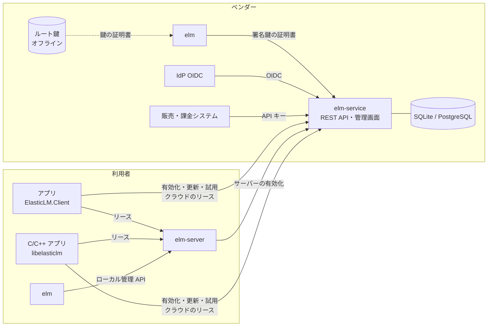
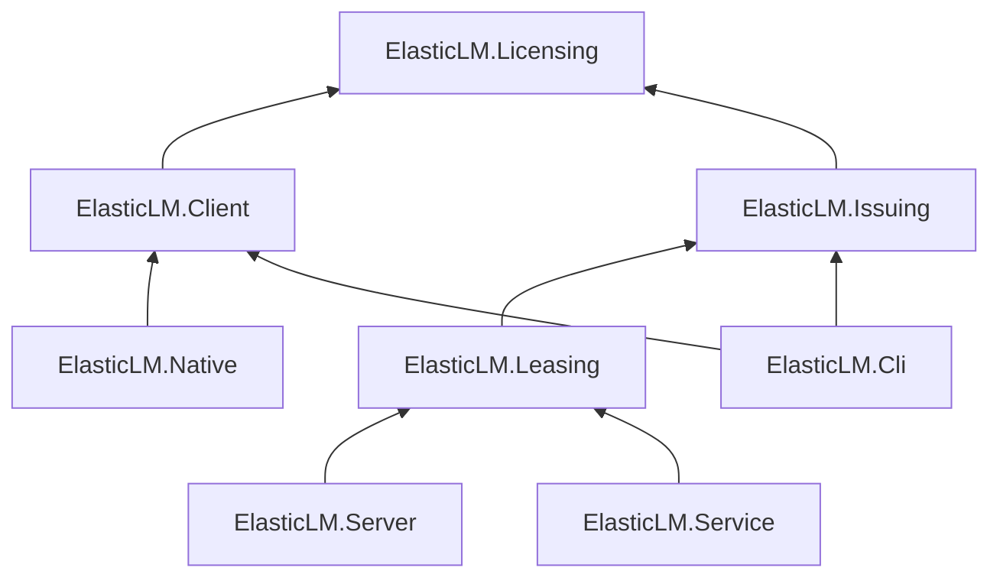
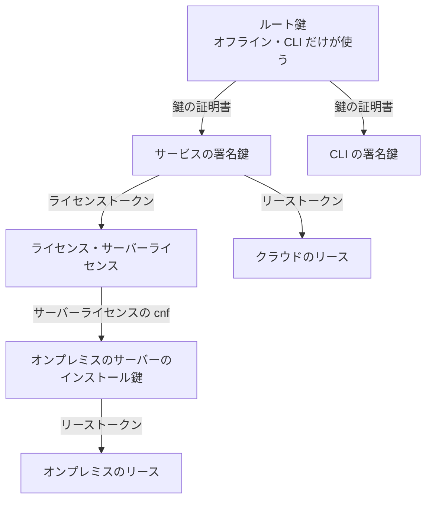
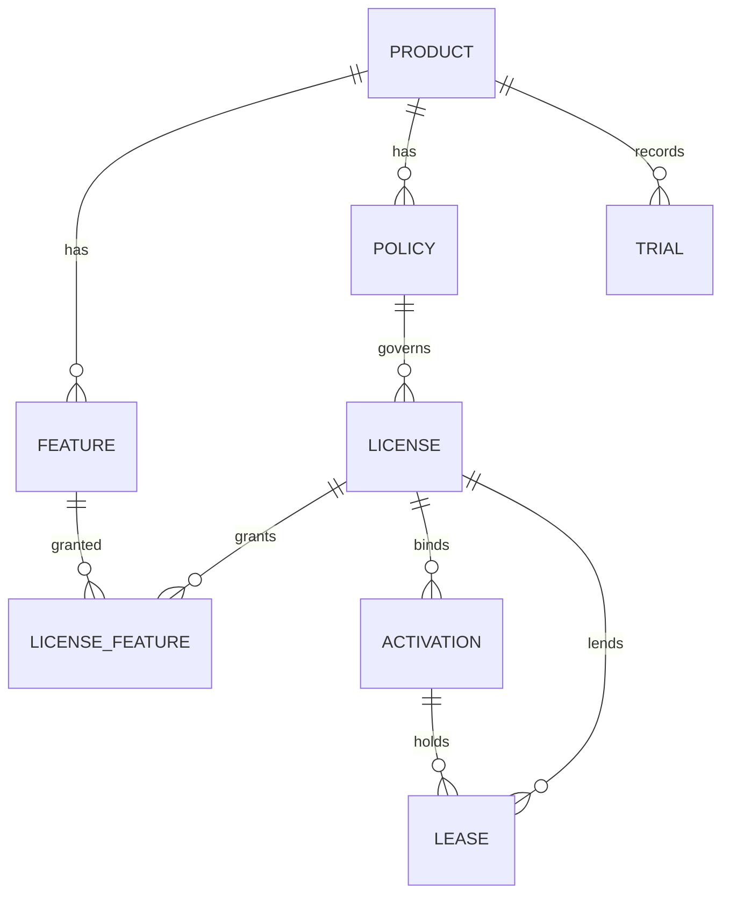
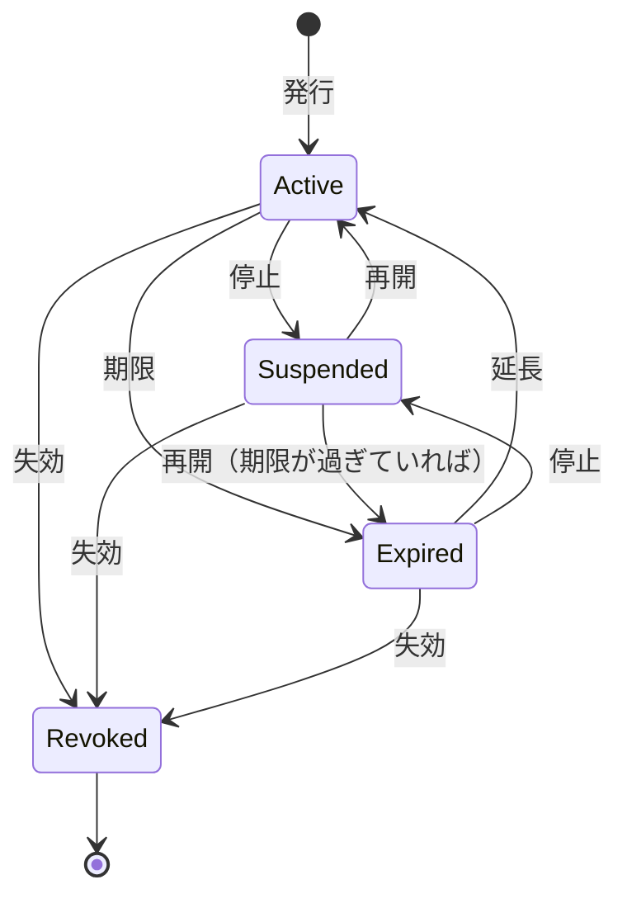
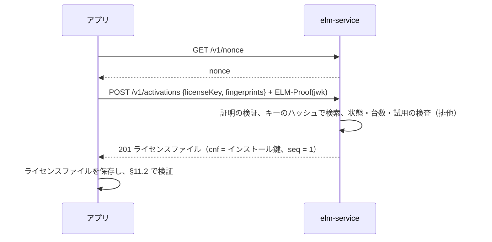
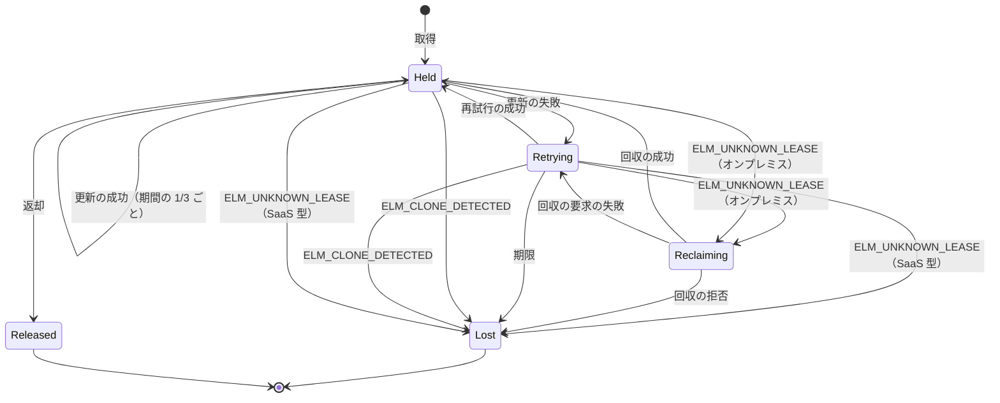

# ElasticLM 設計書

ElasticLM の正本の設計。要件・脅威モデル・形式・プロトコル・契約・段階をここに書く。進め方は `.cursor/rules/design-docs.mdc`、作業の順序は [roadmap.md](./roadmap.md)、採らなかった案は [design-decisions.md](./design-decisions.md) にある。

本書の §0 は Grill で持ち主が決めた前提、§1 以降はそれを具体化した設計である。§1 以降と §0 が食い違うときは §0 が正しく、本書を直す。

## 0. 決定済みの前提

2026-10-26 の Grill（Round 1）で持ち主が決めた。

| # | 項目 | 決定 |
| --- | --- | --- |
| 0.1 | 対象 | `net10.0` だけ。NativeAOT と単一バイナリで配布できること |
| 0.2 | 構成 | 中核は、署名付きライセンスをオフラインで検証するライブラリ（依存なし、AOT 対応、端末への紐づけは任意）。その上に、オンプレミスのフローティングライセンスサーバー（単一バイナリ）と、SaaS 型の有効化サービスを載せる |
| 0.3 | v1 の範囲 | 最初の公開（v1）に、オフライン検証・オンプレミスのフローティングサーバー・SaaS 型の有効化サービスの三つを含める |
| 0.4 | 署名 | ECDSA P-256。運ばれるバイト列そのものに署名し、JSON の正規化に頼らない。アルゴリズムと鍵 ID を示す欄を持ち、将来のアルゴリズム（ML-DSA など）へ移れるようにする。秘密鍵は実行ファイルに埋め込まない |
| 0.5 | 通信 | HTTPS と JSON（ASP.NET Core の Slim ビルダー、System.Text.Json のソース生成）。gRPC は使わない。全クライアントが持つ共有秘密は使わない。貸出は、サーバーが署名した期限付きのリースをハートビートで延長する |
| 0.6 | オンプレミスの状態 | 貸出の状態はメモリに持ち、データベースは持たない。サーバーが再起動したら、クライアントが借り直す |
| 0.7 | 端末の識別 | OS 標準のマシン ID（Windows: MachineGuid、Linux: `/etc/machine-id`、macOS: IOPlatformUUID）。紐づけは任意。使い方は 0.32 で具体化した |
| 0.8 | クライアント | .NET の SDK と、C / C++ から呼ぶネイティブライブラリ（C ABI、NativeAOT の共有ライブラリ）。Round 3 で C ABI も v1 に含めた（0.19） |
| 0.9 | 配布物 | NuGet パッケージ（検証ライブラリ、クライアント）、サーバーの単一バイナリ、CLI（鍵の生成・署名・内容の表示） |
| 0.10 | ライセンス | MIT |

SaaS 型を v1 に含めたことで、0.6（データベースを持たない）はオンプレミスのサーバーに限った決定になる。

### 0.A SaaS 型の前提

2026-10-26 の Grill（Round 2）で持ち主が決めた。

| # | 項目 | 決定 |
| --- | --- | --- |
| 0.11 | 運用者 | ソフトウェアのベンダー（ElasticLM の利用者）が自分で立てる OSS のサービス。単一バイナリまたはコンテナで配る。ElasticLM として商用 SaaS を運営する前提にはしない |
| 0.12 | テナント | 1 デプロイを 1 ベンダーが使い、その中で複数の製品を扱う。複数ベンダーの相乗りは v1 の範囲外 |
| 0.13 | 機能 | ライセンスキーの発行、端末単位の有効化と解除（台数上限つき）、ファイルを介したオフライン有効化、失効、管理用の REST API と CLI |
| 0.14 | フローティング | クラウドからの同時利用数の貸出も v1 に含める。貸出の仕組みはオンプレミスのサーバーと共通にし、状態の持ち方だけを変える |
| 0.15 | 保存先 | SQLite と PostgreSQL。ORM を使わない薄い層の上に載せる（SQL の組み立ては 0.81） |
| 0.16 | 管理 API の認証 | 機械向けの API キー（範囲を絞れ、サーバーはハッシュだけを持つ）と、人向けの OIDC の両方。CLI はデバイス認可フロー（RFC 8628） |
| 0.17 | オフラインのトークン | ライセンスごとのポリシーで決める。既定は期限付き（30 日）でオンラインで更新し、期限後も猶予期間内は使える。期限なしのトークンは CLI での手動発行と、期限のないライセンスの `Unbound` のライセンスファイル（0.86 で足した）に限る |
| 0.18 | 対象外の脅威 | クライアント側のバイナリの改ざん（検証処理を書き換えて飛ばすこと）と難読化は対象外と明記する。守るのはライセンスの偽造、リクエストの偽造と再送、席数を超えた利用 |

### 0.B v1 の範囲の追加

2026-10-26 の Grill（Round 3）で持ち主が決めた。Round 1・2 の推奨のうち、作業量だけを理由に外していたものと、検討から漏れていたものを見直した結果である。

| # | 項目 | 決定 |
| --- | --- | --- |
| 0.19 | C ABI | C / C++ のアプリも対象に含め、ネイティブライブラリを v1 に含める |
| 0.20 | 管理画面 | v1 に含める。静的な SPA をサービスのバイナリに埋め込む。Blazor はサーバー側の NativeAOT で使えないため採らない（§20.4） |
| 0.21 | 借り出し | フローティングの席を期限付きで端末に固定して持ち出す機能を v1 に含める |
| 0.22 | 試用ライセンス | ライセンスのポリシーの一種として v1 に含める。1 台 1 回の制限は SaaS 型が管理する |
| 0.23 | 監査ログ | 発行・解除・失効などの管理操作を、操作者つきで記録する |
| 0.24 | 利用状況の記録 | オンプレミスのサーバーと SaaS 型が、利用のイベントを 1 行 1 件の JSON で出力する |
| 0.25 | オンプレミスの冗長化 | v1 では作らない。根拠は §13.6 |
| 0.26 | 仮想マシンの複製 | 対策は §10.4 |
| 0.27 | Webhook | v1 の後の段階（ロードマップ A-1） |

### 0.C 形式と方式

2026-10-26 の Grill（Round 4）で持ち主が決めた。調査の出典は各節に書く。

| # | 項目 | 決定 |
| --- | --- | --- |
| 0.28 | トークン形式 | JWS コンパクト形式（ES256）を用途を絞った形で使う（§8） |
| 0.29 | リクエスト認証 | 端末ごとの鍵ペアで、DPoP（RFC 9449）の形の証明を各リクエストに付ける。本文のハッシュを証明に含める（§12.2） |
| 0.30 | 管理画面のログイン | BFF。サービスが OIDC の認可コードフロー（PKCE）を行い、ブラウザには HttpOnly の Cookie だけを渡す（§15.3） |
| 0.31 | SQLite | ソースの版とハッシュを固定し、各 OS 向けに静的ライブラリとしてビルドして実行ファイルに組み込む（§14.2） |
| 0.32 | 端末の識別 | 本当の識別は有効化のときに作る端末ごとの鍵（インストール鍵）。OS のマシン ID はアプリごとの値でハッシュした補助の手がかりにする（§10） |
| 0.33 | 暗号化 | ライセンスファイルは署名だけで、暗号化しない |
| 0.34 | 時計の巻き戻し | 発行時刻が未来のトークンを拒否し、最後に確認した時刻を端末に保存して、それより戻った時計を拒否する（§11.4） |
| 0.35 | 利用ログ | 区切りごとにサーバーの鍵で署名を挟み、改ざんを検出できる JSON Lines にする（§18.1） |
| 0.36 | ポリシー | 真偽値の組ではなく、名前付きの選択肢（列挙）の集まりにする（§9.3） |

### 0.D 設計のレビューで決めたこと

2026-10-26 の Grill（Round 5）で持ち主が決めた。D0 の設計の独立したレビューで見つかった、要件と受け入れる危険に関わる点である。

| # | 項目 | 決定 |
| --- | --- | --- |
| 0.37 | オンプレミスのサーバーの信頼 | サーバーライセンスに期限（ポリシーで設定、既定 30 日）を持たせ、SaaS 型のサービスから更新させる。更新のたびに複製を検出する。サーバーの鍵の取り出しは受け入れる脅威とし、クライアント側でリースがサーバーライセンスの範囲内かを確かめて被害を抑える（§5.4, §9.6, §12.7.5） |
| 0.38 | 借り出しと再起動 | 借り出しの記録だけを、追記だけの署名つきファイルに残し、再起動で戻す（§13.4）。データベースは持たない（0.6 のまま） |
| 0.39 | 鍵の証明書の期限 | トークンを発行した時点（`iat`）で証明書が有効だったかで判定する。漏れた鍵は、トラストストアの無効にした鍵 ID の一覧で、アプリの更新により無効にする（§7.5, §11.2） |
| 0.40 | 借り出しの早期返却 | 認める。回数の上限をポリシーで決める。残る危険は受け入れる（§5.4, §12.7.4） |
| 0.41 | ネットワークのない端末の更新 | オフライン有効化と同じファイルのやり取りでトークンを更新できる。サーバーライセンスの更新にも使う（§12.8.3） |

### 0.E M3b で決めたこと

2026-10-26 の Grill（Issue #21）で持ち主が決めた。

| # | 項目 | 決定 |
| --- | --- | --- |
| 0.42 | .NET のクライアントの形 | C ABI（§17.2）と同じ形の `LicenseClient` と `Lease`。状態の変化はイベントで知らせる。回収の時間中の取得は `Retry-After` を返し、自分では待たない（§12.7.3） |
| 0.43 | オンプレミスでの複製の扱い | サーバーライセンスに必須の `clone`（`deny` / `flag`）を持たせる。`deny` で止めたリースは期限まで残し、更新と回収に `ELM_CLONE_DETECTED` を返す（§8.4.2, §10.4） |
| 0.44 | 回収の形 | 1 回の要求で 64 件までのリーストークンを送り、リースごとの結果を返す。回収したリースはトークンと `seq` を引き継ぐ（§13.4） |
| 0.45 | TLS の受け入れ方 | OS の検証に通るか、相手の公開鍵の拇印がピンした `cnf.jkt` と一致すれば受け入れる。クライアントに方式の設定は持たせない（§13.5） |
| 0.46 | 頻度の制限 | `TimeProvider` で動く IP ごとのトークンバケットを `elm-server` に持つ。BCL の制限器は `TimeProvider` を受け取らない（https://github.com/dotnet/runtime/issues/106447 ）（§13.8） |
| 0.47 | 再試行と複製の見分け | `seq` が 1 小さい要求に同じトークンを返すのは、その要求が、今のトークンを出した要求の証明の `jti` を「応答のなかった要求」として名指したときだけにする。D0 の「1 小さければ再試行」のままでは、同じタイマーで動く複製の VM が 1 席を分け合っても検出できない（設計のレビュー、Issue #21）（§10.4） |

### 0.F M3c で決めたこと

2026-10-26 の Grill（Issue #25）で持ち主が決めた。

| # | 項目 | 決定 |
| --- | --- | --- |
| 0.48 | 早期返却の回数の上限 | サーバーライセンスに必須のクレーム `brl`（0〜1,000）を持たせる。ポリシーの `BorrowReturnLimit` を運ぶ。`elm license issue --borrow-returns` の既定は 2（§8.4.2, §12.7.4） |
| 0.49 | 借り出しの保存 | クライアントが借り出しのトークンを、サーバーライセンスの写しとサーバーの公開鍵とともに、インストール鍵の場所の `borrows/` に保存する。オフラインで読み込んで §12.7.5 で確かめる（`BorrowLeaseAsync`、`GetBorrowedLeases`）（§12.7.4） |
| 0.50 | 管理 API の待ち受け | 別のポートのループバックだけで HTTP。256 ビットの管理者トークン。ループバック以外の `admin.listen` では起動しない。ほかの端末からの管理は v1 の範囲外（§13.7）。待ち受けは 0.119 で、データのフォルダーの中のソケットのファイルに改めた。ループバックのポートと `admin.listen` はなくなった。管理者トークンと、ほかの端末からの管理が範囲外であることは変わらない |
| 0.51 | 端末の範囲のフォルダー | Windows では、Administrators・SYSTEM・作った利用者だけの ACL を付けて作る。DPAPI の端末の範囲はその端末のどの利用者でも開けるため、守りは ACL が担う（§10.2） |
| 0.52 | 壊れた借り出しの記録 | `elm-server --set-aside-broken-records` で、壊れたファイルを `borrows-broken-<日時>.jsonl` に移し、`chain.reset` と警告を残して起動する。その記録の借り出しは期限まで数えない（§13.4） |

2026-10-27 の M3c の設計のレビュー（Issue #25）で持ち主が決めた。

| # | 項目 | 決定 |
| --- | --- | --- |
| 0.53 | すでにある端末の範囲のフォルダー | 鍵を書く前と読む前に、フォルダーと親の所有者と ACL（Linux と macOS はモード）を確かめ、ほかの利用者が読めるか置き換えられるなら止める（§10.2） |
| 0.54 | 借り出しの記録の、署名のない末尾 | 最後の署名の後の `borrow.started` は読み、`borrow.returned` は読まない（§13.4） |
| 0.55 | ファイルをまたぐ鍵 | 前のファイルの最後の鍵と違う鍵で続くファイルは誤りとする。同じ `lic` の別の鍵（サーバーの移設）は警告にする。起動時の借り出しの記録は、自分の鍵か同じ `lic` のものだけを読む（§13.4, §18.1）。`elm-service` のログは例外で、別の鍵でも、トラストストアがその時刻に `log` で保証すれば警告にする（署名鍵の入れ替え。鍵は再起動でしか替わらず、古い鍵が新しい鍵を保証する `key.changed` を書けない。ベンダーのルートが両方を保証する。0.95、M4d3 の設計のレビュー、持ち主が受けた） |
| 0.56 | 管理者による借り出しの返却 | オンプレミスでは断る（`409`、`ELM_RETURN_NOT_ALLOWED`）。クラウドでは返す（状態がベンダーのデータベースにあり、利用者の管理者が記録を書き換える経路がないため。§12.7.6、M4d1 の設計レビュー）。新しいログのファイルの名前は最新のファイルより前に並べない。残る経路（ファイルの削除、時計、記録を退ける操作）は §5.4 で受け入れる（§12.7.4, §13.7, §18.1） |
| 0.57 | 早期返却の数え方 | インストール鍵ごとと、マシン指紋ごとに数え、どれかが `brl` に達したら断る。借り出しにはマシン指紋を必須にする（§12.7.4） |
| 0.58 | 拒否の記録 | `lease.denied` と管理 API の認証の失敗は、1 分ごとに種類ごとの件数を 1 行で書く（§13.7, §18.1） |
| 0.59 | ログの書き込みの失敗 | そのファイルを閉じ、次の書き込みで `chain.reset` から新しいファイルを始める。再読み込みは、借り出しの記録に `key.changed` を書けてからライセンスを替える（§13.1, §18.1） |
| 0.60 | 形式と上限の書き足し | 借り出しのファイルに `ver: 1`、`borrows/` は 1,000 ファイルまで。`GetBorrowedLeases` もサーバーのピンを確かめる。脅威の表にサーバーの端末のほかの利用者を足す（§5, §12.7.4） |

2026-10-27 の M4 の Grill（Issue #38）で持ち主が決めた。

| # | 項目 | 決定 |
| --- | --- | --- |
| 0.61 | M4 の分け方 | M4a（土台）、M4b（オンラインの有効化と `ElasticLM.Client`）、M4c（オフラインのファイルとサーバーライセンスの更新）、M4d（クラウドのリース）の 4 行に分け、この順に進める。各行の細かい設計（エンドポイント、形式、検査の順）は、その行の始まりの Grill で決め、PR の前に独立した設計のレビューを当てたうえで、その行の実装と同じ PR に入れる。要件・脅威モデル・段階の変更は、今までどおり先に設計の PR で入れる（§22、`.cursor/rules/design-docs.mdc`） |
| 0.62 | 保存先の範囲 | SQLite と PostgreSQL の両方を M4a で入れる。PostgreSQL は 15〜18 に対応し（0.81 で 14 を外した）、CI は 18 で確かめる（§14.2） |
| 0.63 | 最初の管理者 | `elm-service setup` が、`bootstrapOwner` に結びついた `owner` の API キーを作って一度だけ表示する。期限は 90 日で、何度でも流せる（§14.6） |
| 0.64 | クラウドのリースの規則 | `LeaseEngine` の規則の判定を純粋な関数に取り出し、メモリとデータベースの実装で共有する（M4d、§14.4） |
| 0.65 | 管理 API の分け方 | 実体を作る行が、その実体の管理 API も持つ（§14.5） |
| 0.66 | ログインのない管理者のキー | 90 日ログインのない管理者のキーを止める規則は、ログインを入れる M5 で入れる（§14.6）。M5 の分け方（0.97）で、CLI のログインを入れる M5a に置く |
| 0.67 | ID の形 | 管理の実体の ID は UUID 第 7 版。一覧のカーソルに ID の順を使う（§14.2, §14.5） |
| 0.68 | ポリシーの変更 | 種類と `Binding` を除いて変えられ、次に出すトークンから効く（§9.3） |
| 0.69 | スキーマの移行 | 4 桁の番号のファイル、`schema_migrations` に版と SHA-256、版ごとのトランザクション。書き換えたファイルでは起動しない。PostgreSQL は助言ロックで一度だけ流す（§14.2） |
| 0.70 | 監査ログの連なり | 32 バイトの 0 から始め、列の値を長さつきで並べたバイト列の SHA-256。追記は直列。連なりを確かめる管理 API。古い行を消すときは起点を残す（§18.2） |

2026-10-27 の M4a の Grill（Issue #42）で持ち主が決めた。

| # | 項目 | 決定 |
| --- | --- | --- |
| 0.71 | M4a の分け方 | M4a1（保存先、SQLite の静的ビルド、PostgreSQL、移行、設定、署名鍵の読み込み、`setup` と API キー、監査ログ、3 OS の NativeAOT）と M4a2（製品・機能・ポリシー・ライセンスとその管理 API、署名鍵の状態、`Unbound` のライセンスファイル）に分ける（0.82 で M4a2 を M4a2 と M4a3 に分けた）（§22） |
| 0.72 | SQLite のビルド | `vendor/sqlite/` の版と SHA-256 を固定したアマルガムから、ビルドのたびに各 OS の C コンパイラーで静的ライブラリを作って組み込む。ビルド済みのライブラリはリポジトリに置かない（§14.2） |
| 0.73 | 管理 API の形 | `elm-server` と同じ素の JSON（camelCase、`problem+json` と `ELM_` のコード、`?after=&limit=` で 200 件まで）（§14.5） |
| 0.74 | サービスの設定 | `elm-server` と同じく、JSON の設定ファイルと `ELM_` の環境変数（環境変数が勝つ）。秘密は環境変数かファイルで、設定ファイルに直接書かない（§14.8） |
| 0.75 | 署名鍵 | 起動時に 1 本を読む。証明書が今の時刻とライセンス・リースの用途を持たなければ起動しない。入れ替えは再起動。状態の API は鍵 ID・証明書の期限・用途を返し、期限まで 30 日を切ったら警告する（§14.8） |
| 0.76 | `Unbound` のライセンスファイル | M4a2（0.82 で M4a3 に分けた）で、管理 API から端末に紐づかないライセンスファイルを出す。`Unbound` のオンラインの有効化は M4b の Grill で受け付けないと決めた（0.88、§9.3） |
| 0.77 | 監査ログのバイト列 | 10 列を決まった順に、4 バイトのビッグエンディアンの長さと UTF-8 で並べ、`NULL` は長さ `0xFFFFFFFF`、`prev` は 32 バイトのまま（§18.2） |
| 0.78 | 許可の一覧 | M4a1 と M4a2（0.82 で M4a3 に分けた）の許可を §14.6 の表のとおりにし、M4b 以降の許可はその行で足す（§14.6） |
| 0.79 | M4a1 のエンドポイント | API キーの作成・一覧・停止、監査ログの一覧・確認、`/health`。認証の失敗は 1 分ごとの件数で書く。本文・応答・誤りの形を §14.5 に書き、管理の実体がないときのコード `ELM_NOT_FOUND`（54）を §19 に足す（PR #43 のレビュー）（§14.5, §19） |
| 0.80 | `setup` の出力 | キーだけを標準出力に 1 行で書き、説明は標準エラーに書く。終了コードは 0 / 1 / 2（§14.6） |
| 0.81 | SQL の組み立て | `elm-service` の SQL は AuraORM（型で検査するクエリビルダー）で組み立て、SQLite と PostgreSQL を 1 つの実装で扱う。移行は SQL のファイルのまま流す。AuraORM が 15 から対応し、14 は 2026-11-12 にサポートが終わるため、PostgreSQL は 15〜18 にする（PR #47）（§14.2, §21） |
| 0.82 | M4a2 の分け方 | M4a2（製品・機能・ポリシーとその管理 API、署名鍵の状態）と M4a3（ライセンスとライセンスキー、状態の操作、`Unbound` のライセンスファイル）に分ける（§22） |
| 0.83 | 製品と機能の ID | 製品と機能は、API のパスで使う UUID 第 7 版の `id`（0.67）と、トークンの `prd` と `feat[].id` に入る `code`（§9.1 の形）を持つ。`code` は作った後は変えない（§9.1） |
| 0.84 | ポリシーの API の形 | §9.3 の全項目を M4a2 で保存して検査し、効き目はそれを使う行で入れる。列挙は camelCase の文字列、期間は秒の整数、`Perpetual`・`Unlimited`・`Disabled`・`Overage: None` は `null`。値の範囲は §14.5 の表（§9.3, §14.5） |
| 0.85 | ライセンスの管理 | ライセンスはポリシー・機能の一覧・`name`・`meta` を持ち、上書きできるのは `maxActivations` と期限だけ。顧客の実体は作らない。キーは作成時に一度だけ返し、再発行しない。状態の操作は停止・再開・失効・延長で、`Expired` は保存せずに計算する。許されない遷移と一意の値の重なりは `409` と `ELM_CONFLICT`（55）（§9.4, §14.5, §19） |
| 0.86 | `Unbound` のライセンスファイルの期限 | トークンの `exp` はライセンスの期限と同じにし、期限なしなら省く（期限なしのトークンを出す場所に足し、0.17 と §5.4 を改めた。PR #51 のレビュー）。`Unbound` には期限の起点になる有効化がないので、`Unbound` と `FromFirstActivation` の組は拒む（§9.3, §14.5） |
| 0.87 | 管理の実体の削除と同時の変更 | 製品・機能・ポリシーは消さない（発行済みのトークンが参照する）。`PATCH` は送ったメンバーだけを置き換え、版の検査（`If-Match`）は付けない（§14.5） |
| 0.88 | M4b の分け方とオンラインの有効化 | M4b を M4b1（`elm-service` のオンラインの有効化・更新・解除・試用、複製の検出、その管理 API）と M4b2（`ElasticLM.Client` の対応。始めに別の Grill）に分ける。有効化 ID は応答の本文で渡し、トークンの形式は変えない。`Unbound` のライセンスはオンラインで有効化しない（`409` と `ELM_CONFLICT`）。試用はキーのないライセンスとその有効化で表し、製品の機能をすべて持つ。管理者の解除は `DeactivationLimit` に数えない。`Deny` で止めた有効化は、最後の `seq` を持つ写しか管理者だけが解除できる。解除も `retry` を読む。1 つのインストール鍵はライセンスごとに 1 つの有効化を持つ（試用の後に買ったライセンスを同じ鍵で有効化できる）。この 3 点は Grill の答えを PR #61 の設計のレビューと実装で改め、持ち主が受けた。知らない有効化は `ELM_ACTIVATION_NOT_FOUND`（56）（§5.4, §10.4, §12.4〜§12.6, §12.6.1, §12.9, §14.5〜§14.8, §18.2, §19） |
| 0.89 | `ElasticLM.Client` の有効化 | M4b2 で、`elm-service` 向けの新しいクラス `ActivationClient` を置く（オンプレミスの `LicenseClient` とは相手と TLS の確かめ方が違うので分け、インストール鍵の保管は共有する。C ABI の対応は M6b（0.104 で別のハンドル `elm_activation` にした））。有効化は鍵のフォルダーの `activation.json` に持ち、`activation.lock` で同じ端末のプロセスの要求を 1 つずつにする。トークンの `refresh` から自動で更新し、送る前に `jti` を記録して、応答をなくした要求を送り直せるようにする。受け取ったファイルは確かめてから保存する（§12.6.2）。M4b2 の設計のレビューで、有効化の本文に `product` を足してサービスが製品の違うキーを断り、試用でない有効化があるときの別の有効化を手元で断り、解除でインストール鍵を消さないことにした（持ち主が受けた。§5.4, §12.6, §12.6.1）。受け取ったファイルは時計の守りを使わずに確かめ、その `iat` で守りを上書きする（§11.4） |
| 0.90 | M4c の分け方とオフラインの要求 | M4c を M4c1（`elm-service` のオフラインの要求と `elm offline process`）、M4c2（`ElasticLM.Client` のオフラインのファイル）、M4c3（`elm-server` のサーバーライセンスの有効化と更新。`ActivationClient` を使う）に分ける。要求ファイルは公開の `POST /v1/offline` と管理の `POST /v1/admin/offline`（`activation.offline`）で受け、中身は同じ処理にする。同じ要求には残した同じ応答を返し（ライセンスと有効化の状態が通るときだけ）、`nonce` が同じで中身の違う要求は断る（`offline_requests` の表、有効化ごとに 1 行）。期限の切れた要求は、前の要求の `nonce` を `retry` に入れた新しい要求で取り直す。管理の入口は 1 回ごとに監査ログに書く。応答はオンラインと同じ発行の応答で、拡張子は `.elmresp`。要求に `prd` と `retry` を足し、オフラインの解除でもインストール鍵を残す（§8.4.4, §8.4.5, §12.8, §12.8.4。M4c の Grill と設計のレビュー、持ち主が受けた） |
| 0.91 | `ElasticLM.Client` のオフライン | M4c2 で、`ActivationClient` に、オフラインの要求の作成（有効化・更新）、応答の取り込み、解除の証明の作成と破棄を足す。中身は文字列でやり取りし、見せ方（ファイル、QR コード）はアプリが決める（Cryptlex はファイルのパスを受け取る）。`ServiceUrl` を任意にし、ないクライアントはオンラインの操作を手元で断る。待っている要求（ライセンスキーを除いた中身と、キーの SHA-256）と渡していない解除の証明を `activation.json` に持ち、書き出すたびに同じ中身から組み立て直す。置き換えた要求の `nonce` は、その種類の答えのない要求の一覧に入れる。期限の前でも `renew` で作り直せる。オフラインの取り込みは時計の守りを上書きしない。オンラインで新しいファイルを保存したら待っている要求を捨て、解除の証明が残るうちは有効化を断る。更新の時期は `Check` の `ExpiresAt` と `RefreshWindow` でアプリが判断する（§12.8.5。M4c2 の Grill と設計のレビュー、持ち主が受けた） |
| 0.92 | `elm-server` のサーバーライセンス | M4c3 で、`elm-server` のサーバーライセンスを `elm-service` で有効化・更新・解除する。有効化と手動の操作（オンラインの有効化・更新・解除、オフラインの要求・取り込み・解除の証明）は `elm server` のコマンドがサーバーのデータのフォルダーで `ActivationClient` を直接使って行い、ライセンスファイル（設定 `license`）を書いて、動いているサーバーに再読み込みを頼む。ライセンスがなければ起動しない決まり（§13.1）を変えずに最初の有効化ができるためである。自動の更新は、`service.url` を持つサーバーの中の `ActivationClient` が行い、成功のたびにファイルを書いて再読み込みする。ファイルが正本で、有効化を持つ間は有効化のライセンスが優先する。`kind: server` でないファイルは保存しない。動いているサーバーでの解除と、自動の更新をするサーバーでのオフラインの要求は断る（§13.7、M4c3 の Grill と設計のレビュー、持ち主が受けた） |
| 0.93 | M4d の分け方とクラウドのリース | M4d を M4d1（規則の取り出し、`elm-service` のクラウドのリース、リースの管理 API）、M4d2（`LicenseClient` の SaaS 型のモード）、M4d3（サービスの利用ログとその管理 API）に分ける。`LeaseEngine` の判定を `LeaseRules`（純粋な関数）に取り出し、オンプレミスとサービスが同じ関数を使う。クラウドの取得はライセンスキーで名指し（ID は秘密でないため）、本文に `product` を持つ。回収は持たない（状態はデータベースに残る）。`floating` が `cloud` のポリシーのライセンスだけが貸し、借り出しの上限はポリシーの `BorrowLimit`、残す席は 0。`cloud` のポリシーは試用でもサーバーでもなく、そのライセンスは機能ごとに `seats` を必ず持ち、有効化しない（`409`）。`fromFirstActivation` の期限は最初の取得で決める。リースの期限はライセンスと機能の期限で切り、猶予は足さない。取得・更新・返却は監査ログに書かず（利用ログは M4d3）、複製の検出（`lease.clone`）と、管理 API の一覧と強制返却（借り出しも返す。0.56 の例外）は書く（§12.7.6。M4d の Grill と設計レビュー、持ち主が受けた） |
| 0.94 | `LicenseClient` の SaaS 型のモード | M4d2 で、既存の `LicenseClient` に `LicenseClientOptions.LicenseKey` を足し、値があれば `elm-service` からリースを借りる（別のクラスにしない。0.42 の形をそのまま使う）。TLS は OS の信頼で確かめ、ピンは持たない。URL は `ActivationClient` と同じく https か、ループバックの http だけ。`ExpectedServerLicenseId` は断る。ライセンスキーはメモリーにだけ持ち、取得の本文にだけ入れる。リースは応答の `certificates` で確かめ（§12.7.5 の手順 1・2・6）、借り出しのファイルは `license` と `key` の代わりに `certificates` を持つ（`ver` は 1 のまま）。更新の `ELM_UNKNOWN_LEASE` はすぐに `Lost`、`429` の `Retry-After` は取得の `RetryAfter` に入れる（§12.7.1, §12.7.3, §12.7.4。M4d2 の Grill、持ち主が受けた）。設計の独立レビューを受けて、リース ID の形（`[A-Za-z0-9_-]` の 22 文字）を検証と発行で確かめ（§8.4.3）、両方のクライアントはリダイレクトに従わず（§12.1）、中継が偽る問題の応答とキーの読み取りを §5.4 で受け入れた（持ち主が受けた） |
| 0.95 | `elm-service` の利用ログ | M4d3 で、`elm-service` がクラウドのリースと借り出しの利用ログを、ノードごとのファイルに書く（設定 `usageLog.directory`、なければ書かない。ファイル名にノード名 `node.name`、既定はホスト名）。署名はサービスの署名鍵で、利用ログを書くときは証明書に `log` が要る。各ファイルの最初の行は署名鍵の証明書を持ち、`key.changed` は使わない（鍵は起動のときだけ読む）。`SignedLog` と `LogVerifier` は「サーバーライセンスと鍵」か「証明書」のどちらでも確かめ、製品の確かめはサーバーの形だけにする（`elm log verify` の `--product` はサーバーのログだけ、`--node` でノードを選ぶ）。書くのはリースと借り出しのイベント（期限切れは掃除が消した行から）と拒否の数とサービスの開始と停止で、有効化・管理の操作・複製の検出は監査ログだけに書く。管理 API はそのノードのファイルの一覧・取得・区切りで、全ノードの記録を集めるのは運用者（§14.5, §14.8, §16, §18.1。M4d3 の Grill、持ち主が受けた）。設計の独立レビューを受けて、別の `log` の鍵で続くファイルを警告にし（0.55 の例外）、最初の行にノード名を入れて検証で照らし、同じ名前のノードの起動を断り、署名鍵を持つ者による書き直しを §5.4 で受け入れた（持ち主が受けた） |
| 0.96 | 管理画面の技術 | W0 で、管理画面の SPA を Preact 11 と TypeScript で書き、Vite 8 でビルドする（Preact 用の Vite のプリセットは使わない）。テストは Vitest と happy-dom。ビルドの道具は Node.js 24 と pnpm 12 に版を固定し（pnpm は Corepack がハッシュで確かめる）、`pnpm-lock.yaml` から `pnpm install --frozen-lockfile` で入れ、公開から 1 日たたない版を入れない。ビルドの結果はリポジトリに入れず、`build.ps1` と CI がビルドする。CI は秘密を持たない別のジョブで 1 回ビルドし、`dist` を 3 つの OS のジョブに渡す（M5c、0.97）。Preact、Svelte 5、Vue 3、SolidJS、フレームワークなしの 5 つを同じ試作で比べ、持ち主の希望（依存が少なく、小さく、書きやすい）で選んだ。pnpm は持ち主の問いから npm と比べて選んだ。設計の独立レビューを受けて、Node.js を 22 から 24 にし（22 は 2027-04-30 にサポートが終わる）、依存の乗っ取り（T21）の守りと受け入れる残り（§5.4）を書いた（§5.2, §5.3, §5.4, §15.2, §21、ADR 0001。W0 の Grill と Issue #94 の結果、持ち主が受けた） |
| 0.97 | M5 の分け方 | M5 を M5a（管理者の土台と CLI のログイン: JwtBearer、`elm admin`、管理者の一覧と無効化の API、最後のログイン、90 日ルール）、M5b（管理画面のログイン: BFF、データベースのセッション、Data Protection の鍵の保存、`X-ELM-CSRF`、Keycloak のテスト）、M5c（管理画面の土台: `web/admin/` のビルドとゲート、CI の SPA のジョブ、埋め込みと配信、大きさの計測、最初の画面）、M5d（残りの画面）の 4 行に分け、この順に進める。各行の細かい設計は、その行の始まりの Grill で決め、PR の前に独立した設計のレビューを当てて、その行の実装と同じ PR に入れる（0.61 と同じ）。`elm admin` は `login`・`logout` と汎用の `request` だけにする（§16）。OIDC のテストは、テストの中の偽の IdP（3 つの OS）と、CI の Linux の Keycloak の 2 段にする（§15.3）。M5b の画面のログインも、M5a と同じ「最後のログイン」を更新する。各行の Grill で決める点は §14.6 に挙げる（M5 の Grill、持ち主が受けた）。設計の独立レビューを受けて、Keycloak のテストを M5a から始め（デバイス認可フローと JwtBearer、M5b で認可コードのフローを足す）、画面を §15.1 の日々の操作と `support` の操作、管理者・API キー・セッションまでにした（持ち主が受けた）（M5d は後に 0.101 で M5d1 と M5d2 に分けた） |
| 0.98 | 管理者の土台と CLI のログイン | M5a で、管理 API が `elm_` で始まらない Bearer を OIDC のアクセストークンとして JwtBearer で確かめる（署名は RS256・PS256・ES256、`typ`、発行者、`audience`、サービスの時計での期限。ライブラリーの既定に頼らない）。`iss` と `sub` で管理者を探すか作り、役割を `oidc.roleClaim` と `oidc.roleMap` から決め、対応がなければ役割を `none` にする（`bootstrapOwner` は `owner`）。監査ログの `actorId` は管理者の ID。最後のログインは、認証された要求で 1 時間に 1 回まで書く。90 日の規則は、OIDC があるときだけ、キーを使うたびに「最後のログイン・管理者を作った時刻・キーを作った時刻」の最も遅い時刻と比べる（`apiKeys.inactiveAdminDays`、既定 90、0 で切る）。管理者の一覧・無効化・有効化の API は `admin.read`・`admin.update` で `owner` だけが持ち、自分・`bootstrapOwner`・最後の `owner` は無効にできない。`elm admin login` はデバイス認可フロー（RFC 8628）でトークンを得て、インストール鍵と同じ守り方のユーザーの範囲のファイルに置く。`request` は保存したログインを、その URL と同じオリジンにだけ使い、応答の本文をそのまま書き、転送を追わない。`elm offline process` は、資格がなければ今までどおり公開の入口に送る（§5.3 T13, §5.4, §14.5, §14.6, §14.8, §16, §18.2。M5a の Grill と設計の独立レビュー、持ち主が受けた、Issue #102） |
| 0.99 | 管理画面のログイン（BFF） | M5b で、`/auth/login` と `/auth/callback` を ASP.NET Core の OpenIdConnect のハンドラーに任せ（認可コードと PKCE、`query` で戻す、既定の値に頼らず明示する）、ID トークンを確かめた後に、データベースのセッションと Cookie `__Host-elm-session` を自分で作る（ASP.NET の Cookie 認証は使わない）。画面のログインは、秘密を持つクライアント `oidc.webClientId` とその秘密、鍵暗号化鍵がそろい、`publicUrls` の最初の URL（パスは `/`）が https か、ブラウザを使わない試験のためのループバックの http のときだけ有効にし、画面はその URL だけで配る。役割のクレームは ID トークンとアクセストークンの両方に求める。ログインの時間切れはサービスの `TimeProvider` で確かめる。戻り先は常に `/`。セッションは操作がなければ既定 30 分、最長既定 12 時間（`session.idleMinutes`、`session.maxHours`）。Cookie で認証する状態を変える要求は、`X-ELM-CSRF: 1` と、`Origin` があれば同じオリジンであることを求める。セッションの一覧と取り消しは `owner` だけ。管理者の無効化でその人のセッションを消す。Data Protection の鍵は、鍵暗号化鍵で AES-256-GCM で暗号化してデータベースに置き、サービスがデータベースのロックの下で作る（§5, §14.5, §14.6, §14.7, §14.8, §15.3, §18.2。M5b の Grill と設計のレビュー、Issue #109、#110） |
| 0.100 | 管理画面の土台と最初の画面 | M5c で、画面のログインが有効なときだけ、`elm-service` が `/` で `index.html` を、`/assets/*` で Vite のハッシュつきのファイルを、埋め込みのリソースから配る。画面の中の行き先は `#` の後ろで表し、サーバーは知らないパスに `index.html` を返さない。画面の応答は CSP（`default-src 'self'; base-uri 'none'; form-action 'self'; frame-ancestors 'none'; object-src 'none'`）、`nosniff`、`no-referrer` を持ち、`index.html` は `no-cache`、`/assets/*` は 1 年の `immutable`。`/` はセッションを求めず、画面が API の `401` を受けて `/auth/login` へ移る。`GET /v1/admin/me` で自分の役割と許可を返し（監査ログの例外）、許可のない操作を画面で出さない。ライセンスの一覧に、名前の部分一致 `?q=` と、画面がキーから作る SHA-256 の `?keyHash=` を足す（キーを URL に載せない。設計のレビューで持ち主が決めた）。最初の画面はライセンスの一覧・検索・詳細・失効。CI は秘密を持たない Linux のジョブで SPA を 1 回ビルドして `dist` を渡し（そのジョブの actions はコミットの SHA で固定する。設計のレビューで持ち主が決めた）、`dist` がなければ `ElasticLM.Service` のビルドが止まる。テストは Vitest と happy-dom と .NET の配信のテストで、CSP の違反は PR ごとに手元のヘッドレスの Chrome で確かめる（§5.3, §14.5, §14.6, §15.2, §15.3, §18.2, §21。M5c の Grill と設計のレビュー、Issue #116） |
| 0.101 | M5d の分け方と画面の決まり | M5d を M5d1（日々の操作: 発行、ライセンスの一時停止・再開・期限の延長、有効化の一覧と解除、オフラインの処理、監査ログ）と M5d2（サポートと管理: リースの一覧と強制返却、試用の一覧と削除、管理者、API キー、セッション）の 2 行に分け、この順に進める。ライセンスの編集（`PATCH`）は、v1 では管理 API だけで行う。ヘッダーに各画面への切り替えを並べ、`GET /v1/admin/me` の許可で読めない画面は出さない。発行は、製品 → その製品のポリシー → 名前 → 機能（`ver` と機能の期限は任意。`seats` はポリシーが `server` か `floating: cloud` のときだけ入れて必須、`fromFirstActivation` のポリシーでは期限を入れない）→ 最大の有効化の数・期限・`meta`（任意）の順に入れ、送る前に中身の確認を示す。新しいライセンスキーと API キーは、作った直後に一度だけ、コピーのボタンと、再表示できないことを示す文とともに示す（ライセンスキーは、そのあと詳細へ移る）。ライセンスファイルは、`license.file` を持ち、ポリシーが `unbound` で状態が `Active` のときだけ、詳細の画面から保存する（名前は応答の `Content-Disposition` と同じ `<ライセンス ID>.elmlic`）。オフラインの処理は、画面で要求ファイル（`.elmreq`、または解除の証明 `.elmdeact`。64 KiB まで）を選んで送り、`.elmreq` の答え（`200` の本文）をそのまま `.elmresp` で保存する。`.elmdeact` は `204` なので、結果を示すだけである。ファイルの読み書きはブラウザで行い、画面とサーバーはファイルを保存しない（サービスが残すのは §12.8.4 の `offline_requests` だけ）。`GET /v1/admin/audit` に `?order=desc` を足し（新しい順では `after` より小さい `n` の行を返す。知らない値でも同じ。`order` の既定は今の古い順）、画面は新しい順に出して、連なりの確かめのボタンを置く。有効化とリースの一覧は独立した画面にせず、ライセンスの詳細に置き、解除と強制返却もそこから行う。確認を求める操作（戻せない操作: 解除、強制返却、試用の削除、API キーとセッションの取り消し。戻せるが端末や管理者にすぐ効く操作: 一時停止、管理者の無効化。管理者の有効化は 0.103 で足した）は、対象の名前を示す確認のあとで送る。テストは M5c と同じ形（画面ごとの Vitest、API を足すときの .NET のテスト、PR ごとの手元のヘッドレスの Chrome での CSP の確かめ）。各行の細かい設計は、その行の Grill で決め（§14.6 の一覧）、PR の前に独立した設計のレビューを当てて、その行の実装と同じ PR に入れる（0.61、0.97、§12.8.4、§14.5、§14.6、§15.1、§22。M5d の Grill と設計のレビュー、Issue #121） |
| 0.102 | 管理画面の日々の操作の画面 | M5d1 で、0.101 の画面の決まりの上に次を決めた。監査ログの `order` は `asc` と `desc` だけで既定は `asc`、ほかは `400`、新しい順は `after` がなければ最新の行から読み、`next` はページの最後の行の `n`。読んだことの `audit.list` の行は答えの後に書かれ、次に読んだときに先頭に来るのを、そのまま示す。ライセンスファイルのボタンは、ポリシーを読んで `unbound` かつ `Active` のときだけ出す（`license.file` を持つ役割は `policy.read` も持つので、`policy.read` のない分かれは作らない）。オフラインの処理は `.elmreq` と `.elmdeact` を 64 KiB まで受け、`200` の答えを要求ファイルと同じ名前の `.elmresp` で保存し、`204` は受け付けたと示す。発行の画面は `license.create`・`product.read`・`policy.read` がそろうときだけ出し、試用のポリシーは選ばせず（試用は §12.9 の流れで作る）、ポリシーで `seats` と期限の欄を変える。一時停止（確認つき）・再開（確認なし）・延長（UTC の日時、画面でも確かめる）は、`license.update` と API が受ける状態のときだけ出す。新しいキーは画面のメモリだけに置く。有効化の一覧はライセンスの詳細に置き、解除はホスト名か鍵 ID を示す確認のあとで送る（§14.5、§15.2。M5d1 の Grill と設計のレビュー、Issue #125） |
| 0.103 | 管理画面のサポートと管理の画面 | M5d2 で、0.101 の画面の決まりの上に次を決めた。新しい画面は試用（`trial.read`）、管理者（`admin.read`）、API キー（`apikey.read`）で、セッションの一覧は管理者の画面の中に置く。API キーの一覧は §14.6 のとおり `support` と `viewer` も読み取りだけで見る（作成と取り消しは `owner` だけ）。リースの一覧はライセンスの詳細に置き、`lease.read` があってポリシーが `floating: cloud` のときだけ出す。強制返却は、ホスト名か鍵 ID と機能、借り出しも返ることを示す確認のあとで送る。試用は製品で絞り込み、削除は、その端末がもう一度試用できることと、試用のライセンスと有効化が残ることを示す確認のあとで送る。`support` の許可は変えず、試用の削除は `admin` 以上のままにする（§15.1 の文を直した）。API キーは作る人の許可から選び、キーは一度だけメモリだけで示す。API キーの取り消しは、名前と先頭 8 文字を示す確認のあとで送る。管理者の無効化は、セッションと API キーが使えなくなることを示す確認のあとで送り、自分の行には出さない。管理者の有効化も、その人の API キーがまた使えるようになることを示す確認のあとで送る。API キーの一覧は、作った人が無効のキーと期限の過ぎたキーに印を付ける。自分・最初の `owner`・有効な最後の `owner` の無効化は API の `409` を示す。セッションの取り消しは確認つきで、自分のセッションに印を付ける（§15.1、§15.2。M5d2 の Grill と設計のレビュー、Issue #129） |
| 0.104 | M6 の分け方と C ABI の共通の決まり | M6 を M6a（土台と検証: `ElasticLM.Native` の共有ライブラリ、C ヘッダー、3 つの OS のビルドとテストの仕組み、ライセンスの検証・結果・誤りの関数）、M6b（有効化: `ActivationClient` に当たるハンドル。オンラインの操作、オフラインのファイル、自動の更新）、M6c（リース: `LicenseClient` に当たるハンドル。バックグラウンドの更新のスレッド、コールバック、借り出し）の 3 行に分け、この順に進める。有効化は `elm_activation`、リースは `elm_client` の別のハンドルにし、D0 の案の `elm_client_activate` は取り下げる（0.89 と同じ分け方）。検証と有効化の結果は、不透明なハンドル `elm_license` と取り出しの関数で返し、JSON の文字列では返さない。オプションと要件の構造体は先頭に `uint32_t struct_size` を置き、今より大きい値は `ELM_INVALID_ARGUMENT` にする。バックグラウンドのスレッドとコールバックの規則は `elm_activation` にも当てはめ、公開する関数は例外を外に出さない。テストは、.NET のテストで `[UnmanagedCallersOnly]` の関数を関数ポインターで呼ぶものと、CI の NativeAOT のジョブで 3 つの OS の C コンパイラーで C のテストのプログラムを発行したライブラリにつないで動かすものの 2 段。C ヘッダーは手で書いてリポジトリに入れ、公開する関数の一覧と比べる。M6 の CI が作る RID は `win-x64`・`linux-x64`・`osx-arm64` で、残りの 4 つは実行ファイルの分も合わせて F1（§17.3。M6 の Grill と設計のレビュー、Issue #133） |
| 0.105 | `libelasticlm` の土台と検証 | M6a で、0.104 の共通の決まりの上に次を決めた。置き場所は `src/ElasticLM.Native`・`include/elasticlm.h`・`tests/ElasticLM.Native.Tests`・`tests/native/` で、ライブラリは `elasticlm.dll`・`libelasticlm.so`・`libelasticlm.dylib`。インストールの身元は `elm_installation`（`ElasticLM.Client` の鍵の保管と指紋）で、要件はそれを指す。時計の見張りは、身元があればその鍵で署名する見張り、なければ状態を持たない見張り。そのために、鍵の写しを持って破棄する `InstallationKey.CreateClockGuard` を公開する。`elm_license` は、ID・製品・種類・発行の時刻・期限・猶予期間・猶予期間の中か・機能・`meta` を出し、作ったときにすべての文字列を用意する。64 KiB を超えるファイルは、読む前に .NET と同じ `ELM_MALFORMED` で断る（設計のレビュー R2 で、Grill の `ELM_PAYLOAD_TOO_LARGE` から持ち主が改めた）。0 で埋めた構造体が .NET の既定と同じになるよう、試用の扱いは `reject_trial_as_standard` にする。誤りの文はスレッドごとのピン留めした配列、`elm_version` はビルドで書き出した定数、`ELM_ABI_VERSION` を置く。C のテストは、ライブラリを実行時に読み込み、`tests/native/run.ps1` で CI の NativeAOT のジョブと手元から動かす（V1c8 で、ビルド時にリンクする試験を足した。0.118）（§17.4。M6a の Grill と設計のレビュー、Issue #137。V1c8 で、ビルド時にリンクする試験を足した。0.118） |
| 0.106 | `libelasticlm` の有効化 | M6b で、0.104 と 0.105 の決まりの上に次を決めた。有効化のハンドル `elm_activation` は .NET の `ActivationClient` をそのまま使い、オプションは製品・サービスの URL・トラストストア・鍵の範囲と置き場所・端末の情報・アプリの版・時計のずれ・試用の扱い・状態のコールバックを持つ（時計の見張りは .NET の既定だけ）。オンラインの操作は終わるまで待つ関数で、C には取り消しの口を作らない。成功は `elm_license`（猶予期間の中かは、`ActivationResult.Activated` に足す `InGracePeriod` から取る）、失敗の `RetryAfter` は任意の出力の引数。状態は列挙、有効化の ID は呼び出し側のバッファーに写す。状態の変化は、作る前に .NET の内部の口でつなぐコールバックで、番号と文を知らせる。コールバックの中からは、待つ操作と `destroy` だけを断る。オフラインのファイルはライブラリが確保した文字列で返し、`elm_string_free` で解放する。C のテストは `run.ps1` が発行した `elm-service` を http のループバックで立てて通す（§17.5。M6b の Grill と設計のレビュー、Issue #141） |
| 0.107 | `libelasticlm` のリース | M6c で、0.104〜0.106 の決まりの上に次を決めた。リースのハンドル `elm_client` は .NET の `LicenseClient` をそのまま使い、オプションは M6b と同じ並びに、ライセンスキー（`NULL` ならオンプレミス）と期待するサーバーライセンスの ID を足す。取得の結果は不透明なハンドル `elm_lease` で、呼び出し側が `elm_lease_free` で解放する（解放は返却しない）。取得・借り出し・返却・借りたリースの一覧は終わるまで待つ関数で、失敗の `RetryAfter` は任意の出力の引数。コールバックはリースを ID で渡し、中からの待つ操作と `destroy` だけを断る。借りたリースの一覧は、配列とハンドルをまとめて解放する。ピンの消去は消したかを返す。.NET の `LicenseClient` は、`DisposeAsync` が始まったあとに新しい知らせを始めず（設計のレビュー R5）、ほかのクライアントのリースの返却を断る（R7）。C のテストは `run.ps1` が `elm-server` を https のループバック（短いリースの長さで、回収の間の `ELM_SERVER_RECOVERING` も通す）で立てて通し、C のスレッドの記録が集められるかを .NET のテストで見分ける（§17.6。M6c の Grill と設計のレビュー、Issue #145） |
| 0.108 | リリースの経路の脅威とコンテナイメージの行 | F1 の Grill（Issue #149）で、リリースの経路を作る前にその脅威を脅威モデルに足した。攻撃者に、PR を送れる外部の者（A11）、持ち主の資格情報の 1 つを盗んだ者（A12）、ビルドとリリースの道具を乗っ取った者（A13）、配布の経路で配布物をすり替える者（A14）を足し、脅威 T22〜T25 と、受け入れる脅威（持ち主のアカウントそのものの奪取、実行ファイルにコードの署名がないこと、GitHub とそのランナーの侵害、来歴の証明が示す範囲）を足した。権限はジョブごとに分ける。下書きの Release はタグの push のときだけ、来歴の証明はタグの push と持ち主の手動の実行（`workflow_dispatch`）のときだけ作り、NuGet への push と Release の公開は持ち主が承認する environment `release` のジョブだけが行う。リリースのワークフローはキャッシュを戻さない。書き込みの権限は持ち主だけに与え、`v*` のタグはルールセットで守り、公開した Release は immutable にする。NuGet への公開は API キーを持たない Trusted Publishing にする。配布物には `SHA256SUMS` と GitHub の artifact attestation を付ける。v1 ではコードの署名をしない。`elm-service` のコンテナイメージは F1 に入れず、新しい行 F2 にする（§5、§22。F1 の Grill の Q2・Q5〜Q8 と、設計のレビューの R1・R11 の持ち主の決定、Issue #150） |
| 0.109 | リリースの経路 | F1 で、0.104 と 0.108 の上に次を決めた。リリースは `release.yml` の 1 つのワークフローで、`v*` のタグの push、`workflow_dispatch`、すべての PR（公開しない試し）で動く。版は `VersionPrefix` を正とし、タグと `CHANGELOG.md` の節を確かめる。.NET SDK の版はワークフローの 1 つの値で固定する。7 つの RID は、`win-arm64` を arm64 の Windows のランナーで、`linux-x64` と `linux-arm64` を `almalinux:8` のコンテナ（glibc 2.28 から動く。持ち主の決定）で、`linux-musl-x64` を SDK の Alpine の AOT のイメージで、`osx-x64` を arm64 の macOS からのクロスコンパイルで作る。CI と同じ検査（単一バイナリ、実行時の依存、glibc の版、macOS の署名、§4.2 の大きさ、警告）を 1 つのスクリプトで両方に当て、スモークテストと C のテストを 7 つの RID で動かす。配布物は実行ファイルと RID ごとの圧縮ファイル、`-symbols` の圧縮ファイル、その実行のコミットの SBOM（自前のスクリプト。依存グラフは NuGet の版を読めなかったので、持ち主の決定で替えた）、`SHA256SUMS`、来歴の証明（`actions/attest`）。NuGet は 2 つのパッケージを検査し、パッケージだけを参照するアプリを 3 つの OS で NativeAOT で発行する。公開は、下書きの Release のあと、environment `release` の承認で、下書きのファイルを NuGet に push して Release を公開する。持ち主の設定の手順は `docs/releasing.md`、利用者の確かめ方は `SECURITY.md`（§4.1、§20.5。F1 の Grill の Q1〜Q16、PR #151 の R1・R11、PR #154 の glibc の下限、Issue #149） |
| 0.110 | コンテナのレジストリの経路の脅威 | F2 の Grill（Issue #157）で、`elm-service` のコンテナイメージを GHCR に公開する経路を作る前に、その脅威を脅威モデルに足した（0.108 で F2 に送ったもの）。守るものの「配布物と公開の権限」にイメージと GHCR に push する権限を足し、攻撃者に、ベースのイメージを乗っ取った者（A13 を広げた）と、イメージを取る経路でイメージをすり替える者（A14 を広げた）を入れた。脅威 T26（GHCR のタグの付け替えとイメージのすり替え）と T27（ベースのイメージの乗っ取り）を足し、受け入れる脅威（GHCR のタグは書き換えられること、ベースのイメージの脆弱性は次の版まで直らないこと）を足した。イメージは `contents: read` のジョブで OCI layout として作り、試し、承認のあとの公開のジョブはそれをダイジェストを変えずに push して証明を付けるだけにする（T22 も直した）。ベースは Dockerfile にダイジェストで固定して Dependabot が上げ、署名は確かめずに Microsoft の配布を信じる。（§5、F2 の Grill の Q1〜Q7・Q12 と、設計のレビューの 3 つの持ち主の決定、Issue #166） |
| 0.111 | `elm-service` のコンテナイメージ | F2 で、0.108〜0.110 の上に次を決めた。イメージは `ghcr.io/yukikeda/elm-service` で、`linux/amd64` と `linux/arm64` の OCI の index。`runtime-deps:10.0-noble-chiseled` をダイジェストで固定したベースに、同じ実行の F1 の配布物の `elm-service`、`LICENSE`、空の `/data` だけを `COPY` し、UID 1654 で動かす。イメージが足す環境変数は `ELM_LISTEN=http://0.0.0.0:8080` で、ベースの `ASPNETCORE_HTTP_PORTS` は空にし、`HEALTHCHECK` は書かない。`contents: read` のジョブで OCI layout を作り、2 つのアーキテクチャのランナーで起動、`/health`、UID、実行ファイルの SHA-256、足したファイルを確かめ、承認のあとの公開のジョブがそれをダイジェストを変えずに push して来歴の証明を付ける。タグは版と、正式版の `latest`。設定ファイルに `signing.passphraseFile` を足し、すべての秘密をファイルで渡せるようにする。ベースのダイジェストは Dependabot が上げる。GHCR へのログインは `docker login` の run の段で行い、第三者のアクションを足さない（§20.6。F2 の Grill の Q1〜Q12、PR #167 と PR #170 の持ち主の決定、Issue #157） |
| 0.112 | V1 の分け方と最初の版 | V1 の Grill（Issue #173、Q1〜Q3）で決めた。V1 を、V1a 端から端までのテスト、V1b 参照機での計測、V1c 文書とサンプル、V1d 安全性の見直し、V1e v1 の公開の 5 行に分け、この順に進める。安全性の見直しを公開の直前に置き、V1a〜V1c のコード・テスト・計測・文書を見直す。V1d の見つけたものがすべて直るか §5.4 に受け入れた脅威として書かれるまで、V1e は公開しない。各行の Grill で決める点と行をまたぐ決まりは §20.7。V1a の前に、時々落ちるテスト（Issue #106）を独立したバグの PR で直す。最初の正式版は `1.0.0` で、先に `1.0.0-rc.1` を出して公開の経路を確かめる（§20.5）。V1e から、rc のタグは GitHub のプレリリースだけを出し、nuget.org と GHCR に push するのは正式版のタグだけにする（V1c3e の記録の途中の持ち主の決定 D2。§20.5 の「V1e で変えること」）。そのため rc で確かめられるのは GitHub のプレリリースまでの経路で、nuget.org と GHCR への push の段（Trusted Publishing のログイン、`dotnet nuget push`、skopeo の push と `latest` のタグ、イメージの証明、GHCR の package を public にすること）は正式版のタグで初めて動く。それを正式版のタグの前にどう確かめるかは V1e で決める（V1c3e の設計のレビューの R1。§20.5 の「V1e で変えること」）。V1e で `VersionPrefix` を `1.0.0` にし、`1.0` より前の決まりを `CHANGELOG.md` と `CONTRIBUTING.md` から外す。退けた案は design-decisions.md |
| 0.113 | 端から端までのテスト（V1a） | V1a の Grill（Issue #178、Q1〜Q8）とその設計のレビューで決めた。`tests/ElasticLM.E2E` が、公開した `elm`・`elm-server`・`elm-service` を別のプロセスとして起動し、`ElasticLM.Client` から発行者と利用者の主な流れを通す。`libelasticlm` は C のテストに流れを足す。公開するバイナリに時計の入口は作らず、時間の経過は短い期間と本当の時計で待ち、合計は 1 つの OS で 2 分以下。PR ごとに CI の `aot` ジョブの 3 つの OS で動かし、Linux では PostgreSQL でも通す。`./build.ps1` には入れない。退けた案は design-decisions.md、形は §20.7 |
| 0.114 | 参照機での計測（V1b） | V1b の Grill（Issue #182、Q1〜Q7）とその設計のレビューで決めた。§4.2 の目標を、`workflow_dispatch` と計測に触れる PR で動くワークフロー `measure.yml` で、公開したバイナリを相手に `ubuntu-latest` の 3 つのジョブで測る。計測するプロセスは CPU 0・1 に、負荷をかける道具 `tools/ElasticLM.Measure` は CPU 2・3 に固定する。リース 10,000 件は 100 個のインストール鍵で毎秒 50 件で取り、更新を 2 巡測る。有効化は毎秒 50 件を 60 秒。M3b・M4a1・M4b1 の値は、JIT の `elm-service` を含めて同じ測り方で測り直す。目標に届かなければジョブを失敗にする。形は §20.7 |
| 0.115 | 有効化の p99 の外れ（V1b） | V1b の PR の計測で、有効化の p99 が 3 つのうち 2 つのジョブで 200 ms を外れた（350.64 ms と 329.06 ms）。遅い有効化とディスクの書き出しの時刻を記録して測り直すと、3 つとも目標を満たし、遅い 2 件は書き出しが 64.4 ms 止まった時刻に重なった。遅れはランナーのディスクによると見て、SQLite の `synchronous` も目標も変えない（持ち主の決定）。記録は計測に残す。値は §4.2、形は §20.7、退けた案は design-decisions.md。`report` が書き出しの遅いジョブを有効化の p99 の判定から外す形は、V1d31 で決めた（§4.2、§20.7、`docs/rows/V1d31.md`） |
| 0.116 | 利用者の文書とそのサイト（V1c） | V1c の Grill（Issue #186、Q1〜Q18）で決めた。利用者の文書を Diátaxis の 4 つ（Tutorials、How-to guides、Reference、Explanation）で、全体の構成、信頼の鎖、認証の仕組みと流れ、安全性のモデル、使い方まで英語で書く（持ち主の訂正）。Markdown は `docs/guide/` に置き、Docusaurus のサイトにして、`v*` のタグで GitHub Pages に公開する（持ち主の訂正）。サイトの書き換えを脅威 T28 と攻撃者 A15 として足す。V1c を V1c1（Explanation、入口、README、サイトの土台）、V1c2（Reference）、V1c3（Tutorials とサンプル）、V1c4（How-to guides）に分ける。設計の文書は正本のまま残し、組み直しは roadmap の A-5。設計のレビュー（R1〜R17）で、サイトの公開にも持ち主の承認を置き、版ごとの公開は `1.0.0` の次のタグの前に入れ、PR の確かめは `release.yml` のジョブで行い、ほかの Pages のサイトとの origin の共有を受け入れた（持ち主の決定）。形は §20.7、退けた案は design-decisions.md |
| 0.117 | 利用者の文書を日英で | V1c1 の PR で、持ち主が V1c の Grill の Q2（英語だけ）を覆した。利用者の文書は英語を正本とし、日本語の訳を `docs/guide.ja/` に同じフォルダーとファイルの名前で置いて、同じ PR で直す。サイトは Docusaurus の多言語の仕組みで、英語を `/ElasticLM/`、日本語を `/ElasticLM/ja/` に置き、上のバーで切り替え、検索も日本語で引ける。日本語は `natural-japanese` で書き、書き手と別のレビュアーが、自然さと英語との食い違いを確かめる。roadmap の A-7 を消す。形は §20.7 の V1c1 の形、退けた案は design-decisions.md |
| 0.118 | `libelasticlm` のビルド時のリンク（V1c8） | V1c8 の Grill（Issue #209、Q1〜Q5）で持ち主が決めた（どれも推奨案）。`win-*` の `libelasticlm` の本体の圧縮ファイルに、リンク用のインポートライブラリ `elasticlm.lib` を、ライブラリ、ヘッダー、`LICENSE` と並べて入れる（§20.5 が F1 の Q14 から書いていた「配らない」を改めた）。NativeAOT の発行は `.lib` を作るが発行のフォルダーには写さないので、`ElasticLM.Native.csproj` が `win-*` の発行のあとに写す。`.exp` は配らない。C のテストは実行時に読み込む今の形のまま残し、ヘッダーが宣言するすべての関数を参照するプログラムをビルド時にリンクし、`elm_version` を呼んで発行の版と比べる試験を足して、CI の `aot` ジョブの 3 つの OS と `release.yml` のすべての RID で動かす。試験は `run.ps1` の一時フォルダーで行い、発行のフォルダーには何も書かない。`win-*` の 2 つの zip の中身は、`release.yml` で決めた一覧と完全に一致するかを比べる。Linux のライブラリに SONAME は付けない（恒久の決定）。C の API の頁は OS ごとのビルド時のリンクの事実を書き、実行時に読み込む形をもう 1 つの道として残す。OS ごとの手順は頁に書かず、V1c3c の Tutorial 4 が持つ（実装の PR の持ち主の決定 D1）。設計の独立レビュー（R1〜R14）の R1、R2、R4、R9 も持ち主が推奨案で決めた。調べた事実と各問いの答えは §20.5 の「V1c8 の Grill」、試験は §17.4、退けた案は design-decisions.md |
| 0.119 | 管理 API をソケットのファイルで待ち受ける（V1d2） | V1d2 の Grill（Issue #320、Q1〜Q5）で持ち主が決めた（どれも推奨案 A）。0.50 の待ち受けを改める。`elm-server` の管理 API は、Windows、Linux、macOS のどれでも、データのフォルダーの中の Unix ドメインソケットのファイル `admin.sock` だけで、TLS なしの HTTP で待ち受ける。ループバックの TCP の待ち受け、設定 `admin.listen`、`elm server` のコマンドの `--url` はなくす。設定に `admin.listen` が残っていれば、その設定がなくなったことを知らせる 1 行を出して、起動を止める。管理者トークンは残し、いままでどおり `Authorization: Bearer` で送る。ソケットのパスが OS の上限を超えれば、サーバーも `elm` も、上限と長さを言う 1 行で止まる。設計のレビューのあと、持ち主が次の 4 つを決めた（2026-11-11、どれも推奨案）。問 A: サーバーは、起動のたびに新しい管理者トークンを作る。問 B: サーバーは、データのフォルダーのロックのファイル `server.lock` を排他で開いて、止まるまで持つ。取れなければ、別のサーバーが動いているので起動を止める。ロックを取ったときに残っているソケットのファイルは消す。問 B では、これが、Q4 で決めた「まずつないでみて、答えがあれば起動を止める」に代わるとした。問 D（2026-11-12、推奨案 A）で、Q4 の確かめを、ロックのうしろの 2 つ目の守りとして残した。ロックを取ったあと、残っているソケットのファイルにつないでみて、答えがあれば起動を止め、断られたファイルだけを消す。ロックが効かない所で、ほぼ同時に 2 つを起動する場合だけは守れず、§5.4 の受け入れる脅威とする。問 C: macOS の既定のデータのフォルダーが上限を超える製品 ID でも、Q5 のとおり止める。Windows の下限: `elm-server` と `elm server` のコマンドには、AF_UNIX のある Windows（Windows 10 バージョン 1803 か Windows Server 2019、またはそれ以降）が要る（§4.1）。理由: `elm server` のコマンドは、サーバーが止まっているあいだに同じポートで待ち受けた別の利用者のプロセスへ、管理者トークンを送っていた（V1d の指摘 F02）。ソケットのファイルを作れるのは、守られたフォルダーに書ける者だけである。ほかの端末からの管理は、0.50 のまま v1 の範囲外である（§4.1、§5.3 の T20、§5.4、§10.2、§13.1、§13.7、§13.8。調べた事実と各問いの答えは §20.7 の「V1d2 の Grill」、退けた案は design-decisions.md） |

## 1. 目的と利用者

### 1.1 目的

.NET（と C / C++）で作られたアプリのベンダーが、自分の製品のライセンスを発行し、利用者の端末で確かめ、同時利用数を数えられるようにする。そのための部品一式を、NativeAOT の単一バイナリと NuGet パッケージで OSS として配る。

前身（`_ElasticLM`, `_ElasticLM2`）は FlexLM 風のフローティングサーバーだけを目指し、認証が成り立っていなかった（[design-decisions.md](./design-decisions.md)）。本設計は、ライセンスの偽造・リクエストの偽造と再送・席数を超えた利用を、暗号で防ぐことを第一にする。

### 1.2 登場する人と物

| 名前 | 説明 |
| --- | --- |
| ベンダー（発行者） | ElasticLM を使って製品のライセンスを発行する組織。ルート鍵を持ち、SaaS 型のサービスを運用する |
| ベンダーの管理者 | ベンダーの社員。管理画面・CLI・管理 API で発行や解除を行う。役割（§14.6）で権限が分かれる |
| ベンダーのシステム | ベンダーの販売・課金システムや CI。API キーで管理 API を呼ぶ |
| 利用者（顧客） | 製品を買った組織または個人 |
| 利用者の管理者 | 利用者の社内でオンプレミスのライセンスサーバーを運用する人 |
| アプリ | ベンダーの製品。検証ライブラリかクライアント（.NET または C ABI）を組み込む |
| 攻撃者 | §5.2 |

### 1.3 配る物

| 配布物 | 形 | 使う人 |
| --- | --- | --- |
| `ElasticLM.Licensing` | NuGet パッケージ。オフラインの検証 | アプリ |
| `ElasticLM.Client` | NuGet パッケージ。有効化・リース・借り出し・試用の通信 | アプリ |
| `libelasticlm` | NativeAOT の共有ライブラリ（`.dll` / `.so` / `.dylib`）と C ヘッダ。Windows はリンク用のインポートライブラリ `elasticlm.lib` も（0.118） | C / C++ のアプリ |
| `elm-server` | オンプレミスのライセンスサーバー。単一バイナリ | 利用者の管理者 |
| `elm-service` | SaaS 型の有効化サービス（管理画面を含む）。単一バイナリとコンテナイメージ（イメージは F2） | ベンダー |
| `elm` | CLI。鍵・発行・検査・管理 API の操作 | ベンダーと利用者の管理者 |

## 2. 用語

英語の表記は `.agents/skills/english-writing/SKILL.md` の用語表に合わせる。

| 用語 | 意味 |
| --- | --- |
| ルート鍵（root key） | ベンダーがオフラインで保管する署名鍵。署名鍵の証明書だけに署名する（§7） |
| 署名鍵（signing key） | ライセンスやリースに署名する鍵。ルート鍵が証明書で認める |
| 鍵の証明書（key certificate） | 署名鍵の公開鍵・用途・期限に、ルート鍵が署名したトークン（§8.4.1） |
| トラストストア（trust store） | アプリが信じるルート鍵の公開鍵の集まり。アプリに組み込む |
| ライセンス（license） | ある利用者に、ある製品の機能を、あるポリシーで使わせる権利。SaaS 型のデータとしての実体 |
| ライセンスキー（license key） | 人が入力する、ライセンスを指す秘密の文字列（§9.5） |
| ライセンストークン（license token） | ライセンスの中身を署名鍵で署名したトークン。オフラインで検証できる（§8.4.2） |
| ライセンスファイル（license file） | ライセンストークンと、それを検証するための鍵の証明書を一つにまとめたファイル（§8.5） |
| インストール鍵（installation key） | 端末上のアプリが最初の有効化か借り受けのときに作る鍵ペア。端末の本当の識別子（§10.2） |
| マシン指紋（machine fingerprint） | OS のマシン ID をアプリごとの値でハッシュした補助の手がかり（§10.3） |
| 有効化（activation） | ライセンスとインストール鍵を結びつけ、台数を 1 つ使うこと |
| リース（lease） | フローティングの席を、期限付きで 1 つのインストール鍵に貸すこと。サーバーが署名したリーストークンで表す（§8.4.3） |
| 借り出し（borrow） | 期限の長いリース。ネットワークから離れても使える（§12.7） |
| 回収（reclaim） | 再起動したサーバーに、まだ有効なリースを申告して席を取り戻すこと（§13.4） |
| 証明（proof） | リクエストごとにインストール鍵で署名する DPoP 形式の JWS（§12.2） |
| 管理者トークン | オンプレミスのサーバーの、ローカル管理 API に使う秘密（§13.7） |

## 3. 機能要件

### 3.1 オフラインの検証（`ElasticLM.Licensing`）

1. ライセンスファイルを読み、トラストストアのルート鍵から署名鍵の証明書、ライセンストークンの順に検証する（§11.2）。
2. 期限・猶予期間・発行時刻・対象の製品・機能・端末の紐づけを、§11.2 の順で判定し、結果を理由つきで返す。
3. 時計の巻き戻しを検出する（§11.4）。
4. ネットワークにも、ファイル以外の外部資源にも触れない。時計は `TimeProvider` から読む。

### 3.2 クライアント（`ElasticLM.Client`）

1. SaaS 型のサービスに対して、オンラインの有効化・解除・トークンの更新・試用の開始を行う（§12.4〜§12.6、§12.9）。
2. オフライン有効化・更新・解除のファイルを作り、応答ファイルを取り込む（§12.8）。
3. オンプレミスのサーバーと SaaS 型のサービスに対して、リースの取得・更新・返却・借り出し・返却を行う（§12.7）。プロトコルは両者で同じ。
4. リースを期限の 1/3 ごとに自動で更新し、失敗したら §12.7.3 の規則で再試行する。
5. インストール鍵を作り、OS ごとの方法で保管する（§10.2）。

### 3.3 オンプレミスのライセンスサーバー（`elm-server`）

1. サーバーライセンス（§9.6）を読み、その機能と席数の範囲でリースを貸す。
2. 貸出の状態はメモリだけに持つ。再起動の後は回収で状態を戻す（§13.4）。
3. 借り出しを、ベンダー・利用者の管理者・残す席数の三段の上限で制御する（§12.7.4）。
4. 応答のない端末の席を、リースの期限で解放する。
5. 利用ログを出す（§18.1）。借り出しを署名つきの記録に残し、再起動で戻す（§13.4）。
6. サーバーライセンスを、オンラインかファイルのやり取りで更新する（§9.6, §12.8.3）。
7. 利用者の管理者向けに、状態の表示・強制返却・ライセンスの再読み込みを、ローカル管理 API と `elm` で提供する（§13.7）。
8. TLS の証明書を、運用者が渡すか、サーバー自身の鍵で自己署名する。後者のとき、クライアントはサーバーライセンスに書かれた公開鍵で TLS の相手を確かめる（§13.5）。

### 3.4 SaaS 型の有効化サービス（`elm-service`）

1. 製品・機能・ポリシー・ライセンスを管理し、ライセンスキーを発行する（§9）。
2. 端末単位の有効化と解除、台数上限、オンラインのトークン更新、試用、オフライン有効化、失効を提供する（§12）。
3. クラウドからのフローティング（リースと借り出し）を、オンプレミスと同じプロトコルで提供する。状態はデータベースに持つ（§14.4）。
4. オンプレミスのサーバーの有効化（サーバーライセンスの発行）を提供する（§9.6）。
5. 管理用の REST API（§14.5）、管理画面（§15）、監査ログ（§18.2）、利用ログ（§18.1）を提供する。
6. 管理 API は API キーと OIDC の両方で認証し、役割で認可する（§14.6）。
7. SQLite と PostgreSQL のどちらでも動く（§14.2）。
8. 仮想マシンの複製を検出する（§10.4）。

### 3.5 CLI（`elm`）

1. ルート鍵と署名鍵の生成、鍵の証明書の発行（§7.3）。
2. ライセンストークンの発行（SaaS 型を使わない運用のため）と、トークン・ファイル・利用ログの内容表示と検証（§16）。
3. 管理 API の操作。人はデバイス認可フロー、機械は API キーで認証する。
4. オンプレミスのサーバーのローカル管理 API の操作。

### 3.6 ネイティブライブラリ（`libelasticlm`）

1. `ElasticLM.Licensing` と `ElasticLM.Client` の機能を C ABI で公開する（§17）。
2. メモリの所有権・スレッド・エラーの規則を §17 のとおりに守る。

## 4. 非機能要件

### 4.1 配布の形

- 実行ファイル（`elm-server`, `elm-service`, `elm`）は NativeAOT の単一バイナリで、横に置くファイルなしで動く。設定ファイルは任意。
- 対象の RID: `win-x64`, `win-arm64`, `linux-x64`, `linux-arm64`, `linux-musl-x64`, `osx-arm64`, `osx-x64`。`libelasticlm` も同じ。
- 動く OS の下限（F1、0.109）: `linux-x64` と `linux-arm64` は glibc 2.28 以降（RHEL 8、Debian 10、Ubuntu 20.04 以降。NativeAOT の実行ファイルは作った機械と同じか新しい glibc でしか動かないので、glibc 2.28 の `almalinux:8` で作る。https://learn.microsoft.com/en-us/dotnet/core/deploying/native-aot/ ）、`osx-*` は macOS 12.0 以降（NativeAOT の既定）。`elm-server` と `elm server` のコマンドには、AF_UNIX のある Windows（Windows 10 バージョン 1803 か Windows Server 2019、またはそれ以降）が要る（V1d2、0.119。管理 API をソケットのファイルで待ち受けるため、§13.7。ASP.NET Core の文書は、Unix ドメインソケットの前提を「Linux, macOS, or Windows 10/Windows Server 2019 or later」と書き、https://devblogs.microsoft.com/commandline/af_unix-comes-to-windows/ を指す。その頁は「Beginning in Insider Build 17063, you'll be able to use the unix socket (AF_UNIX) address family on Windows.」と書く。https://learn.microsoft.com/en-us/aspnet/core/grpc/interprocess-uds ）。それより前の Windows では、`elm server` のコマンドも、サーバーに届かない。クライアントのライブラリ、`libelasticlm`、`elm-service`、`elm` のほかのコマンドは、ソケットのファイルを使わないので、この下限に関わらない。
- NuGet パッケージは `IsAotCompatible` で、アプリの NativeAOT 公開で警告を 0 件に保つ。

### 4.2 大きさと速さ

数値は目標で、各行の PR で測る（`.cursor/rules/open-ends.mdc`）。D0 の調査で、Windows（win-x64、.NET 10.0.13）の NativeAOT について次を実測した。

| 物 | D0 の実測 | 目標 |
| --- | --- | --- |
| HTTPS・JwtBearer・Npgsql・SQLite（静的リンク）・埋め込みファイルを持つ ASP.NET Core | 25.3 MB | `elm-service` 40 MB 以下 |
| OIDC と Cookie 認証を持つ Slim ビルダーのサーバー | 17.6 MB | — |
| `webapiaot` テンプレート | 12.2 MB | `elm-server` 30 MB 以下 |
| HttpClient と ECDSA を持つ共有ライブラリ | 4.7 MB | `libelasticlm` 8 MB 以下 |

| 処理 | 目標 |
| --- | --- |
| ライセンスファイル 1 件の検証（鍵の証明書を含む、2 回目以降） | 1 ms 以下（参照機: GitHub Actions の `ubuntu-latest`） |
| `elm-server` の起動から待ち受けまで | 1 秒以下 |
| `elm-server` が同時に持つリース | 10,000 件で、更新の p99 が 50 ms 以下、メモリ 200 MB 以下（2 vCPU） |
| `elm-service` の有効化（SQLite、1 ノード） | 50 件/秒を持続して p99 が 200 ms 以下 |

10,000 件のリースを既定のリース期間 10 分・更新間隔 1/3 で持つと、更新は $10000 / 200\,\mathrm{s} = 50$ 件/秒になる。

参照機での `elm-service` の有効化の目標の判定（V1d31、Issue #357。決めたことの記録と退けた案は [`docs/rows/V1d31.md`](./rows/V1d31.md)）: 参照機の計測（§20.7 の V1b の形）は 3 つのジョブで測る。有効化の p99 の目標は、有効化の間に同じディスクへ 4 KiB を書いて書き出す確かめ（§20.7 の「遅れの見分け」）の p99 が 20 ms 以下のジョブだけで判定する。20 ms を超えたジョブは、ディスクの遅いランナーに当たったものとして判定から外し、その有効化の p99、書き出しの p99、しきい値の 20 ms を計測の結果に書く。外したあとに判定するジョブが 1 つも残らなければ、目標を満たさなかったとする。有効化の失敗の数と送る遅れ、ほかの行の目標は、すべてのジョブで判定する。目標の値は変えない。

この判定の受け入れた限り（V1d31 の独立レビューの M1。持ち主の決定、2026-11-14）: 書き出しの確かめは製品と同じディスクに書くので、ランナーのディスクが遅いのか、製品が足した書き込みでディスクが遅くなったのかを見分けられない。そのため、ディスクの遅いジョブにだけ出る製品の遅れは、目標と比べない。外したジョブの値は計測の結果に残るが、比べるのは人である。製品の変更で書き出しの p99 が 20 ms を超えるジョブが 1 つか 2 つになれば、そのジョブは外れて判定は通る。3 つとも超えれば、「正常なディスクのジョブがない」として落ちる。そのときは一度だけ測り直し、また同じに落ちれば、`main` の最新の計測の書き出しの p99 と比べる（`.cursor/rules/workflow.mdc`）。

V1b（Issue #182）の参照機の実測（コミット `da1cdcf` のコード。`measure.yml` の run 41218732710 の 3 つのジョブ、`ubuntu-latest`、`linux-x64`。測り方は §20.7「V1b の形」。幅は 3 つのジョブの最小と最大）。3 つのジョブとも、すべての目標を満たした。CPU は 4 つで、物理コアの組は 0-1 と 2-3 だった。計測するプロセスは 0・1、負荷をかける道具は 2・3 で動いた。

| 値 | 実測 | 目標 |
| --- | ---: | ---: |
| `elm-service` の大きさ | 26,657,912 バイト | 40,000,000 バイト以下 |
| `elm-server` の大きさ | 13,163,776 バイト | 30,000,000 バイト以下 |
| `libelasticlm` の大きさ | 7,155,080 バイト | 8,000,000 バイト以下 |
| `elm` の大きさ | 8,353,288 バイト | — |
| ライセンスファイル 1 件の検証 | 86.1〜107.9 µs | 1 ms 以下 |
| `elm-server` の起動、`server.started` の記録（各 5 回） | 87〜116 ms | 1 秒以下 |
| `elm-server` の起動、外から（各 5 回） | 110〜350 ms | — |
| 10,000 件を持つときの更新の p99 | 1.52〜2.63 ms | 50 ms 以下 |
| 同じ更新の p50、最大 | 0.94〜1.31 ms、7.29〜12.95 ms | — |
| `elm-server` の `VmHWM` | 101,007,360〜109,793,280 バイト | 200,000,000 バイト以下 |
| `elm-server` の cgroup の `memory.peak` | 88,031,232〜96,628,736 バイト | — |
| リースの取得と更新の失敗、確かめに通らないトークン | 0 件 | 0 件 |
| 終わりに持っていたリース | 10,000 件 | 10,000 件 |
| 有効化の p99（NativeAOT、毎秒 50 件を 60 秒） | 4.65〜7.02 ms | 200 ms 以下 |
| 同じ有効化の p50、最大 | 2.55〜3.10 ms、30.54〜73.88 ms | — |
| 有効化の失敗 | 0 件 | 0 件 |
| 送る遅れの最大（リース、有効化） | 2.7〜2.9 ms、4.4〜10.7 ms | 1 秒以下 |

- 前の行の Windows の値と同じ測り方の値（記録だけ。端末が違うので、Windows の値と差を取らない）:
  - M3b: 証明の作成 45.6〜76.3 µs、証明の検証 84.2〜135.0 µs、更新 1 件のサーバー側の処理（証明の検証を除く）50.1〜68.3 µs（`samples/VerifyLicense --self-test`、4 回）。
  - M4b1: JIT の Release の `elm-service` の有効化は、p50 2.61〜3.28 ms、p99 5.90〜12.02 ms、最大 138.72〜231.80 ms。
  - M4a1: JIT の Release の API キーの作成 1 件は 1.231〜2.711 ms（200 件の平均を 3 回の、ジョブごとの最小と最大）。`elm-service`（NativeAOT）の起動は、`service.started` の記録で SQLite が 431〜546 ms、PostgreSQL 18 が 437〜606 ms（各 3 回）。外からは SQLite が 464.5〜588.7 ms、PostgreSQL が 484.4〜641.4 ms。
  - 大きさは F1 の `linux-x64` の値と、`elm-service` を除いて同じである。`elm-service` は F1 より 16 バイト大きい（差の内訳は測っていない）。
- 有効化の p99 は、ランナーのディスクの書き出しの時間で決まる。有効化 1 件は SQLite の WAL でコミットし、コミットごとにディスクへ書き出してから応答する。`synchronous` は設定せず、組み込んだ SQLite の既定（`vendor/sqlite/sqlite3.c` の `SQLITE_DEFAULT_WAL_SYNCHRONOUS`）の `FULL` で、WAL では `FULL` はコミットごとに WAL のファイルを書き出す（https://www.sqlite.org/pragma.html#pragma_synchronous ）。
  - 製品のコードが同じ前の実行（コミット `89b04aa`、run 41215151866）では、3 つのジョブのうち 2 つで NativeAOT の有効化の p99 が 350.64 ms と 329.06 ms になり、目標を外れた（p50 は 2.27 ms と 2.45 ms で速いまま、最大は 1,871.83 ms と 792.53 ms）。同じジョブの JIT の版も、p99 が 398.58 ms と 140.37 ms だった。もう 1 つのジョブは p99 7.48 ms だった。
  - 上の実行では、有効化の間に同じディスクへ 4 KiB を書いて書き出しては 50 ミリ秒待つことを繰り返し、その時間を記録した。2 つのジョブでは、50 ms より遅い有効化も、20 ms より遅い書き出しもなかった。残りの 1 つでは、50 ms より遅い有効化が 2 件（15.56 秒と 15.58 秒に送った 73.5 ms と 73.9 ms）あった。書き出しも 15.57 秒に 64.4 ms かかっていて、時刻が重なる。
  - このため、遅れはランナーのディスクの書き出しが止まることによると見る。ディスクの遅いランナーに当たると、目標を外れうる。`synchronous` を `NORMAL` にして書き出しを減らす案と、目標を緩める案は退けた（design-decisions.md）。
  - V1d31 の Grill（Issue #357）で、`measure.yml` の 20 の実行（run 41218732710 から run 43434745442 まで。書き出しの確かめを持つ実行のうち、結果のファイルが残っているもの。どれも最後の試みの結果）の 60 ジョブの結果のファイル `run-N.json` を読んだ。書き出しの p99 が 20 ms を超えた 12 ジョブ（24.13〜180.27 ms）は、どれも有効化の p99 が 50 ms を超え（55.83〜630.14 ms）、20 ms 以下の 48 ジョブ（0.43〜7.97 ms）は、どれも 50 ms 以下だった（2.88〜31.81 ms）。書き出しの p99 が 7.97 ms と 24.13 ms のあいだのジョブはない。20 の実行のうち 10 に、20 ms を超えたジョブが 1 つ以上あり（2 つのものが 2 回）、3 つとも超えた実行はない。目標を外れた 3 ジョブ（207.41〜630.14 ms）は、どれも 20 ms を超えたジョブである。このため、有効化の p99 の目標は、上の「参照機での有効化の目標の判定」のとおりに判定する。

M3b（Issue #21）の実測（Windows、win-x64、NativeAOT。参照機での計測は V1b の行）:

- `elm-server` の大きさは 11.4 MB（11,430,912 バイト）。
- 起動から待ち受けまで、サーバーの記録では 51 ms。プロセスの起動から最初の HTTPS の応答までを外から測ると、5 回で 524〜639 ms だった（PowerShell の `Invoke-WebRequest` の待ちを含む）。
- 更新 1 件のサーバー側の処理は、証明の検証が約 120 µs、リースの規則と新しいトークンの署名が 322〜415 µs（4 回の実行、各 1,000 回の平均）で、合わせて約 0.45〜0.54 ms（`samples/VerifyLicense --self-test`）。50 件/秒なら 1 コアの約 2.7 % 以下である（$50 \times 0.54\,\mathrm{ms} = 27\,\mathrm{ms/s}$）。10,000 件を同時に持つときの p99 とメモリは V1b で測る。

M4a1（Issue #46）の実測（Windows、win-x64、NativeAOT。参照機での計測は V1b の行）:

- `elm-service` は 19.8 MB（19,784,192 バイト。AuraORM を入れる前は 19,079,168 バイト）。§4.2 の目標 40 MB 以下に収まる。横に SQLite のライブラリは置かない。
- 起動から待ち受けまで、サービスの記録で 185〜225 ms（SQLite、移行の済んだデータベース、3 回）。
- PostgreSQL 18 では、起動から待ち受けまでサービスの記録で 270〜463 ms（GitHub Actions の `ubuntu-latest`、linux-x64、同じ端末のコンテナー、移行の済んだデータベース。CI の `aot` の「Measure elm-service on PostgreSQL」の 2 回の実行で、各 3 回の起動: 463 / 437 / 446 ms と 270 / 291 / 281 ms）。runner は実行ごとに違う端末なので幅が広い。参照機の値は V1b の行で測る。端末が違うので、上の SQLite の値とは比べない。
- 監査ログを書く管理 API の 1 件（API キーの作成。認証の検索、キーと監査ログの行の追記、1 つのトランザクション）は 1.05〜1.11 ms（SQLite、JIT の Release、ループバックの HTTP を含む、3 回の実行で各 200 件の平均）。同じビルドで SQLite を先行書き込みログ（WAL）にしないと 3.7〜5.0 ms になる。WAL ではコミットごとのディスクへの書き出しが 1 つのファイルで済むためで、WAL にする前の手書きの SQL の版は 3.1〜3.5 ms だった。

M4a2（Issue #54）の実測（同じ条件）:

- `elm-service` は 20.4 MB（20,441,088 バイト）。同じ日に発行した M4a1 の最終版（コードは main の `e6a56ca` と同じで、PR #47 のレビュー後の修正を含む。19,786,240 バイト）より 654,848 バイト大きい。上の M4a1 の 19,784,192 バイトは、PR #47 のレビュー前の版で測った値である。ILC のマップで分けると、応答の JSON のソース生成（7 つの型と context）が約 195 KB、3 つの表のレコードとその AuraORM の型付けが約 140 KB、管理 API の処理と保存先が約 110 KB で、残りは新しく使う BCL の部分（`JsonDocument` など）と型の情報である。§4.2 の目標 40 MB 以下に収まる。
- ポリシーの作成 1 件（本文の読み取りと検査、製品の検索、ポリシーと監査ログの行の追記、1 つのトランザクション）は 1.02〜1.14 ms（SQLite、JIT の Release、ループバックの HTTP を含む、3 回の実行で各 200 件の平均）。M4a1 の API キーの作成（1.05〜1.11 ms）と同じ程度である。

M4a3（Issue #58）の実測（同じ条件）:

- `elm-service` は 20.9 MB（20,909,056 バイト）。M4a2 の最終版（main の `23dd023`、20,467,712 バイト）より 441,344 バイト大きい。ILC のマップで分けると、ライセンスの JSON のソース生成（応答の型、保存する機能の配列、`meta` の辞書）が約 138 KB、管理 API の処理と保存先が約 111 KB、サービスで新しく使う発行と検証の部品（`LicenseIssuer` と、発行したファイルを確かめる `LicenseVerifier`）が約 50 KB、表の型付けが約 21 KB で、残りは新しく使う BCL の部分と型の情報である。§4.2 の目標 40 MB 以下に収まる。
- ライセンスの作成 1 件（本文の読み取りと検査、ポリシーと機能の検索、キーの生成、ライセンスと監査ログの行の追記）は 1.20〜1.34 ms（SQLite、JIT の Release、ループバックの HTTP を含む、3 回の実行で各 200 件の平均）。
- `Unbound` のライセンスファイル 1 件は 2.19〜2.71 ms（同じ条件）。うち発行（`LicenseIssuer.Issue`）が、署名だけで 0.35〜0.39 ms、出したファイルをトラストストアで確かめるまで含めて 0.96〜1.13 ms（各 200 回の平均、3 回）で、残りはライセンス・ポリシー・製品の読み取りと監査ログの行の追記、HTTP である。

M4b1（Issue #60）の実測（同じ条件）:

- `elm-service` は 21.6 MB（21,575,680 バイト）。M4a3 の最終版（main の `8b482ea`、20,912,640 バイト）より 663,040 バイト大きい。ILC のマップで分けると、端末の要求と管理 API の処理、保存先のコード（GC の情報を含む）が約 157 KB、新しい型（行、要求と応答の型、非同期の状態機械）の型の情報と AuraORM のジェネリックのインスタンスが約 190 KB、新しく使う BCL の部分（LINQ など）が約 50 KB、メタデータが約 24 KB で、残りはハッシュ表と凍結したオブジェクトの領域、セクションの詰め物である。§4.2 の目標 40 MB 以下に収まる。
- 有効化（§12.6.1）を 50 件/秒で 60 秒（3,000 件、各件は新しいインストール鍵、1 つのライセンス）、3 回: p50 は 4.28〜4.35 ms、p99 は 8.66〜10.39 ms、最大は 27.5〜46.7 ms（SQLite、JIT の Release、ループバックの HTTP を含む）。端末は前もってノンスを得ておき、証明を作るところから応答までを測った。1 件は、証明の検証、`jti` の記録、キーとポリシーと製品の読み取り、ライセンスの行のロックと数え上げ、ファイルの署名と、トラストストアでの確かめ、有効化と監査ログの行の追記である。§4.2 の目標（p99 200 ms 以下）に収まる。参照機での計測は V1b の行で行う。

M4b2（Issue #66）の実測（Windows、win-x64、JIT の Release、ループバックの `elm-service`（SQLite）を相手に、各 200 件の平均、3 回の実行で各 3 回）:

- `ActivationClient.Check` 1 回は 402〜426 µs で、ライセンスファイルの検証の目標（1 ms 以下）に収まる。毎回 `activation.json` を読み直す時間を含む。
- 有効化 1 回は 21.7〜23.5 ms。うちインストール鍵の作成（鍵の生成、DPAPI、フォルダーの ACL）が 11.8〜12.4 ms、ノンスの取得が残りの一部で、更新と同じ部分が約 7 ms である。
- 更新 1 回は 6.9〜7.2 ms。送信と応答が約 3.8 ms、`activation.json` の書き込み 3 回（送る前、応答の後、保存）が各 0.54〜0.57 ms、時計の守りの書き込みが約 0.9 ms、受け取ったファイルの確かめが約 0.3 ms、ロックの開閉が約 0.07 ms である。保存したファイルを時計の守りつきでもう一度確かめて次の更新の時刻を出していた最初の版は、その確かめに約 8 ms かかって 16 ms だったので、確かめ終えたファイルから時刻を出すようにした（16 ms → 7 ms）。
- `ElasticLM.Client` の NuGet パッケージは 87,481 バイトで、main（`c40136a`）の 69,281 バイトより 18,200 バイト大きい。

M4c3（Issue #78）の実測（Windows、win-x64）:

- `elm-server` の NativeAOT の実行ファイルは 13.6 MB（13,629,440 バイト。main（`a69008c`）の 12,022,784 から +1,606,656 バイト、+13.4%）。目標の 30 MB 以下に収まる。マップのファイル（`-p:IlcGenerateMapFile=true`）で比べると、増えた分は、サーバーライセンスを更新する `ActivationClient` が使う `HttpClient` の一式（`System.Net.Http` が 0 から 420,419 バイト、名前の解決・ソケット・`System.Net.Primitives` で 61,766 バイト、それらの型の記述 `ConstructedEEType` が 275,180 バイト）と、`ElasticLM.Client` の `ActivationClient`（11,337 から 111,974 バイト）である。それまでの `elm-server` は HTTP の受け手（Kestrel）だけで、送り手を持たなかった。
- `elm` は 8.0 MB（8,025,600 バイト。main の 7,458,304 から +567,296 バイト）。`elm server` のサーバーライセンスのコマンドが `ActivationClient` を使うためである。

M4d1（Issue #82）の実測（Windows、win-x64）:

- `elm-service` の NativeAOT の実行ファイルは 21.9 MB（21,929,984 バイト。main（`e3ff4f7`）の 21,664,768 から +265,216 バイト、+1.2%）。目標の 40 MB 以下に収まる。マップのファイルで分けると、次のとおりである。
  - サービスのリースのコード: +132,913 バイト。内訳は、JSON の型（`LeaseItem`、`LeasePage`）が 56,716、行と問い合わせ（`LeaseRow`、`LeaseReturnRow`）が 50,318、要求の処理と本文の解析が 26,507。
  - サービスのほかの型: +54,991 バイト。
  - サービスで新しく使う `LeaseVerifier`、`LeaseIssuer`、`LeaseRules`: 合わせて +9,446 バイト。
  - 残り: メタデータとハッシュ表など。
- 取得と更新の往復（JIT の Release、ループバック、100 台の端末で各 100 回の平均、1 回の実行で 3 回。接続は先に温め、トークンの検証はしない）。値は 2 回目と 3 回目で、1 回目は JIT の温まりを含むので除く。

  | 要求 | `elm-service`（SQLite、HTTP） | `elm-server`（メモリー、HTTPS） |
  | --- | --- | --- |
  | 取得 | 3.15〜3.22 ms | 1.49〜1.76 ms |
  | 更新 | 2.73〜2.89 ms | 1.01〜1.06 ms |
  | 返却 | 2.02〜2.08 ms | 0.73〜0.76 ms |

- 差の約 1.6〜1.9 ms のうち、約 1.2 ms はデータベースの仕事である（同じ実行で別に測った）。
  - `jti` の記録のコミット: 0.43 ms。
  - ライセンスの行のロック、席の `SUM`、行の書き込みのトランザクション: 0.55〜0.60 ms。
  - ロックの前の読み取り 4 つ: 0.13〜0.16 ms。
  - `elm-server` は状態をメモリーに持ち、要求ごとのコミットがない。
- ほかに、サービスは出したトークンを返す前に確かめる（ECDSA の検証 1 回。M3b の証明の検証で約 120 µs）。
- 残りの 0.3〜0.5 ms は分けていない。上の目標の表にクラウドのリースの行はなく、いちばん近い `elm-service` の有効化の目標（p99 200 ms 以下）から十分に遠いためである。

M4d2（Issue #86）の実測（PR #87 の head `dfa97f0` のコード。Windows、JIT の Release、ループバック、1 回の実行の中の値）:

- SaaS 型のリースの確かめ（`LeaseVerifier.VerifyHosted`、証明書を覚えた 2 回目以降）は 1 回 130.6〜131.5 µs（各 1,000 回の平均、3 回）。§4.2 の検証の目標 1 ms 以下に収まる。
- `LicenseClient` の取得・更新・返却。各 100 件の平均を、同じ実行の中で SaaS 型とオンプレミスを交互に 3 回取った。1 回目は JIT の温まりを含むので、2 回目と 3 回目を回ごとに書く。

  | 要求 | SaaS 型 2 回目 | オンプレミス 2 回目 | SaaS 型 3 回目 | オンプレミス 3 回目 |
  | --- | --- | --- | --- | --- |
  | 取得 | 3.50 ms | 1.42 ms | 4.14 ms | 1.39 ms |
  | 更新 | 3.69 ms | 1.24 ms | 3.74 ms | 1.33 ms |
  | 返却 | 2.12 ms | 0.62 ms | 2.15 ms | 1.03 ms |

  - SaaS 型は `elm-service`（SQLite、HTTP）、オンプレミスは `elm-server`（メモリー、HTTPS）が相手である。TLS の仕事はオンプレミスの側にだけある。
  - 更新は、100 件のタイマーを一度に動かし、全件が終わるまでの時間を件数で割った値である。M4d1 の、生の要求を 1 件ずつ送る計測とは測り方が違う。
  - どちらのクライアントも、受け取ったトークンを確かめる（SaaS 型は上の 130.6〜131.5 µs、オンプレミスの確かめはこの行では測っていない）。
  - 回ごとの差は、取得 2.08〜2.75 ms、更新 2.41〜2.45 ms、返却 1.12〜1.50 ms である。M4d1 の実測（上、別の実行）では、相手の側の差のうち約 1.2 ms がサービスのデータベースのコミットと読み取りだった。この行では差をそれ以上分けていない。目標の表にクラウドのリースの行はなく、いちばん近い `elm-service` の有効化の目標（p99 200 ms 以下）から十分に遠いためである。
  - 表は、オンプレミスを先に流した実行の値である。リース ID の確かめとリダイレクトの設定を足す前のコードで、サービスを先に流した実行もしたが、差は同じ程度だった（実行が違うので、値は並べない）。
- `ElasticLM.Client` の NuGet パッケージは 101,027 バイトで、main（`6b39be7`）の 97,845 バイトより 3,182 バイト大きい。

M4d3（Issue #90）の実測（PR の head `d69a3bd` のコード。Windows、1 回の実行の中の値）:

- `elm-service` の NativeAOT の実行ファイルは 22.1 MB（22,136,832 バイト。main（`b4ddb8b`）の 21,931,008 から +205,824 バイト、+0.94%）。目標の 40 MB 以下に収まる。マップのファイルで分けた内訳（合わせて 188,490 バイト、残りはセクションの詰め物）:
  - サービスの利用ログ（`ServiceUsageLog`、管理 API、その JSON）: +66,832
  - サービスのほかの型: +46,787
  - 新しく使う BCL の部分（ファイル、正規表現など）: +31,806
  - ElasticLM のほかの部分: +23,685
  - 署名つきのログ（`SignedLog`、`LogVerifier`、`LogKeyMaterial`。サービスでは新しく使う）: +11,282
  - メタデータ: +8,098
- 利用ログの 1 行（`SignedLog.Append`、100 行ごとの署名とディスクへの書き出しを含む、各 10,000 行の平均）:
  - M3c と同じ測り方（`samples/VerifyLicense --self-test`、NativeAOT、サーバーの形、3 つのメンバーの行、3 回）で 6.7〜7.4 µs。M3c の 6.7〜7.5 µs と同じで、サーバーの形の書き手は変わっていない。
  - サービスの形とサーバーの形を同じ実行で比べた値（JIT の Release、`lease.acquired` の 7 つのメンバーの行、交互に 3 回）: サービスの形が 7.77〜8.65 µs、サーバーの形が 7.87〜10.25 µs。10.25 µs は最初の回の値で、JIT の温まりを含む（2 回目と 3 回目は 7.87〜8.51 µs）。2 つの形の差はない（違うのは最初の行だけ）。この値は測り方（JIT のビルド、7 つのメンバーの行）が M3c と違うので、M3c の値とは比べない。M3c と比べるのは上の同じ測り方の値である。
- 取得と更新の往復（JIT の Release、ループバック、SQLite、100 台の端末で各 100 回の平均。利用ログを書くサービスと書かないサービスを交互に 3 回立てた。2 回目と 3 回目を書く）: 取得は書くとき 2.73〜3.14 ms、書かないとき 2.95〜3.00 ms。更新は書くとき 2.39〜2.69 ms、書かないとき 2.36〜2.56 ms。1 行の約 8 µs は、同じ側の回ごとの揺れ（0.05〜0.41 ms）に隠れて見えない。

M6a（Issue #137）の実測（コミット `149c4bc` のコード。CI の 3 つのランナー）:

- `libelasticlm` の NativeAOT の共有ライブラリは、`win-x64` で 3,543,040 バイト（`elasticlm.dll`）、`linux-x64` で 3,273,552 バイト（`libelasticlm.so`）、`osx-arm64` で 3,151,936 バイト（`libelasticlm.dylib`）。警告は 3 つとも 0 件。目標の 8 MB 以下に収まる。まだ `HttpClient` を持たない（有効化の M6b で入る）。
- 公開する名前は 3 つの OS で 21 個、ヘッダーの宣言と一致した。C のテストのプログラム（PR #138 のレビューの後は 25 件）は 3 つの OS で通った。
- C が作ったスレッドを 4,000 回作っては終わらせたときの常駐のメモリ（コミット `c3d552c`、KiB。前、2,000 回の後、4,000 回の後）: `win-x64` は 10,888、27,072、27,516。`linux-x64` は 10,976、27,732、28,140。`osx-arm64` は 12,064、14,464、14,624。後の 2,000 回で増えたのは 160〜444 KiB（`(4,000 回の後 − 2,000 回の後) × 1,024 ÷ 2,000` で、1 スレッドあたり 82〜227 バイト）で、最初の 2,000 回の増え方（ランタイムの立ち上がりを含む。2,400〜16,756 KiB）の 2.4〜6.7% だった。この確かめが示すのは、4,000 回のスレッドの作成と終了でクラッシュせず、増え方が 1 スレッドあたり数百バイトまでに収まることである。スレッドごとの誤りの文の配列（この確かめでは 1 つ 48 バイト前後）が集められるかは、この値では見分けられない（残っても約 48 バイトの増えで、ピン留めした配列は世代 2 の GC でしか集められない）。それを見分ける確かめは M6c の Grill で決める（§17.3）。
- 実行時の依存: Windows はシステムの DLL（`ADVAPI32`、`bcrypt`、`CRYPT32`、`KERNEL32`、`ncrypt`、`ole32`、`api-ms-win-crt-*`）だけ。Linux の `ldd` に出るのは `libm` と `libc` だけ。macOS はシステムのライブラリとフレームワーク（`libSystem`、`libobjc`、Swift の `libswiftCore`・`libswiftFoundation`、`libicucore`、CoreFoundation、CryptoKit、Foundation、Network、Security、GSS）だけ。横に置くファイルはない（§4.1）。

M6b（Issue #141）の実測（PR #142 の head `173e6e3` のコード。main の `622b57e` とライブラリのコードは同じ。大きさと依存は CI の 3 つのランナー）:

- `libelasticlm` の NativeAOT の共有ライブラリは、`win-x64` で 6,417,920 バイト（M6a から +2,874,880、+81.1%）、`linux-x64` で 6,988,288 バイト（+3,714,736、+113.5%）、`osx-arm64` で 6,386,688 バイト（+3,234,752、+102.6%）。警告は 3 つとも 0 件。目標の 8 MB 以下に収まる。`win-x64` は手元で発行しても同じ値で、M6a のコード（main の `3e1d79c`）を同じ手元で発行すると、CI の M6a の値と同じ 3,543,040 バイトだった。レビューの修正の前の head `eca6f25` では `win-x64` が 1,024 バイト小さく、ほかの 2 つは同じだった。
- `win-x64` の増えをマップのファイル（`-p:IlcGenerateMapFile=true`）で分けた値（内訳は `win-x64` でだけ分けた。`linux-x64` と `osx-arm64` の増えが `win-x64` より大きい理由は測っていない）。手元で main の `622b57e` と `3e1d79c` を発行して比べた。名前の頭のアセンブリ名でまとめ、ノードの長さの合計とファイルの大きさの差（ヘッダー、詰め物、ランタイム）も 1 行に置いた。6 行の合計は +2,874,880 バイトで、ファイルの差と一致する:
  - CoreLib とランタイム（`S_P_*`）: +900,914
  - M6a になかったアセンブリ（`System.Net.*`、`System.Diagnostics.*`、`System.Threading.*`）: +775,717
  - メタデータ、凍結したオブジェクト、スタックトレースの対応表、ほかの表: +531,605
  - ほかの BCL（JSON、暗号、ASN.1、コレクションなど）: +265,520
  - ノードの外（ヘッダー、詰め物、ランタイム）: +260,366
  - ElasticLM のアセンブリ（`ElasticLM.*` と `elasticlm`）: +140,758
- 公開する名前は 3 つの OS で 36 個で、ヘッダーの宣言と一致した。C のテストは、検証の 25 件と有効化の 16 件が 3 つの OS で通った（有効化は、`run.ps1` が発行して `http://127.0.0.1:<空いているポート>` で立てた `elm-service` に対して）。
- 実行時の依存: Windows は、M6a の一覧に `IPHLPAPI`、`Secur32`、`WS2_32` が足された（どれもシステムの DLL）。Linux の `ldd` に出るのは M6a と同じ `libm` と `libc` だけで、OpenSSL は `DT_NEEDED` に入らない（.NET が実行時に読み込む）。macOS は M6a と同じ一覧（`libSystem`、`libobjc`、Swift、`libicucore`、CoreFoundation、CryptoKit、Foundation、Network、Security、GSS）。どの OS も横に置くファイルはない（§4.1）。

M6c（Issue #145）の実測（PR #146 の head `8b5e5ae` のコード。大きさと依存は CI の 3 つのランナー、内訳は手元の `win-x64`）:

- `libelasticlm` の NativeAOT の共有ライブラリは、`win-x64` で 6,690,816 バイト（M6b から +272,896、+4.3%）、`linux-x64` で 7,158,608 バイト（+170,320、+2.4%）、`osx-arm64` で 6,553,616 バイト（+166,928、+2.6%）。警告は 3 つとも 0 件。目標の 8 MB 以下に収まる。`win-x64` は手元（コミット `ab39827`）で発行しても同じ値で、M6b のコード（main の `622b57e`）を同じ手元で発行すると、CI の M6b の値と同じ 6,417,920 バイトだった。
- `win-x64` の増えをマップのファイル（`-p:IlcGenerateMapFile=true`）で分けた値（`linux-x64` と `osx-arm64` の増えが `win-x64` より小さい理由は測っていない）。M6b と同じまとめ方で、5 行の合計は +272,896 バイトで、ファイルの差と一致する。M6b になかったアセンブリはない:
  - CoreLib とランタイム（`S_P_*`）: +91,388
  - ElasticLM のアセンブリ（`ElasticLM.*` と `elasticlm`）: +67,419
  - メタデータ、凍結したオブジェクト、スタックトレースの対応表、ほかの表: +59,842
  - ほかの BCL: +32,465（うち `System.Linq` が +25,990）
  - ノードの外（ヘッダー、詰め物、ランタイム）: +21,782
- 公開する名前は 3 つの OS で 52 個で、ヘッダーの宣言と一致した。C のテストは、検証の 25 件、有効化の 16 件、リースの 24 件が 3 つの OS で通った（リースは、`run.ps1` が発行して `https://127.0.0.1:<空いているポート>` で立てた `elm-server` と、`elm-service` に対して）。
- C のスレッドの記録（§17.3、§17.6）: OS が作ったスレッド（Windows は `CreateThread`、ほかは `pthread_create`）で誤りの文を書かせ、その配列を弱い参照で持つと、スレッドが待っている間は生きていて、スレッドが終わったあとの GC で集められた。.NET が作ったスレッドでも同じだった（`ThreadRecordTests`。3 つの OS の CI で通った）。この確かめは JIT のテストのプロセスで動くので、NativeAOT のランタイムを直接は示さない。
- 実行時の依存: 3 つの OS とも M6b の一覧と同じ。HTTPS を C のテストで初めて通したが、Linux の `ldd` に出るのは `libm` と `libc` だけで、OpenSSL は `DT_NEEDED` に入らない。どの OS も横に置くファイルはない（§4.1）。

F1（Issue #149）の実測（PR #154 の head `d2479c1` のコード。`release.yml` の PR の試し（run 41178264054）の `build` のジョブ、.NET SDK 10.0.403）:

- 7 つの RID の NativeAOT の大きさ（バイト）。警告はどれも 0 件で、§4.2 の目標（`elm-service` 40,000,000、`elm-server` 30,000,000、`libelasticlm` 8,000,000）の内に収まる。`elm` には目標がない。

| RID | `elm` | `elm-server` | `elm-service` | `libelasticlm` |
| --- | ---: | ---: | ---: | ---: |
| `win-x64` | 8,114,688 | 13,649,920 | 28,909,056 | 6,690,816 |
| `win-arm64` | 8,344,064 | 14,025,216 | 29,669,376 | 6,889,472 |
| `linux-x64` | 8,353,288 | 13,163,776 | 26,657,896 | 7,155,080 |
| `linux-arm64` | 8,673,000 | 13,676,048 | 27,387,552 | 7,478,872 |
| `linux-musl-x64` | 8,356,488 | 13,166,976 | 26,697,800 | 7,158,528 |
| `osx-arm64` | 7,761,216 | 12,522,792 | 25,683,576 | 6,553,616 |
| `osx-x64` | 7,951,128 | 12,876,080 | 26,463,376 | 6,731,200 |

- 目標にいちばん近いのは `linux-arm64` の `libelasticlm` で、8,000,000 の 93.5%（残り 521,128 バイト）。`linux-x64` の `libelasticlm` は M6c の CI（`ubuntu-latest` で作った 7,158,608）と比べて 3,528 バイト小さい（glibc 2.28 の `almalinux:8` で作ったため。差の内訳は測っていない）。
- 実行時の依存:
  - `linux-x64` と `linux-arm64`（`almalinux:8`、glibc 2.28）: `NEEDED` は glibc の `libc.so.6`、`libm.so.6`、`libpthread.so.0`、`libdl.so.2`、`librt.so.1`、動的リンカーだけ。`objdump -T` の `GLIBC_` の最も新しい版は、`elm-service` が 2.28、ほかの 3 つが 2.17。
  - `linux-musl-x64`: `NEEDED` は `libc.musl-x86_64.so.1` だけ。
  - macOS（2 つの RID）: M6b と同じシステムのライブラリとフレームワークだけ。`osx-arm64` の 4 つはリンカーの ad-hoc の署名を持ち、クロスコンパイルした `osx-x64` は署名を持たない。
  - Windows（2 つの RID）: M6b と同じシステムの DLL だけ。
  - どの RID も、発行したフォルダーは実行ファイル（ライブラリ）とデバッグシンボルだけで、横に置くファイルはない（§4.1）。
- スモークテストと `libelasticlm` の C のテスト（公開する名前 52 個とヘッダーの比べ合わせ、検証の 25 件、有効化の 16 件、リースの 24 件）は、7 つの RID で通った。`osx-x64` は arm64 のランナーの Rosetta で、`linux-musl-x64` は Alpine のコンテナで動かした。
- 2 つの NuGet パッケージの検査が通り、パッケージだけを参照するアプリが 3 つの OS（`win-x64`、`linux-x64`、`osx-arm64`）で NativeAOT で警告 0 件で発行され、動いた。
- SBOM（自前のスクリプト）は、NuGet の 21 個、npm の 115 個、SQLite の 3.54.1 を載せた（手元の数え）。

F2（Issue #157）の実測（PR #170 の head `2442fdf` のコード。`release.yml` の PR の試し（run 41198999116）の `image` と `image-test` のジョブ）:

- `elm-service` のコンテナイメージ（`linux/amd64` と `linux/arm64` の OCI の index、`sha256:02a1370d6aadfcd7c30e6fb90cb804028bb8dda7fba3107b697040780a1fe3dc`）。同じ実行の中で 2 回作り、index のダイジェストは同じだった。QEMU を入れない `ubuntu-latest` で、2 つのプラットフォームを作れた。

| プラットフォーム | 圧縮後（層の `size` の和） | 展開後（`docker image inspect` の `Size`） |
| --- | ---: | ---: |
| `linux/amd64` | 18,268,377 | 40,816,014 |
| `linux/arm64` | 16,483,738 | 39,941,112 |

- 各プラットフォームの先頭の 2 層は、ベースの同じプラットフォームの層とダイジェストまで同じで、足した層は `app/`（`elm-service` と `LICENSE`）、`data/`、`WORKDIR` の空の層だけだった。`elm-service` と `LICENSE` の SHA-256 は、同じ実行の圧縮ファイルの中のものと同じだった。
- 2 つのランナー（どちらも Docker 28.0.4、API 1.48）で、`setup` が名前つきのボリュームの SQLite に書け、起動して `/health` が 200、プロセスの UID は 1654、ASP.NET Core の待ち受けの上書きの知らせはなく、`docker stop` で終了コード 0 で止まった。Docker 28.0.4 の従来のイメージの置き場所は OCI layout を `docker load --platform` で読めなかったので、そのプラットフォームの docker の `manifest.json` を書いて読み込んだ（§20.6）。
- 手元では、同じ実行の `linux-x64` の配布物で `wslc build` したイメージを `wslc` で動かし、名前つきのボリュームがイメージの `/data` の持ち主（UID 1654）を引き継ぐこと、`setup`、起動、`/health`、止め方を確かめた。CI が作った OCI layout の tar も、docker の `manifest.json` を書いて `wslc load` で読み込めた。

M5d2（Issue #129）の実測（コミット `82607b4` のコード。Windows、win-x64）:

- `elm-service` の NativeAOT の実行ファイルは 28.9 MB（28,909,568 バイト。main（`a189949`）の 28,895,232 から +14,336 バイト、+0.05%）。警告は 0 件。マップのファイルで分けると、埋め込んだリソース（管理画面の `dist`）が +14,765 バイト、ほかが -1 バイトで、合わせて +14,764 バイトになる。セクションの詰め物は 428 バイト減った。サービスのコードは変わっていない。
- 管理画面の `dist` は 3 つのファイルで 55,701 バイト（`index.html` 393、JS 54,131、CSS 1,177。main は 40,936）、brotli（品質 11）で 15,711 バイト（main は 13,011）。上限の圧縮後 1 MB（§15.2）に収まる。
- `elm` は 8,110,592 バイトで、変わっていない。

M5d1（Issue #125）の実測（コミット `98b3b67` のコード。Windows、win-x64）:

- `elm-service` の NativeAOT の実行ファイルは 28.9 MB（28,895,232 バイト。main（`c2de1c8`）の 28,874,752 から +20,480 バイト、+0.07%）。警告は 0 件。マップのファイルで分けた内訳（マップの中は合わせて +19,740 バイト、残りの 740 バイトはセクションの詰め物）:
  - 埋め込んだリソース（管理画面の `dist`）: +17,774
  - サービスのコード（監査ログの `?order=`）: +1,569
  - ほかの実行時の表とメタデータ: +397
- 管理画面の `dist` は 3 つのファイルで 40,936 バイト（`index.html` 393、JS 39,484、CSS 1,059。main は 23,162）、brotli（品質 11）で 13,011 バイト（main は 8,408）。上限の圧縮後 1 MB（§15.2）に収まる。
- `elm` は 8,110,592 バイトで、M5c と同じ。

M5c（Issue #116）の実測（コミット `3d7c620` のコード。Windows、win-x64）:

- `elm-service` の NativeAOT の実行ファイルは 28.9 MB（28,874,752 バイト。main（`6e0d5bf`）の 28,557,824 から +316,928 バイト、+1.1%）。警告は 0 件。目標の 40 MB 以下に収まる。マップのファイルで分けた内訳（マップの中は合わせて +297,012 バイト、残りの 19,916 バイトはセクションの詰め物）:
  - `System.Private.CoreLib`、`Microsoft.Extensions`、ASP.NET Core のほかの部分（新しく使う汎用の型）: +104,490
  - 型の記述・汎用の辞書などの実行時の表: +85,988
  - 静的なファイルの配信（`UseStaticFiles`）: +29,061、埋め込みのファイルの置き場所（`ManifestEmbeddedFileProvider`）: +9,820
  - 埋め込んだリソース（管理画面の `dist` と、その一覧）: +25,128
  - サービスのコード（画面の配信、`/v1/admin/me`、ライセンスの検索）: +17,682
  - メタデータ: +15,385、どのアセンブリにも分けられない生成コードと GC の情報: +9,458
- 管理画面の `dist` は 3 つのファイルで 23,119 バイト（`index.html` 393、JS 22,130、CSS 596）、brotli で 8,395 バイト。上限の圧縮後 1 MB（§15.2）に収まる。
- `elm` は 8,110,592 バイトで、main と同じ。

M5b（Issue #109）の実測（コミット `99b9c6f` のコード。Windows、win-x64）:

- `elm-service` の NativeAOT の実行ファイルは 28.6 MB（28,557,824 バイト。main（`c9f95d6`）の 27,478,016 から +1,079,808 バイト、+3.9%）。警告は 0 件。目標の 40 MB 以下に収まる。マップのファイル（`-p:IlcGenerateMapFile=true`）で分けた内訳（マップの中は合わせて +1,011,804 バイト、残りの 68,004 バイトはセクションの詰め物）:
  - `System.Private.CoreLib`、`Microsoft.Extensions`、ASP.NET Core のほかの部分（新しく使う汎用の型）: +341,345
  - 型の記述・汎用の辞書・静的なデータなど、アセンブリに分けられない実行時の表: +314,054
  - サービスのコード（画面のログイン、セッション、Data Protection の鍵の置き場所、設定）: +113,237
  - OpenIdConnect のハンドラー: +84,502、ASP.NET Core の認証のほかの部分（リモートの認証、Cookie の組み立て）: +41,551
  - メタデータ: +40,503
  - Data Protection（M5a で既に入っていた分に足す鍵の管理）: +23,148
  - `Microsoft.IdentityModel.*`（OpenID Connect のプロトコルの確かめ）: +21,703、暗号（AES-GCM）: +11,284、`System.Net`: +3,409
  - どのアセンブリにも分けられない生成コードと GC の情報: +17,068

M5a（Issue #102）の実測（PR の head `b022680` のコード。その後のコミットはテストだけ。Windows、win-x64）:

- `elm-service` の NativeAOT の実行ファイルは 27.5 MB（27,478,016 バイト。main（`806fec1`）の 22,136,832 から +5,341,184 バイト、+24.1%）。警告は 0 件。目標の 40 MB 以下に収まる。マップのファイル（`-p:IlcGenerateMapFile=true`）で分けた内訳（マップの中は合わせて +4,838,932 バイト、残りの 502,252 バイトはセクションの詰め物）:
  - IdP の discovery と JWKS を取る `HttpClient` の一式（`System.Net`）: +815,412
  - `System.Private.CoreLib`、`Microsoft.Extensions`、`System.Text`、ASP.NET Core のほかの部分（新しく使う汎用の型）: +856,142
  - `Microsoft.IdentityModel.*` と `System.IdentityModel.Tokens.Jwt`（トークンの確かめ）: +466,224
  - メタデータ: +250,534
  - ASP.NET Core の認証（JwtBearer）: +99,097、Data Protection（認証が登録する。鍵は書かない、§14.6）: +136,457
  - 暗号（RSA と PSS の署名の確かめ）: +233,258
  - サービスのコード（OIDC、管理者の API、設定）: +195,097、ElasticLM のほかの部分: +11,629
  - どのアセンブリにも分けられない生成コードと実行時の表（`MethodCode`、凍結したオブジェクト、GC の情報、型の記述など）: +1,775,082
- `elm` は 8.1 MB（8,110,592 バイト。main の 8,044,032 から +66,560 バイト、+0.8%）。警告は 0 件。`elm admin` は、既にある `HttpClient` と `ElasticLM.Client` の守ったファイルを使う。

M3c（Issue #25）の実測（同じ条件）:

- `elm-server` は 12.0 MB（12,021,760 バイト。M3b の 11,430,912 から +0.6 MB）。
- `elm` は 7.4 MB（7,418,368 バイト）。M2 の 4.44 MB から +3.0 MB で、`elm server` が管理 API を呼ぶ HttpClient と `ElasticLM.Client` による。§4.2 に `elm` の目標はない。
- 更新 1 件のサーバー側の処理のうち、リースの規則と新しいトークンの署名は 287〜322 µs（M3b の 322〜415 µs に当たる部分）、証明の検証は 109〜138 µs で、合わせて約 0.40〜0.46 ms（3 回の実行、各 1,000 回の平均、`samples/VerifyLicense --self-test`）。
- 利用ログの 1 行（100 行ごとの署名と、署名ごとのディスクへの書き出しを含む）は 6.7〜7.5 µs（3 回の実行、各 10,000 行の平均）。署名ごとに書き出す前の 3.1〜3.6 µs の約 2 倍で、更新 1 件（約 0.40 ms）の約 2 % である。

### 4.3 安全性

- §5 の脅威モデルの対策をすべて満たす。`.cursor/rules/security.mdc` を守る。
- 暗号は `System.Security.Cryptography` だけを使う。
- 秘密鍵・秘密・ライセンスキーの平文をログに書かない。

### 4.4 プライバシー

- OS のマシン ID の生の値を端末の外へ出さない。送るのはマシン指紋（§10.3）だけである。
- クライアントが送る端末情報（ホスト名、OS のユーザー名）は、ポリシーで残すかどうかを選べる（§9.3 の `ClientInfoStrategy`）。既定は残さない。オンプレミスのリースではサーバーがポリシーを持つ。SaaS 型の有効化では、クライアントが有効化の前にポリシーを知らないので、送るかどうかはアプリの設定（`SendClientInfo`、既定は送らない）で決め、サービスは `HostAndUser` のときだけ残して、ほかは捨てる（§12.6.1, §12.6.2）。

### 4.5 可用性

- アプリは、リースの期限内、オフラインのトークンの期限と猶予期間の内では、サーバーにつながらなくても動き続ける。
- オンプレミスのサーバーの可用性は §13.6 のとおり、冗長化なしで満たす。
- SaaS 型のサービスは、PostgreSQL を使えば複数ノードで動かせる（§14.3）。

## 5. 脅威モデル

### 5.1 守るもの

| 資産 | 説明 |
| --- | --- |
| ルート鍵・署名鍵 | 漏れれば任意のライセンスを作れる |
| ライセンスの効力 | 期限・機能・台数・席数の制限 |
| ライセンスキー | 知れば、新しいインストール鍵を持つ端末として、そのライセンスの枠を使える。何ができるかはポリシーで決まる。端末紐づけのライセンスなら、有効化の上限（`MaxActivations`）まで有効化できる。`cloud` のフローティングのライセンスなら、機能の席（`Overage` を含む）までリースを取れる。サーバーライセンスなら、有効化の上限まで、自分の `elm-server` を有効化できる（§9.6）。`Unbound` のライセンスはキーで有効化できない。サービスはキーのハッシュだけでライセンスを探し、要求の証明は、送り手がそのインストール鍵を持つことだけを示す（`ElmService.Client.cs` の `ActivateCoreAsync`、`ElmService.Leases.cs` の `AcquireParsedAsync`。V1d15 の Grill の問 15-1、[rows/V1d15.md](./rows/V1d15.md)） |
| インストール鍵 | 知れば、その端末になりすませる |
| 管理 API の権限 | 発行・解除・失効ができる |
| 管理者のログイン（アクセストークン、リフレッシュトークン） | `elm admin login` が管理者の端末に置く（M5a）。知れば、その管理者として管理 API を使える。リフレッシュトークンは期限が長い |
| 管理画面のセッション（Cookie `__Host-elm-session`） | 画面のログイン（M5b）で管理者のブラウザに置く。知れば、その管理者として、セッションの期限まで管理 API を使える。データベースには値の SHA-256 だけを置くので、データベースやその控えを読めても、セッションとしては使えない |
| Web のクライアントの秘密 | 画面のログインで、サービスが IdP のトークンのエンドポイントにクライアントとして名乗るための秘密（M5b）。環境変数かファイルで渡す（§14.8）。秘密だけでは、管理者のログインのコードを使えない（PKCE の `code_verifier` は守った `state` の中にあり、戻りの URL は IdP に登録してある）。IdP がそのクライアントにほかの発行の形（クライアントの資格情報、パスワードの直接の送信、トークンの交換）を許していれば、秘密だけでトークンを得られ、それが管理 API の `aud` と役割を持てば管理 API を使える（T13） |
| Data Protection の鍵と鍵暗号化鍵 | ログインの途中の `state` と `nonce` の Cookie を守る（M5b。相関の Cookie は `state` を通して結びつく）。鍵はデータベースに鍵暗号化鍵で暗号化して置く。両方を知れば、ログインの途中の `state` を読め（ほかの管理者の `code_verifier` を含む）、偽れる |
| 利用ログ・監査ログ | 課金や紛争の証拠になる |
| 配布物と公開の権限 | 実行ファイル、`libelasticlm`、NuGet パッケージ、`elm-service` のコンテナイメージと、それを NuGet、GitHub Release、GHCR に公開する権限（F1、F2）。偽の配布物を配れば、利用者の手元の検証を差し替えられ、偽の `elm` と `elm-service`（イメージを含む）はベンダーの署名鍵を読める |
| 利用者の文書のサイトと、その公開の権限 | `https://yukikeda.github.io/ElasticLM/` の文書と、それを GitHub Pages に公開する権限（V1c1、0.116）。読む人は、配布物の取り方と確かめ方、トラストストアの組み込み方、`elm-server` と `elm-service` の安全に関わる設定を、この文書に従って行う。書き換えた文書は、偽の配布物へ導き、確かめを飛ばさせ、守りを弱める設定を勧められる |
| ゲートと計測の結果 | `ci.yml` のゲート（`build.ps1`、NativeAOT の発行と検査、端から端までのテスト、文書の手順）と、`measure.yml` の §4.2 の目標との比べの結果。PR をマージするかの判断と、§4.2 に書く値の拠り所になる。書き換えられれば、通っていない変更が通ったように見え、測った値が変わる（V1d10a） |

### 5.2 攻撃者

| 記号 | 攻撃者 | 持っているもの |
| --- | --- | --- |
| A1 | 不正な利用者 | アプリ、正規のライセンスファイルかライセンスキー、自分の端末の管理者権限 |
| A2 | ネットワーク上の攻撃者 | 通信の盗聴・改ざん・再送 |
| A3 | 利用者の社内の別の人 | オンプレミスのサーバーに届くネットワーク |
| A4 | 管理 API への外部の攻撃者 | インターネットからサービスに届く |
| A5 | 退職した、または権限を越えようとするベンダーの管理者 | 過去の資格情報、低い役割 |
| A6 | オンプレミスのサーバーの端末のほかの利用者 | その端末へのローカルのログオン（管理者権限なし）、ループバックのポートでの待ち受け、ループバックへの要求（ブラウザーからの要求を含む） |
| A7 | 管理画面の npm の依存（`preact` とビルドの道具）を乗っ取った者 | そのパッケージの新しい版を公開できる（公開者の資格情報の盗用、保守者の交代） |
| A8 | ベンダーの管理者の端末のほかの利用者 | その端末へのローカルのログオン（管理者権限なし） |
| A9 | 管理者が使う IdP の、別のアプリ（RP やリソースサーバー）を持つ者 | 管理者がそのアプリに渡したトークン（ID トークンや、そのアプリ向けのアクセストークン） |
| A10 | 管理画面と同じホスト名の別のポート、または同じ登録可能ドメインの別のホストでサービスを動かす者 | 管理者のブラウザに Cookie を置ける。同じホスト名なら、そのホストの Cookie を受け取れる |
| A11 | リポジトリに PR を送れる外部の者 | フォークからの PR。PR の CI はその PR のコードで動く。Dependabot の PR も同じ扱いで、どちらも秘密を受け取らず、`GITHUB_TOKEN` は読み取りだけになる（https://docs.github.com/en/actions/reference/workflows-and-actions/events-that-trigger-workflows ） |
| A12 | 持ち主の資格情報の 1 つ（GitHub の PAT やセッション、nuget.org の API キー）を盗んだ者 | 盗んだ資格情報。持ち主のアカウントそのものの奪取は §5.4 |
| A13 | ビルドとリリースの道具（GitHub Actions のアクション、NuGet のビルドの道具、.NET SDK）と、`elm-service` のイメージのベースのイメージ（`mcr.microsoft.com/dotnet/runtime-deps`）を乗っ取った者 | その道具やイメージの新しい版か、タグの付け替え |
| A14 | 配布の経路（ミラー、別のダウンロードのサイト、社内の配布の共有、コンテナのレジストリとその中継のキャッシュ）で配布物をすり替える者 | 利用者が取ってくる場所に置いたファイルやイメージ |
| A15 | 文書のサイトの npm の依存（Docusaurus、そのテーマと plugin、検索の `@easyops-cn/docusaurus-search-local`、それらの推移的な依存）を乗っ取った者 | そのパッケージの新しい版を公開できる（A7 と同じ） |

### 5.3 脅威と対策

| # | 脅威 | 攻撃者 | 対策 |
| --- | --- | --- | --- |
| T1 | ライセンスの偽造・改ざん | A1 | ES256 の署名を、運ばれたバイト列のまま検証する。鍵はトラストストアのルート鍵から証明書でたどったものだけを使う（§8, §11.2） |
| T2 | アルゴリズムの差し替え（`none`、別アルゴリズム） | A1, A2 | ヘッダーの `alg` は鍵の記録と一致するときだけ受け付ける。`alg` で鍵やアルゴリズムを選ばない（§8.2） |
| T3 | トークンの種類の取り違え（リースをライセンスとして使う等） | A1 | `typ` で種類を固定し、検証する関数ごとに 1 つの `typ` だけを受け付ける（§8.2） |
| T4 | 別の端末へのライセンスの持ち出し | A1 | 端末に紐づくトークンはインストール鍵の拇印（`cnf.jkt`）とマシン指紋を持つ。リースと更新は、その鍵の証明がなければ受け付けない（§10, §12.2） |
| T5 | 期限切れのライセンスを時計を戻して使う | A1 | §11.4 |
| T6 | リクエストの再送 | A2, A3 | 証明はサーバーのノンスと本文のハッシュを持ち、`jti` を一度だけ受け付ける（§12.2） |
| T7 | リクエストの偽造 | A2, A3 | 状態を変えるリクエストはすべてインストール鍵の証明を持つ。共有秘密は使わない |
| T8 | 席数を超えた利用 | A1, A3 | 席の数え上げを排他して行う（§13.3, §14.4）。要求の席数は 1 以上（§12.7.2）。再起動の後は回収の時間内に新しい貸出を止め、借り出しは記録から戻す（§13.4）。クライアントはリースがサーバーライセンスの範囲内かを確かめる（§12.7.5）。確かめるのはリース 1 つずつで、サーバーの鍵を取り出した管理者が数え上げを通さずに出すリースの数は限らない。これは §5.4 で受け入れる |
| T9 | 仮想マシンの複製で台数を増やす | A1 | §10.4 |
| T10 | オフライン有効化の応答の使い回し | A1 | 応答は要求のインストール鍵に紐づく。同じ要求には残した同じ応答を返し、ノンスが同じで中身の違う要求は断る（§12.8, §12.8.4） |
| T11 | 試用の繰り返し | A1 | 製品とマシン指紋の組で 1 回に限る（§12.9）。試用のファイルは指紋を `fp` に持ち、照合は `Any` か `All` なので、作った指紋で得た試用はその端末で使えない。マシン ID の書き換えによる繰り返しと、マシンの指紋を 1 つずつ送って指紋の数だけ取る試用（Windows は 2、V1d26）は §5.4 で受け入れる |
| T12 | 署名鍵の漏えい | — | 漏れた鍵の ID をトラストストアの無効の一覧に入れたアプリの版を配り、正当なライセンスをオンラインの更新で新しい鍵に移す（§7.5）。ルート鍵はオフラインに置く（§7.2）。証明書の期限は新しい署名を止めるだけで、漏れた鍵が `iat` を偽ったトークンは止めない（0.39） |
| T13 | 管理 API の不正利用 | A2, A4, A5, A8, A9 | API キーは範囲と期限を持ちハッシュだけを保存する。全操作を監査ログに残す（§14.6, §18.2。例外は §14.5）。IdP で止めれば、次のトークンは出ない（出したアクセストークンは期限まで、その管理者の API キーはサービスでの無効化か 90 日の規則まで残る、§5.4）。OIDC のアクセストークン（M5a）は、署名・発行者・期限を確かめ、`aud` に `oidc.audience` を求める。ヘッダーの `typ` は `at+jwt`、`application/at+jwt`、`JWT` のどれかだけを受ける。RFC 9068 §4 は、受け取る側に `at+jwt` か `application/at+jwt` だけを受け、ほかの値のトークンを断るよう求めるが、Entra ID のアクセストークンの `typ` は常に `JWT` なので（https://learn.microsoft.com/en-us/entra/identity-platform/access-token-claims-reference ）、`JWT` も受ける。これは §4 からの意図した逸脱で、ID トークンを受けない守りは `aud`（下の起動の確かめ）が受け持つ。`oidc.audience` が CLI のクライアント ID と同じなら起動しない。これで、別のアプリ向けのトークンと ID トークンを使い回せない（A9）。無効の管理者と、役割の対応のない利用者を断る。`elm admin login` のトークンは、インストール鍵と同じ仕組み（§10.2。DPAPI の付加エントロピーは別）で管理者の端末のユーザーの範囲に置く（A8）。保存したときのサービスと同じオリジンにだけ送り、転送を追わない（A2）。細かい形は M5a が §14.6 と §16 に書く（Issue #103）。画面のログイン（M5b）は、認可コードを PKCE で守り（途中でコードを奪っても使えない、A2）、ID トークンの署名・発行者・期限・`nonce` を確かめ、`aud` に `oidc.webClientId` を求める。`oidc.audience` が `oidc.webClientId` と同じなら起動しない（1 つのアプリの登録を Web のクライアントと管理 API の両方にする設定の誤りでは、ID トークンとアクセストークンの `aud` が同じになり、ID トークンを管理 API に使える）。役割のクレームは、ID トークンとアクセストークンの両方に入れるよう IdP を設定する（片方にないと、ログインのたびに役割が `none` と元の役割を行き来する）。`oidc.subjectClaim` の要求も両方に同じ値で要る（Entra ID の `oid` は、`oidc.cliScopes` と `oidc.webScopes` の両方に `profile` が要る）。`oidc.subjectClaim` を `oid` にしても、別のアプリ向けのトークンを断るのは `aud` なので、A9 への守りは変わらない（V1c15 の設計の独立レビューの R6、R13）。Web のクライアントの秘密は環境変数かファイルで渡す（§14.8）。IdP では、Web のクライアントに認可コードのフローだけを許す（Keycloak はサービスアカウントと Direct access grants を切る: https://www.keycloak.org/docs/latest/server_admin/index.html#con-basic-settings_server_administration_guide 。Entra ID はアプリ自身にアプリのロールを与えない: https://learn.microsoft.com/en-us/entra/identity-platform/v2-oauth2-client-creds-grant-flow ）。秘密が漏れても、ほかの発行の形でトークンを得られないためである。IdP で止めても、出したセッションは期限まで残る（§5.4）。サービスで管理者を無効にすれば、その人のセッションも消える。細かい形は M5b が §15.3 に書く（Issue #110） |
| T14 | 管理画面への CSRF・XSS | A4, A10 | BFF でブラウザにトークンを渡さない。Cookie は `__Host-`・`HttpOnly`・`Secure`・`SameSite=Lax`。状態を変える API は独自ヘッダーを要求し、`Origin` があればそれが `publicUrls` の最初の URL と同じオリジンであることを求め、GET は状態を変えない。CSP を厳しくする（§15）。画面のログイン（M5b）では、画面は `publicUrls` の最初の URL だけで配り、`redirect_uri` は要求のホストではなくその URL から作り、ログイン後の戻り先は常に `/` にする（開いた転送をしない）。ログイン CSRF（攻撃者のログインを管理者のブラウザに押し込む）は、相関の Cookie と `state` の一致、PKCE、`nonce` で防ぐ。ログインの途中の Cookie（相関と `nonce`）にも `__Host-` と `Path=/` を付け、別のサブドメイン（A10）からは置けないようにする。ログインのたびに新しい乱数のセッションを作り、ブラウザが送った前のセッションの行は消す（前に置かれた値が、ログインの後に管理者のセッションにならない）。同じホスト名の別のポートからの押し込みは防げない（§5.4）。細かい形は M5b が §15.3 に書く（Issue #110） |
| T15 | 利用ログの改ざん | A3 | 区切りごとの署名と、ファイルをまたぐ連なり（§18.1）。サーバーの鍵を持つ利用者の管理者（A1）による書き直しは防げない（§5.4）。`elm-service` のログは、署名鍵の証明書（`use: log`）で確かめ、各ファイルの署名された最初の行が書いたノードを名指す。署名鍵とそのパスフレーズを持つ者による書き直しは防げない（§5.4、0.95） |
| T16 | 大きな入力やトークンでの資源の枯渇 | A2, A3, A4 | 入力の大きさ・深さ・数に上限を置く（§8.6, §14.7）。リクエストの頻度を制限する（§13.8）。試用は、製品ごとに 24 時間に作る数を絞る（`TrialDailyLimit`、§12.9） |
| T17 | オンプレミスのサーバーのなりすまし | A1, A3 | クライアントはサーバーライセンスをルート鍵からたどって検証し、`kind: server` であること、設定で指定したサーバーであることを確かめ、リースをその公開鍵で検証する。OS の検証に通らない TLS の接続では、接続のたびに TLS の公開鍵とサーバーライセンスの公開鍵の一致を確かめる（§13.5）。OS が信頼する証明書を持つ中継（社内の TLS の検査など）は通信を見られ、署名のない応答（問題の応答）を偽れる。リースは偽れない。本物の答えを、別の要求の答えとして渡すこともできない。リーストークンは、答えた要求の証明の `jti` を `areq` に持ち（§8.4.3）、クライアントは、自分の要求の答えでないリースと、頼んだものと合わないリースを `ELM_REQUEST_MISMATCH` で断る（§12.7.5 の手順 7・8。V1d5）。中継が、1 つの答えを、同じインストール鍵のいくつもの持ち手にくり返し渡しても、その要求を送った持ち手のほかは、リースを持てない。中継は、答えを止めることと、ほかの答えに差し替えることはできる。取得の答えなら、クライアントはリースを得られない。中継が要求をサーバーに渡していれば、サーバーはリースを出している。クライアントは、その要求の証明の `jti` を名指す返却を送り、サーバーはその要求で出したリースを消す（§12.7.7。V1d5b）。中継がその返却も止め続けると、リースは期限まで席を占める（借り出しなら、借り出しの期間）。更新の答えなら、リースは `Retrying` になり、遅くとも期限で失われる。偽の `ELM_CLONE_DETECTED` でリースを失わせることもできる。どれも、通信を止めることと同じ妨害として受け入れる |
| T18 | 試用・通常のライセンスを使った偽のサーバー | A1 | クライアントは `kind: server` 以外のライセンスを持つサーバーのリースを受け付けない（§11.2, §12.7.5） |
| T19 | 他人の有効化の解除・更新 | A2, A3 | 有効化に関わるすべての要求で、証明の鍵が有効化のインストール鍵と一致することを求める（§12.5, §12.6, §12.8） |
| T20 | ローカルの管理 API・管理者トークン・データのフォルダーの不正利用 | A6 | 管理 API は TCP では待ち受けず、データのフォルダーの中のソケットのファイル `admin.sock` だけで待ち受ける（0.119）。サーバーは、自分で作ったソケットの待ち受けに来た要求にだけ、管理 API で答える（§13.7）。`elm server` のコマンドは、管理者トークンを読んだのと同じフォルダーの `admin.sock` にだけつなぎ、TCP のポートには何も送らない。サーバーが止まっているあいだに A6 がループバックの 7071 番（V1d2 の前の既定のポート）で待ち受けても、そこには何も届かない。ブラウザーからの要求も、ソケットには届かない。ソケットのファイルを作れるのは、データのフォルダーに書ける者だけである。256 ビットのトークンは残し、一定時間で比べる。サーバーは、起動のたびに新しいトークンを作るので、漏れたトークンは次の起動から使えない（問 A）。認証の失敗は件数だけを書く。データのフォルダーは Administrators・SYSTEM・作った利用者に限り、ほかの利用者が先に作ったフォルダーは使わない（0.50, 0.51, 0.53, 0.58, 0.119, §10.2, §13.7） |
| T21 | 管理画面の依存の乗っ取り | A7 | 悪い版のコードは、`dist` に入れば管理者のブラウザで管理者のセッションのまま動き（CSP `default-src 'self'` は同じオリジンのコードを止めない）、ビルドの道具ならビルドの機械で動く。依存は `pnpm-lock.yaml` の版と完全性のハッシュに固定し、`pnpm install --frozen-lockfile` で入れる。依存のビルドスクリプトは走らせない（`strictDepBuilds: true` を明示する）。公開から 1440 分たたない版は解決で断る（`minimumReleaseAge` を明示して厳格にする）。pnpm は Corepack が `packageManager` のハッシュで確かめる。lock の差分は PR でレビューする。CI は SPA を、秘密も `id-token` も持たない別のジョブでビルドし、`dist` だけを .NET のジョブに渡す（§15.2、0.96）。`release.yml` の `build`、`ci.yml` の `gate` と `aot`、`measure.yml` の `publish` と `measure` は、取った `dist` を、SPA のジョブが出力で渡したすべてのファイルの SHA-256 と照らす（V1d7、V1d10a、T22、T29）。公表された脆弱性は、CI の SPA のジョブの `pnpm audit` で確かめる（V1c1。pnpm 12 の lock には Dependabot の警告が出ない、§5.4） |
| T22 | リリースのワークフローの乗っ取り | A11, A13 | 権限はジョブごとに分ける。ビルドのジョブ（依存とビルドの道具を動かす）は `contents: read` だけを持つ。証明のジョブ（`id-token: write`、`attestations: write`）と下書きのジョブ（`contents: write`）は、同じ実行のビルドのジョブが渡した配布物を扱うだけで、ビルドのコードを動かさない。下書きはタグの push のときだけ、証明はタグの push と持ち主の手動の実行（`workflow_dispatch`。書き込みの権限が要る）のときだけ作る。NuGet への push、GHCR へのイメージの index の push とその来歴の証明（F2、T26。`push-to-registry` の証明はレジストリにあるイメージに付けるので、push のあとにしか作れない）、Release の公開は、持ち主が承認する environment `release` のジョブだけが行う。そのジョブは `packages: write` と `attestations: write` も持ち、GHCR には `GITHUB_TOKEN` でログインする。イメージの証明はタグの push の承認のあとにだけ作り、試しでは作らない。リポジトリの持ち主は個人のアカウントなので、証明の storage record は作られず、`artifact-metadata: write` は与えない（https://github.com/actions/attest ）。イメージの証明では `create-storage-record: false` を渡す（`push-to-registry: true` のときだけ効く入力で、既定の `true` のままでも、個人のアカウントでは記録を作らずに進み、失敗は警告で握られる。固定したコミットの `src/attest.ts` で読んだ。余計な問い合わせと警告を出さないため）。公開と下書きのジョブは、イベントが `push` で ref が `refs/tags/v` で始まるときだけ動く（`workflow_dispatch` はタグに対しても走らせられるため）。PR の試しは `contents: read` だけで、秘密を持たず、証明も下書きも作らない。`pull_request_target` と `workflow_run` は使わない。書き込みの権限は持ち主だけに与え、リポジトリのルールセットで `v*` のタグの作成を持ち主だけに許し、更新と削除は持ち主にも許さない。environment `release` は、必須の承認者を持ち主にし、配備できる ref を `v*` のタグに限り、管理者による迂回を許さない。リリースのワークフローはキャッシュを戻さない（`actions/cache` も setup 系のアクションのキャッシュも使わない）。タグの実行は既定のブランチのキャッシュを戻せ、`main` で動いたコードはそのキャッシュに書けるため（https://docs.github.com/en/actions/reference/workflows-and-actions/dependency-caching ）。ジョブの間の配布物は同じ実行の artifact だけで渡し、ほかの実行の artifact は取らない。管理画面の `dist` も同じ実行の SPA のジョブから取る（T21）。同じ実行のジョブは、どれも、ほかのジョブが上げた artifact を、同じ名前で置き換えることができる（`actions/upload-artifact` v7.0.2 は、`overwrite: true` で、同じ名前の artifact を消してから上げる。固定したコミットの `src/upload/upload-artifact.ts`）。`actions/download-artifact` v8.0.2 のダイジェストの検査は、取る artifact の一覧がサーバーから返したダイジェストと比べるので、置き換えたあとの artifact も通す（固定したコミットの `src/download-artifact.ts` の `expectedHash`）。実装の PR の実行 43367452071 で測った: `contents: read` だけを持つ別のジョブが、`overwrite: true` で 5 つの artifact を置き換え、`download-artifact` は 5 つとも通した。そこで、artifact を上げるジョブは、上げる前にファイルの SHA-256 を取ってジョブの出力で渡し、取るジョブは、取ったファイルをその出力と照らし、フォルダーの中身が出力の一覧とちょうど同じであることも確かめる（V1d7、§20.5 の「ジョブの間の artifact の確かめ」）。ジョブの出力は、そのジョブのランナーが、ジョブの終わりに、そのジョブの段の出力から作る（`actions/runner` の `src/Runner.Worker/JobExtension.cs`）。ほかのジョブがそれを変えられないことは、GitHub の文書には書かれていない（読んだのは https://docs.github.com/en/actions/reference/workflows-and-actions/workflow-syntax#jobsjob_idoutputs ）。SLSA の GitHub 向けの生成器も、ビルドのジョブの出力で渡したハッシュを信じる形である（https://github.com/slsa-framework/slsa-github-generator/blob/main/internal/builders/generic/README.md ）。ただし、matrix のジョブは出力を共有するので、`build` の 1 つの RID のジョブは、ほかの RID の出力も書ける（§5.4、§20.5 の「matrix の出力」）。この確かめの外にあるのは、サイトの artifact（T28、§5.4）だけである。`publish` が取る `image-oci` も、`image-test` と同じく tar の SHA-256 とファイルの一覧で照らし、そのあと、前からのとおり index のダイジェストも照らす（V1d10、Issue #328）。リリースのワークフローのアクションは、すべてコミットの SHA で固定する（F1、https://docs.github.com/en/actions/reference/workflows-and-actions/events-that-trigger-workflows ） |
| T23 | 公開の資格情報の盗用 | A12 | NuGet への公開は Trusted Publishing（GitHub の OIDC のトークンを、そのたびに 1 時間有効の一時の API キーに換える）にし、長く使える API キーを GitHub にも手元にも置かず、盗む資格情報を残さない。nuget.org のポリシーは、このリポジトリ・`release.yml`・environment `release` に限り、範囲を `ElasticLM.*` のパッケージに絞る（ポリシーは ref に縛れないので、ref は T22 の environment で絞る）。GitHub と nuget.org のアカウントには二要素認証（パスキー）を使う。公開の前に、持ち主が下書きの Release を見て environment を承認する（F1、https://learn.microsoft.com/en-us/nuget/nuget-org/trusted-publishing ） |
| T24 | 配布物のすり替え | A14（A12 によるものは T23、持ち主のアカウントそのものの奪取は §5.4） | GitHub Release の配布物ごとの SHA-256 を `SHA256SUMS` に載せ、配布物と `SHA256SUMS` に GitHub の artifact attestation（Sigstore の来歴の証明）を付ける。`SHA256SUMS` の行は、配布物を作ったジョブが artifact を上げる前に取った SHA-256 で、証明のジョブと下書きのジョブは、取った `SHA256SUMS` を `checksums` のジョブが出力で渡したそのハッシュと照らし、取った配布物を `SHA256SUMS` と照らしてから扱う（V1d7、T22、§20.5 の「ジョブの間の artifact の確かめ」）。公開のジョブも、下書きの Release から取った `SHA256SUMS` を同じハッシュと照らし、`SHA256SUMS` の行のすべてのファイルを照らし、下書きの配布物の一覧が `SHA256SUMS` の行の名前と `SHA256SUMS` にちょうど一致することを確かめてから push し、公開の段のすぐ前に、下書きの配布物の名前と GitHub の SHA-256（`digest`）を同じ行ともう一度比べる（V1d10、§20.5 の「公開のジョブの確かめ」）。最後の比べと公開の間の数秒に、`contents: write` を持つトークン（持ち主、`publish` 自身のトークンとそれを渡されたアクション、ほかの `v*` のタグの実行）が配布物を足すか置き換えれば、それも公開される。この窓は受け入れる（§5.4 の持ち主のアカウントの行、T25、T22）。利用者は `gh attestation verify <ファイル> --repo YUKIKEDA/ElasticLM --signer-workflow YUKIKEDA/ElasticLM/.github/workflows/release.yml --source-ref refs/tags/v<版> --deny-self-hosted-runners` で、このリポジトリのリリースのワークフローがそのタグから作ったことを確かめられる（`--repo` だけでは署名したワークフローを確かめないので、コマンドは文書に書く）。公開した Release は immutable にし、タグとファイルを持ち主にも変えられなくする。下書きにすべてのファイルを付けてから公開する。NuGet パッケージは nuget.org のリポジトリの署名を持つ（nuget.org から取ったことを示し、作り手は示さない）。nuget.org は push したパッケージすべてに署名を足すので、CI で付けた証明とは照らせない。配布物はリリースのワークフローだけが作り、手元で作った物は置かない（F1、https://docs.github.com/en/actions/concepts/security/artifact-attestations 、https://cli.github.com/manual/gh_attestation_verify 、https://docs.github.com/en/code-security/concepts/supply-chain-security/immutable-releases 、https://learn.microsoft.com/en-us/nuget/reference/signed-packages-reference ） |
| T25 | ビルドとリリースの道具の乗っ取り | A13 | アクションは SHA で固定し、固定する SHA はそのアクションのリポジトリのタグを指すことを確かめ（フォークにだけあるコミットも `uses:` で解決されるため）、版をコメントで添える。公開の資格情報に触るアクション（NuGet の Trusted Publishing のログイン、`actions/attest`、V1c1 の `actions/deploy-pages`）は名指しで確かめる。composite のアクション（`actions/upload-pages-artifact` は中で `actions/upload-artifact` を SHA で呼ぶ）は、中で固定したアクションもタグを指すことを確かめる。GHCR へのログインはアクションを使わず、`docker login` の run の段で行う（§20.6）。Dependabot の更新は PR でレビューし、`cooldown` で出たばかりの版を待つ（T21 の `minimumReleaseAge` と同じ考え）。NuGet の依存は `Directory.Packages.props` で版を固定し、nuget.org は同じ版の上書きを許さない（中身のハッシュは固定しない）。`linux-musl-x64` を作る Alpine のイメージはダイジェストで固定する。SQLite はリポジトリに入れたアマルガメーションから毎回作る（0.72）。SDK とランナーのイメージは、Microsoft と GitHub の配布をそのまま信じる（§5.4 の GitHub の侵害の行）。管理画面の依存は T21（F1、https://docs.github.com/en/actions/reference/security/secure-use ） |
| T26 | GHCR のタグの付け替えとイメージのすり替え | A12, A14 | イメージは `contents: read` のビルドのジョブで OCI layout として作り、同じ実行の artifact で渡し、試しのジョブが 2 つのアーキテクチャで起動して確かめる。公開のジョブはその layout を、ダイジェストを変えずに push し、証明を付けるだけで、BuildKit もベースのイメージの取得も行わない（T22、持ち主の決定）。イメージを GHCR に push するのは environment `release` の承認のあとの公開のジョブだけで、`packages: write` もそのジョブだけが持つ。PR と `workflow_dispatch` の試しはイメージを作って確かめるだけで、push しない（証明もレジストリのイメージに付けるので、試しでは作らない）。ワークフローが公開した package ではリポジトリが admin の役割になるので、`packages: write` を公開のジョブのほかに与えないことが、削除と付け替えの守りになる（https://docs.github.com/en/packages/learn-github-packages/deleting-and-restoring-a-package ）。package はリポジトリからアクセスを引き継ぎ（書き込みの権限は持ち主だけ）、Actions のアクセスはこのリポジトリだけに与える（https://docs.github.com/en/packages/learn-github-packages/configuring-a-packages-access-control-and-visibility ）。GitHub Packages の認証は classic の PAT だけで、`write:packages` を持つ PAT を盗んだ者はワークフローを通さずに push し、タグを付け替えられる（https://docs.github.com/en/packages/working-with-a-github-packages-registry/working-with-the-container-registry ）。持ち主は `write:packages` と `delete:packages` の classic の PAT を作らない。証明の subject は、2 つのアーキテクチャをまとめた index のダイジェストである。利用者は `gh attestation verify oci://ghcr.io/yukikeda/elm-service:<版> --repo YUKIKEDA/ElasticLM --signer-workflow YUKIKEDA/ElasticLM/.github/workflows/release.yml --source-ref refs/tags/v<版> --deny-self-hosted-runners` で確かめ、確かめた index のダイジェスト（`@sha256:`）で固定する。gh は証明を既定で GitHub の API から取り、OCI の URL ではそのレジストリへの認証を求める（https://cli.github.com/manual/gh_attestation_verify ）。`--bundle-from-oci` を付ければ、`push-to-registry` で置いた証明をレジストリから取る。このコマンドは V1e の初めての公開で、public にする前と後に試し、`SECURITY.md` に書く。正しく証明された古い版に `latest` を付け替えることもできるので、`--source-ref` には期待する版のタグを渡す。`latest` で取ったイメージは、どの版かを照らせない。似た名前のイメージや、ラベル（`org.opencontainers.image.source`）でこのリポジトリを名乗るイメージは、`--repo` と `--signer-workflow` の確かめで断られる。文書はイメージの名前を `ghcr.io/yukikeda/elm-service` だけと書き、ラベルを信じない。最初に公開した package は private で、public にする操作は取り消せないので、持ち主が V1e の命令を受けてから手で行う（https://docs.github.com/en/packages/learn-github-packages/configuring-a-packages-access-control-and-visibility ）（F2） |
| T27 | ベースのイメージの乗っ取り | A13 | ベースのイメージ（`mcr.microsoft.com/dotnet/runtime-deps:10.0-noble-chiseled`）は Dockerfile の `FROM` にダイジェストつきで書き、イメージはそのベースに F1 の配布物（同じ実行で作り、検査し、`SHA256SUMS` と証明に載せた `elm-service`）を `COPY` するだけで作る。ビルドの文脈には同じ実行の配布物と `LICENSE` だけを置き、秘密も `ARG` の秘密も渡さない。イメージに入るのは `elm-service`、`LICENSE`、空の `/data` だけで、F2 の試しで層の中身と、イメージの中の `elm-service` の SHA-256 が配布物と同じことを確かめる。そのため、ベースのイメージは実行ファイルのバイト列を変えられない。ただし、ベースの glibc と libssl は `elm-service` のプロセスに読み込まれ（.NET の Linux の暗号は OpenSSL を実行の時に読み込む）、CA の束は外への TLS の信頼を決めるので、ベースを乗っ取った者はベンダーの署名鍵と鍵暗号化鍵を読める（§5.1）。守りはダイジェストでの固定と、固定を上げるときの確かめに頼る。ダイジェストは Dependabot の `docker` が PR で上げ（タグが同じでもダイジェストだけを上げる。https://github.com/dependabot/dependabot-core/blob/main/docker/lib/dependabot/docker/update_checker.rb ）、持ち主が PR で確かめる（持ち主の決定）。MCR では Dependabot が公開の日を取れないので、`cooldown` は効かず、警告を残して提案される（https://github.com/dependabot/dependabot-core/blob/main/docker/README.md ）。ベースのイメージの署名は確かめず、T25 の SDK のイメージと同じく Microsoft の配布を信じる（持ち主の決定）。Microsoft のイメージは、ベースの更新から 12 時間以内と毎月作り直される（https://github.com/dotnet/dotnet-docker/blob/main/README.runtime-deps.md ）（F2） |
| T28 | 文書のサイトの書き換え | A11, A12, A13, A15 | サイトは `release.yml` で、`v*` のタグの push のときだけ公開する（§20.7 の V1c の形）。サイトを作るジョブは `contents: read` だけを持ち、秘密も `id-token` も持たず、Docusaurus と npm の依存はこのジョブでだけ動く。そのジョブの出力がそのまま公開されるので、ビルドの依存（A15）と道具（A13）の乗っ取りはそのままサイトの書き換えになり、下の依存の守りは入りにくくするだけである。公開のジョブは、同じ実行の `github-pages` という名前の artifact を `actions/deploy-pages` で配るだけで、ビルドのコードを動かさない。この artifact は、サイトを作るジョブが `actions/upload-pages-artifact` で上げる。ただし、この artifact を置き換えることができるのは、サイトを作るジョブだけではない。同じ実行のどのジョブも、同じ名前で上げ直せる（T22）。公開のジョブは、配る artifact を、サイトを作るジョブがジョブの出力（`outputs`）で渡したハッシュと照らさない（そのような出力はない）。deploy-pages は artifact を取り出さず、その実行の artifact の一覧から名前で探した ID を Pages の配備の API に渡すためである（v5.0.1 の `src/internal/api-client.js` の `getArtifactMetadata` と `createPagesDeployment`）。したがって、`release.yml` のどのジョブで動く依存や道具の乗っ取りも、サイトの書き換えになりうる。これは受け入れる（V1d7 の Grill の問 7-5、Issue #325。理由は §5.4）。公開のジョブだけが `pages: write` と `id-token: write` を持つ。deploy-pages は OIDC のトークンを Pages の配備の API に渡し、API はそのクレームの ref で、その実行が配備してよいかを確かめる（https://github.com/actions/deploy-pages の README の「OIDC」、v5.0.1）。公開のジョブは environment `github-pages` を名指す。`needs` で T22 の公開のジョブを待つのは順序のためで、守りではない（`needs` はタグのコミットの `release.yml` が決めるので、`v*` のタグを押せる者は外せる）。GitHub が強制する守りは、`v*` のタグのルールセット（T22）と、下の environment の規則である。environment `github-pages` は、`release` と同じく必須の承認者を持ち主にし、管理者による迂回を許さない（持ち主の決定、Issue #186 の R2）。タグのコミットの `release.yml` を変えても、公開には持ち主の承認が要る。environment `github-pages` は、配備できる ref を「Selected branches and tags」で `v*` のタグだけにする（https://docs.github.com/en/actions/reference/workflows-and-actions/deployments-and-environments#deployment-branches-and-tags ）。ワークフローが作る environment には守りの規則がない（https://docs.github.com/en/actions/how-tos/deploy/configure-and-manage-deployments/manage-environments ）。Pages の source を GitHub Actions にしたときは、deploy-pages の README が既定で規則を置くと書く（「we will configure it by default for you」、Security Considerations の 5）が、その中身は書かれておらず、タグを許さないこともありうる。そこで持ち主が規則を設定し直し、管理者による迂回を切り、`gh api` で確かめる（`docs/releasing.md`、V1c1）。Pages の source が「Deploy from a branch」に戻ると、ブランチへの push でワークフローを通らずに配られるので、持ち主は source が GitHub Actions であること（`gh api repos/YUKIKEDA/ElasticLM/pages` の `build_type` が `workflow`）も確かめる。持ち主の資格情報を盗んだ者（A12）は、source、environment の規則、タグを操作できる。守りは T23 と T26 と同じく、二要素認証（パスキー）と、`repo` の範囲を持つ classic の PAT を作らないことである。PR の試しはサイトを作るだけで、公開しない。`pull_request_target` と `workflow_run` は使わない。アクションは SHA で固定し（`actions/deploy-pages` は T25 の名指しで確かめる）、キャッシュは戻さない（T22、T25。`actions/setup-node` の `package-manager-cache` は既定で `true` なので `false` を明示する）。artifact は、持ち主が `publish` を承認するまで残るよう `retention-days: 7` を明示する（既定は 1 日。`actions/upload-pages-artifact` の `action.yml`、v5.0.0）。`actions/configure-pages` は使わない（Pages を有効にするには `GITHUB_TOKEN` でない資格情報が要り、持ち主の手の設定で足りる。https://github.com/actions/configure-pages の `action.yml` の `enablement`、v6.0.0）。npm の依存は T21 と同じ守り（`pnpm-lock.yaml` の版とハッシュ、`--frozen-lockfile`、`strictDepBuilds: true` と `minimumReleaseAge` の明示、Corepack のハッシュ、lock の差分のレビュー）で、管理画面とは別の lock にする。`site` のジョブで（タグの実行を除いて）`pnpm audit` を流し、上書き（`overrides`）、受け入れた勧告（`auditConfig.ignoreGhsas`）、走らせないビルドスクリプト（`allowBuilds` の `false`）には、それぞれ理由を書く（§20.7 の V1c1 の形）。サイトに読み手の情報を送る plugin（アクセス解析など）は入れない。配布物の確かめは文書のサイトに頼らない: `gh attestation verify` のコマンドは `SECURITY.md` にも書き（T24、T26）、確かめはこのリポジトリのワークフローと署名に照らす。持ち主のアカウントの奪取と GitHub の侵害は §5.4 の行のとおりで、サイトも同じ。ほかの Pages のサイトとの origin の共有は §5.4（V1c1、0.116） |
| T29 | ゲートと計測の結果の書き換え | A7, A13 | `ci.yml` と `measure.yml` のジョブは、同じ実行のほかのジョブが上げた artifact を取って、ビルド、テスト、計測に使う。同じ実行のどのジョブも、ほかのジョブの artifact を同じ名前で置き換えられる（T22）。そのため、1 つのジョブで動く依存（A7）や道具（A13）が乗っ取られると、ほかのジョブが取るファイルを変えて、そのジョブのゲートや計測の結果も変えられる。乗っ取られたものは、自分が動くジョブの結果を、もともと変えられる。この対策が守るのは、ほかのジョブの結果である。`release.yml` と同じく、artifact を上げるジョブは、上げる前にファイルの SHA-256 を取ってジョブの出力で渡し、取るジョブは、それだけを入れるフォルダーに取って照らし、フォルダーの中身が出力の一覧とちょうど同じであることも確かめる（V1d10a、§20.5 の「ジョブの間の artifact の確かめ」）。照らすのは、`ci.yml` の `admin-ui-dist`（`spa` から、3 つの OS の `gate` と `aot` へ）と、`measure.yml` の `admin-ui-dist`（`spa` から `publish` と 3 つの `measure` へ）と `measure-bin`（`publish` から 3 つの `measure` へ）である。`measure` は `measure-bin` を `measure-bin` のフォルダーに取り、照らしてから展開する。V1d10a の前は、チェックアウトの上に取っていたので、置き換えた artifact が `tools/ElasticLM.Measure/run.ps1` を上書きできた。`measure` の 3 つのジョブの結果（`measure-run-<N>`）は照らさない（§5.4）。`ci.yml` の `gate` と `aot` が `actions/cache` で戻す NuGet のキャッシュ（`~/.nuget/packages`）は、この確かめの外にある（Issue #436。行は Grill で決める）。この脅威の A13 には、ゲートのビルドとテストで動く NuGet のパッケージも入る。アナライザー（`StyleCop.Analyzers`、`Microsoft.CodeAnalysis.BannedApiAnalyzers`）はビルドの中で、テストの道具（`xunit.v3`）と製品の依存（`Npgsql`、`AuraORM` など）はテストの中で、そのジョブのコードとして動く。A11 はこの脅威に入れない。フォークの PR を送る者は、その PR のワークフローとコードを変えられるので、artifact を置き換えなくても、その PR の実行の結果を変えられる。その結果は、その PR の差分とともに、持ち主がレビューで読む |

### 5.4 受け入れる脅威

| 脅威 | 受け入れる理由 |
| --- | --- |
| アプリのバイナリを改ざんして検証を飛ばす | クライアント側では原理的に防げない（0.18）。難読化も対象外 |
| 端末の管理者、またはユーザーの範囲の鍵ならその OS の利用者が、インストール鍵と状態ファイルを別の端末へ写す | 端末の管理者権限を持つ攻撃者からは、OS の保護でも守り切れない。ユーザーの範囲（既定）の鍵は、その利用者の DPAPI か、その利用者のモード `0600` のファイルで守るので（`Dpapi.cs`、§10.2）、その利用者自身も写せる。写したライセンスファイルは、写した端末でマシン指紋も合うか、ポリシーが `Ignore` のときだけ使える。借り出したリースは指紋を持たないので、鍵と一緒に写せば、期限まで両方の端末で使える。写した端末が同時に動けばサーバー側で検出する（§10.4）。オフラインだけで動く写しは検出できない（V1d15 の正しさのレビューの C6 で、写せる者を直した） |
| マシン指紋を偽る（端末の管理者が OS のマシン ID を書き換える、または要求に作った指紋を入れる） | マシン指紋は補助の手がかりで、本当の識別はインストール鍵である（0.32）。ただし、試用の 1 台 1 回と、借り出しの早期返却の回数は、マシン指紋に頼る。指紋はクライアントが申告する値で、サービスとサーバーは確かめられない。そのため、端末のプロトコルで要求を組む者は、新しいインストール鍵と作った指紋で、管理者権限もマシン ID の書き換えもなしに、早期返却の回数を数え直せる（§12.7.4）。試用は、作った指紋でも記録はできるが、試用のファイルは要求の指紋を `fp` に持ち（`ElmService.Client.cs` の `TrialAsync`）、試用のポリシーの照合は `Any` か `All` だけなので、その端末では `ELM_FINGERPRINT_MISMATCH` で使えない。本当の指紋を 1 つでも混ぜれば、それが使われた指紋なら `ELM_TRIAL_USED` になる。ただし、要求を組む者は、マシンが持つ指紋の数だけ使える試用を取れる（Windows は 2、Linux と macOS は 1）。本当の指紋を 1 つずつ送ればよく（同じインストール鍵からでも）、指紋を 1 つ持つ試用のファイルは、照合が `Any` でも `All` でもその端末で通る（§12.9。V1d26 の問 26-5 で事実を直した）。それより多く使える試用を繰り返すには、指紋の元のマシン ID をすべて書き換えるか（Windows では `MachineGuid` と SMBIOS の UUID の両方、`MachineIdSources.cs`）、検証を飛ばすようにアプリを改ざんする（§12.9）（V1d15 の正しさのレビューの C3 と読み直しの E1 で、受け入れる理由は変えずに事実を直した） |
| 利用者の管理者がオンプレミスのサーバーの鍵を取り出す | 管理者は端末の root を持つ。鍵があれば、席の数え上げを通さずに、リースにいくつでも署名できる。利用ログも書き直せる。クライアントは、リースを 1 つずつサーバーライセンスの範囲（期間・機能・リース 1 つの席数・期限）に限る（§12.7.5）。ここでクライアントが確かめるのは、リース 1 つの `n` がその機能の `seats` 以下であることだけで（§12.7.5 の手順 3、`LeaseVerifier.cs`）、ほかのリースを知らないので、リースの数も、同時に使う席の合計も限らない。ベンダーにはその数が見えない（サーバーライセンスの更新の本文は `seq` と `retry` だけを持ち、利用ログは書き直せる）。ベンダーが更新をやめれば、リースは、サーバーライセンスの期限と猶予（既定で 30 日と 7 日、0.37）のあとに終わる（§12.7.5 の手順 5）。端末の root を持つ管理者からは鍵を守れないので、受け入れる（V1d15 の Grill の問 15-2 と設計の独立レビューの D3、[rows/V1d15.md](./rows/V1d15.md)） |
| オンプレミスのサーバーの端末を複製する | 複製は、サーバーライセンスの更新でサービスが更新番号の巻き戻りとして検出する（§10.4）。次の更新までの間（既定で最長 30 日）は検出できない |
| 返却・早期返却の後もリーストークンを残して使う | トークンは期限まで有効である。通常のリースは期間が短い（既定 10 分）ため、被害は 1 期間分に限られる。借り出しは早期返却の回数をポリシーで絞り、インストール鍵ごとと、マシン指紋ごとに数える（0.40, 0.57）。マシン指紋を偽れば数え直せるのは、上のマシン指紋の行と同じである |
| 利用者の管理者が借り出しの席を空ける | 借り出しの記録のファイルを消す、時計を進める、`--set-aside-broken-records` を使う、で空けられる。管理者はサーバーの鍵も取り出せる（上の行）ため、防ぎ切れない。管理 API では空けられない（0.56）。痕跡は利用ログに残り（`records.set_aside`、`chain.reset`、欠けたファイル）、被害は借り出しの期限（`borrow`）までに限られる |
| 有効化を持つ利用者が、再有効化か `Flag` の複製の検出を繰り返して監査ログの行を増やす（§12.6.1） | 行を書けるのは、ライセンスの有効化のインストール鍵を持つ利用者だけで、鍵ごとの頻度の制限（既定 2 件/秒）で抑える。行は鍵の拇印を持つので、ベンダーは管理者の解除でその有効化を外せる。行の保管は `audit.retentionDays` で決める |
| 新しい要求の後に、古いオフラインの要求ファイルを渡す | サービスが残す応答は有効化ごとに最後の 1 つだけなので（§12.8.4、R5）、新しい要求が処理された後に古い要求ファイル（メールの写し、別の USB の写し、処理の順の入れ替わり）を渡すと、新しい要求として処理され、`seq` が 2 以上小さいので複製と判定される。`Deny` では、正しい 1 台の有効化が止まり、管理者の解除で戻る。オンラインの要求は 5 分で切れるノンスを持つので起きず、7 日生きるファイルに固有である。古いほうも残すと表が増え、増え方を有効化の数で抑えた R5 と引き換えになる。利用者は、新しい要求を作ったら古い要求ファイルを捨てる（M4c2 のアプリは、古い要求を作り直すときに知らせる）。PR #71 のレビューで、持ち主が受けた |
| 解除の後に、残しておいたライセンスファイルを使う | 解除はインストール鍵を消さない（§12.6.2、0.89）。`activation.json` の写しを戻せば、トークンの期限と猶予（既定で 30 日と 7 日）まで使える。鍵を消しても、端末の利用者は鍵のファイルごと写せるので守りにならず、同じフォルダーの借り出し・ピン・時計の守りを壊す。オフラインの解除の「鍵の写しを残すことは防げない」（§12.8.2）と同じで、回数は `DeactivationLimit` で絞れる。既定は上限なし（§9.3 の `Unlimited`、§14.5 の `deactivationLimit` の `null`）なので、ベンダーがポリシーで値を決めたときだけ絞られる（V1d15 の Grill の問 15-2） |
| OS が信頼する証明書を持つ中継が、`elm-service` の問題の応答を偽る（T17 と同じ中継） | 署名のない問題の応答は偽れる。偽の `ELM_ACTIVATION_NOT_FOUND` は手元の有効化を消す（§12.6.2）。通信を止めるだけならトークンの期限と猶予まで使えるのに対し、すぐに使えなくなるが、害は利用者自身の端末の妨害に限られ、有効化し直せば戻る。管理者が外した端末をすぐに止めるために消す（M4b2 の設計のレビュー、持ち主が受けた）。SaaS 型のリース（0.94）でも同じで、偽の `ELM_UNKNOWN_LEASE` や `ELM_CLONE_DETECTED` は、期限まで使えるはずのリースをすぐに `Lost` にする。害は利用者自身の端末の妨害に限られ、取り直せば戻る。署名のある有効化の答え（ライセンスファイル）は偽れず、本物の答えを別の要求の答えとして渡すこともできない。ライセンストークンは、答えた要求の ID を `areq` に、有効化 ID を `act` に持ち、クライアントは合わない答えを `ELM_REQUEST_MISMATCH` で断る（§12.6.2。V1d5a）。中継が要求をサービスに渡していれば、サービスが作った有効化は台数を占め、更新は `seq` を進めるが、クライアントがその要求の `jti` を一覧に残すので、送り直しがそのファイルを受け取る。同じ中継が本文のライセンスキーを読むことは、次の行で受け入れる |
| OS が信頼する証明書を持つ中継が、通ったライセンスキーを読む（T17 と同じ中継） | 中継は、有効化と取得の本文のキーを読める（オフラインの要求ファイルが中継を通れば、その中のキーも）。キーを知れば、新しい端末として、利用者と同じ枠を使える（§5.1 のライセンスキーの行）。中継を動かす者は、利用者の端末のトークンを更新することも、解除することもできない。どちらも、その端末のインストール鍵の証明が要る（§12.5、§12.6）。害は、キーが中継を通ったライセンスの枠の中にとどまり、ほかのライセンスには及ばない。ただし、枠はライセンス全体で数えるので、中継を動かす者が使う有効化と席の分だけ、利用者自身の端末が `ELM_ACTIVATION_LIMIT` か `ELM_NO_SEATS` で断られる。中継を動かす者が自分の端末を解除すれば、それもライセンスの解除の回数（`DeactivationLimit`）に数えられる。`FromFirstActivation` のポリシーでは、その者の最初の有効化か取得が期間を始めることもある。上の行の偽の問題の応答と違い、利用者が有効化し直しても戻らない。ベンダーは、利用者が知らない有効化を管理者の解除で外せる（枠が空く。§12.6）が、キーを知る者はまた有効化できる。止めるには、ベンダーがそのライセンスを失効する。すでに出したトークンは期限と猶予（既定で 30 日と 7 日）まで、借り出しはその期限まで使える（失効リストは配らない。この表の「オフラインのトークンは期限まで失効が届かない」）。ライセンスのキーを替える API はない。キーを新しくするには、新しいライセンスを発行し、利用者のすべての端末が有効化し直す。中継は端末とベンダーの間の TLS を握る利用者側の装置なので、受け入れる（M4d2 の設計のレビュー R4 で、持ち主が受けた。そのときの理由「キーだけでは席もトークンも得られない」はコードと合わず、V1d15 の Grill の問 15-1 で、上の理由で受け入れ直した。設計の独立レビューの D1、D2、D7 で害と止め方を足した。[rows/V1d15.md](./rows/V1d15.md)） |
| `elm-service` の署名鍵とパスフレーズを持つ者が、利用ログを書き直す | 署名鍵で署名し直せば、どの行も書き直せる。署名鍵はベンダーの運用者が持つ秘密で（§14.8）、漏れれば発行するライセンスも偽れる。利用ログだけを守る手段はない。別の `log` の鍵で続けたファイルは警告で見え（0.55 の例外）、別のノードのファイルを差し込めば、最初の行の `node` で誤りになる（M4d3 の設計のレビュー、持ち主が受けた） |
| 最新のログのファイルを消すか、最後の署名の後で切り詰める | 次のファイルがまだないため、連なりでは分からない。途中で切れた最後の行だけは警告になる。利用ログは監査のためで、席の数え上げは利用ログに頼らない（§18.1） |
| 無効の鍵の一覧はアプリの更新でしか届かない | 漏れた署名鍵で `iat` を偽ったトークンは、無効の一覧を持つ版に更新していないアプリでは止められない（§7.5）。この表の「オフラインのトークンは期限まで失効が届かない」と同じく、失効リストを配らない決定から受け入れる |
| 時計の守りの状態を消すか書き換える | 状態を消しても、時計はトークンの `iat` より前には戻せない（§11.4）。ただし、状態を毎回消せば、オフラインのあいだ、時計を `iat` と期限のあいだにいつまでも置ける（`FileClockGuard.cs` は、状態がなければ `iat` を下限にする）。時計の守りが限るのは、時計を置ける範囲で、トークンを使える長さではない。その範囲を、短い `TokenLifetime` で狭める（V1d15 の初めて読む人のレビューの R4 で、「実際の上限はトークンの期限」を改めた） |
| `allow` / `deny` のホスト名とユーザー名を偽る | クライアントが申告する値で、確かめられない。確実なのは IP の範囲の規則だけである（§13.8） |
| オフラインのトークンは期限まで失効が届かない | CRL のような失効リストを配る製品は調べた範囲になく、期限の短いトークンとオンラインの更新で失効を届ける（Keygen: https://keygen.sh/docs/api/cryptography/ 、Cryptlex: https://cryptlex.com/docs/sdks-and-apis/best-practices ）。期限はポリシーで短くできる |
| 利用者の管理者が、手で入れた古いサーバーライセンスを読み込み直す | `elm server reload` と起動は、検査（製品、インストール鍵、マシン指紋、トラストストア）を通るファイルなら古いものでも使い、手で発行したファイルには比べる更新番号がない（§13.1 の「手で入れたファイルの限界」）。ベンダーが席や機能を減らした新しいファイルを送っても、期限の切れていない古いファイルで使い続けられる。`service.url` で `elm-service` に繋がるサーバーでは、有効化と同じライセンス ID のファイルなら、保存した有効化のファイルへの書き戻し（1 時間ごと、§13.7）で最長 1 時間に限られる。別のライセンス ID のファイルは、次のオンラインの更新が書き戻すまで使える。オフラインで有効化したサーバー（`service.url` なし）は、管理者が次の更新を `elm server import` で取り込むまで、読み込んだファイルを使う（V1c4c の正しさのレビューの C1、持ち主の決定 A）。手で配ったファイルを取り消す手段はなく、上の「オフラインのトークンは期限まで失効が届かない」と同じく、被害は手で発行するファイルの期限で抑える（V1c4c の設計の独立レビューの R6、持ち主が受けた） |
| 期限なしのトークンは失効できない | CLI の手動発行と、期限のないライセンスの `Unbound` のライセンスファイルに限る（0.17, 0.86）。CLI は発行時に警告を出し、`elm-service` では出すたびの監査ログの行（`exp` なし）が記録になる |
| 借り出しの権利を持つ利用者が、新しいインストール鍵と指紋で借り出しと早期返却を繰り返し、`lease_returns` の行を増やす（§12.7.6） | 行はライセンスごとに数え、30 日で消える。1 回の早期返却は証明と頻度の制限（送信元ごと、鍵ごと、§14.7）を通り、行は鍵 1 つと指紋 8 個までの 9 行である。増やせるのは自分のライセンスの行だけで、ほかのライセンスの判定には響かない |
| 認証のない相手が、毎回新しいインストール鍵と指紋で試用を作り続け、データベースの行を増やす（§12.9。V1d の指摘 R4-1、V1d17） | 試用のポリシーを持つ製品には、ネットワークの誰でも試用を作れる。1 件は、ライセンス・試用・指紋 8 個まで・有効化・監査ログの行で、期限が切れても自動では消さない（指紋の記録（T11）と、`extend` で延ばせることを残すため。V1d17 の問 17-4）。増え方は、製品ごとの 24 時間の上限（`TrialDailyLimit`、既定 1,000）で絞る。V1d17 の Grill が測った最大の形の 1 件（データベースのファイルで 7,397 バイト）では、既定で 1 製品 1 日に 1,000 × 7,397 = 7,397,000 バイト（約 7.4 MB）、1 年で 365 倍の約 2.7 GB である。送信元ごとの頻度の制限（§14.7）は残すが、送信元を増やせる相手には効かない（T16） |
| 相手が製品の 24 時間分の試用を使い切り、その製品の新しい試用を止める（§12.9、V1d17） | 上限に達した製品は、数えた試用のいちばん古いもの（上限を数より下げたあとは、それより新しいもの、§12.9）が 24 時間を過ぎて席が 1 つ空くまで、新しい試用を `429` と `ELM_RATE_LIMITED` で断る。止まるのは最長 24 時間で、相手が作り続ければ続く。上限は製品ごとなので、ほかの製品の試用と、有効化・更新・リースには響かない。送信元ごとの制限は、1 つの送信元から 1 秒に 20 件の試用を通すので（ノンスは 300 秒のあいだ使い回せ、試用 1 件は POST 1 回、§14.7）、既定の 1,000 件は、1 つの送信元から 1,000 ÷ 20 = 50 秒で使い切れる。止まったことは運用のログの警告（§12.9）で分かり、ベンダーは `trialDailyLimit` を上げるか、送信元を断る。製品ごとの上限を置かなければ、行が上限なく増える（前の行）。持ち主の決定（V1d17 の問 17-1） |
| データベースに書ける者が監査ログを書き直す | 連なりは、行の書き換え・削除・番号の付け替えを、`audit_state` の先頭と起点に照らして見つける（§18.2）。しかしデータベースに書ける者は、すべてのハッシュを計算し直して `audit_state` も書き換えられる。末尾を切って先頭を戻すことも、古い行を消して起点を動かすこと（保管期間による削除と見分けがつかない）もできる。この者はほかの表も書き換えられるので、連なりだけでは守れない。署名した先頭や外への書き出しのような、データベースの外の起点は入れない |
| 運用者が `elm-service backup` の古い写しに戻す（V1c14） | 写しのあとの変化はすべて消える。ライセンスの失効と停止、API キーの停止、管理者の無効化が戻り、止めたキーがまた使える。写しのあとに更新した端末は複製として扱われ、写しのあとの有効化はなくなる（§14.2 の「戻し方」）。戻すのは、データベースのファイルを置き換えられる運用者だけで、その者はデータベースに書けるので、上の行と同じく防げない。戻ったことを見つける仕組み（データベースの外の起点）は入れない。運用者は、戻す前に元のデータベースの監査ログを取り出し、写しのあとの失効と停止を戻したあとでやり直す |
| `elm admin login` の `--url` を選び間違える（M5a） | 悪いサービスが本物の IdP の発行者とクライアント ID を返すと、利用者は本物の IdP でログインし、`elm` はそのアクセストークンを悪いサービスに送る。悪いサービスは、そのトークンで本物の管理 API を、その管理者の役割で期限まで使える。リフレッシュトークンは送らないが、管理者がその URL に要求するたびに新しいアクセストークンが渡る。悪いサービスが偽の発行者を返し、偽の IdP のページで資格情報を打たせることもできる。IdP の画面には手がかりがなく、手がかりは `elm` がログインを待つ前に表示するサービスの URL と発行者だけである。サービスの側では防げない、利用者の選択として受け入れる（§16、Issue #103） |
| デバイスコードの遠隔のフィッシング（RFC 8628 §5.4、M5a） | CLI のクライアント ID は、認証のない `GET /v1/admin/oidc` から誰でも読める。攻撃者が自分でデバイスフローを始め、本物の確認の URL とユーザーコードを管理者に送って承認させれば、本物のサービスへのトークンを得る。守りは IdP の承認の画面（承認しているのがデバイスであることを示す）とコードの寿命にあり、サービスと CLI では防げない。運用者は、IdP の承認の画面にクライアントの名前を出す（Issue #103） |
| IdP のグループから外された管理者の役割が残る（M5a） | サービスは IdP から変更を知らされない。役割は、その管理者が次に OIDC で来たときに書き直す（対応する値がなければ役割を `none` にし、API キーも許可を失う。§14.6 は M5a が書く）。それまでは、前の役割の API キーが使える。グループから外す前に出たアクセストークンは古いクレームを持つので、期限まで古い役割で通る。来ない間の上限は、最後のログインから 90 日（`apiKeys.inactiveAdminDays`）で、`owner` は無効にできる（Issue #103） |
| `elm admin logout` の後もアクセストークンが期限まで使える（M5a） | サービスはアクセストークンを JwtBearer で手元で確かめ、IdP に問い合わせない（イントロスペクションをしない）ので、IdP で取り消しても届かない。`logout` はリフレッシュトークンを取り消す（RFC 7009）。IdP が `revocation_endpoint` を示さなければ、リフレッシュトークンは IdP の側に残り、前に写されたログインのファイルはその寿命まで使える。アクセストークンとリフレッシュトークンの寿命は、IdP の設定で短くする（Issue #103） |
| 盗まれた管理画面のセッションの Cookie が、期限まで、どの IP からも使える（M5b） | セッションは送信元の IP にも端末の鍵にも紐づけない。IP に紐づけると、携帯の回線や出口の変わるプロキシで正しい管理者が切れる。Cookie は `HttpOnly` なので、画面の XSS からは読めない（T14）。紐づけで防げるのは、端末やブラウザのプロファイルからの盗み（マルウェア）と、T17 の TLS を中継する装置による盗み見である。Cookie を端末の鍵に結びつけるブラウザの仕組み（Device Bound Session Credentials: https://w3c.github.io/webappsec-dbsc/ ）は草案で、ブラウザの間でそろっていない。被害は、操作のない時間（`session.idleMinutes`、既定 30 分）と最長の時間（`session.maxHours`、既定 12 時間）で抑え、`owner` はセッションを一覧して取り消せる。`POST /auth/logout` は行を消す（Issue #110） |
| Cookie はポートを区別しない（M5b、A10） | 同じホスト名の別のポートで、ブラウザが安全とみなすサービス（https かループバック）を動かす者は、`__Host-elm-session` とログインの途中の Cookie を受け取り、上書きもできる（RFC 6265 §8.5: https://www.rfc-editor.org/rfc/rfc6265#section-8.5 ）。`__Host-` は `Secure`・`Path=/`・`Domain` なしを求め、別のサブドメインからの設定を防ぐが、ポートは分けない（draft-ietf-httpbis-rfc6265bis-22 §4.1.3.2: https://datatracker.ietf.org/doc/html/draft-ietf-httpbis-rfc6265bis-22#section-4.1.3.2 ）。この者は、管理者のセッションの値を読めるほか、自分の正しいセッションの Cookie か、自分のログインの途中の Cookie を管理者のブラウザに置ける。管理者は気づかずに攻撃者の管理者として操作する。サービスでは防げない。運用者は、管理画面に、信頼しないサービスと共有しないホスト名を与える（M5b の設計のレビュー、持ち主が受けた。Issue #110） |
| IdP で止めた、またはグループから外した管理者のセッションが、期限まで残る（M5b） | サービスは IdP から変更を知らされず、セッションの要求では IdP に問い合わせない。セッションが使う役割は管理者の行の今の役割で、次の画面のログインか、CLI のアクセストークンでの次の要求で書き直す（上の「IdP のグループから外された管理者の役割が残る」と同じ行の役割である）。それまでは前の役割で、最長 `session.maxHours`（既定 12 時間）残る。すぐに止めるには、`owner` がサービスで管理者を無効にする（その人のセッションも消える）か、セッションを取り消す（Issue #110） |
| データベースと鍵暗号化鍵を持つ者が、ログインの途中の `state` を読み、偽る（M5b） | Data Protection の鍵を復号できるので、見た `state` から `code_verifier` を読め、`state` を偽れる。ただし、ログイン CSRF には、それと合う相関と `nonce` の Cookie を管理者のブラウザに置くことが要り、それは `__Host-` で別のサブドメインからは防ぐ（T14。同じホスト名の別のポートからは、鍵がなくても押し込める、上の行）。`code_verifier` だけでは、コードと Web のクライアントの秘密がなければトークンを得られない。データベースに書ける者は、値を知るセッションの行を足せば管理 API を使えるので、「データベースに書ける者が監査ログを書き直す」の行と同じく、ログインの途中の状態だけを守る手段はない。鍵暗号化鍵はデータベースの外に置く（§14.8、Issue #110） |
| 画面のログアウトの後も IdP のセッションが残る（M5b） | `POST /auth/logout` はサービスのセッションを消し、IdP の `end_session_endpoint` への移動を画面に渡す。IdP がそれを示さないか、画面が移らないか、IdP が求める確認を利用者が押さなければ（`id_token_hint` を付けないので、Keycloak は確認の画面を出す、§15.3）、IdP のセッションは残り、共用のブラウザでは次の人が資格情報なしでログインできる。IdP のセッションは IdP のもので、サービスは消せない。ログインのたびに資格情報を求める（`prompt=login`）と SSO の便利さを失う。運用者は、共用の端末ではブラウザを閉じるか IdP でもログアウトするよう、利用者に勧める（M5b の設計のレビュー、持ち主が受けた。Issue #110） |
| 実行ファイルと `libelasticlm` にコードの署名がない（F1） | v1 では Authenticode も Developer ID の署名と公証もしない（`osx-*` の ad-hoc の署名は F1 で確かめる）。Windows の SmartScreen は警告を出し、macOS の Gatekeeper は、取ってきたソフトに App Store か Developer ID の署名と公証を求める既定の方針で、そのどちらもないソフトは開かせない（利用者は方針を越えて開ける。https://support.apple.com/guide/security/gatekeeper-and-runtime-protection-sec5599b66df/web ）。OS では発行者を確かめられない。証明書には費用と秘密の管理が要る。確かめる手段は `SHA256SUMS` と来歴の証明（T24）で、Gatekeeper の扱いは文書に書く。署名が要るようになれば行を足す |
| 持ち主の GitHub か nuget.org のアカウントそのものが奪われる（F1） | 奪った者は、持ち主としてタグを押し、environment を承認し、nuget.org で API キーを作れる。GHCR のイメージを消し、タグを付け替え、package の公開の範囲を変えることもできる。environment `github-pages` の規則を変えて、文書のサイトを書き換えることもできる（T28）。来歴の証明も正しく作られ、同じ Release の `SHA256SUMS` も作り直せる。二要素認証（パスキー）で奪われにくくし、公開した Release を immutable にして、公開済みの配布物の書き換えだけは防ぐ（T24）。持ち主の権限を持つ者を、この製品の仕組みで止める手段はない |
| 文書のサイトが、持ち主のほかの Pages のサイトと origin を共有する（V1c1） | `https://yukikeda.github.io` は、持ち主のすべてのプロジェクトサイトの origin である（今は `github-project-metrics` と `github-project-sample` が Pages を持つ）。そのどれかの依存が乗っ取られると、読み手がそのサイトを開いたとき、同じ origin のスクリプトとして ElasticLM の文書の頁を開いて書き換えられる。独自ドメインは、費用と DNS の管理を持ち主の作業に足す。持ち主はユーザーサイトのリポジトリ（`yukikeda.github.io`）を作らない（その根の service worker は `/ElasticLM/` を横取りできる）。持ち主の決定（Issue #186 の R12） |
| GitHub とそのランナーのイメージが侵害される（F1） | リリースはすべて GitHub のランナーで作り、来歴の証明も GitHub の仕組みである。GitHub そのものの侵害には、この製品の側で守る手段がない |
| GHCR のタグは書き換えられる（F2） | 持ち主と、`write:packages` を持つ PAT や `packages: write` を持つワークフローの実行は、`<版>` や `latest` のタグを別のイメージに付け替えられる。GHCR の文書（https://docs.github.com/en/packages/working-with-a-github-packages-registry/working-with-the-container-registry 、2026-10 に確かめた）は、タグを変えられなくする設定を挙げていない。タグで取る利用者は付け替えに気づけないので、文書はダイジェストで取り、証明を確かめることを勧める（T26）。GHCR が止まるか、イメージが消えたときは、Release の単一バイナリの `elm-service` を使える |
| 文書のサイトの npm の依存に、Dependabot の脆弱性の警告が出ない（V1c1） | pnpm 12 が版を固定して書く lock（2 つの YAML の文書）では、Dependabot は依存を読めず、警告も修正の PR も出さない（GitHub の文書 Supported ecosystems and repositories）。管理画面の lock も同じである。代わりに、CI と `release.yml` の `pnpm audit` が、PR と `workflow_dispatch` のたびに公表された脆弱性で落とす（タグの実行では流さない）。PR のない間に公表されたものは、次の PR まで見えない。見たうえで受け入れた 3 件（`uuid`、`minimatch`、`deepmerge`）は、どれも勧告の関数が呼ばれない（§20.7 の V1c1 の形） |
| ベースのイメージの脆弱性は、次の版まで直らない（F2） | イメージはリリースのときに、固定したダイジェストのベースで作るので、Microsoft がベースを作り直しても、公開済みのイメージの libssl などは変わらない。直すには、ベースのダイジェストを上げた次の版を出す。単一バイナリの `elm-service` を使う利用者は、OS の libssl の更新を受ける |
| 来歴の証明は、このワークフローがこのコミットから作ったことしか示さない（F1） | 持ち主がマージした悪いコミットも、正しく証明される。ビルドの中で動いた依存や道具の振る舞い（T25）も示さない。リリースの SBOM はリポジトリの依存だけを載せ、イメージのベースの Ubuntu のパッケージ（glibc、libssl など）は載せない。コードの中身の守りは、PR のレビューと CI である |
| 顧客のネットワークの中の相手が、いくつもの送信元から証明を送り続けて、`elm-server` の、使った `jti` の記録（100,000 件まで、§13.2）を埋め、ほかのクライアントの要求が `503` で断られるようにする。続くあいだ、取得も更新も通らず、動いているアプリのリースは期限で切れる（V1d の指摘 R3-8） | 埋まったときに新しい証明を断るのは、リプレイの守り（T6）を保つためである。古い記録を捨てて受け取れば、同じ証明がもう一度通る。IP の規則（`allow` と `deny`、§13.8）を通る相手を止めるのは、送信元ごとの頻度の制限（§13.8）だけで、送信元を増やせる相手を止められないことは、ほかの入口と同じである（T16）。既定の制限（送信元ごとに 1 秒に 20 件）では、100,000 ÷（20 × 300）で、17 ほどの送信元で埋まる（レビュアーの計算で、走らせていない）。記録はノンスの有効期間（300 秒）で消えるので、相手が送るのをやめれば、新しい証明をまた受け取れるようになる。送信元ごとに記録を分けても、相手が送信元を増やせば、やはり記録は埋まる。変わるのは、埋まるまでの件数だけである（PR #334 の問 10 の持ち主の決定） |
| `elm-server` のデータのフォルダーに書ける者が、`admin.sock` を置き換えて、管理者トークンを受け取る（V1d2） | ソケットのファイルを守るのは、データのフォルダーの保護だけである（§10.2）。そのフォルダーに書ける者（サーバーの利用者、Windows の Administrators と SYSTEM、Linux と macOS の root）は、動いているサーバーのファイルを消して、同じパスで待ち受け直せる（Windows 11 で、同じ利用者について測った。§20.7 の「V1d2 の Grill」）。この者は `admin.token` とインストール鍵も読めるので、ソケットのファイルを置き換えても、得るものは増えない。設計は、データのフォルダーに書ける者を信頼する。上の「利用者の管理者がオンプレミスのサーバーの鍵を取り出す」の行と同じである。`elm` は、つなぐ前にフォルダーの保護を確かめない（`AdminToken.Read` は `ProtectedFiles.CheckDirectory` を呼ばない）。保護を確かめるのは、サーバーの起動である（0.53）。サーバーのロックのファイル（`server.lock`、§13.7）も、この者には守りにならない。Linux と macOS では、サーバーが動いているあいだに `server.lock` を消せて、次の起動は新しいファイルをロックする。その起動は、ソケットの確かめ（§13.7）で、先のサーバーが接続を受けるのを見て止まる（E2E のテストが Linux と macOS で確かめる）。`admin.sock` も消してあれば、確かめを通って、2 つのサーバーが動く（試していない）。Windows では、持たれているファイルを開くことも、消すことも、写すことも断られる（測った） |
| ファイルのロックが効かない所で、同じデータのフォルダーの `elm-server` を、ほぼ同時に 2 つ起動する（V1d2 の問 D） | 条件は 2 つが重なることである。1 つは、ロックが効かないこと（Linux と macOS で、データのフォルダーがファイルのロックを使えないファイルシステムにあるか、環境変数 `DOTNET_SYSTEM_IO_DISABLEFILELOCKING` でロックを切ってある。§13.7 の「ロックが効かないとき」）。もう 1 つは、どちらもまだ待ち受けていないうちに、2 つの起動がソケットの確かめを通ることである。このとき、あとのサーバーが、先のサーバーの `admin.sock` を消して `admin.token` を置き換えることがあり、`elm server deactivate` が、動いている先のサーバーを「動いていない」と見て、ライセンスを解除する（§13.7 の「そのときに起きること」）。端末のローカルのファイルシステムでは、ロックが守る。ロックが効かない所でも、ソケットの確かめが、残りをこの重なりだけに狭める。2 つの条件は、どちらも運用者自身の置き方と起動のしかたで決まるので、受け入れる。避け方は、データのフォルダーをローカルのファイルシステムに置くこと、ファイルのロックを切らないこと、1 つのデータのフォルダーで 1 つのサーバーだけを起動することである（持ち主の決定、2026-11-12） |
| `release.yml` の同じ実行のジョブが、文書のサイトの artifact（`github-pages`）を置き換える（V1d7） | この artifact を置き換えることができるのは、同じ実行のジョブだけである。そのジョブは、タグのコミットの `release.yml` が決める。依存やビルドの道具を動かすジョブは `contents: read` だけを持ち、それより上の権限を持つジョブはビルドのコードを動かさない（T22）。ただし、ビルドのジョブ（`spa`、`build`、`pack`、`sbom`、`image` など）で動く依存や道具が乗っ取られると、サイトも書き換えられる。ほかの artifact は、作ったジョブの出力と照らす（T22）が、サイトの artifact は照らさない。`actions/deploy-pages` は artifact を取り出さず、名前で探した ID を配備の API に渡すので（T28）、ワークフローの中で別に取り出して確かめても、API が配る artifact がそれと同じとは限らない。サイトの公開には environment `github-pages` の持ち主の承認が要り、配布物の確かめはサイトに頼らない（T28）。持ち主の決定（V1d7 の Grill の問 7-5、Issue #325、2026-11-13） |
| `release.yml` の `build` の 1 つの RID のジョブが、ほかの RID の圧縮ファイルと、それに合うジョブの出力を書く（V1d7） | matrix のジョブは出力を共有し、同じ名前の出力は最後に書いたジョブの値になる（§20.5 の「matrix の出力」）。そのため、`build` の 1 つのジョブで動く依存や道具が乗っ取られると、ほかの RID の `archives-<RID>` を置き換え、その RID の名前の出力も書けるので、取るジョブの確かめを通る。7 つのジョブは、同じコミットの同じスクリプトを、同じ権限（`contents: read`）で動かし、乗っ取られたジョブは、もともと自分の RID の配布物を書き換えられる。広がるのは、書き換えられる RID の範囲である。RID ごとに別のジョブの定義にすれば分けられるが、V1d7 ではしていない（設計のレビューの指摘。Issue #325） |
| `measure.yml` の `measure` の 1 つのジョブが、ほかのジョブの計測の結果（`measure-run-<N>`）を置き換える（V1d10a） | `report` は、3 つの結果を `pattern: measure-run-*` で取り、照らさない。`measure` は 1 つの matrix で、3 つのジョブは出力を共有する（§20.5 の「matrix の出力」）。結果のハッシュを出力で渡しても、1 つのジョブはほかのジョブの名前の出力も書けるので、確かめはジョブどうしを分けない。乗っ取られた依存や道具は、自分のジョブの結果を、もともと変えられる。広がるのは、変えられる結果の範囲（3 つのジョブのどれか）である。パターンに合う名前の artifact を足されても、それが `run-*.json` を持てば、`Report.ps1` が数える結果が 3 でなくなり、落ちる。`run-*.json` を持たない artifact は、`Report.ps1` が読まない。そのため、足した artifact は偽の合格を作らない（T29）。matrix の外のジョブ（`spa` で動く npm の依存（A7）、`publish` で動く NuGet、ILCompiler、dnf の道具（A13））は、`measure` より先に終わるので、`measure-run-<N>` の名前を先に取ることしかできない。そのとき、その名前の `measure` のジョブの上げる段は、名前がもうあるので落ち（`actions/upload-artifact` v7.0.2 の `overwrite` の既定は `false` で、同じ名前の artifact があれば失敗する。固定したコミットの `action.yml`）、そのジョブと実行は失敗になる。`report` は、それでも 3 つのファイルを数えて通ることがある。そのため、計測は、`report` のジョブだけでなく、実行全体の結果で読む。持ち主の決定（V1d10a の Grill の問 10a-3、Issue #389、2026-11-14。記録は [`docs/rows/V1d10a.md`](./rows/V1d10a.md)） |

## 6. 全体構成

### 6.1 構成図



### 6.2 プロジェクト

`src/` のプロジェクトと依存の向き。矢印は参照の向きである。プロジェクトは、それを必要とする行の PR で作る（`docs/conventions.md`）。



| プロジェクト | 出力 | 責務 |
| --- | --- | --- |
| `ElasticLM.Licensing` | NuGet | JWS の用途を絞った形（§8）、トークンの型、トラストストア、検証（§11）、時計の守り（§11.4）、マシン指紋（§10.3）。外部の依存なし |
| `ElasticLM.Client` | NuGet | 通信（§12）、証明の作成、インストール鍵の保管（§10.2）、リースの自動更新 |
| `ElasticLM.Native` | `libelasticlm` | C ABI（§17） |
| `ElasticLM.Issuing` | 内部 | 署名側。鍵の読み込み、鍵の証明書・トークンの発行、証明の検証、ノンス |
| `ElasticLM.Leasing` | 内部 | リースの規則（席の数え上げ・借り出し・回収・期限）。状態の置き場は差し替えられる（メモリ／データベース） |
| `ElasticLM.Server` | `elm-server` | オンプレミスのサーバー（§13） |
| `ElasticLM.Service` | `elm-service` | SaaS 型のサービス（§14, §15） |
| `ElasticLM.Cli` | `elm` | CLI（§16） |

アプリが組み込むのは `ElasticLM.Licensing` と `ElasticLM.Client`（または `libelasticlm`）だけである。署名側のコード（`ElasticLM.Issuing` 以降）はアプリに入らない。

管理画面の SPA のソースは `web/admin/` に置き、ビルド結果を `ElasticLM.Service` に埋め込む（§15.2）。SQLite のソースとビルドスクリプトは `vendor/sqlite/` に置く（§14.2）。

### 6.3 運用の形

| 形 | 使う部品 | 説明 |
| --- | --- | --- |
| オフラインだけ | `elm`、`ElasticLM.Licensing` | ベンダーが CLI でライセンスファイルを作って渡す。サービスなし |
| SaaS 型の有効化 | `elm-service`、`ElasticLM.Client` | 利用者はライセンスキーで有効化し、トークンを定期的に更新する |
| クラウドのフローティング | `elm-service`、`ElasticLM.Client` | リースを SaaS 型のサービスから借りる |
| オンプレミスのフローティング | `elm-server`、`ElasticLM.Client`、（サーバーの有効化に `elm-service` か `elm`） | 利用者の社内のサーバーから借りる |

## 7. 鍵と信頼

### 7.1 鍵の階層



- アプリのトラストストアには、ルート鍵の公開鍵だけを入れる。署名鍵が変わってもアプリを作り直さなくてよい。
- 署名鍵は用途（`use`: `license`, `lease`, `log`）と期限を持つ証明書で認める。証明書の期限は既定で 1 年、上限は 2 年とする。期限はその鍵で新しく署名できる期間を表し、署名済みのトークンは期限の後も検証できる（§7.5）。
- オンプレミスのサーバーは自分のインストール鍵でリースに署名する。その鍵の権限は、署名鍵が発行したサーバーライセンス（§9.6）の `cnf` で与えられる。

この 2 段の階層は、Keygen がアカウントの公開鍵をアプリに直接埋め込む方式（https://keygen.sh/docs/api/cryptography/ ）と比べて、署名鍵の入れ替えと漏えいからの回復をアプリの更新なしで行うために選んだ。

### 7.2 鍵の置き場所

- ルート鍵: ベンダーが `elm` の実行時にファイルで渡す。PKCS#8 の PEM を、パスフレーズで暗号化して保管する（`EncryptedPrivateKeyInfo`、PBES2: PBKDF2-HMAC-SHA256 600,000 回と AES-256-CBC。回数は OWASP Password Storage Cheat Sheet の PBKDF2 の節にある PBKDF2-HMAC-SHA256 の値: https://cheatsheetseries.owasp.org/cheatsheets/Password_Storage_Cheat_Sheet.html#pbkdf2 ）。オンラインのサービスには置かない。
- サービスの署名鍵: 運用者がファイルか環境変数で `elm-service` に渡す（§14.8）。
- オンプレミスのサーバーのインストール鍵: サーバーが初回起動で作り、§10.2 の方法で保管する。
- どの秘密鍵も、実行ファイルのリソースや定数に入れない（`.cursor/rules/security.mdc`）。

### 7.3 鍵の入れ替え

1. 新しい署名鍵を作り、ルート鍵で証明書を発行する。
2. サービスの署名鍵と証明書のファイルを新しい鍵のものに替え、再起動する（`elm-service` は起動時に署名鍵を 1 本だけ読む、§14.8、0.75）。新しい鍵で署名が始まる。古い鍵で署名済みのトークンは、その鍵が無効の一覧に入らない限り、証明書の期限の後も検証できる（§7.5）。
3. ルート鍵の入れ替えは、新しいルート鍵の公開鍵をトラストストアに加えたアプリの版を配ってから行う。トラストストアは複数のルート鍵を持てる。

### 7.4 鍵 ID

鍵 ID（`kid`）は、公開鍵の JWK 拇印（RFC 7638、SHA-256、base64url）とする。どの公開鍵からも同じ値が計算でき、`kid` の偽装は拇印の不一致で分かる。

### 7.5 証明書の期限と鍵の無効化

- 証明書は、トークンの `iat` が証明書の `nbf` から `exp` の間にあれば有効とみなす（0.39）。コード署名のタイムスタンプと同じ考え方で、期限なしのライセンスも証明書の期限の後に検証できる。
- 代わりに、漏れた署名鍵では `iat` を過去に偽ったトークンを作れる。これに対し、トラストストアは「無効にした鍵 ID」の一覧を持ち、その鍵の証明書と、その鍵で署名したトークンを拒否する（`ELM_KEY_REVOKED`）。一覧はアプリの更新で配る。
- 署名鍵が漏れたら、ベンダーは新しい署名鍵に入れ替え（§7.3）、漏れた鍵の ID を無効の一覧に入れたアプリの版を配り、正当なライセンスを新しい鍵で発行し直す。オンラインで更新する端末は、更新で新しい鍵のトークンに移る。

## 8. トークン形式

### 8.1 方針

JWS コンパクト形式（RFC 7515）を、ElasticLM 用に絞った形で使う。JOSE 一般の実装は行わない。選んだ理由と却下した案は [design-decisions.md](./design-decisions.md) にある。

### 8.2 ヘッダー

ヘッダーは、次の 3 つのメンバーだけを持つ JSON オブジェクトである。

| メンバー | 値 |
| --- | --- |
| `alg` | `ES256` だけ（v1） |
| `kid` | 署名した公開鍵の JWK 拇印（§7.4） |
| `typ` | §8.4 の種類のどれか |

ElasticLM のプログラムは、ヘッダーとペイロードの文字列を System.Text.Json の既定のエンコーダー（`JavaScriptEncoder.Default`。`LicensingJsonContext` も `Utf8JsonWriter` もエンコーダーを指定しない）で書く。そのため、`+`、`<`、`>`、`&`、`'`、`"`、`` ` `` と ASCII でないすべての文字は `\uXXXX` の形で現れる（たとえば `"typ":"elm-cert\u002Bjws"`）。読む側は、バイト列ではなく、JSON として復号したあとの値で比べる。

検証の規則:

1. コンパクト形式（`.` で区切った 3 つの base64url）だけを受け付ける。JSON 形式は受け付けない。
2. ヘッダーに上の 3 つ以外のメンバー（`crit`, `jku`, `jwk`, `x5u`, `x5c` を含む）があれば拒否する（RFC 8725 §3.10 の鍵の注入を避ける）。
3. `kid` で鍵を引く。鍵の記録が持つアルゴリズムと `alg` が一致しなければ拒否する（RFC 8725 §2.1, §3.1）。v1 では、`CompactJws.TryParse` が、`alg` が `ES256` でないトークンを、鍵を引く前に、署名を確かめずに断る。`alg` が `none` で署名の部分が空のトークンも、`alg` が `HS256` で ES256 の署名を持つトークンも、同じように断る。`TryParse` は、`alg` を読む前に 3 つの部分を base64url として復号するので、署名の部分が正規の base64url でないトークンは、規則 1 の誤り（`ELM_MALFORMED`）が先になる。答えは、トークンを読む側ごとに違う（V1d14 の Grill の問 14-3、§20.7）。
   - ライセンストークン（`LicenseVerifier`、§11.2）とリース（`LeaseVerifier` の、クライアントの検証と `elm-server` の回収。§12.7.5、§13.4）: `ELM_BAD_SIGNATURE`（「The token algorithm is not ES256.」）。
   - 鍵の証明書（`CertificateSet.TryVerify`）: その証明書を候補にしない。候補がほかになければ、ライセンスとリースの検証は `ELM_UNTRUSTED_KEY` になり（§11.2 の手順 3、§12.7.5）、`elm-service` のログの検証は「No certificate on the line is certified for log by the trust store at the line's time.」の誤りになる（§18.1）。`elm-service` が起動のときに自分の署名鍵の証明書を確かめる所（`SigningKeyCertificates.TryCheck`）も、同じ `TryVerify` を呼び、その証明書を飛ばす。発行する側が自分の証明書のファイルを読む所（`LicenseIssuer.Check`）は、署名を確かめないが、同じ `TryParse` で読むので、その証明書を読めないもの（`CertificateCheck.Unreadable`）として扱う。
   - 証明（`ProofVerifier`。`elm-server` と `elm-service`、§12.2）: `401` と `ELM_PROOF_INVALID`（「The request proof is missing or not a valid elm-proof+jws.」）。証明でない文字列と同じ答えである。
   - オフラインのファイル（`OfflineRequestFile.TryRead`、§12.8.4 の手順 3）: `400` と `ELM_MALFORMED`（「The file is not an elm-actreq+jws or elm-deact+jws.」）。
   - `elm-server` の借り出しの記録のトークン（`LeaseVerifier.TryReadOwnLease`、§13.4）: 読まない。その借り出しは、記録から戻らない。
   - ログの署名の行（`LogVerifier`、`elm log verify`、§18.1）: 「The signature line is not an elm-log+jws.」の誤りになる。
4. 検証する関数は受け付ける `typ` を 1 つだけ持ち、一致しなければ拒否する（RFC 8725 §3.11）。
5. 署名は IEEE P1363 形式（`r || s`、64 バイト）である（RFC 7518 §3.4）。DER は受け付けない。
6. 署名は、受け取った `header.payload` の ASCII バイト列に対して検証する。ペイロードは署名の検証が済むまで JSON として解釈しない。
   - 例外: `elm-proof+jws` と `elm-actreq+jws` で、検証する側が `kid` の公開鍵をまだ知らないとき（§12.2 の最初の要求、§12.8）だけ、次の順で読む。(1) §8.6 の上限の中でペイロードを読み、`jwk` だけを取り出す。(2) `jwk` の拇印がヘッダーの `kid` と一致し、点が P-256 の曲線上にあることを確かめる。(3) その鍵で署名を検証する。(4) 検証が済むまで、`jwk` 以外のクレームは使わない。
   - 例外: `elm-deact+jws`（§8.4.5）は、確かめる鍵が有効化のインストール鍵で、その有効化をペイロードの `act` が名指すので、次の順で読む。(1) §8.6 の上限の中でペイロードを読み、`act` だけを取り出す。(2) その有効化の鍵の拇印がヘッダーの `kid` と一致することを確かめる。(3) その鍵で署名を検証する。(4) 検証が済むまで、`act` 以外のクレームは使わない（M4c1 の設計のレビュー）。
   - `elm-cert+jws` の `jwk` は、ルート鍵（トラストストアにある）で署名を検証した後に読むので、この例外に当たらない。

ECDSA の署名は可鍛性を持つ（`(r, n - s)` も有効）。署名のバイト列を ID・キャッシュのキー・再送の判定に使わない。必要なら署名対象のバイト列のハッシュを使う。

将来の ML-DSA は RFC 9964 の `alg`（`ML-DSA-65` など）で表す。.NET 10 の `MLDsa` は `[Experimental]`（SYSLIB5006）で macOS では動かない（https://learn.microsoft.com/en-us/dotnet/standard/security/cross-platform-cryptography ）ため、v1 は ES256 だけとし、移行はロードマップ A-3 で扱う。

### 8.3 ペイロードの共通の決まり

- UTF-8 の JSON オブジェクト。System.Text.Json のソース生成で読み書きする。
- 時刻は UNIX 秒（整数）。
- すべての種類が持つクレーム: `ver`（形式の版。v1 は `1`、必須）、`iat`（発行時刻、必須）、`jti`（トークン ID、128 ビットの乱数を base64url、必須）。
- `exp`（期限）は、`elm-cert+jws`、`elm-lease+jws`、`elm-actreq+jws` で必須、`elm-license+jws` で任意（省略は期限なし）、`elm-proof+jws`、`elm-deact+jws`、`elm-log+jws` では持たない（鮮度はノンスと連番で保つ）。
- `iss`（発行者の `kid`）は、`elm-license+jws` と `elm-lease+jws` で必須、ほかの種類では持たない。
- 例外: `elm-actreq+jws` は `jti` の代わりに `nonce`（128 ビットの乱数）を持ち、`elm-deact+jws` は `jti` を持たない（§8.4.4, §8.4.5）。D0 の表のとおりで、M4c1 の設計のレビューでこの文を足した。
- 知らないクレームは無視する。`ver` が知らない値なら拒否する。
- 必須のクレームが欠けていれば拒否する。

文字として読めない JSON（V1d23、Issue #342、#402。V1d の指摘 F20）: トークンのペイロードに限らず、信頼しない JSON（答え、要求の本文、ファイル、トークンのヘッダー）を、ソース生成の型ではなく `JsonDocument` か `Utf8JsonReader` で読む所の決まりである。

- 測った事実（.NET 10.0.15、Windows）: 対のないサロゲートのエスケープ（`"\ud800"`）、逆の順の対（`"\udc00\ud800"`）、UTF-8 でないバイトは、`JsonDocument.Parse` と `Utf8JsonReader.Read` を通る。あとで次が `InvalidOperationException` を出す。`JsonElement.GetString`、`JsonProperty.Name`、`NameEquals`（サロゲートの名前）、`GetRawText`（その中に UTF-8 でないバイトがあるとき）、`JsonSerializer` で `JsonElement` を書くとき（どの形でも）、`Utf8JsonReader` の `GetString` と `CopyString`、`ValueTextEquals`（サロゲート。UTF-8 でないバイトでは出さない）。`TryGetProperty` は後ろのメンバーから探し、探す名前より後ろに読めない名前があるか、探す名前がないときに、その名前を通って出す（名前の長さによっては比べずに飛ばすので、出ないこともある。UTF-8 でないバイトの名前ではバイトのまま比べ、出さない）。`AllowDuplicateProperties = false` の `JsonDocument.Parse` は、サロゲートの名前でどの深さでも出す（UTF-8 でないバイトの名前では出さない）。ソース生成の `JsonSerializer.Deserialize` は、どの形も `JsonException` にする。
- 読み手は、`InvalidOperationException` を `JsonException` と同じに受け、形の悪い入力として、その読み手の誤りを返す。読み手と誤りは次のとおりである（ログの読み手は V1d8 で直した。§18.1）。

| 読み手 | 読むもの | 読めないときの結果 |
| --- | --- | --- |
| `LicenseClient.TryReadBorrowFile`、`TryReadHostedBorrowFile` | 保存した借り出しのファイル（§12.7.4） | その借り出しを読まない（`GetBorrowedLeases` が返さない）。ファイルは消さない |
| `LicenseClient.TryReadServerLicense` | `elm-server` のサーバーライセンスの答え（§13.5） | `ELM_MALFORMED`（`The server's license answer is not valid.`） |
| `ActivationClient.ReadIssued` | 有効化・更新・試用の答え（§12.6.2）と、取り込むオフラインの答え（§12.8.5） | 答えは `ELM_MALFORMED`（`The service's answer is not an issued license.`）、取り込みは `ELM_MALFORMED`（`The text is not an answer of the service.`）。答えを覚えるハッシュ（`AnswerHash`）は本文全体のハッシュになる。C の `elm_activation_import_response` も同じ |
| `ElmService.IdentityOf`、`ElmService.IsSigned` | ID トークンとアクセストークンのペイロードとヘッダー（§14.6、§15.3） | `IdentityOf` は名乗りの値がないとして（`IdentityRefusal`）、`IsSigned` は署名のないトークンとして断る |
| `RequestBody.Parse` | `elm-service` の要求の本文 | `400` と `ELM_MALFORMED`（§14.5） |
| `AdminAnswer.Of`（`elm server` のコマンド） | `elm-server` の管理 API の答え（§13.7） | 本文を JSON でないものとして扱う（`The server answered <状態> with a body that is not JSON.` などの、JSON でない答えと同じ誤りで、終了コード 3）。名前と文字列は、この 1 回の読み取りで確かめるので、あとの読み手（`Text`、`Boolean`、`ReadEach`、`WriteIndented`）は例外を出さない |
| `OidcHttp.Send`（`elm admin login`、`logout`、トークンの更新） | ID プロバイダーの答え（発見の文書、デバイスの認可、トークン、ユーザー情報） | JSON でない答えと同じ（成功の答えは `The answer of <URL> is not JSON.` で終了コード 1。失敗の答えは、本文のない失敗の答えとして扱う） |
| `OfflineCommands.TypeOf`、`OfflineCommands.Problem`（`elm offline process`） | 要求のファイルのヘッダー、サービスの問題の応答 | ヘッダーは「要求のファイルではない」という誤り。問題の応答は、コード `?` と空の説明（オブジェクトでない本文も同じ） |
| `LicenseCommands.Decode`（`elm license inspect`） | ライセンスファイルとトークンの 2 つの部分 | `The file is not an ElasticLM license file.`（書き出すときではなく読むときに確かめる。V1d23 より前は、読めたあとの書き出しで処理されない例外になった） |

- 前から受けていた読み手: `ActivationStore.Parse`、`AdminLogin` の保存したログインの読み取り、`OfflineCommands.Issued`、`BorrowJournal`、`SignedLog.TryReadAuth`、`LogVerifier`。
- `AdminAnswer.Of` と `OidcHttp.Send` は、読み手ごとに受けず、本文を読む 1 か所で、すべての名前と文字列を読めるか確かめる（PR #441 の実装のあとの持ち主の決定、2026-11-14。問 23-3 を `elm` について変えた。引き換えに、`WriteIndented` の誤りの文は「not the answer」から、JSON でない答えと同じ文になる）。どちらも、1 つの答えを、あとで多くの所（`OidcHttp` では `elm admin login` の中の 10 ほどの読み取り）が読むので、読み手ごとに受けると、受け忘れた所が残るためである。`LicenseCommands.Decode` も、書き出しの前に同じ確かめをする。

### 8.4 トークンの種類

| `typ` | 署名する鍵 | 用途 |
| --- | --- | --- |
| `elm-cert+jws` | ルート鍵 | 鍵の証明書 |
| `elm-license+jws` | 署名鍵（`use: license`） | ライセンストークン |
| `elm-lease+jws` | 署名鍵（`use: lease`）かオンプレミスのサーバーのインストール鍵 | リーストークン |
| `elm-proof+jws` | クライアントのインストール鍵 | リクエストの証明（§12.2） |
| `elm-actreq+jws` | クライアントのインストール鍵 | オフライン有効化・更新の要求（§12.8） |
| `elm-deact+jws` | クライアントのインストール鍵 | オフライン解除の証明（§12.8） |
| `elm-log+jws` | 署名鍵（`use: log`）かオンプレミスのサーバーのインストール鍵 | 利用ログの区切りの署名と、借り出しの記録（§13.4, §18.1） |

ペイロードに公開鍵（`jwk`、EC P-256 の `kty`, `crv`, `x`, `y` だけ）を入れてよいのは、`elm-cert+jws`、`elm-proof+jws`、`elm-actreq+jws` だけである。検証する側は、`jwk` の拇印が対応する `kid`（証明書なら `sub`）と一致することと、点が P-256 の曲線上にあること（`ECDsa.ImportParameters` の検査）を確かめる。

#### 8.4.1 鍵の証明書（`elm-cert+jws`）

| クレーム | 型 | 意味 |
| --- | --- | --- |
| `sub` | string | 認める公開鍵の `kid` |
| `jwk` | object | 認める公開鍵（EC P-256 の `kty`, `crv`, `x`, `y` だけ） |
| `use` | string[] | `license`, `lease`, `log` のどれか以上 |
| `nbf` | int | 有効になる時刻 |
| `exp` | int | 期限（必須） |

検証では、`jwk` の拇印が `sub` と一致することを確かめる。

#### 8.4.2 ライセンストークン（`elm-license+jws`）

§8.3 のクレームに加えて、次を持つ。`exp` を省略できる（期限なし）のは、トークンの種類のうちこれだけである。`exp` のないライセンストークンは §11.2 の手順 11 で期限を判定せず、`grace` を使わない。

| クレーム | 型 | 必須 | 意味 |
| --- | --- | --- | --- |
| `lic` | string | 必須 | ライセンス ID |
| `prd` | string | 必須 | 製品 ID |
| `kind` | string | 必須 | `standard`, `trial`, `server`（§9.6） |
| `feat` | object[] | 必須（空でよい） | 機能。各要素は `id`（string、必須。UTF-8 で 1〜64 バイト。文字は問わない。V1d4）、`ver`（string、任意。許す版の範囲 §9.2）、`seats`（int、`kind: server` のとき必須で、ほかの種類では持たない。持つトークンは検証で `ELM_MALFORMED`）、`exp`（int、任意。機能ごとの期限） |
| `cnf` | object | `kind: server` では必須。ほかの種類では端末に紐づくとき | `{"jkt": "<インストール鍵の拇印>"}` |
| `fp` | string[] | 任意 | マシン指紋（§10.3）。`elm license issue` は、`--fingerprint` があれば `--fingerprint-matching ignore` でも書く。`elm-service` は、ポリシーの照合が `ignore` のときと指紋がないときは `fp` と `fpm` を書かない（`ElmService.Client.cs`、`LicenseIssuer`） |
| `fpm` | string | `fp` が 1 つ以上の要素を持つとき | 指紋の照合方法（§9.3 の `FingerprintMatching`） |
| `grace` | int | 任意（省略は 0） | 期限の後に使える秒数。`exp` のないトークンにもあってよく、そのときは使わない。発行する側は `exp` があるときだけ書く（`LicenseIssuer`）。`kind: trial` では 0 か省略 |
| `refresh` | int | オンラインで更新するとき | 更新を試み始める、期限までの残り秒数 |
| `seq` | int | 有効化から出したとき | 有効化の更新番号（§10.4）。`elm` の手動発行では省略 |
| `areq` | string | 有効化から出したとき | このトークンが答えた要求の ID。オンラインの有効化・更新・試用は要求の証明（§12.2）の `jti`、オフラインの応答は要求の `nonce`（§12.8）。1〜64 文字（V1d5a） |
| `act` | string | 有効化から出したとき | 有効化 ID（§12.6.1。UUID をハイフンつきで書いた 36 文字。V1d5a） |
| `lease` | int | `kind: server` のとき | リースの期間の秒数（ポリシーの `LeaseDuration`）。回収の時間にも使う（§13.4）。`kind: server` では 1 以上、ほかの種類では 0 も受け付ける |
| `borrow` | int | `kind: server` のとき | 借り出しの上限の秒数。0 なら借り出しを許さない |
| `overage` | int | `kind: server` のとき | 席数を超えて貸せる割合（百分率）。0 なら超えない。どの種類でも 0〜1,000 |
| `brl` | int | `kind: server` のとき | 30 日の間に借り出しを早期に返却できる回数。インストール鍵ごとと、マシン指紋ごとに数え、どれかが達したら断る（§9.3 の `BorrowReturnLimit`、§12.7.4、0.57）。0〜1,000。`elm license issue --borrow-returns` で指定し、既定は 2（M3c で足した） |
| `clone` | string | `kind: server` のとき | 複製を検出したときの扱い。`deny` か `flag`（§9.3 の `CloneStrategy`、§10.4）。`elm license issue --clone` で指定し、既定は `deny`（M3b で足した） |
| `meta` | object | 任意 | ベンダーが自由に入れる文字列の組。検証では解釈しない |

`areq` と `act` を書く側と確かめる側（V1d5a、Issue #379。記録は `rows/V1d5a.md`）:

- `LicenseIssuer` は、`LicenseSpec.AnsweredRequestId` を `areq` に、`LicenseSpec.ActivationId` を `act` に書く。`areq` が 1〜64 文字でないか、`act` が UUID（`Guid.TryParseExact` の `D` の形）でなければ、署名の前に `ArgumentException` を投げる（`LicensePayloadRules`）。`elm license issue` の手動の発行は、どちらも書かない。
- `elm-service`（`ElmService.IssueFile`）は、有効化・更新・試用のトークン（オンラインとオフライン、§12.6.1、§12.8.4）の `areq` に、有効化が `LastProof` として覚える、そのファイルを出した要求の ID（オンラインは証明の `jti`、オフラインは要求の `nonce`）を、`act` に有効化 ID を入れる。再試行に返す最後のファイル（§10.4 の手順 3）は残したものをそのまま返すので、その `areq` は前の要求の ID である。
- `LicenseVerifier` は、`areq` と `act` のないトークンを受け付ける。手で出したファイルと、V1d5a より前に保存した有効化のファイルは、これまでどおり `Check` を通る（問 5a-5）。あれば形を確かめ、外れれば `ELM_MALFORMED`。値は `VerifiedLicense.AnsweredRequestId` と `VerifiedLicense.ActivationId` で渡す。要求と比べるのは、要求を送った `ActivationClient` である（§12.6.2、§12.8.5）。
- `act` を入れるのは、M4b の Grill の「有効化 ID をトークンのクレームにする」の却下（`design-decisions.md`）を戻したものである（問 5a-2）。理由は `rows/V1d5a.md` に書く。

#### 8.4.3 リーストークン（`elm-lease+jws`）

§8.3 のクレームに加えて、次を持つ。`exp` は必須で、ないリーストークンと、`exp` が `iat` より後でないリーストークンは拒否する。`jti` は、空でないことだけを確かめる（発行する側は 128 ビットの乱数を書く。`LeaseVerifier.TryReadPayload`、`JwsWriter.NewTokenId`）。

| クレーム | 型 | 必須 | 意味 |
| --- | --- | --- | --- |
| `lse` | string | 必須 | リース ID。128 ビットの乱数の base64url で、`[A-Za-z0-9_-]` の 22 文字（§14.2）。クライアントは借り出しのファイルの名前に使うので、ほかの形（`..` や絶対パスを含む）は `ELM_MALFORMED` で断り、発行も断る（M4d2 の設計のレビュー R1、持ち主が受けた） |
| `prd` | string | 必須 | 製品 ID |
| `lic` | string | 必須 | ライセンス ID（オンプレミスではサーバーライセンスの `lic`） |
| `feat` | string | 必須 | 機能 ID |
| `n` | int | 必須 | 借りた席の数（1 以上） |
| `cnf` | object | 必須 | `{"jkt": "<借りたインストール鍵の拇印>"}` |
| `brw` | bool | 必須 | 借り出しなら `true` |
| `srv` | string | 必須 | 発行したサーバーの `kid`。`iss`（とヘッダーの `kid`）と同じでなければ拒否する |
| `slic` | string | オンプレミスのとき | 発行に使ったサーバーライセンスの `jti`（§13.5） |
| `seq` | int | 必須 | リースの更新番号。更新のたびに 1 増える |
| `areq` | string | 必須 | このトークンが答えた要求の証明（§12.2）の `jti`。1〜64 文字（V1d5） |

`areq` を書く側と確かめる側（V1d5）:

- `LeaseIssuer` は、`LeaseSpec.AnsweredProofId` を `areq` に書く。1〜64 文字でなければ `ArgumentException` を投げる。
- `elm-server`（`LeaseEngine.IssueNext`）は、取得・借り出し・更新の要求の証明の `jti` を入れる。複製を記録して続ける更新（`flag`、§10.4）でも同じである。`elm-service`（`ElmService.IssueLease`）は、リースの行の `issued_by` を入れる（§12.7.6）。
- 再試行に返すトークン（§10.4 の手順 3）は、残してある最後のトークンそのものである。その `areq` は、そのトークンを出した前の要求の `jti` で、再試行の要求の `jti` ではない。
- `LeaseVerifier` は、`areq` がないトークンと、`areq` が `null`、文字列でない値、空、65 文字以上であるトークンを断る。`VerifyOnPremises`、`VerifyHosted`、回収の `VerifyOwnLease` は `ELM_MALFORMED`（「The lease payload is not valid.」）を返し、借り出しの記録を読む `TryReadOwnLease` は、その記録を戻さない。
- `LeaseVerifier` は `areq` を要求と比べない。値は `VerifiedLease.AnsweredProofId` で渡し、要求を送ったクライアントが比べる（§12.7.5 の手順 7・8）。回収の要求（§13.4）はトークンをそのまま送り、サーバーは回収で `areq` の値を見ない。
- V1d5 より前に出したトークンは `areq` を持たない。クライアントも、回収も、借り出しの記録からの復元も、そのトークンを断る。公開した版がまだない（2026-11-13 に `gh release list` で確かめた）ので、移行の仕組みは置かない。借り出しの記録にある V1d5 より前のトークンは、起動のときに黙って飛ばされ、その席は数えられない。クライアントの古い借り出しのファイルは、読まれずに残る。

#### 8.4.4 オフラインの要求（`elm-actreq+jws`）

| クレーム | 型 | 必須 | 意味 |
| --- | --- | --- | --- |
| `ver` | int | 必須 | `1`（§8.3） |
| `op` | string | 必須 | `activate` か `refresh` |
| `key` | string | `activate` のとき | ライセンスキー（§9.5） |
| `prd` | string | `activate` のとき | 製品の `code`（§9.1）。キーのライセンスの製品と違えば断る（M4c1） |
| `act` | string | `refresh` のとき | 有効化 ID |
| `seq` | int | `refresh` のとき必須、`activate` のとき任意 | 最後に受け取った更新番号（§10.4 の手順 4、オンラインの有効化の `seq` と同じ） |
| `retry` | string[] | 任意 | §10.4 の手順 2 の `jti`。16 件まで、各 1〜64 文字。オンラインの要求の応答をなくした後のオフラインの要求が、複製と判定されないためである（M4c1） |
| `fp` | string[] | 必須（作れた分） | マシン指紋。8 個まで |
| `jwk` | object | 必須 | インストール鍵の公開鍵 |
| `nonce` | string | 必須 | 128 ビットの乱数（base64url、22 文字） |
| `iat` | int | 必須 | 作った時刻 |
| `exp` | int | 必須 | `iat` + 7 日（604,800 秒）ちょうど |

ヘッダーの `kid` は `jwk` の拇印である（§8.2 の規則 6 の例外、§12.2 の証明と同じ）。`client` と `app` は持たない（サービスは `null` として保存する）。

#### 8.4.5 オフライン解除の証明（`elm-deact+jws`）

| クレーム | 型 | 必須 | 意味 |
| --- | --- | --- | --- |
| `ver` | int | 必須 | `1`（§8.3） |
| `act` | string | 必須 | 有効化 ID |
| `seq` | int | 必須 | 最後に受け取った更新番号 |
| `retry` | string[] | 任意 | §10.4 の手順 2 の `jti`。16 件まで、各 1〜64 文字（M4c1） |
| `iat` | int | 必須 | 作った時刻 |

ヘッダーの `kid` はインストール鍵の拇印で、`jwk` は持たない。サービスは有効化が覚えた公開鍵で確かめる。期限（`exp`）は持たない。解除した有効化はなくなるので、同じ証明の出し直しは `ELM_ACTIVATION_NOT_FOUND` になる（§12.8.4）。

#### 8.4.6 ログの署名（`elm-log+jws`）

| クレーム | 型 | 必須 | 意味 |
| --- | --- | --- | --- |
| `stream` | string | 必須 | `usage` か `borrows` |
| `n` | int | 必須 | 連番（ストリームの中で 1 から） |
| `prev` | string | 必須 | 前の署名の行（改行を含むバイト列）の SHA-256（base64url）。最初は空文字列 |
| `digest` | string | 必須 | 前の署名の行の次から、この行の前までの全行のバイト列（各行の改行を含む）の SHA-256（base64url） |
| `lines` | int | 必須 | `digest` に含めた行の数 |
| `iat` | int | 必須 | 署名した時刻 |

### 8.5 ライセンスファイル

ライセンスファイルは UTF-8 の JSON で、署名されたトークンと、それを検証するための鍵の証明書を一つにまとめる。ファイルの外側は署名されないが、中身の各トークンはそれぞれ署名で守られる。

```json
{
  "format": "elasticlm-license",
  "version": 1,
  "license": "<elm-license+jws>",
  "certificates": ["<elm-cert+jws>"]
}
```

拡張子は `.elmlic` とする。

### 8.6 上限

| 対象 | 上限 |
| --- | --- |
| 1 つのトークン | 16 KiB |
| ライセンスファイル | 64 KiB |
| `certificates` の数 | 4 |
| `feat` の数 | 256 |
| 機能の ID（`feat[].id`。`elm-server` の貸し出しの要求の `feature` も同じ。V1d4） | UTF-8 で 64 バイト |
| `fp` の数 | 8 |
| `meta` の組の数 | 32（キー 64 バイト、値 1 KiB まで） |
| JSON の入れ子の深さ | 8 |
| 要求の `fingerprints` の数 | 8（各 32 文字の 16 進。`elm-service` は同じ値を 1 つにまとめ、`elm-server` はまとめない。§12.7.1） |
| 要求の `client` のホスト名・ユーザー名 | 各 255 バイト（`elm-server` では各々任意、`elm-service` では両方とも必須。§12.7.1） |
| 要求の `app` | 64 バイト |
| 回収の要求のリーストークンの数 | 64 |
| 更新の要求の `retry`（応答のなかった要求の `jti`） | 16 件、各 64 文字 |
| クライアントが送り直す、答えの届かなかった取得の返却の `jti`（§12.7.7） | 16 件。超えたら古いものから落とす（V1d5b） |
| §12.7.7 の返却のパスに入れる `jti` | 1〜64 文字（`Limits.IsProofId`。外れれば `204`） |
| サーバーライセンスの `brl` | 0 以上、1,000 以下 |
| ライセンストークンの `overage` | 0 以上、1,000 以下（どの種類でも。`LicensePayloadRules`） |
| 取得の要求の `borrow` | 0 以上、100 年（3,162,240,000 秒）以下。範囲の外は `ELM_MALFORMED`、1 秒未満は `ELM_INVALID_ARGUMENT` |
| 署名つきのログの 1 行 | 1 MiB。超えれば `elm log verify` と記録の読み込みはそのファイルを誤りとする |
| クライアントが保存した借り出しのファイル | 256 KiB |
| クライアントが保存する借り出しのファイルの数 | 1,000 |
| 利用ログが 1 分に数える拒否の種類 | 100（超えた分は機能を省いて数える） |
| `borrow.reserve` | 0 以上、1,000,000 以下 |
| サーバーの公開鍵の JWK（`GET /v1/server/license` の `key`） | 1,024 バイト |
| リースの取得の `version` | 32 文字 |
| `elm-server` の応答（クライアントが読む大きさ） | 256 KiB。読みながら数え、超えれば `ELM_MALFORMED`（§12.1 の「応答の読み方」。V1d6） |
| `elm-service` の発行の応答（`ActivationClient` と `elm offline process` が読む大きさ） | 256 KiB。読み方と、超えたときは上の行と同じ |
| `elm-service` のリースの応答（SaaS 型の `LicenseClient` が読む大きさ、0.94） | 256 KiB。読み方と、超えたときは上の行と同じ。`certificates` は 1〜4 個、各 16 KiB まで（1 つのトークンと同じ）。外れれば `ELM_MALFORMED` |
| `elm-server` の管理 API の応答（`elm server` のコマンドが読む大きさ。V1d6） | 64 MiB（67,108,864 バイト）。読み方は上の行と同じ。超えれば終了コード 3（§13.7） |
| オフラインの要求ファイル（`elm-service` と `elm offline process` が読む大きさ） | 64 KiB |
| 問題の応答の `detail`（クライアントがアプリに渡す長さ） | 512 文字。超えれば状態コードだけを伝える |
| サーバーのピンのファイル | 4 KiB |
| `elm-server` の設定ファイル | 64 KiB |
| `allow` と `deny` の項目 | 合わせて 1,000 |
| 頻度の制限が覚える送信元（IPv4 のアドレスか IPv6 の /64） | 100,000。超えたら新しい送信元は 1 つの溢れ用のバケットを分け合う（§13.8） |
| ノンスの文字列 | 1〜128 文字。クライアントは外れた値を無いとみなす（§12.1）（正しいノンスは 56 バイトの base64url で 75 文字） |
| 証明の `jti` | 64 文字 |
| リーストークンの `areq` | 1〜64 文字（証明の `jti` と同じ。`Limits.IsProofId`。V1d5） |
| ライセンストークンの `areq` と `act` | `areq` は 1〜64 文字（`Limits.IsProofId`）、`act` は UUID のハイフンつきの形（`Limits.IsActivationId`）。どちらも任意（V1d5a） |
| リースの `seq` | 9,223,372,036,854,775,807（64 ビットの整数の最大）。これより後のトークンは出さず、その更新は `ELM_MALFORMED`（§10.4 の `flag` の項。V1d5） |
| インストール鍵のファイル | 16 KiB |
| 時刻のクレーム（`iat`, `exp`, `nbf`, 機能の `exp`） | 0 以上、253,402,300,799（9999-12-31T23:59:59Z、`DateTimeOffset` が表せる最後の秒）以下 |
| 期間のクレーム（`grace`, `refresh`, `lease`, `borrow`） | 0 以上、100 年（3,162,240,000 秒、1 年を 366 日として）以下 |
| `overage` | 0 以上、1,000（百分率）以下 |

時刻と期間の上限は、検証の中の足し算（`exp + grace` など）が桁あふれせず、時刻の型への変換が例外を投げないためのものである。

16 KiB は、将来の ML-DSA-87 の署名 4,627 バイト（RFC 9964）を base64url にした約 6.2 KB に、ヘッダーとペイロードを足しても収まる大きさとして選んだ。

## 9. ライセンスのモデル

### 9.1 実体



| 実体 | 説明 |
| --- | --- |
| 製品（product） | ベンダーの製品。管理 API の `id`（UUID 第 7 版）と、トークンの `prd` に入る `code`（英小文字・数字・`-` の 64 文字以内、全体で一意）を持つ（0.83） |
| 機能（feature） | 製品の中で個別に許す単位。`id` と、トークンの `feat[].id` に入る `code`（製品の中で一意）を持つ。`code` は作った後は変えない（0.83） |
| ポリシー（policy） | ライセンスの規則の雛形（§9.3） |
| ライセンス（license） | 利用者に与える権利。ポリシーと機能の組、台数・席数、期限を持つ |
| 有効化（activation） | ライセンスとインストール鍵の結びつき |
| リース（lease） | 席の期限付きの貸出 |
| 試用（trial） | 製品とマシン指紋の組で一度だけの記録 |

### 9.2 機能の版

機能の `ver` は、アプリが求める版を許すかどうかを決める。書き方は `>=2.0 <3.0` の形の範囲とし、版は `major.minor[.patch]` の数字だけとする。省略すればすべての版を許す。前身は「メジャーが同じで、ライセンスの版以上」の固定規則だったが、メジャー版をまたぐ許可を表せなかった。

### 9.3 ポリシー

ポリシーは次の選択肢を持つ。真偽値の組にせず、列挙で表す（0.36）。

| 項目 | 選択肢 | 既定 | 意味 |
| --- | --- | --- | --- |
| `LicenseKind` | `Standard`, `Trial`, `Server` | `Standard` | §9.6 |
| `Binding` | `Unbound`, `NodeLocked` | `NodeLocked` | 端末に紐づけるか |
| `MaxActivations` | 整数 | 1 | 有効化できる台数 |
| `DeactivationLimit` | 整数か `Unlimited` | `Unlimited` | 解除できる回数 |
| `ExpirationBasis` | `FromIssue`, `FromFirstActivation` | `FromIssue` | ライセンスの期限の起点 |
| `Duration` | 期間か `Perpetual` | `Perpetual` | ライセンスの期間 |
| `TokenLifetime` | 期間 | 30 日 | オフラインのトークンの期限（0.17） |
| `RefreshWindow` | 期間 | 20 日 | 期限までの残りがこれを下回ったら更新を試みる |
| `GracePeriod` | 期間 | 7 日 | トークンの期限の後に使える期間 |
| `FingerprintMatching` | `Ignore`, `Any`, `All` | `Any` | 指紋の照合（§10.3） |
| `CloneStrategy` | `Deny`, `Flag` | `Deny` | 複製を検出したとき（§10.4） |
| `Floating` | `None`, `OnPremises`, `Cloud` | `None` | フローティングの種類 |
| `LeaseDuration` | 期間（2 分〜24 時間） | 10 分 | リースの期間 |
| `Overage` | `None`, `Percent(n)` | `None` | 席数を超えて貸せる割合 |
| `BorrowLimit` | 期間か `Disabled` | `Disabled` | 借り出しの上限 |
| `BorrowReturnLimit` | 整数 | 2 | 1 つのインストール鍵が、30 日の間に借り出しを早期に返却できる回数（0.40） |
| `ClientInfoStrategy` | `None`, `HostAndUser` | `None` | ホスト名と OS のユーザー名を送るか（§4.4） |
| `TrialDuration` | 期間 | 14 日 | `LicenseKind: Trial` のときの期間 |
| `TrialDailyLimit` | 整数 | 1,000 | 製品が直近 24 時間に作れる試用の数（§12.9、V1d17）。製品の試用のポリシー（`Product.TrialPolicy`）の値が効く。無制限は選べない |

`Overage` で許す席数は $\lfloor \mathit{seats} \times (100 + \mathit{overage}) / 100 \rfloor$ とする（切り捨て）。これを超える要求は、その要求だけを断る。例外は席を減らしたライセンスの更新で、使う席（その更新のリースを含む）が許す席数を超えている間は、更新を `ELM_NO_SEATS` で断る（§13.1 のオンプレミスと同じ、§12.7.6）。Keygen は厳しい上限を超えると全席を無効にする（https://keygen.sh/docs/api/machines/ ）が、ElasticLM はすでに貸した席に影響させない。

`LicenseKind: Trial` のポリシーには次の制約がある。

- `Binding` は `NodeLocked`。`Unbound` のトークンは指紋を持たず、1 台 1 回を守れない（PR #51 のレビュー）。
- `FingerprintMatching` は `Any` か `All`。`Ignore` は選べない。起動ごとに変えられる指紋では 1 台 1 回を守れないためである。
- `GracePeriod` は 0。
- 製品は試用に使うポリシーを 1 つ指定する（`Product.TrialPolicy`）。指定がなければ、その製品は試用を出さない。

`Floating: Cloud` は `LicenseKind: Standard` のポリシーだけが選べる（`Trial` と `Server` は拒む）。そのライセンスは機能ごとに `seats`（1〜1,000,000）を必ず持ち、席はリースで貸す（§12.7.6）。有効化はしない（`409` と `ELM_CONFLICT`）。`seats` を持たない機能（`Cloud` にする前に作ったライセンス）は貸さない。

`LicenseKind: Server` のポリシーでは、`TokenLifetime` と `RefreshWindow` がサーバーライセンスの更新の周期になる（0.37）。`Binding` は `NodeLocked` に固定する。

`Binding: Unbound` のライセンスファイル（インストール鍵とマシン指紋を持たない）は、M4a3 で管理 API から出す（0.76, 0.82）。トークンの期限はライセンスの期限と同じにする（0.86）。`Unbound` には期限の起点になる有効化がないので、`Binding: Unbound` と `ExpirationBasis: FromFirstActivation` の組は拒む。Keygen にも、オフライン用にライセンスファイルを出す「チェックアウト」の操作がある（https://keygen.sh/docs/api/licenses/ 。端末の有効化が要るかは資料に書かれていない）。`Unbound` のライセンスはオンラインで有効化しない（`409` と `ELM_CONFLICT`、0.88）。インストール鍵に結びつかない有効化は、台数も複製も数えられないためである。

発行済みのライセンスがあるポリシーも、`LicenseKind` と `Binding` を除いて管理 API で変えられる（0.68）。変更は、次に出すトークン（更新・再有効化）から効き、すでに渡したトークンは期限まで今の値のままである。ただし `Duration` と `ExpirationBasis` は、ライセンスの期限がまだないときだけ効く。期限のないライセンスの次の新しい有効化か、`Floating: Cloud` のライセンスの次のリースの取得で、そのときのポリシーが `FromFirstActivation` で `Duration` を持てば、期限をその時刻 + `Duration` に決める。すでに期限を持つライセンスの期限は変わらない（§14.5）。`LicenseKind` と `Binding` は、発行済みのトークンの形を変えるため変えられない。

### 9.4 ライセンスの状態



- 重なったときの状態は `Revoked` > `Suspended` > `Expired` > `Active` の順で 1 つに決める（§14.5）。停止は期限と別の理由なので、期限の過ぎたライセンスも止められ、再開の結果は期限によって `Active` か `Expired` になる。
- `Suspended` と `Revoked` のライセンスには、新しいトークンもリースも出さない。`Suspended` は戻せるが、`Revoked` は戻せない。
- 端末に渡したトークンは期限まで有効である（§5.4）。

### 9.5 ライセンスキー

- 形式: `ELM-` に続けて、Crockford の base32 の 5 文字を 4 組、`-` でつなぐ（例: `ELM-7Q2KX-M9D4R-HV0T8-3NPWZ`）。100 ビットの乱数を `RandomNumberGenerator` で作る。
- サービスは SHA-256 のハッシュだけを保存し、表示は発行のときに一度だけ行う。100 ビットの乱数なので、塩なしのハッシュで総当たりに耐える。
- 入力では大文字小文字と `-` の有無を区別しない。保存するハッシュは、大文字にして `-` を除いた形（`ELM` と 20 文字）の ASCII の SHA-256 である（M4a3）。

### 9.6 サーバーライセンス

オンプレミスのサーバーに与えるライセンスは、`kind: server` のライセンストークンである。

- `cnf.jkt` はサーバーのインストール鍵の拇印、`fp` はサーバーのマシン指紋。
- `feat` の各要素は `seats` を持ち、サーバーはその数までリースを貸す。
- 発行は、SaaS 型のサービスでのサーバーの有効化（オンラインかオフライン、§12.4, §12.8）か、`elm` の手動発行で行う。
- 期限は、サーバー用のポリシーの `TokenLifetime`（既定 30 日）である。`elm-server` は、期限までの残りが `RefreshWindow` を下回ったら、サービスにオンラインで更新を求める（§12.5）。つながらない環境では、利用者の管理者が `elm server refresh-request` で要求ファイルを作り、ファイルのやり取りで更新する（§12.8.3）。サービスは更新のたびに更新番号を調べ、複製を検出する（§10.4）。
- `elm` の手動発行のサーバーライセンスは更新の仕組みを持たないので、期限があっても複製は検出できない。期限が写しの使える長さを限るので、期限なしにすると発行時に警告を出す。

## 10. 端末の識別

### 10.1 方針

本当の識別子はインストール鍵である（0.32）。OS のマシン ID は書き換えや複製で重なるため、識別子にはしない。

| OS の ID | 性質 | 出典 |
| --- | --- | --- |
| Windows の MachineGuid | `HKLM\SOFTWARE\Microsoft\Cryptography` の値。レジストリの値なので管理者が書き換えられる。32 ビットのプロセスはリダイレクトされた別のビューを読むため、64 ビットのビューを指定して読む | https://learn.microsoft.com/en-us/windows/win32/winprog64/shared-registry-keys |
| Linux の `/etc/machine-id` | 初回起動で作られる。イメージは空で配るべきとされ、空でないイメージからの複製では重なる。生の値は秘密として扱い、アプリごとの鍵でハッシュして使うことが勧められている | https://www.freedesktop.org/software/systemd/man/latest/machine-id.html |
| macOS の IOPlatformUUID | IOKit の `IOPlatformExpertDevice` の `IOPlatformUUID` | https://opensource.apple.com/source/xnu/xnu-7195.141.2/iokit/IOKit/IOKitKeys.h.auto.html |

どの OS の ID も、複製や書き換えで重なりうるものとして扱う。設計はそれが重ならないことに頼らない。

### 10.2 インストール鍵

- 最初の有効化・リース・試用のときに、ECDSA P-256 の鍵ペアを作る。
- 保管の場所と方法:

| OS | 方法 | 場所 |
| --- | --- | --- |
| Windows | DPAPI（`CryptProtectData`、`LibraryImport` で `crypt32.dll` を呼ぶ）。範囲はユーザーか端末を選べる | ユーザー: `%LOCALAPPDATA%\ElasticLM\<製品 ID>\`、端末: `%ProgramData%\ElasticLM\<製品 ID>\` |
| Linux | ファイルの権限 `0600`（ディレクトリは `0700`） | ユーザー: `$XDG_DATA_HOME/elasticlm/<製品 ID>/`（未設定なら `~/.local/share/...`）、端末: `/var/lib/elasticlm/<製品 ID>/` |
| macOS | ファイルの権限 `0600`（ディレクトリは `0700`） | ユーザー: `~/Library/Application Support/ElasticLM/<製品 ID>/`、端末: `/Library/Application Support/ElasticLM/<製品 ID>/` |

- 範囲（ユーザーか端末か）は、アプリが `ElasticLM.Client` の設定で選ぶ。既定はユーザーである。端末の範囲は書き込みに管理者権限が要るため、サービスとして動くアプリ向けとする。
- 鍵が読めない（壊れた、別ユーザーの DPAPI で保護された）ときは、新しい鍵を作らずにエラー `ELM_INSTALLATION_KEY_UNREADABLE` を返す。黙って作り直すと、台数を 1 つ余計に使うためである。アプリは利用者に再有効化を促す。
- 製品 ID は `^[a-z0-9-]{1,64}$`（§9.1）に限る。製品 ID はディレクトリの名前になるので、`..` や `/` でその外へ出られない。
- DPAPI には ElasticLM 用の付加エントロピー（`ElasticLM installation key v1`）を渡す。同じ利用者の別のアプリが DPAPI で守った値と取り違えないためである。
- Windows の端末の範囲のフォルダーは、Administrators・SYSTEM・作った利用者だけに読み書きを許し、継承しない ACL で作る（0.51）。DPAPI の端末の範囲は、その端末のどの利用者でも開けるため、ほかの利用者から鍵を守るのはこの ACL である。`%ProgramData%` は既定で一般の利用者も読める。ユーザーの範囲は `%LOCALAPPDATA%` の ACL がその利用者に限る。
- すでにある端末の範囲のフォルダーは、鍵を書く前と読む前に確かめる（0.53）。Windows では、フォルダーと親の所有者が Administrators・SYSTEM・今の利用者のどれかで、フォルダーが ACL を継承せず、許可の規則がこの 3 つだけを名指すこと。Linux と macOS では、フォルダーのモードがグループとほかに何も許さず、親がグループとほかに書き込みを許さないこと。外れれば `ELM_INSTALLATION_KEY_UNREADABLE` で止め、理由と直し方を示す。`%ProgramData%` には一般の利用者もフォルダーを作れるため、ほかの利用者が先に作ったフォルダーに鍵と管理者トークンを置かないためである。Win32-OpenSSH も、ホスト鍵を SYSTEM か Administrators の所有に限り、ほかの利用者が読めれば誤りとする（https://github.com/PowerShell/Win32-OpenSSH/wiki/Security-protection-of-various-files-in-Win32-OpenSSH 。そのときに起動まで止めるかは、この文書では確かめていない）。ユーザーの範囲は確かめない。
- 同じフォルダーに、サーバーのピン（`servers/`、§13.5）、借り出したリース（`borrows/`、§12.7.4）、`elm-server` の管理者トークン（`admin.token`、§13.7）、管理 API のソケットのファイル（`admin.sock`、§13.7。サーバーが動いているあいだだけある）、サーバーのロックのファイル（`server.lock`、§13.7。中身を持たない）、借り出しの記録（§13.4）を置く。有効化の `activation.json` と `activation.lock`（§12.6.2。ロックのファイルは `FileMode.OpenOrCreate` で開くだけで、中身を持たない。`ActivationStore`）、時計の守りの状態 `clock`（§11.4）も置く。
- `admin.sock`（V1d2、0.119）は秘密を持たない。限るのは、そのパスで待ち受けられる者と、つなげる者で、どちらもフォルダーの保護に頼る。
  - 待ち受けるには、フォルダーにファイルを作る権限が要る（Windows 11 で測った）。
  - Windows では、ファイルは 0 バイトの再解析ポイントで、フォルダーの ACL を継ぐ（測った）。端末の範囲のフォルダーの 3 つの規則は、中のファイルとフォルダーに継がせる形で作ってある（`ProtectedFiles.OwnerOnly` の `ContainerInherit` と `ObjectInherit`）。接続のとき、Windows はファイルの ACL を確かめる。書き込みを拒むと、接続は `AccessDenied` になる（測った）。
  - Linux と macOS では、フォルダーのモードが `0700` なので、ほかの利用者はフォルダーの中のファイルに届かない。すでにあるフォルダーの確かめ（上の 0.53 の項目）は、Linux と macOS ではモードだけを見て、所有者を見ない（`ProtectedFiles.CheckUnix`）。これは V1d の指摘 F33 で、V1d24（Issue #343）が受け持ち、この行では変えない。
  - 測っていないこと: Windows の、接続のときの ACL の確かめと、待ち受けに要る権限は、測ったアカウント自身を ACL で拒む形で測っただけで、Windows の別の利用者からの接続は測っていない。Linux と macOS は測っていない（§20.7 の「V1d2 の Grill」。そこのテストが CI で確かめる）。そのため、ソケットに移しても管理者トークンを残す（§13.7）。
  - フォルダーに書ける者は、ソケットのファイルを置き換えられる。この者は管理者トークンとインストール鍵も読めるので、この置き換えは受け入れる脅威とする（§5.4）。

`ElasticLM.Client` の API（M3a、Issue #15 で出荷した形）:

```csharp
public enum KeyScope { User, Machine }

public sealed class InstallationKeyStore(string productId, KeyScope scope = KeyScope.User, string? directory = null)
{
    public string Directory { get; }
    public bool TryLoadOrCreate(out InstallationKey? key, out LicenseError? error);
    public bool TryLoad(out InstallationKey? key, out LicenseError? error);
    public void Delete();
}

public sealed class InstallationKey : IDisposable
{
    public string Thumbprint { get; }                      // §7.4。cnf.jkt の値
    public InstallationIdentity Identity(IReadOnlyList<string> fingerprints);
}
```

### 10.3 マシン指紋

マシン指紋は、OS の ID をアプリごとの値でハッシュした 16 バイトを、小文字の 16 進で表した文字列である。systemd の `sd_id128_get_machine_app_specific` と同じ作り方にする（https://github.com/systemd/systemd/blob/main/src/libsystemd/sd-id128/sd-id128.c ）。

$$
\mathrm{fp} = \mathrm{UUIDv4}\bigl(\mathrm{first}_{16}(\mathrm{HMAC\text{-}SHA256}(\mathit{key} = \mathrm{osid}_{16},\ \mathit{msg} = \mathrm{appid}_{16}))\bigr)
$$

- $\mathrm{osid}_{16}$: OS の ID の 16 バイト。Windows は MachineGuid（64 ビットのレジストリビューで読む）、Linux は `/etc/machine-id` の 32 桁の 16 進を復号した値、macOS は IOPlatformUUID。
- $\mathrm{appid}_{16}$: 製品 ID の SHA-256 の先頭 16 バイト。製品ごとに指紋が変わり、製品をまたいで端末を追跡できない。
- $\mathrm{UUIDv4}$: 7 バイト目を `(b & 0x0F) | 0x40`、9 バイト目を `(b & 0x3F) | 0x80` にする。

Windows では、2 つ目の指紋として SMBIOS の UUID（`GetSystemFirmwareTable('RSMB')`、管理者権限は不要）から同じ方法で作った値を加える。Linux の `/sys/class/dmi/id/product_uuid` は root しか読めないため使わない。

`FingerprintMatching` が `Any` なら、トークンの `fp` のどれか 1 つが現在の指紋と一致すれば通す。`All` ならすべて一致を要する。`Ignore` は照合しない。

OS の ID が読めないとき（ファイルがない、`uninitialized`、全ゼロ）は、その指紋を作らない。1 つも作れなければ、`Ignore` 以外のポリシーでは `ELM_FINGERPRINT_UNAVAILABLE` を返す。

読む時期: OS の ID は、プロセスの中で最初に指紋が要るときに読み、プロセスの終わりまで覚えておく。検証のたびには読まない。OS の ID が動いている間に変わることは想定しない。

コンテナ: `/etc/machine-id` のないコンテナ（`linux-musl-x64` のイメージに多い）では指紋を作れない。コンテナで動かすアプリと `elm-server` には、次のどちらかを使う。

1. ホストの `/etc/machine-id` を読み取り専用でマウントする。
2. ポリシーの `FingerprintMatching` を `Ignore` にして、インストール鍵だけで紐づける。インストール鍵を置くディレクトリは、コンテナを作り直しても残るボリュームにする。残さなければ、作り直すたびに台数を 1 つ使う。

### 10.4 仮想マシンの複製の検出

複製された端末は同じインストール鍵を持つため、サーバー側で更新番号の巻き戻りから検出する。OAuth のリフレッシュトークンの回転（RFC 9700 §4.14）と同じ考え方である。

1. 有効化（サーバーライセンスを含む）とリースは更新番号（`seq`）を持つ。サービスとサーバーは、更新のたびに 1 増やしてトークンに入れ、最後に出した値と、そのトークンを覚える。
2. クライアントは、更新・解除・再有効化の要求に、最後に受け取った `seq` を入れる。前の要求に応答が届かなかった（送ったが答えがない）ときは、その要求の証明の `jti` を、新しいトークンを受け取るまで覚えておき、再試行の本文の `retry` に入れる（新しいものを後ろに、16 件まで）。リースの更新では、成功の応答が届いたのに、クライアントがその答えを受け取らなかったとき（§12.7.3）にも、その要求の証明の `jti` を同じ一覧に入れる（V1d5）。サーバーがその要求で更新していれば、次の再試行には同じトークンが返り、複製と判定されない。読む大きさの上限（§8.6）を超える成功の応答も、答えのない要求と同じに扱い、その要求の `jti` を一覧に入れる。リースの更新でも、有効化・試用・更新・解除でも同じである（V1d6。§12.1 の「応答の読み方」）。リースの取得と借り出しには続く要求がないので、答えのない要求の `jti` は `retry` で名指さず、その `jti` を名指す返却で、サーバーが出したかもしれないリースを消す（§12.7.7。V1d5b）。
3. 判定:
   - 要求の `seq` が最後に出した値と同じ: 正しい更新。`seq` を 1 増やして新しいトークンを出す。
   - 要求の `seq` が最後に出した値より 1 小さく、`retry` が「最後に出したトークンを出した要求の証明の `jti`」を含む: 前の応答が届かなかった再試行とみなし、最後に出したトークンをそのまま返す（冪等）。サーバーはそのため、トークンごとに、それを出した要求の `jti` を覚える。リーストークンは、その `jti` を `areq` に持つ（§8.4.3）。返したトークンの `areq` は、再試行の要求の `jti` ではなく、前の要求の `jti` である。クライアントは、その `jti` が自分の一覧にあるので、このトークンを受け取る（§12.7.5 の手順 8）。
   - 1 小さくても `retry` がその `jti` を含まなければ、複製とする。同じ時刻に更新する 2 つの写し（タイマーまで複製された VM）では、後から来た写しは 1 小さい `seq` を送るが、もう一方の写しの要求の `jti` は知りようがない。回収で戻したリース（§13.4）は出した要求が分からないので、1 小さい要求はすべて複製とする（0.47）。
   - それ以外（2 以上小さい、大きい、省略）: 別の写しが先に進んだとみなし、複製として扱う。
4. 同じインストール鍵での再有効化（§12.4）も、既存の有効化があれば 3 の判定を行う。`seq` を省いた再有効化は複製として扱う。ライセンスファイルをなくした正当な利用者は、管理者による解除の後に有効化し直す。最初の有効化の応答が届かなかったクライアントは、まだ `seq` を持たないので、`seq` を 0 にし、`retry` に最初の要求の `jti` を入れて送り直す（最後に出した `seq` は 1 なので、3 の「1 小さい」にあたる。0.88）。

検出したら、ポリシーの `CloneStrategy` に従う。`Deny` は、その有効化の新しいトークンとリースを止め、監査ログに記録し、エラー `ELM_CLONE_DETECTED` を返す。利用者は解除と再有効化で戻る。`Flag` は記録だけを行い、通常どおり応答する。リースの `Flag` では、次のトークンの `seq` を、要求の `seq` よりも大きくする（下の `flag` の項。V1d5）。有効化の `Flag` も同じで、次のファイルの `seq` は、最後に出した値と要求の `seq` の大きいほうより 1 大きい（`LeaseRules.NextSequence`。V1d5a の問 5a-6）。古いバックアップから戻したデータベースでは、サービスが端末より遅れる。そのときも端末は、持っている `seq` より後のファイルを受け取る（§12.6.2 の「受け取ったファイル」の 3）。次の `seq` を作れない要求（`seq` が 9,223,372,036,854,775,807）は、複製を記録せずに `400` と `ELM_MALFORMED`（「The sequence number is too large for a next token.」）で断る。`Deny` では、`seq` がいくつでも止める。

`Deny` で止めた有効化（0.88）:

- 更新と再有効化は、どの `seq` でも `ELM_CLONE_DETECTED` を返す。検出の記録は止めたときの 1 行だけで、止めた後の要求は書かない。
- 解除は、最後に出した `seq` を送った要求（先に進んだ写し）だけを受け付け、`DeactivationLimit` に数える。それ以外の `seq` は `409` と `ELM_CLONE_DETECTED` で断り、その写しは管理者の解除でだけ戻る。どの `seq` でも受け付けると、遅れた写しが止めた有効化を外して有効化し直し、もう一方を止め返せるので、2 つの写しが 1 台分の枠で交互に新しいトークンを得続け、`Deny` が `Flag` と同じになる（M4b1 の設計のレビュー）。
- 試用の有効化を止めたときは、試用のライセンスにキーがないので有効化し直せず、新しい試用は `ELM_TRIAL_USED` になる。試用はそこで終わり、管理者が試用の記録を消したときだけやり直せる（§12.9）。

オンプレミスのサーバーは、リースの更新で同じ判定を行う（メモリの状態に対して）。複製された 2 つのクライアントが同じリースを更新し合えば、2 回目で検出する。オンプレミスでの検出は、サーバーライセンスの `clone`（§8.4.2）に従う。

- `deny`: そのリースを「止めたもの」にして期限まで残し、`ELM_CLONE_DETECTED` を返す。止めたリースは、どの `seq` でも更新できず、回収もできない。返却も受け付けず（`409` と `ELM_CLONE_DETECTED`）、席は期限まで埋まったままにする。リースを消して席を空けると、もう一方の写しが手元のトークンで回収し直せてしまうためである（0.43）。クライアントはそのリースを `Lost` にする。
- `flag`: 記録だけを行い、次のトークンを返す。その `seq` は、サーバーが覚えている値と要求の `seq` の大きいほうより 1 つ大きい（`LeaseRules.NextSequence`。V1d5）。サーバーがクライアントより遅れていることがある。再起動のあとに、別の写しが古いトークンで回収した `elm-server` と、古い写しから戻した `elm-service` のデータベースである。そのときも、頼んだ写しは、持っているトークンより後のトークンを受け取る（§12.7.5 の手順 8）。
- 次の `seq` を作れない更新は、`400` と `ELM_MALFORMED`（「The sequence number is too large for a next token.」）で断る（V1d5）。`flag` の複製で、要求の `seq` が 9,223,372,036,854,775,807（64 ビットの整数の最大）のときと、リースの `seq` がその値になったあとの更新である。`elm-server` は 64 ビットの整数ならどの `seq` も受ける（§12.7.1）ので、足し算をあふれさせない。このとき、複製は記録しない。`elm-service` も同じである（§12.7.6）。`deny` の複製は、`seq` がいくつでも、上のとおり止める。
- 回収（§13.4）で、サーバーがすでに持つリースのトークンが届いたときは、`seq` が同じなら同じクライアントとし、それ以外は複製とする。回収の要求は `retry` を持たないので、1 小さいトークンを同じ時刻に動く写しと見分けられない（0.47）。正当なクライアントが 1 小さいトークンで回収し直す流れはない（回収の応答を失ったクライアントは更新に戻る、§12.7.3）。

複製を「同時の利用」で検出する案は採らない。同じ端末で複数のプロセスが同じインストール鍵を使うのは正当であり、区別できないためである。

Windows の VM Generation ID は管理者権限が要り、Linux ではユーザー空間から読めない（https://learn.microsoft.com/en-us/windows/win32/hyperv_v2/virtual-machine-generation-identifier 、https://github.com/torvalds/linux/blob/master/drivers/virt/vmgenid.c ）。すべての OS で使えないため、v1 では使わない。

## 11. オフラインの検証

### 11.1 公開 API の形

M1（Issue #7）で出荷した形である。名前空間は `ElasticLM.Licensing`。

```csharp
public sealed class TrustStore
{
    public static TrustStore Create(ReadOnlySpan<string> rootPublicKeysPem, ReadOnlySpan<string> revokedKeyIds);
    public IReadOnlyCollection<string> RootKeyIds { get; }
}

public sealed class LicenseVerifier
{
    public LicenseVerifier(TrustStore trust, TimeProvider time, IClockGuard clockGuard, LicenseVerifierOptions? options = null);
    public LicenseVerificationResult Verify(ReadOnlySpan<byte> licenseFile, LicenseRequirement requirement);
}

public sealed class LicenseVerifierOptions
{
    public TimeSpan ClockSkew { get; set; }               // §11.3。既定 5 分、0〜1 時間
    public bool AcceptTrialAsStandard { get; set; }       // §11.2 の手順 8。既定 true
}

public readonly record struct LicenseRequirement(
    string ProductId,
    LicenseKind Kind,
    string? FeatureId,
    string? FeatureVersion,
    InstallationIdentity? Installation);

public abstract record LicenseVerificationResult
{
    public sealed record Valid(VerifiedLicense License, bool InGracePeriod) : LicenseVerificationResult;
    public sealed record Invalid(LicenseError Error) : LicenseVerificationResult;
}

public interface IClockGuard
{
    bool Observe(DateTimeOffset now, DateTimeOffset tokenIssuedAt, TimeSpan allowedSkew);
    void AcceptServerTime(DateTimeOffset serverTime) { }     // M4b2: オンラインの更新の後（§11.4 の手順 4）
}

public sealed class FileClockGuard(string path, ECDsa? installationKey = null) : IClockGuard;
public sealed class StatelessClockGuard : IClockGuard { public static StatelessClockGuard Instance { get; } }

public static class MachineFingerprint
{
    public static IReadOnlyList<string> Compute(string productId);
}

public sealed class InstallationIdentity(string keyThumbprint, IReadOnlyList<string> fingerprints);
public static class TokenTypes { /* §8.4 の typ の定数 */ }
public enum ErrorCode { /* §19 */ }
public static class ErrorCodes
{
    public static string ToWireName(ErrorCode code);
    public static bool TryParseWireName(string? wireName, out ErrorCode code);   // M3b: クライアントが問題の応答を読む
}
```

型の中身:

| 型 | 中身 |
| --- | --- |
| `LicenseKind` | `Standard`, `Trial`, `Server` の列挙（§9.3 の `LicenseKind`） |
| `CloneStrategy` | `Deny`, `Flag` の列挙（§9.3 の `CloneStrategy`）。`VerifiedLicense.CloneStrategy` はサーバーライセンスの `clone` で、それ以外は `null`（M3b で足した） |
| `InstallationIdentity` | インストール鍵の拇印と、現在のマシン指紋の組。指紋は `MachineFingerprint.Compute`（§10.3）で作り、インストール鍵は `ElasticLM.Client` が §10.2 で持つ。オフラインだけの運用で端末に紐づけないときは `null` |
| `VerifiedLicense` | 署名の検証と §11.2 の判定に通ったライセンストークンのクレーム（§8.4.2）を、型つきで持つ。検証を経ずには作れない |
| `LicensedFeature` | `VerifiedLicense.Features` の要素。機能 ID、版の範囲、席数、機能の期限 |
| `LicenseError` | §19 のエラーコードと、人が読む一文の組。一文は鍵やトークンの全体を含まない |
| `LicenseVerifierOptions` | 検証器ごとの設定。検証器は作るときに写しを取り、`ClockSkew` が範囲外なら `ArgumentOutOfRangeException` を投げる |

- 検証前の値と検証済みの値（`VerifiedLicense`）は別の型にする（`.cursor/rules/csharp.mdc`）。
- 失敗は例外ではなく `Invalid` と理由で返す。例外になるのは引数の誤り（空の製品 ID、`major.minor[.patch]` でない要求の版、範囲外の `ClockSkew`、不正なトラストストアの鍵）だけである。ファイルの中身がどう壊れていても（JSON の `null` を含む）、例外ではなく `Invalid` を返す。
- `TrustStore.Create` の鍵は、1 つの PEM ブロックに入った P-256 の SubjectPublicKeyInfo に限る。秘密鍵の PEM、複数のブロック、同じ鍵の重複は `ArgumentException` である。
- リースの検証の API（`LeaseVerifier`、`ServerIdentity` など）、`HttpTargetUri`、`KeyIds` も同じパッケージの公開面で、§12.2 と §12.7.5 に書く。
- `MachineFingerprint` の公開面は、この端末の指紋を返す `Compute` だけである。任意の値から指紋を作る関数は公開しない。
- `LicenseVerifier` は、検証に成功した証明書（その文字列）と、そこから作った鍵を、最初の 16 件まで覚えて使い回す。トラストストアは作った後に変えられないので、同じ文字列の結果は変わらない。上限を超えた証明書は呼び出しごとに検証し、呼び出しの終わりに鍵を破棄する。

### 11.2 検証の手順

次の順に調べ、最初に失敗した段の理由を返す。

1. ファイルの大きさと形式（§8.5, §8.6）。`certificates` が 0 個、または 5 個以上のファイルもここで `ELM_MALFORMED` とする。
2. ライセンストークンのヘッダーを読む（ペイロードはまだ読まない）。その `kid` が無効の一覧にあれば `ELM_KEY_REVOKED`。
3. 証明書の候補を集める。各証明書について、ヘッダーの `kid` がトラストストアのルート鍵で、無効の一覧になく、署名が正しく、`use` に `license` を持ち、`sub` がライセンストークンの `kid` と一致するものを候補にする。候補がなければ `ELM_UNTRUSTED_KEY`。候補にならなかった証明書は飛ばし、ファイル全体は失敗させない（入れ替えのために残した古い証明書が、ほかを巻き込まないため）。候補はどれも同じ鍵を証明するので、手順 4 はその鍵で 1 回だけ検証し、ペイロードは手順 4 の後に読む（§8.2 の規則 6）。
4. ライセンストークンの署名（§8.2）。違えば `ELM_BAD_SIGNATURE`。
5. 証明書の期間: 候補のうち、ライセンストークンの `iat` が `nbf` から `exp` の間（許容のずれ込み、§11.3）に入るものが 1 つもなければ `ELM_CERTIFICATE_EXPIRED`（§7.5）。鍵を変えずに証明書だけを更新すると、同じ鍵の証明書が期間を変えて並ぶ。並び順によらず、`iat` を含む期間の証明書を使う。
6. 発行時刻: `iat` が「現在 + 許容のずれ」より未来なら `ELM_CLOCK_TAMPERED`。
7. 時計の守り（§11.4）。巻き戻りを検出したら `ELM_CLOCK_TAMPERED`。
8. 種類: `kind` が要求の `Kind` と違えば `ELM_WRONG_KIND`。`Standard` を求める検証が `Trial` も受け付けるかは、検証器の設定 `LicenseVerifierOptions.AcceptTrialAsStandard` で選ぶ（既定は受け付ける）。アプリの中で要求ごとに変える理由がないため、検証器ごとの設定にした。`Server` は `Server` を求める検証だけが受け付ける。
9. 製品: `prd` が要求と違えば `ELM_WRONG_PRODUCT`。
10. 端末: `cnf` があれば、要求のインストール鍵の拇印と一致しなければ `ELM_WRONG_INSTALLATION`。`fp` を `fpm` で照合し、合わなければ `ELM_FINGERPRINT_MISMATCH`。
11. 期限: `exp` がなければ期限なしとして通す。`exp` を過ぎて `exp + grace` 以内なら `Valid` で `InGracePeriod = true`。`exp + grace` も過ぎていれば `ELM_EXPIRED`。
12. 機能: 要求の機能がなければ `ELM_FEATURE_NOT_LICENSED`、版が範囲外なら `ELM_FEATURE_VERSION_NOT_LICENSED`、機能の `exp` を過ぎていれば `ELM_FEATURE_EXPIRED`。

### 11.3 許容のずれ

端末とサーバーの時計の差として、既定で 300 秒を許す。アプリが設定で 0〜3,600 秒に変えられる。

### 11.4 時計の守り

1. §11.2 の手順 1〜6 に通ったトークンごとに（手順 7 で）、そのときの時刻と、トークンの `iat` の大きいほうを「最後に確認した時刻」として記録する。手順 8 以降で失敗するトークン（別の製品、期限切れ）でも記録する。署名と証明書を通ったトークンの `iat` なので、記録してよい。トークンの `iat` は署名鍵の時計なので、端末の時計を進めて戻しても、`iat` より前には戻せない。
2. 現在の時刻が「最後に確認した時刻 − 許容のずれ」より前なら、巻き戻りとみなす。
3. `FileClockGuard` は既定の場所を持たず、作る側が状態のパスを渡す。インストール鍵のフォルダーの `clock`（§10.2）を使うのは、`ActivationClient` と `LicenseClient`（アプリが `ClockGuard` を差し替えないとき）、`elm-server`（`ElmServer`）、インストールを渡した C の検証（`elm_verifier_create`。`clock_guard_path` があればそのパス）、C の有効化とクライアント（中の `ActivationClient` と `LicenseClient`）である。インストールを渡さない C の検証は、パスがあれば署名しない状態をそこに置き、パスもなければ状態を持たない実装を使う（`Exports.cs`）。インストール鍵があれば状態に署名し、署名が合わなければ書き換えとみなす。端末に紐づかないライセンスにはインストール鍵がないため、署名しない。状態が書き換えられた、消された、読めないときは、最後に確認した時刻を「検証中のトークンの `iat`」とみなして続ける。どの場合も、時計をトークンの `iat` より前には戻せない。
4. FlexNet Embedded は、時計を進めて使い、戻すと、本当の時刻が追いつくまで使えなくなると書いている（https://community.revenera.com/s/article/clock-windback-detection-with-an-flexnet-embedded-client ）。ElasticLM も同じ振る舞いになる。オンラインの更新に成功すれば、サーバーの時刻を「最後に確認した時刻」として上書きし、戻せる。上書きは `IClockGuard.AcceptServerTime(serverTime)` で行い、サーバーの時刻は、時計の守りを使わずに確かめた新しいトークンの `iat` である（M4b2、§12.6.2）。`FileClockGuard` は記録をその時刻に置き換えて書き、状態を持たない実装は何もしない。オフラインの応答の取り込み（§12.8.5）では渡さない。応答は運ぶ間に古くなりうるので、渡すと記録が戻るためである（M4c2 の設計のレビュー）。

5. 対象: 時計の守りは、ライセンストークンの検証と、リーストークン（借り出しを含む）の検証の両方で行う（§12.7.5）。借り出したリースはオフラインで端末の時計と比べるため、リースにも行わなければ、時計を戻して期限を延ばせる。
6. 書き込み: 状態は「最後に確認した時刻」が 60 秒以上進んだときだけ書き込む。書き込めない（ディレクトリがない、権限がない、ディスクが一杯）ときは、例外にせず、メモリの値とトークンの `iat` で守りを続け、次の 60 秒までは書き込みを試みない。書けない場所でも検証のたびにファイルの I/O が走らないためである。§4.2 の 1 ms の目標は、書き込まない検証で測る。書き込みは一時ファイルへの書き込みと置き換え（アトミックな改名）で行い、複数のプロセスが同時に書いても壊れた状態を残さない。読み込んだ値と書き込む値の大きいほうを残すので、どのプロセスの書き込みが残っても巻き戻らない。

`IClockGuard` はアプリが差し替えられる。状態を持たない実装（手順 1〜3 を行わず、§11.2 の手順 6 の `iat` の検査だけ）も用意する。

## 12. プロトコル

### 12.1 共通

- HTTPS 上の JSON。パスは `/v1/` で始める。
- エラーは RFC 9457 の `application/problem+json` で返し、`code` に §19 のエラーコードを入れる。`title` にも同じコードの名前を入れ、`type` は `about:blank`、ほかは `status` と `detail` である（`elm-server` と `elm-service` の `Problem`）。遠くの呼び出し元には、§19 の分類以上の内部の理由を返さない。
- リクエストの本文は 64 KiB まで。超えれば `413` と `ELM_PAYLOAD_TOO_LARGE`。
- 時刻は UNIX 秒。
- ライセンスキーを送るクライアント（`LicenseClient`、`ActivationClient`、`elm offline process`）はリダイレクトに従わない。`3xx` は誤りの応答として扱う（`ELM_INTERNAL_ERROR`）。設定を誤ったプロキシの `307` や `308` に従うと、ライセンスキーを含む本文を別の送り先へ送り直してしまうためである。証明の `htu` で要求はそこで失敗するが、キーはもう届いている（M4d2 の設計のレビュー R5、持ち主が受けた）。
- サーバーは自分の公開 URL（`publicUrls`、§13.8, §14.8）を設定で持つ。証明の `htu` は、要求の `Host` ヘッダーではなく、この設定と比べる。リバースプロキシの後ろでも同じ値になるためである。公開 URL が複数あれば、どれかと一致すればよい。
- 問題の応答は `{"type": "about:blank", "title": <コード>, "status": <状態コード>, "detail": <一文>, "code": <コード>}` である。`Retry-After` を返すときは秒数で返す（`ELM_SERVER_RECOVERING`, `ELM_RATE_LIMITED`）。`ELM_RATE_LIMITED` の `Retry-After` は、頻度の制限ではどちらのプログラムでも `1` である（`elm-server` の `GuardAsync`、`elm-service` の `WriteProblemAsync`）。`elm-service` の試用の、製品ごとの上限（§12.9、V1d17）では、数えた試用のいちばん古いものが 24 時間を過ぎるまでの秒である。
- クライアント（`LicenseClient`、`ActivationClient`）が問題の応答の `code` から受け取るのは、§19 の表の HTTP の列に、問題の応答の状態コードがあるコードだけである（番号で 1、2、7、10〜14、20〜22、24、30〜37、39〜44、50〜56、99 の 34 個。`ElasticLM.Client` の中の、公開しない `ProblemCodes` が、この一覧と、§19 の回収の応答の一覧を持つ）。ほかの 15 個は受け取らない: `ELM_OK`（0）、クライアントやライブラリだけが作る 15、18、19、23、38、90、`elm-server` のサーバーライセンスの再読み込みの `409` でしか返らない 3、4、5、6、8、9、16、17 である。受け取らないコード、知らない名前、`code` のない本文、JSON でない本文は、どれも `ELM_INTERNAL_ERROR` と「The server answered <状態コード> without a known error code.」として読み、`detail` は使わない。問題の応答には署名がなく、中継や偽のサーバーが作れる（§5.4）。成功のコードや、クライアント自身が作る誤りのコードを、そこから受け取らないためである（V1d1 の Grill の Q1 と Q2）。応答の状態コードは、§19 の表のそのコードの値と比べない。`3xx` は、本文によらず `ELM_INTERNAL_ERROR` である（上の項）。受け取らないコードの応答でも、`Retry-After` と `ELM-Nonce` のヘッダーは、いままでどおり読む（上限を超えた応答のヘッダーは読まない。下の「応答の読み方」）。
- 受け取ったコードの `detail` は、1〜512 文字のときだけ使い、ほかは「The server answered <状態コード>.」にする。オンプレミスのクライアントが、サーバーライセンスを確かめる前に受け取る問題の応答（`GET /v1/server/license` の答え、§13.5）は、コードは上の規則で受け取り、`detail` は使わずに、いつも「The server answered <状態コード>.」にする。この接続はどの証明書も受け取るので、経路の上の誰でも答えられ、その相手が選んだ文をアプリの誤りの文にしないためである（V1d1 の Grill の Q3）。
- `elm-server` は、リースの要求（取得・更新・返却・回収）への応答に、成功でも失敗でもヘッダー `ELM-Nonce` で新しいノンスを付ける。クライアントは次の要求にそれを使い、`GET /v1/nonce` を呼ぶのは最初とノンスを失ったときだけになる。例外は、経路の処理の前に答える 2 つで、`ELM-Nonce` を持たない。IP の規則（`allow`・`deny`、§13.8）で断る `403` と `ELM_FORBIDDEN`、送信元ごとの頻度の制限の `429` と `ELM_RATE_LIMITED` である（`ElmServer.GuardAsync`）。`elm-service` の送信元ごとの `429` も同じく `ELM-Nonce` を持たない（`ElmService.GuardAsync`。§12.6.1）。
- クライアント（`ActivationClient` と `LicenseClient`）は、ヘッダーのノンスも、`GET /v1/nonce` の本文のノンスと同じく 1 文字以上 128 文字以下に限り、外れた値はヘッダーがないのと同じに扱う（1 つの関数 `LicenseClient.ValidNonce`。V1c11 の Grill、Issue #242。持ち主の決定はすべて推奨案）。空のヘッダーと空白だけのヘッダーは、どちらも `HttpClient` で空の文字列になる（2026-11-08、.NET 10.0.14 で生の HTTP の応答を返して測った）。前は長さの上限しか見ず、空のノンスで次の要求の証明を作ろうとして、`ProofBuilder.Create` が `ArgumentException` を投げていた（C では `ELM_INVALID_ARGUMENT`。V1c10 の実装で見つけた）。ヘッダーがないときの動き（前のノンスを使い、`ELM_NONCE_REQUIRED` なら新しいノンスで 1 回だけ送り直し、ノンスがなければ `GET /v1/nonce`）は変えない。ノンスはその有効期間（§12.2）のあいだ何度でも使えるので、範囲の外のヘッダーを受けたクライアントは、期間の中では前のノンスで送り、切れていれば `ELM_NONCE_REQUIRED` のあと `GET /v1/nonce` で取り直す（V1c11 の設計の独立レビューと正しさのレビューの A2、持ち主の決定で、Issue の Done when をこの動きに合わせて読む）。ノンスの文字の種類は確かめない。サーバーのノンスはどれも `NonceService` が作る 75 文字の base64url だが、利用者の文書はノンスを中身を読まない文字列（opaque string）とし、文字の正しくない値はサーバーが `ELM_NONCE_REQUIRED` で断って今の送り直しの流れで直るため（レビューの R4、持ち主の決定）。

応答の読み方（V1d6、Issue #324。決めたことは [rows/V1d6.md](./rows/V1d6.md)）:

- 読む側は、`LicenseClient`（最初の接続の `GET /v1/server/license`、`GET /v1/nonce`、リースの要求のすべて）、`ActivationClient`、`elm offline process`（§12.8.4）、`elm server` のコマンド（§13.7）である。どれも、`ElasticLM.Client` の中の、公開しない 1 つの処理（`BoundedAnswer.SendAsync`）で送って読む。上限は、サーバーとサービスの応答が 256 KiB（`BoundedAnswer.MaxLength`）、`elm-server` の管理 API の応答が 64 MiB（§13.7）である（§8.6）。
- 手順:
  1. ヘッダーまでを受け取る（`HttpCompletionOption.ResponseHeadersRead`）。`HttpClient` の既定（`ResponseContentRead`）は、本文の全部をメモリに読み込んでから戻る（dotnet/runtime の release/10.0、`src/libraries/System.Net.Http/src/System/Net/Http/HttpClient.cs` の `LoadIntoBufferAsync(_maxResponseContentBufferSize, …)`。この値の既定は約 2 GiB）。V1d6 より前は、そのあとで大きさを確かめていた。
  2. `Content-Length` が上限を超えていれば、本文を 1 バイトも読まずに、上限を超えた応答とする。
  3. `Content-Length` があれば、その長さの配列に読む。なければ（chunked か、接続の終わりまでの本文）、数えながら読む。バッファーは 1 KiB から倍にしていき、上限より大きくしない。上限まで読んだら、1 バイトだけを別の 1 バイトの配列に読み、読めれば上限を超えた応答とする（V1d6 のレビュー。その前は、バッファーを上限と 1 バイトに広げていたので、上限ちょうどの本文のときに、上限の 2 倍を一度に持った）。読んだ本文は写さず、バッファーのその部分（`ReadOnlyMemory<byte>`）を渡す。そのため、1 つの応答が持つメモリは、`Content-Length` があれば上限まで、なければ、広げる途中の古いバッファーがまだ回収されていないあいだ、最大で上限の約 2 倍（1 KiB + 2 KiB + … + 上限）である。クライアント（`LicenseClient`、`ActivationClient`）と `elm offline process` は、256 KiB までの本文を `byte[]` に写して使う。`elm-server` のリースの答えは chunked で届き、どれも数 KiB である。
- 速さと確保の量（測った値。Windows 11、.NET SDK 10.0.404、JIT の Release、プロセスの中の `elm-server` にループバックの TLS で、取得と返却を 2,000 回ずつ 7 組。確保の量はサーバーを含むプロセス全体の、要求 1 つあたり。f64b5f1 と、この行のコードを、同じ時間に交互に 2 回ずつ走らせた）: 確保は、f64b5f1 で 46,540〜46,559 バイト、この行で 38,950〜39,004 バイトだった。最初のバッファーを 4 KiB にすると 42,062〜42,083 バイト、16 KiB にすると 54,312〜54,333 バイトだったので、1 KiB にした。1 要求の時間の中央値は、f64b5f1 で 672.8〜1,107.8 µs、この行で 681.6〜1,013.6 µs で、同じ版の 2 回の差（最大 435 µs）より小さい差は見分けられなかった（同じ機械で、ほかの作業のビルドが動いていた）。`ResponseHeadersRead` と数えながらの読み取りのほかに、要求ごとに `CancellationTokenSource` を 2 つ（30 秒と、呼び出した側のトークンとのつなぎ）作る。参照機での §4.2 の測定（`tools/ElasticLM.Measure`）は、自分の `HttpClient` で送るので、この変更を通らない。
- 上限を超えた応答は、終わらない本文も含めて、状態コードによらず `ELM_MALFORMED` である（問 6-2）。文は、`LicenseClient` が「The server's answer is larger than the limit.」、`ActivationClient` が「The service's answer is larger than the limit.」。V1d6 より前は、終わらない本文を約 2 GiB まで読み、`ELM_NETWORK_ERROR` になっていた。
- 上限を超えた応答からは、状態コードのほかに何も読まない。`ELM-Nonce`、`Retry-After`、`ELM-Server-License` のヘッダーも、本文の `code` も使わない（公開しない型 `BoundedAnswer.TooLarge` は、状態コードしか持たない）。次の要求は、前のノンスで送る。状態コードは、その要求を、答えのない要求として数えるかどうかにだけ使う（成功の `2xx` なら数える。§12.6.2、§12.7.3。問 6-3。取得と借り出しでは、`2xx` ならその要求の `jti` を名指す返却を送る。§12.7.7）。
- 時間: 要求を送るところから本文の終わりまでを、1 つの 30 秒（`BoundedAnswer.Deadline`）で打ち切る（問 6-4）。30 秒は、クライアントの `TimeProvider`（`elm` では `CliHost.Time`）で数える。`new CancellationTokenSource(30 秒, TimeProvider)` のトークンを、送信と本文の読み取りの両方に渡す。`HttpClient.Timeout` は無限にする。`ResponseHeadersRead` では、`HttpClient.Timeout` はヘッダーが届くまでしか数えず、実時間のタイマーで動くためである。打ち切った要求は `ELM_NETWORK_ERROR` で、文は「No whole answer came within 30 seconds.」で終わる（`LicenseClient` は「The server cannot be reached: 」、`ActivationClient` は「The service did not answer: 」のあとに続ける）。本文が遅く届くときも、途中で止まるときも、同じである。呼び出した側の取り消しも、いままでどおり `ELM_NETWORK_ERROR` である。アプリが `TimeProvider` に偽の時計を渡すと（テスト）、止まった要求は、時計を進めるまで終わらない。要求の途中で時計を 30 秒より多く進めると、その要求は `ELM_NETWORK_ERROR` で終わる（V1d6 のレビューで、利用者の文書の `ActivationClientOptions` と `LicenseClientOptions` の `TimeProvider` の行にも書いた）。
- 本文が、`Content-Length` の長さに届く前に切れたときは、いままでどおり `ELM_NETWORK_ERROR` である（文は「The answer ended before it was whole.」で終わる）。chunked の区切りが HTTP として正しくないとき（.NET の `HttpIOException` の `HttpRequestError.InvalidResponse`）は、文が「The answer's body is not valid HTTP.」で、コードは同じである。`HttpRequestException` には、.NET が付けた `HttpRequestError` をそのまま渡す（V1d6 のレビュー）。その要求は、答えのない要求として数える。
- 読み残した本文: クライアントは、上限を超えた応答の残りを読まずに、応答を捨てる。そのとき .NET の `SocketsHttpHandler` は、接続を使い回すために、残りを最大 1 MiB、最長 2 秒まで読んで捨てることがある（`SocketsHttpHandler/HttpContentReadStream.cs` の `DrainOnDisposeAsync`。既定の値は `src/libraries/Common/src/System/Net/Http/HttpHandlerDefaults.cs` の `DefaultMaxResponseDrainSize` と `DefaultResponseDrainTimeout`）。`Content-Length` の残りが 1 MiB を超えるときは、読まずに接続を閉じる（`ContentLengthReadStream.cs` の `DrainAsync`）。この読み捨てはメモリに残らず、30 秒の中には数えない。この設定は変えていない。
- 測った値（Windows 11、.NET SDK 10.0.404、JIT の Release、ループバック。`BoundedAnswerTests.Send_BodyFarOverTheLimit_IsGivenUpNearTheLimit` を 30 回）: 64 MiB の本文を出す相手が、クライアントが接続を閉じるまでに書けた本文は、chunked で 524,288〜917,504 バイト、長さのない本文で 393,216〜1,048,576 バイト、`Content-Length` が 64 MiB の本文で 262,144〜393,216 バイトだった。相手が書けた量は、クライアントが読んだ量に、2 つのソケットのバッファーに入った量を足したものである。直す前は、256 MiB の答えで約 768 MiB を確保し、終わらない答えを約 2 GiB まで読んだ（Issue #324 の Grill のコメント）。

`htu` の正規化（クライアントとサーバーの両方で同じ手順）:

1. スキームとホストを小文字にする。
2. 既定のポート（https の 443、http の 80）を省く。
3. パスに RFC 3986 §6.2.2 の構文の正規化を行う。予約されていない文字（英数字と `-` `.` `_` `~`）のパーセントエンコードを戻し（`%6C` → `l`）、`.` と `..` の区切りを畳む（RFC 3986 §5.2.4）。.NET では `System.Uri` の解析がこれを行い、`ElasticLM.Licensing` の `HttpTargetUri.Normalize` はその結果（`AbsolutePath`）を使う。他の言語の実装も同じ正規化を行う。
4. 残ったパーセントエンコードを大文字の 16 進にそろえる。
5. クエリと断片を除く。

M3a（Issue #15）のレビューで、手順 3 を「それ以外は変えない」から、`System.Uri` が実際に行う正規化に合わせて書き直した。`HttpTargetUriTests` が `%6C` と `/./`、`/x/../` の例でこの形を固定する。

### 12.2 証明（DPoP 形式）

状態を変えるリクエストと、端末に紐づく情報を返すリクエストは、ヘッダー `ELM-Proof` に `elm-proof+jws` を付ける。DPoP（RFC 9449 §4.2）の形に、本文のハッシュを加えたものである。

| ヘッダー | 値 |
| --- | --- |
| `alg` | `ES256` |
| `kid` | インストール鍵の拇印 |
| `typ` | `elm-proof+jws` |

検証する側が `kid` の公開鍵を知らない最初のリクエスト（有効化、リースの取得、回収、試用）では、ペイロードに `jwk`（公開鍵）を入れる。確かめ方は §8.4 の末尾のとおり。ヘッダーに `jwk` を置かないのは、§8.2 の規則 2 を全種類で同じにするためである。

| クレーム | 意味 |
| --- | --- |
| `ver` | 形式の版。`1` でなければ `ELM_PROOF_INVALID`（`ProofVerifier.Verify`） |
| `jti` | 一度だけ使う識別子。検証する側は 1〜64 文字を受け、それ以外は `ELM_PROOF_INVALID`。`ElasticLM.Client` は 128 ビットの乱数の base64url を送る（`ProofBuilder.Create`） |
| `htm` | HTTP メソッド |
| `htu` | 要求の URI（クエリと断片を除く。RFC 9449 §4.2） |
| `iat` | 作った時刻 |
| `nonce` | サーバーのノンス |
| `bdy` | 本文の SHA-256 の base64url。本文がなければ空文字列の SHA-256 |
| `jwk` | インストール鍵の公開鍵（最初のリクエストだけ） |

ペイロードは §8.3 の決まりで読む。表のクレームが 2 回あれば `ELM_PROOF_INVALID`、知らないクレームは 2 回あっても無視する（`ElasticLM.Licensing` のソース生成の型で読み、`AllowDuplicateProperties = false` は型のプロパティーにだけ効く。§12.7.1）。両方のサーバーで同じである。

検証の規則:

1. §8.2 のとおり署名を検証する。
2. `htm` と `htu` が実際の要求と一致する。
3. `bdy` が、受け取った本文のバイト列の SHA-256 と一致する。
4. `nonce` がサーバーの出した有効なノンスである。
5. `jti` が、ノンスの有効期間内に一度も使われていない。
6. `iat` は鮮度の判定に使わない。端末の時計がずれていても、鮮度はノンスで保つ。

ノンス:

- サーバーは `GET /v1/nonce` と、`401` の応答の `ELM-Nonce` ヘッダーでノンスを出す（RFC 9449 §8, §9 と同じ流れ）。`elm-server` はリースの要求への応答にも付ける（経路の処理の前に答える IP の規則の `403` と送信元ごとの `429` を除く。§12.1）。
- ノンスは、作った時刻と 128 ビットの乱数を、サーバーの秘密で HMAC-SHA256 したものを含む。有効期間は 300 秒。サーバーはノンス自体を保存しない。
- `jti` は、ノンスの有効期間のあいだと、さらに 60 秒保存して重複を断る（下の「記録を残す長さ」）。オンプレミスはメモリ（`elm-server` はノンスの期限の 60 秒あとまで）、SaaS 型はデータベース（一意制約。書いた時刻 + 300 秒 + 60 秒まで、§14.8）に置く。
- 期限の比べ方（V1d23、Issue #342。V1d の指摘 F19）: ノンスは、作った時刻を UNIX 秒で持つ（秒未満は切り捨てる）。`NonceService.IsValid` は、今の時刻を秒未満まで含めたまま「作った時刻 + 300 秒」と比べ、それを過ぎていれば断る（ちょうどその時刻は受け付ける）。この直しのときは、`elm-server` の `jti` の記録（`MemoryReplayStore.TryUse`）が同じ時刻（`expiresAt`）まで、その時刻を含めて同じ `jti` をくり返しとして断ったので、ノンスを受け付ける最後の時刻と、記録が切れる時刻がそろった。そのあと、独立レビューの K2 で、記録はさらに 60 秒残すようにした（下の「記録を残す長さ」）。作った時刻を切り捨てるので、ノンスを受け付ける長さは、作ってから 299 秒を超え 300 秒以下である。V1d23 より前は、今の時刻も秒に切り捨てて比べていた。そのため、「作った時刻 + 300 秒」を過ぎてからの 1 秒未満もノンスを受け付け、そのあいだ `elm-server` の記録はもう切れていて、同じ証明がもう一度通った（+300.5 秒で 2 つ目のリースが出た）。`elm-service` は `jti` を「書いた時刻 + 300 秒 + 60 秒」まで残す（§14.8）ので、この形では通らなかった。
- 記録を残す長さ（V1d23、PR #441 の独立レビューの K2）: `ProofVerifier` は、ノンスを確かめる所（`NonceService.IsValid`）と `jti` を記録する所（`IReplayStore.TryUse`）で、時刻を別々に読む。そのあいだに時刻が期限を越えると（2 つの呼び出しのあいだの数マイクロ秒と、記録の錠を待つあいだ）、ノンスは期限の内として受け付けられ、記録は期限を過ぎたとして消えている。そのため `MemoryReplayStore` は、記録を期限（`expiresAt`）の 60 秒あとまで、その時刻を含めて残し（`KeptAfterExpiry`）、掃除（`Purge`）もそれより古い記録だけを消す。`elm-service` の「書いた時刻 + 300 秒 + 60 秒」と同じ幅である。残るすき: ノンスを確かめてから記録するまでに 60 秒より長くかかった証明だけが、もう一度通りうる。2 つの呼び出しは錠のほかに待つものがなく、ふつうは 60 秒に届かない。届くのは、プロセスが止められたとき（仮想マシンの一時停止、休止状態、デバッガー）だけである。記録の数の上限（§13.2）は、60 秒ぶん長く残す分を含めて数える。
- 複数ノードの SaaS 型では、HMAC の秘密を全ノードで共有する（§14.8）。
- 一度検証できた公開鍵は、`kid` ごとに 10,000 件まで覚えて使い回す。`kid` はその鍵の拇印なので、ほかの鍵で汚せない。覚えた鍵でも署名は毎回確かめる。M3a で、証明の検証が 1 件 460 µs から約 130 µs になった（NativeAOT、win-x64）。

API（M3a、Issue #15 で出荷した形）:

```csharp
// ElasticLM.Client: クライアントが証明を作る
public static class ProofBuilder
{
    public const string HeaderName = "ELM-Proof";
    public static string Create(InstallationKey key, string method, Uri target, string nonce,
                                ReadOnlySpan<byte> body, bool includePublicKey, TimeProvider time);
}

// ElasticLM.Issuing: サーバーがノンスを出し、証明を検証する
public sealed class NonceService(ReadOnlySpan<byte> secret, TimeProvider time)   // 秘密は 32 バイト以上
{
    public static readonly TimeSpan Lifetime;                                     // 300 秒
    public string Issue();
    public bool IsValid(string? nonce, out DateTimeOffset expiresAt);
}

public interface IReplayStore { ReplayCheck TryUse(string jti, DateTimeOffset expiresAt); }
public sealed class MemoryReplayStore(TimeProvider time, int capacity = 100_000) : IReplayStore
{
    public static readonly TimeSpan KeptAfterExpiry;                              // 60 秒（V1d23）
    public void Purge();
}

public sealed class ProofVerifier(NonceService nonces, IReplayStore replays)
{
    public ProofResult Verify(string? proof, string method, Uri target, ReadOnlySpan<byte> body,
                              Func<string, ECParameters?>? knownKey = null);
    public ProofResult Verify(string? proof, string method, IReadOnlyList<Uri> targets, ReadOnlySpan<byte> body,
                              Func<string, ECParameters?>? knownKey = null);   // M3b: 公開 URL が複数のサーバー（§12.1）
}

// ElasticLM.Licensing: 両側で使う
public static class HttpTargetUri { public static string Normalize(Uri uri); }   // §12.1
public static class KeyIds { public static string Of(ECDsa key); }                // §7.4
```

### 12.3 端末の情報

有効化とリースの取得の本文は、次を持つ。

| フィールド | 意味 |
| --- | --- |
| `fingerprints` | マシン指紋（§10.3） |
| `seq` | 最後に受け取った更新番号（初回は省略） |
| `client` | `ClientInfoStrategy: HostAndUser` のときだけ、ホスト名と OS のユーザー名（`{host, user}`。`elm-server` では各々任意、`elm-service` では両方とも必須。§12.7.1） |
| `app` | アプリの版（任意。監査と利用ログのため） |

### 12.4 オンラインの有効化



- 同じインストール鍵の 2 回目の有効化は、台数を増やさない。本文の `seq` を §10.4 の手順 3 で判定し、正しければ新しいライセンスファイルを返す。
- 台数を超えれば `409` と `ELM_ACTIVATION_LIMIT`。
- サーバーの有効化（`LicenseKind: Server` のライセンス）も同じ要求で行い、`elm-server` がインストール鍵で証明を付ける。サービスが出すサーバーライセンスの `clone` は、ポリシーの `CloneStrategy` から作る（§8.4.2）。

### 12.5 トークンの更新

- アプリは、トークンの期限までの残りが `refresh` を下回ったら、`POST /v1/activations/{id}/refresh {seq}` を証明つきで送る。
- サービスは、証明の鍵（`kid`）が有効化のインストール鍵の拇印と一致することを確かめる。違えば `ELM_PROOF_INVALID`。
- サービスは、ライセンスの状態と `seq`（§10.4）を調べ、新しいライセンスファイル（`seq` を 1 増やす）を返す。
- 同じ端末の複数のプロセスが同時に更新しないよう、クライアントはライセンスファイルの横のロックファイルで更新を直列にし、更新の直前に保存済みの最新のライセンスファイルを読み直して、その `seq` を使う。古い `seq` での更新が複製と誤って判定されるのを防ぐためである。
- 失敗しても、手元のトークンが期限と猶予期間の内なら、アプリは動き続ける。再試行は 1 時間ごと。

### 12.6 解除

- オンライン: `POST /v1/activations/{id}/deactivate {seq}` を証明つきで送る。`seq` を本文に置くのは、証明の `bdy` で守るためである（クエリは `htu` から除かれ、§12.1）。サービスは、証明の鍵が有効化のインストール鍵と一致することと `seq`（§10.4）を確かめ、台数を戻す。アプリはライセンスファイルを消す。インストール鍵は消さない（§12.6.2、0.89。M4b2 の設計のレビューで改め、持ち主が受けた。残した写しは §5.4）。
- 管理者による解除（管理 API、§14.5）は、証明なしで行える。
- `DeactivationLimit` を超えれば `ELM_DEACTIVATION_LIMIT`。数えるのは、ライセンスごとの端末からの解除（オンラインと M4c のオフライン）の通算で、管理者の解除は数えない（0.88）。運用の都合で端末を外すことを、回数で縛らないためである。
- オフラインの解除は §12.8。

#### 12.6.1 `elm-service` の端末の要求（M4b1）

M4b1（0.88）で、§12.4〜§12.6 と §12.9 を次の形で出す。

| 要求 | 本文 | 成功 |
| --- | --- | --- |
| `GET /v1/nonce` | — | `200` と `{"nonce"}`（`elm-server` と同じ形） |
| `POST /v1/activations` | `{licenseKey, product, fingerprints, seq?, retry?, client?, app?}` | 新しい有効化は `201`、同じ鍵の再有効化（再試行を含む）は `200`。本文は下の「発行の応答」 |
| `POST /v1/activations/{id}/refresh` | `{seq, retry?}` | `200`。発行の応答 |
| `POST /v1/activations/{id}/deactivate` | `{seq, retry?}` | `204`（本文なし） |
| `POST /v1/trials` | `{product, fingerprints, retry?, client?, app?}` | `201`、再試行は `200`。発行の応答 |

- 発行の応答は `{"activationId": "<UUID>", "license": <§8.5 のライセンスファイル>}`（`application/json`）。`license` は署名したファイルの JSON をそのまま置く。トークン（§8.4.2）は有効化 ID を `act` に持つ（V1d5a）。署名の外の `activationId` は、クライアントが `act` と比べ、違えば受け取らない（§12.6.2）。クライアントは `act` の値を、ファイルと一緒に保存する。
- 応答（`GET /v1/nonce` も、成功も失敗も）は、ヘッダー `ELM-Nonce` で新しいノンスを持つ（§12.1）。例外は、経路の処理の前に答える送信元ごとの頻度の制限の `429` で、`ELM-Nonce` を持たない（`ElmService.GuardAsync`）。インストール鍵ごとの `429` は持つ。
- すべての `POST` は `ELM-Proof`（§12.2）を持つ。有効化と試用の証明は `jwk` を持つ。更新と解除の証明の鍵は、有効化が覚えた公開鍵で確かめる（`jwk` は要らない）。

本文（上限は §8.6。本文は 64 KiB まで（超えれば `413` と `ELM_PAYLOAD_TOO_LARGE`）、入れ子の深さ 8、同じメンバーが 2 回あれば誤り。知らないメンバーは無視する。任意のメンバーの `null` は送らなかったものと同じに扱う）:

| メンバー | 型 | 必須 | 上限と、外れたとき |
| --- | --- | --- | --- |
| `licenseKey` | 文字列 | 有効化で必須 | §9.5 の形（大文字小文字と `-` の有無を問わない）。キーの形でない、か知らないキーは `404` と `ELM_LICENSE_NOT_FOUND`（同じ答えにして、形の違いから何も読み取らせない） |
| `fingerprints` | 文字列の配列 | 有効化と試用で必須 | 0〜8 個（重なりを除く前に数える）、各 32 文字の小文字の 16 進（§10.3）。同じ値は 1 つに数える。外れれば `ELM_MALFORMED` |
| `seq` | 0 以上の 64 ビットの整数 | 更新と解除で必須（`null` も誤り）、有効化で任意 | 最後に受け取った更新番号。最初の有効化の再試行は 0（§10.4 の手順 4）。外れれば `ELM_MALFORMED` |
| `retry` | 文字列の配列 | 有効化・更新・解除・試用で任意 | §10.4 の手順 2。16 件まで、各 1〜64 文字。外れれば `ELM_MALFORMED` |
| `client` | `{host, user}` | 任意 | `host` と `user` は両方とも必須の文字列で、各 255 バイトまで（UTF-8）。外れれば `ELM_MALFORMED`。ポリシーが `hostAndUser` のときだけ保存し、ほかは捨てる。クライアントは有効化の前にポリシーを知らないので、断ると有効化できなくなる |
| `app` | 文字列 | 任意 | 64 バイトまで（UTF-8）。外れれば `ELM_MALFORMED` |
| `product` | 文字列 | 有効化と試用で必須 | 製品の `code`（クライアントの製品 ID と同じ値、§9.1 の `^[a-z0-9-]{1,64}$`）。形が違えば `ELM_MALFORMED`。有効化では、キーのライセンスの製品と違えば `400` と `ELM_WRONG_PRODUCT`（M4b2 の設計のレビュー）。試用では、知らない製品は `404` と `ELM_TRIAL_NOT_OFFERED` |

有効化の検査の順:

1. 送信元ごとの頻度の制限（`rateLimit.clientPerIp`、`429` と `ELM_RATE_LIMITED`）。
2. 本文の大きさ（`413`）。
3. 証明（§12.2 の規則 1〜4。`401` と `ELM_PROOF_INVALID` か `ELM_NONCE_REQUIRED`）。
4. インストール鍵ごとの頻度の制限（`rateLimit.clientPerKey`、`429`）。
5. `jti` をデータベースに一意で書く（規則 5。書けなければ `401` と `ELM_REPLAYED`）。ここまでで断った要求の `jti` は書かない。
6. 本文の形（`400` と `ELM_MALFORMED`）。
7. キーのハッシュでライセンスを探す（`404` と `ELM_LICENSE_NOT_FOUND`）。ライセンスの製品の `code` が本文の `product` と違えば `400` と `ELM_WRONG_PRODUCT`。有効化を作る前に断るので、別の製品のアプリに入れたキーが、そのアプリから外せない台数を使わない（M4b2）。
8. ポリシーが `unbound` なら `409` と `ELM_CONFLICT`（0.88）。`floating` が `cloud` でも `409` と `ELM_CONFLICT`（席はリースで貸す、§12.7.6）。
9. ポリシーが `ignore` でなく指紋が 0 個なら `400` と `ELM_FINGERPRINT_UNAVAILABLE`。
10. ライセンスの行をロックし（§14.4）、その行の状態で断る: `Revoked` は `403` と `ELM_LICENSE_REVOKED`、`Suspended` は `ELM_LICENSE_SUSPENDED`、`Expired` は `ELM_EXPIRED`（§9.4 の順で決めた 1 つの状態）。
11. このライセンスに同じインストール鍵の有効化があれば、§10.4 の手順 3 で判定する。正しい `seq` なら、指紋・`client`・`app` を送られた値に替え、`seq` を 1 増やしたファイルを `200` で返す。再試行なら最後のファイルをそのまま `200` で返す。複製なら上の `CloneStrategy` に従う（`Flag` は記録して、正しい `seq` と同じに進める）。
12. 台数（ライセンスの `maxActivations`、なければポリシーの値）に達していれば `409` と `ELM_ACTIVATION_LIMIT`。数えるのは新しい有効化のときだけで、`maxActivations` を下げても今ある有効化は残る。
13. `fromFirstActivation` で期限がまだなく、`duration` があれば、ライセンスの期限を「今 + `duration`」に書く。2 台目以降と再有効化では動かさない。
14. ファイル（`seq` = 1）を出し、有効化と監査ログの行を同じトランザクションで書いて `201` で返す。

- 1 つのインストール鍵は、ライセンスごとに 1 つの有効化を持つ（ライセンスと拇印の組で一意）。同じ鍵で別のライセンス（試用の後に買ったライセンスなど）を有効化できる。
更新の検査の順:

1. 送信元ごとの頻度の制限。
2. 有効化 ID で有効化を探す（ロックせずに読む）。なければ、ID が UUID の形でなくても `404` と `ELM_ACTIVATION_NOT_FOUND`。証明より前に答えるので、ID があるかどうかは証明なしで分かるが、ID は 122 ビットの UUID 第 7 版で、有効化の中身は何も返さない。
3. 本文の大きさ（`413`）。
4. 証明（§12.2 の規則 1〜4、鍵は有効化が覚えた公開鍵）。証明の鍵が有効化のインストール鍵でなければ `401` と `ELM_PROOF_INVALID`（T19）。
5. インストール鍵ごとの頻度の制限、`jti` の記録、本文の形（有効化の 4〜6 と同じ）。
6. ライセンスの行をロックし、有効化を読み直す（消えていれば `404` と `ELM_ACTIVATION_NOT_FOUND`）。
7. ライセンスの状態（有効化の 10 と同じ）。
8. §10.4 の判定（有効化の 11 と同じ。新しいファイルを出しても監査の行は書かない）。`200` を返す。

解除の検査の順:

1〜6. 更新と同じ（本文は `{seq, retry?}`）。
7. §10.4 の判定。止めた有効化は、最後に出した `seq` のときだけ進め、それ以外は `409` と `ELM_CLONE_DETECTED`（記録は書かない）。`retry` が最後のファイルを出した要求の `jti` を含む「1 小さい」要求は、応答をなくした同じ写しなので進める。それ以外の `seq` の違いは複製として扱う（`Deny` は止めて `409`、`Flag` は記録して進める）。ライセンスの状態は問わない（台数を戻すだけで害がない）。
8. ライセンスの解除の回数が `DeactivationLimit` に達していれば `409` と `ELM_DEACTIVATION_LIMIT`。数えて足すのはロックの中なので、同時の 2 つの解除が上限を超えることはない。
9. 有効化を消し、回数を 1 増やし、監査ログの行を書く（1 つのトランザクション）。`204` を返す。`Deny` で止めたときの有効化の書き換えと `activation.clone` の行も、同じトランザクションで書く。

試用の検査の順:

1〜6. 有効化の 1〜6 と同じ（証明は `jwk` を持つ）。
7. 指紋が 0 個なら `400` と `ELM_FINGERPRINT_UNAVAILABLE`。
8. `product` の製品と、その試用のポリシーを探す。どちらかがなければ `404` と `ELM_TRIAL_NOT_OFFERED`。
9. `retry` があり、同じインストール鍵がこの製品の試用の有効化を持ち、その有効化が `seq` 1 のままで、`retry` がそのファイルを出した要求の `jti` を含めば、応答をなくした再試行である。そのファイルを返す前に、試用のライセンスの状態（有効化の 10 と同じ。`Revoked`、`Suspended`、`Expired` で断る）と、有効化が止まっていないこと（止まっていれば `409` と `ELM_CLONE_DETECTED`、「The activation was stopped because a clone of the installation was detected.」）を確かめる。どちらも通れば、そのファイルを `200` で返す（記録は書かない）。確かめは、有効化の再試行（有効化の 10 と 11）と、残した答えを返すオフラインの道（§12.8.4）と同じ順である（V1d26 の問 26-7。V1d26 の前は、停止や失効のあとも、最初の `jti` を添えた再送に同じファイルを `200` で返した）。再送の検索は、その鍵が有効化したライセンスのうち、製品の試用のもの（ライセンス ID のいちばん小さいもの）を、表 `activations` の `key_id` の索引 `activations_by_key`（移行 `0011`、V1d26 の問 26-4）と、`trials` の索引 `trials_by_product` で探し、その鍵の有効化を一意の索引 `(license_id, key_id)` で読む（`ServiceStore.FindTrialActivationAsync`）。V1d26 の前は、1 つの問い合わせで、製品の試用を副問い合わせにしていた。一意の索引は `license_id` で始まるので、鍵だけからは引けず、SQLite 3.54.1（統計なし）は製品の試用をすべて読んで 1 つずつ鍵を引き（`EXPLAIN QUERY PLAN`）、PostgreSQL 18 は有効化の表をすべて読んだ（`EXPLAIN ANALYZE`。有効化 200,000 行で約 7 ms）。索引を足しても、SQLite は前の問い合わせの形では新しい索引を使わなかったので、副問い合わせを鍵の側に移した（どちらのエンジンも、索引のあとは鍵の行だけを読む。PostgreSQL で約 0.05 ms。数は [rows/V1d26.md](rows/V1d26.md)）。
10. 1 つのトランザクションで、製品の行をロックし（PostgreSQL では名前を自分に代入する `UPDATE` で。SQLite は書き込みのロックを持つ）、製品の直近 24 時間の試用を数える（§12.9）。
11. 数えた試用が、試用のポリシーの `TrialDailyLimit` 以上なら、何も書かずに断る。指紋のどれかに、この製品の試用の記録がすでにあれば `409` と `ELM_TRIAL_USED`、なければ `429` と `ELM_RATE_LIMITED`（「The product has reached its limit of N trials in 24 hours.」。N は上限）。`Retry-After` は §12.9 の秒である。指紋を先に確かめるので、試用を済ませた端末は、上限のときも `409` を受け取る（V1d17 の問 17-2）。上限のときは指紋を読むだけで、行を書いてから戻すことはしない。
12. 上限より少なければ、ライセンス・試用・指紋の行を書く。指紋のどれかがすでにあれば全体を戻して `409` と `ELM_TRIAL_USED`。
13. 有効化と監査ログの行を書き、`201` を返す。

トークン（§8.4.2）:

- `kind` はポリシーの `licenseKind`、`lic` はライセンス ID、`prd` は製品の `code`、`meta` はライセンスの `meta`。`feat` の各要素は、`id` が機能の `code`、`ver` がライセンスの `ver`（あれば）、`exp` が機能ごとの期限（あれば）、`seats` が `server` の席数である。
- `exp` は「今 + `TokenLifetime`」とライセンスの期限の早いほう。ライセンスの期限が近ければトークンはそこで切れ、その後の更新は `ELM_EXPIRED` で断る。`grace` は `GracePeriod`（試用は 0、§9.3）、`refresh` は `RefreshWindow`。`exp` をライセンスの期限で切ったときも `grace` は付け、アプリはライセンスの期限の後も `GracePeriod` の間は動く。`Unbound` のファイル（0.86）と同じく、猶予はオフラインの端末が更新の機会を待つための幅で、期限の短いポリシーには短い猶予を選ぶ。
- `cnf.jkt` は証明の鍵の拇印、`fp` は保存した指紋（`ignore` なら `fp` と `fpm` を持たない）、`fpm` はポリシーの照合、`seq` は有効化の更新番号。`areq` は、そのファイルを出した要求の ID（有効化の `LastProof`。オンラインは証明の `jti`、オフラインは要求の `nonce`）、`act` は有効化 ID である（§8.4.2。V1d5a）。
- `server` のライセンスは、`lease`（`LeaseDuration`）、`borrow`（`BorrowLimit`、なければ 0）、`overage`（なければ 0）、`brl`（`BorrowReturnLimit`）、`clone`（`CloneStrategy`）を持つ（§12.4）。
- 値は、出すときのポリシーとライセンスから作る（0.68）。出したファイルはサービスのトラストストアで確かめてから返す（M4a3 のファイルと同じ）。

発行の失敗: 署名鍵のどの証明書も今の時刻を含まなくなった（起動の後に期限が過ぎた）か、出したファイルがトラストストアで確かめられないとき、発行は失敗する。有効化・更新・試用は `500` と `ELM_INTERNAL_ERROR`（「The service cannot sign a license file now.」）で答え、トランザクションを戻すので何も書かない。理由はサービスのログに書く。管理 API の `Unbound` のファイルも同じに答える（PR #61 のレビュー）。署名鍵の入れ替えは再起動で行う（§14.8、0.75）。

再試行と重なり:

- 応答の届かなかった更新は、新しい証明と `retry` で送り直す（§10.4）。同じ証明の送り直しは `ELM_REPLAYED` になる。
- 応答の届かなかった最初の有効化は、`seq` を 0 にし、`retry` に最初の要求の `jti` を入れて送り直す（§10.4 の手順 4）。応答の届かなかった試用は、`retry` に最初の要求の `jti` を入れて送り直す（試用の 9）。どちらも最後のファイルをそのまま `200` で返す。
- 応答の届かなかった更新の後の解除は、`retry` に更新の要求の `jti` を入れて送る（解除の 7）。
- 応答の届かなかった解除の送り直しは、有効化がもうないので `404` と `ELM_ACTIVATION_NOT_FOUND` になる。クライアント（M4b2）はそれを解除済みとして扱う。
- `jti` は、ほかの検査の前に自分のトランザクションで書いてコミットする（有効化の 5）。後の検査で断った要求の `jti` も残り、同じ証明では送り直せない。
- 同じライセンスへの同時の有効化は、ライセンスの行のロックで 1 つずつ数える（§14.4）。同じ指紋の同時の試用は、指紋の一意制約で 1 つだけが通る（下）。

監査ログ（§18.2）: 操作者の種類は `installation`、ID はインストール鍵の拇印。

| 操作 | 書くとき | `target` | `detail` |
| --- | --- | --- | --- |
| `activation.activate` | 新しい有効化と再有効化 | 有効化 ID | `{"licenseId", "seq", "reactivated"}` |
| `activation.deactivate` | 端末の解除 | 有効化 ID | `{"licenseId", "deactivations"}`（解除の後の回数） |
| `activation.clone` | 複製の検出（`result` は `Deny` で `ELM_CLONE_DETECTED`、`Flag` で `ELM_OK`） | 有効化 ID | `{"licenseId", "operation", "seq", "lastSeq", "strategy"}`。`operation` は `activate`・`refresh`・`deactivate`、`seq` は送られた値（なければ `null`） |
| `trial.create` | 試用 | 試用のライセンス ID | `{"productId", "activationId", "expiresAt"}` |

- 更新と、再試行に最後のファイルを返した要求は書かない（端末ごとに日に何度も来る）。断った端末の要求も書かない。証明を持てば誰でも送れるので、書けば監査ログを外から増やせる（管理の認証の失敗を件数で書くのと同じ理由、§14.5）。
- 書く行のうち、再有効化と `Flag` の検出の行は、有効化のインストール鍵を持つ利用者が繰り返し起こせる（`rateLimit.clientPerKey` まで）。これは受け入れる（§5.4）。

#### 12.6.2 `ElasticLM.Client` の有効化（M4b2）

M4b2（0.89）で、§12.4〜§12.6.1 と §12.9 のクライアントを、次の形で出す。

```csharp
public sealed class ActivationClientOptions
{
    public required string ProductId { get; init; }          // §9.1 の製品の code。鍵のフォルダーの名前にもなる
    public Uri? ServiceUrl { get; init; }                    // https。ループバックの http だけは、試験と手元で試すために許す（本番は https。V1c3d の設計のレビューの R9）。null ならオフラインだけ（M4c2）
    public required TrustStore Trust { get; init; }
    public KeyScope KeyScope { get; init; }                  // 既定 User（§10.2）
    public string? DataDirectory { get; init; }              // null なら §10.2 の既定
    public bool SendClientInfo { get; init; }                // client を送る（§4.4）
    public string? AppVersion { get; init; }                 // app。64 バイトまで
    public IClockGuard? ClockGuard { get; init; }            // null なら鍵の横の FileClockGuard（鍵で署名）
    public LicenseVerifierOptions? VerifierOptions { get; init; }
    public TimeProvider TimeProvider { get; init; }          // 既定 TimeProvider.System
}

public enum ActivationState { None, Active, RefreshFailing, Refused, CloneDetected }

public sealed class ActivationClient : IAsyncDisposable
{
    public static bool TryCreate(ActivationClientOptions options, out ActivationClient? client, out LicenseError? error);
    public ActivationState State { get; }
    public string? ActivationId { get; }
    public event EventHandler<ActivationStateChangedEventArgs>? StateChanged;   // Previous, Current, Error
    public Task<ActivationResult> ActivateAsync(string licenseKey, CancellationToken cancellationToken = default);
    public Task<ActivationResult> StartTrialAsync(CancellationToken cancellationToken = default);
    public Task<ActivationResult> RefreshAsync(CancellationToken cancellationToken = default);
    public Task<LicenseError?> DeactivateAsync(CancellationToken cancellationToken = default);
    public LicenseVerificationResult Check(string? featureId, string? version, LicenseKind kind = LicenseKind.Standard);
    public ValueTask DisposeAsync();                         // タイマーを止める。解除はしない

    // M4c2（§12.8.5）
    public Task<OfflineRequestResult> CreateActivationRequestAsync(string licenseKey, bool renew = false, CancellationToken cancellationToken = default);
    public Task<OfflineRequestResult> CreateRefreshRequestAsync(bool renew = false, CancellationToken cancellationToken = default);
    public Task<ActivationResult> ImportResponseAsync(string response, CancellationToken cancellationToken = default);
    public Task<OfflineRequestResult> CreateDeactivationProofAsync(CancellationToken cancellationToken = default);
    public Task<LicenseError?> ForgetDeactivationProofAsync(CancellationToken cancellationToken = default);
}

public abstract record ActivationResult
{
    public sealed record Activated(VerifiedLicense License) : ActivationResult;
    public sealed record Failed(LicenseError Error, TimeSpan? RetryAfter) : ActivationResult;
}

public abstract record OfflineRequestResult                 // M4c2（§12.8.5）
{
    public sealed record Created(string File, bool Replaced) : OfflineRequestResult;
    public sealed record Failed(LicenseError Error) : OfflineRequestResult;
}
```

- `TryCreate` は、インストール鍵があれば読み（読めなければ `ELM_INSTALLATION_KEY_UNREADABLE`）、指紋を `MachineFingerprint.Compute` で作り、保存した有効化を読んで更新を予約する。鍵がなければ作らず、最初の `ActivateAsync` か `StartTrialAsync` が送る前に、鍵とそのフォルダーを作る（§10.2 の「最初の有効化・試用のときに作る」）。鍵を持たないクライアントは、操作のたびに、同じ端末のほかのプロセスが作った鍵があれば読む。サービスには触れない。製品 ID の誤り、`ServiceUrl` が https でもループバックの http でもない、`AppVersion` が 64 バイトを超える、は `ArgumentException`。`ServiceUrl` が `null` のクライアントは、オンラインの操作（有効化・試用・更新・解除）を送らずに `ELM_INVALID_STATE`（「No service URL is set; use the offline requests.」）を返し、自動の更新のタイマーを置かない（M4c2）。
- 内部の設定（`elm-server` と `elm` だけが使う、M4c3）: `RequiredKind`（受け取るファイルの種類を 1 つに絞る。保存した有効化がその種類でなければ、どの操作も `ELM_INVALID_STATE`）、`CreateKey`（`false` なら鍵を作らない）、`LicenseKept`（新しいファイルを保存するたびに、そのバイト列で呼ぶ）。§13.7 のとおりに使う。
- 失敗は例外にせず `Failed` か `LicenseError` で返す。通信の失敗と打ち切りは `ELM_NETWORK_ERROR`、サービスの問題の応答は §19 のコード（受け取るコードは §12.1）、手元のファイルが書けないときは `ELM_INTERNAL_ERROR` である。クライアントが返す `Failed` と `LicenseError` は、`ELM_OK` を持たない。`DeactivateAsync` と `ForgetDeactivationProofAsync` の成功は、内部でも、誤りのコードの値では表さない（V1d1 の Grill の Q5）。
- TLS はサービスの証明書を OS の信頼で確かめる（オンプレミスのピン（§13.5）は使わない）。要求は、送るところから本文の終わりまでを、クライアントの `TimeProvider` で数える 30 秒で打ち切り（`ELM_NETWORK_ERROR`）、応答は 256 KiB まで読む（§8.6）。超える応答は `ELM_MALFORMED` で、そのヘッダーは読まない（§12.1 の「応答の読み方」。V1d6）。ノンスは前の応答の `ELM-Nonce`（1 文字以上 128 文字まで。外れれば無いとみなす。§12.1）、なければ `GET /v1/nonce` を使い、`ELM_NONCE_REQUIRED` にはその応答の新しいノンスで 1 回だけ送り直す。
- 送るもの: 有効化と試用は、製品の `code`（`product`）、指紋（`Compute` のすべて）、`SendClientInfo` なら `client`（ホスト名と OS のユーザー名、どちらかが 255 バイトを超えれば送らない）、`AppVersion` があれば `app`。クライアントは有効化の前にポリシーを知らず、トークンも `ClientInfoStrategy` を持たないので、`client` を送るかはアプリが決め、残すかはサービスがポリシーで決める（§4.4）。

保存（鍵のフォルダー、§10.2 の ACL と権限の内）:

- `activation.json` は `{"activationId": <UUID か null>, "seq": <0 以上の整数>, "kind": <"standard"・"trial"・"server" か null>, "license": <§8.5 のファイルか null>, "retry": [<jti>, ...], "pending": [<jti>, ...], "aims": {<jti>: <向け先>, ...}, "unkept": <文字列か null>, "offline": <{"op", "nonce", "iat", "exp", "seq", "act", "key", "retry", "fp"} か null>, "deactivation": <elm-deact+jws か null>}` である。`offline` は待っているオフラインの要求、`deactivation` は渡していない解除の証明である（M4c2、§12.8.5）。`retry` は保存した有効化の更新と解除の、`pending` は有効化と試用の、答えのない要求の `jti` で、それぞれの要求の本文の `retry` になる。`aims` は、`pending` の各 `jti` の向け先である（下の「受け取ったファイル」の 4。V1d5a）。書くときは `pending` にある `jti` の分だけを書き、読むときは `aims` がなければ空とみなす。一覧を分けるのは、片方の成功がもう片方の `jti` を消さないためである（試用を持つ端末で、応答をなくした購入の有効化の `jti` を、試用の自動の更新の成功が消すと、購入の送り直しが複製と判定される。PR #67 のレビューの後の試験で見つけた）。`unkept` は、成功の応答で受けたのに保存できなかった最後のファイルの SHA-256（base64url、43 文字）である。読むときは `pending` がなければ空、`unkept`・`offline`・`deactivation` がなければ `null` とみなす。`seq` と `kind` は保存のときに確かめたトークンの値で、送るときは `seq` を使う。ライセンスキーは保存しない。待っているオフラインの有効化の要求も、キーの SHA-256（`offline.key`）だけを持つ（M4c2 の設計のレビュー）。
- 書くときは一時ファイルに書いてから置き換える（読み手は書きかけを見ない）。読み手は、ロックを取らずに、削除と置き換えを許す共有で開く。Linux と macOS では、開いている読み手は置き換えを止めない（`rename(2)`）。Windows では止める。別のハンドルが `activation.json` を開いているあいだ、`File.Move(…, overwrite: true)` は、読み手が許した共有によらず、`UnauthorizedAccessException`（「Access to the path is denied.」）で失敗し、読み手が閉じれば通る（V1d2a。Windows 11 のビルド 26300、.NET 10.0.15 で、`FileShare.ReadWrite | FileShare.Delete` の読み手で測った。`FileShare.Read` の読み手は V1d2 が測った。§13.7）。M4b2 からここにあった「Windows でも別のプロセスの `Check` が置き換えを止めない」という文は、誤りだった。
- 置き換えのやり直し（V1d2a、Issue #359）: Windows で置き換えが `UnauthorizedAccessException` で断られたら、100 ミリ秒待ってやり直す。最初の試みから 2 秒がたったあとは、新しく待たない（クライアントの `TimeProvider` で数える。100 ミリ秒ちょうどずつ進む時計では、試みは 21 回で、最後は最初の 2 秒後になる。間隔と上限は、§13.7 の `admin.token` と同じ）。待つあいだ、呼び出したスレッドは止まり、端末のロックは持ったままである。最後の試みも断られたら、次の項の「書けなければ」と同じ結果になり、一時ファイル `activation.json.tmp` は残る（次に書くときに上書きする）。Linux と macOS では、やり直さない。ほかの失敗（`IOException`）も、やり直さない。Windows では、読み手のせいでない拒否（読み取り専用のファイル、アクセス規則）も見分けられないので、2 秒待ってから同じ誤りになる。
  - 同じやり直しを使うファイル（一時ファイルから置き換えて書き、ロックを取らない読み手がいるもの）: `activation.json`、サーバーライセンスのファイル（`elm-server` の更新と、`elm server activate` と `elm server refresh` が書く。§13.7）、ピン（§13.5）、`elm` のログインのファイル（保存した URL を読むときは、ロックを取らない。§16）、`admin.token`（§13.7。起動を取り消せるように、待つあいだスレッドを止めない形で使う）。
  - 使わないファイル: 借り出しのファイル（§12.7.4。リース ID ごとに 1 度だけ書くので、移す先にファイルがなく、断る読み手がいない）。`elm` が `--force` で上書きする出力のファイル（ElasticLM のプログラムは、`elm` が書いているあいだにそのファイルを読まない。断られたら、運用者に誤りの行が出る）。借り出しの記録をよけるとき（§13.1）と、バックアップ（§14.2）の移動も、移す先にファイルがない。時計の守りのファイル（§11.4）には、ロックを取らない読み手がいるが、使わない。書けなかったときの扱い（例外にせず、値をメモリに持ち、あとの確かめで書き直す）を前から持ち、ライセンスの検証の道の上にあるので、やり直すと、読みと重なった検証が最長 2 秒止まる（持ち主の決定、PR #367 の問いの推奨案 A。2026-11-12）。
  - 1 つの操作の中の待ち: 更新は、`activation.json` を、送る前と答えのあとの 2 回書く（ノンスを取り直すと、もう 1 回）。`elm-server` では、その中でサーバーライセンスのファイルも書く。読み手が開いたままなら、最初の書き込みが 2 秒で失敗して、操作はそこで終わる。別々の読み手に続けて当たったときは、待ちが書き込みの数だけ重なる（3 回なら 6 秒）。ロックを待つ側の上限は 10 秒（下の項）である。
- 書けなければ（ディスク、権限、Windows で 2 秒を超えて開いたままの読み手）、送る前なら送らずに、受け取った後なら `retry` を残したまま、`ELM_INTERNAL_ERROR` を返す。
- 読むのは 256 KiB まで。超えるか、この形（`activationId` は UUID、`retry` と `pending` は各 16 件まで各 1〜64 文字、`aims` は 16 組までで、各 1〜64 文字の `jti` から 1〜128 文字の文字列、`unkept` は 43 文字か `null`、`deactivation` は 16 KiB までの文字列、`offline.nonce` は 22 文字、`offline.op` は `activate` か `refresh`、`offline.act` は更新のときだけ UUID、`offline.key` は有効化のときだけ 43 文字、`offline.retry` は 16 件まで、`offline.fp` は 8 個まで各 32 文字の小文字の 16 進、`activationId`・`kind`・`license` はそろって値かそろって `null`）でなければ壊れているとし、`Check` は `ELM_MALFORMED` を返す。壊れたときの `ActivateAsync` と `StartTrialAsync` は有効化がないものとして送る。サービスにまだ有効化があれば、`seq` のない再有効化は複製になる（§10.4 の手順 4）ので、管理者の解除で戻る。
- `Check` は呼ばれるたびにファイルを読み直す。別のプロセスの更新と解除は次の `Check` から見える。
- `activation.lock` は OS のファイルのロック（Windows は共有モード、Linux と macOS は .NET の `flock`）で、同じ端末のプロセスの有効化・試用・更新・解除を 1 つずつにする。同じプロセスの同じクライアントの呼び出しは、その前にクライアントの中の排他で 1 つずつにする（自動の更新と手動の更新が自分のロックを待たない）。
- ロックはクライアントの時計で最長 10 秒待つ。取れなければ、呼ばれた操作は `ELM_INVALID_STATE`（「Another process of this device holds the activation lock.」）を返し、自動の更新は 1 時間後に回す。ほかのプロセスの要求は打ち切りまで最長 2 分ロックを持つので、その間の操作は断られ、アプリは後で呼び直す。待っている間も `CancellationToken` で止められる。ロックのファイルが開けない（権限）ときは `ELM_INTERNAL_ERROR`。
- ロックを取った後に `activation.json` を読み直し、その `seq` と `retry` で送る（§12.5）。
- 受け入れる限り: .NET の `DOTNET_SYSTEM_IO_DISABLEFILELOCKING` でロックを切った環境と、`flock` の効かないネットワークのファイルシステムでは、ロックが効かない。そのとき同時の更新は複製と判定されうる。

送り直しと記録（§10.4 の手順 2）:

- 証明を作るたびに、その `jti` を `retry` に書いてから送る（送った後に落ちても、次の要求が名指せる）。
- 問題の応答を受けた要求と、送る前に失敗した要求（名前の解決、接続、TLS）の `jti` は、`retry` から消す。サービスが受け取ったかわからない要求（送った後の打ち切りと切断）の `jti` は残す。256 KiB を超える応答（§12.1 の「応答の読み方」）は、状態コードで分ける（[rows/V1d6.md](./rows/V1d6.md) の記録 の問 6-3）。成功（`2xx`）なら、サービスがその要求で有効化や更新を済ませているかもしれないので、`jti` を残す。次の要求がその `jti` を `retry` で名指し、サービスは同じファイルを返す（§10.4 の手順 2）。誤りの状態なら、`jti` を消す。V1d6 より前は、どちらでも消していた。サービスが `seq` を進めていれば、次の更新は、1 小さい `seq` を、その `jti` のない `retry` で送ることになり、§10.4 の手順 3 で複製になる形だった。大きすぎる成功の応答がくり返されると、残る `jti` は要求ごとに 1 つ増え、16 件で次の項の `ELM_INVALID_STATE` になる。成功の応答を受けた要求の `jti` も、そのファイルを保存するまで残す。保存できない（確かめに通らない、発行の応答でない、書けない）ときに消すと、サービスが `seq` を進めた後の次の要求が「1 小さく `retry` に `jti` がない」になり、複製と判定されるためである（署名鍵の入れ替えの後、新しいルートを持つ版が届く前の端末がこの順をたどる。PR #67 のレビュー）。保存できなかったファイルは、その SHA-256 を `unkept` に残す。次の成功の応答のファイルが同じなら、サービスはその要求を送り直しと判定していて（§10.4 の手順 3。最後の証明は前の要求のまま）、その要求の `jti` は効かないので消す。消さなければ、保存できない応答が 1 時間ごとの再試行で 1 件ずつ増え、16 時間で一覧が埋まって、更新も解除も送れなくなるためである（PR #67 の再レビュー）。新しいファイルを保存したら `unkept` を `null` にする。§10.4 の判定で効くのは、最後のファイルを出した 1 つの要求だけで、確かに断られた要求を残すと、オフラインが長いと 16 件を使い切って効く `jti` を押し出すためである（M4b2 の設計のレビュー）。
- わからない要求が 1 つの一覧に 16 件たまったら、その種類の要求はそれ以上送らずに `ELM_INVALID_STATE` を返す。古いものを落とすと、効く `jti` を失って複製と判定されうるためで、管理者の解除と有効化で戻る。
- 新しいファイルを保存したら、その要求の一覧を空にする。有効化と試用は両方を空にし（前の有効化を置き換えるため）、更新は `retry` だけを空にして `pending` を残す。
- 最初の有効化と試用の前は、`activationId`・`kind`・`license` が `null`、`seq` が 0 の `activation.json` に `pending` だけを持つ。応答をなくした最初の有効化の送り直しは `seq` 0 と `retry` を持ち、試用は `retry` を持つ（§12.6.1）。
- 解除の送り直しで `ELM_ACTIVATION_NOT_FOUND` を受けたら、解除済みとして扱う。

受け取ったファイル:

- 保存の前に、時計の守りを使わない検証器で、この端末の鍵と今の指紋、`ProductId` で確かめる（§11.2 の手順 7 の巻き戻りの判定を除く。署名鍵の時刻の `iat` が、端末の時計を確かめる側である）。種類は `Standard`・`Trial`・`Server` の順に試し、試用は `Trial` だけを受ける。通らなければ保存せず、検証器の誤りで `Failed` を返す。サービスの誤りや中継の改ざんで、使えないファイルが手元の正しいファイルを上書きしない。通らなかった有効化はサービスに残り、管理者が外す。
- 確かめに通ったファイルを、送った要求に照らす（V1d5a、Issue #379）。書いた順に比べ、最初に外れたものの文で `ELM_REQUEST_MISMATCH` を返し、保存しない。項目を `areq` より先に比べるのは、§12.7.5 と同じく、何が違うかを文で伝えるためである。
  1. `act` が、応答の `activationId` と同じである（「The service's answer names another activation than its license file.」）。`act` のないトークンも、ここで外れる。保存する有効化 ID は `act` の値で、署名の外の値ではない。
  2. 更新では、`act` が保存した有効化 ID である（「The service's refresh is for another activation than the one kept.」）。同じインストール鍵の別の有効化（試用の後に買ったライセンスを持つ端末の、試用の有効化）の更新の答えが、ここで外れる。
  3. 更新では、`seq` が保存した `seq` より大きい（「The service's refresh has no later sequence number than the activation kept.」）。ふつうの更新のファイルも、再試行に返る最後のファイルも、1 大きい。
  4. `areq` が、この要求の証明の `jti` か、次のどれかである（「The service's license file answers another request.」）。`areq` のないトークンも、ここで外れる（問 5a-5）。
     - 有効化と試用: `pending` の `jti` のうち、この要求と同じ向け先のもの。待っているオフラインの有効化の要求の `nonce` も、同じ向け先なら含める。向け先は、製品の `code` とライセンスキーの SHA-256（base64url）を空白でつないだもの、試用では製品の `code` と `trial` である。クライアントは `pending` に `jti` を足すときに、その向け先を `activation.json` の `aims` に書く（置き換えたオフラインの要求の `nonce` も、そのキーの向け先で書く）。向け先の分からない `jti`（`aims` にないもの）は、どの向け先にも当たらない。
     - 更新: `retry` の `jti` と、待っているオフラインの要求の `nonce`（オフラインの有効化の要求への答えは、2 の `act` の比べで外れる）。
     要求の本文の `retry` には、これまでどおり一覧のすべてを入れるので、サービスの §10.4 の判定は変わらない。向け先で絞るのは、別の有効化か試用の、答えのない要求への本物の答えを、中継が返せるためである。ライセンス 1 の有効化の答えを中継が止めると、その `jti` は `pending` に残る。そのあとのライセンス 2 の有効化に、中継がその答えを返すと、`areq` は一覧にあり、絞らなければクライアントはライセンス 1 を保存する（V1d5a の独立レビュー。問 5a-7）。サービスが再試行に返す最後のファイル（§10.4 の手順 3）の `areq` は、同じ向け先の、前に送った要求の `jti` である。
- 外れた答えは、届かなかった答えと同じに扱う（リースの §12.7.3 と同じ）。要求の `jti` は一覧に残し（問 5a-4）、`unkept` は書かない。中継が要求をサービスに渡していれば、サービスはその要求で進めているが、次の要求の `retry` がその `jti` を名指すので、サービスは最後のファイルを返し、複製と判定しない。保存したファイル・有効化 ID・`seq` は変えない。更新では状態を `RefreshFailing` にし（下の表）、有効化と試用では変えない。
- オフラインの応答の取り込みは、1 と `nonce` だけを比べる（§12.8.5）。
- 確かめに通れば、時計の守りに、そのトークンの `iat`（サービスの時刻）を「最後に確認した時刻」として渡す（`IClockGuard.AcceptServerTime`、§11.4 の手順 4）。端末の時計を進めて戻した利用者は、オンラインの更新で戻れる。

有効化があるときの操作:

- `ActivateAsync` は、試用でない有効化を持つときは送らずに `ELM_INVALID_STATE`（「An activation is kept; deactivate it before activating another license.」）を返す。別のライセンスで上書きすると、前の有効化がサービスに残り、手元から届かなくなるためである。試用を持つときは送り、成功すれば試用を置き換える（試用の後の購入。試用の有効化はサービスに残るが、試用のライセンスの 1 台だけである）。
- `ActivateAsync` は、いつも `seq` 0 と、保存した `retry` を送る。新しい有効化には `seq` は効かず、応答をなくした有効化の送り直し（試用を持つときの購入も）は、サービスの最初の `seq` の 1 小さいものとして判定される（§10.4 の手順 3、4）。
- `StartTrialAsync` は、有効化（試用を含む）を持つときは送らずに `ELM_INVALID_STATE` を返す。
- 有効化を持たないとき、`StartTrialAsync` は送り直しの `retry` だけを持って送る。

自動の更新（§12.5）:

- 保存したトークンの `exp` − `refresh` の時刻にタイマーを置く（`refresh` のないトークンは更新しない。保存したファイルが確かめに通らなければすぐに）。タイマーの待ちは 24 時間で区切り、来たら時刻を見直して置き直す（`TimeProvider.CreateTimer` の待ちの上限、約 49.7 日を超えないため）。新しいファイルを保存した後は、次の自動の更新まで少なくとも 1 時間待つ。`exp` はライセンスの期限を越えない（§12.6）ので、期限の近いライセンスと試用では、保存したトークンの更新の時刻がもう過ぎていて、すぐに送り直すと更新が止まらずに続くためである（PR #67 の CI で見つけた。1 時間あれば、管理者の延長も 1 時間以内に届く。持ち主が受けた）。
- タイマーの更新は、ロックの後に読み直したファイルの更新の時刻がまだなら送らずに置き直す（別のプロセスが先に更新したとき）。失敗すれば、有効化があるかぎり 1 時間後（`Retry-After` が長ければそれまで、ただし 24 時間まで）に置き直す。`CloneDetected` と、鍵が合わない（`ELM_PROOF_INVALID`）ときは、置き直さない（どちらも利用者か管理者の操作が要る）。
- タイマーは 1 回ずつで、走っている更新の間に来たタイマーは捨てずに覚え、その更新が終わったときに保存したファイルから置き直す（来たタイマーを飛ばすだけでは、自動の更新が止まったままになる。PR #67 のレビュー）。
- タイマーは `DisposeAsync` で止める。走っている更新の要求は取り消し（`jti` は記録済みなので、次の要求が名指せる）、終わるのを最長 5 秒待つ（§17.2 の寿命の規則）。`DisposeAsync` の後にイベントは起きない。
- `TryCreate` が置いたタイマーは、更新の時刻が来ていれば、アプリが `StateChanged` に登録する前に走りうる。アプリは `TryCreate` の後に `State` を読み、その後の変化をイベントで受ける。

断られたとき（状態とイベント）:

| 応答 | 操作 | 手元のファイル | 状態 |
| --- | --- | --- | --- |
| `ELM_ACTIVATION_NOT_FOUND` | 更新 | 消す（管理者が外した） | `None` |
| `ELM_CLONE_DETECTED` | 更新・再有効化・解除 | 残す | `CloneDetected`（自動の更新を止める） |
| `ELM_LICENSE_REVOKED`・`ELM_LICENSE_SUSPENDED`・`ELM_EXPIRED` | 更新 | 残す | `Refused` |
| `ELM_PROOF_INVALID` | 更新 | 残す | `RefreshFailing`（自動の更新を止める。鍵が替わった） |
| ほか（通信、`5xx`、`429`） | 更新 | 残す | `RefreshFailing` |
| 成功の応答を保存できない（確かめに通らない、発行の応答でない、書けない、要求に合わない（`ELM_REQUEST_MISMATCH`、V1d5a）） | 更新 | 残す（`retry` に `jti` を残す） | `RefreshFailing` |
| 成功の応答が要求に合わない（`ELM_REQUEST_MISMATCH`、V1d5a） | 有効化・試用 | 変えない（`pending` に `jti` を残す） | 変えない |
| `ELM_ACTIVATION_LIMIT`・`ELM_CONFLICT`・`ELM_WRONG_PRODUCT` など | 有効化・試用 | 変えない | 変えない |
| `ELM_DEACTIVATION_LIMIT` など | 解除 | 変えない | 変えない |

- 残したファイルは、トークンの期限と猶予の間、`Check` で使える（§5.4）。成功すれば `Active` に戻る。
- 状態の変化は `StateChanged` で、クライアントの排他の外で知らせる。ハンドラーの例外は、タイマーのスレッドでも呼び出しのスレッドでも無視する。ハンドラーの中から `DisposeAsync` を呼んでよい（走っている更新を待たずに止める）。

解除と確かめ:

- `DeactivateAsync` は、解除に成功すれば `activation.json` を消す。インストール鍵は消さない。同じフォルダーの借り出し（§12.7.4）、サーバーのピン（§13.5）、時計の守りの状態（§11.4）が鍵に結びつくためで、残した写しの扱いは §5.4 に書く。
- `Check` は通信せずに、保存したファイルを鍵・今の指紋・時計の守り（§11.4）で確かめる。有効化がなければ `ELM_LICENSE_NOT_FOUND`。

### 12.7 リースと借り出し

オンプレミスのサーバーと SaaS 型のサービスで同じプロトコルを使う（0.14）。

#### 12.7.1 取得・更新・返却

| 操作 | 要求 |
| --- | --- |
| 取得 | `POST /v1/leases {feature, version?, count, borrow?, fingerprints?, client?, app?}` + 証明（`version` は両方のプログラムで任意。`fingerprints`・`client`・`app` は §12.3） |
| 更新 | `POST /v1/leases/{id}/renew {seq, retry?}` + 証明（`retry` は §10.4 の手順 2） |
| 返却 | `DELETE /v1/leases/{id}` + 証明 |
| 答えの届かなかった取得の返却 | `DELETE /v1/leases/requests/{jti}` + 証明（`jwk` を持つ。`jti` は取得か借り出しの要求の証明の `jti`。§12.7.7、V1d5b） |

- `count` は 1 以上で、その機能の席数以下。`borrow` を入れるなら 1 秒以上。外れれば `ELM_INVALID_ARGUMENT`（`borrow` が負か 100 年を超えれば、§8.6 の `ELM_MALFORMED`）。
- SaaS 型では、取得の本文にライセンスキーと製品の `code` を入れる（§12.7.6。ライセンス ID は秘密でないので、ID では取れない。M4d の Grill）。オンプレミスでは、サーバーライセンスの機能から貸す。
- 更新の `seq` は §10.4 の手順 3 で判定する。
- オンプレミスのサーバーは、リースの `exp` を自分のサーバーライセンスの `exp + grace` を超えない値に切り詰める（§12.7.5 の手順 5 を満たすため）。
- 応答は `{"lease": "<elm-lease+jws>", "certificates": ["<elm-cert+jws>"]}` である。SaaS 型は `use: lease` の署名鍵の証明書を `certificates` に入れ、オンプレミスは空にする（サーバーライセンスで検証するため）。借り出しをオフラインで使うときも、クライアントは手元の証明書で検証できる。
- 応答はヘッダー `ELM-Server-License` に、サーバーが今発行に使うサーバーライセンスの `jti` を入れる（オンプレミスだけ。`ElmServer.AnswerAsync`）。新しく発行したトークンの `slic` にも同じ値が入る（§8.4.3）。更新の再試行（§10.4 の手順 3）で前のトークンをそのまま返すときも、ヘッダーは今のサーバーライセンスの `jti` で、その間にサーバーライセンスを入れ替えていれば、トークンの `slic` と違いうる。
- クライアントは §12.7.5 で検証し、そのあと、答えのリースを自分の要求に照らす（§12.7.5 の手順 7・8。V1d5）。合わなければ `ELM_REQUEST_MISMATCH`。返却と回収の応答はリーストークンを運ばないので、照らすものがない。
- 更新と返却は、`cnf.jkt` のインストール鍵の証明がなければ断る（前身の「誰でも他人のセッションを返却できる」問題への対策）。
- 返却は冪等で、すでに返却されたリースには `204` を返す。
- 応答の状態コード: 取得は `201`、更新は `200`、返却は `204`。サーバーが知らないリースの更新は、証明を確かめる前に `404` と `ELM_UNKNOWN_LEASE` を返し、返却は `204` を返す。リース ID は 128 ビットの乱数なので、ID の有無を答えても他人のリースを探せない。
- 更新と返却の証明は `jwk` を持たない（借り出しの返却を除く。下を見よ）。サーバーは、リースを取得・回収したときの証明の公開鍵をリースとともに覚え、それで確かめる。
- 取得の本文の `borrow` は借り出しの秒数である（§12.7.4。M3c で足した）。1 秒未満は `ELM_INVALID_ARGUMENT`、上限を超えれば `403` と `ELM_BORROW_NOT_ALLOWED`。
- 借り出したリースの更新は `ELM_INVALID_ARGUMENT` で断る。早期返却が規則で断られたら `409` と `ELM_RETURN_NOT_ALLOWED` を返す。
- 借り出しの返却の証明は `jwk` を持つ。サーバーが再起動の後に記録から戻した借り出しは、取得の証明の公開鍵を知らないためである。
- 借り出しの取得は、本文の `fingerprints`（§10.3）を 1 つ以上要る（0.57）。なければ、期間の上限の判定の後に `400` と `ELM_FINGERPRINT_UNAVAILABLE` を返す。
- 本文の読み方は、`elm-server` と `elm-service` で次の点が違う。`elm-server` は本文をソース生成の型（`ServerJson` の `AcquireBody`・`RenewBody`・`ReclaimBody`）で読み、`elm-service` は `RequestBody`（`JsonDocument`）で読む（§12.6.1, §12.7.6）。
  - `client` の `host` と `user`: `elm-server` では各々任意（なくても `null` でもよい）で、各 255 バイトまで（`ElmServer.AcquireAsync`）。`elm-service` では両方とも必須で、欠ければ `ELM_MALFORMED`（`Activations.Client`）。
  - `feature`: `elm-server` は、空の値と、UTF-8 で 64 バイトを超える値を、`400` と `ELM_MALFORMED`（「The request body is not a valid lease request.」）で断る（V1d4。機能の ID の上限と同じ。§8.6）。`version` や `app` と同じ検査で、証明の検証のあと、リースの処理と利用ログの前に行うので、こういう要求は `lease.denied` に数えない。文字の種類は確かめず、サーバーライセンスにない値は `403` と `ELM_FEATURE_NOT_LICENSED` である。V1d4 より前は、長さを確かめなかった。`elm-service` は製品の `code` と同じ形（§9.1）を確かめ、外れれば `ELM_MALFORMED`（`LeaseRequests.ReadAcquire`）。
  - `fingerprints`: どちらも 8 個まで、各 32 文字の小文字の 16 進。`elm-service` は同じ値を 1 つにまとめ（`Activations.Fingerprints`）、`elm-server` はまとめずに受け取ったまま使う。
  - 更新の `seq`: `elm-server` は 64 ビットの整数なら負の値も受け、§10.4 の手順 3 で複製と判定する（`LeaseRules.Judge`。負の値は今の更新番号とも、その 1 つ前とも一致しない）。`elm-service` は負の値を `ELM_MALFORMED` で断る（`Activations.Sequence`）。
  - 取得の `count`:
    - 2 つのサーバーで同じこと: 1 未満の値と、機能の席数を超える値は、この節の `count` の検査（1 以上、機能の席数以下。`LeaseRules.CheckRequest`）が、`400` と `ELM_INVALID_ARGUMENT` で断る。この検査は、どちらのサーバーでも、機能の確かめ（ライセンスにあるか、期限、版）のあとにある。違うのは、32 ビットの整数に収まらない値の扱いである。
    - `elm-server`: `count` を 32 ビットの整数として読む（`AcquireBody.Count`）。収まらない値は、本文を読むところで `400` と `ELM_MALFORMED` になる。本文を読むのは、証明を確かめたあと、`client` の許可と機能を確かめる前である（`ElmServer.AcquireAsync`）。
    - `elm-service`: `count` を 64 ビットの整数として読む（`LeaseRequests.ReadAcquire`）。64 ビットに収まらない値は、本文を読むところで `400` と `ELM_MALFORMED` になる。64 ビットに収まる値は、負の値は 0 に、32 ビットの最大値を超える値はその最大値に置き換えてから、この節の `count` の検査にかける（`ElmService.AcquireInScopeAsync`）。機能の席数は 1,000,000 までなので（§14.5）、32 ビットの最大値は必ず席数を超える。そのため、32 ビットに収まらない値は `400` と `ELM_INVALID_ARGUMENT` になる。ただし、そうなるのは、その前の検査（ライセンスキー、製品、ポリシー、ライセンスの状態、機能。§12.7.6 の取得の手順）を通った要求だけである。前の検査で断られる要求は、`count` の値によらず、その検査の状態コードとコードで答える（知らないライセンスキーなら `404` と `ELM_LICENSE_NOT_FOUND`）。
    - どちらのサーバーも、断った要求ではリースを作らない。この違いはそろえない（§20.7 の「V1d12 の Grill」の問 12-1）。
  - 同じメンバーが 2 回ある本文: `elm-server` は、型が知るメンバーの 2 回だけを `ELM_MALFORMED` とし、知らないメンバーの 2 回は無視する。System.Text.Json のソース生成の読み手の `AllowDuplicateProperties = false` は、型のプロパティーにだけ効く（.NET 10 で試して確かめた）。`elm-service` は、どのメンバーの 2 回も `ELM_MALFORMED` とする（`JsonDocument` の `AllowDuplicateProperties = false`）。

API（`ElasticLM.Client`、M3b で出荷した形。0.42）:

```csharp
public sealed class LicenseClientOptions
{
    public required string ProductId { get; init; }
    public required Uri ServerUrl { get; init; }
    public required TrustStore Trust { get; init; }
    public string? ExpectedServerLicenseId { get; init; }   // §13.5 手順 3。null なら最初に見たものをピンする
    public string? LicenseKey { get; init; }                 // M4d2。あれば elm-service から借りる（下を見よ）
    public KeyScope KeyScope { get; init; }                  // 既定 User
    public string? DataDirectory { get; init; }              // インストール鍵とピンの場所。null なら §10.2 の既定
    public bool SendClientInfo { get; init; }                // ClientInfoStrategy: HostAndUser
    public string? AppVersion { get; init; }                 // 64 バイトまで
    public IClockGuard? ClockGuard { get; init; }            // null ならインストール鍵の横の FileClockGuard
    public LicenseVerifierOptions? VerifierOptions { get; init; }
    public TimeProvider TimeProvider { get; init; }          // 既定 TimeProvider.System
}

public sealed class LicenseClient : IAsyncDisposable
{
    public static bool TryCreate(LicenseClientOptions options, out LicenseClient? client, out LicenseError? error);
    public string InstallationKeyThumbprint { get; }
    public event EventHandler<LeaseStateChangedEventArgs>? LeaseStateChanged;
    public Task<LeaseResult> AcquireLeaseAsync(string featureId, string? version = null, int count = 1,
                                               CancellationToken cancellationToken = default);
    public Task<LicenseError?> ReleaseLeaseAsync(Lease lease, CancellationToken cancellationToken = default);
    public bool ResetServerPin(Uri serverUrl);
    public ValueTask DisposeAsync();                         // タイマーを止め、残っている取得の返却（§12.7.7）を送り、持っているリースを返却する
}

public sealed class Lease                                    // Id, FeatureId, Seats, Token (VerifiedLease), ExpiresAt, State, LastError
public enum LeaseState { Held, Retrying, Reclaiming, Lost, Released }
public abstract record LeaseResult { /* Acquired(Lease) / Failed(LicenseError Error, TimeSpan? RetryAfter) */ }
public sealed class LeaseStateChangedEventArgs : EventArgs  // Lease, Previous, Current, Error
```

- `TryCreate` はインストール鍵を読み込むか作り、マシン指紋を計算する。サーバーにはつながない。
- 要求は 1 つずつ送る（クライアントの中の排他）。イベントはタイマーのスレッドから、排他の外で呼ぶ。ハンドラーの中から `ReleaseLeaseAsync` を呼んでよい。タイマーのスレッドで投げられた例外は無視する（プロセスを落とさないため）。`DisposeAsync` が始まったあと、新しいイベントは始まらない（渡し始めた 1 件は、戻る前後に走りうる。§17.6）。`ReleaseLeaseAsync` は、ほかのクライアントが作ったリースを `ArgumentException` で断る（§17.6）。
- `DisposeAsync` の後にイベントは呼ばれない。

SaaS 型のモード（M4d2、0.94）: `LicenseKey` があれば、`ServerUrl` は `elm-service` の URL で、次のように動く。ほかの API と振る舞い（更新の間隔、再試行、イベント、`DisposeAsync` での返却）はオンプレミスと同じである。

- `TryCreate` は、URL が https か、ループバックの http でなければ、また `LicenseKey` が空か `ExpectedServerLicenseId` があれば `ArgumentException` を投げる。
- TLS は OS の信頼で確かめる。サーバーライセンスを取りに行かず（`GET /v1/server/license` はない）、ピンは書かない。`ResetServerPin` は消すピンがないので `false` を返す。
- 取得の本文に `licenseKey` と `product`（`ProductId`）を足す（§12.7.6）。キーはメモリーにだけ持ち、ファイルには書かない。更新と返却には送らない。
- 受け取ったトークンは、応答の `certificates` で `LeaseVerifier.VerifyHosted` により確かめる（§12.7.5 の手順 1・2・6）。`certificates` がないか、`null` か 16 KiB を超える要素を持つ応答は `ELM_MALFORMED`（§8.6）、0 個か 5 個以上は検証が `ELM_MALFORMED` で断る。各要素を 16 KiB までにするのは、借り出しのファイル（256 KiB まで）に必ず収めるためである。
- 検証を通ったトークンは、オンプレミスと同じように、要求に照らす（§12.7.5 の手順 7・8。V1d5）。
- 更新が `ELM_UNKNOWN_LEASE` で断られたら、回収せずにすぐ `Lost` にする（§12.7.3）。

#### 12.7.2 席の数え上げ

- 機能ごとに、期限内のリースの `n` の合計を数える。合計 + 要求の `count` が `seats × (1 + Overage)` を超えれば `409` と `ELM_NO_SEATS`。
- 数え上げと追加は排他して行う（§13.3, §14.4）。

#### 12.7.3 更新の間隔と再試行



- クライアントは、リース期間の 1/3 ごとに更新する。既定の 10 分なら約 200 秒ごとである。
- 失敗したら、15 秒から始めて倍にし、60 秒を上限として、期限まで再試行する。Cryptlex が「期限の 30 秒以上前に同期せよ」と書く（https://cryptlex.com/docs/licensing-models/floating-licenses/hosted-floating-licenses ）ように、1 回の遅れで席を失わない間隔にする。
- 期限が来たら `Lost` にし、アプリに通知する。アプリが何をするか（保存を促す、機能を止める）はアプリが決める。
- `ELM_CLONE_DETECTED` は再試行しても変わらないので、すぐに `Lost` にする。それ以外の失敗（通信の失敗、`5xx`、サーバーのピンの不一致、クライアントが受け取らなかった答えを含む）は期限まで再試行する。
- 成功の応答が届いたのに、クライアントがその答えを受け取らなかったとき（V1d5）は、持っているトークンを替えずに `Retrying` にし、その要求の証明の `jti` を、答えのない要求の一覧に入れる（§10.4 の手順 2）。受け取らないのは、応答の本文がリースの答えとして読めないとき（JSON でない。SaaS 型では、`certificates` が §12.7.1 の形でないときも）、トークンが §12.7.5 の手順 1〜6 を通らないとき、答えが名指すサーバーライセンスを取り直せないとき、手順 8 で `ELM_REQUEST_MISMATCH` になるときである。256 KiB（§8.6）を超える成功（`2xx`）の応答も、同じに扱う（[rows/V1d6.md](./rows/V1d6.md) の記録 の問 6-3）。クライアントは `ELM_MALFORMED` で `Retrying` にし、その要求の `jti` を一覧に入れる。サーバーがその要求で更新していれば、再試行は、その `jti` を名指して同じトークンを受け取る。256 KiB を超える誤りの状態の応答では、`ELM_MALFORMED` で `Retrying` にするが、`jti` を一覧に入れない（サーバーは、断った要求では更新していない）。どちらも、応答のヘッダーは読まず、再試行は前のノンスで送る（§12.1 の「応答の読み方」）。V1d5 のときは、大きすぎる成功の応答でも `jti` を入れなかった。一覧は 16 件までで、超えると古いものから落とす（`Lease.AddUnanswered`）。再試行のタイマーは、状態を `Retrying` にする前に作る。`Retrying` を見てから時計を進める側が、タイマーを見逃さないためである（更新の成功で、次の更新を先に決めるのと同じ）。
- 更新の問題の応答から受け取るコードは、§12.1 の一覧のものだけである。
- 取得と借り出しの答えが届かないときや、クライアントがその答えを受け取らないときは、リースがないので状態はない。クライアントは、その要求の `jti` を名指す返却を送る（§12.7.7。V1d5b）。
- SaaS 型では、更新が `ELM_UNKNOWN_LEASE` で断られたら、すぐに `Lost` にする。サービスは状態をデータベースに持ち、再起動で失わないので、回収はない（回収の経路もない。`404`、0.93）。
- オンプレミスで更新が `ELM_UNKNOWN_LEASE` で断られたら `Reclaiming` にし、そのサーバーから借りているリースを 1 回の要求でまとめて回収する（0.44）。回収できたリースはそのまま、断られたリースは `Lost` にし、回収できたら更新をやり直す。回収の要求自体が失敗したら `Retrying` にする。

#### 12.7.4 借り出し

- 借り出しは `borrow` に期間を入れたリースの取得である。リーストークンの `brw` が `true` になる。
- 期間の上限は、次の最小値とする（FlexNet の `MAX_BORROW_HOURS` と `BORROW_LOWWATER` を参考にした: https://docs.revenera.com/fnp/2024r1/LicAdmin_Guide/Content/helplibrary/Initiating_License_Borrowing.htm ）。
  1. ポリシーの `BorrowLimit`（ベンダーが決める）
  2. サーバーの設定の `borrow.maxDuration`（利用者の管理者が決める。オンプレミスだけ）
- サーバーの設定の `borrow.reserve` 席は、借り出しに使わず残す。
- 借り出したリースは更新しない。期限まで有効である。
- 早期の返却は、同じインストール鍵の証明つきの返却で行う。次のときは断り（`ELM_RETURN_NOT_ALLOWED`）、期限まで待つ。
  - そのインストール鍵か、借り出したときのマシン指紋のどれかの、30 日の間の早期返却が、ポリシーの `BorrowReturnLimit` に達している（0.40, 0.57）。
  - 借り出した後にサーバーライセンスが変わった。「変わった」は内容で決める: `lic` が違う、または借り出した機能が新しいライセンスにない、その機能の `seats` かライセンスの `borrow`（§8.4.2）が減った。定期の更新で `jti` と `exp` が変わっただけでは「変わった」としない。RLM も、サーバーのライセンスが変わった後の早期返却を断る（https://docs.reprisesoftware.com/docs/admin/how-to-use-roaming.html ）。判定のため、借り出しの記録（§13.4）は、借り出した時点の `lic`、その機能の `seats`、ライセンスの `borrow` を持つ。
- オンプレミスでは、借り出しと早期返却を記録に残し、再起動で戻す（§13.4）。
- `borrow.reserve` の席を残せないときの借り出しは `409` と `ELM_NO_SEATS` で断る。通常のリースは残した席も使える。
- 30 日の回数は、インストール鍵ごとと、マシン指紋ごとに、早期返却の時刻から数える（0.57）。インストール鍵は作り直せるため、鍵だけで数えると、同じ端末で鍵を替えて数え直せる。指紋もクライアントが申告する値なので、指紋も偽れば数え直せる（§5.4 のマシン指紋の行）。数の表は、30 秒ごとの掃除で 30 日を過ぎた返却を消す。
- 管理者は借り出しを返却できない（`409`、`ELM_RETURN_NOT_ALLOWED`、0.56）。借り出しは、クライアントの早期返却か期限でだけ終わる。FlexNet の `lmremove` も、借り出しの回収をベンダーが許した割合でしか認めず、既定の 0 では断る（https://community.flexera.com/t5/FlexNet-Publisher-Knowledge-Base/Activation-borrow-reclaim-operation-is-not-allowed-204-14200/ta-p/229283 。コミュニティの記事で、公式の手引きでは確かめていない）。
- 早期返却の判定の「変わった」は、借り出しの記録の `lic`・その機能の `seats`・ライセンスの `borrow` と、今のサーバーライセンスを比べる。

クライアント（0.49。`ElasticLM.Client`、M3c で出荷した形）:

```csharp
public sealed class LicenseClient
{
    public Task<LeaseResult> BorrowLeaseAsync(string featureId, TimeSpan period, string? version = null, int count = 1,
                                              CancellationToken cancellationToken = default);
    public IReadOnlyList<Lease> GetBorrowedLeases();          // 要求を送らない
}

public sealed class Lease { public bool IsBorrow { get; } }
```

- 借り出したリースは更新しない。`DisposeAsync` は借り出しを返却しない（期限まで使うため）。
- 保存: インストール鍵の場所の `borrows/<リース ID>.json` に `{"ver": 1, "server": <正規化した URL>, "lease": <トークン>, "license": <サーバーライセンスのファイル>, "key": <サーバーの公開鍵の JWK>}` を、一時ファイルから置き換えて書く。読むときは `ver` が 1 でなければ使わず、知らないメンバーは無視する。フォルダーは 1,000 ファイルまでで、超える借り出しは保存しない。保存できなければ借り出しは失敗とする（`ELM_INTERNAL_ERROR`）。クライアントは、その借り出しの要求の `jti` を名指す返却を送る（§12.7.7。V1d5b）。サーバーはそれを早期返却として数え、早期返却の規則で断ることがある。規則は、どちらのサーバーでも上の 30 日の回数で、そのほかに、`elm-server` ではサーバーライセンスの変更（上）、`elm-service` ではライセンスの機能の `seats` かポリシーの `BorrowLimit` が借り出しのときより減ったこと（§12.7.6 の返却の 5）である。断られれば、サーバーの席はその借り出しの期限まで使われたままになる。
- `GetBorrowedLeases` は、このクライアントのサーバーの URL のファイルだけを読み、保存したサーバーライセンスと公開鍵から `ServerIdentity.TryVerify`（§13.5）と §12.7.5 で確かめる（時計の守りも含む）。サーバーのピン（`ExpectedServerLicenseId` を設定していればその `lic`、なければ保存したピンの `lic` と `cnf.jkt`）とも合わなければ使わない（0.60）。読むのは 1,000 ファイルまでである。期限の切れたファイルは消し、確かめられないファイル（書き換え・壊れ）は残して返さない。
- `ReleaseLeaseAsync` で早期に返却する。成功（サーバーが知らないときを含む）ならファイルを消して `Released` にする。断られたか届かなければ、ファイルと `Held` のままにしてエラーを返す。
- SaaS 型のモード（0.94）では、ファイルは `{"ver": 1, "server": <正規化した URL>, "lease": <トークン>, "certificates": [<証明書>]}` で、`license` と `key` を持たない。`GetBorrowedLeases` は同じ URL の、`certificates`（1〜4 個の文字列）を持つファイルだけを `VerifyHosted` で確かめる。ピンはない。ほかの規則（1,000 ファイル、期限切れは消す、確かめられないものは残して返さない）は同じである。`ver` を上げないのは、読み手が URL とモードで分かれ、知らないメンバーを無視するためである。期限の切れたファイルを消すのも同じ URL とモードのクライアントだけなので、ほかのモードや URL のファイルは、それを読むクライアントが動くまで 1,000 ファイルの上限に数えられたまま残る。

#### 12.7.5 クライアントによるリースの確かめ方

クライアントは、リーストークンを受け取ったときと、借り出したリースを使う前に、次を確かめる。1 つでも外れれば、そのリースを使わない（`ELM_LEASE_OUT_OF_BOUNDS`）。

1. 署名: オンプレミスでは、リーストークンの `slic` と同じ `jti` を持つ、検証済みのサーバーライセンス（`kind: server`、§13.5）の `cnf.jkt` の鍵で。SaaS 型では、ライセンスファイルと同じ方法（§11.2 の手順 2〜5、`use: lease`）で。
2. `prd` が自分の製品、`cnf.jkt` が自分のインストール鍵である。
3. オンプレミスでは、`lic` がサーバーライセンスの `lic` と一致し、`feat` がサーバーライセンスの `feat` にあって `n` がその `seats` 以下である。
4. 期間: `exp - iat` が、借り出しでなければサーバーライセンスの `lease`、借り出しなら `borrow` 以下である。
5. `exp` が、手順 1 のサーバーライセンスの `exp + grace` を超えない。`exp + grace` は、ライセンスの有効期限（§11.2 の手順 11）と同じく、UNIX 秒の整数で足す（V1d23、Issue #342。V1d の指摘 F36）。`elm-server` がリースの期限をサーバーライセンスの期限で詰める値（`LeaseEngine`）も同じである。`exp` は 0〜253,402,300,799 秒、`grace` は 100 年以内なので、足しても `long` を超えない。V1d23 より前は `DateTimeOffset` で足していたので、`exp` が 9999 年の終わりに近く `grace` があるサーバーライセンスで、`ArgumentOutOfRangeException` になった。
6. 時計の守り（§11.4）と、`iat` が未来でないこと（§11.2 の手順 6）。

これで、試用や通常のライセンスで立てた偽のサーバー（T18）や、鍵を取り出したサーバーの管理者（§5.4）が出すリースを、1 つずつ、サーバーライセンスの範囲に限る（リースの数は限らない。§5.4）。

手順 3〜5 はオンプレミスのリースだけに当てはまる。SaaS 型のリースはベンダーの署名鍵（`use: lease`）で署名され、手順 3〜5 が防ぐ「鍵を握った利用者側のサーバー」がいない。また SaaS 型のクライアントはポリシーの値を持たない。SaaS 型では手順 1・2・6 を行う（M3a、Issue #15 で決めた）。

要求との照らし合わせ（V1d5、Issue #323）: 手順 1〜6 は `LeaseVerifier` が行う。要求を送った `LicenseClient` は、手順 1〜6 を通ったトークンを、次の手順で要求に照らす。オンプレミスでも SaaS 型でも同じで、C の関数（§17.6）も同じコードを通る。外れれば `ELM_REQUEST_MISMATCH` である。書いた順に比べ、最初に外れたものの文を返す。

7. 取得と借り出しの答え（`LicenseClient.AcquireMismatch`）:
   1. `brw` が頼んだ種類である（「The server's lease is not of the kind asked for.」。V1d5 の前は、これだけを比べ、`ELM_MALFORMED` を返していた）。
   2. `feat` が頼んだ機能と同じである。大文字と小文字も区別して比べる（「The server's lease is for another feature than the one asked for.」）。
   3. `n` が頼んだ数と同じである（「The server's lease is for another number of seats than the one asked for.」）。
   4. 借り出しでは、`exp - iat` が頼んだ秒数以下である（「The server's borrow is longer than the period asked for.」）。サーバーは借り出しをライセンスの期限で短くする（§12.7.1、§12.7.6）ので、等しいことは求めない。
   5. `areq` が、この要求の証明の `jti` と同じである（「The server's lease answers another request.」）。

   外れたら、クライアントはリースを持たず、借り出しを保存せず、更新を始めず、答えが運んだリースの返却（`DELETE /v1/leases/{id}`）も送らない。答えが運んだリースは、ほかの持ち手のものでありうるので、自分の期限で終わる（V1d5 の問 5-4）。代わりに、この要求の証明の `jti` を名指す返却を送る（§12.7.7。V1d5b）。サーバーがこの要求でリースを出していれば、そのリースだけが消える。答えが運んだリースは、この `jti` で出したものでないので消えない。
8. 更新の答え（`LicenseClient.RenewalMismatch`）:
   1. `brw` が `false` である（「The server's renewal is a borrow.」）。
   2. `feat` が、持っているリースの機能と同じである（「The server's renewal is for another feature than the lease held.」）。
   3. `n` が、持っているリースの席の数と同じである（「The server's renewal is for another number of seats than the lease held.」）。
   4. `lse` が、持っているリースの ID である（「The server's renewal is for another lease than the one held.」）。
   5. `seq` が、持っているトークンの `seq` より大きい（「The server's renewal has no later sequence number than the lease held.」）。正しいサーバーの答えは、どれも持っている値より大きい。ふつうの更新のトークンと、再試行に返る残してあるトークン（§10.4 の手順 3）は、1 つ大きい。複製を記録して続ける更新（`flag`）のトークンは、サーバーの値と要求の値の両方より大きく（§10.4）、2 つ以上進むことがある。だから、ちょうど 1 つ大きいことは求めない。
   6. `areq` が、この要求の証明の `jti` か、そのリースの答えのない要求の一覧（§10.4 の手順 2）にある `jti` である（「The server's renewal answers another request.」）。

   外れたら、§12.7.3 の「クライアントがその答えを受け取らなかったとき」になる。
9. 保存した借り出しを読むとき（`GetBorrowedLeases`、§12.7.4）は、手順 1〜6 だけを行う。要求を送らないので、照らすものがない。借り出しは、保存する前に手順 7 を通っている。

項目を `areq` より先に比べるのは、何が違うかを文で伝えるためである。別の要求への本物の答えは `areq` も違うので、`areq` を先に比べると、どの項目が違っても同じ文になる。`ELM_REQUEST_MISMATCH` はクライアントだけが作る。問題の応答と回収の応答からは受け取らない（§12.1、§19。`ProblemCodes`）。

API（`ElasticLM.Licensing`、M3a で出荷した形）:

```csharp
public sealed class ServerIdentity : IDisposable              // 検証済みのサーバーライセンスとサーバーの公開鍵
{
    public static bool TryCreate(VerifiedLicense license, ReadOnlySpan<byte> publicKeyJwk,
                                 out ServerIdentity? identity, out LicenseError? error);
    public VerifiedLicense License { get; }
    public string KeyId { get; }
}

public sealed record LeaseExpectation(string ProductId, string InstallationKeyThumbprint);

// M3c で足した: VerifiedLease.InstallationKeyThumbprint（cnf.jkt）、VerifiedLicense.BorrowReturnLimit（brl）

public sealed class LeaseVerifier(TrustStore trust, TimeProvider time, IClockGuard clockGuard,
                                  LicenseVerifierOptions? options = null)
{
    public LeaseVerificationResult VerifyOnPremises(string leaseToken, ServerIdentity server, LeaseExpectation expect);
    public LeaseVerificationResult VerifyHosted(string leaseToken, IReadOnlyList<string> certificates, LeaseExpectation expect);
}

public abstract record LeaseVerificationResult { /* Valid(VerifiedLease) / Invalid(LicenseError) */ }
```

- `ServerIdentity` はサーバーの鍵のオブジェクトを 1 度だけ作って持ち、そのサーバーのリースをすべてそれで確かめる。
- `LeaseVerifier` は、SaaS 型のリースの証明書を、`LicenseVerifier` と同じく検証器ごとに最初の 16 件まで覚える。
- リースの発行は `ElasticLM.Issuing` の `LeaseIssuer.Issue(ECDsa signingKey, LeaseSpec spec, TimeProvider time)` で行う。M3b で、発行の時刻を渡す `Issue(ECDsa signingKey, LeaseSpec spec, DateTimeOffset issuedAt)` を足した。サーバーは期間を切り詰める計算と同じ時刻で発行し、その間に秒が進んでも `exp` が §12.7.5 の手順 5 を超えないようにする。
- `ElasticLM.Issuing` の `KeyFiles` に、公開鍵を JWK で書き出す `ExportPublicJwk` と、PEM の文を鍵ごとに分ける `SplitPem` を足した（M3b。`elm-server` の `GET /v1/server/license` とトラストストアの読み込みで使う）。

#### 12.7.6 `elm-service` のクラウドのリース（M4d1）

M4d1（0.93）で、§12.7.1〜§12.7.4 を `elm-service` に出す。プロトコルはオンプレミスと同じで、状態をデータベースに持つ（§14.4）。回収（§13.4）はない。

規則の共有（決定 0.64）: `ElasticLM.Leasing` の `LeaseRules`（純粋な関数）が、機能の確かめ（付与・機能の期限・版の範囲）、席の上限（`floor(seats × (100 + overage) / 100)`）、空きの判定（使う席 + 求める数 ≤ 上限 − 残す席）、`count` と借り出しの期間と指紋の確かめ、早期返却の可否、`seq` による判定（§10.4 の手順 3: 正しい・再試行・複製）、期限（今 + 期間を、渡された上限で切る）を持つ。オンプレミスの `LeaseEngine` とサービスの両方がこれを呼び、同じ入力に同じ答えを返す。

| 要求 | 本文 | 成功 |
| --- | --- | --- |
| `POST /v1/leases` | `{licenseKey, product, feature, version?, count, borrow?, fingerprints?, client?, app?}` | `201`。`{lease, certificates}` |
| `POST /v1/leases/{id}/renew` | `{seq, retry?}` | `200`。`{lease, certificates}` |
| `DELETE /v1/leases/{id}` | なし | `204` |
| `DELETE /v1/leases/requests/{jti}` | なし | `204`（検査の順は §12.7.7） |

- `certificates` は、サービスの署名鍵の証明書（`use: lease` を持つ、§14.8）である。ヘッダー `ELM-Server-License` は付けない。リーストークン（§8.4.3）は、`iss` と `srv` がサービスの署名鍵の ID、`lic` がライセンス ID、`prd` が製品の `code`、`slic` がない。`areq` は、リースの行の `issued_by`（そのトークンを出した要求の証明の `jti`）である（§8.4.3。V1d5）。
- サービスは、出したトークンを返す前にクライアントと同じ検証（§12.7.5 の手順 1、2、6）にかける。通らなければ（証明書の期限が切れたなど）`500` と `ELM_INTERNAL_ERROR` で答え、トランザクションを戻す。
- 本文の上限は §12.6.1 と §12.7.1 と同じ。`licenseKey` と `product` の形は有効化と同じ、`feature` は製品の `code` と同じ形、`version` は 32 文字まで、`count` は必須の整数、`borrow` は 0 以上の秒数で 100 年まで、`fingerprints` は 8 個まで。外れれば `ELM_MALFORMED`。
- リース ID は 128 ビットの乱数の base64url（22 文字、§14.2）。
- 応答（成功も失敗も）は、ヘッダー `ELM-Nonce` で新しいノンスを持つ。送信元ごとの頻度の制限の `429` だけは持たない（§12.6.1 と同じ）。
- 頻度の制限は、ほかの端末の要求と同じ（送信元ごとと、インストール鍵ごと、§14.7）。証明（§12.2）と `jti` の記録も同じである。

取得の検査の順:

1. 頻度の制限、本文の大きさ、証明（`jwk` を持つ）、インストール鍵ごとの頻度、`jti` の記録、本文の形（§12.6.1 の有効化の 1〜6 と同じ）。
2. キーのハッシュでライセンスを探す（`404` と `ELM_LICENSE_NOT_FOUND`）。製品の `code` が `product` と違えば `400` と `ELM_WRONG_PRODUCT`（席を使う前に断る）。
3. ポリシーの `floating` が `cloud` でなければ `409` と `ELM_CONFLICT`。
4. ライセンスの行をロックし（§14.4）、ライセンスの状態で断る（失効・停止・期限切れ、§12.6.1 の有効化の 10 と同じ）。
5. 機能の確かめ。ライセンスの `features` にその `code` があり `seats` を持つか（なければ `403` と `ELM_FEATURE_NOT_LICENSED`）、機能の期限（`ELM_FEATURE_EXPIRED`）、`ver` の範囲（`ELM_FEATURE_VERSION_NOT_LICENSED`。`version` の形が違えば `400` と `ELM_INVALID_ARGUMENT`）。
6. `count` は 1 以上で機能の `seats` 以下（`Overage` の分は含めない。外れれば `400` と `ELM_INVALID_ARGUMENT`）。借り出しは 1 秒以上（`ELM_INVALID_ARGUMENT`）、ポリシーの `BorrowLimit` 以下（なければ 0。`403` と `ELM_BORROW_NOT_ALLOWED`）、指紋が要る（`400` と `ELM_FINGERPRINT_UNAVAILABLE`）。
7. 期限の来ていないリースの席の和で、空きを判定する（`409` と `ELM_NO_SEATS`）。和には止めたリースと借り出しも入る。残す席は 0（`borrow.reserve` はオンプレミスの設定）。
8. `fromFirstActivation` で期限がまだなく、`duration` があれば、ライセンスの期限を「今 + `duration`」に書く（§12.6.1 の有効化の 13 と同じ）。
9. リースの期限を「今 + 期間」とし（期間はポリシーの `LeaseDuration` か借り出しの秒数）、ライセンスの期限と機能の期限の早いほうで切る（`GracePeriod` は足さない）。1 秒未満しか残らなければ `403` と `ELM_EXPIRED`。
10. トークン（`seq` 1）を出して確かめ、リースの行を書いて返す。クライアントの情報はポリシーの `ClientInfoStrategy` に従って残す。

更新の検査の順:

1. 送信元ごとの頻度の制限。
2. リース ID で、期限の来ていない行を探す（ロックせずに読む）。なければ `404` と `ELM_UNKNOWN_LEASE`。ID が 22 文字の base64url でなければ、データベースを読まずに同じ答えを返す。
3. 本文の大きさ、証明（鍵はリースが覚えた公開鍵。違えば `401` と `ELM_PROOF_INVALID`）、インストール鍵ごとの頻度、`jti` の記録、本文の形。
4. ライセンスの行をロックし、リースを読み直す（消えたか期限が来ていれば `404` と `ELM_UNKNOWN_LEASE`）。
5. 止めたリースは `409` と `ELM_CLONE_DETECTED`、借り出しは `400` と `ELM_INVALID_ARGUMENT`（借り出しは更新しない）。
6. ポリシーの `floating` が `cloud` でなければ `409` と `ELM_CONFLICT`。
7. ライセンスの状態、機能の確かめ（取得の 4 と 5 と同じ。機能を外したライセンスは `ELM_FEATURE_NOT_LICENSED`）。
8. 使う席（このリースを含む）が許す席数を超えていれば `409` と `ELM_NO_SEATS`（席を減らしたライセンス。§9.3 の例外、§13.1 と同じ）。
9. `seq` の判定。正しければ次のトークン（期間は今のポリシーの `LeaseDuration`、取得の 9 と同じに切る）、再試行なら最後のトークンをそのまま返す。複製は `CloneStrategy` に従い、監査ログに `lease.clone` を書く。`Deny` は行を止めて期限まで残し（席を持ったまま）`409` と `ELM_CLONE_DETECTED`、`Flag` は次のトークンを出す。その `seq` は、行の値と要求の `seq` の大きいほうより 1 つ大きい。次の `seq` を作れない更新は、`lease.clone` を書く前に `400` と `ELM_MALFORMED` で断る（§10.4 の `flag` の項。V1d5）。

返却の検査の順:

1. 送信元ごとの頻度の制限。
2. リース ID で、期限の来ていない行を探す。なければ（期限の来たリース、ID の形でないものを含む）`204`（冪等。早期返却の記録はしない）。
3. 本文の大きさ、証明（リースの鍵で。証明が `jwk` を持っても、覚えた鍵で確かめる）、インストール鍵ごとの頻度、`jti` の記録。
4. ライセンスの行をロックし、読み直す（なければ `204`）。止めたリースは `409` と `ELM_CLONE_DETECTED`。
5. 借り出しなら早期返却の判定。30 日の早期返却の回数が、このライセンスのインストール鍵ごとと指紋ごとの最大で `BorrowReturnLimit` 未満で、かつライセンスの機能の `seats` とポリシーの `BorrowLimit` が借り出しのときから減っていない（機能を外したライセンスは `seats` 0 として扱う）。外れれば `409` と `ELM_RETURN_NOT_ALLOWED`。
6. 行を消し、借り出しなら早期返却を記録して `204`。

表:

| 表 | 列 |
| --- | --- |
| `leases` | `id`（主キー）、`license_id`、`feature`、`seats`、`key_id`・`key_x`・`key_y`（取得の証明の公開鍵）、`seq`、`last_token`、`issued_by`（最後のトークンを出した証明の `jti`）、`expires_at`、`borrow`（真偽）、`borrow_fingerprints`・`borrow_feature_seats`・`borrow_limit`（早期返却の判定のため、借り出しのときの値）、`stopped`、`client_host`・`client_user`・`app`、`created_at`。（`license_id`, `feature`, `expires_at`）と `expires_at` に索引 |
| `lease_returns` | `license_id`、`counter`（`key:<拇印>` か `fp:<指紋>`）、`returned_at`、`lease_id`（返した借り出しのリース ID）。主キーは 4 つの組で、早期返却は 1 回ずつ数える（V1d26 の問 26-8。列 `lease_id` は移行 `0011` で足し、前からある行は空の文字列を持つ。前の行は 3 つの組で一意だったので、主キーは保たれる）。`returned_at` に索引 |

`leases` の `key_id` に索引 `leases_by_key` を足す（移行 `0010`。V1d5b）。§12.7.7 の返却が、証明の鍵のリースだけを読むためである。索引を `key_id` だけにして `issued_by` を入れないのは、`issued_by` が更新のたびに変わるからである。SQLite は、更新が列を変えない索引を書き直さない（`vendor/sqlite/sqlite3.c` の `sqlite3Update` が、`indexColumnIsBeingUpdated` で索引ごとに決める）。PostgreSQL は、索引の列を変える更新を HOT にしない（https://www.postgresql.org/docs/current/storage-hot.html ）。リースの更新は索引にある `expires_at` を変えるので、もともと HOT にならず、どの索引にも新しい項目を書く。`leases_by_key` もその 1 つに加わる。

- 期限の過ぎたリースの行と、30 日を過ぎた早期返却の行は、1 分ごとの周期の仕事（§14.4）で消す。席の数え上げとリースを探す読みは `expires_at > 今` に限るので、消す前の行は数えない。
- 早期返却の行はライセンスごとに数える。ほかのライセンスの返却は数えない。
- 早期返却は、同じ秒の同じ数え方（鍵か指紋）のものも、1 回ずつ数える（V1d26 の問 26-8、V1d の指摘 F45）。`brl` は回数である（0.57）。V1d26 の前は、主キーが（`license_id`, `counter`, `returned_at`）で、書き込みは `ON CONFLICT DO NOTHING` だったので、同じ指紋を持つ 2 つの借り出しを同じ秒に返すと 1 行にまとまり、上限を 1 回分すり抜けた。返却 1 回は、リースの行をロックの中で消して記録するので、同じリース ID の返却が 2 度記録されることはない。`elm-server` は、数え方ごとに返却の時刻の一覧を持ち、同じ秒の返却も 1 つずつ足す（`LeaseEngine.RecordReturn`）ので、もとから 1 回ずつ数えている。
- ライセンスを消すことはない（§9.5）ので、行が残るライセンスがなくなることはない。

管理 API（§14.5）:

| 要求 | 許可 | 中身 |
| --- | --- | --- |
| `GET /v1/admin/licenses/{id}/leases` | `lease.read` | ライセンスの期限の来ていないリース（止めたものを含む）の一覧（`after` はリース ID、`limit`）。各要素は `{id, feature, seats, keyId, seq, expiresAt, borrow, stopped, client, app, createdAt}`。知らないライセンスは `404` と `ELM_LICENSE_NOT_FOUND`、`after` の形が違えば `400` と `ELM_INVALID_ARGUMENT` |
| `DELETE /v1/admin/leases/{id}` | `lease.release` | 強制返却。ライセンスの行をロックし、行を消して、監査ログの行を同じトランザクションで書く。止めたリースと借り出しも返す（0.56 の例外）。早期返却としては数えない。知らないリースは `404` と `ELM_UNKNOWN_LEASE`。`204` |

監査ログ: 取得・更新・返却（§12.7.7 の返却を含む）は書かない（端末ごとに数分おきに来る。記録は M4d3 の利用ログ）。書くのは複製の検出（`lease.clone`。`target` はリース ID、`detail` は `{"licenseId", "feature", "seq", "lastSeq", "strategy"}`、結果は `Deny` なら `ELM_CLONE_DETECTED`、`Flag` なら `ELM_OK`）と、管理 API の一覧（`lease.list`）と強制返却（`lease.release`。`target` はリース ID、`detail` は `{"licenseId", "feature", "seats"}`）である。

#### 12.7.7 答えの届かなかった取得の返却（V1d5b）

取得と借り出しの答えをクライアントが受け取れなかったとき、サーバーはリースを出していることがある。V1d5b の前は、そのリースは期限まで（借り出しは借り出しの期間）席を占めていた。2 席の機能では、答えをなくした取得のあとの 3 回目の取得が `ELM_NO_SEATS` になった。`elm-server` の管理者は借り出しを返せない（§12.7.4）。どちらのサーバーも、取得の本文の `retry` を読まない。測った事実と持ち主の決定（問 5b-1〜5b-4、どれも推奨案 A、2026-11-14）は [rows/V1d5b.md](./rows/V1d5b.md) にある。

そこで、クライアントは、その要求の証明の `jti` を名指す返却を送り、サーバーはその要求で出したリースを消す。`DisposeAsync` の返却と違い、クライアントはリース ID を知らないので、要求の `jti` で名指す。

クライアント（`LicenseClient`。C の関数 §17.6 も同じコードを通る）:

- 送るのは、取得か借り出しの要求が次のどれかで終わったときである（問 5b-2）。
  1. 送ったのに答えがない: 通信の失敗、§12.1 の 30 秒の打ち切り、アプリの取り消し。§10.4 の手順 2 の「答えのない要求」と同じ見分けで、TLS の鍵がピンと合わなかった要求（`ELM_SERVER_PIN_MISMATCH`）は、サーバーに届いていないので除く。
  2. 256 KiB（§8.6）を超える成功（`2xx`）の応答。
  3. クライアントが受け取らなかった成功の応答: 本文がリースの答えとして読めない（SaaS 型では `certificates` が §12.7.1 の形でないときも）、トークンが §12.7.5 の手順 1〜6 を通らない、答えが名指すサーバーライセンスを取り直せない、手順 7 で `ELM_REQUEST_MISMATCH` になる。
  4. 借り出しを保存できない（§12.7.4）。

  問題の応答（`2xx` でない応答。大きすぎるものも含む）では送らない。サーバーは、断った要求ではリースを出していない。取得の呼び出しの結果は変わらず、上の失敗の誤りを返す。
- 送るもの: `DELETE /v1/leases/requests/{jti}`。本文はなく、証明は `jwk` を持ち、新しい `jti` で作る。`{jti}` は取得か借り出しの要求の証明の `jti` で、`Uri.EscapeDataString` で書く（このクライアントの `jti` は 128 ビットの乱数の base64url、22 文字なので、書き換わる文字はない）。
- 1 回目は、その取得の呼び出しの中で、結果を返す前に送る。この要求にも §12.1 の 30 秒の打ち切りがあるので、つながらないサーバーへの取得の呼び出しは、合わせて最長で約 60 秒かかる（ノンスを取り直す要求を除く）。アプリが取り消した呼び出しでは、取り消された `CancellationToken` で送ろうとするので送られず、下の一覧に入る。
- 届いたとみなすのは、この要求そのものへの 256 KiB までの応答が `2xx` か、`429` と `5xx` 以外の状態で返ったときである（`3xx` と、本文のない `404` も含む）。`ELM_NONCE_REQUIRED` のあとに取り直すノンスの要求が失敗したときは、その状態コードによらず届かなかったとみなす（PR #440 の独立レビュー K6）。`409` の `ELM_CLONE_DETECTED` と `ELM_RETURN_NOT_ALLOWED` も、サーバーが決めて断ったので届いたとみなし、送り直さない。答えがない、256 KiB を超える、`429`、`5xx` の答えは届かなかったとみなす。
- 届かなかった `jti` は、メモリーの一覧に、古いものから順に 16 件まで残す。17 件目を入れるときは、いちばん古いものを落とす。落とした `jti` のリースは、期限まで席を占める。ファイルには書かない（問 5b-2）。
- 一覧の `jti` は、そのクライアントがサーバーに送る次の要求（取得、借り出し、返却、自動の更新。回収は更新の中で送る）の前に、いちばん古いものを 1 件だけ送り直す。オンプレミスでは、サーバーの確かめ（§13.5）が済んでから送る。届いたもの（上の見分け）は一覧から消し、届かなければ一覧に残す。どちらでも、そのあと、もとの要求を送る。1 件だけにするのは、`elm-service` のインストール鍵ごとの頻度（`rateLimit.clientPerKey`、既定は毎秒 2 件。§14.7）を送り直しが使い切って、もとの要求が `429` になるのを避けるためで、つながらないサーバーにも、要求ごとに 30 秒を 1 回しか待たない（持ち主の決定 K1、2026-11-14。PR #440 の独立レビューのあと）。
- `DisposeAsync`（と `elm_client_destroy`）は、持っているリースを返却する前に、一覧のすべてを古いものから送る。1 つが届かなければそこでやめ、それと残りを捨てる。そのあとのリースの返却は、送り直しをしない。送るのも、リースの返却と同じ最長 5 秒の中である。
- 同じ失敗が続くとき: 送り直しが届かない間、取得のたびに 1 件ずつ増え、16 件で止まって古いものから落ちる。届くようになると、要求ごとに 1 件ずつ減る。一覧が残ったまま、プロセスが終わるか、`DisposeAsync` の 5 秒で届かなければ、そのリースは期限まで（借り出しは借り出しの期間）席を占める。ファイルに書かないので、次に動くプロセスは送らない。これは受け入れる（問 5b-2。サーバーの席の数はクライアントの保存に頼らず、リースの期限で必ず戻る）。

サーバー（`elm-server` と `elm-service` で同じ。問 5b-1、5b-4）:

- 消すのは、その `jti` の要求（取得か借り出し）で出したリースのうち、次をすべて満たす 1 つだけである。
  - 証明の鍵（`cnf.jkt`）に結ばれている。ほかの鍵のリースは、`jti` が同じでも見つからない。
  - 期限が来ていない。
  - 出してから一度も更新していない（`seq` が 1）。更新したリースは、答えを受け取ったクライアントが持っている。この返却を送るのは、答えを受け取らなかったクライアントなので、正しいクライアントが更新したリースを名指すことはない。
- `elm-server` が借り出しの記録から戻した借り出し（§13.4）は、トークンの `areq` を、その借り出しを出した要求の `jti` とする。回収で戻したリース（§13.4）は、出した要求が分からない（0.47）ので、どの `jti` でも見つからない。再起動の前に出した、借り出しでないリースは、再起動でなくなっている（クライアントはそのリースのトークンを持たないので、回収もされない）。
- 見つからなければ `204` である。ほかの鍵のリース、更新したリース、期限の来たリース、知らない `jti` を区別しない。
- 借り出しの返却は、早期返却として `BorrowReturnLimit` に数え、同じ規則で断る（§12.7.4、0.40、0.57。問 5b-3）。
- 止めたリース（§10.4 の `deny`）は、`409` と `ELM_CLONE_DETECTED` で断る。返却（§12.7.1）と同じ理由で、席は期限まで埋まったままにする。

検査の順（§12.7.6 の返却の順に合わせた。リースの鍵を知るには証明が要るので、証明はリースを探すより前にある）:

1. 送信元ごとの頻度の制限（`elm-server` では、その前に送信元の IP の許可。§13.8）。
2. `{jti}` の形。1〜64 文字（証明の `jti` と同じ `Limits.IsProofId`）でなければ、証明を確かめず、何も読まずに `204`（返却の、ID の形でないリース ID と同じ）。
3. 本文の大きさ、証明（`jwk` を持つ。この要求自身の `jti` を記録する）。`elm-service` では、続けてインストール鍵ごとの頻度と `jti` の記録（§12.7.6 の返却の 3 と同じ）。
4. 上の条件でリースを探す。なければ `204`。`elm-service` は、ロックせずに `key_id` と `issued_by` で読み、ライセンスの行をロックしてからリース ID で読み直す。読み直した行がない、期限が来ている、`seq` が 1 でないときは `204`（更新も同じロックを取るので、2 つの読みのあいだの更新はここで分かる。行の `key_id` は変わらず、`issued_by` は `seq` と一緒にしか変わらないので、`seq` だけを見る。PR #440 の独立レビュー K2）。
5. 止めたリースは `409` と `ELM_CLONE_DETECTED`。
6. 借り出しなら早期返却の判定（`elm-server` は §12.7.4、`elm-service` は §12.7.6 の返却の 5 と同じ）。外れれば `409` と `ELM_RETURN_NOT_ALLOWED`。
7. リースを消し、借り出しなら早期返却を記録して `204`。

- 応答は、ほかの端末の要求と同じく `ELM-Nonce` を持つ（§12.1）。
- 利用ログ（§18.1）は、リース ID での返却と同じ行を書く: `lease.released` か `borrow.returned`（`elm-service` の `by` は `device`）。5 と 6 の拒否は、どちらのサーバーでも `lease.denied` に数える。`elm-server` は、リース ID での返却で止めたリースを断ったときも数える（持ち主の決定 K4、2026-11-14。V1d5b の前は数えていなかった）。監査ログには書かない（§12.7.6）。
- 探し方: `elm-server` は、メモリーに（インストール鍵の拇印、要求の `jti`）からリースを引く表を持つ（`LeaseEngine`）。取得と借り出しで足し、記録から戻した借り出しはトークンの `areq` で足し、リースを消すときに消す。リース 1 件あたり、表の項目 1 つ分のメモリーと、取得 1 件あたり表への 1 回の追加が増える。更新では表に触らない。`elm-service` は、ロックの前に `leases` の行を `key_id` と `issued_by` で探し（索引 `leases_by_key`、§12.7.6 の表）、`seq` と期限は、ライセンスの行をロックしてからリース ID で読み直すときに見る（手順 4）。`elm-server` も、機能の排他の中で期限の来たリースを消してから見る。

### 12.8 オフライン有効化

ネットワークにつながらない端末のために、ファイルを人が運ぶ。

#### 12.8.1 有効化

1. アプリが要求ファイル `elm-actreq+jws` を作る。ペイロードは、ライセンスキー、製品、マシン指紋、インストール鍵の公開鍵（`jwk`）、128 ビットの乱数 `nonce`、`iat`（§8.4.4）。アプリは要求を「待っている要求」として保存し、応答を取り込むまで、保存した要求をそのまま書き出し直す（新しい要求は作らず、署名もし直さない。ECDSA の署名は作るたびに変わり、サービスは同じ要求かどうかを署名の対象のハッシュで見るので、署名し直しても同じ要求だが、保存したものを使えば迷わない）。待っている要求の期限（7 日）が切れたら捨て、新しい要求を作る。新しい要求は、最後の `seq`（まだなければ 0）と、`retry` に前の要求の `nonce` を持つ。前の要求が処理されて応答だけをなくしていても、サービスはその `nonce` を「出した要求」と覚えているので、§10.4 の再試行として通る（M4c1 の設計のレビュー）。待っている要求があるうちにオンラインで要求するときも、その `nonce` を `retry` に入れる（M4c2）。
2. 利用者がファイルを、つながる端末から管理画面か `elm` でサービスに渡す（ベンダーの管理者が代わりに受けてもよい）。
3. サービスは署名と内容を検証し、オンラインの有効化と同じ検査をして、発行の応答（`{"activationId", "license"}`、§12.6.1）を返す。ライセンスファイルは要求のインストール鍵に紐づき、ライセンストークンのクレーム `areq` に要求の `nonce` を入れる。同じ要求には残した同じ応答を返し、`nonce` が同じで中身の違う要求は断る（§12.8.4）。運ぶ途中で応答をなくした利用者は、同じ要求ファイルを渡し直せばよい。
4. アプリは応答を取り込み、`act` が応答の `activationId` と同じで、`areq` が待っている要求と一致するときだけ受け付け、待っている要求を消す。一致しなければ `ELM_REQUEST_MISMATCH`（§12.8.5）。

- 応答を別の端末で取り込んでも、インストール鍵が違うので使えない。同じ端末での取り込み直しは無害である。LicenseSpring が「使用済みの印」で防いでいる使い回し（https://docs.licensespring.com/license-entitlements/license-activation-types/air-gapped-license-activation ）は、鍵への紐づけと、ノンスごとに 1 つの応答で防ぐ。
- 要求ファイルの期限（`exp`、7 日）を過ぎた要求をサービスは断る（`ELM_REQUEST_EXPIRED`）。

#### 12.8.2 オフラインの解除

1. アプリは、有効化 ID と最後の `seq`（と `retry`）を持つ `elm-deact+jws`（§8.4.5）をインストール鍵で署名して書き出し、ライセンスファイル（`activation.json`）を消す。インストール鍵は消さない（オンラインの解除と同じ、§12.6、0.89。M4c の Grill）。
2. 利用者がファイルをサービスに渡すと、サービスは、署名の鍵（`kid`）が有効化のインストール鍵の拇印と一致することと、署名と `seq` を確かめて、台数を戻す（§12.8.4）。
   - アプリは、解除の証明を書き出した後、その証明が渡されたことを知らない。サービスにまだ有効化があるうちに同じ鍵で有効化し直すと、`seq` のない再有効化で複製になる（§10.4 の手順 4）。そのため、アプリは書き出した解除の証明を残し、残っているうちの有効化は手元で断る。利用者が解除を済ませたと伝えたとき（証明を捨てる操作）に限って有効化できる（M4c2、M4c1 の設計のレビュー）。
3. アプリが鍵の写しを残すことは防げない（§5.4）。`DeactivationLimit` で回数を絞れる。

#### 12.8.3 オフラインの更新

ネットワークのない端末と `elm-server` のトークンの更新（0.41）。

1. アプリ（または `elm server refresh-request`）が、`op: refresh`、有効化 ID、最後の `seq`（と `retry`）を持つ `elm-actreq+jws` を書き出す。
2. サービスは、署名の鍵が有効化のインストール鍵と一致することを確かめ、オンラインの更新（§12.5）と同じ検査（状態、`seq` による複製の検出）をして、新しいライセンスファイルを返す。`areq` は要求の `nonce` である。
3. 取り込みは §12.8.1 の手順 4 と同じである。

既定のトークンの期限 30 日と猶予 7 日のもとでは、つながらない端末も 37 日に 1 回ファイルを運べば使い続けられる。ベンダーは、つながらない顧客向けのポリシーで `TokenLifetime` を延ばせる。

#### 12.8.4 `elm-service` のオフラインの要求（M4c1）

M4c1（0.90）で、§12.8.1〜§12.8.3 を次の形で出す。

| 要求 | 認証 | 本文 | 成功 |
| --- | --- | --- | --- |
| `POST /v1/offline` | なし（要求ファイルの署名で確かめる） | 要求ファイルの中身（コンパクトな JWS の ASCII。前後の空白と改行は除く） | `elm-actreq+jws` は `200` と発行の応答（§12.6.1。新しい有効化も `200`）。`elm-deact+jws` は `204`（本文なし） |
| `POST /v1/admin/offline` | API キー（`activation.offline`、§14.5） | 同じ | 同じ |

- 2 つの入口の処理は同じで、違うのは認証と頻度の制限と監査ログの操作者だけである。公開の入口は、ベンダーの API キーを持たない利用者が、つながる端末から自分で渡すためにある。要求ファイルはインストール鍵で署名され、有効化ではライセンスキーを持つので、オンラインの有効化と同じだけ確かである。管理の入口は、ベンダーの管理者が代わりに受けるためにある。
- 本文は 64 KiB まで（超えれば `413` と `ELM_PAYLOAD_TOO_LARGE`）。`Content-Type` は問わない。応答はヘッダー `ELM-Nonce` を持たない（オフラインの要求は自分の `nonce` を持つ）。
- 要求の種類はヘッダーの `typ` で分ける。

共通の検査の順:

1. 公開の入口は送信元ごとの頻度の制限（`rateLimit.clientPerIp`、`429` と `ELM_RATE_LIMITED`）。管理の入口は §14.5 の認証・許可・頻度の制限。
2. 本文の大きさ（`413`）。
3. JWS の形（§8.2 の規則 1〜4）。`typ` が `elm-actreq+jws` でも `elm-deact+jws` でもなければ `400` と `ELM_MALFORMED`。

有効化と更新（`elm-actreq+jws`）の検査の順:

4. 署名を `jwk` で確かめる（`kid` は `jwk` の拇印）。通らなければ `400` と `ELM_PROOF_INVALID`。ファイルなので `401` は使わない。
5. ペイロードの形（§8.4.4、上限は §12.6.1 の本文と同じ: `fp` は 0〜8 個の各 32 文字の小文字の 16 進、`retry` は 16 件まで各 1〜64 文字、`prd` は §9.1 の形、`act` は UUID）。`op` に要るクレームがない、`exp` が `iat` + 604,800 でない、知らない `op` は `400` と `ELM_MALFORMED`。`ver` が `1` でなければ `400` と `ELM_MALFORMED`。知らないクレームは無視する。
6. 時刻: `iat` が今より 5 分（§11.3 の検証の `ClockSkew` の既定と同じ）を超えて先なら `400` と `ELM_MALFORMED`（「The request is issued in the future.」）。今が `exp` 以降なら `400` と `ELM_REQUEST_EXPIRED`。端末の時計が 7 日の幅の中でずれていても処理できる。
7. 公開の入口は、インストール鍵ごとの頻度の制限（`rateLimit.clientPerKey`）。
8. 対象を探す。有効化はキーのハッシュでライセンスを探し（`404` と `ELM_LICENSE_NOT_FOUND`）、製品の `code` が `prd` と違えば `400` と `ELM_WRONG_PRODUCT`、ポリシーが `unbound` か指紋が足りなければオンラインの有効化の 8 と 9 のとおりに断る。更新は `act` で有効化を探し（`404` と `ELM_ACTIVATION_NOT_FOUND`）、その鍵の拇印が `kid` と違えば `400` と `ELM_PROOF_INVALID`（T19）。
9. ライセンスの行をロックし、`offline_requests` を（`kid`, `nonce`）の組で見る。行があって要求のハッシュ（署名の対象 `header.payload` の SHA-256。ECDSA の署名は作り直すたびに変わり、他人が書き換えることもできるので、署名は比べない、§8.2）が違えば `409` と `ELM_REPLAYED`。同じなら、ライセンスの状態（有効化の 10）が通り、行の有効化がまだあって止められていない（`Deny`）ときだけ、残した応答を `200` で返す（何も書かない）。通らなければ、その状態のエラー（有効化がなければ `404` と `ELM_ACTIVATION_NOT_FOUND`、止めていれば `409` と `ELM_CLONE_DETECTED`）。応答をなくした直後にライセンスを失効させても、出し直しでトークンを受け取れないためである（M4c1 の設計のレビュー）。同時に来た同じ要求は、ロックの中で見直すので 1 つだけが処理される。
10. 有効化はオンラインの有効化の 10〜14、更新はオンラインの更新の 6〜8 と同じ検査をして、ファイルを出す。トークンの `areq` は要求の `nonce` である。有効化は `client` と `app` を `null` として保存する。更新は、オンラインの更新と同じく、指紋を保存し直さない（要求の `fp` は形だけを確かめる）。
11. 出した応答を、要求の `kid`・`nonce`・ハッシュ・`exp` とともに、その有効化の `offline_requests` の行に書く（行があれば置き換える。有効化と同じトランザクション）。`200` を返す。

- §10.4 の判定の「再試行」（`seq` が 1 小さく、`retry` が最後のファイルを出した要求の `jti` を含む）は、オフラインの要求では最後のファイルを返さず、正しい `seq` と同じに次のファイル（`seq` + 1）を出す。最後のファイルの `areq` はこの要求の `nonce` でないので、アプリが取り込めないためである。§10.4 の検出は変わらない。前の要求の応答を受け取った写し（応答を待つ間に複製された VM の元の側）があれば、その写しの次の要求は `seq` が 1 小さく、`retry` がこの要求の `nonce` を含まないので、複製と判定される（M4c1 の設計のレビュー）。
- オフラインで出したファイルの「出した要求」（§10.4 の手順 3 で `retry` と比べるもの）は、要求の `nonce` とする。
- 断った要求は `offline_requests` に書かない。停止したライセンスを管理者が再開した後に、同じ要求ファイルを渡し直せる。
- `offline_requests` は有効化ごとに 1 行で、オフラインで新しいファイルを出すたびに置き換える。端末が待つ要求は一度に 1 つ（§12.8.1）なので、残すのは最後の 1 つで足りる。ただし、書き出した要求ファイルは端末の外に残りうる。新しい要求が処理された後に古い要求ファイルを渡すと、複製と判定される（受け入れる脅威、§5.4）。行の数は有効化の数を超えず、1 行は応答の上限（256 KiB、§8.6）までである。認証のない入口から新しい `nonce` の要求を送り続けても、行は増えない（M4c1 の設計のレビュー）。
- 行は、要求の `exp` を過ぎたら周期の仕事（`proof_jtis` の掃除と同じ）で消す。過ぎた要求は手順 6 で断るので、消した後に同じ要求が通ることはない。有効化を消しても行は期限まで残るが、手順 9 で有効化がなければ返さない。
- 探すのは（`kid`, `nonce`）の組なので、要求ファイルを見た人が、同じ `nonce` を自分の鍵の要求に使っても、持ち主の要求は断られない。

表 `offline_requests`:

| 列 | 型 | 中身 |
| --- | --- | --- |
| `activation_id` | UUID（主キー） | 応答を出した有効化 |
| `key_id` | 文字列 | 要求の `kid` |
| `nonce` | 文字列 | 要求の `nonce`。（`key_id`, `nonce`）に索引 |
| `request_hash` | バイト列（32） | 要求の署名の対象（`header.payload` の ASCII）の SHA-256 |
| `license_id` | UUID | 対象のライセンス |
| `response` | バイト列 | 返した発行の応答（`application/json` の本文） |
| `expires_at` | 時刻 | 要求の `exp` |

解除（`elm-deact+jws`）の検査の順:

4. ペイロードの `act` を、署名を確かめる前に読む（UUID の形でなければ `400` と `ELM_MALFORMED`）。有効化を探し（`404` と `ELM_ACTIVATION_NOT_FOUND`）、ヘッダーの `kid` が有効化の鍵の拇印と違うか、有効化が覚えた公開鍵で署名が通らなければ `400` と `ELM_PROOF_INVALID`。オンラインの更新の 2 と同じく、ID があるかどうかは署名なしで分かるが、有効化の中身は何も返さない。
5. ペイロードの形（§8.4.5）と時刻（`iat` が 5 分を超えて先なら `400` と `ELM_MALFORMED`）。
6. 公開の入口は、インストール鍵ごとの頻度の制限。
7. ライセンスの行をロックし、有効化を読み直す（消えていれば `404` と `ELM_ACTIVATION_NOT_FOUND`）。
8. オンラインの解除の 7〜9 と同じ。`204` を返す。

- 解除の証明は `nonce` も期限も持たない。解除した有効化は消え、同じ鍵での有効化し直しは新しい有効化 ID になるので、同じ証明の出し直しは `404` になる。書き出したまま渡していない証明は、`seq` が最後の値のままなら後からでも効く（端末はもう有効化を持たないので害はない）。

監査ログ:

- 公開の入口: オンラインと同じ行（§12.6.1）に、`detail` の `"channel": "offline"` を足す。操作者はインストール鍵（`installation`、ID は拇印）。更新と、残した応答を返した要求と、断った要求は書かない（オンラインと同じ理由）。
- 管理の入口: ほかの管理 API と同じく、断った要求も含めて 1 回ごとに `activation.offline` の行を書く（§14.5, §18.2）。`target` は有効化 ID（分からなければ `null`）、`result` は答えたコード、`detail` は `{"operation", "channel": "offline"}`（`operation` は `activate`・`refresh`・`deactivate`、ファイルが読めなければ `null`）。有効化・解除・複製の検出の行（操作者は API キー）は、それに加えて書く（M4c1 の設計のレビュー）。

`elm offline process`（§16）:

- `elm offline process --url <サービスの URL> --in <要求ファイル> [--out <応答ファイル>] [--force] [--json]`。
- 環境変数 `ELM_API_KEY` があれば管理の入口に `Authorization: Bearer` で送る。なければ、`elm admin login` で保存したログインの URL が `--url` と同じオリジンならそのアクセストークンで管理の入口に送り（M5a、§16）、そうでなければ公開の入口に送る。
- `--url` は https（ループバックの http だけ許す、`ActivationClient` と同じ）。TLS は OS の信頼で確かめる。応答は、`ActivationClient` と同じ処理で読む（§12.1 の「応答の読み方」。V1d6）。要求を送るところから本文の終わりまでを、`elm` の時計（`CliHost.Time`）で数える 30 秒で打ち切り、「error: The service cannot be reached: No whole answer came within 30 seconds.」と終了コード 3 で終わる。応答は 256 KiB まで読み（§8.6）、超えれば、状態コードによらず「error: ELM_MALFORMED: The service's answer is larger than 262144 bytes.」と終了コード 3 で終わり、応答ファイルは書かない。V1d6 より前は、`HttpClient` が本文の全部を読み込んだあとで大きさを確かめ、文は誤りコードを持たなかった。
- 入力は 64 KiB まで読み、ヘッダーの `typ` を見る（署名はサービスが確かめる）。`elm-actreq+jws` には `--out` が要り、`elm-deact+jws` に `--out` を渡せば引数の誤り。
- `--out` がすでにあれば、`--force` がなければ、送る前に引数の誤りで終わる（ほかのコマンドと同じく、黙って上書きしない）。
- 拡張子: 要求は `.elmreq`、解除の証明は `.elmdeact`、応答は `.elmresp`。名前は問わない。
- 出力: 有効化 ID、ライセンス ID、`seq` と書いたファイル（`--json` で `{"deactivated", "activationId", "licenseId", "seq", "file"}`）。ライセンス ID と `seq` は表示のためにトークンを確かめずに読む（確かめるのは取り込む端末）。終了コードは §16 のとおり（成功 0、サービスの拒否 1、引数の誤りと読めないファイル 2、つながらないとき 3）。サービスの拒否は、誤りコードと文を標準エラーに出す。

#### 12.8.5 `ElasticLM.Client` のオフライン（M4c2）

M4c2（0.91）で、§12.8.1〜§12.8.3 の端末の側を `ActivationClient`（§12.6.2）に足す。どの操作もオンラインと同じクライアントの排他と `activation.lock` の中で動き、ロックの後に読み直した `activation.json` を使う。

- 中身は文字列でやり取りする。要求ファイル（`.elmreq`）、解除の証明（`.elmdeact`）、応答（`.elmresp`）の保存、QR コード、クリップボードは、アプリが選ぶ。Cryptlex の `GenerateOfflineActivationRequest` などはファイルのパスを受け取る（https://cryptlex.com/docs/licensing-models/offline-licenses ）が、見せ方を縛らないため文字列にする。
- 要求ファイルはライセンスキーを含む。アプリは、ほかの人が読める場所に置かない。クライアントはキーを保存しない。
- どのメソッドも、`activation.json` が壊れていれば何もせずに `ELM_MALFORMED`（「The kept activation file is damaged.」）を返す。壊れたファイルからは解除の証明の有無も待っている要求も分からないためである（オンラインの操作は §12.6.2 のとおり有効化がないものとして送る）。鍵が読めなければ `ELM_INSTALLATION_KEY_UNREADABLE`。鍵がまだなければ、有効化の要求だけが鍵とフォルダーを作り（§10.2）、ほかは `ELM_INVALID_STATE`（取り込みは `ELM_REQUEST_MISMATCH`）を返す。

要求の作成（`CreateActivationRequestAsync`、`CreateRefreshRequestAsync`）:

1. 解除の証明が残っていれば `ELM_INVALID_STATE`（「A deactivation proof is kept; pass it to the service and forget it first.」）。有効化の要求は、試用でない有効化を持つときも `ELM_INVALID_STATE`（オンラインと同じ。試用を持つときは作る）。更新の要求は、有効化がなければ `ELM_INVALID_STATE`。
2. 同じ種類の待っている要求があり、`renew` でなく、期限（`exp`）の前で、有効化の要求ならライセンスキー（の SHA-256）も、更新の要求なら有効化 ID も同じで、その種類の一覧（有効化は `pending`、更新は `retry`）が要求を作ったときから変わっていなければ、保存した中身から同じ要求を組み立て直して返す（`Replaced` は `false`）。署名はし直すが、サービスは署名の対象のハッシュで同じ要求と見る（§12.8.4）。一覧が変わったのは、その後にオンラインの要求が応答をなくしたときである。その要求をサービスが処理していれば、古い要求は「1 小さく `retry` にない」で複製と判定されるので、作り直して両方を名指す（PR #75 のレビュー）。一覧は新しいファイルを保存するまで増えるだけなので、作ったときの写しと順に比べる。
3. そうでなく待っている要求があれば、その `nonce` を、答えのわからない要求として、その種類の一覧（有効化は `pending`、更新は `retry`）に入れ、新しいファイルを保存するまで残す。作り直した後の次の要求や、種類の違う要求に置き換えても、処理済みの要求を名指せるためである（M4c2 の設計のレビュー）。一覧がすでに 16 件なら、入れずに `ELM_INVALID_STATE`（オンラインと同じ文）。
4. 新しい要求を作る（§8.4.4）。`nonce` は 128 ビットの乱数、`iat` は今、`exp` は `iat` + 7 日、`fp` は `MachineFingerprint.Compute` のすべて、`retry` はその種類の一覧（16 件まで）。有効化の要求は `key`・`prd`・`seq` 0、更新の要求は `act` と保存した `seq` を持つ。キーを除いた中身とキーの SHA-256 を `activation.json` の `offline` に書いてから返す。待っている要求を置き換えたときは `Replaced` を `true` にする。アプリは利用者に、古い要求ファイルを捨てるよう知らせる（§5.4）。
- `renew` は、端末の時計が遅れていて、サービスが期限切れ（`ELM_REQUEST_EXPIRED`）で断る要求を作り直すためにある。期限の判断は端末の時計だけで行うので、利用者が作り直しを選べるようにする（M4c2 の設計のレビュー）。

応答の取り込み（`ImportResponseAsync`）:

1. 応答は発行の応答（§12.6.1）で、256 KiB まで。形が違えば `ELM_MALFORMED`。
2. 保存したファイルと有効化 ID とファイルが同じなら、何もせずに `Activated` を返す（取り込み直しは無害、§12.8.1）。
3. ファイルを、オンラインと同じく時計の守りなしで確かめる（§12.6.2 の「受け取ったファイル」）。通らなければ、何も変えずに検証器の誤りで `Failed`。
4. トークンの `act` が応答の `activationId` と違えば（`act` がなくても）、`ELM_REQUEST_MISMATCH`（「The service's answer names another activation than its license file.」。§12.6.2 の 1。V1d5a）。応答を運ぶ人は、署名の外の ID を書き換えられるためである。保存する有効化 ID は `act` の値である。次に、待っている要求がないか、トークンの `areq` がその `nonce` と違えば `ELM_REQUEST_MISMATCH`（「The answer is not for the request this installation waits for.」）。保存した有効化の ID と `seq` とは比べない（§12.6.2 の 2・3 は行わない）。更新の要求は保存した有効化について作られ、有効化を替える道（オンラインの成功、取り込み、解除の証明）はどれも待っている要求を捨てるので、`nonce` が合えば有効化も合う（変異の確かめで、比べる文が働かないことが分かった）。
5. オンラインの成功と同じに保存する（有効化の要求は `retry` と `pending` を空に、更新の要求は `retry` だけを空にする。`unkept` と `offline` は `null`）。状態を `Active` にし（変われば `StateChanged`）、`ServiceUrl` があれば次の自動の更新を、保存の後の少なくとも 1 時間の規則（§12.6.2）で置く。書けなければ `ELM_INTERNAL_ERROR` で、待っている要求はそのまま残す。
- 時計の守りには、トークンの `iat` を渡さない（§11.4 の手順 4 はオンラインだけ）。オフラインの応答は運ぶ間に何日も古くなりうるので、渡すと「最後に確認した時刻」が戻り、その分だけ時計を戻せるためである（M4c2 の設計のレビュー）。時計を進めて戻した端末は、オンラインの更新でだけ戻れる。

解除の証明（`CreateDeactivationProofAsync`、`ForgetDeactivationProofAsync`）:

- 証明が残っていれば、それをそのまま返す（`Replaced` はいつも `false`）。なければ、有効化がないとき `ELM_INVALID_STATE`。あれば、待っている要求の `nonce` をその種類の一覧に入れ（作成の 3 と同じ。16 件なら `ELM_INVALID_STATE`）、`act`・保存した `seq`・`retry` を持つ `elm-deact+jws`（§8.4.5）をインストール鍵で署名する。有効化（ライセンスファイルと `retry`）を消し、証明と `pending` だけを残して、状態を `None` にし（`StateChanged`）、タイマーを止める。インストール鍵は残す。証明だけが残るあいだ、`Check` は `ELM_LICENSE_NOT_FOUND`、`TryCreate` の後の `State` は `None` である。
- 証明が残るうちは、オンラインの有効化と試用、オフラインの有効化の要求を、`ELM_INVALID_STATE` と同じ文で断る（§12.8.2）。
- `ForgetDeactivationProofAsync` は、利用者が証明をサービスに渡したと伝えたときに呼ぶ。証明を消す（`pending` が残っていればそれだけを残し、なければ `activation.json` を消す）。証明がなければ何もしない。書けなければ `ELM_INTERNAL_ERROR`。

オンラインとの重なり:

- 待っているオフラインの要求があるうちのオンラインの要求は、その `nonce` を `retry` に足して送る（§12.8.1）。一覧と合わせて 16 件を超えるなら、送らずに `ELM_INVALID_STATE`（§12.6.2 の 16 件の規則に、足す `nonce` を数える）。オフラインの要求が処理されて応答だけが届いていなくても、§10.4 の再試行として通る。
- オンラインで新しいファイルを保存したら、待っているオフラインの要求を捨てる。その要求ファイルを後から渡すと複製と判定されうる（§5.4 の受け入れる脅威）。アプリには伝わらないので、オンラインとオフラインの両方を使わせるアプリは、利用者に古い要求ファイルを捨てるよう知らせる。新しい API は足さない（M4c2 の設計のレビュー、持ち主が受けた）。

`ServiceUrl` のないクライアント:

- オンラインの操作は手元で断り、自動の更新は置かない。更新の時期は、アプリが `Check` の返す `VerifiedLicense` の `ExpiresAt` と `RefreshWindow` で判断し（期限 − `RefreshWindow` を過ぎたら更新の要求を作るよう利用者に知らせる）、新しい API は足さない（M4c2 の Grill）。

### 12.9 試用

- `POST /v1/trials {product, fingerprints}` + 証明。オンラインだけで行う。`product` は製品の `code` である。
- サービスは、製品とマシン指紋の組（`fp` のどれか）で、過去の試用を探す。あれば `409` と `ELM_TRIAL_USED`（同じインストール鍵からでも。試用の要求は `seq` を持たないので、再有効化の判定は持ち込まない）。ファイルをなくした利用者は、管理者が試用の記録を消してからやり直す。
- なければ、製品の試用のポリシー（`Product.TrialPolicy`、§9.3）で、`TrialDuration` を期限とする `kind: trial` のライセンスファイルを返す。猶予期間は 0 で、機能はその時点の製品の機能すべて（版の範囲と機能ごとの期限なし）とする（0.88）。ポリシーは機能の一覧を持たないためである。試用のポリシーがない製品と知らない製品には `404` と `ELM_TRIAL_NOT_OFFERED` を返す。
- 試用は、キーのないライセンス（名前 `trial`、期限は今 + `TrialDuration`）とその有効化で表す（0.88）。更新・解除・複製の検出は通常の有効化と同じ道で行う。製品と指紋の組は表に一意で記録し、1 つのトランザクションでライセンス・試用・指紋・有効化・監査ログの行を書く。指紋は決まった順（文字列の順）に書くので、指紋を 2 つ共有する同時の試用が互いを待つことはない。どれかの指紋がすでにあれば全体を戻して `409` と `ELM_TRIAL_USED` を返す。
- 製品ごとの上限（V1d17、Issue #336。決めたことの記録と退けた案は [`docs/rows/V1d17.md`](./rows/V1d17.md)）: 製品は、直近 24 時間に、試用のポリシーの `TrialDailyLimit`（既定 1,000、1〜100,000。無制限は選べない）までしか試用を作らない。数えるのは、表 `trials` のその製品の行のうち、作った時刻が「今 − 86,400 秒」より後のものである（作ってちょうど 86,400 秒たった試用は数えない）。どのポリシーで作った試用も製品の数に入る。管理 API で試用のポリシーから作ったライセンス（キーを持ち、試用の記録を作らない、下の項）は数えない。管理者が記録を消した試用も数えない（`DELETE /v1/admin/trials/{id}` は、指紋とともに試用の行も消す。ライセンスと有効化は残る）。上限は、要求のときに製品が指定している試用のポリシーの値で、`PATCH` で変えれば次の要求から効く。数は、どのノードからも同じデータベースで数えるので、ノードの数と再起動によらない。数えることと書くことは、製品の行をロックした 1 つのトランザクションで行うので、同時の試用が上限を超えることはない（有効化の台数と同じ形、§14.4）。上限を超える試用は `429` と `ELM_RATE_LIMITED` で断り、何も書かない（監査ログの行も書かない、§18.2）。`Retry-After` は、試用 1 件ぶんの席が空くまでの秒である。数えた試用の数を n、上限を N として、作った時刻の古い順に n − N + 1 番目の試用（n = N ならいちばん古いもの。上限を下げて n が N を超えていれば、それより新しいもの）の時刻 t から t + 86,400 − 今で、t は「今 − 86,400」より後なので 1 以上である。空く席は 1 つだけで、求め続ける相手がいれば、空いた席はすぐに埋まる。そのため、運用のログと利用者の文書は、断る時刻を「少なくともその時刻まで」と書く。確かめる順は、再送の道、指紋（`409` と `ELM_TRIAL_USED`）、上限である（§12.6.1 の試用の検査の順の 9〜11、V1d17 の問 17-2）。送信元ごとと鍵ごとの頻度の制限（§14.7）は残す。表 `policies` の列 `trial_daily_limit` と、表 `trials` の索引 `(product_id, created_at)` は、移行 `0010` で足す（今あるポリシーの値は 1,000）。
- 上限に達したことは、運用のログ（§18.3）に `Warning` で 1 行書く: 「The product <code> (<製品 ID>) reached its limit of <N> trials in 24 hours; new trials are refused at least until <時刻>.」（`ServiceLog.TrialLimitReached`、イベント 22。時刻は今 + `Retry-After`）。書くのは、ノードごとに、製品ごとに 1 回で、同じ製品の次の警告は、そのノードの前の警告から 24 時間以上たった断りで書く（`TrialLimitWarnings`。ノードは、上限に達した製品ごとに最後の警告の時刻を 1 つメモリーに持ち、再起動で忘れる。V1d17 の問 17-3）。断りごとに書けば、続く攻撃で、送信元ごとに 1 秒に 20 行がログに出る。前の警告から 24 時間のうちに、製品がもう一度上限に達しても（たとえば、警告の時刻を過ぎて席が空き、また使い切られたとき）、新しい警告は書かない。警告の時刻は「少なくともその時刻まで」なので、その時刻を過ぎても断りは続きうる（PR #431 のレビューの K2 のあとの持ち主の決定、2026-11-14、Issue #336。前の警告の時刻を過ぎたらもう一度書く案は、続く攻撃では空いた席がすぐ埋まり、次の時刻が数十ミリ秒先になるので、断るたびに書くことになる）。
- 試用の行は、期限が切れても自動では消さない（V1d17 の問 17-4）。指紋の記録（T11 の 1 台 1 回）と、期限の切れた試用を `extend` で延ばせることを残すためである。行の増え方は上の上限で絞り、§5.4 で受け入れる。
- OS のマシン ID をすべて書き換えれば試用を繰り返せることは、受け入れる脅威である（§5.4）。指紋はクライアントが申告する値で、サービスは確かめられないので、作った指紋でも試用の記録はできる。ただし、試用のファイルは要求の指紋を `fp` に持ち、試用のポリシーの照合は `Any` か `All` なので、その端末では `ELM_FINGERPRINT_MISMATCH` で使えない。
- 要求を組む者は、マシンが持つ指紋の数だけ、使える試用を取れる（Windows は `MachineGuid` と SMBIOS の UUID の 2 つ、Linux と macOS は 1 つ。`MachineIdSources.cs`）。指紋ごとに 1 回の検査は要求の指紋だけを見るので、本当の指紋を 1 つずつ送れば（同じインストール鍵からでも）、それぞれが新しい試用になる。照合は、トークンの `fp` のどれか（`Any`）かすべて（`All`）が今の指紋にあれば通る（§10.3）ので、指紋を 1 つだけ持つ試用のファイルも、その端末で使える。これも受け入れる（§5.4。V1d26 の問 26-5、V1d の指摘 F42）。退けた案: 試用のトークンで、今の指紋のすべてがトークンにあることを求める。指紋が増えた端末（たとえば SMBIOS の UUID が後から読めるようになった Windows）が試用を失ううえ、アプリの検証は端末の側にあり、改ざんで外せる（[rows/V1d26.md](rows/V1d26.md)）。
- 試用の有効化を解除したとき、または `Deny` で止めたときは、試用のライセンスにキーがないので有効化し直せず、試用はそこで終わる。管理者が試用の記録を消したときだけやり直せ、そのときは新しい `TrialDuration` の試用になる（§10.4）。
- 管理 API で試用のポリシーのライセンスを作ることもできる（キーを持ち、試用の記録は作らない）。特定の顧客に試用を延ばすときなどに使う。試用のライセンスにも `extend`・`PATCH`・状態の操作は効く。
- マシン指紋が 1 つも作れない端末には試用を出さない。Keygen が書くとおり、起動ごとに変わる識別子では「1 台 1 回」を守れない（https://keygen.sh/docs/choosing-a-licensing-model/timed-licenses/ ）。

## 13. オンプレミスのライセンスサーバー

### 13.1 起動

1. 設定ファイル（任意、JSON）と環境変数を読み、管理 API のソケットのパスの長さを確かめ（§13.7 の「パスの上限」、V1d2）、トラストストアを読む。パスが上限を超えれば起動しない。
2. インストール鍵を読む。なければ作る（§10.2 の端末の範囲）。
3. データのフォルダーのロックのファイルを排他で開き、止まるまで持つ（§13.7 の「ロックのファイル」、V1d2 の問 B）。取れなければ、同じデータのフォルダーで別のサーバーが動いているので起動しない。取れたら、残っている管理 API のソケットのファイルにつないでみる（§13.7 の「ソケットの確かめ」、Q4 と問 D）。答えがあれば、別のサーバーが動いているので起動しない。断られたら、そのファイルを消す。
4. サーバーライセンスを読み、§11.2 で検証する。`cnf.jkt` が自分のインストール鍵と一致しなければ起動しない。
5. 借り出しの記録を読んで検証する（§13.4）。
6. 管理者トークンを新しく作り、前のファイルと置き換える（§13.7、V1d2 の問 A）。
7. TLS の証明書を用意する（§13.5）。
8. 利用ログの新しいファイルを始める（§18.1）。
9. リースの規則に借り出しを戻し、回収の時間（§13.4）を始め、待ち受ける（`listen` のアドレスと、管理 API のソケットのファイル）。
10. Windows で、運用者の証明書のファイルに中間 CA があれば、自分の待ち受けへの TLS のハンドシェイクで、中間 CA が送られていることを確かめる（§13.5 の「起動のときの送信の確かめ」、V1d3a）。送られていないか、答えが得られなければ、待ち受けをやめて起動しない。そのあとで、開始の記録を書き、要求に答え始める。`app.StartAsync` からここまでに来た要求には答えず、接続を切る（§13.5 の「起動のときの送信の確かめ」の、確かめが終わるまでの間）。

サーバーライセンスの検証に失敗したら、エラーを出して終了する。前身は「機能を絞って動き続ける」としていたが、管理者が失敗に気づかないため採らない。

- インストール鍵は設定の `product` の、端末の範囲の場所（`dataDirectory` で変えられる）に置く。サーバーライセンスがまだないときは、鍵を作ったうえで、その拇印とマシン指紋をエラーの文に出して終了する。管理者はそれをベンダーに渡して、サーバーライセンスを発行してもらうか、`elm server activate`（オフラインなら `activate-request`）で有効化する（§13.7、M4c3）。
- サーバーライセンスの検証には、インストール鍵の横のファイルの時計の守り（§11.4）を使う。状態はインストール鍵で署名する（§11.4 の手順 3）。M4c3 で、同じファイルを使う `ActivationClient`（署名する）に合わせて直した。署名のない前の版の状態は、手順 3 のとおりないものとして扱い、トークンの `iat` に戻り、次の書き込みで署名つきに置き換わる。サーバーの検証器と中の `ActivationClient` は、同じ 1 つの時計の守りを使う（§13.7）。
- 終了コードは、正常な停止が 0、起動できないときが 1、引数と設定の誤りが 2 である。起動の時間（起動から待ち受けまで）を、開始の記録に書く。
- 待ち受けられないとき（`listen` のアドレスか、管理 API のソケットのパス（§13.7）で、Kestrel が待ち受けを始められない）も、起動できないときに当たる。`ElmServer.StartAsync` は `app.StartAsync` が投げる `IOException`（アドレスがほかに使われている）と `SocketException`（待ち受ける権限がない、端末にないアドレス）を捕まえて、`ServerStartException`（メッセージ `elm-server cannot listen on {settings.Listen} and {adminSocketPath}: {e.Message}`。`adminSocketPath` は `admin.sock` の絶対パスで、V1d2 の前は `admin.listen` の URL だった）にする。`Program.cs` は、ほかの起動の誤りと同じく標準エラーに `error: ` とメッセージの 1 行を書き、終了コード 1 で終わる。アドレスがほかに使われているときは、Kestrel のメッセージが待ち受けられなかったアドレスを名指す（例 `Failed to bind to address https://127.0.0.1:7070: address already in use.`）。`SocketException` のメッセージは OS の文で、アドレスを名指さない。そのときは、頭のアドレスとパスが、確かめる設定を示す（設計の独立レビューの R6）。ほかの例外は捕まえない。`elm-service` も同じ 2 つを同じように扱う（§14.8 の終了コード、`ElmService.StartAsync`。下の「V1c9 の Grill」の U1）。.NET のホストが書くログ（「Hosting failed to start」とスタックトレース）は、`elm-service` と同じく最後の行の前に残る。V1c9 の前は、捕まえない `IOException` で終わり、Windows では終了コードが -1073740791 だった（Issue #227。下の「V1c9 の Grill」）。
- この `catch` は `app.StartAsync` の全体を囲む。その中で動く自前のホストのサービス（`IHostedService`）はなく（`src/` に `AddHostedService` はない）、捕まえる 2 つの例外が自前のコードの誤りを隠すことはない。`elm-service` が使うフレームワークの `DataProtectionHostedService` は、自分の例外をすべて捕まえてログに書く（dotnet/aspnetcore の release/10.0、`1a5d35b`、`src/DataProtection/DataProtection/src/Internal/DataProtectionHostedService.cs` の 29〜43 行。設計の独立レビューの R11）。
- ソケットとロックのために止まる起動（V1d2）: ソケットのパスが上限を超えるときは、手順 1 で止まる。確かめるのは `ElmServer.CheckPaths` の直後で、トラストストアを読む前である。データのフォルダーもインストール鍵もまだ作っていないので、この起動は何も残さない。ロックを取れないとき（同じデータのフォルダーで別のサーバーが動いている）、ロックのファイルを開けないとき、残っているソケットのファイルに答えがあるとき（ロックが効かない所で、別のサーバーが動いている）、そのファイルを使えないとき（接続のほかの誤り、消せない）は、手順 3 で止まる。手順 3 は借り出しの記録と利用ログを開く前なので、この起動は、どちらの新しいファイルも作らない。どの場合も、それぞれの 1 行（§13.7 の「ソケットのファイル」）を標準エラーに書き、終了コード 1 で終わる（`ServerStartException`。`CheckPaths` のほかの誤りと同じ）。
- 中間 CA の送信の確かめで止まる起動（V1d3a）: 手順 10 で止まる。`app.StartAsync` のあとなので、2 つの待ち受けはもう始まっている。`ElmServer.StartAsync` は `ServerStartException`（文は §13.5 の「起動のときの送信の確かめ」）を投げ、下の項目の破棄が `WebApplication` を破棄して、2 つの待ち受けを閉じる（`admin.sock` は消える）。`Program.cs` は、ほかの起動の誤りと同じく、標準エラーに `error: ` とその 1 行を書き、終了コード 1 で終わる。開始の記録（運用の記録と利用ログの `server.started`）は書かない。確かめの間に来た要求（https の待ち受けと `admin.sock`）は、答えずに切ったので、借り出しや管理の操作は何も記録されていない。利用ログと借り出しの記録の新しいファイルは、待ち受けの失敗と同じく、1 つずつ残り、どちらも `auth` の行で閉じる。
- 起動に失敗したときは、`elm-service` と同じく `WebApplication` も破棄する（`ElmServer.StartAsync` の `disposables` に入れる）。破棄はコンソールのログの出力を待つ（dotnet/runtime の release/10.0、`c17ac3c`、`src/libraries/Microsoft.Extensions.Logging.Console/src/ConsoleLoggerProcessor.cs` の `Dispose` が、出力のスレッドを最大 1.5 秒待つ）ので、ホストのログは `Program.cs` が書く最後の行より前に出る（R2）。
- `--set-aside-broken-records` で借り出しの記録を退避したときの利用ログの `records.set_aside` の行と、運用の記録の警告（`ServerLog.RecordSetAside`、利用ログが `chain.reset` で始まったときの `ServerLog.ChainReset`）は、利用ログを開いた直後、`app.StartAsync` の前に書く。待ち受けに失敗しても退避は済んでいて（ファイルの名前はもう変わっている）、次の起動は退避しないので、記録はこの起動の利用ログのファイルにしか残らないためである。利用ログの行の順（`chain.start`、`records.set_aside`、`server.started`）は変わらない（R1）。
- 失敗した起動も、利用ログと借り出しの記録の新しいファイルを 1 つずつ残す。どちらも最後の `auth` 行で閉じるので、次の起動はそこから連なりを続ける（R10）。
- 利用ログや借り出しの記録のファイルが読めない形でも、起動は止まらない（V1d8、Issue #326）: 手順 8 は、前の利用ログのファイルの最後の行が署名の行でなくても（オブジェクトでない JSON、文字として読めない `type` や `sig`）、その前の署名から連なりを続ける。署名が 1 つもなければ `chain.reset` で始める。どちらでも起動する（§18.1 の「前のファイルの読み方」）。日時として読めない名前のファイルは、利用ログでも借り出しの記録でも、ログのファイルとして数えず、運用の記録に警告を書いて起動する（§18.1 の「日時として読めない名前」）。手順 5 が読む最新の記録も、そのファイルを除いて選ぶ。警告を書くのは、それぞれの新しいファイルを始めるとき（手順 8 と、借り出しの記録を書くために開くとき）で、どちらも `app.StartAsync` の前である。最新のファイルの名前が、名前にできる最後の日時（`99991231T235959999Z`）のときだけは、新しいファイルを始められないので、`ServerStartException`（`The usage log '<パス>' cannot be written: …`、借り出しの記録では `The borrow record cannot be read or written: …`）で止まる（§18.1 の「名前にできる最後の日時」）。この直しの前は、これらの形で `InvalidOperationException`、`FormatException`、`ArgumentOutOfRangeException` が `Program.cs` まで届き、処理されない例外で終わった。`Program.cs` に、すべての例外を受ける処理は足していない（下の「V1d8 の Grill」）。
- 上の起動の順は M3c で決めた。
- 再読み込み（管理 API、§13.7）は、起動のときと同じ検査（製品、自分のインストール鍵、マシン指紋、トラストストア）を通ったファイルだけを使う。通らなければ古いサーバーライセンスを使い続け、`409` と検査のエラーコードを返す。通れば、借り出しの記録に `key.changed` を書けてから、利用ログに書き、新しいサーバーライセンスを使う（§18.1、0.59）。借り出しの記録に書けなければ、`409` と `ELM_INTERNAL_ERROR` を返して古いライセンスを使い続ける。利用ログに書けなければ運用の記録に書き、利用ログの次のファイルを新しいライセンスで始める。
- 手で入れたファイルの限界（V1c4c の Grill の Q5）: 再読み込みは、上の検査を通るファイルなら、今のファイルより古いものでも使う。更新番号（`seq`）を比べるのは、起動のときに保存した有効化のファイルを書き戻す道（§13.7、`ElmServer.License.cs`）だけで、`elm license issue` で手で発行したファイルには `seq` がない。そのため、ベンダーが席や機能を減らした新しいファイルを送っても、運用者は期限の切れていない古いファイルを読み込み直せる。`elm-service` で有効化したサーバーでも、古いファイルを手で読み込み直せば使える。保存した有効化のファイルを書き戻すのは、`service.url` があり（その時だけ 1 時間ごとの `SyncKept` のタイマーを作る。`ElmServer.cs` の `SyncInterval`）、読み込んだファイルが有効化と同じライセンス ID で、`seq` が小さいときだけである（`ElmServer.License.cs` の `SyncKept`）。別のライセンス ID のファイルは、次のオンラインの更新が `license` のパスに書いて読み直すまで使われ、オフラインで有効化したサーバーでは、管理者が次の更新を `elm server import` で取り込むまで使われる（V1c4c の設計の独立レビューの R6、正しさのレビューの C1、持ち主の決定 A）。§5.4 の表に受け入れる脅威として載せる。手で配ったファイルを取り消す手段はもともとなく（ライセンスの失効が届くのは `elm-service` の更新だけ。署名鍵の失効は鍵ごと止める）、これは変えない。席を確実に減らしたいベンダーは、手で発行するファイルの期限を短くするか、サーバーを `elm-service` で有効化する（更新番号で古いファイルと複製を見つける、§10.4）。利用者の文書の更新の How-to と floating-licenses の解説の頁に、このことを書く。

動いている間のサーバーライセンス:

- 期限までの残りが `RefreshWindow` を下回ったら、オンラインの更新を試みる（§9.6）。周期と止めるときは §12.6.2 のとおり（M4c3、§13.7）。
- `exp` を過ぎて `exp + grace` 以内は通常どおり貸す。`exp + grace` を過ぎたら、新しい取得と更新を `ELM_EXPIRED` で断り、利用ログに記録する。すでに貸したリースは期限まで有効である。
- 再読み込み（更新や、管理者の操作による）で読む新しいファイルは、起動時と同じ検査をする。`cnf.jkt` が自分の鍵と違えば読み込まず、古いライセンスを使い続ける。
- 新しいライセンスで機能が減ったか席数が減ったときは、減った分のリースの更新を断り（`ELM_FEATURE_NOT_LICENSED` か `ELM_NO_SEATS`）、期限で自然に消す。すでに貸したリースを途中で取り消すことはしない。
- 早期返却の判定での「ライセンスが変わった」は、§12.7.4 の内容による定義に従う。

V1c9 の Grill（Issue #227。持ち主の決定はどれも推奨案）:

- 調べた事実:
  - V1c9 の前の `elm-server` は、待ち受けるポートがふさがっていると `Unhandled exception. System.IO.IOException: Failed to bind to address …` とスタックトレースを出し、Windows では終了コード -1073740791 で終わった（V1c3d で、発行した `win-x64` の実行ファイルで測った。Issue #227）。`ElmServer.StartAsync` は `app.StartAsync` の例外を捕まえない。
  - `elm-service` は同じ場合を扱っている。`ElmService.StartAsync` が `app.StartAsync` の `IOException` を捕まえて `ServiceStartException`（`elm-service cannot listen on {settings.Listen}: {e.Message}`）にし、終了コード 1 で終わる（`src/ElasticLM.Service/ElmService.cs` の 214〜222 行）。
  - Kestrel が `IOException` にするのは、アドレスがほかに使われているときである。ソケットの `Bind` が `SocketError.AddressAlreadyInUse` の `SocketException` を `AddressInUseException` にし（dotnet/aspnetcore の release/10.0、`1a5d35b`、`src/Servers/Kestrel/Transport.Sockets/src/SocketConnectionListener.cs` の 46〜49 行）、`AddressBinder.BindEndpointAsync` がそれを `IOException`（`Failed to bind to address {endpoint}: address already in use.`）にする（`src/Servers/Kestrel/Core/src/Internal/AddressBinder.cs` の 92〜95 行）。ほかのソケットの誤り（待ち受ける権限がない、端末にないアドレス）は `SocketException` のまま上がる。`SocketException` は `IOException` を継がない。Grill の Q2 は、権限がない場合と端末にないアドレスも `IOException` になるとして決めた。このずれは下の U1 で決め直した。
  - 端末にないアドレス（192.0.2.1、RFC 5737 の文書用の TEST-NET-1）に `Socket.Bind` すると、Windows では `SocketException`（`SocketError.AddressNotAvailable`、ネイティブのコード 10049）、Linux では `SocketException`（`SocketError.AddressNotAvailable`、ネイティブのコード 99、「Cannot assign requested address」）になり、どちらも `IOException` ではなかった（2026-11-07、Windows 11 の .NET 10、WSL の Ubuntu 22.04 の .NET 8.0.33 で、使い捨てのコンソールのプログラムで測った。WSL には .NET 10 の実行環境がなかった。`SocketError` への対応は OS の誤りのコードから作るので、版で変わらないとみた）。Kestrel はこの `SocketException` を `AddressInUseException` にしないので（上の 46〜49 行）、そのまま `app.StartAsync` から上がる。
  - Kestrel は、待ち受けの途中で失敗すると、それまでに始めた待ち受けを閉じてから例外を投げ直す（`src/Servers/Kestrel/Core/src/Internal/KestrelServerImpl.cs` の `StartAsync` の 231〜236 行の `catch` が `Dispose()` を呼ぶ）。
- Q1 出す文: 待ち受けられなければ、`elm-server` は `error: elm-server cannot listen on <listen> and <admin.listen>: <Kestrel のメッセージ>` を標準エラーに書き、終了コード 1 で終わる。V1d2 からは、`<admin.listen>` の所に `admin.sock` の絶対パスを出す（上の §13.1 の項目）。Kestrel のメッセージが、失敗したアドレスを名指す。`error: ` の頭は、`elm-server` のほかの誤りの行（`src/ElasticLM.Server/Program.cs`）に揃える。
- Q2 捕まえる範囲: `ElmServer.StartAsync` の `app.StartAsync` が投げる `IOException` だけを捕まえ、`ServerStartException` にする。`elm-service` と同じ形である。ほかの例外はそのまま上げる。下の U1 で、`SocketException` も捕まえる形に決め直した。
- Q3 .NET のホストのログ: 「Hosting failed to start」とスタックトレースは、`elm-service` と同じく最後の行の前に残す（Tutorial 2 もそう書いている）。消すと 2 つのプログラムのログが変わり、この不具合の範囲の外になる。要るなら別の行にする。
- Q4 テスト（`ElasticLM.Server.Tests`）:
  - `listen` のポートを `TcpListener` でふさぐと、`StartAsync` が `ServerStartException` を投げ、そのメッセージが `elm-server cannot listen on` で始まる。
  - `admin.listen` のポートをふさいでも同じになる。V1d2 からは管理の TCP のポートがないので、このテストをなくし、次のテストに替える: `listen` のポートをふさいだときのメッセージは、` and ` のあとに `admin.sock` の絶対パスを持つ。同じデータのフォルダーで別のサーバーが動いている場合は、待ち受けの前に、§13.1 の手順 3 のロックが止める（§20.7 の「V1d2 の Grill」のテスト）。
  - ポートを空けたあと、同じデータのフォルダーで起動すると成功する。失敗した起動が借り出しの記録と利用ログのファイルを閉じたことを、これで確かめる。
- Q5 文書: 同じ PR で、この規則を上の §13.1 の終了コードの項目に足す。`docs/guide/reference/server-configuration.md` と日本語の頁の終了コード 1 の理由に「`listen` か `admin.listen` で待ち受けられない」を足す（V1d2 で、この理由は「`listen` のアドレスか、管理 API のソケットのファイルで待ち受けられない」になる）。Tutorial 3（`docs/guide/tutorials/use-a-floating-license.md` と日本語の頁）のポートの確かめの段落を、Tutorial 2 が `elm-service` について書く形（長い誤りが出て、終了コードは 1、最後の行が新しいメッセージ）に書き直す。
- U1 `SocketException`（Q2 を決め直した。持ち主の決定、(a)）: 待ち受ける権限がない場合と端末にないアドレスは、Kestrel では `SocketException` になり、Q2 のとおり `IOException` だけを捕まえると、V1c9 のあとも捕まえない例外で終わる。`elm-server` と `elm-service` の両方で、`app.StartAsync` の `IOException` と `SocketException` を捕まえ、同じ 1 行の文（`elm-server cannot listen on …`、`elm-service cannot listen on …`）と終了コード 1 にする。理由: どれも運用者から見て「起動できない」で、終了コード 1 の意味に当たる。同じ種類の誤りは、見つかったところすべてで直す（`.cursor/rules/similar-findings.mdc`）。`ElmService.cs` の 220 行のコメント（「Kestrel reports an address in use, or one it may not bind, as an IOException.」）は、測った事実（使われているアドレスは `IOException`、権限がない場合と端末にないアドレスは `SocketException`）に直す。Q4 のテストに、両方のプログラムで、端末にないアドレス 192.0.2.1 で起動すると `ServerStartException` か `ServiceStartException` の 1 行の文になるテストを足す（終了コード 1 は `Program.cs` がこの例外から決める）。退けた案（`IOException` だけにして、2 つをこの Issue の外に置く）は design-decisions.md。

V1c9 の設計の独立レビュー（R1〜R11。持ち主はどれも推奨案を取った。退けた案は design-decisions.md）:

- R1 退避の記録: V1c9 の前の `elm-server` は、`records.set_aside` と運用の記録の警告（`RecordSetAside`、`ChainReset`）を `app.StartAsync` の後（`AfterStart`）に書いていた。待ち受けに失敗すると、退避は済んだのに利用ログに何も残らず、次の起動は退避しないので、記録が失われる。利用ログを開いた直後、`app.StartAsync` の前に書く（上の §13.1 の項目）。テスト: `SetAsideBrokenRecords` で起動し、ポートをふさいで `ServerStartException` を受けたあと、ポートを空けて起動し直すと、利用ログに `records.set_aside` がある。
- R2 ホストの破棄: `elm-server` は、失敗した起動で `WebApplication` を破棄していなかった。`elm-service` と同じく破棄し、コンソールのログを最後の行より前に出し切る（上の §13.1 の項目）。
- R3 証明書の EKU: EKU がクライアント認証だけの証明書では、Kestrel が `app.StartAsync` の中で `InvalidOperationException` を投げ、§13.1 の `catch` の外なので、同じ種類の不具合（1 行の文と終了コード 1 にならない）が残る。`TlsCertificateFiles.TryLoad` が Kestrel と同じ規則で前もって確かめる（§13.5）。テスト: EKU がクライアント認証だけの証明書を生成し、両方のプログラムで起動すると、その理由の起動の誤りになる。自己署名の証明書の起動は通る。Reference の `server-configuration.md` と `service-configuration.md`（英語と日本語）の、TLS の証明書の誤りを挙げるところにこの場合を足す。
- R4 起動し直しのテストが確かめること: Q4 の「ポートを空けたあと同じデータのフォルダーで起動すると成功する」だけでは、ファイルを閉じたことを示さない。失敗した起動の利用ログのファイルが署名（`auth`）の行で終わること、起動し直したときの利用ログのファイルが、それにつながる `chain.start`（`chain.reset` ではない）で始まること、借り出しの記録が検証に通り、借り出しを引き継ぐことを確かめる。`admin.listen` の場合は、2 つのポートを OS が選んだ待ち受けから取り、`admin.listen` のポートだけをふさぐ。Kestrel は足した順に待ち受け（dotnet/aspnetcore の `1a5d35b`、`src/Servers/Kestrel/Core/src/Internal/AddressBinder.cs` の 237〜243 行）、`ElmServer.Build` は `listen` を先に足すので、`listen` を待ち受けてから `admin.listen` で失敗する。そのため、空けたあと同じ 2 つのポートで起動し直せば、Kestrel が `listen` のポートを放したことが分かる。放してから使い直すまでの短い間に別のプロセスがポートを取りうることは、テストの説明に書く。V1d2 からは、`admin.listen` のポートだけをふさぐ場合がない。`ElmServer.Build` は、ソケットを先に、`listen` をあとに足す。`listen` のポートをふさぐと、ソケットで待ち受けてから `listen` で失敗する。そのため、失敗した起動のあとに `admin.sock` がないことと、ポートを空けたあと同じフォルダーで起動し直せることで、Kestrel がソケットを放したことが分かる（§13.7 の「ファイルを消すもの」）。
- R5 発行した実行ファイルのテスト: `tests/ElasticLM.E2E` に、ループバックのポートをふさいで発行した `elm-server` を起動し、終了コード 1 と、`error: elm-server cannot listen on https://127.0.0.1:<ポート>/ and ` で始まる標準エラーの最後の行を確かめるテストを足す。`elm-service` も同じに確かめる（最後の行は `elm-service cannot listen on` で始まる）。
- R6 メッセージ: 文は Q1 のまま変えない。「Kestrel のメッセージがアドレスを名指す」は、アドレスがほかに使われている場合に限る（上の §13.1 の項目）。テストは頭の文と例外の型を確かめ、OS の文は確かめない。
- R7 `elm-service` の `service.started` の対: `service.started` は `app.StartAsync` の前に書くので、待ち受けに失敗すると対の `service.stopped` のないファイルが残っていた。`service.started` を書いたあとで起動に失敗したら（待ち受けの失敗を含む）、利用ログに `service.stopped`（`node`）を 1 度だけ書いてから閉じる（§14.8、§18.1）。初めは待ち受けの失敗だけだったが、実装のあとのレビュー（PR #233）で、`service.started` のあとのどの失敗にも広げた。`.cursor/rules/testing.mdc` の、`service.started` を `app.StartAsync` の後に書くとした文は、運用ログの `server.started` と `service.started` の行（`AfterStart` が書き、V1b の `run.ps1` が読む）の話で、誤りではなかった。利用ログの行と取り違えないよう、運用ログの行だと明記し、利用ログの `service.started` は `app.StartAsync` の前に書くことを書き足す（レビューの前提の誤りを実装で見つけた）。
- R8 端末にないアドレスのテスト: 192.0.2.1 のテスト（`listen` だけ。V1c9 のときは、`admin.listen` がループバックでなければならなかった。V1d2 からは、管理の待ち受けに TCP のアドレスがない）は、まず 192.0.2.1 のポート 0 への `Socket.Bind` が `SocketException` を投げることを、理由のわかる文つきで確かめる。その `Bind` を許す端末では、テストはその理由で落ちる。macOS と、.NET 10 の Linux は CI で確かめる（ゲートは 3 つの OS でテストを走らせる）。
- R9 ふさぐ方法: ポートをふさぐテストは、サーバーが待ち受けるのと同じ IP（127.0.0.1）とポートを、`TcpListener.Start()` でふさぐ。
- R10 失敗した起動が残すファイル: 失敗した起動も、利用ログと借り出しの記録の新しいファイルを 1 つずつ残す（上の §13.1 の項目）。
- R11 `catch` の範囲: `app.StartAsync` の全体を囲んでよい理由を書く（上の §13.1 の項目）。

### 13.2 状態

メモリに次を持つ（0.6）。

- リース: ID、ライセンスの機能、`n`、インストール鍵の拇印と公開鍵（取得か回収の証明のもの。更新と返却の証明を確かめる、§12.7.1）、期限、`seq`、最後に出したトークン（`seq` が 1 小さい再試行に返す、§10.4）、止めたかどうか（§10.4）、借り出しかどうか。
- 使った `jti`: ノンスの期限の 60 秒あとまで（V1d23、§12.2 の「記録を残す長さ」。それより前は、ノンスの有効期間（300 秒）のあいだ）。上限は 100,000 件とし、超えたら新しい証明を `503` と `ELM_SERVER_BUSY` で断る。100,000 件は、§4.2 の 50 件/秒の 360 秒分（18,000 件）の約 5.6 倍である（100,000 ÷ 18,000）。
- 期限の切れたリースと `jti` は、30 秒ごとの掃除で消す。同じ掃除で、頻度の制限（§13.8）の、1 秒以上要求のない送信元も忘れる。

タイマーの寿命: 掃除・利用ログの区切り（§18.1）・サーバーライセンスの更新のタイマーは、`TimeProvider.CreateTimer` で起動時に作り、停止の処理（ホストの `ApplicationStopping`）で止めて破棄する。止めた後に、返却されていないリースは利用ログに `server.stopped` とともに件数だけを書く（状態は残さない）。

### 13.3 排他

機能ごとに 1 つの排他（`lock`）の中で、数え上げと追加を行う。全体で 1 つの排他にしないのは、機能をまたぐ要求を待たせないためである。前身の「全セッションを読み、全行を消して入れ直す」実装は排他がなく、同時の要求で席数を超えた。

### 13.4 再起動と回収

再起動したサーバーは、どのリースが有効かを知らない。

1. 起動から「回収の時間」のあいだ、新しいリースの取得を `503` と `ELM_SERVER_RECOVERING`（`Retry-After` つき）で断る。
2. その間、クライアントは手元の有効なリーストークンを `POST /v1/leases/reclaim` で申告する。サーバーは、トークンの署名が自分のインストール鍵であること、期限内であること、証明のインストール鍵が `cnf.jkt` と一致することを確かめて、状態に戻す。
3. 回収の時間は、サーバーライセンスの `lease`（リースの期間）とする。既定のポリシーなら 10 分である。回収した席と借り出しの記録から戻した席の合計が、すべての機能で席数に達したら、その時点で回収の時間を終える（それ以上の回収は来ないか、来ても席がないため）。
4. クライアントは、更新が `ELM_UNKNOWN_LEASE` で断られたら回収を送る。回収の応答の各リースの `code` としてクライアントが受け取るコードは、§19 にある。
5. 回収の時間が終わった後に届いた回収（ネットワークが遅れた端末、スリープから戻った端末）も、手順 2 と同じ検査をして受け付ける。ただし、その時点の空き席に収まるときだけで、収まらなければ `ELM_NO_SEATS` を返す。クライアントは回収が断られたら、そのリースを `Lost` にする（§12.7.3）。

回収の要求と応答（0.44）:

```text
POST /v1/leases/reclaim + 証明（jwk つき）
{"leases": ["<elm-lease+jws>", ...]}                       64 件まで。超えれば 400 と ELM_MALFORMED
200 {"results": [{"lease": "<ID>", "code": "ELM_OK"}, ...]}  要求と同じ順に 1 件ずつ。検証に通らないトークンは lease を省く
```

- トークンは要求の順に 1 件ずつ処理する（全体を 1 つの単位にはしない）。回収の時間の中でも外でも、各トークンを機能の排他の中で、超過を含む空き席（§12.7.2）に収まるときだけ戻す。席数の減ったサーバーライセンスに入れ替えた後や、返却したリースのトークンを再起動の後に送り直されたときにも、席数を超えないためである。同じトークンが 1 つの要求に 2 度あれば、2 度目はすでに持つリースとして判定する（席は 1 度だけ数える）。
- 各トークンは §12.7.5 の手順 1〜6 で確かめる。ただし `slic` が今のサーバーライセンスと違ってもよい。そのサーバーの鍵でしか署名できないトークンであり、今のサーバーライセンスの範囲（ライセンス ID・機能・席数・期間・期限）には収まっている必要がある。トークンの `lic` が今のサーバーライセンスのライセンス ID と違えば `ELM_LEASE_OUT_OF_BOUNDS` である（`LeaseVerifier.VerifyOnPremises`）。サーバーが止まっている間にサーバーライセンスを入れ替えても、クライアントが席を失わないためである。
- リースごとの結果のコード: 読めない・形の誤り（`ELM_MALFORMED`）、署名の誤り（`ELM_BAD_SIGNATURE`）、期限切れ（`ELM_EXPIRED`）、トークンの `iat` がサーバーの時計より 5 分（`LicenseVerifierOptions.ClockSkew` の既定）を超えて先（`ELM_CLOCK_TAMPERED`。`elm-server` の検証器は `StatelessClockGuard` を使い、時計の巻き戻しの記録は見ないので、これだけで返る）、サーバーライセンスの範囲外（`ELM_LEASE_OUT_OF_BOUNDS`）、製品の違い（`ELM_WRONG_PRODUCT`）、証明の鍵がトークンの `cnf.jkt` と違う（`ELM_WRONG_INSTALLATION`）、借り出しのトークン（`ELM_BORROW_NOT_ALLOWED`。借り出しは記録から戻すため）、空き席なし（`ELM_NO_SEATS`）、止めたリース（`ELM_CLONE_DETECTED`）。検証に通らないトークン（`ELM_MALFORMED` から `ELM_WRONG_INSTALLATION` まで）の結果は、トークンのリース ID を読めても `lease` を持たない（`LeaseEngine.ReclaimOne`）。借り出し・空き席なし・止めたリースの結果は `lease` を持つ。
- クライアントは、そのサーバーから借りているリースを 64 件ずつの要求に分けて回収する。
- 回収の時間中の取得への `Retry-After` は、回収の時間の残りを秒に切り上げたものである。
- サーバーがすでに持つリースのトークンは、`seq` が同じときだけ同じクライアントとし、それ以外は複製とする（§10.4）。
- 回収したリースは、トークンの `seq` と期限を引き継ぐ。次の更新は、その `seq` で行う。

検査の順（`elm-server`）:

1. すべての要求: IP の規則、頻度の制限（§13.8）。
2. 取得・回収: 本文の大きさ（64 KiB）、証明（§12.2）、本文の形と上限（§8.6）、ホスト名とユーザー名の規則（取得）、サーバーライセンスの期限、機能・機能の期限・版、`count`、借り出しの期間と指紋（取得）、回収の時間（取得）、席。まず貸せる機能かを見るため、知らない機能で長すぎる借り出しを頼めば `ELM_FEATURE_NOT_LICENSED` になる。
3. 更新: リースを知っているか（知らなければ証明の前に `404`）、本文の大きさ、証明（リースの公開鍵で）、本文の形、証明の鍵がリースの鍵か（違えば `ELM_PROOF_INVALID`）、止めたリースか、サーバーライセンスの期限、機能の期限、`seq`。
4. 返却: リースを知っているか（知らなければ証明の前に `204`）、本文の大きさ、証明、証明の鍵がリースの鍵か（違えば `ELM_PROOF_INVALID`）、止めたリースか。借り出しなら、早期返却の規則（§12.7.4）と、記録への書き込み。

借り出しの記録（0.38）:

- 借り出したクライアントはネットワークから離れているため、回収を送れない。そこで、借り出しと早期返却だけを記録に追記する。形は下の「借り出しの記録の形」である。
- 利用ログと同じ方法（§18.1、`stream: borrows`）で、サーバーのインストール鍵で署名する。借り出しは件数が少ないため、1 件ごとに署名の行を書く。
- 起動時に記録を読み、署名の連なりを確かめ、期限内で返却されていない借り出しを状態に戻してから、回収の時間を始める。連なりが壊れていれば起動を止め、管理者に知らせる（壊れた記録を退けて起動するのは `elm-server --set-aside-broken-records`。0.52）。
- 期限を過ぎた借り出しの行は、新しいファイル（起動のたびと日ごと）へ書き写さずに落とす（M3c で、起動のたびにも新しいファイルを始める形にした。下の「借り出しの記録の形」）。
- これはデータベースではなく、署名つきの追記だけの記録である（0.6 のまま）。

借り出しの記録の形（M3c）:

- データのフォルダー（§10.2）の `borrows-<UTC の日時>.jsonl`。§18.1 と同じ署名つきのログで、`stream: borrows`、1 行ごとに署名し、ディスクに書き出してから借り出しや返却を有効にする。書けなければ借り出しは `ELM_INTERNAL_ERROR` で断り、返却は `ELM_RETURN_NOT_ALLOWED` で断る。どちらのときも、原因の例外を運用の記録に書く（`ServerLog.BorrowRecordFailed`、イベント 34。§18.1 の「ディスクが一杯のとき」）。
- 行: `{"type": "borrow.started", "ts", "lease": <トークン>, "lic", "seats", "borrow": <秒>, "fp": [<マシン指紋>]}`（`lic`・`seats`・`borrow` は借り出した時点のサーバーライセンスの値、`fp` は取得の要求の値）と `{"type": "borrow.returned", "ts", "id": <リース ID>, "key": <拇印>, "fp": [<マシン指紋>], "at": <返却の時刻>}`。`fp` が 8 個以下の文字列の配列でなければ、指紋なしとして読む。
- 起動のたびと UTC の日が変わるたびに新しいファイルを始め、期限の切れていない借り出しと 30 日以内の早期返却の行を書き写す。そのため最新のファイルだけで状態が戻る。古いファイルは運用者が消す。
- 起動時は最新のファイルを §18.1 の手順で検証する。誤りがあれば起動しない（`--set-aside-broken-records` は 0.52）。記録のフォルダーやファイルを読めない、書けない、退けられないときも、理由を示して終了コード 1 で止める（§13.1）。トークンの署名は自分の鍵で確かめる。
- 記録の最後の鍵は、自分のインストール鍵か、同じ `lic` のサーバーライセンスの鍵でなければならない（0.55）。ほかのサーバーの記録は、壊れた記録と同じに扱う。
- 最後の署名の後の行（書いた直後の停止）のうち、`borrow.started` は読み、`borrow.returned` は読まない（0.54）。返却は署名がディスクに書き出されてから `204` を返すため、署名のない返却の行は、クライアントが成功を知らない返却か、フォルダーに書ける誰かが足した行である。借り出しを読むのは、席を数える側に倒れるためである。
- 記録の読めない形（V1d8、Issue #326 の問 8-3）: 最新のファイルの検証（§18.1）は、JSON だがオブジェクトでない行（`[]` など）と、`type` が文字として読めない行（対のないサロゲートのエスケープ `"\ud800"`、UTF-8 でないバイト）を誤りにする。そういう行のある記録は、その行が最後の署名の後にあっても、壊れた記録である。起動は理由（行の番号と誤りの文）を示して止まり、`--set-aside-broken-records` で退けられる。この直しの前は、そういう行が検証を通り、記録を書くために開く所で `InvalidOperationException` になって、`--set-aside-broken-records` をつけても起動しなかった。検証を通った `borrow.started` と `borrow.returned` の行のうち、文字列かメンバーの名前が文字として読めない行は、形の違うほかの行と同じく、行ごと読み飛ばす（`BorrowJournal.Read`）。返却の行は、項目をすべて読めてから借り出しを消すので、読み飛ばした返却は何も変えない。借り出しのトークンの中身（ペイロード）がオブジェクトでないか、`lse` が文字として読めないときは、トークンでないものとして、期限を 0 として読む（`BorrowJournal.ReadToken`）。リースの規則は、確かめられないトークンを状態に戻さず、席にも数えない。記録を書くために開いた新しいファイルにも、期限の切れたものとして書き写さない（`CarryForward`）。起動は止まらない。署名のある行でも、最後の署名の後の行でも同じである。
- 記録とログの書き手のロックは、いつも記録のロックを先に取る。新しいファイルは、ログのロックの中で記録を書き写すためである。
- 戻す借り出しは、トークンが自分の鍵で署名され、期限が切れていないもの。今のサーバーライセンスの範囲（機能・席数・期間）は問わない。借り出した時点で正しく、期限まで席を使うためである。

この方式で、サーバーが状態を失っても、すでに貸した席を他の端末に貸し直さない。

### 13.5 TLS とサーバーの確かめ方

| 方式 | 説明 |
| --- | --- |
| 運用者の証明書 | 運用者が PEM か PFX を渡す。クライアントは OS の通常の検証を行う |
| 自己署名（既定） | サーバーが自分のインストール鍵で自己署名の証明書を作る。クライアントは次の手順で確かめる |

どちらの方式でも、クライアントは次を行う（オンプレミスのサーバーに対して。SaaS 型のモード（0.94）は、サーバーライセンスもピンも持たないので、手順 1〜3 を行わない）。

1. `GET /v1/server/license` でサーバーライセンスのファイルと、サーバーの公開鍵を受け取る（自己署名のときは TLS の検証を保留する）。この要求に問題の応答が返ったときの読み方は、§12.1 にある（`detail` は使わない）。応答は `{"license": <ライセンスファイル>, "key": <公開鍵の JWK（§8.4.1 と同じ EC P-256 の 4 メンバー）>}` である。サーバーライセンスには公開鍵の拇印（`cnf.jkt`）しかなく、リースの署名を確かめるには公開鍵そのものが要る（M3a、Issue #15 で足した）。
2. ルート鍵から §11.2 で検証する。要求の `Kind` は `Server` である（T18）。受け取った公開鍵の拇印が `cnf.jkt` と一致しなければ、`ELM_SERVER_PIN_MISMATCH` とする。
3. クライアントの設定は、接続するサーバーの URL と、期待するサーバーライセンスの `lic` を持つ。`lic` を設定しないときは、最初に受け取った `lic` と `cnf.jkt` を保存し、以後それと一致することを求める（最初の接続を信じる方式）。一致しなければ `ELM_SERVER_PIN_MISMATCH`。
4. 以後、そのサーバーのリーストークンを `cnf.jkt` の鍵で検証する（§12.7.5）。

サーバーライセンスの写しを取り直す時期: サーバーは定期の更新（§9.6）でサーバーライセンスを入れ替える。クライアントは、リースの応答のヘッダー `ELM-Server-License`（§12.7.1）の `jti` が手元の写しと違えば、手順 1〜3 をやり直して新しい写しを得る。古い写しは、それを `slic` で指すリース（借り出しを含む）が期限切れになるまで残す。

ピンの保存: 手順 3 で保存する `lic` と `cnf.jkt` は、インストール鍵と同じ場所（§10.2）に、サーバーの URL ごとに置く。サーバーを正当に入れ替えた（別の端末に移した）ときは `cnf.jkt` が変わるため、`ElasticLM.Client` の `ResetServerPin`（C ABI にも同じ関数）でピンを消してから接続し直す。`lic` を設定で指定していれば、入れ替えた後も `lic` が同じ限り、`cnf.jkt` の変化を受け入れて保存し直す。

自己署名のときは、さらに次を行う。

- 最初の接続: TLS の検証を保留したハンドシェイクで得た相手の公開鍵を覚えておき、手順 2 でサーバーライセンスを検証して `cnf.jkt` が分かった後に照合する。違えば、その接続で受け取ったものをすべて捨て、`ELM_SERVER_PIN_MISMATCH` で終える。
- 以後の接続: TLS の接続のたびに（接続の再利用・再接続を含め、`HttpClient` の証明書の検証のコールバックで）、OS の検証に通らない証明書なら、相手の公開鍵の拇印がサーバーライセンスの `cnf.jkt` と一致することを確かめる（0.45）。一致しなければ接続を切り、`ELM_SERVER_PIN_MISMATCH` を返す。
- 最初の接続（ピンも手元の写しもないとき）は、証明書を記録するだけで受け入れ、手順 2 の後に照合する（上の「最初の接続」）。OS の検証に通った証明書なら照合しない。照合で断ったときはピンを保存しない。

これで、社内に証明書の仕組みがなくても、サーバーのなりすまし（T17）を防ぐ。

Windows で PEM から読んだ鍵は一時的な鍵になり、SChannel の TLS で失敗することを D0 で確かめた（https://github.com/dotnet/aspnetcore/issues/40020 、https://github.com/dotnet/runtime/issues/23749 ）。PKCS#12 に書き出して読み直すと動く。M3b では、自己署名の証明書と PEM の運用者の証明書を、どの OS でも PKCS#12 に書き出して読み直す（道を 1 つにするため）。

運用者の証明書の拡張キー使用法（EKU）は、読むときに Kestrel と同じ規則で確かめる（V1c9 の設計の独立レビューの R3。§13.1 の「V1c9 の Grill」）。EKU の拡張がないか、どれかの EKU の拡張がサーバー認証（serverAuth、`1.3.6.1.5.5.7.3.1`）を含めば通す。通らなければ、`TlsCertificateFiles.TryLoad`（`elm-server` と `elm-service` が共有する）が読めないときと同じく理由を返し、`elm-server` は `ServerStartException`、`elm-service` は `ServiceStartException` で、`app.StartAsync` の前に終了コード 1 で終わる。Kestrel は同じ確かめを `app.StartAsync` の中で行い、`InvalidOperationException` を投げる（dotnet/aspnetcore の release/10.0、`1a5d35b`。規則は `src/Servers/Kestrel/Core/src/CertificateLoader.cs` の 72〜103 行の `IsCertificateAllowedForServerAuth`、投げるのは `src/Servers/Kestrel/Core/src/Middleware/HttpsConnectionMiddleware.cs` の 481〜486 行で、99 行のコンストラクターから呼ぶ。ミドルウェアは `KestrelServerImpl.cs` の 198 行の `options.Build()` で、待ち受けの前に作る）。この例外は §13.1 の `catch` が捕まえないので、前もって確かめないと捕まえない例外で終わる。自己署名の証明書は serverAuth の EKU を持つ（`TlsCertificates.SelfSigned`）。

運用者の証明書の中間 CA（V1c12 の Grill、Issue #260。持ち主の決定はすべて推奨案で、退けた案は design-decisions.md にある。そのあと設計の独立レビュー（R1〜R9）で改めた。持ち主の決定（R1、R3）も推奨案）: `elm-server` と `elm-service` は、運用者の証明書のファイルにある中間 CA の証明書を、サーバーの証明書と一緒に TLS のハンドシェイクで送る。社内の CA は中間 CA でサーバーの証明書に署名することが多く、クライアントのマシンが中間 CA を自分で見つけられないと、OS の検証が通らず接続を断るためである（`ELM_SERVER_PIN_MISMATCH`。V1c4c の How-to の「Use your own TLS certificate」）。

- 調べた事実（2026-11-08、`main` の 999e298）:
  - `TlsCertificateFiles.TryLoad` は、PEM を `X509Certificate2.CreateFromPemFile` で読むので、ファイルの 1 枚目の証明書しか使わない。PKCS#12 は `X509CertificateLoader.LoadPkcs12FromFile` で、最初に鍵を持つ 1 枚だけを読み、`ForKestrel` を通さない（PEM と自己署名だけが `ForKestrel` を通る）。`elm-service` は PEM だけを受け付ける（`ServiceSettings.cs` の「An https listen needs tls.certificate and tls.key (PEM files).」、`ElmService.cs` はパスワードに `null` を渡す）。
  - `elm-server`（`ElmServer.Build`）と `elm-service`（`ElmService.Build`）は `UseHttps(certificate)` で 1 枚を渡し、Kestrel の `HttpsConnectionAdapterOptions.ServerCertificateChain` を使わない。証明書を破棄するのは、`ElmServer` の `_certificate` と `ElmService` の `_tls` だけである。
  - Kestrel は `ServerCertificate` の道でだけ、`ServerCertificateChain` を `SslStreamCertificateContext.Create(certificate, additionalCertificates)` に渡す（dotnet/aspnetcore の release/10.0、`src/Servers/Kestrel/Core/src/Middleware/HttpsConnectionMiddleware.cs`。`offline` は既定の `false`）。
  - `Create` は渡した証明書を `ExtraStore` に入れ、`X509Chain` を `DisableCertificateDownloads = offline` で組み、`ChainElements` の 2 枚目からを送る（dotnet/runtime の release/10.0、`src/libraries/System.Net.Security/src/System/Net/Security/SslStreamCertificateContext.cs`）。そのため、システムのストアと AIA で補い、繋がらない証明書は黙って落とし、順は連なりの順になり、期限切れの中間 CA も落とさない。ルートは Linux では外し（`TrimRootCertificate`）、Windows では含める。サーバーのマシンにルートがなければ、起動のときに AIA でルートを取りに行く。
  - Windows: SChannel はストアから連なりを組むので、ストアにある中間 CA しか送らない（https://learn.microsoft.com/dotnet/core/extensions/sslstream-troubleshooting の「Intermediate certificates are not sent」）。`SslStreamCertificateContext.Windows.cs` は、ストアだけで連なりが組めないとき、渡した中間 CA を `LocalMachine\CA`（書けなければ `CurrentUser\CA`）に書き込み、消さない。どちらにも書けないアカウントでは、何も言わずに送らない（V1d3a からは、下の「起動のときの送信の確かめ」が、送られていないことを見つけて、起動しない）。
  - Linux: 発行者が分かると、OCSP ステープリングの取得を裏で始める（`SslStreamCertificateContext.Linux.cs`。サーバーの証明書の AIA の OCSP の URL に GET する）。
  - 確かめていないこと: macOS で送る形とルートの扱い、Linux の OpenSSL が中間 CA を送るところ、`Pkcs12LoaderLimits.Defaults` の値。
- 範囲（Q1）: 共有の `TlsCertificateFiles` を直し、`elm-server`（PEM と PKCS#12）と `elm-service`（PEM）の両方が送る。
- 読み方（Q2。R5、R7、R8）:
  - PEM: `X509Certificate2Collection.ImportFromPemFile` でファイルのすべての `CERTIFICATE` を読み（ほかのラベルは飛ばされる）、1 枚目を `tls.key` の鍵と組み合わせてサーバーの証明書にし（今と同じく `ForKestrel` で読み直す）、2 枚目からを中間 CA とする。`CERTIFICATE` が 1 枚もなければ、今の読めないときと同じ道で `The TLS certificate cannot be read: …` を返す。
  - PKCS#12: `X509CertificateLoader.LoadPkcs12CollectionFromFile`（既定のフラグ `DefaultKeySet` と既定の制限）で読み、最初に秘密鍵を持つ 1 枚をサーバーの証明書にし（今の `LoadPkcs12FromFile` と同じ選び方）、鍵を持たないほかの証明書を中間 CA とする。鍵を持つ 2 枚目からは使わずに破棄する。
  - 形: `TryLoad` は、サーバーの証明書と中間 CA の `X509Certificate2Collection`（なければ空）を持つ `TlsServerCertificate`（`ElasticLM.Issuing`）を返し、その `Dispose` がすべての証明書を破棄する。`ElmServer` と `ElmService` は、今のサーバーの証明書の代わりにこれを持ち、同じ時に破棄する（Kestrel は渡した証明書を破棄しない）。自己署名の証明書も、空の中間 CA で同じ型に包む（正しさのレビューの C7）。2 つは `UseHttps(options => { options.ServerCertificate = …; options.ServerCertificateChain = …; })` で渡す。設定の名前と自己署名の証明書（中間 CA なし）は変えない。
- 起動のときの確かめ（Q3。R6）: 中間 CA のどれもが、基本制約の拡張を持ち、CA であることを確かめる。拡張のない証明書（v1 のルートなど）も CA でないとみなす。通らなければ、EKU と同じ道で、`The TLS certificate '{path}' cannot be used by a server: its certificate {n} ({Subject}) is not a CA certificate.`（`{n}` はファイルの中で何枚目か）を返し、終了コード 1 で起動しない。ルートをファイルに入れても通る（要らないが害はない）。名前の繋がり、期限、名前の制約は確かめない（クライアントの OS が確かめる）。この確かめが止めるのは、CA でない証明書（サーバーの証明書を 2 度並べたもの、別のサーバーの証明書）であり、CA ではあるが繋がらない証明書（更新前の中間 CA など）は通って、上の連なりの組み直しで黙って落ちる。
- Windows のストアへの書き込み（R1、持ち主の決定 A）: 渡した中間 CA を Windows が `LocalMachine\CA` か `CurrentUser\CA` に書き込み、残すことを許す。書き込むのはストアだけで連なりが組めないときだけで、中間 CA を足しても組めなければ、連なりの最後の証明書（ファイルか AIA から得た、マシンが信頼しないルート）も同じストアに書き込む（`SslStreamCertificateContext.Windows.cs` の「Add also root to Intermediate CA store」。正しさのレビューの C1、持ち主の決定 A。ファイルのルートを渡す前に外す案は、AIA のルートが残るので退けた）。中間証明機関のストアのルートも信頼の起点にならない。中間 CA はストアに入っても信頼の起点にならず、信頼は増えない（Windows 自身も AIA で取った中間 CA を同じストアに置く）。Reference と How-to に、書き込まれること、どちらのストアにも書けないアカウントでは送られないことを書く（V1d3a からは、送られず、起動しないことを書く）。試験は、終わりに作った中間 CA を拇印で両方のストアから消す（`.cursor/rules/scratch.mdc`）。Windows で渡さずに運用者に入れてもらう案は退けた（design-decisions.md）。
- 外への通信（R3、持ち主の決定 A）: Kestrel の `offline: false` のまま、AIA でルートを取りに行くこと（ルートがないとき、起動のとき）と、Linux の OCSP ステープリングの取得を許し、§13.5 のこの段落と Reference に事実として書く。実装で、.NET 10 の Linux のコンテナー（`mcr.microsoft.com/dotnet/sdk:10.0`）で測った。ルートがシステムのストアになく、中間 CA とサーバーの証明書の AIA が応答しないアドレス（192.0.2.1、TEST-NET-1）を指すとき、`SslStreamCertificateContext.Create` は、`offline: false` で約 15 秒（15,010 ms と 14,999 ms）、`offline: true` で 49 ms 以下だった。ネットワークのないコンテナー（`--network none`）では `offline: false` でも 50 ms だった。サーバーの証明書だけ（今の `UseHttps(certificate)` と同じ形）でも `offline: false` で 15,048 ms で、この遅れは V1c12 で増えたものではない。止まることはない。Windows と macOS では測っていない。自分で `offline: true` の context を作って渡す案は退けた（design-decisions.md）。
- 測ること（Q4。R2）: 試験を測りにする。ルート → 中間 CA → サーバーの連なりを `CertificateRequest` で作り、サーバーを起動して `SslStream` で繋ぐ。判定は、クライアントの検証のコールバックの `chain.ChainPolicy.ExtraStore` に、作った中間 CA の拇印があること（`SslStream` は相手が送った証明書をここに足す。足すのは `SslStream.Protocol.cs` の `VerifyRemoteCertificate` が呼ぶ `CertificateValidationPal.GetRemoteCertificate` で、正しさのレビューで確かめた）で行う。サーバーのストアに入った中間 CA で検証が通ってしまうことを避けるためである。あわせて、ルートだけを信頼して（`X509ChainTrustMode.CustomRootTrust`）証明書のダウンロードを止め（`DisableCertificateDownloads`）、`RevocationMode` を `NoCheck` にした方針（接続ごとに新しく作る）で、連なりが組めることも確かめる。証明書の期間は試験の偽の時刻（`Deployment.Start`）でなく実時間を含むように取り、`VerificationTime` は実時間のままにする。CI の 3 つの OS で流し、Windows で中間 CA が届かなければ、止めて持ち主に問い直す。Kestrel がストアや AIA から補うかは測らない（ファイルで渡せば頼らずに済む）。
- 試験（Q5）: `elm-server` は、PEM と PKCS#12 のそれぞれで中間 CA が届くこと、CA でない証明書が並ぶと上の文で起動しないこと、中間 CA のない今のファイルが今までどおり動くこと。`elm-service` は、PEM で中間 CA が届くこと。正しさのレビューの C2 で、設計の文のうち試験のなかったものに試験を足した: ルートも並べた PEM が起動して中間 CA を送ること、基本制約の拡張のない証明書で起動しないこと、PKCS#12 の CA でない証明書で起動しないこと（`{n}` がファイルの順であることも確かめる。C4）、鍵を持つ証明書が 2 枚の PKCS#12 で 1 枚目を使うこと、`CERTIFICATE` のない PEM が読めないとして起動しないこと。
- 文書（Q6。R9）: Reference の `server-configuration.md` と `service-configuration.md` の `tls`（英語と日本語）に、中間 CA の証明書をサーバーの証明書のあとに並べること（`elm-server` の PKCS#12 なら同じファイルに入れること）、ルートは要らないこと、Windows のストアへの書き込みと外への通信（上の R1 と R3）を書く。V1c4c の How-to の「Use your own TLS certificate」の中間 CA の段落（英語と日本語）を、この形に置き換える。`docs/container.md` は Linux なので変えない。試用の証明書のサンプル（`samples/MakeTestCertificate`）は中間 CA のない形のまま変えない。
- レビュー（Q7）: 設計の独立レビュー、正しさのレビュー、日本語のレビュー（書き手と別）。指摘は表にして、PR を ready にする前に PR か Issue に載せる（`.cursor/rules/review-comments.mdc`）。How-to の段落は読み手の目で読み直すだけにする。

起動のときの送信の確かめ（V1d3a、Issue #356。持ち主の決定 3a-1'。測った事実と決めた経緯は [rows/V1d3a.md](./rows/V1d3a.md)）: Windows では、`elm-server` と `elm-service` は、起動のたびに、待ち受けを始めた直後に、自分の待ち受けへ 1 回だけ TLS のハンドシェイクをして、運用者の証明書のファイルの中間 CA が送られているかを確かめる。送られていなければ、起動しない。

- 理由: Windows では、.NET は SChannel にサーバーの証明書だけを渡し、SChannel が、資格情報の最初のハンドシェイクのときに、証明書のストアから送る連なりを組む（dotnet/runtime v10.0.15 の `SslStreamPal.Windows.cs` の 357〜362 行と 439〜444 行）。そのときにほかのプログラムが同じストアを書き換えていると、サーバーの証明書だけを送ることがあり、その状態は資格情報のキャッシュ（`SslSessionsCache.cs` の 17〜98 行、`SslStream.Protocol.cs` の 746〜764 行）のためにプロセスが終わるまで続く。新しいプロセスでは直る。待ちもストアへの自前の書き込みも、測ると守りにならなかった（[rows/V1d3a.md](./rows/V1d3a.md)）。Linux と macOS は、連なりを `SslStreamCertificateContext.Create` で決めて TLS のライブラリーに直接渡すので、この競合は起きず、確かめない（Issue #356 の測定の記録が、ソースで読んだこととして書く。走らせていない。この行でも走らせていない）。
- 確かめるとき: https の待ち受けに、中間 CA のある運用者の証明書のファイルを使うときだけ（`elm-server` は `tls.certificate` があるとき、`elm-service` は `listen` が https のとき）。`app.StartAsync` のあと、開始の記録（運用の記録の `server.started` と `service.started`、`elm-server` の利用ログの `server.started`）を書く前に確かめる（§13.1 の手順 10）。自己署名の証明書と、中間 CA のないファイルでは、つながない。
- 期待する中間 CA: ファイルの証明書を手元に置いて（ダウンロードと失効の確かめは切る）サーバーの証明書から連なりを組み、サーバーの証明書と自己署名の証明書（ルート）を除いた、ファイルにある証明書。連なりに入らない CA の証明書（V1c12 の Q3 で、黙って落ちるとしたもの）は期待しない。.NET も同じ組み方で送るものを決めるためである。
- 送られたかの決め方: ハンドシェイクの検証のコールバックの `chain.ChainPolicy.ExtraStore`（相手が送った証明書。§13.5 の V1c12 の Q4 と同じ）に、ファイルの中間 CA そのもの（拇印が同じ）があれば、送られたとする。ファイルのものでなくても、主体の名前と公開鍵の両方が同じで、確かめのときにホストの `TimeProvider` の時刻がその証明書の期間の中にあれば、送られたとする（`TlsChainSelfCheck.StandsFor`）。Windows がストアにある、更新した同じ CA の証明書を送ることがあり、そのときクライアントは、同じ CA を通ってルートまでの連なりを組めるためである。クライアントがその連なりを受け入れるかは、クライアントの時刻と規則による（ここでは決めない）。
- つなぐ先: `listen` のアドレスとポート（ポート 0 なら Kestrel が選んだポート）。`0.0.0.0` は `127.0.0.1`、`[::]` は `[::1]` につなぐ。待ち受けは `listen` の 1 つだけである（`elm-server` の管理 API はソケットのファイルで、TLS を使わない）。
- ハンドシェイク: `SslStream` で、`TargetHost` はつなぐ先の IP アドレス（SNI は送らない。待ち受けの証明書は 1 枚）、TLS の再開は切る（`AllowTlsResume = false`）、連なりの組み立てのダウンロードと失効の確かめは切る。証明書はどれも受け入れ、信頼は判断しない。送るのはハンドシェイクだけで、要求は送らずに閉じる。サーバーの証明書はハンドシェイクの終わりより前に届くので、届いていれば読む。届かなければ、答えが得られないときとする。
- 時間の上限: 接続とハンドシェイクを合わせて 10 秒。呼び出す側の `TimeProvider` で数える（`TlsChainSelfCheck.Limit`）。Kestrel がクライアントに許すハンドシェイクの時間の既定（`HttpsConnectionAdapterOptions.HandshakeTimeout`）と同じ値で、自分のハンドシェイクがそれより長く待つ意味はない。
- 送られていないとき: 待ち受けをやめ（起動の失敗の破棄がホストを破棄する）、`ServerStartException` か `ServiceStartException` で、終了コード 1 で終わる。文は `Windows left the intermediate CA certificate {Subject} (thumbprint {Thumbprint}) of the TLS certificate '{path}' out of the first TLS handshake, and what that handshake sent stays for as long as this process runs. Start again; if this happens at every start, add the certificate to the machine's Intermediate Certification Authorities store.` で、足りない証明書が 2 枚以上なら ` and ` でつなぎ（連なりの順、サーバーの証明書に近いものから）、最後の `add the certificate` は `add these certificates` になる。拇印は秘密でない。どちらのストアにも書けないアカウント（§13.5 の V1c12 の R1）でも同じ文になる。ストアを読んで 2 つを分けることはしない。ストアがほかに書き換えられている間は、ストアを読んでも、あるはずの中間 CA を見落とした（[rows/V1d3a.md](./rows/V1d3a.md)）。
- 答えが得られないとき（接続の失敗、ハンドシェイクの失敗、10 秒を過ぎた）: 送られたかが分からないので、同じく起動しない（持ち主の決定 3a-3。[rows/V1d3a.md](./rows/V1d3a.md)）。別のプロセスが証明書のストアを激しく書き換えている間（V1d3a のテストでは、`CurrentUser\CA` の約 300 件を 4 つのループで足し消しし続けた）は、ループバックのハンドシェイクが数十秒かかるか切られ、起動が止まりうる。これは受け入れ、運用者が起動をやり直す（持ち主の決定 R-8、2026-11-13。利用者の文書の `server-configuration.md` に書いた）。呼び出し側の取り消し（`StartAsync` の `CancellationToken`）は、この文にせず、取り消しの例外のまま上げる。文は `The check that Windows sends the intermediate CA certificates of the TLS certificate '{path}' did not get an answer: the TLS handshake with {address} {what happened}.` で、`{what happened}` は `failed`、`failed (socket error {SocketError})`、`did not finish within 10 seconds` のどれか（例外の文は出さない）。
- 待ち受けを始めてから確かめが終わるまでの間（測ると中央 9〜20 ms、上限は 10 秒、§20.7）: Kestrel は `app.StartAsync` から接続を受け、TLS のハンドシェイクもする。そのためこの間につないだクライアントは、サーバーの証明書だけを受け取ることがある。要求には答えない。2 つの製品の最初のミドルウェア（`StartGateAsync`）が、起動が終わる（開始の記録を書く）までに来た要求を、答えずに切る（`HttpContext.Abort()`）。https の待ち受けも、`elm-server` の `admin.sock` も同じである。確かめに落ちた起動は、要求を 1 つも処理していないので、借り出しの記録、利用ログ、データベースのどれも、この間の要求で変わらない。答えずに切るのは、まだ待ち受けていないときと同じ形で、クライアントは接続の失敗として扱う（`503` の誤りのコードは、`ELM_SERVER_RECOVERING` も `ELM_SERVER_BUSY` も別の意味を持ち、`elm-service` の経路と管理 API には当たるコードがない）。確かめのない起動でも、`app.StartAsync` から開始の記録までの短い間は同じに切る。
- 確かめるのは、起動のときに作った資格情報である。長く動いているサーバーが、あとで資格情報を作り直すことがあるか（そのとき、また中間 CA を落とすことがあるか）は、測っていない。
- 使うのは `ElasticLM.Issuing` の `TlsChainSelfCheck.RunAsync`（2 つの製品が共有する）。リフレクションは使わない。テストは、`ServerHostOptions` と `ServiceHostOptions` の `SelfCheckTarget` で、確かめのつなぐ先を、答えないテストの待ち受けに替える（答えのない確かめを、製品の起動で試すため。製品は設定しない）。

M3b で決めたこと（0.45）:

- クライアントは、接続ごとに、OS の通常の検証に通るか、相手の公開鍵の拇印がピンした `cnf.jkt` と一致すれば受け入れる。クライアントに方式の設定は持たせない。サーバーの方式はサーバーの管理者が決め、アプリの開発者は知らないためである。正しい証明書を持つ別のサーバーにつながっても、リースは `cnf.jkt` の鍵でしか検証に通らない（§12.7.5）。
- 接続のたびの確かめで一致しなければ、`ELM_SERVER_PIN_MISMATCH` を返し、次の要求で手順 1〜3 をやり直す。`ExpectedServerLicenseId` を設定していれば、同じ `lic` の別の鍵を受け入れ直す。設定していなければピンが断る。
- クライアントは、受け取ったサーバーライセンスを、ルート鍵から §11.2 で検証し、`cnf.jkt` が受け取った公開鍵の拇印と一致することを確かめる。マシン指紋は確かめない。指紋はサーバーの端末のもので、サーバーが起動時に確かめる（§13.1）。`ElasticLM.Licensing` の `ServerIdentity.TryVerify` がこれを行う。
- ピンは、インストール鍵の場所の `servers/` に、正規化した URL（§12.1）の SHA-256 の名前で、`{"url", "lic", "jkt"}` の JSON として置く。書くときは一時ファイルから置き換える（Windows で読み手に断られたときは、§12.6.2 の「置き換えのやり直し」）。読めない・壊れた・別の URL のピンは、サーバーを確かめる役に立たないので、`ELM_SERVER_PIN_MISMATCH` で断る。`ResetServerPin` で消せる。
- サーバーが `ELM-Server-License` で手元と違う `jti` を返したら、クライアントは手順 1〜3 をやり直し、新しい写しで応答のリースを確かめる。古い写しは、それを指すリースのために 8 件まで残す。

```csharp
// ElasticLM.Licensing（M3b で足した）
public sealed class ServerIdentity
{
    public static bool TryVerify(LicenseVerifier verifier, ReadOnlySpan<byte> licenseFile, ReadOnlySpan<byte> publicKeyJwk,
                                 string productId, out ServerIdentity? identity, out LicenseError? error);
}
```

### 13.6 冗長化を作らない根拠

0.25 の根拠を示す。

- クライアントは期間の 1/3 ごとに更新するので、サーバーが止まった時点でリースは少なくとも期間の 2/3 を残している。既定の 10 分なら約 6 分 40 秒である。
- `elm-server` は単一バイナリで、起動から待ち受けまで 1 秒以下を目標とする（§4.2）。OS のサービス管理（Windows サービス、systemd、launchd）で自動で再起動させる。
- 再起動のあとは回収（§13.4）で状態が戻る。
- したがって、プロセスの異常終了や更新のための再起動では、アプリは止まらない。止まるのは、サーバーの端末そのものが 6 分以上落ちたときである。
- `LeaseDuration` を延ばせば、この猶予は伸びる（上限 24 時間）。ただし回収の時間も同じだけ伸び、その間は、席がすべて回収されない限り新しい取得を断る（§13.4）。長いリースは「落ちても動き続ける時間」と「再起動の後に新しい利用者が待つ時間」を同時に伸ばす。ベンダーは、この両方を見てポリシーを決める。既定の 10 分では、どちらも最長 10 分である。

FlexNet の 3 台構成は 3 台中 2 台の合意を要し、安定した LAN が前提である（https://community.flexera.com/s/article/three-server-redundancy-basics ）。サーバーを独立に並べる方式は席数をサーバーごとに分ける。どちらも v1 の要件に対して重いため、冗長化はロードマップ A-2 とする。

### 13.7 ローカル管理

- 管理 API は、データのフォルダーの中のソケットのファイルだけで待ち受ける。TCP では待ち受けない（0.119）。
- 起動のたびに 256 ビットの管理者トークンを新しく作り（V1d2 の問 A。その前は、初回起動で作ったものを使い続けた）、§10.2 の端末の範囲の場所に権限 `0600`（Windows は DPAPI）で保存する。`elm` はそれを読んで `Authorization: Bearer` に入れる。
- 操作: 状態の表示、リースの一覧、強制返却、サーバーライセンスの再読み込み、利用ログの区切りの強制、オフラインの更新の要求ファイルの作成と応答の取り込み（§12.8.3）。
- すべての操作を利用ログに記録する。

M3c で作った形（0.50。待ち受けは V1d2 の 0.119 で改めた。オフラインの更新の要求ファイルは M4c）:

- データのフォルダー（§10.2。`dataDirectory`、なければ `product` の端末の範囲の既定の場所）の中の Unix ドメインソケットのファイル `admin.sock` で、TLS なしの HTTP で待ち受ける。Windows、Linux、macOS で同じである。TCP の待ち受けはなく、待ち受けの設定もない（V1d2 の前の `admin.listen` と、その既定の `http://127.0.0.1:7071` はなくした。残っている設定の扱いは §13.8）。管理 API はこの待ち受けだけで答え、リースのプロトコルは TLS の待ち受け（`listen`）だけで答える（ほかは `404`）。IP の規則と頻度の制限は管理 API に当てない。
- 管理の要求の見分け方（`ElmServer.GuardAsync`。V1d2 で改めた）: サーバーは、自分で `admin.sock` に結んだ待ち受けに来た要求にだけ、`/admin` で答える。`IsHttps` が偽であることでは見分けない。
  - 印: `ElmServer.Build` は、`ListenUnixSocket` に渡す `ListenOptions` に、接続のミドルウェアを足す（`public IConnectionBuilder Use(Func<ConnectionDelegate, ConnectionDelegate> middleware)`。dotnet/aspnetcore の release/10.0、`src/Servers/Kestrel/Core/src/ListenOptions.cs`）。ミドルウェアは、受け取った接続の `Features.Get<IConnectionItemsFeature>()` の `Items` に、サーバーだけが持つ印のオブジェクトを置く。
  - 読み方: `GuardAsync` は、`HttpContext.Features.Get<IConnectionItemsFeature>()` の `Items` に、その印があるかを見る。Kestrel は、接続の `Features` をそのまま HTTP の層に渡す（`src/Servers/Kestrel/Core/src/Middleware/HttpConnectionMiddleware.cs` の `OnConnectionAsync` が、`new HttpConnectionContext(…, connectionContext.Features, …)` と書く）。要求の機能の集まりは、自分が持たない機能を、その接続の機能から返す（`src/Servers/Kestrel/Core/src/Internal/Http/HttpProtocol.Generated.cs` の `return feature ?? ConnectionFeatures?[key];`）。そのため、ミドルウェアが印を置いた `Items` と、要求から読む `Items` は、同じ機能のものである。Kestrel の接続では、この機能は接続の `Items` を返す（`src/Servers/Kestrel/shared/TransportConnection.FeatureCollection.cs` の `get => Items;`）。
  - 答え方: 印のある要求は、パスが `/admin` で始まらなければ `404` にする。印のない要求は、https でもそうでなくても、パスが `/admin` で始まれば `404` にする。印がなく TLS でもない要求は、パスによらず `404` にする（リースのプロトコルは TLS の待ち受けだけで答える）。
  - パスの比べ方（正しさのレビューの C1。V1d の指摘 F03 のうち `elm-server` の側と同じもので、Issue #321 が 91c68fd で再現している。重さは、V1d の一覧では中で、正しさのレビューは高と付けた）: `/admin` で始まるかは、大文字と小文字を区別せずに比べる（`StartsWithSegments("/admin", StringComparison.OrdinalIgnoreCase)`）。ASP.NET Core のルーティングは大文字と小文字を区別せずに合わせるので、区別して比べると、`https://<listen>/Admin/v1/status` が守りを通り、正しいトークンがあれば TLS の待ち受けで管理 API が答える。この比べ方は V1d2 より前からあり、レビューが、区別する比べ方で `200` が返るのを走らせて確かめた。テストは、TLS の待ち受けの `Admin/v1/status` と `ADMIN/v1/status` が `404` で、ソケットの `V1/nonce` が `404`、ソケットの `Admin/v1/status` が `200` であることを確かめる。管理の処理（`AdminAsync`）の側には、印の確かめを重ねて置かない。守りとルーティングは、同じ `Request.Path` を見る。`PathBase` は設定していない。そのため、守りを通ってルーティングが `/admin/…` に合わせる、印のない要求はない（届く入力のない検査は置かない。`.cursor/rules/testing.mdc`）。守りの中で、パスを比べるのはここだけである。IP の規則と流量の制限は、印のない TLS の要求のすべてに、パスによらず、ルーティングの前にかかる。
  - 理由: `WebApplication.CreateSlimBuilder` は、構成の `Kestrel` の節も読む（`src/DefaultBuilder/src/WebHost.cs` の `ConfigureWebDefaultsSlim` が渡す `ConfigureKestrel` の `options.Configure(builderContext.Configuration.GetSection("Kestrel"), reloadOnChange: true);`）。構成の `Endpoints` の待ち受けは、コードの待ち受けに足される（`src/Servers/Kestrel/Core/src/KestrelConfigurationLoader.cs` の `Reload` が、`AddressBinder.ParseAddress(endpoint.Url, out var https)` の結果を `Options.ConfigurationBackedListenOptions` に入れる。`KestrelServerOptions.cs` の `GetListenOptions` が、`CodeBackedListenOptions` のあとに `ConfigurationBackedListenOptions.CopyTo(result, CodeBackedListenOptions.Count);` で並べる。`ListenUnixSocket` は `CodeBackedListenOptions.Add(listenOptions);` と書く）。運用者が環境変数 `Kestrel__Endpoints__<名前>__Url` に http の URL を渡すと、TLS のない TCP の待ち受けが増える。`http://unix:/<パス>` を渡すと、別のソケットの待ち受けが増える（`AddressBinder.cs` の `ParseAddress` の `options = new ListenOptions(parsedAddress.UnixPipePath);`）。`IsHttps` だけで見分けると、どちらでも `/admin` が答える。この穴は V1d2 の前からあり、この行で閉じる。構成で足した待ち受けには、印を置くミドルウェアがない。
  - 測った値: ソケットの要求では、`IsHttps` は偽、`Connection.RemoteIpAddress` と `Connection.LocalIpAddress` は null、`Connection.LocalPort` は 0 になる（Windows 11 で測った）。これだけでは、構成で足した別のソケットの待ち受けと見分けられないので、見分けには使わない。
- 管理者トークンはデータのフォルダーの `admin.token`（32 バイト。DPAPI の付加エントロピーは `ElasticLM admin token v1`）。
  - 比べ方: トークンは、要求の `Authorization: Bearer <base64url>` と一定時間で比べ、ないか違えば `401` と `ELM_UNAUTHORIZED`。スキーム名は大文字と小文字を区別して `Bearer `（空白を含む）で始まるものだけを受ける（`ElmServer.AdminAsync`。`bearer` は `401`）。`elm-service` の管理 API は区別しない（§14.5）。
  - 作るとき（V1d2 の問 A）: サーバーは、§13.1 の手順 6 で、起動のたびに新しいトークンを作る。前のトークンは、その起動から使えない。手順 6 の場所は変えていない（サーバーライセンスと借り出しの記録の確かめのあと）。ロック（手順 3）を持っているので、置き換えるのは、そのフォルダーのただ 1 つのサーバーである。
  - 作り方: 32 バイトの乱数を、同じフォルダーの `admin.token.new` に `FileMode.CreateNew` で書く（Linux と macOS は `0600`、Windows はいままでどおり端末の範囲の DPAPI。`ProtectedFiles.TryCreateSecret`）。それを `File.Move(…, overwrite: true)` で `admin.token` に置き換える（`.cursor/rules/security.mdc` の、秘密のファイルの置き換え方）。前の起動が残した `admin.token.new` があれば、先に消す。`AdminToken.LoadOrCreate`（あれば読み、なければ作る）は、いつも新しく作る形に変える。作れなければ、いままでどおり「The administrator token in '<フォルダー>' cannot be created or read.」で起動しない（終了コード 1）。バイトは `admin.token.new` に書くので、書きかけの `admin.token` が読まれることは、どの OS でもない。
  - 置き換えが断られるとき: Windows では、別のプロセスが `admin.token` を読むために開いているあいだ（`File.ReadAllBytes` と同じ `FileAccess.Read` と `FileShare.Read`）、`File.Move(…, overwrite: true)` は `UnauthorizedAccessException`（「Access to the path is denied.」、HResult 0x80070005）で失敗し、読み手が閉じれば通る（Windows 11、.NET 10.0.14 で測った）。`elm` が読んでいる最中の起動が、これに当たる。サーバーは、置き換えを、100 ミリ秒おきに、最長 2 秒までやり直す（サーバーの `TimeProvider` で数える）。それでも失敗すれば、上の「cannot be created or read」の行で起動しない。やり直すのは Windows だけである。失敗したときと、待つあいだに起動が取り消されたときは、`admin.token.new` を消す（消せなければ、次の起動が消す。正しさのレビューの C9）。Linux と macOS では、置き換えは `rename(2)` で、開いている読み手に断られない（`rename(2)` の文書は、すでにある先のファイルを、途切れなく置き換えると書く。測っていない）。
  - 置き場: サーバーはトークンをメモリに持ち、`elm` は呼ぶたびにファイルから読む。ほかに、トークンを置く所はない。運用者が自分のスクリプトにトークンを写しているなら、サーバーを起動するたびに読み直す。
  - 止まるとき: 正常に止まっても、ファイルは消さない。次の起動が置き換えるまで残るが、そのトークンを受けるサーバーはもうない。消さないのは、止まる処理を増やさず、強制終了のあとと同じ形にするためである。
  - 失敗した起動: 手順 6 より後で失敗した起動（待ち受けられないときなど）では、トークンはもう置き換わっている。手順 6 より前で失敗した起動は、前のファイルを残す。どちらでも動いているサーバーはなく、`elm` は、`admin.sock` がないことで「動いていない」と見る。
  - ソケットでの `ELM_UNAUTHORIZED`（`401`）の意味: トークンとソケットは同じフォルダーにあるので、V1c18 が書いた「`--url` のサーバーとは別のサーバーのフォルダーを名指した」は、もう起きない。`401` になるのは、次の 2 つである。(a) 起動し直す途中のサーバーがトークンを置き換える前に `elm` が `admin.token` を読み、新しいサーバーが待ち受けたあとでつないだ。(b) `admin.token` が手で置き換えられた。結果は、いままでの行（「error: ELM_UNAUTHORIZED: <文>」。再読み込みの依頼では、ファイルは書いてあることを足す）と終了コード 1 で、状態の問い合わせでは何も書かない。`elm` は、トークンを読み直して送り直すことはしない。読み直すと、(b) の本当の食い違いを 1 回ぶん隠すためで、(a) は、コマンドをもう一度流せば通る。
- エンドポイント: `GET /admin/v1/status`、`GET /admin/v1/leases`、`DELETE /admin/v1/leases/{id}`（強制返却。知らなければ `404` と `ELM_UNKNOWN_LEASE`。`{id}` がリースの ID の形（`[A-Za-z0-9_-]` の 22 文字）でなければ、リースを探さずに同じ答えを返し、利用ログの `admin.action` の行は `target` なしで書く。V1d4、Issue #374。借り出しなら `409` と `ELM_RETURN_NOT_ALLOWED`。0.56。強制返却したリースのクライアントは、次の更新で `ELM_UNKNOWN_LEASE` を受けて回収を送り（§13.4 の手順 4）、手持ちのトークンが期限内で空き席があれば、席をまた持つ。`LeaseEngine.ForceRelease` は記録を消すだけで、トークンを止めないためである）、`POST /admin/v1/license/reload`（§13.1）、`POST /admin/v1/log/seal`（利用ログの署名を今書く）。
- 認証された各操作を利用ログに `{"type": "admin.action", "action", "target", "result": <コード>}` で書く。認証の失敗は 1 行ずつ書かず、1 分ごとに `{"type": "admin.denied", "code": "ELM_UNAUTHORIZED", "count"}` で件数を書く（0.58）。ソケットにつなげる者が違うトークンを送り続けても、利用ログを際限なく増やせないようにするためである（V1d2 の前は、ほかの利用者やブラウザーがループバックへ送る要求も、ここに届いた）。
- 例外で終わった操作（V1d9）: `admin.action` の行は、操作が例外で終わったときも書く。`result` は、要求が取り消されていれば（呼び出した側が接続を切った）`ELM_NETWORK_ERROR`、そうでなければ `ELM_INTERNAL_ERROR` である。例外は、そのあと前と同じく外へ出る。例外の型は見ない。例外なしに戻った操作でも、行を書く前に応答の書き手をフラッシュして、接続が閉じていたら（`IsCompleted` が真か、フラッシュが取り消された）`ELM_NETWORK_ERROR` にする（`ElmServer.AnswerMetClosedConnectionAsync`。Kestrel が、閉じた接続への書き込みを、取り消しの前は例外なしに捨てるため。§18.2）。`204` だけを返す操作でもフラッシュするので、その答えは、行を書く前に始まる（`elm-service` と違い、行が書けないときに `500` を返す道がないので、先に始まってよい）。サーバーの停止や、Kestrel が自分で接続を切ったときも、要求は取り消されるので、同じく `ELM_NETWORK_ERROR` と記録する。`result` は、状態が変わったかどうかではなく、呼び出しがどう終わったかを表す。再読み込みが済んだあとで答えを書けなかったときも、`result` は `ELM_NETWORK_ERROR` になる。ライセンスが替わったことは、`key.changed` の行で分かる。強制返却は、返却のあとに `204` を置くだけなので、済んだあとで例外になる所がない（`ElmServer.ForceReleaseAsync`）。
- 状態の表示（`GET /admin/v1/status`）の応答は `{"product", "license": <ライセンス ID>, "licenseToken": <トークン ID>, "licenseExpires": <UNIX 秒>, "key": <サーバーのインストール鍵の拇印>, "recovering": <回収の時間中か>, "recoveryEnds": <回収の時間の終わりの UNIX 秒>, "leases": <持っているリースの数>, "features": [{"feature", "seats", "allowed": <超過を含む席数>, "inUse": <期限内のリースの席>, "borrowed": <借り出しの席>}], "autoRefresh"}` である（`StatusAnswer`）。期限のないサーバーライセンスでは `licenseExpires` を書かない（`null` も書かない。`ServerJsonContext` の `WhenWritingNull`）。`elm server status` は、この項目がなければ `expires: never` と表示する（`ServerCommands.PrintStatus`。V1c7、Issue #203 で直した）。
- `elm server status|leases|release <ID>|reload|seal` が、`--data`（データのフォルダー）か `--product`（端末の範囲の既定の場所）のフォルダーから管理者トークンを読み、同じフォルダーの `admin.sock` につないで管理 API を呼ぶ（`ServerCommands.Call`）。`--url` はない（V1d2 でなくした。渡せば、ほかの知らないオプションと同じ引数の誤りになる。`--url` のための行は出さない）。ほかの端末から使う道はない（0.50、0.119）。要求の時間切れは、送るところから本文の終わりまでの 30 秒で、`elm` の時計（`CliHost.Time`）で数える（V1d6。§12.1 の「応答の読み方」。その前は、`HttpClient.Timeout` の 30 秒で、本文を読む時間を数えなかった）。時間切れは「The server cannot be reached: No whole answer came within 30 seconds.」を出す。応答は 64 MiB まで読み、超えれば「error: ELM_MALFORMED: The server's administration API answered with a body larger than 67108864 bytes.」を出す（下の「管理 API の応答の上限」）。どちらも終了コード 3 である。終了コードは、成功 0、サーバーの拒否 1、引数の誤りとトークンが読めないとき 2、つながらないとき 3。`admin.sock` がなければ、つながずに「The server cannot be reached: the administration socket '<パス>' does not exist.」を出す。接続に失敗したとき（断られたときを含む）は、いままでどおり「The server cannot be reached: <.NET の文>」を出す。どちらも終了コード 3 である。<.NET の文> は、接続の誤りでは、内側の `SocketException` の文にする。`HttpRequestException` の文は、終わりに「(elm-server.invalid:80)」を足すので、`elm` が 80 番へ行ったように読めるためである。誤りの応答にコードがないとき（別のリリースの `elm-server` の `404` など）は、サーバーライセンスのコマンドと同じ「The server's administration API answered <状態コード>.」を出して、終了コード 1 で終わる（`ServerAdminApi.Unexpected`。V1d2 の前は「error: ?: 」と出ていた。文書の読み直しの E6）。

管理 API の応答の上限（[rows/V1d6.md](./rows/V1d6.md) の記録 の問 6-5。値は、測り直したあとの持ち主の決定で 64 MiB。[rows/V1d6.md](./rows/V1d6.md)）:

- `elm server` のコマンドは、管理 API の応答を 64 MiB（67,108,864 バイト、`ServerAdminApi.MaxAnswerLength`）まで読む。`status`・`leases`・`release`・`reload`・`seal`（`ServerCommands.Call`）と、サーバーライセンスのコマンドの、状態の問い合わせと再読み込みの依頼（`ServerLicenseCommands.Send`）で、同じ値を使う。読み方と 30 秒の数え方は、§12.1 の「応答の読み方」と同じである。V1d6 より前は、上限がなかった。
- 超えた応答は、状態コードによらず「error: ELM_MALFORMED: The server's administration API answered with a body larger than 67108864 bytes.」と終了コード 3 で止まる。サーバーライセンスのコマンドでは、ほかの「答えが読めない」場合と同じに扱う。状態の問い合わせなら何も書かずに止まり、再読み込みの依頼なら「The license file is written; the server did not confirm a reload.」を同じ行に足す。
- 測った応答の大きさ（サーバーの `ServerJsonContext` が書く UTF-8 のバイト数。Windows 11、.NET SDK 10.0.404）:
  - リースの一覧（`GET /admin/v1/leases`）: リースがなければ 13 バイト。リースが $n$ 件なら $12 + n \times s$ バイトで、$s$ は 1 件の大きさに区切りのコンマを足したものである。$s$ は、機能が `pro`、席が 1、期限が 10 桁の数字のリースで 162 バイトだった（動かした `elm-server` から 1,000 件を取って読むと 162,012 バイト）。機能の ID が ASCII の英字 64 文字なら 223 バイト、漢字 21 文字（UTF-8 で 63 バイト。JSON では 1 文字が `\uXXXX` の 6 バイトになる）なら 285 バイトである。いちばん大きいのは、ID が `"` 64 文字（1 文字が `"`）、席が 2,147,483,647、期限が 12 桁のときの 554 バイトである。
  - 状態（`GET /admin/v1/status`）: 動かしたサーバー（機能 1 つ）で 326 バイト。いちばん大きいのは、機能が 256 個（§8.6）で、どの ID も `"` 64 文字のときの 124,066 バイトである。
  - 再読み込み（`POST /admin/v1/license/reload`）: 動かしたサーバーで 61 バイト。知らないリースの強制返却の `404` の問題の応答は 137 バイト。強制返却とログの区切りの成功（`204`）には本文がない。
- リースの数には、設計の上の上限がない。サーバーライセンスの機能は 256 個まで（§8.6）、機能の席数は 1 以上の 32 ビットの整数、超過は 1,000 % まで（§8.6）なので、1 席ずつのリースは $256 \times \lfloor 2{,}147{,}483{,}647 \times 11 \rfloor = 256 \times 23{,}622{,}320{,}117$ 件まで持てる。どんな上限を置いても、それを超える一覧はありうる。そこで、上限は §4.2 の目標（`elm-server` が同時に持つリース 10,000 件）から決めた。
- 64 MiB に入るリースの数: $s = 162$ で 414,252 件（$\lfloor (67{,}108{,}864 - 12) / 162 \rfloor$）、$s = 554$ で 121,135 件。10,000 件の一覧は、$s = 162$ で 1,620,012 バイト、$s = 554$ で 5,540,012 バイトなので、上限はその約 41 倍と約 12 倍である。
- 上限を超えうるのは、リースの一覧だけである。そのとき `elm server leases` は終了コード 3 で止まり、リースの一覧をほかに読む道はない。状態の `leases` は件数の数字なので、ほかのコマンドの応答は、リースの数では大きくならない。
- 上限が守るもの: ソケットで答える相手が `elm-server` でないとき（§5.4 の、データのフォルダーに書ける者が `admin.sock` を置き換えたとき）に、`elm` のプロセスが応答のために持つメモリを抑える。値は 1 か所（`ServerAdminApi.MaxAnswerLength`）にだけ書いてある。
- 読み方（V1d6 のレビュー）: `elm` は、管理 API の応答を文書のモデル（`JsonDocument`）にしない。トークンの詰まった本文では、そのモデルが本文の何倍ものメモリを持つためである。レビューが .NET 10 の Release で、64 MiB の `[0,0,0,…]`（2 バイトに 1 つのトークン）を `JsonDocument.Parse` して `RootElement.Clone()` すると、1,344 MiB を確保し、作業セットの最大は 1,306 MiB だった。いまは、`AdminAnswer`（`elm` の中の、公開しない型）が、本文を `Utf8JsonReader` で 1 度読んで JSON であることを確かめ（入れ子は 64 まで。何も残さない）、`code`・`detail`・`licenseToken`・`autoRefresh` は、いちばん外のオブジェクトのメンバーを読み手で探して読む（同じ名前が 2 度あれば、後のもの）。`status` と `reload` の表示は、ソースで生成した型（`AdminJsonContext`。`RespectNullableAnnotations` と `AllowDuplicateProperties = false`、表示するメンバーは `[JsonRequired]`）で読む。`features` と `leases` の配列は、要素を 1 つずつ読んで表示し、捨てる。`--json` は、読み手のトークンを、字下げつきの書き手（`Utf8JsonWriter`）に 1 つずつ渡し、16 KiB ごとに標準出力へ書く（前の `JsonSerializer` での書き出しと同じ形になる）。型に合わない成功の応答は、「The server answered <状態コード> with a body that is not the answer asked for.」と終了コード 3 である（その前は、`JsonElement.GetProperty` の例外が捕まえられずに、`elm` が止まっていた）。
- 測ったメモリ（Windows 11、.NET SDK 10.0.404、JIT の Release、`elm` をテストのプロセスの中で動かし、ソケットで答える相手は、答えを先に作っておいたテストの待ち受け。1 つの場合を 1 つのプロセスで測った。確保はコマンドのあいだの `GC.GetTotalAllocatedBytes(true)` の差、マネージドヒープの最大は、1 ミリ秒ごとに読んだ `GC.GetTotalMemory(false)` の最大から、コマンドの前の値を引いたもの。「前」は 691429c（`JsonDocument` と `Clone()`）、「後」はこのレビューのコード。どちらも `Content-Length` つきの答え）:

  | コマンド | 本文 | 前の確保 | 前のヒープの最大 | 後の確保 | 後のヒープの最大 |
  | --- | --- | --- | --- | --- | --- |
  | `leases` | `[0,0,…]` 64 MiB | 1,476,829,048 | 1,476,473,512 | 67,491,088 | 67,489,160 |
  | `leases --json` | `[0,0,…]` 64 MiB | 2,013,603,840 | 2,013,301,672 | 67,569,712 | 67,575,960 |
  | `status` | `[0,0,…]` 64 MiB | 1,476,828,536 | 1,476,465,704 | 67,498,272 | 67,497,208 |
  | `reload` | `[0,0,…]` 64 MiB | 1,476,828,496 | 1,476,470,672 | 67,487,736 | 67,492,616 |
  | `deactivate-proof`（状態の問い合わせ） | `[0,0,…]` 64 MiB | 1,476,762,128 | 1,476,459,776 | 67,474,320 | 67,497,640 |
  | `leases` | 最小のリース（1 文字の文字列）を並べた 64 MiB | 940,806,024 | 760,310,320 | 467,834,200 | 77,706,392 |
  | `leases --json` | 同じ | 1,066,454,112 | 1,066,154,744 | 67,605,328 | 67,645,880 |
  | `status` | 最小の機能を並べた 64 MiB | 866,627,624 | 705,526,592 | 542,215,472 | 77,848,304 |
  | `deactivate-proof` | 同じ | 695,657,848 | 695,347,216 | 67,474,168 | 67,481,296 |
  | `leases` | 本物の形のリース 10,000 件（1,620,012 バイト） | 10,803,792 | 10,673,512 | 10,036,048 | 9,101,008 |
  | `leases --json` | 同じ | 14,497,304 | 9,787,056 | 2,113,992 | 2,089,384 |
  | `leases` | `[0,0,…]` 16 MiB | 369,544,424 | 369,175,088 | 17,171,368 | 17,161,136 |
  | `leases --json` | `[0,0,…]` 16 MiB | 503,655,048 | 503,461,456 | 17,240,120 | 17,270,616 |
  | `leases` | 最小のリースを並べた 16 MiB | 218,470,552 | 181,162,720 | 116,580,240 | 27,523,904 |

  `Content-Length` のない chunked の答え（後のコードだけ）: `leases --json` の `[0,0,…]` 64 MiB で確保 135,062,456・ヒープの最大 135,099,168、`deactivate-proof` で 134,921,808・134,943,760、`leases` の最小のリース 64 MiB で 534,276,864・144,797,216 バイトだった。
  そのため、`elm` が 1 つの答えのために持つメモリは、`Content-Length` つきの答えで上限の約 1.16 倍まで、chunked の答えで約 2.16 倍まで（64 MiB の上限で 77.8 MB と 144.8 MB）である。確保の合計が上限の約 8 倍（542 MB）になるのは、要素を 1 つずつ読んで捨てる表示で、捨てた要素はすぐに回収される。作業セットの最大の増え方も測ったが、テストのプロセスが答えを作るときに使ったメモリと区別できないので、表には入れていない。
  テスト `AdminAnswerMemoryTests.Commands_TokenDenseAnswer_AllocateLessThanTwiceTheAnswer` が、16 MiB の `[0,0,…]` で、`leases --json`・`status`・`deactivate-proof` の確保が答えの 2 倍に収まることを確かめる（ほかのテストと並べて走らせない）。

ソケットのファイル（V1d2、0.119。調べた事実は §20.7 の「V1d2 の Grill」）:

- パス: データのフォルダーの絶対パスの下の `admin.sock`。名前は固定で、設定はない。Kestrel は相対のパスを断る（測った）ので、サーバーは、`dataDirectory` が相対でも、絶対パスに直してからソケットのパスを作る。`elm` も、`--data` か `--product` のフォルダーを同じく絶対パスに直す。
- つなぎ方: `elm` は、`SocketsHttpHandler.ConnectCallback` で、そのパスの `UnixDomainSocketEndPoint` につなぐ。名前の解決も TCP の接続もしない。
  - 要求の URL は `http://elm-server.invalid/admin/v1/...` にする。`.invalid` は、名前として解決されないと決まっている予約のドメインである（RFC 2606 §2、RFC 6761 §6.4）。
  - ハンドラーは `UseProxy = false` にし、リダイレクトを追わない（`AllowAutoRedirect = false`。いままでどおり）。
  - あとの変更で `ConnectCallback` が外れても、要求は名前を解決できずに失敗し、端末の TCP の 80 番にもプロキシにも行かない。ホストを `localhost` にすると、そのときに 80 番へ行く。
  - サーバーは `Host` を見ない。
- 認証: 要求には、いままでどおり `Authorization: Bearer <管理者トークン>` が要る。トークンのない要求と、違うトークンの要求は、ソケットから来ても `401` と `ELM_UNAUTHORIZED` である。
- パスの上限: .NET の `UnixDomainSocketEndPoint` は、パスの UTF-8 のバイト数に終わりの NUL の 1 を足した数が、`sockaddr_un` の `sun_path` の大きさを超えると、`ArgumentOutOfRangeException` を投げる（dotnet/runtime の release/10.0、`src/libraries/System.Net.Sockets/src/System/Net/Sockets/UnixDomainSocketEndPoint.cs` のコンストラクター）。`sun_path` の大きさは、Windows では 108 と書いてあり（同じフォルダーの `UnixDomainSocketEndPoint.Windows.cs`）、Linux と macOS では OS から読む（`UnixDomainSocketEndPoint.Unix.cs` の `GetDomainSocketSizes`）。
  - 上限は、Windows で 107 バイト（測った。107 バイトは通り、108 バイトは待ち受けでも接続でも `ArgumentOutOfRangeException`）、Linux で 107 バイト（`unix(7)` の `sun_path[108]` から 1 を引く）、macOS で 103 バイト（`sys/un.h` の `sun_path[104]` から 1 を引く）である。Linux と macOS の値は文書からで、測っていない。
  - 超えるかどうかの判定は .NET に任せる。サーバーも `elm` も、そのパスの `UnixDomainSocketEndPoint` を作り、`ArgumentOutOfRangeException` なら止まる。行に出す上限の数字として、上の OS ごとの値を定数で持つ。定数が .NET の判定と合うことは、3 つの OS の境界のテスト（上限ちょうどのパスは通り、1 バイト長いパスは止まる）が確かめる。
  - サーバーは、§13.1 の手順 1 で確かめる。データのフォルダーとインストール鍵を作る前なので、長すぎるパスの起動は、フォルダーもファイルも残さない。`error: The path of the administration socket '<パス>' is <長さ> bytes in UTF-8, and this system allows <上限>. Use a data folder with a shorter path.` を標準エラーに書き、終了コード 1 で終わる。
  - `elm` は、同じ文を出し、終了コード 2 で終わる（`--data` か `--product` の誤り）。`elm server` のどのコマンドでも同じで、管理者トークンを読む前に確かめる。「サーバーが動いていない」とは見ない。
  - 短いパスに置き換える道（一時フォルダーなど）は作らない。守られたフォルダーの外にソケットを置くことになるためである。
  - 既定の場所での長さ: 製品 ID は ASCII の 64 文字まで（§10.2）で、区切りと `admin.sock` は 11 バイトである。Windows の `C:\ProgramData\ElasticLM\`（25 バイト）では 25 + 64 + 11 = 100、Linux の `/var/lib/elasticlm/`（19 バイト）では 19 + 64 + 11 = 94 で、どちらも 107 に収まる。macOS の `/Library/Application Support/ElasticLM/`（39 バイト）では 39 + 64 + 11 = 114 で、103 を超える。macOS の既定の場所で起動できるのは、製品 ID が 53 文字まで（103 − 39 − 11 = 53）のときである（macOS の上限が文書からの値なので、この 53 も測っていない）。
  - macOS の長い製品 ID（問 C）: 既定の場所を変えず、上の行で止める。行が、短い `dataDirectory` を設定するよう伝える。そのサーバーでは、`elm server` のコマンドに `--data` が要る（`--product` の既定の場所ではないため）。すでに使っているデータのフォルダーを移すときは、フォルダーを、その保護ごと丸ごと移す。インストール鍵がその中にあり、新しいフォルダーで起動すると新しい鍵ができて、サーバーライセンスの `cnf.jkt` と合わなくなるためである。まだリリースがないので、動いているサーバーが、この上限で止まるようになることはない。
- ロックのファイル（§13.1 の手順 3。問 B）: サーバーは、データのフォルダーの `server.lock` を排他で開き、止まるまで持つ。手順 3 の順は、ロック、ソケットの確かめ（下の「取ったあと」。Grill の Q4 の確かめを、問 D でロックのうしろに残した）、残ったファイルの削除である。待ち受けは、§13.1 の最後の手順である。
  - 開き方: `new FileStream(path, FileMode.OpenOrCreate, FileAccess.ReadWrite, FileShare.None)`。`activation.lock` と同じ開き方である（`ActivationStore.cs`、§12.6.2）。ただし、取れるまで待つことはしない。ファイルは中身を持たず、秘密でもない。
  - 取れないとき: ほかのプロセスがファイルを持っているとき（共有の違反）だけ、同じデータのフォルダーで別のサーバーが動いていると見る。`error: Another elm-server is running on the data folder '<フォルダー>': it holds the lock file '<パス>'.` を出して、終了コード 1 で終わる。Windows では、バックアップやウイルス対策のプログラムがそのファイルをたまたま開いているあいだも、同じ行になる。
    - 見分け方（`ElmServer.IsHeldByAnother`。正しさのレビューの C4）: Windows では、`IOException` の HResult が 0x80070020（共有の違反。測った）のとき。Linux と macOS では、HResult が `EWOULDBLOCK` の値（Linux は 11、macOS は 35。`errno.h` の値で、走らせてはいない）のとき。.NET は、`flock` が `EWOULDBLOCK` を返したときだけ投げ（`SafeFileHandle.Unix.cs` の 351〜362 行）、その例外の HResult は生の errno である（`Interop.IOErrors.cs` の 149〜152 行が `new IOException(SR.Format(SR.IO_SharingViolation_File, path), errorInfo.RawErrno)` と書く。どちらも dotnet/runtime の release/10.0）。
    - ほかの誤り（開く権限がない、その名前のフォルダーがあるなどの `UnauthorizedAccessException` と、ディスクがいっぱい、読み取り専用のファイルシステムなどの、共有の違反でない `IOException`）では、`error: The lock file '<パス>' cannot be opened: <.NET の文>` を出して、終了コード 1 で終わる。はじめの設計は、どの `IOException` も「別のサーバー」と読んでいた。それでは、運用者が、いないサーバーを探すことになる。Linux と macOS で、その名前のフォルダーがあるときは `UnauthorizedAccessException` になる（`SafeFileHandle.Unix.cs` の 115〜118 行が `EISDIR` を `EACCES` に替える）。
  - 順: インストール鍵の手順のあと、サーバーライセンスを読む前に取る。フォルダーを作って、その保護を確かめるのは、インストール鍵の手順（`InstallationKeyStore.TryLoadOrCreate`）なので、それより前には置けない。鍵のファイルは `FileMode.CreateNew` で作り、すでにあるファイルを書き換えない（`ProtectedFiles.TryCreateSecret`）。`service.url` があるときの、`license` のパスに書けるかの確かめ（`ElmServer.EnsureWritable`。`<license のパス>.tmp` を書いて消す）は、いまはインストール鍵の手順のすぐあとにある。ロックは、それより前に取る。借り出しの記録、管理者トークン、利用ログ、ソケットに触るのも、どれもロックを取ったあとである。そのため、ロックを取る前の起動は、何も消さない。別のサーバーが動いていて、サーバーライセンスもない場合は、先に来るロックの行で止まる。
  - 取ったあと（ソケットの確かめ。Q4 と問 D）: ロックを取れたら、`admin.sock` を調べる。ロックが効かない所で、動いているサーバーのソケットを消さないための、2 つ目の守りである。
    1. `admin.sock` がなければ、先へ進む。
    2. あれば、そのパスにつないでみる。何も送らない（HTTP の要求も、管理者トークンも送らない）。相手が接続を受ければ、すぐに閉じ、`error: Another elm-server is running on the data folder '<フォルダー>': its administration socket '<パス>' accepts connections.` を出して、終了コード 1 で終わる。ファイルは消さない。Q4 の「答えがあれば」を、相手が接続を受けることと読んだ（設計で選んだ読み方。§20.7 の「V1d2 の Grill」の「こちらが決めたこと」）。ロックの行（「it holds the lock file」）と文を分けてあるので、運用者は、どちらの守りが止めたかを見分けられる。この行が出るのは、ロックが効いていないときである。
    3. 接続が断られたら（`SocketError.ConnectionRefused`）、残ったファイルとして消し、先へ進む。強制終了されたサーバーが残したファイルが、これに当たる（測った）。Windows では、ソケットでない普通のファイルへの接続も断られる（測った）ので、同じく消える。Linux と macOS で、普通のファイルへの接続がどの誤りになるかは測っていない。テストが、OS ごとの結果を記録する。
    4. 「受けた」でも「断られた」でもない結果（接続のほかの誤り）と、ファイルを消せないとき（その名前のフォルダーなど）は、`error: The administration socket '<パス>' cannot be used: <.NET の文>` を出して、終了コード 1 で終わり、何も消さない。
    - そこにファイルを置けるのは、フォルダーに書ける者だけである。`admin.sock` がリンクなら、消えるのはリンクだけである。
    - 先のないリンク（正しさのレビューの C5）: Windows では、接続が断られ、リンクが消えて、起動は成功する（測った）。Linux と macOS では、`Path.Exists` が `lstat` でリンクを見つけ（`Path.Unix.cs`）、接続は `ENOENT`（`SocketError.AddressNotAvailable`）なので、「cannot be used」の行で止まり、リンクは残る（ソースから。テストが OS ごとの結果を確かめる）。
    - 確かめには、それだけの時間の上限を置かない。Unix ドメインソケットの接続は、相手の待ち受けの列に入るか、誤りで、すぐに返る（測っていない）。起動の取り消しが、接続も取り消す。
  - 放すとき: 止まる処理の最後（`ElmServer.StopAsync`）と、失敗した起動の後片付けで、ファイルを閉じる。ファイルは消さない。消すと、Linux と macOS では、次の起動が新しいファイルをロックし、まだ前のファイルを持っているサーバーがいても、ロックでは止まらなくなるためである（下の「運用者が消すとき」と同じ仕組み。そのとき残る守りは、ソケットの確かめだけである）。止まる処理の途中で例外が出ても、ロックは放す（`StopAsync` の `finally`。正しさのレビューの C8。テストはない）。プロセスが強制終了されると、OS がファイルを閉じてロックを放すので、次の起動に後片付けは要らない。
  - 守るもの: 同じデータのフォルダーで、`elm-server` が 2 つ同時に動かないこと。ほぼ同時に起動しても、ロックを取れるのは 1 つである。Windows では、共有モードによって、ほかのプロセスはそのファイルを開けない。持たれているファイルは、もう一度開くことも、`File.Delete` も、`File.Copy` も、`IOException`（HResult 0x80070020、共有の違反）で断られる（Windows 11、.NET 10.0.14 で測った）。Linux と macOS では、.NET が `flock` の `LOCK_EX` を、待たずに取る（dotnet/runtime の release/10.0、`src/libraries/System.Private.CoreLib/src/Microsoft/Win32/SafeHandles/SafeFileHandle.Unix.cs`。「Lock the file if requested via FileShare.  This is only advisory locking. FileShare.None implies an exclusive lock on the file and all other modes use a shared lock.」）。これは助言のロック（advisory lock）である。起動を止められるのは、同じロックを取ろうとするプロセス（別の `elm-server`）だけである。ロックを取らずにフォルダーに書くプロセスは止められない。そういうプロセスは、§5.4 の、フォルダーに書ける者に当たる。
  - 運用者が消すとき: Linux と macOS では、サーバーが動いているあいだも `server.lock` を消せる。次の起動は、新しく作ったファイルをロックし、上の「取ったあと」の確かめへ進む。先のサーバーが待ち受けていれば、接続を受けるので、「accepts connections」の行で止まる（E2E の `Server_LockFileDeletedWhileRunning_SecondStartStopsAtTheSocketProbe` が Linux と macOS で確かめる。問 B だけのときは 2 つが動いたが、問 D の確かめがこれを止める。正しさのレビューの C3）。`admin.sock` も消してあれば、確かめを通って、2 つのサーバーが動く（試していない）。これも、§5.4 の、フォルダーに書ける者の行に入れる。Windows では、上のとおり断られる。
  - ロックが効かないとき（Linux と macOS）: 次の 2 つでは、ロックが取られない。1 つは、`flock` を使えないファイルシステムである。.NET は、`flock` が返す誤りのうち、ほかが持っていることを示す `EWOULDBLOCK` のときだけ開くのをやめ、ロックを使えないことを示す誤りは無視して開く（同じファイル。「The only error we care about is EWOULDBLOCK, which indicates that the file is currently locked by someone else and we would block trying to access it.」）。もう 1 つは、.NET のスイッチである。`System.IO.DisableFileLocking` か、環境変数 `DOTNET_SYSTEM_IO_DISABLEFILELOCKING` が真だと、.NET はロックを取らない（同じファイルの `DisableFileLocking` が `AppContextConfigHelper.GetBooleanConfig("System.IO.DisableFileLocking", "DOTNET_SYSTEM_IO_DISABLEFILELOCKING", defaultValue: false)` を読み、`CanLockTheFile` が `if (DisableFileLocking)` で `false` を返す）。運用者の環境変数 1 つで起きるのは、`Kestrel__Endpoints` の場合と同じである。ネットワークのファイルシステムと、ボリュームを分け合うコンテナーのあいだでロックが効くかは、測っていない。3 つの OS のテストが確かめるのは、端末のローカルのファイルシステムでの動きである。
  - そのときに起きること: ロックが効かない所で 2 つ目を起動すると、2 つ目は、ロックを取れたものとして進む。1 つ目がもう待ち受けていれば、2 つ目は、上のソケットの確かめで止まり（「accepts connections」の行）、1 つ目のソケットもトークンも変わらない。残るのは、2 つをほぼ同時に起動して、どちらもまだ待ち受けていないうちに、両方が確かめを通る場合である。このとき、あとのサーバーは、`admin.token` を置き換え、先のサーバーが待ち受けたあとなら「address already in use」で起動できず、先のサーバーが待ち受ける前なら同じパスで待ち受ける。先のサーバーのメモリのトークンは、ファイルと合わなくなる。2 つが同じ `listen` のポートなら、あとで待ち受けたほうは失敗し、Kestrel の破棄が、そのとき `admin.sock` のパスにあるファイルを消す（上の「ファイルを消すもの」）。そうなると、ソケットのファイルがなく、トークンも合わない、動いているサーバーが残ることがある。`elm` はこのサーバーに届かず、`elm server deactivate` は「動いていない」と見て解除する。動いているサーバーのライセンスは解除しない、という規則（R8）は、この重なりでは守られない。持ち主は、これを受け入れる脅威とした（問 D、§5.4）。利用者の文書は、データのフォルダーをローカルのファイルシステムに置くよう書く。
  - `elm` は、このロックを見ない。ロックは、サーバーが自分の起動を守るためのもので、`elm` が「動いていない」と見る規則（下）は変わらない。ロックを取ってから待ち受けるまでのあいだ、起動の途中のサーバーには、まだソケットがない。そのあいだに流した `elm server deactivate` は「動いていない」と見る。この行の前も、ポートで待ち受ける前は同じだった。
- 待ち受け: §13.1 の最後の手順で、`listen` と同じ `app.StartAsync` の中で待ち受ける（Kestrel の `ListenUnixSocket`）。`ElmServer.Build` は、ソケットを先に、`listen` をあとに足す。Kestrel は足した順に待ち受ける（§13.1 の「V1c9 の設計の独立レビュー」の R4 が挙げる `AddressBinder.cs`）ので、`listen` で失敗する起動は、ソケットで待ち受けたあとに失敗する。管理者トークンを作る手順のあとなので、ソケットが答え始めるときには、`admin.token` がもうある。待ち受けられないときの行は §13.1 にある。ソケットのファイルを置けないファイルシステムにデータのフォルダーがあるときも、待ち受けが失敗し、その行と終了コード 1 で終わる（どのファイルシステムで失敗するかは測っていない）。
- ファイルを消すもの: ファイルを消すのは .NET の `Socket` である。待ち受けたソケットは、閉じるときに自分のファイルを消す（dotnet/runtime の release/10.0、`src/libraries/System.Net.Sockets/src/System/Net/Sockets/Socket.cs`。`DoBind` が「For UnixDomainSocketEndPoint, track the file to delete on Dispose.」と書いて `_rightEndPoint` に覚え、`Dispose(bool)` が `File.Delete(unixEndPoint.BoundFileName);` を呼ぶ。消せないときの例外は捨てる）。Kestrel は、待ち受けを止めるときと破棄するときに `_listenSocket?.Dispose();` を呼ぶ（dotnet/aspnetcore の release/10.0、`src/Servers/Kestrel/Transport.Sockets/src/SocketConnectionListener.cs` の `UnbindAsync` と `DisposeAsync`）。待ち受ける前に、すでにあるファイルを消すことはしない（`SocketTransportOptions.cs` の `CreateDefaultBoundListenSocket` は、ソケットを作って `listenSocket.Bind(endpoint);` を呼ぶだけである）。
  - 正常に止まると（`ElmServer.StopAsync` の `app.StopAsync`）、ファイルは消える（測った）。
  - 待ち受けたあとで起動に失敗したとき（ソケットで待ち受けたあと、`listen` のポートがほかに使われていた）も、ファイルは消える。Kestrel の `StartAsync` は、`catch` の中で `Dispose();` を呼んでから投げ直す（`src/Servers/Kestrel/Core/src/Internal/KestrelServerImpl.cs` の 231〜236 行）。`Dispose` は `StopAsync` を呼び（285〜288 行）、`StopAsync` は `_transportManager.StopAsync` を呼ぶ（263 行）。これが、始めた待ち受けの `UnbindAsync` と `DisposeAsync` を呼ぶ（`src/Servers/Kestrel/Core/src/Internal/Infrastructure/TransportManager.cs` の 130 行と 157 行）。そのため、サーバーは自分ではファイルを消さない。テストが、失敗した起動のあとに `admin.sock` がないことを確かめる。
  - 強制終了のあとはファイルが残り、次の起動が、ロックを取り、接続が断られるのを確かめたあとで消す。.NET が消せなかったファイルも同じである。
- 動く OS と版:
  - `elm-server` と `elm server` のコマンドには、AF_UNIX のある Windows（Windows 10 バージョン 1803 か Windows Server 2019、またはそれ以降）が要る（§4.1。持ち主が受け入れた下限）。.NET 10 が対応する Windows には、Windows 10 1607、Windows Server 2016、2012 R2、2012 もある（https://github.com/dotnet/core/blob/main/release-notes/10.0/supported-os.md ）。AF_UNIX のない Windows では、`new UnixDomainSocketEndPoint(…)` が `PlatformNotSupportedException` を投げる（dotnet/runtime の release/10.0、`UnixDomainSocketEndPoint.cs` の 59〜61 行。パスの長さの確かめのあと）。サーバーと `elm` は、これを、パスの上限と同じ所（§13.1 の手順 1、`AdminSocket.TryCreateEndPoint`）で 1 行にして止まる。サーバーは終了コード 1、`elm` は 2 である。行は「This system has no Unix domain sockets, which the server's administration API needs. On Windows, <下限>, is required.」で、<下限> は 1 つの定数（`AdminSocket.OldestWindows`）にある。そういう Windows で走らせてはおらず、テストもない（正しさのレビューの C7）。利用者の文書とプログラムの行では、Windows 10 の下限をバージョンまで書く（PR #355 の問 E、持ち主の決定。design-decisions.md）。AF_UNIX は Windows の Insider Build 17063 からで（https://devblogs.microsoft.com/commandline/af_unix-comes-to-windows/ の「Beginning in Insider Build 17063」）、バージョン 1709 はビルド 16299、1803 はビルド 17134 である（https://learn.microsoft.com/en-us/windows/release-health/release-information ）。ビルド 17063 は 16299 より後で 17134 より前なので、AF_UNIX のある最初の Windows 10 のバージョンは 1803 である。
  - `elm` と `elm-server` は、同じリリースのものを使う。V1d2 からの `elm` は、V1d2 の前の `elm-server` が動いていても、`admin.sock` がないので見つけられない。`status` などは「The server cannot be reached」と終了コード 3 になり、サーバーライセンスのコマンドは「動いていない」と見て先へ進む（動いているサーバーの `deactivate` を断らない）。まだリリースがなく、配った版を使っている人はいない（§20.7 の V1d の項目）ので、V1d2 の前のサーバーが利用者の手元で動いていることはない。設計は、`elm` と `elm-server` の版の組み合わせを、ほかに決めていない。
- ほぼ同時に起動した 2 つのサーバー: ロックが効く所では、ロックを取れるのは 1 つなので、もう 1 つは、上の「it holds the lock file」の行で止まり、ソケットの確かめには進まない。動いているサーバーのソケットのファイルを、あとから起動したサーバーが消すことはない。ロックが効かない所での重なりは、上の「そのときに起きること」と §5.4 にある。3 つの決定は、順につながる。Q4 は、つないでみる確かめだけを決めた。問 B は、それをロックに置き換えた。問 D は、ロックのうしろに確かめを残した。

サーバーライセンスの有効化と更新（M4c3、0.92）:

- `elm server` の次のコマンドは、サーバーのデータのフォルダー（`--data`、なければ `--product` の端末の範囲の既定の場所）で `ActivationClient`（§12.6.2, §12.8.5）を直接使う。サーバーが止まっていても動く。管理者トークンを読むのと同じく、サーバーの利用者として、その機械で実行する（鍵のフォルダーの ACL、§10.2）。
  - オンライン（`--service <elm-service の URL>` が要る）: `activate <ライセンスキー>`、`refresh`、`deactivate`
  - オフライン: `activate-request --key <キー> --out <要求>`、`refresh-request --out <要求>`、`import <応答>`、`deactivate-proof --out <証明>`、`forget-proof`。要求の 2 つは `--renew` を受ける（§12.8.5）。
- どれも `--product`（必須。`ActivationClient` の製品 ID）と、トラストストア（`--trust` か `ELM_TRUST_ROOT_KEYS`、§16）を受け取る。ファイルを得る `activate`・`refresh`・`import` は `--license <ファイル>`（サーバーの設定 `license` と同じパス）が要る。管理 API には、上の `status` などと同じく、同じフォルダーの `admin.sock` でつなぐ（`ServerLicenseCommands.Send`。`--url` は V1d2 でなくした）。
- コマンドは鍵を作らない。鍵はサーバーが最初の起動で作る（§13.1。ライセンスがなければ、鍵を作ったうえで、拇印と指紋と `elm server activate` の案内を出して終わる）。鍵がなければ「The server's installation key does not exist; start elm-server once to make it.」で終了コード 2。`--data` の誤りで別の鍵が有効化され、サービスの台数を使うのを防ぐ（M4c3 の設計のレビュー、R5）。
- 種類を `Server` に絞る（`ActivationClient` の内部の設定 `RequiredKind`、§12.6.2）。受け取ったファイルが `kind: server` でなければ保存せず `ELM_WRONG_KIND`（確かめに通らない成功の応答と同じ扱いで、`retry` と `unkept` に残す、§12.6.2）。サービスに残った有効化は、ベンダーの管理者が外す。
- 保存した有効化が `server` でない（同じ製品のアプリが端末の範囲の鍵を使い、`activation.json` を共有している）ときは、どのコマンドもサーバーの更新も何もせずに `ELM_INVALID_STATE`（「The kept activation is not a server license; give the server its own dataDirectory.」）を返す。サーバーにはアプリと別の `dataDirectory` を設定する（§13.8）。
- ファイルを得たら、`ActivationClient` を閉じて（ロックを放して）から、`--license` のパスに一時ファイルから置き換えて書き、管理 API の再読み込みを呼ぶ。
  - サーバーが動いていなければ（読める管理者トークンがない、`admin.sock` がない、`admin.sock` への接続が断られた）、「次の起動で読む」と出して成功で終える。
  - 再読み込みの応答のトークン ID が、書いたファイルのトークン ID と違えば、「The server reads another license file than --license.」で終了コード 1（設定 `license` と `--license` のずれ、R6）。
  - サーバーが新しいファイルを断れば（`409`）、「error: the server kept its license: <コード>: <文>」を出して終了コード 1。
  - 管理 API が、再読み込みの答えでないほかの答えを返せば（管理者トークンが違う `401` など）、「error: <コード>: <文> The license file is written; the server did not confirm a reload.」の 1 行を出して終了コード 1。コードのない答えは、「<コード>: <文>」の代わりに「The server's administration API answered <状態コード>.」と出す（V1c18 の Grill の Q6）。
  - `deactivate`・`deactivate-proof`・`activate-request`・`refresh-request` が先に行う状態の問い合わせに、状態でない答えが返れば、「error: <コード>: <文>」（コードがなければ「error: The server's administration API answered <状態コード>.」）を出して終了コード 1 で止まり、何も書かない。サーバーが動いていないと見るのは、フォルダーに読める管理者トークンがないとき、`admin.sock` がないとき、`admin.sock` への接続が断られたとき（強制終了のあとに残ったファイル）だけである（V1d2 で、`--url` への接続をソケットに読み替えた）。サーバーのロックのファイル（`server.lock`）は、`elm` の判定に使わない。Windows では、ファイルがないときの接続も、残ったファイルへの接続も `SocketError.ConnectionRefused` になる（測った）。Linux と macOS では、ファイルのないパスへの接続は `ENOENT` で、.NET はこれを `SocketError.AddressNotAvailable` にする（dotnet/runtime の release/10.0、`src/libraries/Common/src/System/Net/Sockets/SocketErrorPal.Unix.cs` の 64 行。`ECONNREFUSED` は 45 行で `ConnectionRefused` になる）。断られたのとは別の誤りなので、そのままでは、下の「ほかの接続の誤り」に入る。そこで `elm` は、つなぐ前にファイルがあるかを見て、なければ動いていないと見る。Windows では、この確かめを外しても結果が変わらない（変異が生き残る）。Linux と macOS のテストが、ファイルのない場合でこれを確かめる。ほかの接続の誤り（たとえば、`elm` の利用者がソケットのファイルに書けないときの `AccessDenied`）は、動いていないとは見ず、下の「gave no whole answer」の行と終了コード 3 で止まる。テストは、この場合を、接続を作る所を差し替えて起こす（§20.7 の「V1d2 の Grill」）。何かが待ち受けていて、答えの全体が 30 秒のうちに返らなければ、「error: The server's administration API did not answer in time.」か「error: The server's administration API gave no whole answer.」を出して終了コード 3 で止まる。再読み込みの依頼では、その行に「The license file is written; the server did not confirm a reload.」を足す（V1c18 の Grill の Q7 と、PR #315 の持ち主の決定）。
- `deactivate` と `deactivate-proof` は、サーバーが動いている（管理 API の状態の表示が答える）間は「Stop elm-server before deactivating its license.」で断る（終了コード 1。誤りのコードは出さない。`ServerLicenseCommands.StopFirst`）。解除したのに動き続けるサーバーが貸し続け、同じキーで別の機械を有効化して、最長 `exp + grace` の間、席が 2 倍になるのを防ぐ（R8）。成功したら、`--license` のファイルが有効化のライセンスと同じ中身のときだけ消す（手で入れたファイルは消さない）。止めたサーバーはライセンスがなく起動しない。ファイルの写しを残す道は §5.4 の「解除の後に残したライセンスファイル」と同じである。
- `activate-request` と `refresh-request` は、動いているサーバーが自動の更新をしている（状態の表示の `autoRefresh` が `true`）間は `ELM_INVALID_STATE`（「The server refreshes its license online; use elm server refresh.」）で断る。自動の更新が成功すると待っている要求は捨てられ、その古いファイルを渡すとサーバーライセンスが複製と判定されるためである（§5.4、R9）。
- 出力と終了コード（§16）:

| 結果 | 終了コード |
| --- | --- |
| 成功（サーバーが動いていない、を含む） | 0 |
| サービスの拒否、検証の誤り（`ELM_WRONG_KIND` など）、手元の状態（`ELM_INVALID_STATE`、壊れた `activation.json` の `ELM_MALFORMED`、`ELM_INSTALLATION_KEY_UNREADABLE`、ロック）、サーバーの再読み込みの拒否とファイルのずれ、管理 API が、再読み込みの答えでも状態でもない答えを返した | 1 |
| 引数とファイルの誤り（URL の形、読めない応答ファイル、`--out` が既にある）、鍵がまだない | 2 |
| `elm-service` につながらない（`ELM_NETWORK_ERROR`）、管理 API の 2xx の答えの本文が JSON でない、管理 API で何かが待ち受けていて答えの全体が時間のうちに返らない | 3 |

- サービスでは成功した後の失敗（`--license` に書けない）は、「The activation is kept, but the license file cannot be written: …. Fix the path and run elm server refresh.」で終了コード 1 にする。有効化は手元に残るので、`activate` を繰り返すと断られる。

サーバーの中の自動の更新:

- 設定 `service.url` があれば、起動のときに次を行う。
  - `license` のパスに書けるかを確かめる（その横に一時ファイルを作って消す）。書けなければ起動しない（設定の誤り、R6）。既定のパス（実行ファイルの横）にサービスのアカウントが書けない構成を、起動の時点で知らせるためである。
  - `ActivationClient` を作る（種類は `Server`）。時計の守りは、サーバーの検証器と同じ 1 つのインスタンス（鍵の横の署名つきのファイル）を渡す（R1）。2 つあると、片方だけが `AcceptServerTime` を受け、もう片方がメモリの古い値でファイルを戻すためである。`ActivationClient` は、新しいファイルを `LicenseKept` に渡す前に `AcceptServerTime` を呼ぶので、時計を進めて戻したサーバーも、その更新の再読み込みで戻る（PR #79 のレビュー）。別のプロセスの `elm server refresh` の道では、サーバーの守りに時刻が届かないので、再読み込みは `ELM_CLOCK_TAMPERED` で断られうる。そのときは、サーバーの中の `ActivationClient` の次の更新（`service.url` があるとき）か、サーバーの再起動で戻る。
  - `ActivationClient` が作れない（鍵が読めない）ときは、起動はして、運用のログと利用ログ（`license.refresh_failed`）に書く。保存した有効化がない（手で発行したライセンス）ときは、何もしない。
- 保存したファイルを持つかぎり、`ActivationClient` が §12.6.2 のとおり更新する（期限 − `RefreshWindow` から。失敗の後は 1 時間ごと、`Retry-After` があれば 24 時間までそれに従い、`CloneDetected` と `ELM_PROOF_INVALID` では止める）。
- 更新で新しいファイルを保存したら、`license` のパスに書いて再読み込みする（起動と同じ検査、§13.1。再読み込みは借り出しの記録と利用ログに `key.changed` を書いてから新しいライセンスを使う）。書けないか再読み込みが断れば、古いライセンスで貸し続け、1 時間ごとに、保存した有効化のファイルの書き込みと再読み込みをやり直す（R2）。起動のときも、保存した有効化のファイルが読み込んだライセンスより新しい（同じライセンスで `seq` が大きい）なら、書いて再読み込みする。
- 管理 API の再読み込みが成功したら（`elm server activate` などの後）、古い `ActivationClient` を閉じて（走っている更新を取り消して）から作り直し、保存した有効化を読み直して更新を置き直す。自分の更新の後の再読み込みでは作り直さない。手で入れたファイルを再読み込みしたときも作り直すので、有効化のトークンの更新の時刻がもう過ぎていれば、すぐに有効化のファイルに戻る。
- 状態の表示（`GET /admin/v1/status`）に `autoRefresh`（`service.url` があり、`ActivationClient` が有効化を持つ）を足す。
- `service.url` がなければ自動の更新はしない。管理者が `elm server refresh-request` と `import` で更新する。

利用ログ（§18.1）:

- `license.refreshed`: 自動の更新で新しいライセンスを使い始めたとき。`{"lic", "token", "seq"}`（新しいライセンスの ID、トークン ID、更新番号）。再読み込みの `key.changed` の後に書く。
- `license.refresh_failed`: `{"stage", "code"}`。`stage` は `service`（状態が `RefreshFailing`・`Refused`・`CloneDetected` に変わった）、`write`（ファイルに書けない）、`reload`（再読み込みが断った）、`start`（`ActivationClient` が作れない）。`None` に変わった（管理者が外した）ときは `stage` を `service`、`code` を `ELM_ACTIVATION_NOT_FOUND` とする。
- `elm server` のコマンドの操作は、サーバーの外で行うので利用ログに書かない。再読み込みは `admin.action` と `key.changed` で残る。

有効化を持つ間の手の入れ替え: 有効化を持つサーバーで、管理者が別のライセンスファイルを置いて再読み込みすれば、そのファイルを使うが、次の更新（作り直したクライアントの、すでに過ぎていればすぐの更新）で有効化のファイルに戻る。手で入れたライセンスに切り替える管理者は、先にサーバーを止めて `elm server deactivate` で解除する（M4c3 の Grill）。

ノンスの秘密: `elm-server` は、ノンスの HMAC の秘密（§12.2）を起動のたびに `RandomNumberGenerator` で作り、保存しない。`jti` の記録はメモリだけにあり再起動で消えるため、秘密を残すと、再起動の直前に使われた証明を再起動の後 300 秒以内に再送できてしまう。秘密を作り直せば、古いノンスはすべて無効になる。

### 13.8 設定

主な設定（JSON か環境変数）。環境変数は `ELM_` に、キーの道筋を大文字にして `.` を `_` にしたものを付ける（例: `rateLimit.perIp` は `ELM_RATELIMIT_PERIP`）。一覧は `;` で区切る。環境変数がファイルより優先する。ファイルの知らないキーは誤りとして起動しない（綴りの誤りを黙って無視しないため）。`elm-server --config <ファイル>` で読む。

| キー | 既定 | 意味 |
| --- | --- | --- |
| `product` | なし（必須） | 製品 ID。サーバーライセンスの `prd` と一致する必要がある。インストール鍵の場所もこれで決まる（M3b で足した） |
| `listen` | `https://0.0.0.0:7070` | 待ち受け。ホストは IP アドレス、`localhost`、`0.0.0.0`、`[::]` のどれか |
| `publicUrls` | `listen` から作る | クライアントが使う URL。証明の `htu` と比べる（§12.1） |
| `rateLimit.perIp` | 毎秒 20 件 | 送信元 IP ごとの要求の上限（1〜10,000） |
| `license` | 実行ファイルと同じ場所の `server.elmlic` | サーバーライセンス |
| `trust.rootKeys` | なし（必須） | ベンダーのルート鍵の公開鍵（PEM のファイルのパス、または環境変数 `ELM_TRUST_ROOT_KEYS` に PEM。環境変数は、`trust.rootKeys` がファイルを 1 つも名指さないときだけ読む。`ElmServer.ReadTrust`）。`elm-server` は汎用のバイナリでベンダーのルート鍵を持たないため、運用者が渡す。未設定なら起動しない |
| `trust.revokedKeyIds` | なし | 無効にした鍵 ID の一覧（§7.5） |
| `tls.certificate` | なし（自己署名） | §13.5。`tls.key` があれば PEM の証明書として、なければ PKCS#12 のファイル（パスワードは環境変数 `ELM_TLS_PASSWORD`）として読む（`TlsCertificateFiles.TryLoad`）。拡張キー使用法も §13.5 の規則で確かめる |
| `tls.key` | なし | `tls.certificate` が PEM のときの、PEM の秘密鍵（M3b で足した） |
| `dataDirectory` | §10.2 の端末の範囲 | インストール鍵と時計の守りの場所（M3b で足した）。管理 API のソケットのファイルもここに置くので、パスの長さに上限がある（§13.7、V1d2） |
| `service.url` | なし | サーバーライセンスを自動で更新する `elm-service` の URL（https。ループバックの http は、試験と手元で試すため。本番は https。V1c3d の設計のレビューの R9）。なければ自動の更新をしない。あれば、起動のときに `license` のパスへ書けることを確かめる（§13.7、M4c3 で足した）。同じ製品のアプリと `activation.json` を共有しないよう、サーバーには別の `dataDirectory` を設定する |
| `borrow.maxDuration` | ポリシーの上限 | §12.7.4。`d.hh:mm:ss` の形（例 `7.00:00:00`）、1 秒〜100 年 |
| `borrow.reserve` | 0 | §12.7.4。0〜1,000,000 |
| `log.usage` | `usage.jsonl` | §18.1。フォルダーと、拡張子を除いた名前が日ごとのファイルの名前になる（`usage-<UTC の日時>.jsonl`）。相対のパスはデータのフォルダーから |
| `allow` / `deny` | なし | IP 範囲での許可と拒否。2 つを合わせて 1,000 項目まで。ホスト名・ユーザー名の規則も書ける（`ClientInfoStrategy: HostAndUser` のとき）が、クライアントの申告で確かめられないため、確実に効くのは IP の規則だけである（§5.4） |

- `elm-server --set-aside-broken-records` は、壊れた借り出しの記録を退けて起動する（0.52、§13.4）。
- `admin.listen` は V1d2 でなくした（0.119）。管理 API の待ち受けに設定はない（§13.7）。設定ファイルの `admin.listen` が `null` でない値を持つか、環境変数 `ELM_ADMIN_LISTEN` が空でなければ、`error: admin.listen is no longer a setting: the administration API listens on the socket file admin.sock in the data folder. Remove admin.listen (ELM_ADMIN_LISTEN).` を標準エラーに書き、終了コード 2（設定の誤り）で起動しない。値は見ない（前の既定と同じ値でも止める）。黙って無視すると、運用者が、管理 API は前のポートにあると思い続けるためである。設定ファイルの `admin` は、この行を出すためだけに読む。`admin.listen` が `null` のファイルは通る。`admin` の中の、`listen` でないメンバーは、知らないキーとして誤りになる。空の `ELM_ADMIN_LISTEN` は、ほかの空の環境変数と同じく、ないものとして扱う。
- 環境変数の名前の規則の例外: `ELM_TRUST_ROOT_KEYS` はファイルのパスではなく PEM の文そのもので、`trust.rootKeys`（ファイル、環境変数では `ELM_TRUST_ROOTKEYS`）がないときに使う。`ELM_TLS_PASSWORD` は PKCS#12 のパスワードである。
- 空の値の環境変数は、ないものとして扱う（`ServerSettings.Load`）。例外は `ELM_TLS_PASSWORD` で、空の値も空のパスワードとしてそのまま渡す。
- 設定ファイルの空の文字列と、リストの空か `null` の要素を、`elm-server` は形の検査では断らない（`elm-service` と違う、§14.8）。値ごとの検査に通らなければ起動しない。
- `publicUrls` を設定しないときは `listen` から作る（`ElmServer.DefaultPublicUrls`）。`listen` のホストが `0.0.0.0` か `[::]` なら、`https://<端末のホスト名（小文字）>:<ポート>/` と `https://localhost:<ポート>/` の 2 つの URL にする。それ以外のホストでは `listen` の URL（パスは `/`）にする。クライアントが別の名前で接続するなら、`publicUrls` にその URL を書く（`htu` が一致しないため）。
- リバースプロキシの後ろでは、IP の規則と頻度の制限はプロキシの IP に当たる。`elm-server` は `X-Forwarded-For` を信じない（偽れるため）。プロキシの後ろに置くなら、IP の規則はプロキシで行い、`rateLimit.perIp` をプロキシの先の端末の数に合わせて上げる。NAT の後ろの多くの端末が 1 つの IP から来るときも同じである。
- 待ち受けの時間の上限は Kestrel の既定である（ヘッダーは 30 秒、本文は毎秒 240 バイトを下回れば切る、接続の保持は 130 秒）。遅く送るクライアントに資源を取られ続けないためである。
- クライアントは要求ごとに、送るところから本文の終わりまでを 30 秒で打ち切り、通信の失敗として扱う（`ELM_NETWORK_ERROR`、§12.7.3 の再試行。30 秒はクライアントの `TimeProvider` で数える。§12.1 の「応答の読み方」）。ノンスが切れていれば（リースが長く、更新の間隔が 300 秒を超えるとき）、`ELM_NONCE_REQUIRED` の応答の新しいノンスで 1 度だけ送り直す。
- `allow` と `deny` の項目は、IP アドレス、CIDR の範囲、`host:<名前>`、`user:<名前>` のどれかである。IP の項目はリースのすべての要求に、ホスト名とユーザー名の項目は新しいリース（取得）だけに当てる。それを申告するのは取得の要求だけだからである。種類ごとに、拒否の項目に当たれば断り、許可の項目があってどれにも当たらなければ断る（`403` と `ELM_FORBIDDEN`）。申告のない取得は、ホスト名・ユーザー名の許可の項目に当たらない。ホスト名は大文字と小文字を区別しない。`host:` と `user:` の名前は 1〜255 文字で、外れれば起動しない（`AccessRules.Parse`）。
- 頻度の制限（0.46）は、送信元ごとのトークンバケットである。送信元は IPv4 のアドレスか IPv6 の /64 である（IPv6 の端末は /64 の中のどのアドレスも使えるため）。毎秒 `rateLimit.perIp` 件まで、同じ数までのまとまった要求を許す。超えれば `429` と `ELM_RATE_LIMITED`、`Retry-After: 1` を返す。IP の規則と頻度の制限は、ほかのどの処理より先に行う。
- 覚える送信元は 100,000 件までで、満ちているときの新しい送信元は、全員で 1 つの溢れ用のバケットを分け合う。断らないのは、攻撃者が送信元を次々に変えて表を満たしても、正規のクライアントを締め出せないようにするためである。1 秒以上要求のない送信元は 30 秒ごとの掃除で忘れる。

## 14. SaaS 型の有効化サービス

### 14.1 構成

`elm-service` は ASP.NET Core の Slim ビルダー（`WebApplication.CreateSlimBuilder`）で作る。D0 の調査で、HTTPS（PEM の証明書）、JwtBearer（OIDC の設定情報の取得を含む）、Npgsql、SQLite、埋め込みファイルを持つ構成が、Windows の NativeAOT 公開で警告 0 件になることを確かめた。M4a1 で、`elm-service` を 3 OS（win-x64、linux-x64、osx-arm64）の CI で NativeAOT で発行し、警告 0 件、横にファイルを置かずに `setup` と起動と `/health` が動くことを確かめる（`.github/workflows/ci.yml` の `aot`）。

### 14.2 保存先

- SQL は AuraORM で組み立て、1 つの実装（`ServiceStore<TDialect>`）で SQLite と PostgreSQL を扱う（0.81）。AuraORM は型で検査する SQL のクエリビルダーで、呼んだ句がそのまま SQL になり、ない列や型の違う値はコンパイルの誤りになり、値はすべてパラメーターになる。変更の追跡や LINQ の翻訳は持たない。前身で足かせになった EF Core は使わない（[design-decisions.md](./design-decisions.md)）。移行（下）は SQL のファイルをそのまま流す。
- トランザクション: 書き込みは、SQLite では `BEGIN IMMEDIATE`（始めに書き込みのロックを取る）、PostgreSQL では read committed で行う。連なりの確認（§18.2）は 1 つの読み取りのスナップショットで行う（SQLite は遅延のトランザクション、PostgreSQL は repeatable read）。SQLite の `BEGIN` は同期の呼び出しで、ほかの書き手を待つ間（5 秒まで）スレッドプールのスレッドを 1 つふさぐ。SQLite は 1 ノードで使う（§14.3）ので受け入れる。
- PostgreSQL: Npgsql の `NpgsqlSlimDataSourceBuilder` を使う。Npgsql 8.0 以降は NativeAOT に対応する（https://www.npgsql.org/doc/compatibility.html ）。D0 で Npgsql 10.0.3 の公開が警告 0 件だった。
- SQLite の接続文字列の `Password`: 組み込んだ SQLite は暗号化しないので、`Database.ParseSqlite` が設定の誤りとして断る（サービスの起動、`setup`、`backup`）。Microsoft.Data.Sqlite は、開くときにはじめて `InvalidOperationException` で断るため、扱われない例外で終わっていた（V1c14 の正しさのレビューの C8）。
- SQLite: `Microsoft.Data.Sqlite.Core` と `SQLitePCLRaw.provider.e_sqlite3` を使い、SQLite 本体は `vendor/sqlite/` で版と SHA-256 を固定したアマルガムから、各 OS 向けの静的ライブラリにビルドして、`DirectPInvoke` と `NativeLibrary` で実行ファイルに組み込む（https://learn.microsoft.com/en-us/dotnet/core/deploying/native-aot/interop ）。D0 で SQLite 3.54.1 を win-x64 で組み込み、横に DLL のない 25.3 MB の実行ファイルで `sqlite_version()` が動くことを確かめた。M4a1 で 3 OS の CI に足した（§14.1）。
- SQLite のビルド（0.72）: `vendor/sqlite/` に、版と SHA-256 を固定したアマルガム（`sqlite3.c` と `sqlite3.h`）とビルドのスクリプトを置く。`build.ps1` と CI は、ビルドのたびに各 OS の C コンパイラー（Windows は MSVC の `cl`、Linux は `clang`、macOS は Xcode の `clang`）で静的ライブラリを作る。NativeAOT が同じ C の道具をすでに求めるため、新しく要る道具はない。ビルド済みのライブラリは、中身を確かめられないのでリポジトリに置かない。
- `vendor/sqlite/build.ps1` は、`SHA256SUMS` と合わないアマルガムをビルドしない。同じアマルガムから、NativeAOT が組み込む静的ライブラリと、JIT で動くとき（テスト、`dotnet run`）に読む共有ライブラリの 2 つを作る。共有ライブラリは発行に含めない。コンパイルの選択肢は `SQLITE_THREADSAFE=1`、`SQLITE_DQS=0`、`SQLITE_DEFAULT_MEMSTATUS=0`、`SQLITE_ENABLE_COLUMN_METADATA=1`（`Microsoft.Data.Sqlite` が使う）である（https://sqlite.org/compile.html ）。
- 値の持ち方: 時刻は UNIX 秒の整数（両方とも `bigint` 相当）、バイト列は SQLite の `BLOB` と PostgreSQL の `bytea`、真偽は SQLite の `INTEGER`（0 / 1）と PostgreSQL の `boolean` とする。SQLite の接続は外部キーを有効にし、ほかの書き手を 5 秒まで待つ。移行の接続だけは 60 秒まで待つ（2 つのプロセスが同じ空のファイルを同時に移行すると、版ごとにロックを取り合い、待つ方が相手のすべての版を待つことがある。CI の Windows のランナーで 5 秒を超えて移行が止まった。Issue #158、持ち主の決定）。配列と組（ライセンスの `features` と `meta`）は、`ServiceJsonContext` のソース生成で書いた JSON の文字列の列（SQLite は `TEXT`、PostgreSQL は `text`）に持ち、SQL では中を読まない。PostgreSQL の `jsonb` は採らない（中を SQL で読まず、両方のエンジンで同じ形にするため）（PR #59 のレビュー）。SQLite のファイルは、移行のときに先行書き込みログ（WAL）にする。読み手が書き手を待たず、コミットごとの書き出しも減る（§4.2）。
- スキーマの移行は、版の番号つきの SQL ファイルを実行ファイルに埋め込み、起動時に順に流す。前身はマイグレーションが消えて新しい環境で表が作られなかったため、移行は起動時に必ず行い、テストで空のデータベースから最新まで流す。
- 移行の形（0.69）: ファイルは `0001_<名前>.sql` の 4 桁の番号から始め、SQLite 用と PostgreSQL 用を別のフォルダーに置く。流した版とファイルの SHA-256 を表 `schema_migrations` に記録し、流した後に書き換えたファイルがあれば起動しない。1 つの版は 1 つのトランザクションで流す。PostgreSQL では助言ロック（`pg_advisory_lock`）を取り、複数のノードが同時に起動しても一度だけ流す。SQLite には助言ロックがないので、各版の書き込みのトランザクションの中で記録を読み直し、ほかのプロセスが先に流した版は流さない（その版の SHA-256 が違えば起動しない）。
- バックアップ（V1c14 の Grill と、その設計の独立レビュー R1〜R19、Issue #272）: `elm-service backup` が、SQLite のデータベースを 1 つのファイルに写す。戻し方は下の「戻し方」。
  - 引数（R10）: `elm-service backup --out <file> [--config <file>]`。`backup` は 1 番目に書き、そのあとの `--out` と `--config` は順を問わず、それぞれ 1 回まで書ける。`--out` がない、値がない、2 回ある、知らない引数、`setup` と `backup` 以外の 1 番目の語、`setup --out` は、使い方の行を標準エラーに書いて終了コード 2。空か空白だけの `--out` は、`The backup file path is empty.` で 2（V1c10 の決まりと同じく、名前を挙げて断る）。使い方の行は `Usage: elm-service [setup | backup --out <file>] [--config <file>]` に変える。相対パスは作業フォルダーから見る。フォルダーは作らない（ないフォルダーは書けない誤り）。
  - 設定（R1）: `setup` と同じく `ServiceSettings.Load` を `requireSigning: false` で読む。設定の全体を確かめ（知らないキー、範囲の外の値、`listen` がループバックでないときの `publicUrls` など）、誤りなら 2。設定が名指す秘密のファイル（`database.connectionFile`、`nonce.secretFile`、`oidc.webClientSecretFile`、`dataProtection.kekFile`）は、渡されていれば読んで確かめる。読まないのは署名鍵、その証明書、`trust.rootKeys`、署名鍵のパスフレーズで、`bootstrapOwner` も要らない。PostgreSQL の設定なら、`Use pg_dump to back up a PostgreSQL database.` で 2。
  - 写し方: SQLite の `VACUUM INTO` で写す（https://sqlite.org/lang_vacuum.html の 2.1）。`VACUUM INTO` は元のデータベースに読み取りのトランザクションだけを取り（`sqlite3.c` の `sqlite3RunVacuum` の `sqlite3BtreeBeginTrans(pMain, pOut==0 ? 2 : 0, 0)`。3.54.1）、ある一時点の一貫したデータベースを写す。WAL にまだ残るコミットも含み、その時点のあとのコミットと、コミットしていない書き込みは含まない。元は起動のたびの移行で WAL になっている（`Migrator.cs`）ので、写す間もサービスの書き込みは止まらない。写す間はチェックポイントが写しの時点を越えられず、元の `-wal` が大きくなる（終われば戻る）。読み始めで待たされるのは WAL の復旧の最中のような稀なときだけで、そのときはほかの接続と同じ 5 秒まで待つ（R4）。同梱の SQLite（3.54.1）は `SQLITE_OMIT_VACUUM` を付けずにビルドしている（`vendor/sqlite/defines.txt`）。
  - 写しの形（R5）: `VACUUM INTO` は書き先を ATTACH で開いて書くので、写しは WAL でなく、ロールバックジャーナルの形である。書き先の同期は元の `synchronous` を継ぎ（既定は FULL）、コマンドが 0 で終わる前に書き出す。戻したあとの起動の移行で、写しはまた WAL になる（`Migrator.cs` は版を流すかにかかわらず `PRAGMA journal_mode = WAL` を流す）。
  - 元のデータベース（R3、R11）: 接続文字列の `Mode` は、利用者の値にかかわらず `ReadWrite` にして開き（コネクションプールは使わない）、空のデータベースを作らない。`Data Source` はファイルのパスとしてだけ読み、URI のファイル名（`file:`）と `|DataDirectory|` は解決しない（V1c14 の正しさのレビューの C10）。サービスが止まっているときは、この接続がデータベースの最後の接続になり、閉じるときに SQLite が WAL をチェックポイントして `-wal` と `-shm` を消す。データは変わらない（C11）。`Data Source` がファイルのパスでない（空、`:memory:`、`Mode=Memory`）ときは、`elm-service` のデータベースでないとして断る。ファイルがなければ、開く前に `The database file '<path>' does not exist.` で断る。移行は流さない。`schema_migrations` の表がないか、空なら、`elm-service` のデータベースでないとして断る（空は最初の版で落ちたデータベースで、戻す中身がない）。この `elm-service` が知らない新しい版のデータベースも断らずに写し、記録の最も大きい版を出力に書く。新しい版の実行ファイルで移行したあとでも、古い版の実行ファイルで写しを取れる（R16）。
  - 書き先（R6）: `--out` と同じフォルダーに、一時の名前（`<--out のファイル名>.<16 進の乱数>.tmp`）のファイルを `FileMode.CreateNew` で作り、Unix ではモードを 0600（所有者の読み書きだけ）にし、Windows ではフォルダーの規則を継ぐ。そのファイルに `VACUUM INTO` で書き、書き終えたら `File.Move(一時, --out, overwrite: false)` で `--out` にする。`--out` がすでにあれば（元のファイルそのもの、シンボリックリンク、ほかの人が作ったファイルを含む）、移す前にも移すときにも断り、上書きしない。`--force` はない。誤りで終わるときは、一時のファイルとその `-journal` を消す。プロセスが殺されたときに残るのは一時の名前のファイルだけで、`--out` の名前の途中までの写しは残らない。写しは自分だけが書けるフォルダーに置く（ほかの人が書けるフォルダーでは、作った一時のファイルを、SQLite が開き直すまでの間に差し替えられる）。
  - 写しの中身と守る理由（R7）: 写しはデータベースの全体である。製品、ポリシー、ライセンス（顧客の名前と `meta`）、有効化と端末の公開鍵、試用、リース、API キーのハッシュ、管理者、管理画面のセッション、監査ログ（送信元 IP を含む）、KEK で暗号化した Data Protection の鍵を持つ。脅威は 2 つある。漏えい: 顧客の情報と IP が出る（API キーと鍵は本体でなくハッシュか暗号文）。改ざん: 手を加えた写しを戻すことはデータベースに書くことと同じで、管理者や API キーのハッシュを足して `owner` になれ、ライセンスも書き換えられる（§5.4 の「データベースに書ける者が監査ログを書き直す」、利用者の文書の security-model.md）。そのため写しは、署名鍵と同じく、読める人と書ける人を限った場所に置く。
  - 出力と終了コード（R9、持ち主の決定 A）: 成功すると、標準出力に `backup: <--out に渡されたままのパス>, schema version <n>` の 1 行を書き、0 で終わる。`<n>` は、写しを戻す `elm-service` がその版を知っている必要があることを運用者が知るために出す。誤りは標準エラーに 1 行で書く。引数と設定と PostgreSQL は 2、データベースか書き先の誤り（元のファイルがない、`elm-service` のデータベースでない、書き先がある、書けない、待ちきれない）は 1 とする（`setup` の 0 / 1 / 2 の意味は変えない、0.80）。
  - 監査ログ（R7）: 写すことは監査ログに残さない。§18.2 の「管理操作を記録する」の例外で、理由はそこに書いた。
  - 戻し方（R2、持ち主の決定 A）: 戻すコマンドは作らない。サービスを止め、元のファイルと、その `-wal` と `-shm` のファイルを消すか移し、写しを元の名前で置いて起動する。古い `-wal` を残すと、SQLite は空でないデータベースの横にある `-wal` を、そのデータベースのものとして開き（`sqlite3.c` の `pagerOpenWalIfPresent`）、写しに当てて壊す（R17。https://sqlite.org/howtocorrupt.html の 1.4 も、ジャーナルを消さずにデータベースを別のもので上書きすることを挙げる）。
    - 戻すと、写しを取ったあとの変化がすべて消える。(a) 写しのあとに更新した端末は、データベースが覚えているより大きい `seq` を送るので、複製として扱われ（§10.4）、既定の `cloneStrategy` `deny` では `ELM_CLONE_DETECTED` で止まり、管理者が解除するまで使えない。(b) 写しのあとの有効化はなくなり、その端末の更新は `ELM_ACTIVATION_NOT_FOUND` で断られる。(c) 写しのあとのライセンスの失効と停止、API キーの停止、管理者の無効化が戻り、止めたキーがまた使える（§5.4 で受け入れる）。(d) 監査ログは写しの時点で終わり、連なりの確かめはそのまま通る（末尾を切ったのと同じ。§5.4）。(e) 写しのあとのリースはなくなり、利用ログ（データベースの外）と食い違う。
    - そのため、戻す前に元のデータベースがまだ読めれば、その監査ログ（`GET /v1/admin/audit`）を取り出しておき、写しのあとの失効と停止を、戻したあとでやり直す。
  - データベースの外の状態（R8）: 次はこのコマンドの外で、別に守って残す。署名鍵とそのパスフレーズ（`signing.passphraseFile`）と証明書、ルートの公開鍵（`trust.rootKeys`）、ノンスの秘密、Data Protection の KEK（`dataProtection.kekFile`。ないと写しの Data Protection の鍵を復号できず、管理画面のログインがあるサービスは起動しない、§14.8）、OIDC の Web のクライアントの秘密、TLS の証明書と鍵、設定と接続文字列のファイル、利用ログのフォルダー。写しの版を知っている版の `elm-service` の実行ファイルも要る。
- PostgreSQL は 15〜18 に対応し、CI では 18 で同じテストを流す（0.62, 0.81）。Windows と macOS の CI は SQLite だけを流す。
- 管理の実体（製品、機能、ポリシー、ライセンス、有効化、API キーなど）の ID は UUID 第 7 版とし、SQLite では文字列、PostgreSQL では `uuid` 型で持つ（0.67）。一覧のカーソルには ID の順を使う。ライセンスキー（§9.5）とリース ID（§12.7）は今の形のままとする。

### 14.3 複数ノード

- SQLite は 1 ノードだけとする。
- PostgreSQL では複数ノードで動かせる。ノード間で共有するのはデータベースと、ノンスの HMAC の秘密・署名鍵・Data Protection の鍵（§14.8）である。
- 利用ログは各ノードが自分のファイル（`usage-<ノード名>-*.jsonl`）に書く（§18.1、0.95）。ノードごとに `node.name` を変える。

### 14.4 席と台数の排他

- PostgreSQL: ライセンスの行を、その行を自分自身の値で `UPDATE` して固定してから（`SELECT ... FOR UPDATE` と同じ行のロックを取る。AuraORM は `FOR UPDATE` を持たない）、数え上げと追加を同じトランザクションで行う。
- SQLite: `BEGIN IMMEDIATE` で書き込みを直列にする。
- クラウドのフローティングのリースも同じ表と排他で扱う。期限の切れたリースは、数え上げの条件（`expires_at > now`）で除き、掃除は 1 分ごとに行う。同じ掃除で、期限の切れた `jti`（§12.2）とノンスの有効期間を過ぎた記録も消す。掃除のタイマーは `TimeProvider.CreateTimer` で起動時に作り、停止の処理で止める。複数ノードでは各ノードが掃除してよい（消す条件が同じで、重なっても結果は変わらない）。掃除は期限の切れたリースを `DELETE ... RETURNING` で消し、消した行を受け取ったノードだけが利用ログに期限切れの行を書く（§18.1）。1 つの行を消すのは 1 つのノードだけなので、行は 1 回だけ書かれる。掃除はライセンスの行をロックしないので、返却・更新・強制返却は、自分が行を変えたときだけ利用ログに書く。

### 14.5 管理 API

- パスは `/v1/admin/` で始める。JSON で、一覧はカーソルで区切る。
- 対象: 製品、機能、ポリシー、ライセンス（発行・停止・再開・失効・延長）、有効化（一覧・解除）、リース（一覧・強制返却）、試用（一覧・消去）、オフライン有効化の処理、署名鍵の状態、API キー、監査ログ、利用ログ。
- 正確なエンドポイントの一覧は、その実体を作る行（M4a1〜M4d、0.65。管理者の一覧と無効化は M5a、セッションの一覧と取り消しは M5b、0.97）で決め、本節に表で書く。
- 形（0.73）: `elm-server` と同じ素の JSON。名前は camelCase、誤りは `application/problem+json` と `ELM_` のコード、一覧は `?after=<ID>&limit=<件数>`（200 件まで、既定 50）。JSON:API の形は、包みが深く、ソース生成の JSON の型が増えるので採らない。
- 認証は `Authorization: Bearer elm_...`（API キー、§14.6）。M5a から、OIDC のアクセストークンも同じヘッダーで受ける（JwtBearer）。M5b から、管理画面のセッションの Cookie と `X-ELM-CSRF` も受ける（§15.3）。管理 API のすべての操作を監査ログ（§18.2）に書く（例外は、秘密を返さない `GET /v1/admin/oidc`（M5a）と、呼び出し元自身の `GET /v1/admin/me`（M5c））。管理 API のすべての答えは `Cache-Control: no-store` を持つ（M5c。M5b から Cookie で認証する答えがあり、共有のキャッシュは `Authorization` のない要求の答えを残しうるため）。同じく、管理 API のすべての答えは `X-Content-Type-Options: nosniff` と `Content-Security-Policy: frame-ancestors 'none'` を持つ（V1d26 の問 26-2。記録は [rows/V1d26.md](rows/V1d26.md)）。ブラウザーが答えの中身から型を推して HTML として読むことと、ほかのサイトが答えを枠に入れること（ドラッグ アンド ドロップのクリックジャッキング）を断る。2 つは、OWASP の REST Security Cheat Sheet の「Security Headers」の表が、ブラウザーが読みうる API の答えに勧めるもの（https://cheatsheetseries.owasp.org/cheatsheets/REST_Security_Cheat_Sheet.html ）である。3 つのヘッダーは、送信元ごとの頻度の制限の `429` を含めて、経路の処理の前に `GuardAsync` が付ける。認証の失敗は、1 分ごとに件数を 1 行で書く（M3c の利用ログの `admin.denied` と同じ考え方）。
- 例外で終わった操作（V1d9、Issue #327）: 認証と、鍵ごとの頻度の制限を通った要求は、操作が例外で終わったときも、監査の行を 1 つ残す（行の形は §18.2）。権限がなくて断る `403` の答えが書けなかったときも含む。認証の途中で断る `403`（アクセストークンの主張がどの役割にも当たらないとき、画面のセッションの CSRF）と、画面のログインの拒否も、答えが書けなかったときに行を残す（V1d9a、§18.2）。行を書いたあと、例外はそのまま投げ直す。`DbException` は、前と同じく、答えを書き始めていなければ `500` と `ELM_INTERNAL_ERROR` になる。Kestrel が、呼び出した側の送った本文を読めずに投げる `BadHttpRequestException` は、Kestrel に渡さず、運用の記録に 1 行を書いて接続を切る。答えは返らない（V1d9a、§18.2）。ほかの例外は Kestrel に渡り、答えを書き始めていなければ本文のない `500`、書き始めていれば接続が切れる。途中で切れた答えが、正しく終わった答えに見えることはない。接続が閉じたあとで書いた答えは、例外にならなくても、`ELM_NETWORK_ERROR` の行になる（Kestrel は、要求を取り消すまで、その書き込みを例外なしに捨てる。見分け方は §18.2）。成功した `GET /v1/admin/me` は行を書かないが、例外で終わったものは `admin.me` の行を書く。利用ログのダウンロード（`GET /v1/admin/usage-log/files/{name}`）は、ファイルを、開いたときの長さまで送る（そのあとに足された行は送らない）。答えは、その長さを `Content-Length` に持つ（設計の独立レビューのあとの持ち主の決定。長さは開いたときに決まるので、書ける）。読み取りがその長さに届く前に終われば（ファイルが短くなった）、例外で接続を切る。Kestrel は、`Content-Length` より少なく書いたまま例外で終わった答えを、足りない分を埋めたり正しく終わらせたりせずに、接続を切る（測った。`Content-Length` が 33554432 の答えを 1 MiB 読んだあとでファイルを 16 MiB に縮めると、`HttpClient` の読み取りは、終わりに届かずに `IOException` になる。`UsageGet_FileCutWhileItIsSent_FailsTheTransferAndIsAuditedAsInternalError`）。そのため、途中で終わった転送は、接続の終わりで本文の終わりを知るクライアント（HTTP/1.0）にも、長さの足りない答えとして分かる（HTTP/1.0 のクライアントでは試していない）。

M4a1 のエンドポイント（0.79）:

| メソッドとパス | 許可 | 中身 |
| --- | --- | --- |
| `POST /v1/admin/api-keys` | `apikey.create` | 本文 `{name, permissions, expiresInDays}`。`201` で、キー本体は一度だけ返す。期限は既定 90 日、上限 365 日。作る人の許可を超える許可は `403` と `ELM_FORBIDDEN` |
| `GET /v1/admin/api-keys` | `apikey.read` | 一覧。キー本体は返さず、先頭 8 文字だけを返す |
| `DELETE /v1/admin/api-keys/{id}` | `apikey.revoke` | キーを止める。行は消さずに止めた時刻を記録する。止めたキーをもう一度止めると、`revokedAt` は最初の時刻のまま変えず、監査ログには毎回 `apikey.revoke` の行（`result` `ELM_OK`、`detail` なし）を書く（`ServiceStore.RevokeKeyAsync`） |
| `GET /v1/admin/audit` | `audit.read` | 監査ログの一覧。M5d1 から `?order=`（`asc` か `desc`、既定は `asc`。ほかの値と 2 回以上の指定は `400` と `ELM_INVALID_ARGUMENT`）。`desc` では新しい順で、`after` がなければ最新の行から、あれば `after` より小さい `n` の行を返し（知らない値でも同じ。`after=0` は空の一覧）、`next` はそのページの最後の行の `n` |
| `POST /v1/admin/audit/verify` | `audit.read` | 連なりを確かめ、`{intact, checked, firstBroken}` を返す。確かめは、ノードごとに同時に 1 つだけ走る。確かめている間に同じノードに来た呼び出しは、`429` と `ELM_RATE_LIMITED`（「Another check of the audit log is running on this node.」、`Retry-After: 1`）で断り、監査の行（結果 `ELM_RATE_LIMITED`）を書く（V1d26 の問 26-3、T16）。時間は表の行の数に比例する（V1d26 の Grill で測った。1,000,000 行で、SQLite が約 4 秒、PostgreSQL が約 2 秒。数は [rows/V1d26.md](rows/V1d26.md)）。上限を置かなかったときは、`viewer` も持つ `audit.read` の呼び出しが、鍵ごとの頻度の制限（既定は毎秒 10 件）の数だけ、同じ読み取りを重ねて走らせられた |
| `GET /health` | なし | データベースに届けば `200`。秘密は返さない |

要求の本文（M4a1、§12.1 の 64 KiB の上限の内側）:

| メンバー | 型 | 必須 | 上限と、外れたとき |
| --- | --- | --- | --- |
| `name` | 文字列 | 必須 | 1〜64 文字（Unicode のスカラー値で数える。64 文字なら UTF-8 で 256 バイトを超えない）。外れれば `400` と `ELM_INVALID_ARGUMENT` |
| `permissions` | 文字列の配列 | 必須 | 1〜32 件（重なりをまとめる前に数える）。§14.6 の表にない許可は `400` と `ELM_INVALID_ARGUMENT`。重なりは 1 つにまとめる。作る人が持たない許可は `403` と `ELM_FORBIDDEN` |
| `expiresInDays` | 整数 | 任意（既定 90） | 1〜365。外れれば `400` と `ELM_INVALID_ARGUMENT` |

- 本文が JSON でない、型が違う、入れ子が深すぎる（8 まで）、必須のメンバーがないか `null`、同じメンバーが 2 度ある、文字列が UTF-16 として正しくない（対になっていないサロゲート）ときは `400` と `ELM_MALFORMED`。知らないメンバーは無視する（版の違うクライアントが送っても壊れないため）。
  - 文字として読めない名前と本文（V1d23、Issue #342、#402）: UTF-8 として正しくないバイトを持つ本文は、どこにあっても（名前、値、読まないメンバー）`400` と `ELM_MALFORMED` である。JSON の本文は UTF-8 である（RFC 8259 §8.1）。`RequestBody.Parse` が、解析の前に `Utf8.IsValid` で確かめる。対のないサロゲートのエスケープ（`"\ud800"`）と逆の順の対（`"\udc00\ud800"`）を名前に持つ本文も、どの深さでも `400` と `ELM_MALFORMED` である。`RequestBody.Parse` が使う `JsonDocument.Parse`（`AllowDuplicateProperties = false`）は、同じ名前を探すときに名前を読んで `InvalidOperationException` を出し、`RequestBody.Parse` がこれを `JsonException` と同じに受ける。値の対のないサロゲートは、前からのとおり、読むときに `RequestBody.Text` が `ELM_MALFORMED` にする。どれも .NET 10.0.15、Windows で測った。V1d23 より前は、名前のサロゲートと、`meta` の名前の UTF-8 でないバイト（`JsonProperty.Name` が `InvalidOperationException` を出す）で、答えが `500` だった。
- 一覧の `limit` は 1〜200（既定 50）。外れれば `400` と `ELM_INVALID_ARGUMENT`。`after` は、API キーでは ID（UUID 第 7 版）、監査ログでは行の番号 `n` である。知らない `after` は空の一覧ではなく、その値より後の行（監査ログの `desc` では小さい方）を返す。

応答（M4a1）:

| 応答 | 形 |
| --- | --- |
| 一覧 | `{"items": [...], "next": <次の after>}`。最後のページでは `next` を書かない（`null` も書かない。`ServiceJsonContext` の `WhenWritingNull`）。`next` がなければ、それ以上の行はない |
| API キーの 1 件 | `{"id", "name", "prefix": <先頭 8 文字>, "permissions", "createdBy": <管理者の ID>, "createdAt", "expiresAt", "revokedAt": <止めていなければ null>}`。時刻は ISO 8601 の UTC（`2026-10-27T00:00:00Z`） |
| `POST /v1/admin/api-keys` の `201` | API キーの 1 件に `"key": "elm_..."` を足したもの。キー本体はこの応答だけに入る |
| 監査ログの 1 件 | §18.2 の 10 列（`n`、`ts`、`actorType`、`actorId`、`action`、`target`、`result`、`ip`、`detail`、`prev`）と `hash`。`ts` は ISO 8601 の UTC（ハッシュに入る UNIX 秒へ一意に戻せる）、`prev` と `hash` は base64url、`detail` は保存した JSON の文字列をそのまま文字列として返す（例 `"detail": "{\"count\":12}"`）。解釈し直したオブジェクトでは、空白やメンバーの順が保存したものと違いうるため、§18.2 のハッシュを API の利用者が出し直せるよう、保存したバイト列を変えずに返す |
| `POST /v1/admin/audit/verify` | `{"intact": <真偽>, "checked": <確かめた行の数>, "firstBroken": <最初に食い違う行の n。なければ null>}` |

誤り（M4a1）:

| 場合 | 応答 |
| --- | --- |
| `Authorization` がない、知らないキー、止めたキー、期限の切れたキー | `401` と `ELM_UNAUTHORIZED`。どれかは区別して返さない |
| キーが許可を持たない | `403` と `ELM_FORBIDDEN` |
| 知らない `{id}`、UUID の形でない `{id}`（`DELETE /v1/admin/api-keys/{id}`）、すでに止めたキーの `DELETE` | 知らないか形が違えば `404` と `ELM_NOT_FOUND`。止めたキーの `DELETE` は冪等で `204` |
| 本文が 64 KiB を超える（`Content-Length` がなくても、読んだ量で数える） | `413` と `ELM_PAYLOAD_TOO_LARGE` |
| 頻度の制限 | `429` と `ELM_RATE_LIMITED`、`Retry-After: 1` |
| データベースの誤り | `500` と `ELM_INTERNAL_ERROR`。誤りはサービスのログに書く |
| `/health` でデータベースに届かない | `503`（本文なし） |

- 頻度の制限（§14.7）: すべての要求は、認証の前に送信元 IP ごとの制限（設定 `rateLimit.perIp`）を受ける。`/health` と認証に失敗した要求は、この制限だけを受ける。認証された要求は、API キーごと（OIDC のアクセストークンでは管理者ごと、M5a）の制限（設定 `rateLimit.perKey`）も受ける。どちらの制限の `429` も監査ログに書かない（拒んだ要求で記録を増やさないため）。
- `Authorization` のスキーム名 `Bearer` は、大文字と小文字を区別しない（RFC 9110 §11.1）。`elm-server` の管理 API は区別する（§13.7）。
- 経路はメソッドごとに登録し、受け皿の経路を置かない。知っているパスに違うメソッドで送れば、ASP.NET Core の経路の選び方が `405` を本文なしで返す。`AdminAsync` を通らないので、認証も監査ログの行もない（送信元ごとの頻度の制限は受ける）。
M4a2 のエンドポイント（0.82〜0.84、0.87）:

| メソッドとパス | 許可 | 中身 |
| --- | --- | --- |
| `POST /v1/admin/products` | `product.write` | 本文 `{code, name}`。`201` で製品の 1 件。`code` がほかの製品と重なれば `409` と `ELM_CONFLICT` |
| `GET /v1/admin/products` | `product.read` | 一覧 |
| `GET /v1/admin/products/{id}` | `product.read` | 1 件 |
| `PATCH /v1/admin/products/{id}` | `product.write` | 本文 `{name, trialPolicyId}` のうち送ったもの。`trialPolicyId` に `null` を送れば外す。`code` を送れば `400` と `ELM_INVALID_ARGUMENT` |
| `POST /v1/admin/products/{id}/features` | `product.write` | 本文 `{code, name}`。`201` で機能の 1 件。`code` が同じ製品の機能と重なれば `409` と `ELM_CONFLICT` |
| `GET /v1/admin/products/{id}/features` | `product.read` | その製品の機能の一覧 |
| `PATCH /v1/admin/products/{id}/features/{featureId}` | `product.write` | 本文 `{name}`。`code` か `productId` を送れば `400` と `ELM_INVALID_ARGUMENT` |
| `POST /v1/admin/policies` | `policy.write` | 本文は下のポリシーの表。`productId` と `name` のほかは任意で、省けば §9.3 の既定。`201` でポリシーの 1 件 |
| `GET /v1/admin/policies` | `policy.read` | 一覧。`?productId=` で絞り込める |
| `GET /v1/admin/policies/{id}` | `policy.read` | 1 件 |
| `PATCH /v1/admin/policies/{id}` | `policy.write` | 送ったメンバー（`null` を含む）を置き換える。`productId`・`licenseKind`・`binding` を送れば `400` と `ELM_INVALID_ARGUMENT`（0.68）。置き換えた後の全体を下の制約で確かめる |
| `GET /v1/admin/signing-key` | `signingkey.read` | `{"keyId", "uses": ["license", "lease"], "expiresAt", "expiresSoon"}`。値は起動のときに計算し、起動の後は変わらない（`SigningKeyCertificates.TryCheck`）。`uses` は、起動の時点で有効な（`nbf` 以後で `exp` 以前の）証明書が許す用途を `license`・`lease`・`log` の順に並べたもので、`log` を含みうる。`expiresAt` は、サービスが要る用途（`license` と `lease`、利用ログを書くときは `log` も）ごとに、その用途を許す証明書の期限の最も遅いものを取り、それらの最も早いものである。`expiresSoon` は期限まで 30 日を切ったら `true`（0.75） |

製品と機能の本文:

| メンバー | 型 | 必須 | 上限と、外れたとき |
| --- | --- | --- | --- |
| `code` | 文字列 | 作成のとき必須 | §9.1 の形（英小文字・数字・`-`、1〜64 文字）。外れれば `400` と `ELM_INVALID_ARGUMENT`。作った後は変えられない |
| `name` | 文字列 | 作成のとき必須 | 1〜64 文字。外れれば `400` と `ELM_INVALID_ARGUMENT` |
| `trialPolicyId` | 文字列か `null` | `PATCH` だけ（製品だけ） | 同じ製品の `licenseKind: trial` のポリシーの ID（§9.3 の `Product.TrialPolicy`）。ほかは `400` と `ELM_INVALID_ARGUMENT`。作成の時点では製品の `trial` のポリシーがまだないので、作成の本文には置かない。試用そのものは M4b1（§12.9） |

ポリシーの本文（0.84。名前は §9.3 の項目の camelCase）:

| メンバー | 型 | 既定 | 範囲 |
| --- | --- | --- | --- |
| `productId` | 文字列 | 必須 | 製品の ID。ない製品は `400` と `ELM_INVALID_ARGUMENT` |
| `name` | 文字列 | 必須 | 1〜64 文字 |
| `licenseKind` | `standard`、`trial`、`server` | `standard` | — |
| `binding` | `unbound`、`nodeLocked` | `nodeLocked` | — |
| `maxActivations` | 整数 | 1 | 1〜100,000 |
| `deactivationLimit` | 整数か `null`（無制限） | `null` | 0〜100,000 |
| `expirationBasis` | `fromIssue`、`fromFirstActivation` | `fromIssue` | — |
| `duration` | 秒か `null`（無期限） | `null` | 1 日〜100 年 |
| `tokenLifetime` | 秒 | 30 日 | 1 時間〜100 年 |
| `refreshWindow` | 秒 | 20 日 | 0 以上、`tokenLifetime` 未満 |
| `gracePeriod` | 秒 | 7 日 | 0〜100 年 |
| `fingerprintMatching` | `ignore`、`any`、`all` | `any` | — |
| `cloneStrategy` | `deny`、`flag` | `deny` | — |
| `floating` | `none`、`onPremises`、`cloud` | `none` | — |
| `leaseDuration` | 秒 | 10 分 | 2 分〜24 時間 |
| `overage` | 百分率か `null`（超えない） | `null` | 0〜1,000 |
| `borrowLimit` | 秒か `null`（借り出しなし） | `null` | 1 秒〜100 年 |
| `borrowReturnLimit` | 整数 | 2 | 0〜1,000 |
| `clientInfoStrategy` | `none`、`hostAndUser` | `none` | — |
| `trialDuration` | 秒 | 14 日 | 1 日〜365 日 |
| `trialDailyLimit` | 整数 | 1,000 | 1〜100,000 |

- 100 年は §8.6 の期間のクレームの上限（3,162,240,000 秒）である。範囲の外と知らない列挙の値は `400` と `ELM_INVALID_ARGUMENT`（M4a1 の知らない許可と同じ）、JSON として読めないときと型の違いは `400` と `ELM_MALFORMED`。
- 項目どうしの制約（§9.3）: `trial` は `fingerprintMatching` が `any` か `all`、`gracePeriod` は 0、`binding` は `nodeLocked`（1 台 1 回を指紋で守るため。`unbound` のトークンは指紋を持たない）。`server` は `binding` が `nodeLocked`。`unbound` と `fromFirstActivation` の組は拒む（0.86）。破れば `400` と `ELM_INVALID_ARGUMENT`。
- 効き目はその項目を使う行で入る（有効化と台数は M4b1、オンプレミスとクラウドのリースは M3 と M4d）。M4a2 は保存して検査し、返す。

応答（M4a2）:

| 応答 | 形 |
| --- | --- |
| 製品の 1 件 | `{"id", "code", "name", "trialPolicyId": <なければ null>, "createdAt"}` |
| 機能の 1 件 | `{"id", "productId", "code", "name", "createdAt"}` |
| ポリシーの 1 件 | `{"id", "createdAt", "updatedAt"}` と、上の表のすべてのメンバー（既定を使ったものも値を書く） |

- 一覧の形、`after` と `limit`、時刻の書き方は M4a1 と同じ。`after` は ID である。
- 知らない `{id}`・`{featureId}`・形の違う ID は `404` と `ELM_NOT_FOUND`。本文の中の ID（`productId`、`trialPolicyId`）が指す実体がなければ `400` と `ELM_INVALID_ARGUMENT` にする（パスの実体ではないため）。
- 製品・機能・ポリシーを消す操作はない（0.87）。
- 実体が持つメンバーのうち変えられないもの（製品と機能の `code`、機能の `productId`、ポリシーの `productId`・`licenseKind`・`binding`、ライセンスの `productId`・`policyId`・`expiresAt`）を `PATCH` に送れば、知らないメンバーのように無視せず、`400` と `ELM_INVALID_ARGUMENT`（「… cannot be changed.」。ライセンスの `expiresAt` は「expiresAt is changed by extend.」と、変える道を示す）にする。「知らないメンバーは無視する」は版の違うクライアントのための決まりで、既知のメンバーには当てない（PR #55 のレビュー）。
- `PATCH` は、変える行を書き込みのトランザクションの中で読み（PostgreSQL は自分自身への `UPDATE ... RETURNING` で行をロックする）、送ったメンバーを重ねて、その全体を確かめてから書く。別のメンバーを同時に変えた 2 つの `PATCH` は、どちらの変更も残る（PR #55 のレビュー）。
- 監査ログ（§18.2）: 作成の行の `detail` は送られたメンバー、変更の行の `detail` は変えたメンバーとその新しい値。`target` は実体の ID。

M4a3 のエンドポイント（0.85, 0.86）:

| メソッドとパス | 許可 | 中身 |
| --- | --- | --- |
| `POST /v1/admin/licenses` | `license.create` | 本文は下の表。`201` でライセンスの 1 件に `"key": "ELM-..."`（§9.5）を足したもの。キーはこの応答だけに入る |
| `GET /v1/admin/licenses` | `license.read` | 一覧。`?productId=`、`?policyId=`、`?state=`（`active`・`suspended`・`expired`・`revoked`）で絞り込める。M5c から、`?q=`（名前の部分一致。1〜100 文字、ASCII の文字だけ大文字と小文字を区別しない、`%` と `_` は文字として比べる）と `?keyHash=`（ライセンスキーの §9.5 の正規形の SHA-256 を base64url で 43 文字。保存したハッシュと比べる。キーそのものは URL に載せない: 要求の URL はプロキシのログに残るため。サービスの運用のログには、V1d4a から残らない（§18.3））でも絞り込め、どの絞り込みも重ねられる。`q` は、C# で ASCII の大文字だけを小文字にし、`\`・`%`・`_` を `\` で逃がして、`lower(name) LIKE '%' \|\| q \|\| '%' ESCAPE '\'` で比べる（PostgreSQL では `lower(name COLLATE "C")` にして、ASCII の文字だけを小文字にする。SQLite の `lower` は初めから ASCII だけ）。`q` の長さは文字（Rune）で数え、制御文字を含むもの、空、2 回以上の指定は、`keyHash` の形の誤りと同じく `400` と `ELM_INVALID_ARGUMENT`。`q` には索引がなく、表をライセンスの ID の順に読んで合う行を集める（ライセンスの数だけ読むことがあるが、管理 API の 1 回の要求として受け入れる） |
| `GET /v1/admin/licenses/{id}` | `license.read` | 1 件 |
| `PATCH /v1/admin/licenses/{id}` | `license.update` | 本文 `{name, meta, maxActivations, features}` のうち送ったもの。`maxActivations` に `null` を送ればポリシーの値に戻す |
| `POST /v1/admin/licenses/{id}/suspend` | `license.update` | `Active` → `Suspended`。本文なし（`suspend`・`resume`・`revoke` は本文を読まないので、送られても無視する） |
| `POST /v1/admin/licenses/{id}/resume` | `license.update` | `Suspended` → `Active` |
| `POST /v1/admin/licenses/{id}/revoke` | `license.revoke` | `Active`・`Suspended`・`Expired` → `Revoked` |
| `POST /v1/admin/licenses/{id}/extend` | `license.update` | 本文 `{expiresAt}`。`Active` か `Expired` で、期限のあるライセンスの期限を延ばす |
| `POST /v1/admin/licenses/{id}/file` | `license.file` | `Unbound` のライセンスファイル（§8.5） |

ライセンスの本文:

| メンバー | 型 | 必須 | 上限と、外れたとき |
| --- | --- | --- | --- |
| `policyId` | 文字列 | 作成のとき必須 | ポリシーの ID。作った後は変えられない |
| `name` | 文字列 | 作成のとき必須 | 1〜256 文字（顧客名など。顧客の実体は作らない） |
| `features` | 配列 | 作成のとき必須 | 1〜256 個（§8.6）。各要素は `code`（ポリシーと同じ製品の機能、重なりなし）、`ver`（任意、§9.2 の範囲、64 文字まで）、`seats`（`server` か `floating: cloud` のときだけ必須で 1〜1,000,000、ほかで送れば誤り）、`expiresAt`（任意、機能ごとの期限。下の期限の決まり） |
| `maxActivations` | 整数か `null` | 任意 | 1〜100,000。`null` か省略はポリシーの値 |
| `expiresAt` | 時刻 | 任意（作成のときだけ） | 下の期限の決まり。時刻は秒までの UTC の 1 つの形（`2026-10-27T00:00:00Z`）だけを受け、ほかの形（小数の秒、`+00:00` など）は `ELM_MALFORMED`。機能の `expiresAt` と `extend` の `{expiresAt}` も同じ |
| `meta` | 文字列の組 | 任意 | §8.6（32 組、キー 64 バイト、値 1 KiB） |

- 期限（0.85）: `fromIssue` のポリシーでは、既定は作った時刻 + `duration`（`null` なら期限なし）。`expiresAt` で上書きでき、今より後でなければ `400` と `ELM_INVALID_ARGUMENT`。`fromFirstActivation` のポリシーでは、期限は最初の有効化（M4b1、§12.6.1 の手順 13）まで `null` で、`expiresAt` を送れば `400`。期限のないライセンスの期限は、新しい有効化か、`floating: cloud` のライセンスのリースの取得のたびに、そのときのポリシーが `fromFirstActivation` で `duration` を持てば、その時刻 + `duration` に決まる（`ElmService.ActivateInScopeAsync`、`ElmService.AcquireInScopeAsync`）。そのため、ポリシーの `duration` と `expirationBasis` の変更は、まだ期限のないライセンスの次の有効化か、クラウドのライセンスの次のリースの取得で効く。すでに決まった期限は変わらない（変えるのは `extend`）。
- 機能ごとの `expiresAt` は今より後で、ライセンスに期限があればその期限以下（期限のないライセンスでは任意）。外れれば `400` と `ELM_INVALID_ARGUMENT`。`fromFirstActivation` のライセンスでは送れない（`400`）。`extend` は機能の期限を変えない（変えるなら `PATCH` の `features`）。
- `extend` の `expiresAt` は、今の期限と今の時刻の両方より後でなければ `400` と `ELM_INVALID_ARGUMENT`。期限のないライセンスは `409` と `ELM_CONFLICT`。
- 状態（§9.4）: `Suspended` と `Revoked` は時刻（`suspendedAt`、`revokedAt`）で持ち、`Expired` は保存せず、期限が今の時刻以前なら `Expired` とみなす。重なったときは `Revoked` > `Suspended` > `Expired` > `Active` の順で 1 つに決める（`state`、`?state=` の絞り込み、操作の可否はこの値に依る）。
  - `suspend` は `Active` か `Expired` で `suspendedAt` を書く（停止は期限と別の理由なので、期限の過ぎたライセンスも止められる）。`resume` は `Suspended` で `suspendedAt` を消し、結果は期限によって `Active` か `Expired` になる。
  - `extend` は `suspendedAt` と `revokedAt` がないときだけ受ける。`revoke` は `Revoked` 以外で受ける。
  - ほかの組（`Revoked` への操作、`Suspended` の延長など）は `409` と `ELM_CONFLICT`。同じ状態への操作（停止中の停止、失効の失効）は冪等で、`200` と今の 1 件を返し、監査ログに `result` `ELM_OK`、`detail` `{"unchanged": true}` の行を書く（M4a1 の止めたキーの `DELETE` と同じく、すべての操作を書く）。
- 変更は、次に出すトークンから効く（0.68 と同じ）。すでに渡したトークンは期限まで今の値のままである（§5.4）。
- `PATCH` は送ったメンバーだけを置き換え、版の検査はしない（0.87）。

`Unbound` のライセンスファイル（0.76, 0.86）:

- ポリシーが `unbound` で、ライセンスの状態が `Active` のときだけ出す（上の順で決めた状態）。ほかは `409` と `ELM_CONFLICT`。
- 応答は §8.5 のファイル（`application/json`、`Content-Disposition: attachment; filename="<ライセンス ID>.elmlic"`）。`certificates` は署名鍵の証明書。
- トークンは `kind`（ポリシーの `licenseKind`）、`lic`、`prd`（製品の `code`）、`feat`（機能の `code`・`ver`・期限）、`meta` を持ち、`cnf`・`fp`・`seq`・`refresh` は持たない。`exp` はライセンスの期限と同じで、期限がなければ省く。`exp` があれば `grace` はポリシーの `gracePeriod`。
- 出すたびに監査ログに書く。`detail` はトークンの `jti` と `exp`。

応答（M4a3）:

| 応答 | 形 |
| --- | --- |
| ライセンスの 1 件 | `{"id", "productId", "policyId", "name", "features", "maxActivations": <上書きがなければ null>, "state", "createdAt", "expiresAt": <なければ null>, "suspendedAt", "revokedAt", "meta", "deactivations"}`。`features` の各要素は本文と同じ形。`deactivations` は M4b1 で足した |
| 状態の操作の `200` | ライセンスの 1 件 |

- 知らないライセンスと形の違う ID は `404` と `ELM_LICENSE_NOT_FOUND`（§19）。
- 監査ログ: 作成の行の `detail` は送られたメンバー（キーは書かない）。変更・状態の操作の行は変えた値（変えなかった操作は `{"unchanged": true}`）。

M4b1 のエンドポイント（0.88）:

| メソッドとパス | 許可 | 中身 |
| --- | --- | --- |
| `GET /v1/admin/licenses/{id}/activations` | `activation.read` | ライセンスの有効化の一覧（`after` と `limit`）。知らないライセンスは `404` と `ELM_LICENSE_NOT_FOUND` |
| `GET /v1/admin/activations/{id}` | `activation.read` | 1 件 |
| `POST /v1/admin/offline` | `activation.offline` | オフラインの要求ファイルの処理（§12.8.4）。公開の `POST /v1/offline` と同じ処理 |
| `POST /v1/admin/activations/{id}/deactivate` | `activation.deactivate` | 管理者の解除（§12.6）。本文なし。証明も `seq` も求めず、止めた有効化も外せる。`DeactivationLimit` に数えない。`204` |
| `GET /v1/admin/trials` | `trial.read` | 試用の一覧（`after` と `limit`）。`?productId=` で絞り込める（UUID でなければ `400` と `ELM_INVALID_ARGUMENT`） |
| `GET /v1/admin/licenses/{id}/leases` | `lease.read` | クラウドのリースの一覧（§12.7.6） |
| `DELETE /v1/admin/leases/{id}` | `lease.release` | クラウドのリースの強制返却。借り出しも返す（§12.7.6、0.56 の例外） |
| `GET /v1/admin/usage-log/files` | `usagelog.read` | このノードの利用ログのファイルの一覧 `{node, items: [{name, size, modifiedAt}], next}`（古い順、§18.1）。`after`（ファイル名。その名前より後のもの）と `limit`（1〜200、既定 50）でページにする。`modifiedAt` はほかの時刻と同じ ISO 8601。利用ログを書かないノードは、3 つの操作とも `409` と `ELM_CONFLICT`（「This node writes no usage log; set usageLog.directory.」） |
| `GET /v1/admin/usage-log/files/{name}` | `usagelog.read` | 1 つのファイルの中身（`application/x-ndjson`）。名前はこのノードのファイルの一覧と照らし、パスとしては使わない。ない名前は `404` と `ELM_NOT_FOUND`。`200` の答えは `Content-Disposition: attachment; filename="<名前>"` を持ち、ブラウザーは中身を表示せずに保存する（V1d26 の問 26-2。名前は `usage-<ノード名>-<日時>.jsonl` で、ノード名は英数字と `-` だけなので、引用符の中で逃がす文字はない）。ライセンスファイルの答え（`POST /v1/admin/licenses/{id}/file`）と同じ形 |
| `POST /v1/admin/usage-log/seal` | `usagelog.seal` | 数えた拒否の行と区切りの署名を今すぐ書く。本文なし。`204` |
| `DELETE /v1/admin/trials/{id}` | `trial.delete` | 試用の記録（指紋）を消し、その指紋がもう一度試用できるようにする。試用のライセンスと有効化は残る。`204`。消した後の 2 回目は `404` と `ELM_NOT_FOUND`（消す物がない） |

| 応答 | 形 |
| --- | --- |
| 有効化の 1 件 | `{"id", "licenseId", "keyId", "fingerprints", "client": <{"host", "user"} か null>, "app": <なければ null>, "seq", "blockedAt": <止めていなければ null>, "createdAt", "updatedAt"}` |
| 試用の 1 件 | `{"id", "productId", "fingerprints", "createdAt"}`。`id` は試用のライセンスの ID |

- 知らない有効化と形の違う ID は `404` と `ELM_ACTIVATION_NOT_FOUND`、知らない試用は `404` と `ELM_NOT_FOUND`。`?productId=` に知らない製品を送れば空の一覧を返す。
- 監査ログ: 管理者の解除の行（`activation.deactivate`、操作者は `apikey`）の `detail` は `{"licenseId", "keyId"}`、試用の削除の行（`trial.delete`）の `target` は試用の ID で、`detail` はない。
- ライセンスの 1 件は、端末からの解除の回数 `deactivations` を持つ（M4b1。`DeactivationLimit` の残りを管理者が見るため）。一覧と 1 件の読み取りも、ほかの管理 API と同じく行を書く（`activation.list`、`activation.get`、`trial.list`）。
- 試用のライセンスはライセンスの一覧にも出る（名前 `trial`、キーなし）。

- TLS とリバースプロキシ: `listen` が http なら、API キーは平文で流れる。ループバック以外で待ち受けるなら https にするか、TLS を終端するリバースプロキシの後ろに置く。プロキシの後ろでは、送信元ごとの制限と監査ログの `ip` はプロキシの IP になる。`elm-service` は `X-Forwarded-For` を信じない（偽れるため。§13.8 と同じ）。プロキシの後ろに置くなら、`rateLimit.perIp` をプロキシの先の利用者の数に合わせて上げる。

M5a のエンドポイント（0.98）:

| メソッドとパス | 許可 | 中身 |
| --- | --- | --- |
| `GET /v1/admin/oidc` | なし（認証しない） | `elm admin login` のための OIDC の設定（§16）。`oidc.issuer` がなければ `404` と `ELM_NOT_FOUND`。送信元ごとの頻度の制限（`rateLimit.perIp`）だけを受ける。秘密を返さないので監査ログには書かない（下の「すべての操作」の例外）。`Cache-Control: no-store` |
| `GET /v1/admin/admins` | `admin.read` | 管理者の一覧（`after` は管理者の ID（UUID 第 7 版）、`limit`、ID の順） |
| `POST /v1/admin/admins/{id}/disable` | `admin.update` | 管理者を無効にする。本文なし。`204`。無効の管理者は OIDC でも API キーでも認証できない（§14.6）。M5b から、その管理者の画面のセッションも消す |
| `POST /v1/admin/admins/{id}/enable` | `admin.update` | 管理者を有効にする。本文なし。`204` |

| 応答 | 形 |
| --- | --- |
| OIDC の設定 | `{"issuer": <文字列、oidc.issuer のまま>, "clientId": <文字列>, "scopes": <文字列の配列>}` |
| 管理者の 1 件 | `{"id", "issuer", "subject", "role": <"owner"・"admin"・"support"・"viewer"・"none">, "enabled": <真偽>, "createdAt", "lastLoginAt": <なければ null>}`。`none` は役割の対応を失った管理者（§14.6） |

- 知らない管理者と形の違う ID は `404` と `ELM_NOT_FOUND`。
- 次の無効化は `409` と `ELM_CONFLICT` で断る: 自分（呼び出し元の API キーかアクセストークンの管理者）、`bootstrapOwner`（`setup` が最初の `owner` を作り直す道を残すため）、有効な最後の `owner`。
- すでにその状態の管理者への操作は、何も変えずに `204` を返し、監査ログの `detail` を `{"unchanged": true}` にする（M4a3 の状態の操作と同じ）。
- 監査ログ: `admin.list`、`admin.disable`、`admin.enable`（`target` は管理者の ID、`detail` は変えたときは `null`。M5b から、無効化で変えたときは `{"sessions": <消したセッションの数>}`）。無効化と有効化は、管理者の行と同じトランザクションで書く（§18.2）。
- 管理者の表に、最後のログインの列 `last_login_at`（UNIX 秒、なければ `NULL`）を足す（移行 `0007`）。

M5b のエンドポイント（0.99）:

| メソッドとパス | 許可 | 中身 |
| --- | --- | --- |
| `GET /v1/admin/sessions` | `session.read` | 有効なセッションの一覧（`after` はセッションの ID（UUID 第 7 版）、`limit`、ID の順）。期限か操作のない時間を過ぎて、まだ掃除していない行は含めない。`?adminId=<管理者の ID>` で絞り込める。形の違う `adminId` は `400` と `ELM_INVALID_ARGUMENT`、知らない管理者は空の一覧 |
| `DELETE /v1/admin/sessions/{id}` | `session.revoke` | セッションを消す。本文なし。`204`。知らない ID、形の違う ID、期限か操作のない時間を過ぎた行は `404` と `ELM_NOT_FOUND` |

| 応答 | 形 |
| --- | --- |
| セッションの 1 件 | `{"id", "adminId", "createdAt", "lastSeenAt", "expiresAt", "ip": <取れなかったときは null>}`。時刻は ISO 8601 の UTC。Cookie の値もハッシュも返さない |
| セッションの一覧 | 上の一覧の形（`{"items", "next"}`） |

- 画面の受け口（`/auth/login`、`/auth/callback`、`/auth/logout`）は管理 API の外にあり、§15.3 に書く。
- 頻度の制限は、ほかの管理 API と同じく、送信元ごとと呼び出し元ごとである（§14.7）。
- 監査ログ（セッションを作る・消す操作は、その行と同じトランザクションで書く、§18.2）:
  - `session.create`（`/auth/callback`）: `actorType` は `oidc`、`actorId` は管理者の ID、`target` はセッションの ID、`detail` は `{"replaced": <ブラウザが送った前のセッションを消したらその ID、なければ null>, "evicted": <管理者ごとの上限 50 で消したセッションの ID か null>}`。
  - `session.list`: `target` は `null`、`detail` は `{"adminId": <絞り込みの値か null>}`。
  - `session.revoke`: `target` はセッションの ID、`detail` は `{"adminId"}`。
  - `session.logout`（`/auth/logout`）: `actorType` は `oidc`、`actorId` は管理者の ID、`target` はセッションの ID、`detail` は `null`。
- 許可 `session.read`・`session.revoke` は `owner` だけが持つ（`admin.*` と同じ）。
- 管理者の無効化は、その管理者のセッションの行を同じトランザクションで消す（上の M5a の表）。

M5c のエンドポイント（0.100）:

| メソッドとパス | 許可 | 中身 |
| --- | --- | --- |
| `GET /v1/admin/me` | なし（認証された呼び出し元なら誰でも） | 呼び出し元の管理者と、今の要求に効く許可。`Cache-Control: no-store`。成功は監査ログに書かない（ほかの人の情報も秘密も返さず、画面を開くたびに呼ぶため。上の「すべての操作」の例外） |

| 応答 | 形 |
| --- | --- |
| 自分 | `{"id": <管理者の ID>, "issuer", "subject", "role": <"owner"・"admin"・"support"・"viewer"・"none">, "permissions": <文字列の配列、§14.6 の順>}`。API キーの呼び出しでは、`role` は管理者の役割、`permissions` はそのキーの許可（管理者の役割で絞った後のもの、§14.6） |

- 頻度の制限と認証の失敗の数え方は、ほかの管理 API と同じで、答えも同じ（`401` と `ELM_UNAUTHORIZED`、`403` と `ELM_FORBIDDEN`、`429` と `ELM_RATE_LIMITED`）。
- 監査ログに書かないのは `/me` の成功の行だけである。認証の途中で書く行（OIDC のアクセストークンの `admin.create`・`admin.role`・最後のログイン、§14.6 の 7 の役割の対応のない拒否）は、ほかの管理 API と同じく書き、拒否の行の操作の名前は `admin.me` である。
- 役割が後から `none` に書き直されたセッションや API キーでは、`200` で `"role": "none"`、`"permissions": []` を返す（役割の対応のないアクセストークンは、§14.6 の 7 のとおり `403`）。

### 14.6 管理の認証と認可

| 呼び出し元 | 方式 |
| --- | --- |
| 機械（販売・課金システム、CI） | API キー |
| 人（CLI） | OIDC のデバイス認可フロー（RFC 8628）で得たアクセストークンを JwtBearer で検証 |
| 人（管理画面） | BFF のセッション Cookie（§15.3） |

API キー:

- 形式は `elm_` に 256 ビットの乱数の base64url。サービスは SHA-256 のハッシュと、先頭 8 文字（表示用）だけを保存する。表示は作成のときに一度だけ。
- 範囲（許可の集合）と期限を持つ。期限は既定 90 日、上限 1 年とする。
- キーは作った管理者に結びつく。使うたびに、キーの許可と、作った管理者の現在の役割の許可の共通部分だけを認める。作った管理者を無効にすると（§14.6 の管理者の一覧）、そのキーも使えなくなる。サービスは IdP から退職を知らされないため、`owner` が管理者を無効にする操作と、90 日ログインのない管理者のキーを止める設定（既定で有効）を持つ。この設定は M5a で入れた（0.66、0.98）。設定の前と OIDC のないサービスでは、`owner` が管理 API でキーを止める。

役割と許可:

- 許可は `resource.action` の形（例: `license.read`, `license.revoke`）とし、Keygen の方式にならう（https://keygen.sh/docs/api/authorization/ ）。
- 役割: `owner`（すべて）、`admin`（API キーと役割の管理を除くすべて）、`support`（読み取り、解除、強制返却、オフライン有効化の処理）、`viewer`（読み取りだけ）。
- M4a1〜M4b1 の許可（0.78, 0.82, 0.88）。M4c 以降の許可と、`support` の強制返却・オフラインの処理の許可は、その実体を作る行で足す。

| 許可 | 中身 | 行 |
| --- | --- | --- |
| `apikey.read`、`apikey.create`、`apikey.revoke` | API キー | M4a1 |
| `audit.read` | 監査ログの閲覧と連なりの確認 | M4a1 |
| `product.read`、`product.write` | 製品と機能 | M4a2 |
| `policy.read`、`policy.write` | ポリシー | M4a2 |
| `license.read`、`license.create`、`license.update`、`license.revoke` | ライセンス（`update` は変更・停止・再開・延長） | M4a3 |
| `license.file` | `Unbound` のライセンスファイルを出す | M4a3 |
| `signingkey.read` | 署名鍵の状態 | M4a2 |
| `activation.read`、`activation.deactivate` | 有効化の閲覧と管理者の解除 | M4b1 |
| `activation.offline` | オフラインの要求ファイルの処理（§12.8.4） | M4c1 |
| `lease.read`、`lease.release` | クラウドのリースの閲覧と強制返却（§12.7.6） | M4d1 |
| `usagelog.read`、`usagelog.seal` | 利用ログのファイルの閲覧と、区切りの署名（§18.1） | M4d3 |
| `trial.read`、`trial.delete` | 試用の記録の閲覧と削除 | M4b1 |
| `admin.read`、`admin.update` | 管理者の一覧と、無効化・有効化（`owner` だけ） | M5a |
| `session.read`、`session.revoke` | 画面のログインのセッションの一覧と取り消し（`owner` だけ） | M5b |

  `owner` はすべて、`admin` は `apikey.*` と `admin.*` と `session.*` を除くすべて、`viewer` は `admin.read` と `session.read` を除く `*.read`、`support` は `admin.read` と `session.read` を除く `*.read` と `activation.deactivate` と `activation.offline` と `lease.release` を持つ（`admin.*` は M5a、`session.*` は M5b）。
- API キーの許可は、作った人の許可を超えられない。
- OIDC の利用者の役割は、IdP のクレーム（設定で指定。例: `groups`）から設定の対応表で決める。対応しない利用者は拒否する。
- サービスは、ログインした管理者の一覧（OIDC の `iss` と `oidc.subjectClaim` の値（`subject`、既定は `sub`）、役割、最後のログイン、有効か無効か）を持つ。無効の管理者は、IdP で認証できてもログインできない。
- 最初の `owner` は、起動時の設定（`bootstrapOwner`: IdP の `iss` と `oidc.subjectClaim` の値）で決める。
- 最初の API キーは、サービスのホストで `elm-service setup` を流して作る（0.63）。`bootstrapOwner` に結びついた `owner` の許可のキーで、期限は 90 日、作ったときに一度だけ表示する。何度でも流せ、流すたびに新しいキーを作って監査ログに残す（前のキーは消さない）。`bootstrapOwner` がなければ誤りで止める。出力（0.80）: キー本体だけを標準出力に 1 行で書き、キーの ID・期限・持ち主は標準エラーに書く（`elm-service setup > key.txt` でそのまま渡せる）。終了コードは、成功 0、データベースの誤り 1、設定の誤り 2。Keygen CE も、ホストで `setup` を流して最初の管理者を作る（https://keygen.sh/docs/self-hosting/ ）。

OIDC のアクセストークン（M5a、0.98）:

- 受けるのは `oidc.issuer` があるときだけで、なければ `elm_` で始まらない Bearer は `401` と `ELM_UNAUTHORIZED` である。
- 見分け方: `Bearer` の値が `elm_` で始まれば API キー、そうでなければアクセストークンとして JwtBearer（`Microsoft.AspNetCore.Authentication.JwtBearer`、§21）で確かめる。
- 確かめる順（要求ごと）:
  1. 送信元ごとの頻度の制限（§14.7）。
  2. `Authorization` が `Bearer ` で始まること。値が `elm_` で始まれば API キーの確かめ（§14.6）に進む。
  3. 値が 8,192 文字以下であること。長ければ `401`。
  4. トークンの確かめ（下）。
  5. `iss` と `sub` で管理者を探す。`bootstrapOwner` の `iss` と `sub` なら、役割はクレームによらず `owner` とする。`sub` の代わりに読む要求は `oidc.subjectClaim`（既定 `sub`）で選べ、管理者の `subject` と `bootstrapOwner.sub` はその要求の値になる（V1c15、下の §20.7 の「V1c15 の Grill」）。
  6. 管理者がいて無効なら `401`。役割の対応より先に見るので、無効の管理者は役割の対応がなくても `401` である。
  7. 役割をクレームから決める（下）。対応がなければ `403` と `ELM_FORBIDDEN`。管理者がいれば役割を `none` に書き直す（`admin.role`）。いなければ行を作らず、監査ログの `actorId` は `null`、`detail` は `{"issuer", "subject"}` にする。
  8. 管理者がいなければ作り（`admin.create`、`detail` は `{"issuer", "subject", "role"}`）、役割が変わっていれば書き直す（`admin.role`、`detail` は `{"from", "to"}`）。
  9. 最後のログインを書く（下）。
  10. 管理者の ID ごとの頻度の制限（`rateLimit.perKey`）。
  11. 操作の許可。
- 2〜4 と 6 の失敗は、API キーと同じ 1 つの答え `401` と `ELM_UNAUTHORIZED` にし、1 分ごとの認証の失敗の件数（§14.5）に数える。IdP に届かず鍵を取れないときも同じで、理由はサービスのログに書く。
- トークンの確かめ（JwtBearer の既定の値に頼らず、次を明示する。`design-docs` の規則）:
  - 署名を求める（`RequireSignedTokens`）。アルゴリズムは RS256、PS256、ES256 だけ（`ValidAlgorithms`）。鍵は JWKS の鍵で、`kid` のないトークンは JWKS のすべての鍵で試す（`TryAllIssuerSigningKeys`）。
  - ヘッダーの `typ` は `at+jwt`、`application/at+jwt`、`JWT` のどれかだけを受ける（大文字と小文字を区別しない）。RFC 9068 §4 は、受け取る側に `at+jwt` か `application/at+jwt` だけを受け、ほかの値のトークンを断るよう求めるが、Entra ID のアクセストークンの `typ` は常に `JWT` なので（https://learn.microsoft.com/en-us/entra/identity-platform/access-token-claims-reference ）、`JWT` も受ける。これは §4 からの意図した逸脱で、ID トークンを受けない守りは `aud`（下の起動の確かめ）が受け持つ。JWS の形でない値と、暗号化したトークン（JWE）は断る。
  - `iss` が `oidc.issuer` と文字列で一致し（`ValidIssuer`）、`aud` が `oidc.audience` を含む（`ValidAudience`）。
  - `exp` を求め（`RequireExpirationTime`）、`exp` と `nbf` を、サービスの `TimeProvider` の今の時刻で、時計の差 60 秒まで認めて確かめる。期限の確かめは、ライブラリーの時計でなく、サービスの時計を渡す関数（`LifetimeValidator`）で行う。
  - クレームの名前を書き換えない（`MapInboundClaims = false`）。`sub`（`oidc.subjectClaim`）と `oidc.roleClaim` を、トークンのままの名前で読むためである。
  - `WWW-Authenticate` に誤りの説明を書かない（`IncludeErrorDetails = false`）。サービスはチャレンジを返さず、答えは上の `401` だけである。
  - `iss` と `sub`（`oidc.subjectClaim` の要求）は、それぞれ 1〜255 文字の文字列で、制御文字を含まないこと。外れれば `401`。
- discovery と鍵:
  - discovery の URL は、`oidc.issuer` の末尾の `/` を除いて `/.well-known/openid-configuration` を足したもの（OpenID Connect Discovery 1.0 §4）。discovery の `issuer` が `oidc.issuer` と一致し、`jwks_uri` が https（ループバックの http は可）であること。違えば鍵を取れないものとして扱う。
  - 取り方: 転送を追わず、時間切れは 30 秒、応答は 256 KiB まで（外から来る入力）。https を求める（`RequireHttpsMetadata`。ループバックの http の発行者のときだけ外す）。
  - 12 時間ごとに取り直し（`AutomaticRefreshInterval`）、知らない `kid` を見たら取り直す（`RefreshOnIssuerKeyNotFound`、5 分に 1 回まで、`RefreshInterval`）。そのトークンの要求は `401` で、取り直しが終わった後の要求から通る（JwtBearer は取り直しを頼んだ要求を失敗させ、`Microsoft.IdentityModel` は前の鍵を持っている間、取り直しを裏で行う。M5a のテストで確かめた）。取り直しに失敗したら、前に取れた鍵を使い続け、5 分後にまた取りに行く。起動の後、一度も取れていない間は、すべてのトークンが `401` である。
- IdP の側の設定: アクセストークンの `aud` に `oidc.audience` が入るよう IdP を設定する。Keycloak はクライアントのスコープに audience のマッパーを足す（テストの realm もそうする）。Entra ID と Auth0 は、資源のスコープ（または `audience` の値）を `oidc.cliScopes` に入れないと、サービスのためのトークンを出さない。
- 役割: `oidc.roleClaim` はトップレベルのクレームの名前で、ネストしたパス（Keycloak の `realm_access.roles` など）は読まない（IdP の側で、トップレベルのクレームに出すマッパーを置く）。値は文字列か文字列の配列で、ほかの型の値は無視する。値が 100 個を超えるトークンは `401`。各値を `oidc.roleMap` で役割にし、複数あれば強い方（`owner` > `admin` > `support` > `viewer`）を取る。
- 最後のログイン: 認証が通り、`last_login_at` がないか今より 1 時間以上前なら、今の時刻を書く（要求ごとに書かない）。M5b の画面のログインも同じ列を書く。
- 同時の要求: 新しい `iss` と `subject` の最初の要求が 2 つ同時に来ても、管理者の行は 1 つだけ作る（`(issuer, subject)` の一意の制約で、あとの挿入は何もせず、両方が同じ行を読む）。`admin.create` は行を作った方だけが書く。役割の書き直しは、読んだ役割のままの行だけを変える条件つきの更新で、変えた方だけが `admin.role` を書く。
- 許可は役割の許可（上の表）で、API キーのように絞られない。役割 `none` は許可を持たない。
- 頻度の制限: 管理者の ID ごとに、API キーと同じ器（`rateLimit.perKey`）で数える。キーの ID と管理者の ID は別の UUID なので重ならない。
- 監査ログ: `actorType` は `oidc`、`actorId` は管理者の ID（§18.2）。`iss` と `subject`（`oidc.subjectClaim` の値）は `admin.create` の行の `detail` にある。
- `bootstrapOwner` と `oidc.issuer` が両方あれば、`bootstrapOwner.iss` は `oidc.issuer` と文字列で一致すること。違えば起動しない（終了コード 2）。
- `oidc.audience` が `oidc.cliClientId` と同じなら起動しない（終了コード 2）。そのクライアントの ID トークンが、アクセストークンとして通るのを防ぐ（T13）。
- Data Protection: 認証を足すと Data Protection が登録される（§14.8 の D0 の確かめ）。JwtBearer は Data Protection で何も守らないので、M5a は鍵を書かない。M5a のテストで、トークンを受ける前と後で、ホストの Data Protection のキーマネージャーが持つ鍵の数が変わらないことを確かめる（`ElmServiceOidcTests.Tokens_WriteNoDataProtectionKey`）。書かれたら、鍵暗号化鍵（`ELM_DATAPROTECTION_KEK`）を M5a に移して本節を直す。

90 日ログインのない管理者のキー（M5a、0.66、0.98）:

- 設定 `apiKeys.inactiveAdminDays`（既定 90、0〜3,650。0 で規則を切る）。規則は `oidc.issuer` があるときだけ効く（OIDC がなければログインする手段がない）。
- API キーで認証するたびに、「キーの管理者の `last_login_at`、管理者を作った時刻、キーを作った時刻」の最も遅い時刻にその日数を足した時刻が今以前なら、そのキーを断る。答えはほかの止め方と同じ `401` と `ELM_UNAUTHORIZED` で、理由（キーの ID と管理者の ID）はサービスのログに書く。
- キーを作った時刻も数え始めに入れるので、OIDC を入れた直後やアップグレードの直後に、作ったばかりのキーが止まることはない。締め出された `owner` は、ホストで `elm-service setup` を流せば、新しいキーをその日数の間使える。
- 止めた状態は書かない。管理者が OIDC でログインすれば、キーはまた使える。時計の仕事は作らない。`elm-service setup` はログインに数えない。

M5 の各行の Grill で決める点（0.97）:

- M5a（決めた形は 0.98、上の 2 つの節、§14.5、§16）:
  - 「最後のログイン」を何で更新するか。CLI のログインはサービスを通らず、サービスが見るのは Bearer の要求だけなので、新しいトークンの最初の要求で更新するか、要求のたびに更新するかを決める。`admins` の表に最後のログインの列を足す。
  - 90 日の規則を時計の仕事にするか、キーを使うときに確かめるか。一度もログインしていない管理者（`setup` のキーだけを使う `bootstrapOwner` を含む）の 90 日を何から数えるか。
  - OIDC の設定（発行者、`audience`、役割のクレームとその対応表、CLI のクライアント ID）。CLI はクライアントの秘密を持たない公開クライアントにする。
  - アクセストークンと `elm_` のキーの見分け方。OIDC の利用者の頻度の制限（§14.7。`iss` と `sub` ごとか）。
  - 管理者の一覧と無効化の許可。`owner` だけが持つ許可にし、「`admin` は `apikey.*` を除くすべて」の文を直す。
  - `elm admin` の形（§16）:
    - ログインの置き場所と形。アクセストークンとリフレッシュトークンは手元に置く秘密で、インストール鍵の守り方（§10.2）が候補である。
    - サービスの URL の渡し方。
    - 転送を追わない（§12.1 と同じ）。
    - 応答の本文をそのまま書く（ライセンスファイルと NDJSON の応答がある）。
    - `--body` のファイルは 64 KiB まで（§12.1）。
    - `ELM_API_KEY` とログインのどちらを使うか。`elm offline process` も同じ選び方にするか。
    - 終了コード。
  - JwtBearer のために認証を足すと、Data Protection が鍵を作る（§14.8 の D0 の確かめ）。M5a で鍵を書かないことを確かめるか、鍵暗号化鍵を M5a に移すかを決める。
  - JwtBearer を足した `elm-service` の大きさの差と、NativeAOT の警告（§21）。
  - 偽の IdP（discovery、JWKS、トークン、デバイス認可）と、CI の Linux の Keycloak（イメージをダイジェストで固定する）で、デバイス認可フローと JwtBearer を確かめる（§15.3）。
- M5c（決めた形は 0.100、§14.5 の「M5c のエンドポイント」、§15.2 の「M5c の形」）。
- M5d1（決めた形は 0.102、§14.5 の監査ログ、§15.2 の「M5d1 の形」）。
- M5d2（決めた形は 0.103、§15.2 の「M5d2 の形」）。
- M5b（決めた形は 0.99、§15.3 の「M5b の形」）:
  - 管理者を無効にしたら、その人のセッションをすべて消す（§15.3）。セッションの一覧と取り消しの許可は `owner` だけにする。
  - 画面のログインも、M5a と同じ「最後のログイン」を更新する。
  - OIDC のクライアントの秘密（§14.8。BFF は秘密を持つクライアント）と、セッションごとの頻度の制限。
  - ログインの後に戻る先。M5c までは画面がないので、M5b のテストは Cookie と API の段で止める。
  - OpenIdConnect を足した `elm-service` の大きさの差と、NativeAOT の警告（§21）。偽の IdP に認可のエンドポイントを足し、Keycloak のテストに認可コードのフローを足す。

### 14.7 入力の上限と頻度の制限

- 本文は 64 KiB まで（§12.1）。一覧の 1 ページは 200 件まで。
- 頻度の制限: 端末の要求（`/v1/nonce`、`/v1/activations`、`/v1/trials`、`/v1/offline`、`/v1/leases`）は送信元 IP ごと（`rateLimit.clientPerIp`）と、証明を確かめたインストール鍵ごと（`rateLimit.clientPerKey`）、それ以外のすべての経路（管理 API、管理画面とその `/auth/` の経路、`/health`）は送信元 IP ごと（`rateLimit.perIp`）に制限し、管理 API はさらに、認証された API キー（OIDC のアクセストークンと画面のセッションでは管理者、M5a・M5b）ごと（`rateLimit.perKey`。数える鍵は `Caller.RateKey`）に制限する（§14.5、`ElmService.GuardAsync` と `AdminAsync`）。端末とそれ以外の送信元ごとの器は別で、端末の多い送信元が管理 API を止めない。値は設定で変えられる。どの制限で断っても、端末の要求を含めて `429` と `ELM_RATE_LIMITED`、`Retry-After: 1` で答える（`WriteProblemAsync`、§12.1。試用の製品ごとの上限の `Retry-After` は §12.9）。送信元ごとの `429` は `ELM-Nonce` を持たない（§12.6.1）。
- `rateLimit.clientPerKey` の既定は 2 である。正しい端末の要求は、有効化 1 回と数日おきの更新なので、鍵ごとの器は小さくて足りる。正しい端末の有効化は、GET のノンスと POST の 2 つの要求なので、送信元ごとの既定 20 は、1 秒に 10 台の有効化にあたる。ただし、サーバーはノンスを保存せず、ノンスは 300 秒のあいだ何度でも使える（§12.2）。ノンスを使い回す相手は、POST 1 回で有効化か試用を 1 件送れる。そのため、1 つの送信元から 1 秒に 20 件になる（V1d17 の Grill の事実）。この文は、V1d17 まで、正しい端末の要求だけを数えて、1 秒に 10 件としていた。クラウドのリース（§12.7.6）も同じ器を使う。更新も 2 つの要求で、端末ごとに期間の 1/3（既定 10 分なら約 200 秒）に 1 回なので、既定 20 で 1 つの送信元（NAT の後ろの事業所）から約 2,000 台が更新できる。それより多い送信元は `rateLimit.clientPerIp` を上げる。鍵ごとの既定 2 は、1 台が取得・更新・返却を順に送る限り足りる。
- 試用は、送信元ごとと鍵ごとの制限に加えて、製品ごとに直近 24 時間の数を絞る（`TrialDailyLimit`、§12.9、V1d17）。毎回新しいインストール鍵を使う相手には鍵ごとの制限が効かず、送信元を増やせる相手には送信元ごとの制限が効かないためである。
- 制限器は `elm-server` と同じ、`TimeProvider` で動くトークンバケット（0.46、`ElasticLM.Issuing` の `RateLimiter<TKey>`）である。ASP.NET Core の RateLimiting は `TimeProvider` を受け取らず、偽の時計でテストできない（[design-decisions.md](./design-decisions.md) の「BCL と ASP.NET Core の頻度の制限器」）。送信元は IPv4 のアドレスか IPv6 の /64、覚える送信元とキーは各 100,000 まで（§13.8 と同じ）。30 秒ごとの掃除で、1 秒以上要求のない送信元とキーを忘れる。
- `rateLimit.perKey` の既定（10）は `rateLimit.perIp` の既定（20）以下にする。管理 API の要求はまず送信元ごとの制限を受けるので、キーごとの制限が送信元ごとより大きいと、1 台から使うキーには効かない。

### 14.8 秘密の受け渡し

| 秘密 | 渡し方 |
| --- | --- |
| 署名鍵 | ファイル（PKCS#8 PEM。パスフレーズは環境変数かファイル）と、その鍵の証明書のファイル |
| ノンスの HMAC の秘密 | 環境変数かファイル。未設定なら起動しない（複数ノードで食い違わないため、黙って作らない） |
| OIDC のクライアントの秘密 | 環境変数かファイル（画面のログインの Web のクライアントの秘密、M5b。CLI のクライアントは秘密を持たない） |
| データベースの接続文字列 | 環境変数かファイル |
| Data Protection の鍵（画面のログインの途中の状態の保護） | データベースの表 `dataprotection_keys` に保存する（§15.3）。保存する鍵は、運用者が環境変数かファイルで渡す鍵暗号化鍵（256 ビット、`ELM_DATAPROTECTION_KEK`）で AES-256-GCM により暗号化する。鍵暗号化鍵は画面のログインを有効にするときだけ要り、画面のログインを使わないのに渡せば起動しない（M5b）。守るのはログインの途中の `state` と `nonce` の Cookie で、セッションの Cookie は守らない。D0 で、認証を足すと Data Protection が `%LOCALAPPDATA%` に鍵を作ることを確かめたため、置き場所を明示する |
| 公開 URL（`publicUrls`） | 設定。証明の `htu` と、OIDC のリダイレクト URI に使う（§12.1） |

鍵管理サービス（クラウドの KMS）からの署名鍵の利用は、ロードマップ A-4 とする。

- 設定（0.74）: `elm-server` と同じく、任意の JSON の設定ファイル（`elm-service --config <ファイル>`、64 KiB まで、知らないキーは誤り）と `ELM_` の環境変数で、環境変数が勝つ。上の表の秘密は環境変数かファイルで渡し、設定ファイルに直接書かない。

M4a1 の設定:

| キー | 環境変数 | 既定 | 意味 |
| --- | --- | --- | --- |
| `listen` | `ELM_LISTEN` | `http://127.0.0.1:8080` | 待ち受け。http か https で、パス・クエリ・断片のない URL。ホストは IP アドレス、`localhost`、`0.0.0.0`、`[::]` |
| `tls.certificate`, `tls.key` | `ELM_TLS_CERTIFICATE`, `ELM_TLS_KEY` | なし | https のときの PEM の証明書と鍵。証明書の拡張キー使用法は §13.5 の規則で確かめる |
| `database.provider` | `ELM_DATABASE_PROVIDER` | `sqlite` | `sqlite` か `postgres` |
| `database.connectionFile` | `ELM_DATABASE_CONNECTION`（接続文字列そのもの） | なし（必須） | 接続文字列のファイル（16 KiB まで、末尾の改行は除く） |
| `signing.key` | `ELM_SIGNING_KEY` | なし（必須。`setup` と `backup` は読まない） | 署名鍵（暗号化した PKCS#8 PEM）。パスフレーズは `ELM_SIGNING_PASSPHRASE`（値そのもの）か `signing.passphraseFile` |
| `signing.passphraseFile` | `ELM_SIGNING_PASSPHRASE`（パスフレーズそのもの） | なし（`ELM_SIGNING_PASSPHRASE` がなければ必須。`setup` と `backup` は読まない） | 署名鍵のパスフレーズのファイル（16 KiB まで、末尾の改行は除く。F2、0.111） |
| `signing.certificates` | `ELM_SIGNING_CERTIFICATES`（`;` 区切り） | なし（必須。`setup` と `backup` は読まない） | 署名鍵の証明書のファイル。1〜4 個（§8.6）で、空のファイルは誤り。各ファイルの前後の空白と改行は除いて読む（`elm key certify` は末尾に改行を書く。M4d3 の設計のレビュー R1） |
| `trust.rootKeys` | `ELM_TRUST_ROOTKEYS`（`;` 区切り）、または PEM の本文を `ELM_TRUST_ROOT_KEYS` | なし（必須。`setup` と `backup` は読まない） | 証明書を確かめるルート鍵（§13.8 と同じ）。`ELM_TRUST_ROOT_KEYS` は、名指したファイルがないときに加えて、名指したファイルに PEM の鍵が 1 つもないときにも読む（`ElmService.ReadTrust`。`elm-server` はファイルがないときだけ） |
| `trust.revokedKeyIds` | `ELM_TRUST_REVOKEDKEYIDS`（`;` 区切り） | なし | 無効にした鍵の ID（§13.8 と同じ） |
| `bootstrapOwner.iss`, `bootstrapOwner.sub` | `ELM_BOOTSTRAPOWNER_ISS`, `ELM_BOOTSTRAPOWNER_SUB` | なし | 最初の `owner`（各 1〜255 文字、両方そろえる）。`sub` は `oidc.subjectClaim` の要求の値（既定は `sub`、V1c15） |
| `rateLimit.perIp` | `ELM_RATELIMIT_PERIP` | 20 | 端末の要求の経路を除くすべての経路（管理 API、管理画面、`/health` など）の、送信元ごとの毎秒の要求（1〜10,000、§14.7） |
| `rateLimit.perKey` | `ELM_RATELIMIT_PERKEY` | 10 | API キーごと（OIDC のアクセストークンと画面のセッションでは管理者ごと、M5a・M5b）の毎秒の要求（1〜10,000） |
| `rateLimit.clientPerIp` | `ELM_RATELIMIT_CLIENTPERIP` | 20 | 端末の要求の、送信元ごとの毎秒の要求（1〜10,000、M4b1） |
| `rateLimit.clientPerKey` | `ELM_RATELIMIT_CLIENTPERKEY` | 2 | インストール鍵ごとの毎秒の要求（1〜10,000、M4b1） |
| `publicUrls` | `ELM_PUBLICURLS`（`;` 区切り） | `listen` がループバックのときだけ、待ち受けた `listen` の URL（http でもよい。試験と手元で試すため。本番は https。V1c3d の設計のレビューの R9） | 端末が使う公開 URL。各要素は https でクエリと断片のない URL で、数の上限は設定ファイルの 64 KiB だけ。証明の `htu` をこれと比べる（§12.1）。`listen` がループバックでなければ必須で、ないか形が違えば起動しない（終了コード 2）。TLS を終端するプロキシの後ろでは、`listen` が http でも公開 URL は https である（M4b1） |
| `nonce.secretFile` | `ELM_NONCE_SECRET`（秘密そのもの） | なし（必須。`setup` と `backup` では要らないが、渡せば読んで確かめる） | ノンスの HMAC の秘密（base64 で 32 バイト以上）のファイル（16 KiB まで、末尾の改行は除く）。複数ノードは同じ値を持つ（§14.3、M4b1） |
| `audit.retentionDays` | `ELM_AUDIT_RETENTIONDAYS` | なし（消さない） | 監査ログを残す日数（1〜36,600）。1 時間ごとに、それより古い行を消す |
| `usageLog.directory` | `ELM_USAGELOG_DIRECTORY` | なし（利用ログを書かない） | このノードの利用ログのフォルダー（§18.1、M4d3）。設定すると、署名鍵の証明書に `log` が要り、なければ起動しない。書けないフォルダーでも起動しない |
| `node.name` | `ELM_NODE_NAME` | ホスト名（`[A-Za-z0-9-]` 以外の文字は `-` にし、64 文字で切る。残らなければ `node`） | このノードの名前。`[A-Za-z0-9-]` の 1〜64 文字で、利用ログのファイル名と最初の行に入る。フォルダーを共有するノードは別の名前にする。同じ名前のノードがフォルダーで利用ログを書いていれば起動しない（§18.1） |
| `oidc.issuer` | `ELM_OIDC_ISSUER` | なし（OIDC を使わない） | IdP の発行者（M5a）。https でクエリ・断片・利用者の情報のない URL で、2,048 文字まで（ループバックは http も可）。トークンの `iss` と文字列で比べる。設定すると `oidc.audience`、`oidc.cliClientId`、`oidc.roleMap` が必須 |
| `oidc.audience` | `ELM_OIDC_AUDIENCE` | なし | アクセストークンの `aud` に求める値（1〜255 文字）。`oidc.cliClientId` と同じにはできない |
| `oidc.cliClientId` | `ELM_OIDC_CLICLIENTID` | なし | `elm admin login` のクライアント ID（秘密を持たない公開クライアント、1〜255 文字） |
| `oidc.cliScopes` | `ELM_OIDC_CLISCOPES`（空白区切り） | `openid offline_access` | CLI が求めるスコープ（1〜20 個、各 1〜100 文字の印字可能な ASCII で、空白、`"`、`\` を含まない。V1c15 の設計の独立レビューの R8 で `"` と `\` を書き足した）。IdP によっては資源のスコープを足す（§14.6） |
| `oidc.roleClaim` | `ELM_OIDC_ROLECLAIM` | `groups` | 役割を読むトップレベルのクレームの名前（1〜255 文字） |
| `oidc.subjectClaim` | `ELM_OIDC_SUBJECTCLAIM` | `sub` | 管理者を見分けるクレームの名前。`sub` か `oid` だけ（ほかは終了コード 2、V1c15） |
| `oidc.roleMap` | `ELM_OIDC_ROLEMAP`（`値=役割` を `;` 区切り。`;` と `=` を含む値は設定ファイルで書く） | なし | クレームの値と役割の対応（1〜100 組。値は 1〜255 文字、役割は `owner`・`admin`・`support`・`viewer`） |
| `apiKeys.inactiveAdminDays` | `ELM_APIKEYS_INACTIVEADMINDAYS` | 90 | ログインのない管理者のキーを止めるまでの日数（0〜3,650。0 で切る。`oidc.issuer` があるときだけ効く、M5a） |
| `oidc.webClientId` | `ELM_OIDC_WEBCLIENTID` | なし（画面のログインを使わない） | 画面のログイン（BFF）の、秘密を持つクライアントの ID（1〜255 文字、M5b）。`oidc.issuer` が要る。`oidc.cliClientId` とも `oidc.audience` とも同じにはできない |
| `oidc.webScopes` | `ELM_OIDC_WEBSCOPES`（空白区切り） | `openid` | 画面のログインが求めるスコープ（`oidc.cliScopes` と同じ範囲。`openid` を文字どおり含む。`oidc.webClientId` が要る、V1c15） |
| `oidc.webClientSecretFile` | `ELM_OIDC_WEBCLIENTSECRET`（秘密そのもの） | なし | その秘密のファイル（16 KiB まで、末尾の改行は除く。1〜1,024 文字の空白のない印字可能な ASCII） |
| `dataProtection.kekFile` | `ELM_DATAPROTECTION_KEK`（base64 の鍵そのもの） | なし | Data Protection の鍵暗号化鍵（base64 で 32 バイト）のファイル（16 KiB まで、末尾の改行は除く）。画面のログインを有効にするときだけ渡す（§15.3）。形が違えば終了コード 2 |
| `session.idleMinutes` | `ELM_SESSION_IDLEMINUTES` | 30 | 操作がなければセッションが切れるまでの分（5〜120） |
| `session.maxHours` | `ELM_SESSION_MAXHOURS` | 12 | セッションの最長の時間（1〜24） |

- 設定ファイルの値は、省けるが空にはできない。空の文字列と、リストの空か `null` の要素は誤りである（既定の値とはみなさない。`ServiceSettings.Check`）。`elm-server` はこの検査をしない（§13.8）。
- 空の値の環境変数は、ないものとして扱う（`ServiceSettings.Load`）。例外は `ELM_SIGNING_PASSPHRASE` で、空の値も空のパスフレーズとして使う（`ElmService.ReadSigningKey`）。
- 終了コードは、正常な停止と `setup` と `backup` の成功が 0（`backup` のデータベースか書き先の誤りは 1、§14.2 の「バックアップ」）、引数の誤りと設定の誤り（設定ファイルが読めないか形が違う、知らないキー、範囲の外の値、必須の値がない、設定を読むときに読む秘密のファイル `database.connectionFile`・`nonce.secretFile`・`oidc.webClientSecretFile`・`dataProtection.kekFile` が読めないか形が違う）が 2、それ以外で起動できないとき（起動の中で読むファイル `signing.passphraseFile`・署名鍵・証明書・`trust.rootKeys` が読めない、署名鍵や証明書が合わない、待ち受けられない、Windows で中間 CA の送信の確かめに通らない、データベースの誤り）が 1 である（`Program.cs`。前者は `ServiceSettings.Load`、後者は `ElmService.StartAsync` の誤り）。
- 待ち受けられないときは、`ElmService.StartAsync` が `app.StartAsync` の `IOException`（アドレスがほかに使われている）と `SocketException`（待ち受ける権限がない、端末にないアドレス）を捕まえて `ServiceStartException`（`elm-service cannot listen on {settings.Listen}: {e.Message}`）にし、`Program.cs` がその 1 行を標準エラーに書いて終了コード 1 で終わる。ほかの例外は捕まえない。`SocketException` は V1c9 で足した（§13.1 の「V1c9 の Grill」の U1）。`service.started` を書いたあとで起動に失敗したとき（待ち受けの失敗を含む）は、`app.StartAsync` の前に書いた `service.started` の対になるよう、`StartAsync` の外側の `catch` が、利用ログに `service.stopped`（`node`）を 1 度だけ書いてから閉じる（§18.1。§13.1 の「V1c9 の Grill」の設計の独立レビューの R7。実装のあとのレビューで、待ち受けの失敗だけから広げた）。
- 利用ログを開けないとき（`usageLog.directory` があるノード）も、起動できないときに当たる。`ElmService.StartAsync` は、`ServiceUsageLog.Open` の `IOException` と `UnauthorizedAccessException` を `ServiceStartException`（`The usage log cannot be written in '{usageDirectory}': {e.Message}`）にし、終了コード 1 で終わる。前のファイルが読めない、署名の行でない行で終わる、日時として読めない名前のファイルがある、のどれでも起動は止まらない（§18.1 の「前のファイルの読み方」と「日時として読めない名前」）。連なりを数え直したときと、日時として読めない名前のファイルがあるときは、運用の記録に警告を書く。最新のファイルの名前が、名前にできる最後の日時のときだけは、この起動の誤りになる（§18.1 の「名前にできる最後の日時」。V1d8、Issue #326）。
- 中間 CA の送信の確かめ（V1d3a）: Windows で、https の `listen` の PEM のファイルに中間 CA があれば、`ElmService.StartAsync` は、`app.StartAsync` のあと、開始の記録（運用の記録の `service.started`）を書いて時計の仕事を始める前に、`elm-server` と同じ確かめをする（§13.5 の「起動のときの送信の確かめ」）。送られていないか、答えが得られなければ、同じ文の `ServiceStartException` を投げ、`Program.cs` がその 1 行を標準エラーに書いて、終了コード 1 で終わる。上の項目のとおり、利用ログには `service.stopped` を書き、ホストを破棄して待ち受けを閉じる。`app.StartAsync` から開始の記録までに来た要求には答えず、接続を切る（§13.5）ので、確かめに落ちた起動の間の要求は、データベースも利用ログも変えない。
- `setup` が使うのは `database` と `bootstrapOwner` だけで、署名の設定（`signing.*`）、`trust.*`、ノンスの秘密は要らない。ほかの設定（OIDC など）は、サービスの起動と同じく確かめ、誤りなら終了コード 2 で終わる。`backup` も同じで、使うのは `database` だけ（`bootstrapOwner` も要らない。§14.2 の「バックアップ」）。
- 起動後の時計の仕事は、それぞれ前の実行が終わっていなければ、その回を飛ばす（M4b1）。時計が飛んだとき（停止から戻った端末など）に溜まった回がまとめて来ても、仕事は 1 つずつで、データベースの接続を回の数だけ取らない（PR #61 のレビュー）。
- 起動後の時計の仕事: 30 秒ごとに頻度の制限器の掃除（§14.7）、1 分ごとに認証の失敗の件数の書き込み（§14.5）と、ノンスの有効期間を過ぎた `jti` の記録の削除（§14.4、M4b1）、`audit.retentionDays` があれば 1 時間ごとに保管期間を過ぎた監査ログの削除（最初は起動の 1 時間後）、画面のログインが有効なら 1 時間ごとに期限か操作のない時間を過ぎたセッションの行の削除と、Data Protection の次の鍵の確かめ（§15.3、最初は起動の 1 時間後、M5b）。件数の書き込みが失敗したら件数を戻し、次の 1 分の行に足す。削除と鍵の確かめの失敗はサービスのログに書き、次の 1 時間に回す。停止では、走っている仕事の終わりを待ってから、残った件数を書く。
- ノンスの HMAC の秘密は M4b1 で足した。OIDC は M5a（CLI のアクセストークン）と M5b（BFF）で、Data Protection の鍵暗号化鍵は M5b で足す（0.97）。
- `jti` の記録（M4b1）: 証明の検証器（§12.2 の `ProofVerifier`）の記録は使わず、ほかの検査が通った後に表 `proof_jtis` に一意で書く。残す期間は「書いた時刻 + 300 秒 + 60 秒」で、ノンスの期限（ノンスを出した時刻 + 300 秒）より後になる。60 秒は、ノンスを出したノードと `jti` を書いたノードの時計の差の幅で、複数ノードの時計は NTP で 60 秒以内にそろえる前提である。複数ノードは同じ表を見る。`jti` の削除が失敗したらサービスのログに書き、次の 1 分に回す（表が大きくなるだけで、検査は変わらない）。
- 署名鍵（0.75）: 起動時に 1 本を読む（暗号化した PKCS#8 と、その鍵の証明書のファイル）。証明書が今の時刻を含まないか、ライセンスとリースの用途を持たなければ、起動しない。入れ替えは、ファイルを替えて再起動する（§7.3）。署名鍵の状態の API（M4a2）は、鍵 ID、証明書の期限、用途を返し、期限まで 30 日を切ったら警告を返す。期限が過ぎた後の発行（端末の要求と `Unbound` のファイル）は `500` と `ELM_INTERNAL_ERROR` になり、理由をサービスのログに書く（§12.6.1、M4b1）。

## 15. 管理画面

### 15.1 要件

- 日々の操作（顧客とライセンスの検索、発行、ライセンスの一時停止・再開・期限の延長、有効化の解除、失効、オフライン有効化の処理、監査ログの閲覧）を、エンジニアでない担当者が行える。
- 外部の CDN に頼らない。CSP は `default-src 'self'` を基本にし、インラインのスクリプトを使わない。
- 管理 API と同じ認可（§14.6）に従う。画面で隠すだけでなく、API が断る。
- 画面にするのは、上の日々の操作、`support` の操作（リースの閲覧と強制返却、試用の閲覧）、試用の削除（`trial.delete` を持つ `admin` 以上）、管理者と API キー、セッションの一覧と取り消しである（0.97、0.101、0.103。M5c、M5d1、M5d2）。ライセンスの編集（`PATCH`）、製品・機能・ポリシー、署名鍵の状態、利用ログのファイルは、エンジニアが行う準備と運用の作業として、v1 では管理 API と `elm admin request` で行う。

### 15.2 形

- 静的な SPA を `web/admin/` で作り、ビルド結果を `ElasticLM.Service` の埋め込みリソースにする。`ManifestEmbeddedFileProvider` と `UseStaticFiles` で配る。D0 で、この構成が NativeAOT で警告 0 件で、実行ファイルだけで `index.html` を返すことを確かめた。`MapStaticAssets` は埋め込みリソースに使えない（https://learn.microsoft.com/en-us/aspnet/core/fundamentals/map-static-files?view=aspnetcore-10.0 ）。
- SPA は Preact 11 と TypeScript で書き、Vite 8 でビルドする（W0、0.96、ADR 0001）。
  - JSX は Vite 自身が `preact` の JSX ランタイムに変換する（`oxc.jsx.importSource: 'preact'`）。Preact 用の Vite のプリセット（`@preact/preset-vite`）は使わない。プリセットは Babel を連れて入るパッケージを 56 個から 124 個にし、得られるのは状態を保ったままのホットリロードだけである（W0 の計測）。
  - 画面の型は `tsc` で確かめる。部品のテストは Vitest と happy-dom で、ブラウザを入れずに行う。
  - 実行時の依存は `preact` だけで、その先の依存はない。W0 の試作（一覧・検索・ページ・詳細・失効）の本番のビルドは、HTML・CSS・JS を合わせて 17,791 バイト、brotli で 6,771 バイトだった（上限は圧縮後 1 MB）。M5c の最初の画面（一覧・検索・詳細・失効）の `dist` は 3 つのファイルで 23,119 バイト、brotli で 8,395 バイトで、`elm-service` の実行ファイルは +316,928 バイトだった（§4.2）。
  - 文言は英語で、1 つのファイルにまとめる（日本語は v1 の後）。CSS は自前で書き、CSS のフレームワークも部品の集まりも入れない。
  - インラインのスクリプトとスタイルを使わない（§15.1）。W0 で、試作はヘッドレスの Chrome で `Content-Security-Policy: default-src 'self'` のもとで一覧から失効と `401` での `/auth/login` への移動まで動き、CSP の違反は 0 件だった。
  - フォームを送るときは、入力の値をフォームの要素から読む。W0 で、入力と送信を同じタスクで続けると、描き直しの前のフックの関数が古い入力の値で検索した。
  - 送るたびに新しいものを作る要求（ライセンスの発行）は、状態とは別の印（`useRef`）で、送っている間を止める。M5d1 で、同じタスクの 2 回の押下はどちらも描き直しの前の状態を見て、POST を 2 回出した（Vitest で見つけた、PR #126）。
- ビルドの道具は版を固定する。
  - Node.js は 24 系（LTS、サポートは 2028-04-30 まで、https://github.com/nodejs/Release ）の 1 つの版にし、`web/admin/.node-version` に書く。Vite 8.3.5 の `engines` は `node: ^20.19.0 || >=22.12.0` である（`npm view vite@8.3.5 engines`）。22 系は 2027-04-30 にサポートが終わるので使わない。
  - パッケージマネージャーは pnpm 12 で、`web/admin/package.json` の `packageManager` に `pnpm@<版>+sha512.<ハッシュ>` の形で版とハッシュを書く。pnpm は Node.js に同梱の Corepack で入れ、Corepack がその版とハッシュを確かめる（Corepack は Node.js 14.19.0 から 25.0.0 の前まで同梱され、ハッシュは「検証のため」に書く、https://github.com/nodejs/corepack ）。Node.js を 25 以降に上げるときは、pnpm の入れ方を決め直す。
  - 依存は `pnpm-lock.yaml` に版と完全性のハッシュで固定し、`pnpm install --frozen-lockfile` で入れる。
  - pnpm 12 は、`allowBuilds` に載せていない依存のビルドスクリプトを走らせず、`strictDepBuilds: true` ではそのような依存があればインストールを失敗させる（https://pnpm.io/settings/build 。既定も `true`）。`strictDepBuilds: true` も `web/admin/pnpm-workspace.yaml` に明示する。pnpm の既定が版で変わっても守りが残り、T21 が頼る設定を lock の横の 1 つのファイルで読めるようにするためである。W0 で、ビルドスクリプトを持つパッケージ（`pnpm@12.16.1`）の追加は `ERR_PNPM_IGNORED_BUILDS` で失敗した。
  - `minimumReleaseAge` は `web/admin/pnpm-workspace.yaml` に 1440（分）と明示する。既定値も 1440 だが、既定のままでは条件を満たす版がないときに新しすぎる版を入れる。明示すると `minimumReleaseAgeStrict` が `true` になり、解決が失敗する（https://pnpm.io/settings/dependency-resolution ）。
  - W0 で、Node.js 22 に同梱の npm 10.9.9 と npm 11.0.0 は依存の解決の途中で止まり、pnpm 9.12.1 は Rolldown のネイティブの部品を入れずにビルドが止まった。同梱の道具に任せず版を固定するのはこのためである。
- `build.ps1` は、`web/admin/` があれば、.NET のビルドの前に SPA をビルドし、`tsc` と Vitest を通す。Node.js の版が `.node-version` と違うか、Corepack がなければ誤りで止め、pnpm の版とハッシュは Corepack が `packageManager` で確かめる（M5c の形の `build.ps1`、設計のレビュー R12）。
- `web/admin/` があって `dist` がなければ、`ElasticLM.Service` のビルドは誤りで止まる（`build.ps1` を通さない `dotnet build`、`dotnet test`、`dotnet publish` でも、画面のない `elm-service` を作らない）。
- ビルドの結果はリポジトリに入れない。W0 で、同じ lock から `node_modules` と `dist` を消して入れ直し、ビルドする回を 3 回行い、3 回とも同じバイト列の `dist` になった（Windows、Node.js 22.23.4 と 24.22.2 で同じハッシュ）。lock には OS ごとのネイティブの部品が入るので、CI は `dist` を 1 つのジョブで 1 回だけビルドし、3 つの OS のジョブに同じ `dist` を渡す。
- CI の SPA のジョブは、秘密も `id-token` も持たない（T21）。.NET のジョブは `dist` だけを受け取り、Node.js の道具を動かさない。
- これらの組み込みは M5c で作る（0.97）。M5c は、Windows のパスの長さを CI と手元で確かめ、`AGENTS.md`・`CONTRIBUTING.md`・規則・規約に Node.js と pnpm を書く。

M5c の形（0.100）:

- 配る条件: 画面のログインが有効なとき（§15.3）だけ、`GET /` と `GET /assets/{ファイル}` で画面を配る。有効でないとき、ほかのメソッド（`HEAD` を含む）、`/assets/` の下のないファイルと配らない拡張子は、どれも `404` の画面である（§15.3 の画面の形: `text/plain`、`no-store`、`nosniff`、CSP `default-src 'none'; frame-ancestors 'none'`）。
- 順: 送信元ごとの頻度の制限（`rateLimit.perIp`、`/` と `/assets/*` も受ける）と、パスとメソッドの確かめ（§15.3 の `RefuseWebPath` に `/assets` の下を足す）、認証の仕組み（`UseAuthentication`）、`UseStaticFiles`、ルーティングの順に通す。`/assets/` の下で `UseStaticFiles` が答えなかった要求は、最後に `404` の画面を返す。
- `GET /`: 埋め込んだ `index.html`。セッションを求めない。M5b の仮の文を置き換える。
- `GET /assets/{ファイル}`: 埋め込んだ `dist/assets/` のファイル（ASP.NET Core の `UseStaticFiles`、`RequestPath` は `/assets`、ファイルの置き場所は `ManifestEmbeddedFileProvider` の `dist/assets`）。`Content-Type` は、対応を 5 つだけにした `FileExtensionContentTypeProvider`（`.js` は `text/javascript`、`.css` は `text/css`、`.svg` は `image/svg+xml`、`.woff2` は `font/woff2`、`.png` は `image/png`）で決め、`ServeUnknownFileTypes` は `false` にする（ほかの拡張子は配らない）。
- 画面の中の行き先は `#` の後ろで表す（`/#/licenses`、`/#/licenses/{id}`）。サーバーは知らないパスに `index.html` を返さない（返すと `/v1/`・`/auth/`・`/health` と取り合い、誤った URL も `200` になるため）。
- 画面の応答（`/` と `/assets/*`）のヘッダー:
  - `Content-Security-Policy: default-src 'self'; base-uri 'none'; form-action 'self'; frame-ancestors 'none'; object-src 'none'`
  - `X-Content-Type-Options: nosniff`、`Referrer-Policy: no-referrer`
  - `Cache-Control`: `index.html` は `no-cache`、`/assets/*` は 1 年の `public, max-age=31536000, immutable`（Vite がファイルの名前に中身のハッシュを入れるため）。
- ビルドの形: Vite の `base` は `/`、`build.assetsDir` は `assets`、`build.assetsInlineLimit` は `0`（既定の 4,096 バイトでは、小さな画像やフォントが `data:` の URL になり、CSP `default-src 'self'` が断る）。`public/` の置き場所は使わない。`dist` には `index.html` と `assets/` だけがあり、埋め込むのもその 2 つだけである。インラインのスクリプトとスタイルを作らない（W0 で、CSP `default-src 'self'` のもとで違反 0 件を確かめた形、§15.2）。
- ログインしていないとき: 画面は、API の `401` を受けて `/auth/login` へ移る。自動で移るのは 1 回だけで（`sessionStorage` に印を置き、`GET /v1/admin/me` が通れば消す）、続けて `401` なら、理由と「Sign in」のボタンを示して止まる（ログインが通っても Cookie が戻らないとき、たとえば http のループバックで `__Host-` の Cookie を断るブラウザで、IdP と行き来を繰り返さないため）。戻り先は常に `/` なので、`#` の行き先は失われる（§15.3）。
- ログアウトのボタンは `POST /auth/logout`（`X-ELM-CSRF: 1`）を送り、答えの `endSession` があればその URL へ、なければ `/` へ移る。
- API の呼び方: 同じオリジンへ `fetch` の既定の形（`mode` は `cors`、`credentials` は `same-origin`）で送り、`GET` でない要求には `X-ELM-CSRF: 1` を付ける（`mode` を `same-origin` や `no-cors` にすると、`Referrer-Policy: no-referrer` のもとで `Origin` が `null` になり、§15.3 が `403` で断る）。`403` は「許可がない」、ほかの誤りは答えの `detail` を示す。
- XSS への守り（T14）: ライセンスの名前・`meta`・機能などの API の値は、文字として描くだけにする。`dangerouslySetInnerHTML` を使わず、API の値から `href` や `src` を作らない。`meta` は `JSON.stringify` した文字を `<pre>` に入れる。
- 許可: 画面は最初に `GET /v1/admin/me` を読み、許可のない操作（M5c では失効）のボタンを出さない。API も断る（§15.1）。
- 最初の画面:
  - 一覧（`/#/licenses`）: 名前、製品の名前、状態、期限、作った日。状態と名前の部分一致（`q`）とキーで絞り込み、`next` で次のページを読む。キーは、画面が §9.5 の正規形（大文字にして `-` を除いた形）にして SHA-256 を取り（`crypto.subtle.digest`）、`keyHash` で送る。キーの形でなければ、送らずに誤りを示す。
  - 製品の名前: 一覧を開いたときに `GET /v1/admin/products` のすべてのページ（`limit=200`）を読み、その画面の間だけ覚える。`403`（`product.read` のない呼び出し元）か、製品が見つからないときは、製品の ID を示す。一覧を開くたびに、監査ログに `product.list` の行が書かれる。
  - 詳細（`/#/licenses/{id}`）: ライセンスのすべての項目と機能。
  - 失効: ライセンスの名前を示す確認のあとで `POST /v1/admin/licenses/{id}/revoke` を送る。`license.revoke` の許可がなければボタンを出さない。
  - ヘッダー: 自分の subject と役割、ログアウトのボタン。
  - 知らない行き先は「見つからない」の画面。
- 文言は英語で、1 つのファイルにまとめる（§15.2）。
- `build.ps1`: `web/admin/` があれば、.NET のビルドの前に、`node --version` が `web/admin/.node-version` と同じであることと、`corepack` のコマンドがあることを確かめ（どちらかが違えば止まる）、`corepack pnpm install --frozen-lockfile`、型の確かめ（`tsc -b`。各 tsconfig が `noEmit` を持つ）、Vitest、本番のビルドを走らせる。pnpm は `corepack pnpm` で呼び、Corepack に `packageManager` の版とハッシュを確かめさせる（`corepack enable` は要らず、明示して呼べば確認の問いを出さない。最初の 1 回は registry.npmjs.org から pnpm を取るので、ネットワークが要る。https://github.com/nodejs/corepack ）。CI の .NET のジョブは `-SkipWeb` で SPA の段を飛ばし、受け取った `dist` を使う。
- `ElasticLM.Service` のビルド: `web/admin/dist/index.html` がなければ、誤り「`web/admin/dist is missing. Run ./build.ps1, or run 'corepack pnpm install --frozen-lockfile' and 'corepack pnpm build' in web/admin.`」（`dist` がないことと、`./build.ps1` か `web/admin` での `corepack pnpm install --frozen-lockfile` と `corepack pnpm build` の 2 つの手）で止まる（.NET だけを触る人にも次の手を示す。§15.2）。`dist` は `GenerateEmbeddedFilesManifest` で埋め込む（`Microsoft.Extensions.FileProviders.Embedded`、§21）。
- CI の SPA のジョブ: Linux で、`permissions: contents: read` だけを持ち（秘密も `id-token` も持たない）、Node.js を `.node-version` の版で入れ、Corepack で pnpm を入れ、`--frozen-lockfile` で入れて、型の確かめ、Vitest、本番のビルドを走らせる。`dist` を成果物（`retention-days: 1`）として上げる。3 つの OS の .NET のジョブと NativeAOT のジョブは `needs` でこのジョブを待ち、同じ実行の成果物だけを受け取る（ほかの実行の成果物は使わない）。SPA のジョブは、上げる前に `dist` のすべてのファイルの SHA-256 をジョブの出力で渡し、受け取るジョブは、使う前にそれと照らす（V1d10a、T29。§20.5 の「ジョブの間の artifact の確かめ」）。このジョブで使う `actions/setup-node` と `actions/upload-artifact`、受け取る側の `actions/download-artifact` は、コミットの SHA で固定し、版をコメントに書く（出力が配る実行ファイルに入るため。ほかのジョブの actions はタグのまま）。
- CI の NativeAOT のジョブの `elm-service` の動作の確かめ（3 つの OS）に、画面のログインの設定（仮の発行者。起動は IdP に問い合わせない）で起動し、`GET /` が `200` で CSP のヘッダーを持ち、`/assets/` の 1 つのファイルが `200` で正しい `Content-Type` を持つことを足す（実行ファイルだけで画面を配ることを確かめる）。
- Windows のパスの長さ: pnpm は `node_modules/.pnpm` の下の名前を、Windows で 60 文字（`virtualStoreDirMaxLength` の Windows の既定、Linux と macOS は 120、https://pnpm.io/settings ）に切る。Windows の `build.ps1` は、入れた後に `web/admin/` の下の最も長い相対パスを測り、160 文字（260 文字から、チェックアウトの場所に 100 文字を残した値）を超えれば止まる。PR には、手元の Windows で測った最も長い相対パスとその長さを書く。CI の Linux の SPA のジョブは、Windows と違う形で入れるので測らない。
- テスト:
  - Vitest と happy-dom（3 つの OS の `build.ps1` と CI の SPA のジョブ）: API の呼び方（`X-ELM-CSRF`、`fetch` の既定の形、`401` での 1 回だけの移動）、一覧と絞り込み（`keyHash` の作り方を含む）、詳細、失効の確認と許可によるボタンの有無、`#` の行き先、名前に `<script>` や `` を持つライセンスを文字として描くこと。
  - .NET（3 つの OS）: `/` と `/assets/*` の答えとヘッダー、`HEAD` とほかのメソッド、ないファイルと配らない拡張子の `404`、画面のログインがないときの `404`、`GET /v1/admin/me`、ライセンスの一覧の `q` と `keyHash`（SQLite と PostgreSQL で、`É` と `é`、`\`、`%`、`_` を含む）。
  - CSP の違反が 0 件であること: PR ごとに手元で、NativeAOT の `elm-service` を自己署名の証明書の https で待ち受けさせ、WSL コンテナの Keycloak（テストの realm）でログインして、ヘッドレスの Chrome で一覧から失効までを動かして確かめ、PR に書く（ブラウザは http のループバックで `__Host-` の Cookie を扱わないことがある、§15.3）。テストの realm の `elm-web` は、この確かめのために `https://127.0.0.1:18443/` の戻り先（`/auth/callback` とログアウトの後の `/`）も持つ。CI にはブラウザを入れない。
- 文書: `AGENTS.md`・`CONTRIBUTING.md`・`docs/conventions.md`・`.cursor/rules/engineering.mdc` に、`web/admin/`、Node.js 24、Corepack の pnpm、`build.ps1 -SkipWeb` を書く。

M5d1 の形（0.101、0.102）:

- 画面の行き先と切り替え: `#/licenses`（一覧）、`#/licenses/{id}`（詳細）、`#/issue`（発行）、`#/offline`（オフラインの処理）、`#/audit`（監査ログ）。ヘッダーの切り替えには、その画面に要る許可がそろうものだけを出す（一覧と詳細は `license.read`、発行は `license.create`・`product.read`・`policy.read`、オフラインの処理は `activation.offline`、監査ログは `audit.read`）。許可のない行き先を開いたときは、API を呼ぶ前に `GET /v1/admin/me` の許可と同じ組で確かめて「許可がない」と示す。API の `403` も同じく示す。
- 発行（`#/issue`）:
  - 製品（`GET /v1/admin/products` のすべてのページ）を選び、その製品のポリシー（`GET /v1/admin/policies?productId=`）と機能（`GET /v1/admin/products/{id}/features`）を、どちらも `limit=200` ですべてのページ読む。
  - ポリシーの選択には、`licenseKind` が `trial` のものを出さない。試用のライセンスは §12.9 の流れか管理 API で作る。
  - 選べるポリシーか機能が 1 つもない製品では、その理由を示し、送るボタンを使えなくする。
  - 入力: ポリシー、名前（1〜256。API と同じく Unicode のスカラー値で数える）、機能（機能ごとのチェックで 1〜256 個。`ver` と機能の期限は任意）、最大の有効化の数（任意）、期限（任意）、`meta`（キーと値の組を足していく。任意）。
  - `meta` は、空のキーと同じキーの 2 回目を送る前に断る。組の数（32 まで）とバイトの上限（キー 64 バイト、値 1 KiB）は API が断り、その `detail` を示す。
  - ポリシーで欄を変える: `licenseKind` が `server` か `floating` が `cloud` なら、選んだ機能ごとに `seats`（1〜1,000,000）の欄を出して必須にする。`expirationBasis` が `fromFirstActivation` なら、ライセンスと機能の期限の欄を出さない。`fromIssue` で `duration` があれば、期限の既定の見込み（ブラウザの今の時刻 + `duration`。決めるのはサーバーが作った時刻）を欄の横に示す。
  - 時刻の欄は `<input type="datetime-local">` で、「UTC」と書き添え、入れた値を UTC として読む。送るときは秒までの UTC の形（`2026-10-27T00:00:00Z`）にし、秒がなければ `:00` を足す。延長の欄も同じにする。
  - 送る前に、入れた中身（ポリシーの名前、名前、機能と機能ごとの `ver`・`seats`・期限、最大の有効化の数、期限、`meta`）を示して確かめを求め、確かめたら `POST /v1/admin/licenses` を送る。API の誤りは、その `detail` を示す。
  - 送っている間は送るボタンを使えなくする。答えのないまま通信が切れても自分では送り直さず、送り直す前に一覧を名前で探すよう示す（作るたびに新しいキーができ、要求は冪等でない）。
  - `201` の答えの `key` は、画面のメモリだけに置き、URL にもブラウザの保存（`sessionStorage`、`localStorage`）にも置かない。キーを読み取り専用の入力欄（選んでコピーできる）に、コピーのボタン（`navigator.clipboard.writeText`。断られたら「選んでコピーする」よう示す）と、再表示できないことを示す文を添えて出し、「詳細へ」のボタンで詳細へ移る。画面を移るとキーは消える。
- 詳細（`#/licenses/{id}`）の操作:
  - 一時停止（`license.update`、`Active` か `Expired`）: 名前を示す確認のあとで `POST …/suspend`。
  - 再開（`license.update`、`Suspended`）: 確認なしで `POST …/resume`（端末を止めない操作のため）。
  - 期限の延長（`license.update`、期限があり `suspendedAt` も `revokedAt` もない）: UTC の日付と時刻を入れ、今の期限と今の時刻より後であることを画面でも確かめて、`POST …/extend` に `{expiresAt}` を送る。
  - ライセンスファイル（`license.file`。この許可を持つ役割は `policy.read` も持つ）: ポリシー（`GET /v1/admin/policies/{id}`）を読み、`binding` が `unbound` で状態が `Active` のときだけボタンを出す。答え（`application/json`）の本文を解析し直さずにそのまま（`response.blob()`）、`<ライセンス ID>.elmlic` の名前でブラウザに保存させる（§8.5 の署名した文書のため）。
  - 保存のさせ方（ライセンスファイルと `.elmresp`）: `Blob` の URL と `download` の属性つきのリンクを押させ、`URL.revokeObjectURL` はクリックを処理したあと（次のタスク）で呼ぶ。
  - 状態を変えた答え（`200` のライセンスの 1 件）で、画面のライセンスを置き換える。`409`（ほかの管理者が先に変えたときなど）では、API の `detail` を示し、ライセンスを読み直す。
- 有効化の一覧（詳細の中、`activation.read`）: `GET /v1/admin/licenses/{id}/activations`（`limit=50`、`next` で次のページ）。列は、鍵 ID、ホストとユーザー（`client`、なければ空）、アプリ、`seq`、止めた時刻（`blockedAt`）、作った時刻と更新した時刻。解除（`activation.deactivate`）は、ホスト名（なければ鍵 ID）を示す確認のあとで `POST /v1/admin/activations/{id}/deactivate` を送り、`204` で一覧を読み直す。
- オフラインの処理（`#/offline`、`activation.offline`）:
  - ファイルの選択は `accept=".elmreq,.elmdeact"`。65,536 バイト（`File.size`）を超えるファイルは送らずに誤りを示す。
  - 選んだ `File` を、読み直さずにそのまま `POST /v1/admin/offline` の本文にする（`Content-Type` は `text/plain`。§12.8.4 は問わず、前後の空白はサービスが除く）。
  - `200`: 答えの本文をそのまま（`response.blob()`。§8.6 の 256 KiB の上限の中で、画面は大きさを確かめない）、要求ファイルの名前の拡張子を `.elmresp` に変えた名前で保存させる（`acme.elmreq` → `acme.elmresp`。名前が `.elmreq` で終わらなければ、名前の後ろに `.elmresp` を足す）。
  - `204`: 端末の解除を受け付けたと示す。
  - ほかの答えは、API の `detail` を示す。ファイルは画面もサーバーも保存しない（サービスが残すのは §12.8.4 の `offline_requests` だけ）。
- 監査ログ（`#/audit`、`audit.read`）: `GET /v1/admin/audit?order=desc&limit=50` で新しい順に出し、`next` で古い方へ読む。列は、番号、時刻、操作者の種類と ID、操作、対象、結果、IP、`detail`（文字として、折り返す `<pre>` に入れる。`meta` を含むと 30 KiB を超えることがある）。読んだことの `audit.list` の行は答えを返した後に書かれるので、次に読んだときに先頭に来る。画面はそれを除かずに示す。「連なりを確かめる」のボタンで `POST /v1/admin/audit/verify` を送り、`intact`・`checked`・`firstBroken` を示す。
- 時刻の示し方: API の時刻（ISO 8601 の UTC）は、そのまま UTC で示す（ブラウザの地域の時刻に変えない）。
- 監査ログに残る行: 詳細を開くたびに `license.get` と、`license.file` があれば `policy.get`、`activation.read` があれば `activation.list` の行が書かれる。発行の画面を開くと `product.list`、製品を選ぶたびに `policy.list` と `feature.list` の行が書かれる。
- XSS への守り（T14）: M5c と同じく文字として描くだけにする。有効化の `client.host`・`client.user`・`app` は端末が送った値で、解除の確認にも出る。監査ログの `target` と `detail` は呼び出し元が送った値を含む。
- テスト: 画面ごとの Vitest（行き先ごとの許可、許可と状態によるボタンの有無、試用のポリシーを出さないこと、ポリシーごとの欄、`meta` の空と重なったキー、時刻の形、送る間のボタン、キーを保存しないこと、コピーの失敗、`409` での読み直し、ファイルの名前と大きさの上限と本文をそのまま送ること、監査ログの並びと確かめ、有効化のホストとアプリと監査ログの `detail` に入れた `` を文字として描くこと）、`?order=desc` の .NET のテスト（SQLite と PostgreSQL）、手元のヘッドレスの Chrome での CSP の確かめ（発行からキーの表示、一時停止・再開・延長、ライセンスファイル、有効化の解除、オフラインの処理、監査ログ。保存は CDP の `Browser.setDownloadBehavior` で有効にし、ファイルが書かれたことを確かめる）。
- 計測: `elm-service` の NativeAOT の大きさは main から +20,480 バイト、`dist` は brotli で 13,011 バイト（§4.2 の「M5d1 の実測」）。

M5d2 の形（0.101、0.103）:

- 画面の行き先と切り替え: M5d1 の行き先に、`#/trials`（試用）、`#/admins`（管理者とセッション）、`#/api-keys`（API キー）を足す。要る許可は、試用が `trial.read`、管理者が `admin.read`、API キーが `apikey.read` である。ヘッダーへの出し方と、許可のない行き先を API を呼ぶ前に断ることは M5d1 と同じ。§14.6 の役割（`Permissions.OfRole`）では、`admin.*` と `session.*` と `apikey.create`・`apikey.revoke` は `owner` だけが持ち、`apikey.read` は `owner`・`support`・`viewer` が持つ（`admin` は `apikey.*` を持たない）。
- 名前を引くための一覧: 製品の名前と管理者の subject は、`limit=200` ですべてのページを読み、その画面の間だけ覚える（M5c の製品の名前と同じ）。読むページごとに監査ログに 1 行（`product.list`、`admin.list`）が書かれる。
- リースの一覧（ライセンスの詳細の中）:
  - 出す条件: `lease.read` があり、ポリシーの `floating` が `cloud` のとき。`lease.read` を持つ役割は `policy.read` も持つ。詳細は、`license.file` か `lease.read` があるときに、ポリシーを 1 回だけ `GET /v1/admin/policies/{id}` で読む。オンプレミスのリースはサービスにないので出さない。
  - `GET /v1/admin/licenses/{id}/leases`（`limit=50`、`next` で次のページ）。期限の来ていないリースで、止めたものも含む。列は、機能、席数、鍵 ID、ホストとユーザー（`client`、なければ空）、アプリ、`seq`、期限、借り出し（`borrow`）、止めたか（`stopped`）、作った時刻。
  - 強制返却（`lease.release`）: ホスト名（なければ鍵 ID）と機能を示し、借り出しも返ることを書いた確認のあとで `DELETE /v1/admin/leases/{id}` を送る。`204` で一覧を読み直す。`404`（ほかで先に返ったか、期限が来たとき）は API の `detail` を示して読み直す。
- 試用（`#/trials`、`trial.read`）:
  - `GET /v1/admin/trials?limit=50`（`next` で次のページ）。製品の選択で `?productId=` を付ける。製品の選択肢と製品の列の名前は、上の製品のすべてのページから引く（`trial.read` を持つ役割は `product.read` も持つので、ほかの分かれは作らない）。
  - 列は、製品の名前、指紋（文字として、`, ` でつなぐ）、作った時刻。
  - 削除（`trial.delete`）: 製品の名前と作った時刻を示し、その端末がもう一度試用できること、試用のライセンスと有効化が残ることを書いた確認のあとで `DELETE /v1/admin/trials/{id}` を送る。`204` で一覧を読み直す。`404`（ほかで先に消したとき）は API の `detail` を示して読み直す。
- API キー（`#/api-keys`、`apikey.read`）:
  - 一覧: `GET /v1/admin/api-keys?limit=50`（`next` で次のページ）。列は、名前、先頭 8 文字（`prefix`）、許可（空白でつなぐ）、作った人、作った時刻、期限、止めた時刻、状態。止めたキーも出す。
  - 作った人: `admin.read` があれば、上の管理者のすべてのページで `subject` を引く。なければ（`support` と `viewer`）ID を示す。
  - 状態: 止めた時刻があれば「止めた」、期限（`expiresAt`）が今以前なら「期限切れ」（`ApiKeys.AuthenticateAsync` が断るのと同じ時刻）、作った人が無効（`admin.read` があるときだけわかる）なら「作った人が無効」と示す。どれでもなければ空にする。90 日の決まり（§14.6）で止まるキーは、画面ではわからないので示さない。
  - 作成（`apikey.create`。`owner` だけ）: 入力は、名前（1〜64。Unicode のスカラー値（`[...name].length`）で数える。HTML の `maxlength` は UTF-16 で数えるので、確かめには使わない）、許可（`GET /v1/admin/me` の自分の許可だけをチェックで並べ、1 個以上。選択肢は `Permissions.All` の 27 個までなので、API の上限の 32 個には届かない）、日数（任意。空なら送らず、API の既定の 90 日になる。入れたら 1〜365 の整数かを送る前に確かめる。`1.5` のような値は API では `ELM_MALFORMED` になるため）。送っている間はボタンを使えなくし、状態とは別の印（`useRef`）で 2 回目を止める。答えのないまま通信が切れても、自分では送り直さない。API の `400` と `403` は、その `detail` を示す。
  - `201` の `key` は、画面のメモリだけに置く。URL にもブラウザの保存にも置かない。読み取り専用の欄に、コピーのボタン（断られたら「選んでコピーする」と示す）と、再表示できないことを示す文を添えて出す。「一覧へ」で一覧を読み直すと、キーは消える。
  - 取り消し（`apikey.revoke`。`owner` だけ。止めていないキー）: 名前と先頭 8 文字を示す確認のあとで `DELETE /v1/admin/api-keys/{id}` を送る。`204` で一覧を読み直す。`404` は API の `detail` を示して読み直す（止めたキーをもう一度止めるのは、変えずに `204`）。
- 管理者（`#/admins`、`admin.read`）:
  - 一覧: 上の管理者のすべてのページを、そのまま表にする（ID の順）。列は、subject、issuer、役割、有効か、作った時刻、最後のログイン（なければ空）。自分の行（`id` が `GET /v1/admin/me` の `id`）に印を付ける。
  - 管理者の無効化（`admin.update`、有効で自分でない行）: subject を示し、その人の画面のセッションが消え、API キーも使えなくなることを書いた確認のあとで `POST /v1/admin/admins/{id}/disable` を送る。`409`（自分、`bootstrapOwner`、有効な最後の `owner`。画面は後の 2 つを見分けず、自分のボタンは出さないが古い画面からは届く）は API の `detail` を示す。`204` で、管理者とセッションの両方の一覧を読み直す（無効化はその人のセッションを同じトランザクションで消す）。
  - 管理者の有効化（`admin.update`、無効の行）: subject を示し、その人の止めていない期限内の API キーがまたすぐ使えるようになることを書いた確認のあとで `POST …/enable` を送る（`ApiKeys.AuthenticateAsync` は、管理者が有効かどうかでキーを断るため）。`204` で管理者の一覧を読み直す。
- セッション（管理者の画面の中、`session.read`）:
  - `GET /v1/admin/sessions?limit=50`（`next` で次のページ）。期限か操作のない時間を過ぎていないセッションだけが返る。管理者の選択（上の管理者のすべてのページ）で `?adminId=` を付ける。列は、管理者の subject（見つからなければ ID）、作った時刻、最後に使った時刻（`lastSeenAt`）、期限、IP。自分のセッション（`adminId` が自分の `id`）に印を付ける。
  - 取り消し（`session.revoke`）: subject と作った時刻を示す確認のあとで `DELETE /v1/admin/sessions/{id}` を送る。自分のセッションの行では、確認の文に「今のセッションなら、このあとログインし直しになる」と書く（API はどれが今のセッションかを返さない）。`204` で一覧を読み直す。`404`（もう消えたか、期限か操作のない時間を過ぎたとき）は API の `detail` を示して読み直す。今のセッションを消したときは、次の要求の `401` で M5c の 1 回だけのログインへ移る。
- 監査ログに残る行:
  - 詳細を開くと、M5d1 の行に加えて、ポリシーを読む行（`license.file` か `lease.read` があれば、合わせて 1 行の `policy.get`）と、クラウドのポリシーで `lease.read` があれば `lease.list` が書かれる。
  - 試用の画面は、製品のページごとの `product.list` と `trial.list`。API キーの画面は `apikey.list` と、`admin.read` があれば管理者のページごとの `admin.list`。管理者の画面は管理者のページごとの `admin.list` と、`session.read` があれば `session.list`（`detail` は `{"adminId": <絞り込んだ ID か null>}`）。
  - 操作の行: `lease.release`（`target` はリースの ID、`detail` は `{licenseId, feature, seats}`）、`trial.delete`、`apikey.create`、`apikey.revoke`、`admin.disable`（`detail` は `{"sessions": <消した数>}`、変えなければ `{"unchanged": true}`）、`admin.enable`、`session.revoke`（`detail` は `{"adminId"}`）。操作のあとに読み直すと、その一覧の行がもう 1 つ書かれる。
- XSS への守り（T14）: M5c と同じく文字として描くだけにする。リースの `client`・`app`、試用の指紋、管理者の `subject`・`issuer`、API キーの名前、セッションの IP は、端末か IdP か人が送った値である。
- 時刻の示し方: M5d1 と同じく、API の UTC のまま示す。
- テスト: 画面ごとの Vitest:
  - 行き先ごとの許可（`viewer` は API キーの一覧を作成と取り消しのボタンなしで見て、作った人は ID。`admin` には API キーの画面を出さない）。
  - リースの一覧を出す条件。強制返却・試用の削除・API キーの取り消し・管理者の無効化と有効化・セッションの取り消しの確認の文。
  - 製品の絞り込みで `?productId=` を送ること。2 ページ以上の製品と管理者を引くこと。
  - API キーの許可の選択肢と 1 個以上、名前のスカラー値の数、日数（空なら送らない、整数でなければ断る）、送る間のボタン、キーを保存しないこと、コピーの失敗、状態の印（止めた、期限切れ、作った人が無効）。
  - 自分の行に無効化のボタンがないこと、`409` の文、無効化のあとにセッションも読み直すこと、自分のセッションの印。
  - 強制返却・試用の削除・セッションの取り消しの `404` で `detail` を示して読み直すこと。
  - 端末・IdP・人の値（リースのホストとアプリ、管理者の subject、API キーの名前）に入れた `` を文字として描くこと。
  - API は変えないので、.NET のテストは足さない。手元のヘッドレスの Chrome での CSP の確かめ（試用の削除、クラウドのリースの強制返却、API キーの作成と取り消し、管理者の無効化と有効化、セッションの取り消し）。試用とクラウドのリースは、一時フォルダーに作る使い捨ての C# のプログラムが `ElasticLM.Client` で作り、確かめのあとで消す。
- 計測: `elm-service` の NativeAOT の大きさは main から +14,336 バイト、`dist` は brotli で 15,711 バイト（§4.2 の「M5d2 の実測」）。

### 15.3 ログイン（BFF）

RFC 10017（OAuth 2.0 for Browser-Based Applications、BCP 212）は、業務アプリに BFF を強く勧めている（https://www.rfc-editor.org/info/rfc10017/ ）。

1. ブラウザが `/auth/login` を開くと、サービスが IdP へ認可コードフロー（PKCE、S256）で転送する。
2. IdP からの戻りを `/auth/callback` で受け、サービスがコードをトークンに交換し、ID トークンを検証して、役割を決める（§14.6）。
3. サービスはセッションを作り、Cookie `__Host-elm-session`（`HttpOnly`, `Secure`, `SameSite=Lax`, `Path=/`）だけをブラウザに渡す。アクセストークンはブラウザに渡さない。
4. セッションは、操作がなければ 30 分、最長 12 時間で切れる（既定。`session.idleMinutes` と `session.maxHours`）。
5. 状態を変える API の呼び出しは、ヘッダー `X-ELM-CSRF: 1` を要求する。独自ヘッダーは別のサイトのフォームやリンクからは付けられないため、`SameSite=Lax` と合わせて CSRF を防ぐ。GET の API は状態を変えない。

`SameSite=Strict` にしないのは、IdP からの戻り（別のサイトからの最上位の移動）の後の最初の画面で Cookie が送られず、ログインしていないように見えるためである。

セッションはデータベースに置く（複数ノードで共有するため）。Cookie の値は 256 ビットの乱数で、データベースには SHA-256 のハッシュだけを置く。`owner` は管理者のセッションを一覧して取り消せる。管理者を無効にすると、その人のセッションをすべて消す。

実装には ASP.NET Core の OpenIdConnect の認証ハンドラーを使う（D0 では Cookie の認証ハンドラーも確かめたが、M5b はセッションを自分で持ち、Cookie の認証ハンドラーは使わない。0.99）。公式の表は「その他の認証」を NativeAOT 非対応としている（https://learn.microsoft.com/en-us/aspnet/core/fundamentals/native-aot?view=aspnetcore-10.0 ）が、D0 で次を確かめた（.NET 10.0.13、win-x64）。

- `Microsoft.AspNetCore.Authentication.OpenIdConnect` 10.0.0 と Cookie 認証を持つ Slim ビルダーの公開で、トリムと AOT の警告が 0 件、実行ファイルは 17.6 MB。
- 未認証の要求が IdP へ `code_challenge_method=S256` つきで `302` 転送される。
- Cookie でのサインインと、その Cookie での認証が動く。

IdP からの戻りでのコードの交換と ID トークンの検証は、IdP がないため D0 では確かめていない。Keycloak を相手にした端から端までのテストを、M5a（デバイス認可フローと JwtBearer）と M5b（認可コードのフロー）の受け入れ条件に入れる。テストは 2 段にする（0.97）。普段のテストは、テストの中に立てる最小の偽の IdP（鍵はテストで作る）で 3 つの OS で回す。偽の IdP は、M5a で discovery、JWKS、トークン、デバイス認可のエンドポイントを持ち、M5b で認可のエンドポイントを足す。Keycloak は CI の Linux だけで、イメージをダイジェストで固定したコンテナに立て、ほかの OS では飛ばす（PostgreSQL のテストと同じ）。M5a の Keycloak のテストは、`start-dev` のコンテナにテストの realm を読ませ、デバイスのコードの承認を、Keycloak のログインの画面のフォームを HTTP で送って行う（ブラウザを使わない）。そこで動かなければ、コードの交換とセッションを BCL と `Microsoft.IdentityModel`（NativeAOT 対応）で書く案に切り替え、本節を直す。

M5b の形（0.99）:

- 有効にする条件: `oidc.issuer` に加えて、秘密を持つ Web のクライアント `oidc.webClientId` とその秘密（`ELM_OIDC_WEBCLIENTSECRET` か `oidc.webClientSecretFile`）、鍵暗号化鍵（`ELM_DATAPROTECTION_KEK` か `dataProtection.kekFile`）がそろうときだけ、画面のログインを有効にする。次のときは起動しない（終了コード 2）: Web のクライアントの ID か秘密の一方だけがある、`oidc.issuer` がないのに Web のクライアントがある、Web のクライアントがあるのに鍵暗号化鍵がない、画面のログインを使わないのに鍵暗号化鍵か `session.idleMinutes`・`session.maxHours` がある、`oidc.audience` が `oidc.webClientId` と同じ（ID トークンをアクセストークンとして使い回せないため。M5a の `oidc.cliClientId` と同じ確かめ）。
- 公開 URL: 画面は `publicUrls` の最初の URL だけで配る。その URL のパスは `/` に限る（`__Host-` の Cookie は `Path=/` を求め、ハンドラーの `CallbackPath` は要求のパスと比べるため）。戻りの URL（`redirect_uri`）は、その URL に `/auth/callback` を足したもの（`publicUrls` がなくループバックで待ち受けるときは、待ち受けた URL）。画面のログインが有効なとき、その URL が https でもループバックの http でもなければ、またはパスが `/` でなければ起動しない（終了コード 2）。画面のログインを使わないときは確かめない（パスを持つ `publicUrls` の M4 の設定はそのまま動く）。
- ループバックの http: ブラウザが http のループバックに `Secure` や `__Host-` の Cookie を送るかは、ブラウザで違う（Chrome は `Secure` の Cookie を受けるが `__Host-` と `__Secure-` の Cookie を断り、Firefox はどれも受け、Safari は `Secure` の Cookie を断る。https://github.com/httpwg/http-extensions/issues/2605 ）。そこで http のループバックは、ブラウザを使わない試験（テストの HTTP のクライアント）のためだけに受け、ブラウザで使うには https の公開 URL を求める。手元でブラウザで試すときも、自己署名の証明書で https にする。
- OpenIdConnect のハンドラーの設定（既定の値に頼らない。https://learn.microsoft.com/en-us/dotnet/api/microsoft.aspnetcore.authentication.openidconnect.openidconnectoptions?view=aspnetcore-10.0 ）:
  - `ResponseType` は `code`（既定は `id_token`）、`ResponseMode` は `query`（既定は `form_post` で、IdP が `/auth/callback` へ POST する。`code` と `query` の組では `query` が既定なので、ハンドラーは認可の要求に `response_mode` を入れない）、`UsePkce` は `true`（S256）、スコープは `openid` だけ（既定の `profile` を外す。V1c15 で `oidc.webScopes` を足し、Entra ID の `oid` のために `profile` を足せるようにした。既定は `openid` のまま）。
  - `MapInboundClaims` は `false`、`ClaimActions` は空（既定の動きは、トークンを確かめた後に `iss`・`aud`・`azp`・`nonce` などのクレームを消すので、戻りで `iss` を読めない。M5b の実装で見つけた）、`SaveTokens` は `false`、`GetClaimsFromUserInfoEndpoint` は `false`、`UseTokenLifetime` は `false`、`DisableTelemetry` は `true`（既定では IdentityModel の版を IdP に送る）、`PushedAuthorizationBehavior` は `Disable`、`SkipUnrecognizedRequests` は `false`、`TimeProvider` はサービスの `TimeProvider`。
  - `CallbackPath` は `/auth/callback`、`RemoteAuthenticationTimeout` は 15 分（ログインを始めてから戻るまで）。
  - `RemoteSignOutPath` と `SignedOutCallbackPath` は空にして受けない（既定の `/signout-oidc` と `/signout-callback-oidc` は、サービスにない仕組みの受け口である）。どちらのパスも `404` になることをテストで確かめる。
  - `SignInScheme` は使わない。ハンドラーの仕事は ID トークンの確かめまでで、`OnTicketReceived` でセッションを作って応答を書き、`HandleResponse()` で Cookie の認証へのサインインに進ませない（下の「戻り」）。
  - 相関の Cookie（`CorrelationCookie`）と `nonce` の Cookie（`NonceCookie`）は、名前を `__Host-elm-correlation.` と `__Host-elm-nonce.`（ハンドラーが後ろに値を足す）、`HttpOnly`、`Secure`（常に）、`SameSite=Lax`（既定は `None`。`query` で戻るので、最上位の GET の移動には `Lax` で届く）、`Path=/`、寿命は `RemoteAuthenticationTimeout` と同じにする。どちらの Cookie も値は `N` である。守るのは、`state`（相関の ID、PKCE の `code_verifier`、`IssuedUtc`、`redirect_uri` を持つ）と、`nonce` の Cookie の名前に入る `nonce` で、どちらもハンドラーが Data Protection で守る（下）。相関の Cookie は `state` の中の相関の ID を通して結びつく。
  - `ProtocolValidator`: `RequireNonce` と `RequireTimeStampInNonce` は `true`、`NonceLifetime` は 15 分、`RequireStateValidation` は `false`（ハンドラーは `state` を自分で Data Protection で開いて相関の Cookie と照らし、検証器には `state` を渡さない。`true` にすると、検証器がすべての戻りを `state` がないとして断る。ハンドラーの既定も `false`。M5b の実装で見つけた）。`nonce` の時刻は IdentityModel が壁時計で比べる。時間切れの確かめは、下の「戻り」がサービスの `TimeProvider` で行い、`nonce` の時刻は余分の守りとして残す。
  - `ConfigurationManager` は M5a の JwtBearer と同じもの（§14.6 の discovery と鍵、`CheckedDiscovery`）を明示して渡し、`RequireHttpsMetadata` も M5a と同じにする（`Backchannel` だけを渡すと、ハンドラーは確かめのない自分の取り出し口を作る）。下の discovery の追加の確かめは、画面のログインが有効なときだけ同じ取り出し口に足す。そのため画面のログインが有効なら、追加の確かめに外れた discovery では、CLI のアクセストークンも `401` になる。
  - IdP とのやりとり（discovery、鍵、トークンのエンドポイント）は、M5a の取り出し口と同じ `HttpClient`（転送を追わない、30 秒、応答は 256 KiB まで、§14.6）を使う（`Backchannel`。既定の待ちは 60 秒）。IdP の 5xx の答えは、この `HttpClient` が `HttpRequestException` にし、IdP に届かないものとして扱う（下の「戻りの失敗」）。
  - クライアントの認証は `client_secret_post`（ハンドラーは秘密を要求の本文で送る）。
  - discovery は、M5a の確かめ（`issuer` と `jwks_uri`）に加えて、`authorization_endpoint` と `token_endpoint`、あれば `end_session_endpoint` が https（ループバックの http は可）であることを求める（秘密を送る先のため）。違えば IdP に届かないものとして扱う。
  - ID トークンは、署名（RS256・PS256・ES256）、`iss` が `oidc.issuer`、`aud` が `oidc.webClientId` を含む、`nonce`、`exp` と `iat` があること、サービスの `TimeProvider` での期限（時計の差 60 秒）で確かめる。`azp` があればそれが `oidc.webClientId` であることを、`aud` が複数なら `azp` があることを求める（OpenID Connect Core 1.0 §3.1.3.7: https://openid.net/specs/openid-connect-core-1_0.html#IDTokenValidation ）。ハンドラーの確かめは、`aud` が複数で `azp` がないときに警告を書くだけなので、`azp` は `OnTokenValidated` でサービスが確かめる。署名もサービスが確かめる。ハンドラーは、トークンのエンドポイントから受けた ID トークンを確かめるとき、自分の写しの `TokenValidationParameters` で `RequireSignedTokens` を `false` にする（ASP.NET Core 10.0.14、`src/Security/Authentication/OpenIdConnect/src/OpenIdConnectHandler.cs` の 839 行。OpenID Connect Core 1.0 §3.1.3.7 の、TLS で直に受けたトークンの例外）。そのため、署名のない ID トークンもハンドラーを通る。署名を確かめるのは Microsoft.IdentityModel.JsonWebTokens 8.19.2 である。`JsonWebToken.cs` の 542 行（`IsSigned`）は、2 つ目の `.` のあとに何かあれば署名ありとする。`JsonWebTokenHandler.ValidateToken.cs` は、署名がなく `RequireSignedTokens` が `false` ならそこで返す（147〜157 行）。署名があれば、鍵（225〜236 行、347 行）と `ValidAlgorithms`（364 行。Microsoft.IdentityModel.Tokens 8.19.2 の `Validators.cs` の 44 行で、文字どおり比べる）で確かめる。サービスは `OnTokenValidated` の最初で、`TokenEndpointResponse.IdToken` の生の文字列について、次のどれかなら断る。部分が 3 つでない。署名の部分が空。ヘッダーの `alg` が、ちょうど 1 つの JSON の文字列として RS256・PS256・ES256 のどれかになっていない。`TokenEndpointResponse` か `IdToken` がない（V1c16、下の §20.7 の「V1c16 の Grill」）。今の版では、署名の部分が空であることの確かめとライブラリーの確かめで足りる。部分の数と `alg` の確かめは、ライブラリーの中の作りに頼らないための重ねた守りである。`iss` と `oidc.subjectClaim` の要求は、M5a と同じく 1〜255 文字で制御文字を含まない。`oidc.subjectClaim` が `oid` のとき、サービスは `sub` を読まず確かめない。ID トークンの `sub` は OpenID Connect のハンドラーが求める（`OpenIdConnectProtocolValidator.ValidateIdToken`、IDX21314。実装で Microsoft.IdentityModel.Protocols.OpenIdConnect の使う版のソースを読み、ファイルを書く。V1c15 の設計の独立レビューの R2）。
- メソッド: `/auth/login` と `/auth/callback` は `GET` だけ、`/auth/logout` は `POST` だけを受け、ほかのメソッドはハンドラーに渡す前に `404` にする（ハンドラーはメソッドを問わずパスで受け、POST の本文を、サービスの上限 64 KiB（§12.1）でなく Kestrel の 1 MiB まで読むため）。
- パスの比べ方（V1d3、Issue #321）: 上のメソッドの検査と、画面のログインが有効でないときの `404` は、うしろで答えるもの（ルーティングと OpenIdConnect のハンドラー）がパスを合わせるのと同じ形で、パスを比べる。大文字と小文字は区別しない（`/AUTH/LOGIN`。`/auth/%4Cogin` のように符号化した大文字は、検査に届く前に復号されている）。`/auth/login` と `/auth/logout` は、末尾のスラッシュ 1 つを同じパスと見る（ルーティングがそうする。2 つ以上は、ルーティングが別のパスと見るので、検査の対象でなく、本文のない `404` になる）。空のパス（要求の対象が `*` のとき。`OPTIONS *`）は、ルーティングが `/` と同じ経路に合わせるので、`/` と同じに扱う。メソッドは、前と同じく、大文字と小文字を区別して比べる（`get` は、`GET` でないので `404`）。`/auth/callback/` は、ハンドラーが自分のパスと見ず、経路もないので、検査の対象にせず、本文のない `404` になる。V1d3 より前は、区別して比べていた。画面のログインが有効なとき、`POST /AUTH/CALLBACK` はハンドラーに届いて、本文を 1 MiB まで読み、メソッドの違う要求はルーティングの `405` になり、`/auth/login/` と `/auth/logout/` も検査を通った（V1d の指摘 F03 のうち、サービスの側。測った事実は §20.7 の「V1d3 の Grill」）。`elm-server` の同じ決まりは §13.7 の「パスの比べ方」にある。
- ログインの開始 `GET /auth/login`: 送信元ごとの頻度の制限（`rateLimit.perIp`）だけを受ける。`OnRedirectToIdentityProvider` で、`redirect_uri` を上の戻りの URL に置き（ハンドラーの既定は要求のスキーム・`Host`・`PathBase` から作る）、認証のプロパティの `IssuedUtc` にサービスの `TimeProvider` の今の時刻を書く（`state` に入る）。IdP の認可のエンドポイントへ `302` で送る。discovery が取れないときは `503` の画面を返し、理由はサービスのログに書く。
- 戻り `GET /auth/callback`: 送信元ごとの頻度の制限だけを受ける。順に:
  1. ハンドラーが `state` を Data Protection で開き、相関の Cookie と照らす。`state` と相関の Cookie の一致が、ログイン CSRF（攻撃者のコードを管理者のブラウザに押し込む）への守りである（T14）。ほかのブラウザで始めた `state` の戻りは、相関の Cookie がないので断る。これをテストで確かめる。
  2. `OnAuthorizationCodeReceived` で、`IssuedUtc` がないか、`IssuedUtc` から 15 分を過ぎたか、今より 60 秒を超えて先なら、`context.Fail` で断る（コードを交換する前。`OnRemoteFailure` に進み `400`）。トークンのエンドポイントへの要求の `redirect_uri` は、ハンドラーが `state` から写すので、上の戻りの URL と同じになる。
  3. ハンドラーがコードをトークンに交換し（PKCE の `code_verifier` つき）、ID トークンを確かめる（上）。
  4. `OnTicketReceived` で、§14.6 の確かめる順の 5〜9 を、ID トークンの `iss`・`oidc.subjectClaim` の要求・`oidc.roleClaim` で行う。役割のクレームの値は、アクセストークンと同じく 100 個まで（§14.6）で、超えれば `400`。役割の書き直しと最後のログインは M5a と同じである。
  5. ブラウザが形の正しい `__Host-elm-session` を送っていれば、その行を消す（前のセッションを残さない。セッションの固定への守り、T14）。その管理者の有効なセッションが 50 あれば、いちばん古い行（作った時刻の順）を消す（1 つの IdP のアカウントが行を増やし続けないため）。新しいセッションの行を作り、監査ログの `session.create` を同じトランザクションで書く。
  6. Cookie を渡し、`/` へ `302` で送り、`HandleResponse()` で終える。
- 戻りの失敗（どれもセッションを作らない。画面の形は下）:
  - 無効の管理者: `403`。M5a の 6 と同じく、1 分ごとの認証の失敗の件数（§14.5）に数え、監査ログには書かない。
  - 役割の対応のない利用者: `403`。M5a の 7 と同じく、管理者がいれば役割を `none` に書き直し（`admin.role`）、拒否の行（`session.create`、結果 `403`、`actorId` は管理者の ID かなければ `null`、`detail` は `{"issuer", "subject"}`）を応答の後に書く。
  - ハンドラーの失敗は、どれも `OnRemoteFailure` に `context.Failure` として来る（`access_denied` は `OnAccessDenied`）。どちらも `HandleResponse()` して画面を返す（しなければ例外が `500` になる）。例外の型で分ける:
    - IdP に届かない: `HttpRequestException`、時間切れの `TaskCanceledException`（要求の中止 `RequestAborted` でないもの）、discovery の取り出しの `InvalidOperationException`、トークンのエンドポイントの 5xx の `OpenIdConnectProtocolException`。`503`。件数には数えない。
    - それ以外（IdP の誤り `error`、`access_denied`、`state` か相関の Cookie の食い違い、時間切れ、確かめられないトークン、トークンのエンドポイントの 4xx）: `400`。1 分ごとの認証の失敗の件数に数える。
    - どちらも理由はサービスのログに書く。ブラウザが要求を中止したとき（`RequestAborted`）は、IdP の失敗として書かない。IdP が戻りのクエリの `error` で答えたときの理由は、登録された誤りのコードか決まった文で、`error_description` と `error_uri` は書かない（§18.3、V1d4b）。
- 画面が読む管理 API の答え（`/v1/admin/`）は、`Cache-Control: no-store`、`X-Content-Type-Options: nosniff`、`Content-Security-Policy: frame-ancestors 'none'` を持つ（§14.5。後の 2 つは V1d26 の問 26-2 で足した）。答えは HTML ではないので、`default-src 'none'` は付けない（OWASP の REST Security Cheat Sheet は、それを HTML を返しうる API に限る）。
- 画面（`400`、`403`、`503`）: `text/plain; charset=utf-8`、`Cache-Control: no-store`、`X-Content-Type-Options: nosniff`、`Content-Security-Policy: default-src 'none'; frame-ancestors 'none'`。本文は状態ごとに決めた短い英語の文で、IdP の `error_description` などの入力を映さない。
- IdP の設定（運用者が行う。テストの realm も同じにする）: Web のクライアントは秘密を持つクライアントで、認可コードのフロー（PKCE）だけを許す（Keycloak はサービスアカウントと Direct access grants を切る。Entra ID はアプリ自身にアプリのロールを与えない。T13）。戻りの URL（`publicUrls` の最初の URL + `/auth/callback`）を、ワイルドカードなしでそのまま登録し、ログアウトの後の戻り先（`publicUrls` の最初の URL）も登録する。クライアントの認証に `client_secret_post` を許す。
- 役割のクレーム: 役割は、画面のログインでは ID トークンから、CLI ではアクセストークンから決まり、同じ管理者の行を書き換える。片方にだけクレームがあると役割が行き来するので、`oidc.roleClaim` のクレームを ID トークンとアクセストークンの両方に入れるよう IdP を設定する（Keycloak はマッパーの「ID トークンに入れる」と「アクセストークンに入れる」。テストの realm も両方に入れる、T13）。アクセストークンとリフレッシュトークンは使わず（`SaveTokens` は `false`）、ブラウザにも渡さない。
- セッション:
  - Cookie は `__Host-elm-session=<256 ビットの乱数の base64url、パディングなしの 43 文字>`。`HttpOnly`、`Secure`、`SameSite=Lax`、`Path=/`、`Max-Age` と `Expires` なし。ブラウザを閉じても、ブラウザが前のセッションを戻すと Cookie は残る。セッションを区切るのは、サービスの操作のない時間と最長の時間である。
  - 表 `admin_sessions`（移行 `0008`）: ID（UUID 第 7 版）、管理者の ID、Cookie の値の SHA-256（32 バイト、一意の索引）、作った時刻、最後の操作の時刻、期限（作った時刻 + `session.maxHours`）、送信元の IP（作ったときのもの。取れなければ `NULL`）。時刻は UNIX 秒。
  - 確かめる順（Cookie の要求ごと）:
    1. 送信元ごとの頻度の制限（§14.7）。
    2. `Authorization` があれば Cookie は見ず、§14.6 の確かめに進む。
    3. 画面のログインが有効でなければ、Cookie は見ない（資格のない要求として `401`）。
    4. `__Host-elm-session` がちょうど 1 つで、値が 43 文字の base64url であること。2 つ以上か形が違えば、データベースを引かずに `401`。数えるには `Cookie` ヘッダーを自分で読む（`HttpRequest.Cookies` は同じ名前をまとめる。A10 は別の `Path` で同じ名前の Cookie を足せる）。
    5. 値の SHA-256 で行を引く（一意の索引で引くので、引く時間は保存した値を明かさない）。なければ `401`。
    6. 期限を過ぎたか、最後の操作から `session.idleMinutes` を過ぎたか、管理者が無効なら、その行を消して `401`。
    7. `GET` と `HEAD` でない要求は CSRF の確かめ（下）。
    8. 最後の操作の時刻を書く（書いた値が 60 秒以上前のときだけ。そのため、操作のない時間は最長 60 秒遅れて切れる）。
    9. 管理者の ID ごとの頻度の制限（`rateLimit.perKey`、M5a のアクセストークンと同じ器）。
    10. 操作の許可（管理者の今の役割の許可。役割 `none` は何も許されない）。
  - 3〜6 の失敗は、API キーと同じ 1 つの答え `401` と `ELM_UNAUTHORIZED` にし、1 分ごとの認証の失敗の件数に数える。
  - 監査ログの `actorType` は `oidc`、`actorId` は管理者の ID（M5a のアクセストークンと同じ）。
  - 期限を過ぎた行と、操作のない時間を過ぎた行は、1 時間ごとの掃除で消す（最初は起動の 1 時間後、§14.8 の時計の仕事）。
- CSRF: Cookie で認証する要求のうち、`GET` と `HEAD` でないものは、ヘッダー `X-ELM-CSRF: 1` を求め、`Origin` があれば、それが `publicUrls` の最初の URL（なければ待ち受けた URL）と同じオリジン（スキーム・ホスト・ポート）であることを求める。`Origin: null` は合わないものとする。どちらかが合わなければ `403` と `ELM_FORBIDDEN`。拒否の行（その操作の名前、結果 `403`、`detail` は `{"reason": "csrf"}`）を応答の後に書く。API キーとアクセストークンの要求には求めない（ブラウザが自動で付ける資格ではないため）。
- ログアウト `POST /auth/logout`: 送信元ごとの頻度の制限を受け、`X-ELM-CSRF` と `Origin` の確かめ（上）を、セッションがなくても受ける（合わなければ `403`、件数にも監査ログにも書かない）。
  - 形の正しい Cookie で行があれば、それを消し、監査ログの `session.logout`（`target` はセッションの ID、`detail` は `null`）を同じトランザクションで書く。Cookie がない、形が違う、行がない、期限を過ぎた、のどれでも断らない。
  - 応答はいつも `200` で、Cookie を消し（同じ名前と属性で `Max-Age=0`）、本文は `{"endSession": <URL か null>}`。URL は、IdP の `end_session_endpoint` に `client_id`（`oidc.webClientId`）と `post_logout_redirect_uri`（公開 URL の `/`）を付けたもの。`end_session_endpoint` がなければ `null`。画面がその URL へ移る。`post_logout_redirect_uri` は IdP のクライアントに登録しておく（Keycloak は登録のない値を断る）。サービスは ID トークンを残さない（`SaveTokens` は `false`）ので、`id_token_hint` は付けない。そのため IdP は、利用者に確認を求めてからセッションを終えることがある。Keycloak 26.8 は、セッションがあれば確認の画面（`confirmLogout` のフォーム）を `200` で返し、利用者が確かめると `post_logout_redirect_uri` へ戻し、セッションがなければすぐにそこへ `302` で戻す（Keycloak のテスト `CodeFlow_SignsInToTheAdminUi` と、手元の WSL コンテナで確かめた。PR #114 のレビュー）。
- `/`: M5b では、セッションを求めず、`200` で、画面がまだないことを短い文で返した（`text/plain`）。M5c から、画面の `index.html` を返す（§15.2 の「M5c の形」）。
- 画面のログインが有効でないとき、`/auth/login`、`/auth/callback`、`/auth/logout`、`/` は `404` で、上の画面の形（`text/plain`）を返す（管理 API の外の受け口なので、`application/problem+json` にしない）。上のメソッドの `404` も同じ形である。
- Data Protection（`state` と `nonce` の Cookie を守る。相関の Cookie は `state` を通して結びつく。セッションの Cookie は守らない）:
  - 鍵の置き場所は表 `dataprotection_keys`（移行 `0008`）: 鍵の名前（文字列、一意）、12 バイトの乱数の nonce、暗号文、16 バイトのタグ、作った時刻（UNIX 秒）。暗号文は、鍵の XML（UTF-8）を鍵暗号化鍵で AES-256-GCM で暗号化したもので、鍵の名前の UTF-8 を付加データにする（行の間で暗号文を入れ替えられない）。行は消さない（鍵の寿命 90 日で、1 年に 5 行ほど）。
  - 鍵暗号化鍵は、base64 で 32 バイト。
  - アプリの名前は `ElasticLM.Service`、鍵の寿命は 90 日、Data Protection 自身の鍵の暗号化（`IXmlEncryptor`）は使わない（表に置く前に上の AES-256-GCM で暗号化する）。どれも既定に頼らず明示する。
  - 自動の鍵の生成は切り（`DisableAutomaticKeyGeneration`）、サービスが鍵を作る。Data Protection は、鍵を作ると 2 日後に使い始め、手元の鍵の一覧を約 24 時間ごとに読み直す（https://learn.microsoft.com/en-us/aspnet/core/security/data-protection/implementation/key-management?view=aspnetcore-10.0 ）。知らない鍵に出会ったときの読み直しは、手元の一覧を作ってから 2 分の間だけである（release/10.0 の `KeyRingBasedDataProtector.UnprotectCore` と `KeyRingProvider.InAutoRefreshWindow`: https://github.com/dotnet/aspnetcore/tree/release/10.0/src/DataProtection/DataProtection/src/KeyManagement ）。自動の生成を切って鍵がなければ、Data Protection は例外を投げる。複数のノードが同時に鍵を作ると、ほかのノードが知らない鍵で `state` を守り、ログインが別のノードに戻ると読み直すまで失敗する。そこで鍵を作るのは、データベースのロックの下で 1 つのノードだけにする（PostgreSQL はトランザクションの中の助言ロック `pg_advisory_xact_lock`、SQLite は `BEGIN IMMEDIATE`）。鍵を作るときの `IXmlRepository.StoreElement` は、ロックを持つ接続とトランザクションで書く（SQLite で別の接続から書くと、5 秒待って `SQLITE_BUSY` になる）。起動時の鍵の確かめが終わるまで、Data Protection に鍵の一覧を読ませない。
  - 起動時: ロックの下で表を読み直し、使える鍵（期限が今より後）がなければ、すぐに使い始める鍵（今から 90 日）を作る。ほかのノードはロックを待ち、作られた鍵を読む。
  - 1 時間ごと（§14.8 の時計の仕事）: ロックの下で、いちばん後に期限の来る鍵の期限が 7 日以内なら、その期限から使い始める鍵（期限はその 90 日後）を作る。ほかのノードは、使い始める前の 24 時間ごとの読み直しで知る。
  - 読めない（復号できない）鍵の行は飛ばし、サービスのログに書く。行があるのに 1 つも読めなければ、鍵暗号化鍵の取り違えとして起動しない（終了コード 1）。
  - 鍵暗号化鍵の入れ替え: すべてのノードを止め、表 `dataprotection_keys` の行を消し、すべてのノードに新しい鍵暗号化鍵を渡して起動する。途中のログインは `400` で失敗し、やり直せば通る。セッションは Data Protection を使わないので残る。
- 管理者の無効化（§14.5）は、その管理者のセッションの行を同じトランザクションで消す。

`/auth/*` は管理 API（`/v1/admin/`）の外の画面のための受け口なので、ここに書く。セッションの一覧と取り消しの API は §14.5 の「M5b のエンドポイント」に書く。

## 16. CLI

`elm` の主なコマンド:

| コマンド | 内容 |
| --- | --- |
| `elm key root create` / `elm key signing create` | ルート鍵・署名鍵を作る（PKCS#8 PEM、パスフレーズで暗号化） |
| `elm key certify` | ルート鍵で署名鍵の証明書を発行する（`--use` は `license`・`lease`・`log` を `,` で区切るか、`--use` をくり返す。既定 `license`。`--days` は既定 365、上限 731） |
| `elm key thumbprint` | 公開鍵の鍵 ID（§7.4）を表示する |
| `elm secret create --out <ファイル> [--force] [--json]` | `elm-service` のノンスの秘密のファイルを作る（V1c3d、§20.7 の V1c3 の形の「V1c3d の Grill」の Q3）。32 バイトの乱数を base64 で 1 行に書き、長さは選べない（サービスが求めるノンスの秘密の最小の長さ `NonceService.MinSecretLength` で、管理画面のログインの KEK の長さ `WebLoginSettings.KekLength` でもある。2 つの用途のために長さを 32 バイトに固定し、同じコマンドで KEK（`dataProtection.kekFile`）のファイルも作れる。用途ごとに別のファイルを作る。V1c4d2b の設計の独立レビューの R8）。ファイルはほかの秘密のファイルと同じく `CliFiles.Write` で作り（Linux と macOS は `0600`、Windows はフォルダーの権限を受け継ぐ）、あれば `--force` のほかは断る。標準出力に `secret file: <パス>` を、`--json` では `{"file": "<パス>"}` を書き、秘密の値はどの出力にも書かない（V1c3d の設計のレビューの R11）。サービスは設定の `nonce.secretFile` で読む（値そのものは `ELM_NONCE_SECRET`。§14.8） |
| `elm license issue` | ライセンスファイルを発行する（サービスなしの運用）。`--expires` は日時か `never` を必ず指定し、`never` には警告を出す。機能は `--feature "ID;ver=範囲;seats=N;exp=日時"`。発行の前に §8.4.2・§8.6・§9.3 の規則で確かめ、検証側が拒否するものは発行しない。さらに、書き出す前に必ず検証器そのもの（`LicenseVerifier`）でトラストストアから検証し、通らなければ書き出さない。ベンダーはルートの公開鍵をいつも持っているので、この検証は省けない |
| `elm license inspect` / `elm license verify` | ライセンスファイルの中身の表示と、トラストストアでの検証。`verify` は `--product`（必須）と `--kind` に加えて、`--feature`、`--version`、`--key-thumbprint`（端末に結びつけたライセンス）、`--fingerprint`（くり返せる）か `--this-machine`（この端末の指紋）で、確かめる条件を受け取る |
| `elm log verify` | 利用ログと借り出しの記録の署名の連なりを検証する（§18.1）。ファイルかフォルダーを受け取り、名前の順（時刻の順）に確かめる。`--product`（必須のオプションではない。サーバーのログを確かめるには要り、渡さなければサーバーのログは検証の誤りになる。`elm-service` のログでは要らない）、`--node`（フォルダーから `elm-service` の 1 つのノードのファイル `usage-<ノード名>-*.jsonl` を選び、各ファイルの最初の行の `node` がその名前であることを確かめる。`usage` だけで、ファイルを渡したときは誤り。ノードのファイルだけがあるフォルダーを `--node` なしで渡すと、`--node` を案内する）、`--stream usage|borrows`（既定 `usage`）、`--trust`。誤りがあれば終了コード 1、警告だけなら 0 |
| `elm admin login` / `elm admin logout` | OIDC のデバイス認可フローで管理 API にログインする / ログインを消す（M5a） |
| `elm admin request <METHOD> <path> [--body <ファイル>] [--url <URL>]` | 管理 API を 1 回呼び、応答の本文をそのまま書く。エンドポイントごとのコマンドは作らない（0.97）。認証は `ELM_API_KEY` か、`elm admin login` で保存したログイン（M5a、下の `elm admin`） |
| `elm offline process` | オフラインの有効化・更新・解除のファイルをサービスに渡し、応答を書く（`--url`、`--in`、`--out`。§12.8.4、M4c1） |
| `elm server ...` | オンプレミスのサーバーのローカル管理（§13.7）。`status`、`leases`、`release <ID>`、`reload`、`seal`。サーバーライセンスの `activate`、`refresh`、`deactivate`、`activate-request`、`refresh-request`、`import`、`deactivate-proof`、`forget-proof`（M4c3。オプションの `--product`、`--data`、`--service`、`--license`、`--key`、`--out`、`--renew` は §13.7。`--url` は V1d2 でなくした） |

この表は主なオプションだけを挙げる。すべてのコマンドとオプションは、Reference の `docs/guide/reference/elm-cli.md` にある（`ElmApp.CreateRoot` の木と比べるテストがある、§20.7 の V1c2 の形）。

`key` と `license` のコマンドは M2（Issue #11）で実装した。秘密鍵を読むコマンドのパスフレーズは、`--passphrase-env` が名指す環境変数（既定 `ELM_KEY_PASSPHRASE`）から読み、なければ対話で尋ねる。入力が対話でないときは引数の誤り（2）で終わる。新しい鍵のパスフレーズは 12 文字以上とする。秘密鍵のファイルは上書きせず（`--force` で上書き）、Linux と macOS では権限 `0600` で作る。`--force` で前からあるファイルを上書きするときは、同じフォルダーに一時のファイルを `CreateNew`（Linux と macOS は `UnixCreateMode` の `0600`）で作って中身を書き、それを `File.Move(..., overwrite: true)` で前のファイルに置き換える（`CliFiles.Write`。`elm secret create` も同じ）。前のファイルに書き込むと、そのファイルが持っていたものが残る。Linux と macOS では、新しく作るときだけ効く `UnixCreateMode` が効かず、前の `0644` のファイルが `0644` のまま残っていた（V1c3d の設計のレビューの R5）。R5 の直しは、開いたハンドルを `0600` にしてから書く形だったが、V1c3d の正しさのレビュー（A1、A2）で、それでも次の 2 つが残ると分かったので、一時のファイルと置き換えの形に改めた。Windows では、`FileMode.Create` が前のファイルの明示のアクセス規則を残す（`Everyone:(R)` の規則が `elm secret create --force` のあとも残ることを測った）。Linux と macOS では、前のファイルを開いていたプロセスが、そのハンドルから新しい秘密を読める。置き換えたファイルは、一時のファイルのとおりにフォルダーの規則か `0600` を持ち、前のファイルを開いたハンドルは前の中身を指したままになる。書けなければ一時のファイルを消す。`--force` のないときは、今のとおり出力先を `CreateNew` で作る。

トラストストアを要するコマンド（`elm license issue`、`elm license verify`、`elm log verify`、`elm server ...` の一部）は、`--trust <PEM のファイル>`（複数可）と `--revoked <鍵 ID>`（複数可）か、環境変数 `ELM_TRUST_ROOT_KEYS` で受け取る。`elm` も汎用のバイナリで、ベンダーのルート鍵を持たない。

サーバー側の `trust.rootKeys` は運用者の設定の誤りを早く知らせるためのもので、安全性の要ではない。利用者の管理者が自分のルート鍵を設定して自分でサーバーライセンスを作っても、アプリはベンダーのルート鍵だけを信じるため、そのサーバーのリースを受け付けない（§12.7.5）。

出力は既定で人が読む形、`--json` で JSON にする。終了コードは、成功 0、検証の失敗 1、引数の誤り 2、通信の失敗 3 とする。読む大きさの上限（§8.6）を超えた応答は、`ELM_MALFORMED` と書いて、終了コード 3 にする（[rows/V1d6.md](./rows/V1d6.md) の記録 の問 6-2）。応答からは何も読んでおらず、相手が何を答えたかが分からないので、相手の拒否（1）ではなく、やりとりの失敗に数える。`elm offline process`（§12.8.4）、`elm server` のコマンドの管理 API の応答（§13.7）、サーバーライセンスのコマンドが `ActivationClient` から受け取る「The service's answer is larger than the limit.」（`ServerLicenseCommands.Refused`）が、これに当たる。ほかの `ELM_MALFORMED`（ノンスの応答の形が違う、発行の応答でない、など）は、いままでどおり 1 である。

`elm admin`（M5a、0.98）:

- 外から来る応答（`GET /v1/admin/oidc`、discovery、デバイス認可、トークン、取り消し）は、どれも時間切れ 30 秒、本文 64 KiB まで、転送を追わない。URL は https（ループバックの http は可）。
- `elm admin login --url <サービスの URL>`:
  1. `GET <URL>/v1/admin/oidc` で、発行者・クライアント ID・スコープを読む（§14.5）。`404` なら、サービスに OIDC がないので `ELM_API_KEY` を使うよう書いて終了コード 1。
  2. 発行者の discovery（§14.6 と同じ URL）を読む。その `issuer` が発行者と一致し、`device_authorization_endpoint` と `token_endpoint` を持つこと。違えば終了コード 1。
  3. サービスの URL と発行者を標準エラーに書く（利用者が、ログインする先を確かめられるように。§5.4）。
  4. デバイス認可の要求（RFC 8628 §3.1）を `client_id` と `scope` で送る。応答の `user_code` と `verification_uri`（あれば `verification_uri_complete` も）を標準エラーに書く。`expires_in` がなければ終了コード 1。
  5. トークンの要求（RFC 8628 §3.4）をくり返す（§3.5）。
     - 間隔は `interval`（なければ 5 秒）で、1〜60 秒に収める（外れた値は近い端の値にする）。待つ長さは `expires_in` で、1,800 秒までに収める。
     - `authorization_pending` は待ち、`slow_down` は間隔に 5 秒足す。ほかの誤り（`access_denied`、`expired_token` など）では止めて終了コード 1。
     - 通信の失敗（時間切れを含む）では間隔を 2 倍にし（60 秒まで）、続ける。待つ長さを過ぎたら終了コード 1。
     - `elm` は Ctrl-C を扱う処理を持たず、Ctrl-C では既定のとおりプロセスが終わる。ログインのファイルはトークンを得た後にだけ書くので（手順 7）、待っている間に止めればファイルは書かれない。
  6. トークンの応答の `token_type` は `Bearer`（大文字と小文字を区別しない）で、`access_token` を持つこと。違えば終了コード 1。
  7. 得たものを、ログインのファイルに置く（下）。前のログインは置き換える。
- ログインのファイル:
  - 中身は UTF-8 の JSON `{"version": 1, "url": <文字列>, "issuer": <文字列>, "clientId": <文字列>, "accessToken": <文字列>, "refreshToken": <文字列か null>, "expiresAt": <UNIX 秒の整数>}`。`expiresAt` は、受け取った時刻に `expires_in` を足したもので、`expires_in` がなければ受け取った時刻 + 300 秒とする。
  - 知らない `version` と形の違うファイルは、ログインがないものとして扱い、`elm admin login` をやり直すよう書く。知らないメンバーは無視する。
  - 64 KiB は、ディスクの上のファイル（Windows では DPAPI で守った後のバイト列）の大きさである。
  - インストール鍵と同じ守り方をする（§10.2）。Windows は DPAPI のユーザーの範囲で、付加エントロピーは `ElasticLM admin login v1`。Linux と macOS はファイルが `0600`、フォルダーが `0700`。
  - 置き場所: Windows は `%LOCALAPPDATA%\ElasticLM\elm\login`、Linux は `$XDG_DATA_HOME/elasticlm/elm/login`（未設定なら `~/.local/share/...`）、macOS は `~/Library/Application Support/ElasticLM/elm/login`。環境変数 `ELM_ADMIN_LOGIN` でファイルを変えられ、その先のフォルダーの守りは利用者が選ぶ（確かめない）。
  - フォルダーは、ロックのファイルを作る前に、Linux と macOS では `0700` で作る（すでにあるフォルダーのモードは変えない）。ユーザーの範囲なので、すでにあるフォルダーは確かめない（§10.2 が確かめるのは端末の範囲のフォルダーだけで、インストール鍵のユーザーの範囲と同じ）。
  - 書き換えは、同じフォルダーに別名のファイルを守った形（`0600` か DPAPI）で新しく作ってから、置き換える。
  - 取り直しと書き換えは、ログインのファイルの横の `.lock` のファイルを排他で開いてから行う（最長 10 秒待つ）。2 つの `elm` が同じリフレッシュトークンを同時に使わないためで、IdP がリフレッシュトークンを使い回しとして全部取り消すのを防ぐ。
- 認証の選び方:
  - `request`: 環境変数 `ELM_API_KEY` があればそれを使う。なければ保存したログインを使う。どちらもなければ終了コード 2。
  - `elm offline process`（§12.8.4）: `ELM_API_KEY` があればそれを使う。なければ、保存したログインの `url` が `--url` と同じオリジンならそのログインで管理の入口に送り、そうでなければ公開の入口に送る（M4c1 と同じ）。
  - 保存したログインは、その `url` と同じオリジン（スキーム・ホスト・ポート）への要求にだけ使う。ほかのサービスにトークンを送らないためで、`request` で違えば終了コード 2。
  - アクセストークンの `expiresAt` まで 60 秒を切っていれば、リフレッシュトークンで取り直し（`grant_type=refresh_token`）、ファイルを書き直す。応答に新しい `refresh_token` があれば置き換え、なければ前のものを残す（RFC 6749 §6）。`invalid_grant` なら `elm admin login` をやり直すよう書いて終了コード 1、ほかの誤りは 1、通信の失敗は 3。リフレッシュトークンがなく期限が来ていれば、やり直すよう書いて 1。
- `elm admin logout`: ログインのファイルを消す。リフレッシュトークンがあり、discovery が `revocation_endpoint` を示していれば、その取り消し（RFC 7009）を先に送る。取り消しの失敗は標準エラーに書き、ファイルは消す。アクセストークンは期限まで有効である（§5.4）。使えるログインがなければ（ファイルがない、読めない、形が違う）、取り消しは送らず、残っているファイルを消して「Not signed in.」と書き、0 で終わる（`AdminCommands.Logout`）。
- `elm admin request <METHOD> <path> [--body <ファイル>] [--url <URL>]`:
  - METHOD は `GET`、`POST`、`PUT`、`PATCH`、`DELETE`。
  - path は `/v1/admin/` で始まり、クエリを含めてよく、2,048 文字まで。断片、`\`、`.` と `..` のセグメント、`%2e`・`%2f`・`%5c`（大文字と小文字を区別しない）を含めば引数の誤り。`System.Uri` が正規化で変える形を、送る前に断るためである（§12.1、`design-docs` の規則）。
  - URL は `--url`、環境変数 `ELM_SERVICE_URL`、保存したログインの `url` の順に使う。URL がパスを持てば（リバースプロキシの下）、その末尾の `/` を除いた後に path をつなぐ。https（ループバックの http は可）でなければ終了コード 2。
  - `--body` のファイルは 64 KiB までで、`application/json` で送る。
  - `2xx` は応答の本文を、大きさを問わず読みながら標準出力に書き、終了コード 0（利用ログのファイルの NDJSON は大きいことがある）。成功の本文に大きさの上限がないことは、受け入れる（[rows/V1d6.md](./rows/V1d6.md) の記録 の問 6-6）。本文はメモリにためずに 8,192 文字ずつ標準出力へ流すので、大きな本文で増えるのは、出力の行き先の大きさである。本文が改行で終わらなければ、最後に改行を 1 つ書く（シェルのプロンプトや次の出力が本文の行に続かないように。空の本文には何も書かない。V1c3d の正しさのレビューの A8、持ち主の決定でこの行で直した）。ほかの状態は本文を 64 KiB まで標準エラーに書き、終了コード 1。転送（`3xx`）は追わず、終了コード 1（§12.1 と同じく、Bearer の値をほかの場所に送らない）。
  - 通信の失敗（接続、TLS、100 秒の時間切れ）は終了コード 3。
- トークンとキーの値は、標準出力にも標準エラーにも書かない。

サーバーライセンス（`--kind server`）の発行は、`--lease-minutes`（既定 10）、`--borrow-days`（既定 0）、`--borrow-returns`（既定 2、§8.4.2 の `brl`）、`--overage`（既定 0）、`--clone`（`deny` か `flag`、既定 `deny`、§8.4.2）を受け取る。ほかの種類にこれらを渡せば誤りとする。

## 17. C ABI

### 17.1 方針

- `ElasticLM.Native` を NativeAOT の共有ライブラリとして公開し、`[UnmanagedCallersOnly(EntryPoint = "elm_...")]` で関数を出す。公開されるのは、公開するアセンブリ自身の関数だけである（https://learn.microsoft.com/en-us/dotnet/core/deploying/native-aot/interop ）。
- 引数と戻り値は blittable な型だけにする。.NET 11 からは blittable でない署名がプロセスを終了させる（同上）。
- ライブラリの解放（`dlclose`, `FreeLibrary`）はできない（https://learn.microsoft.com/en-us/dotnet/core/deploying/native-aot/libraries ）。ヘッダーに書く。
- 1 つのプロセスに複数の NativeAOT ライブラリを読み込むと、それぞれが自分のランタイムを持つ。D0 で、`libelasticlm` 相当の DLL 2 つを 1 つのプロセスで読み込み、両方で HTTPS と ECDSA が動くことを確かめた。

### 17.2 関数の形

```c
/* 0.104 の形の概略。正確な関数・構造体・メンバーは §17.4〜§17.6 にあり、名前や引数が違えばそちらが優先する。 */
typedef struct elm_verifier elm_verifier;     /* 不透明なハンドル */
typedef struct elm_license elm_license;       /* 検証と有効化の結果 */
typedef struct elm_activation elm_activation; /* ActivationClient に当たる（M6b） */
typedef struct elm_client elm_client;         /* LicenseClient に当たる（M6c） */

int32_t elm_verifier_create(const elm_verifier_options* options, elm_verifier** out);
int32_t elm_verifier_verify(elm_verifier* v, const uint8_t* file, size_t len,
                            const elm_requirement* req, elm_license** out);
void    elm_verifier_destroy(elm_verifier* v);

const char* elm_license_id(const elm_license* l);
size_t      elm_license_feature_count(const elm_license* l);
int32_t     elm_license_meta_get(const elm_license* l, const char* key,
                                 const char** value, size_t* value_len);
int32_t     elm_license_meta_at(const elm_license* l, size_t index, const char** key, size_t* key_len,
                                const char** value, size_t* value_len);
void        elm_license_free(elm_license* l);

int32_t elm_activation_create(const elm_activation_options* options, elm_activation** out);
int32_t elm_activation_activate(elm_activation* a, const char* license_key, elm_license** out,
                                int64_t* retry_after_seconds);
void    elm_activation_destroy(elm_activation* a);

int32_t elm_client_create(const elm_client_options* options, elm_client** out);
int32_t elm_client_acquire_lease(elm_client* c, const char* feature_id, const char* feature_version,
                                 int32_t count, elm_lease** out, int64_t* retry_after_seconds);
int32_t elm_client_release_lease(elm_client* c, elm_lease* lease);
int32_t elm_client_reset_server_pin(elm_client* c, const char* server_url, int32_t* deleted);
void    elm_client_destroy(elm_client* c);

const char* elm_last_error_message(void);
```

- 概略の構造体（`elm_verifier_options`、`elm_requirement`、`elm_activation_options`、`elm_client_options`、`elm_lease`）のメンバーは、M6a〜M6c の各行で決める（§17.3）。

- 戻り値の `int32_t` は §19 のエラーコードの番号で、0 が成功である。
- `elm_verifier_create` は、.NET の `TrustStore.Create` と同じく、ルート鍵と無効にした鍵 ID の両方を受け取る（§7.5。オプションの構造体のメンバー）。C ABI だけ鍵の無効化が効かない、ということがないようにする。
- ライブラリが返したメモリは、対応する `_free` / `_destroy` で解放する。呼び出し側のメモリをライブラリが保持し続けることはない。
- 文字列は UTF-8 で NUL 終端する。前身は NUL 終端しない文字列を返し、呼び出し側の解放も未定義動作だった。
- `elm_last_error_message` はスレッドごとに持ち、次の呼び出しまで有効である。
- 出力引数が `NULL` なら `ELM_INVALID_ARGUMENT` を返す。前身は `NULL` を確かめずに書き込んでいた。
- ハンドルは複数のスレッドから同時に使ってよい。
- リースの自動更新は、`elm_client` が持つバックグラウンドのスレッドで行い、期限切れはコールバックで通知する。
- スレッドとコールバックの規則:
  - 更新のスレッドは `elm_client_create` で作り、`elm_client_destroy` で止める。`elm_client_destroy` は、走っているコールバックが戻るのと、同じハンドルの進行中の操作（自動の更新を含む）が終わるのを上限なく待ち、そのあと、送り直しを待つ取得の返却（§12.7.7）と、持っているリース（借り出しを除く）の返却を、合わせて最長 5 秒で送る（失敗しても続ける）。`elm_activation_destroy` は、走っているコールバックが戻るのを上限なく待ち、そのあと自動の更新を最長 5 秒待って止める（§17.5、§17.6）。
  - コールバックはライブラリのスレッドから呼ばれる。コールバックの中から同じハンドルの待つ操作（`elm_client_release_lease` など）を呼べば、`ELM_INVALID_STATE` を返し、何もしない。同じハンドルの `destroy` は値を返さず、何もしない（§17.5、§17.6）。
  - `destroy` の後に、そのハンドルでコールバックは呼ばれない。
  - プロセスの終了時に `destroy` を呼ばなかった場合、リースは返却されず、サーバーの期限で消える。
- 正確な関数の一覧と構造体は、M6a〜M6c の各行で決め、本節を直す（§17.3）。D0 の案は有効化とリースを 1 つの `elm_client` に置いた（`elm_client_activate`）が、.NET と同じく別のハンドルにした（0.89、§12.6.2、0.104）。

.NET のクライアント（`ElasticLM.Client`）も同じ寿命の規則に従う。リースの自動更新は `TimeProvider.CreateTimer` で行い、クライアントの `DisposeAsync` でタイマーを止め、送り直しを待つ取得の返却（§12.7.7）を送り、持っているリースを返却する。返却は合わせて最長 5 秒で打ち切り、返却できなかったリースはサーバーの期限で消える。違いは 1 つだけで、.NET はイベントをクライアントの排他の外で呼ぶので、ハンドラーの中から `ReleaseLeaseAsync` を呼んでよい（C ABI のコールバックの中の `elm_client_release_lease` は `ELM_INVALID_STATE`）。リースごとのタイマーは、そのリースが `Lost` か `Released` になったときに破棄する。

### 17.3 M6 の分け方と共通の決まり（0.104）

M6 の Grill（Issue #133）で、M6 を 3 行に分け、すべての関数に共通する決まりを決めた。設計の独立レビューで、共通の決まりと各行の Grill で決める点を足した。

- 行: M6a（土台と検証）、M6b（有効化、`elm_activation`）、M6c（リース、`elm_client`）。この順に進める。
- バックグラウンドのスレッドとコールバック: §17.2 のスレッドとコールバックの規則（作る時と止める時、`destroy` の待ち、コールバックの中からの待つ操作は `ELM_INVALID_STATE` で `destroy` は何もしない、`destroy` の後に呼ばない）は、`elm_client` だけでなく `elm_activation` にも当てはまる。.NET の `ActivationClient` も、タイマーで自動の更新をし、そのスレッドから `StateChanged` を出し、`DisposeAsync` で最長 5 秒待つ（`ActivationClient.cs`）。
- 例外: 公開するどの関数も、すべての例外を関数の中で受け止める。.NET の NativeAOT の共有ライブラリの例は「公開する関数は普通の C# の例外の扱いを使えず、誤りのコードを返す」と書く（https://github.com/dotnet/samples/blob/main/core/nativeaot/NativeLibrary/README.md ）。関数の外に出た例外がどうなるかを書いた資料は見つからなかった（NativeAOT の相互運用のページ https://learn.microsoft.com/en-us/dotnet/core/deploying/native-aot/interop と、例外の相互運用のページ https://learn.microsoft.com/en-us/dotnet/standard/native-interop/exceptions-interoperability は、Unix では予測できない動きか落ちる、とだけ書く）。M6a のテストで、受け止めることを確かめる。引数の例外（`ArgumentException` とその派生）は `ELM_INVALID_ARGUMENT`、ほかは `ELM_INTERNAL_ERROR`（99）にし、`elm_last_error_message` に文を残す。残す文に .NET の引数の名前は付けない（下の「V1c10 の Grill」）。
- V1c10 の Grill（Issue #238、Q1〜Q5。持ち主の決定はすべて推奨案で、退けた案は design-decisions.md にある。そのあと設計の独立レビューの R1〜R10 で改めた。持ち主の決定（R4、R5）も推奨案）: .NET の `ArgumentException.Message` は、`ParamName` があれば文の終わりに ` (Parameter '<名前>')` を足し、`ArgumentOutOfRangeException` は `ActualValue` があればさらに改行と `Actual value was <値>.` を足す。そのため `elm_last_error_message` に、C の呼び出し元の知らない .NET の引数の名前が出ていた（V1c3c の C のサンプルで `elm_verifier_create` に PEM でない鍵を渡すと「A root key is not a P-256 public key in PEM. (Parameter 'rootPublicKeysPem')」が出た。V1c3c の初見の読み手のレビューの F4）。
  - 調べた事実（2026-11-07、`main` の 3115081）: C では、製品 ID の形、PEM でない鍵と重ねた鍵、空の失効した鍵 ID、URL の形、`app_version` の長さ、`feature_version` の形、空の `product_id`、`feature_id`、ライセンスキー、`directory`、`clock_guard_path`、1 より小さい `count`、ほかのクライアントのリースの返却が、ライブラリの `ArgumentException` のまま `NativeErrors.Fail` に届く。C の入口が自分で確かめる誤り（`NULL`、`struct_size`、UTF-8、ハンドル、列挙、配列の数、`clock_skew_seconds`、`period_seconds`、URL として読めること）は `NativeException` の自分の文で、名前は付かない。`elm`（`src/ElasticLM.Cli/CommonOptions.cs` の `Run`）も `ArgumentException` の文をそのまま `error:` の行に出し、`TrustStore.Create`（P-256 でない鍵、重ねた鍵、`--revoked ""`）、`LicenseRequirement` の版、`InstallationKeyStore` の製品 ID、`LicenseIssuer` と `CertificateIssuer` の誤り、空のライセンスキーで名前が付く。`elm-server` と `elm-service` は、起動のときトラストの設定の誤りを「The trust settings are not valid: 」に続けて同じ文で出す（`ElmServer.cs`、`ElmService.cs`）。HTTP の応答に例外の文はそのまま入らない（記録に残すだけ）。.NET には名前の付かない文を返す公開のメンバーがない（`Message`、`ParamName`、`ActualValue` だけ）。同じ例外の型と `ParamName`（と `ActualValue`）で空の文の例外を作ると、その `Message` が足された部分そのものになり、文の終わりと比べて正確に外せることを、.NET 10.0.14 で測った（`ArgumentException`、`ThrowIfNullOrEmpty`、`ArgumentOutOfRangeException.ThrowIfLessThan`、`Path.GetFullPath("")`）。`ThrowIfNullOrEmpty` の文（「The value cannot be an empty string.」）と `Path.GetFullPath` の空か空白だけのパスの文（「The path is empty.」）は、どの値かを含まない。`ArgumentOutOfRangeException.ThrowIfLessThan` の文（「count ('0') must be greater than or equal to '1'.」）は、本文の先頭に .NET の引数の名前を含む（V1c10 の設計の独立レビューの R7）。`elm-service` は、データベースの接続の文字列の `ArgumentException` も「The database connection string is not valid: 」に続けて同じ文で出す（`Database.cs`。Npgsql 10.0.3 では「Couldn't set port (Parameter 'port')」。レビューの R4）。`elm-server` は、設定の `dataDirectory` が空のとき、`ElmServer.StartAsync` の `try` の外の `new InstallationKeyStore` が `ArgumentException` を投げ、`Program.cs` は `ServerStartException` だけを受けるので、扱わない例外で終わる（レビューの R5。V1c9 と同じ種類の不具合）。
  - 範囲（Q1）: .NET の API を使わない人に見える 3 か所を直す。`elm_last_error_message`、`elm` の `error:` の行、`elm-server` と `elm-service` の起動の誤りの文（トラストの設定と、`elm-service` のデータベースの接続の文字列。レビューの R4 の (a)、持ち主の決定）。`elm-service` が発行に失敗したときに運用ログへ書く `IssueFailed` の文は、起きないはずの内部の誤り（設計上の不具合）を運用者が調べるための記録なので、.NET の名前を含めて今のまま残す（R4 の (b)、持ち主の決定）。.NET の API の例外の文は今のまま（.NET では引数の名前が付くのがふつうで、.NET の試験と Tutorial 2 の頁の引用もそのまま）。
  - 直し方（Q2）: `ElasticLM.Licensing` に内部の関数を 1 つ置き（公開の API は増やさない。`InternalsVisibleTo` はアセンブリ名で効くので、`elm`、`elm-server`、`elm-service`、`elasticlm`、`libelasticlm` に付ける。`ElasticLM.Client.csproj` と同じ形。レビューの R1）、`ArgumentException` の文から、.NET が足した部分を、文の終わりとちょうど一致したときだけ外す。足された部分は、`ArgumentOutOfRangeException` なら `new ArgumentOutOfRangeException(ParamName, ActualValue, "")`、ほかのすべての `ArgumentException`（`ArgumentNullException` を含む）なら `new ArgumentException("", ParamName)` の `Message` として作り直す（NativeAOT では任意の派生型を作れないため。空の文から作れば足された部分だけになり、改行は Windows でも作り直したほうと同じになる。レビューの R6）。一致しなければ文をそのまま使う（`Message` を上書きする派生型など）。名前のない例外はそのまま。3 か所はどれもこの関数を通す。.NET の名前を C の名前に置き換える表を持つ案と、外すだけで止める案は退けた（design-decisions.md）。
  - 先に確かめるもの（Q3）: どの値の誤りかを文が言わないものは、各入口がライブラリを呼ぶ前に確かめ、名前を挙げた文で断る。C は、空の `revoked_key_ids` の要素、空の `product_id`（検証の要件、インストール、有効化、クライアントのオプション）、空の `feature_id`、空の `license_key`、空か空白だけの `directory` と `clock_guard_path`（Windows の `Path.GetFullPath` は空白だけのパスも「The path is empty.」で断る。レビューの R3。Linux と macOS では空白だけのパスも正しい相対パスだが、空白だけのフォルダー名はまず打ち間違いで、OS によって結果が変わらないよう、どの OS でも断る。正しさのレビューの A4、持ち主の決定。ヘッダー `elasticlm.h` と C の API の頁に、空か空白だけの値は `ELM_INVALID_ARGUMENT` だと書く）、1 より小さい `count`（文の先頭に .NET の名前が入るため。R7）を、C の引数かメンバーの名前を挙げた `NativeException`（`ELM_INVALID_ARGUMENT`）で断る。`elm` は、空の `--revoked` の値、空のライセンスキー、空の `--product`、空の `--key-thumbprint`、空の `--bind-key`（正しさのレビューの A2）を、オプションの名前を挙げた `CliException` で断る（R2）。`elm-server` は、設定の失効した鍵の ID の空の要素と、空か空白だけの `dataDirectory`、`license`、`trust.rootKeys` の要素、`tls.certificate`、`tls.key` を（`trust.rootKeys` と `tls.*` は正しさのレビューの A1 で、持ち主の決定で足した）、設定の名前を挙げた起動の誤り（`error:` の 1 行と終了コード 1）で断る（R5、持ち主の決定。`license` は実装で見つけ、持ち主の決定 D3 で足した。空のパスは `new FileInfo` などで扱わない例外になる）。`elm-service` の、失効した鍵の ID の空の要素は、設定を読む段（`ServiceSettings.Load`）がすでに「trust.revokedKeyIds must not hold an empty or null entry.」で断る。この断り方は `elm-service` の設定の誤りのいつもの形（`error:` を付けず、終了コード 2）で、文は設定の名前を含み、.NET の名前は付かないので、そのままにする（実装で分かり、持ち主の決定 D1 で、設計の「起動の誤りで断る」を改めた）。`elm-service` の空白だけの `trust.rootKeys`、`tls.certificate`、`tls.key`、`usageLog.directory` は、Windows では設定の確かめ（`ServiceSettings` の `Check`。空だけを見る）を通り抜けて「The path is empty.」になるので、同じ確かめで空か空白だけを断る（正しさのレビューの A1、持ち主の決定。設定の誤りのいつもの形）。実装で、`elm-service` のほかのパスの設定（`database.connectionFile`、`signing.key`、`signing.certificates` の要素、`signing.passphraseFile`、`nonce.secretFile`、`oidc.webClientSecretFile`、`dataProtection.kekFile` など）にも同じ穴が見つかり、環境変数から来た値は設定ファイルの確かめを通らないことも分かったので、同じ種類の問題として（`.cursor/rules/similar-findings.mdc`）、`elm-server` と `elm-service` のすべてのパスの設定を、環境変数で置き換えたあとの値で、同じ形で確かめる。`elm` のファイルのパスを受け取るオプションと引数（`elm license verify ""`、`--out ""` など）は、名前を外すと「The path is empty.」か「The value cannot be an empty string.」だけになるので、1 つの共通の確かめ（`CliPaths.AsPath`。System.CommandLine の検証で、パースの誤りとして `error:` の行のあとに「Run 'elm --help' for usage.」が続き、終了コードは 2）で、空か空白だけのパスを、オプションか引数の名前を挙げて断る（実装で見つけ、持ち主の決定 D2 で足した。`--data` もこの確かめで断る。PR #241 の持ち主の再レビューの P5）。ほかの誤りの文は、もともと何が誤りかを言う（「A root key is not a P-256 public key in PEM.」、製品 ID の形、URL の形など）ので、名前の部分を外すだけにする。実装は、3 か所に届く `ArgumentException` を投げる所をすべて洗い出し、各所が「名前を外すだけで足りる」か「先に確かめる」かを PR に書く。
  - 試験（Q4）: `ElasticLM.Native.Tests` で、調べた事実の C の各経路を呼び、`elm_last_error_message` に `(Parameter` がないこと、先に確かめる誤りの文が C の名前を含むことを、文の全体で確かめる。共通の関数は、名前のない例外、`ArgumentOutOfRangeException`（`Actual value` の行も外れる）、終わりが一致しない文（そのまま残る）で試す。`ArgumentNullException` と、`Message` を上書きする派生型（終わりが一致せず、文がそのまま残る）も試す（R6）。`elm` は、先に確かめるオプションごとに 1 つずつ（`--revoked ""`、空のライセンスキー、`--product ""`、`--key-thumbprint ""`、`--data ""`）と P-256 でない鍵で、文にオプションの名前があり `(Parameter` がないことを確かめる（R9）。`elm-server` と `elm-service` は、起動のトラストの設定の誤りと空の失効した鍵 ID、`elm-server` の空の `dataDirectory`（扱わない例外でなく `error:` の 1 行と終了コード 1）、`elm-service` の誤った接続の文字列で、文に `(Parameter` がないことを確かめる。発行した `libelasticlm` でも確かめるため、`tests/native/run.ps1` の C の試験に、`elm_verifier_create` に PEM でない鍵を渡して `elm_last_error_message` の文の全体を比べる 1 件を足す（R9。`UseSystemResourceKeys` はどこにも設定していないので、NativeAOT でも英語の文になるはずだが、試験で確かめる）。
  - 文書（Q5）: `docs/guide/reference/error-codes.md` と `docs/guide.ja/reference/error-codes.md` の `ELM_INVALID_ARGUMENT` の「the message names the argument」を、誤った引数か値を C の引数の名前か何が誤りかで示す文に直す（日本語の頁はレビューの R8 で足した）。C の API の頁の `elm_last_error_message` に、`ELM_INVALID_ARGUMENT` の文は C の引数かメンバーの名前を挙げるか、値の何が誤りかを言うと書く（英語と日本語）。約束は読み手が見るものの形で書き、ライブラリの実装の言語には触れない（PR #241 の持ち主のレビューの P3）。約束は `ELM_INVALID_ARGUMENT` の文に限る。`ELM_INTERNAL_ERROR` の文は、内部の例外の文をそのまま続けるので、約束しない（R8）。Tutorial 1 と 4 の「`error: A root key …` で始まる」の文は、直したあとも正しいので変えない。
- 誤りの番号: 戻り値は `ElasticLM.Licensing.ErrorCode` の値をそのまま返す。この列挙の値は §19 の番号と同じである。ただし、失敗の結果のコードが 0（`ELM_OK`）のときは、99（`ELM_INTERNAL_ERROR`）を返し、誤りの文は渡されたままにする。0 は成功だけを表す（`NativeErrors.Fail`。クライアントは `ELM_OK` を持つ失敗を作らないので、通らないはずの道の守りである。V1d1 の Grill の Q4）。
- 結果の中身: 検証と有効化の結果は不透明なハンドル `elm_license` で返し、取り出しの関数（ID、製品、種類、期限、猶予期間の中か、機能の数と各機能（コード、版の範囲、席数、期限）、`meta`）で読む。猶予期間の中かは `VerifiedLicense` ではなく `LicenseVerificationResult.Valid` にあるので、`elm_license` が持つ。JSON の文字列では返さない（C の利用者に JSON の解析器を求めないため）。
- 構造体の版:
  - オプションと要件の構造体は、先頭に `uint32_t struct_size` を置き、呼び出し側は `sizeof` を入れる。
  - ライブラリが受け付けるのは、`struct_size` が今の版の `sizeof` とちょうど等しい値だけで、ほかの値は `ELM_INVALID_ARGUMENT` で断る（`NativeStructs.cs` の `StructSizes.Check`）。`ELM_ABI_VERSION` が 1 の今は、どの構造体も最初の版なので、最初の版の大きさと今の版の大きさは同じである。
  - 後から足すメンバーは、前の版の `sizeof` の後ろに置く（前の版の末尾の詰め物に置くと、`sizeof` が変わらず見分けられない）。
  - 今の版より大きい値を断るので、新しいヘッダーで作ったアプリは、古いライブラリでは動かない。ライブラリはアプリと一緒に配る（§3.6）ので、これを受け入れる。
  - 真偽のメンバーは `int32_t`（0 か 1）にし、C の `bool` を使わない（§17.1 の blittable）。
  - 構造体へのポインターが `NULL` なら `ELM_INVALID_ARGUMENT` にする。
- 文字列はすべて UTF-8 で NUL 終端する。
- テスト:
  - .NET のテストで、`[UnmanagedCallersOnly]` の関数を関数ポインター（`delegate* unmanaged`）で直接呼び、JIT の上で引数の確かめ、メモリの解放、誤り、例外の受け止めを確かめる。
  - CI の NativeAOT のジョブで、3 つの OS の C コンパイラー（Windows は MSVC、Linux は gcc、macOS は clang）で、発行した共有ライブラリと手書きのヘッダーに C の小さなテストのプログラムをつないで動かす。手元の Windows でも同じものを動かす。関数の型（引数と戻り値）は、C のテストのプログラムが、公開するすべての関数をヘッダーの型の関数ポインターに入れて確かめる。
- ヘッダー: `include/elasticlm.h` を手で書いてリポジトリに入れる。CI で、ライブラリが定義して公開する関数の名前の一覧を取り出し、ヘッダーの宣言と比べ、食い違えば失敗にする。取り出し方は、Windows が `dumpbin /exports`、Linux が `nm -D --defined-only`（NativeAOT が付ける記号の版 `@@V1.0` を除く。M6a の CI で見た）、macOS が `nm -gU`（先頭の `_` を除く）。NativeAOT のランタイムが自分で公開する名前（`DotNetRuntimeDebugHeader` など。最初の発行で一覧を確かめる）は、許す一覧に書いて除く。比べるのは名前だけで、型は上の C のテストのプログラムが確かめる。
- RID: M6 の CI で作って確かめるのは、今の NativeAOT のジョブの 3 つのランナーの RID（`win-x64`、`linux-x64`、`osx-arm64`）である。§4.1 の残りの 4 つ（`win-arm64`、`linux-arm64`、`linux-musl-x64`、`osx-x64`）のビルドと配布は、3 つの実行ファイルの分も合わせて F1 で扱う。

各行の Grill で決める点:

- M6a（土台と検証）:
  - プロジェクトと配置: `ElasticLM.Native` の置き場所、共有ライブラリの名前（`elasticlm.dll`、`libelasticlm.so`、`libelasticlm.dylib`）、C のテストのプログラムの置き場所、`docs/conventions.md` の木と `include/`、`build.ps1` と CI のジョブへの組み込み（Windows の MSVC の環境の用意を含む）。
  - C のコードの決まり: C コンパイラーの警告を誤りにする（`/W4 /WX`、`-Wall -Wextra -Werror`）、C のテストのプログラムの書き方と `testing.mdc`（テストの説明、変異の確かめ）の当てはめ方。
  - ライブラリが頼るもの: 共有ライブラリの実行時の依存（Linux の OpenSSL など。`ldd` と `otool -L` で確かめる）と、§4.1 の「横に置くファイルなし」との関係。
  - 検証の入力:
    - `elm_verifier_options`（ルート鍵の PEM、無効にした鍵 ID、`LicenseVerifierOptions` の `ClockSkew` と `AcceptTrialAsStandard`）。
    - 時計の巻き戻しの見張り（.NET の `LicenseVerifier` は `TimeProvider` と `IClockGuard` を受け取る。`FileClockGuard` はインストール鍵で状態に署名する）。C で見張りを選ぶ形と、見張らない形を許すか。
    - `elm_requirement`（製品、種類、機能、版、インストールの身元）。
    - ライセンスファイルの入力: `len` が §8.6 の上限（64 KiB）を超えるときに読む前に断るか、`file` が `NULL` で `len` が 0 のときの扱い、`len` が実際のバッファーより大きいとき（ライブラリは確かめられないので、呼び出し側の誤りとしてヘッダーに書く）。取り出しの関数（`elm_license_meta` など）の `key` が `NULL` のときの扱い。インストールの身元（インストール鍵の拇印と指紋）を C のアプリがどう得るか: 鍵の置き場所（`InstallationKeyStore`、鍵の範囲、フォルダー、Windows の DPAPI）と指紋（`MachineFingerprint`）を C ABI で出すか、検証にフォルダーを渡すか。
  - 結果:
    - `elm_license` の取り出しの関数の一覧（`VerifiedLicense` のどのメンバーまで出すか）。
    - 時刻の型（UNIX 秒の `int64_t`）と、ない値（期限のないライセンス、席数のない機能）の表し方。
    - 範囲外の機能の番号の扱い。
    - `meta` を引くだけか、並べられるようにもするか。
    - NUL を含む `meta` のキーと値（§8.6 は禁じていない）の扱い。
    - 取り出した文字列の寿命（`elm_license_free` まで）。`elm_license` は変わらない値で、複数のスレッドから読んでよいこと（読みと同時の `_free` は呼び出し側の誤り）。
    - 検証の失敗のときに `out` に何を入れるか。
  - 誤り: `elm_last_error_message` のスレッドごとの持ち方（NativeAOT でのスレッドごとの記憶）、版を返す関数（`elm_version`）の有無。
  - 測る値: `libelasticlm` の大きさ（目標 8 MB 以下、§4.2）と、警告 0 件。
- M6b（有効化）:
  - `elm_activation_options`（製品、サービスの URL、トラストストア、鍵の範囲、置き場所、端末の情報を送るか、アプリの版、時計の巻き戻しの見張り、`VerifierOptions`）。
  - オンラインの操作（有効化、試用（§12.9）、更新、解除）の呼び出しの形: 終わるまで待つか、時間の上限と取り消し。失敗の `RetryAfter`（次に試してよい時）の渡し方。
  - オフラインのファイル（要求ファイル、答えの取り込み、解除の証明、§12.8.5 のサービスに届かない端末）の受け渡し: ライブラリが確保したバッファーと、その解放。
  - 機能の確かめ（`Check`）、状態（`ActivationState`）と有効化の ID の読み方、状態の変化のコールバック（上の共通の決まりに従う）、自動の更新のタイマーの寿命。
  - 大きさ: `HttpClient` が入る差（`aot.mdc`）と、目標 8 MB 以下。
- M6c（リース）:
  - `elm_client_options`（サーバーの URL、SaaS 型のリースのライセンスキー（0.94）、期待するサーバーライセンスの ID（サーバーのピン、§13.5）、鍵の範囲、置き場所、端末の情報を送るか、アプリの版、時計の巻き戻しの見張り、`VerifierOptions`）。
  - リースのハンドル（`elm_lease`）の中身と寿命、借りたリースの一覧（`GetBorrowedLeases`）の所有。
  - バックグラウンドの更新のスレッドとコールバックの形（上の共通の決まり）、失敗の `RetryAfter` の渡し方。
  - 借り出しと、サーバーのピンの消去（`reset_server_pin`、§13.5）。
  - 大きさ: M6 を終えたときの `libelasticlm` の大きさ（目標 8 MB 以下）。
  - C が作ったスレッドが終わったときに、スレッドごとの記録（`elm_last_error_message` の配列）が集められるかを見分ける確かめ。M6a の確かめ（§4.2）は、クラッシュしないことと 1 スレッドあたりの増えの上限までしか示さない（PR #138 のレビュー）。コールバックのスレッドと同じく、ライブラリに入る C のスレッドの寿命の決まりとして扱う。

### 17.4 M6a の形（0.104、0.105）

M6a の Grill（Issue #137）で決め、設計の独立レビューで直した。§17.3 の共通の決まりに従う。

置き場所と名前:

- `src/ElasticLM.Native`: C ABI の .NET のコード。`ElasticLM.Licensing` と `ElasticLM.Client` を参照する（鍵の保管と指紋のため）。NativeAOT の共有ライブラリとして発行する（`NativeLib=Shared`）。アセンブリ名は Windows で `elasticlm`、ほかで `libelasticlm` にし、ファイル名を `elasticlm.dll`・`libelasticlm.so`・`libelasticlm.dylib` にする。NativeAOT はアセンブリ名をそのままファイル名にする（M6a の試作で、Windows で `elasticlm.dll` になり、公開する名前に `DotNetRuntimeDebugHeader` も入ることを確かめた。Linux と macOS も、M6a の CI で `libelasticlm.so` と `libelasticlm.dylib` になることを確かめた）。Windows の発行は、リンク用のインポートライブラリ `elasticlm.lib` も `native/` のフォルダーに作る。ILCompiler の `CopyNativeBinary` はこれを発行のフォルダーに写さないので、`ElasticLM.Native.csproj` が写す（0.118、設計の独立レビューの R7）。写すのは `AfterTargets="Publish"` のターゲットで、条件は `NativeLib` が `Shared`、`PublishAot` が `true`、RID が `win` で始まること（`-p:PublishAot=false` の JIT の発行は `NativeLib=Shared` を持ったままで、`.lib` を作らない。条件に `PublishAot` がないと、その発行が `Error` で失敗するか、前の NativeAOT の発行が残した古い `.lib` を写す）。`$(NativeOutputPath)$(TargetName).lib` がなければ `Error` でビルドを失敗にし（ILCompiler が今後 `.lib` を作らなくなったときに気づくため）、あれば `$(PublishDir)` へ写す。`CopyNativeBinary` も `AfterTargets="Publish"` で、csproj に置けば、`Publish-Rid.ps1`、`run.ps1 -Publish`、CI の `aot` ジョブのどの発行の道も通る（R6。レビュアーが試作し、`-o` の先に 14,118 バイトの `elasticlm.lib` が届いた）。Linux のライブラリは SONAME を持たず、macOS のライブラリの install name は `@rpath/libelasticlm.dylib`（V1c8 で調べた。§20.5 の「V1c8 の Grill」、0.118）。
- `include/elasticlm.h`: 手で書くヘッダー。`ELM_ABI_VERSION`（この版は 1）、型、関数の宣言、所有と寿命の決まりを持つ。
- `tests/ElasticLM.Native.Tests`: 公開する関数を関数ポインターで呼ぶ .NET のテスト（JIT）。`build.ps1` が走らせる。
- `tests/native/`: C のテストのプログラム（`test_elasticlm.c`）と、それをビルドして動かす `run.ps1`。

型と関数（C の表記）:

```c
#define ELM_ABI_VERSION 1

enum { ELM_KIND_STANDARD = 0, ELM_KIND_TRIAL = 1, ELM_KIND_SERVER = 2 };   /* LicenseKind */
enum { ELM_SCOPE_USER = 0, ELM_SCOPE_MACHINE = 1 };                        /* KeyScope */

typedef struct elm_installation elm_installation;
typedef struct elm_verifier elm_verifier;
typedef struct elm_license elm_license;

typedef struct {
    uint32_t struct_size;
    const char* product_id;     /* 必須 */
    int32_t scope;              /* ELM_SCOPE_* */
    const char* directory;      /* NULL なら §10.2 の既定 */
    int32_t create;             /* 1 なら、なければ作る。0 なら、なければ ELM_INSTALLATION_KEY_UNREADABLE */
} elm_installation_options;

typedef struct {
    uint32_t struct_size;
    const char* const* root_keys_pem;     /* ルート鍵の PEM。1〜16 個 */
    size_t root_key_count;
    const char* const* revoked_key_ids;   /* 無効にした鍵 ID。0〜1024 個 */
    size_t revoked_key_count;
    const elm_installation* installation; /* NULL でよい。作るときに写す */
    const char* clock_guard_path;         /* NULL でよい */
    int32_t clock_skew_seconds;           /* 0 なら既定（300）。1〜3600 */
    int32_t reject_trial_as_standard;     /* 0（既定、.NET の AcceptTrialAsStandard = true）か 1 */
} elm_verifier_options;

typedef struct {
    uint32_t struct_size;
    const char* product_id;               /* 必須 */
    int32_t kind;                         /* ELM_KIND_* */
    const char* feature_id;               /* NULL でよい */
    const char* feature_version;          /* NULL でよい。major.minor[.patch] */
    const elm_installation* installation; /* 端末に結びつかないライセンスなら NULL。呼び出しの間だけ使う */
} elm_requirement;

typedef struct {
    uint32_t struct_size;       /* 呼び出し側が入れる。ライブラリはこの大きさの中だけを書く */
    const char* id;
    const char* version_range;  /* なければ NULL */
    int32_t has_seats;
    int32_t seats;
    int32_t has_expires_at;
    int64_t expires_at;         /* UNIX 秒 */
} elm_feature;

/* §19 の番号を返す関数 */
int32_t elm_installation_open(const elm_installation_options* options, elm_installation** out);
int32_t elm_verifier_create(const elm_verifier_options* options, elm_verifier** out);
int32_t elm_verifier_verify(elm_verifier* verifier, const uint8_t* file, size_t len,
                            const elm_requirement* requirement, elm_license** out);
int32_t elm_license_expires_at(const elm_license* license, int32_t* has_value, int64_t* value);
int32_t elm_license_feature(const elm_license* license, size_t index, elm_feature* out);
int32_t elm_license_meta_at(const elm_license* license, size_t index,
                            const char** key, size_t* key_len, const char** value, size_t* value_len);
int32_t elm_license_meta_get(const elm_license* license, const char* key,
                             const char** value, size_t* value_len);

/* 値を返す関数（ハンドルが NULL なら、文字列は NULL、数は 0、kind と in_grace_period は -1） */
const char* elm_installation_thumbprint(const elm_installation* installation);
const char* elm_license_id(const elm_license* license);
const char* elm_license_product(const elm_license* license);
int32_t     elm_license_kind(const elm_license* license);              /* ELM_KIND_* */
int64_t     elm_license_issued_at(const elm_license* license);         /* UNIX 秒 */
int64_t     elm_license_grace_period_seconds(const elm_license* license);
int32_t     elm_license_in_grace_period(const elm_license* license);   /* 1 か 0 */
size_t      elm_license_feature_count(const elm_license* license);
size_t      elm_license_meta_count(const elm_license* license);
const char* elm_last_error_message(void);
const char* elm_version(void);

/* 解放（NULL なら何もしない） */
void elm_installation_free(elm_installation* installation);
void elm_verifier_destroy(elm_verifier* verifier);
void elm_license_free(elm_license* license);
```

決まり:

- 名前: 鍵の置き場所を開く（あれば読み、なければ作る）ので `elm_installation_open`、ライブラリが作る物は `_create` と `_destroy`、値の集まりは `_free` にする。
- 戻り値: 上の「§19 の番号を返す関数」だけが §19 の番号（0 が成功）を返す。値を返す関数の `int32_t` は番号ではない。値を返す関数は、ハンドルが `NULL` のときの値（`NULL`、0、-1）を返し、誤りの文を変えない。
- 失敗のときの出力: 番号を返す関数は、出力の引数が `NULL` でなければ、失敗のどの場合も（引数の誤りを含む）`*out` を `NULL` にする。`const char**` と `size_t*` の出力も、失敗では `NULL` と 0 にする。`elm_feature` は、`struct_size` が正しければ、ほかのメンバーを `NULL` と 0 にしてから書く（`struct_size` が正しくなければ、大きさが分からないので何も書かない）。出力の引数そのものが `NULL` なら `ELM_INVALID_ARGUMENT`。
- 入力の値: 真偽のメンバー（`create`、`reject_trial_as_standard`）は 0 か 1、`kind` と `scope` は列挙の値だけを受け、ほかは `ELM_INVALID_ARGUMENT`。`.NET` の `LicenseVerifier` は種類を確かめないので、知らない種類を `ELM_WRONG_KIND` にしないよう、ライブラリが先に断る。
- C からの文字列: UTF-8 として厳密に読み（`UTF8Encoding(throwOnInvalidBytes: true)`）、正しくない並びは `ELM_INVALID_ARGUMENT`。NUL を探す長さに上限を置く（PEM は 16 KiB、ほかの文字列は 1 KiB）。上限までに NUL がなければ `ELM_INVALID_ARGUMENT`。`root_key_count` は 1〜16、`revoked_key_count` は 0〜1,024 で、外れれば配列を読む前に `ELM_INVALID_ARGUMENT`。
- インストールの身元: `elm_installation_open` は `InstallationKeyStore` で鍵を読むか作り（`create`）、そのときに `MachineFingerprint.Compute(product_id)` で指紋を作って持つ。OS の ID が読めなければ指紋は空で、指紋を持つライセンスの検証は `ELM_FINGERPRINT_UNAVAILABLE` になる（`LicenseVerifier`）。拇印の文字列は `elm_installation_free` まで有効。指紋は製品ごとなので、`elm_requirement.installation` の製品と `elm_requirement.product_id` が違えば `ELM_INVALID_ARGUMENT`（指紋の食い違いと取り違えないため）。
- 時計の見張り（§11.4）:
  - `elm_verifier_options.installation` があれば、`clock_guard_path`（なければ鍵の置き場所の `clock`。`ActivationClient`・`LicenseClient`・`elm-server` と同じ）に、その鍵で状態に署名する見張りを作る。`installation` がなく `clock_guard_path` だけなら、署名しない `FileClockGuard`。どちらもなければ `StatelessClockGuard`（`iat` の確かめだけ）。
  - 署名つきの見張りを公開 API で作れるよう、`ElasticLM.Client` に `InstallationKey.CreateClockGuard(string path)` を足す。返す `InstallationClockGuard` は `IClockGuard` と `IDisposable` で、鍵の写し（`ECDsa`）を持ち、`Dispose` で破棄する（.NET のアプリも、これまで公開 API だけでは作れなかった）。`CopyForClockGuard` は、写しを作ったあと書き出した `ECParameters.D` をゼロで消す（`security.mdc`）。
  - `elm_verifier_create` は見張りと要るものを写し、`elm_installation` をその後は使わない。`elm_installation` は作った後に解放してよい。`elm_verifier_destroy` が見張りを破棄する。
- `clock_skew_seconds`: 0 を既定の 300 秒とする（0 で埋めた構造体が既定になるように）。1〜3600 のほかは `ELM_INVALID_ARGUMENT`。.NET の 0 秒（ずれを許さない）は C ABI では選べない。
- 試用の扱い: `reject_trial_as_standard` が 0（既定）なら、.NET の既定（`AcceptTrialAsStandard = true`）と同じく、標準の要件で試用のライセンスも受け入れる。
- 検証の入力: `file` が `NULL` なら、`len` が 0 でも `ELM_INVALID_ARGUMENT`。`len` が 65,536（§8.6）を超えれば、読む前に `ELM_MALFORMED`（.NET の `LicenseVerifier` の手順 1 と同じ番号。`size_t` を `int` の範囲に入れる守りも兼ねる）。`len` が実際のバッファーより大きいときは、ライブラリには分からないので、呼び出し側の誤り（未定義の動作）としてヘッダーに書く。ライブラリは `file` をコピーせずに読み、関数から戻った後は持たない。
- 検証の結果: 通れば `ELM_OK` と `*out` の新しい `elm_license`。通らなければ `LicenseError` の番号を返し、その文を `elm_last_error_message` に残す。要件の `product_id` が `NULL` か空、`feature_version` が版の形でないときは `ELM_INVALID_ARGUMENT`。
- `elm_license`:
  - 作ったときに、すべての文字列（ID、製品、機能のコードと版の範囲、`meta` のキーと値）をライブラリが確保したネイティブのメモリ（`NativeMemory`）に UTF-8 と NUL で用意し、機能と `meta` の並びも固める。あとから作ることはない。文字列は `elm_license_free` まで有効。
  - 変わらない値で、複数のスレッドから同時に読んでよい。読んでいる間に `elm_license_free` を呼ぶのは呼び出し側の誤り。
  - 時刻は UNIX 秒の `int64_t`。期限のないライセンスは `elm_license_expires_at` が `*has_value = 0`。席数と期限のない機能も `has_seats`・`has_expires_at` が 0。猶予期間（`VerifiedLicense.GracePeriod`）は必ずあるので、秒をそのまま返す。
  - `meta` のキーと値は NUL を含みうる（§8.6 は禁じていない）ので、`elm_license_meta_at` と `elm_license_meta_get` は長さも返す。`elm_license_meta_at` の順は、作ったときの `VerifiedLicense.Metadata` を並べた順。`elm_license_meta_get` は、キーがなければ `ELM_OK` で `*value = NULL`。`key` が `NULL` なら `ELM_INVALID_ARGUMENT`。NUL を含むキーは並べて読む。
  - ID、製品、機能のコードと版の範囲も、ライセンスの規則（`LicensePayloadRules`）は NUL を禁じていない。これらは長さを返さないので、NUL を含めば C ではそこで切れて見える。ElasticLM の発行は、これらに NUL を入れない（`elm license issue` は値をコマンドの引数から読み、引数は NUL を含められない。`elm-service` は、製品と機能のコードを英小文字・数字・`-` に、ライセンス ID を UUID に、版の範囲を `LicenseRules.IsVersionRange` に限る）。
  - `elm_license_feature` と `elm_license_meta_at` の範囲外の番号、出力の引数が `NULL`、`elm_feature.struct_size` が今の版の `sizeof` と違うときは `ELM_INVALID_ARGUMENT`（`ELM_ABI_VERSION` が 1 の今は、最初の版と今の版の大きさは同じ）。
- ハンドル: 不透明なポインターは、.NET のオブジェクトを指す `GCHandle` の値である。違う型のハンドル（たとえば `elm_verifier*` を `elm_installation*` として渡す）は、見分けられるときは `ELM_INVALID_ARGUMENT`。二度の解放と解放した後の使用は、呼び出し側の誤り（未定義の動作）としてヘッダーに書く。`elm_verifier` と `elm_installation` は、複数のスレッドから同時に使ってよい（`LicenseVerifier` は変わらない状態、確かめた鍵の証明書の `ConcurrentDictionary`、排他つきの `VerificationKey` だけを持ち、`FileClockGuard` は排他を持つ）。
- 誤りの文: 番号を返す関数は、呼ばれるたびに同じスレッドの文を空にし、失敗なら文を書く。`elm_last_error_message` と `elm_version` と値を返す関数は、文を変えない。文は、スレッドごとのピン留めした配列（`[ThreadStatic]` の `GC.AllocateArray<byte>(n, pinned: true)`）に UTF-8 と NUL で持ち、同じスレッドの次の番号を返す関数の呼び出しまで有効。C が作ったスレッドについては、C のテストのプログラムが 3 つの OS で、スレッドを 4,000 回作ってライブラリを呼ばせては終わらせ、各スレッドが自分の文を読み、メインのスレッドの文が変わらないことを確かめ、前後の常駐のメモリを出す（M6a の PR #138 で、3 つの OS の値を §4.2 に記録した）。終わったスレッドの配列が集められるかは、この確かめでは見分けられず、M6c の Grill で決める（§17.3）。
- `elm_version`: ライブラリの版を、ビルドで書き出した定数（`$(Version)` から MSBuild が作るソースの定数。リフレクションを使わない）から作り、プロセスの終わりまで有効な文字列で返す。
- 時刻: ライブラリは `TimeProvider.System` を使う。`elm_verifier_create` が使う時計は内部の差し替え口（`internal`）を持ち、`ElasticLM.Native.Tests` だけが `InternalsVisibleTo` で偽の時計に替える（`testing.mdc`）。
- テスト:
  - `tests/ElasticLM.Native.Tests`（公開するすべての関数を `&Method` の関数ポインターで呼ぶ。偽の時計。鍵とライセンスはテストの中で作る）:
    - `NULL` と範囲外の入力、真偽と列挙の範囲、正しくない UTF-8、文字列と数の上限、すべての構造体の `struct_size`（最初の版、1 小さい、今の版、1 大きい）。
    - 失敗のあとの `*out == NULL` と、`const char**`・`size_t*` の出力。
    - 例外を外に出さないこと（例外を投げる入力で番号が返ること）。
    - `len` が 65,536 と 65,537、`file == NULL` で `len == 0`。
    - 無効にした鍵 ID のライセンスを C の経路で断ること（§17.2）。
    - `clock_skew_seconds` の 0・1・3600・3601・-1、`reject_trial_as_standard` の 0 と 1。
    - `create = 0` で鍵がないときの `ELM_INSTALLATION_KEY_UNREADABLE`、違うインストール、指紋の食い違い、要件と身元の製品の違い。
    - 時計の見張りの 3 つの形（署名つき、署名なし、状態なし）と、巻き戻した時計を断ること。
    - 期限、猶予期間の境目、猶予期間の中か（偽の時計で）。
    - `meta` の NUL、順、ないキー、値を返す関数の `NULL` のハンドル、違う型のハンドル。
    - 誤りの文がスレッドごとであることと、空にされること。`elm_version` が空でないこと。
    - `elm_license` を複数のスレッドから同時に読むこと。
  - `tests/native/test_elasticlm.c`:
    - ライブラリを実行時に読み込み（`LoadLibrary`・`GetProcAddress`、`dlopen`・`dlsym`）、公開するすべての関数をヘッダーの `_fn` の型の関数ポインターに入れて呼ぶ（§17.3）。V1c8 の Grill の Q3 で、この試験は実行時に読み込む形のまま残すと決めた。残す理由は、実行時に読み込む道を確かめるためである。この道は C の API の頁でもう 1 つの道として残り（0.118）、下の「ビルド時のリンクの試験」はこの道を通らない（設計の独立レビューの R8）。関数の型の確かめは、残す理由にならない。`_fn` の型は関数の宣言と同じマクロ（ヘッダーの `ELM_FUNCTION`）から作るので、ビルド時にリンクして呼んでも、確かめる型は同じになる。ビルド時のリンクは、下の「ビルド時のリンクの試験」が確かめる。
    - 2 段で動かす: 1 段目でプログラムが一時フォルダーにインストールの身元を作って拇印を出し、`run.ps1` が `elm license issue` でその鍵に結びついたライセンスと、結びつかないライセンスを作る（ルート鍵、署名鍵、無効にした鍵も一時フォルダーで作る）。2 段目でプログラムがそれらを検証して中身を読み、無効にした鍵と違う製品で断られることを確かめる。指紋は結びつけない（`elm` にこの端末の指紋を出すコマンドはない）。
    - 警告は誤りにする（MSVC は `/W4 /WX`、gcc と clang は `-Wall -Wextra -Werror -std=c11`）。各テストの関数に Preconditions / Steps / Expected の説明を付ける。変異の確かめは .NET のテストで行う。
  - ビルド時のリンクの試験（V1c8 の Grill の Q3、0.118、§20.5 の「V1c8 の Grill」、設計の独立レビューの R1〜R4、R14）:
    - プログラム: `run.ps1` が、ヘッダーから読む関数の一覧（上の公開する名前の比べ合わせに使う `$declared`）から、ヘッダーが宣言するすべての関数を参照する C のプログラムを作る。関数ごとに `elm_xxx_fn p = elm_xxx;` の形で受け、`NULL` なら失敗にする（`void*` に変換しないので、MSVC の C4152 も出ない）。プログラムは `elm_version` を呼び、返った版を発行の版と比べる。別の場所の古いライブラリを読んでいないことが、これで分かる。`release.yml` のビルドでは、`$(Version)` がジョブの環境変数 `VERSION` から来るので、`-Version $env:VERSION` で確かめるのは、読み込んだライブラリがその実行で発行したものであることまでで、`VERSION` がどう決まったかは確かめない。`elm_version` だけを参照する形では、`.lib` がすべての関数を持つことも、Linux と macOS でヘッダーの宣言どおりにすべての記号がリンクで解決することも確かめられない（R4）。警告は C のテストと同じく誤りにする。
    - リンクの方法: Windows はインポートライブラリ `elasticlm.lib`、Linux は `-L<ライブラリのフォルダー> -lelasticlm -Wl,-rpath,'$ORIGIN'`、macOS は `-L<ライブラリのフォルダー> -lelasticlm -Wl,-rpath,@executable_path` でリンクする。macOS では、今の C のテストと同じく RID から `-arch arm64` か `-arch x86_64` を付ける。`osx-x64` は arm64 の macOS のランナーで試験するので、`-arch x86_64` で作って Rosetta で動かす（R3）。
    - 置き場所: `run.ps1` の一時フォルダーに、ライブラリ（Windows では `elasticlm.lib` も）を写し、そこでビルドして動かす。発行のフォルダーには何も書かない（R1）。`$ORIGIN` と `@executable_path` は実行ファイルのフォルダーを指し、Windows には rpath に当たるものがないので、プログラムはライブラリと同じフォルダーに置いて動かす必要がある。発行のフォルダーでビルドすると、`release.yml` が `run.ps1` のあとで動かす `Pack-Rid.ps1` が、本体の圧縮ファイルに入れるファイル（`$shipped`）のほかをすべて `-symbols` に入れるので、試験の `.obj` と実行ファイルが気づかれないまま配られる。
    - 流す場所: `run.ps1` が動かし、CI の `aot` ジョブの 3 つの OS と、`release.yml` のすべての RID（`linux-musl-x64` は Alpine のコンテナの中）で流す。手元で測れない RID（`win-arm64`、`osx-arm64`、`osx-x64`、`linux-arm64`、`linux-musl-x64`）は、V1c8 の実装の PR での `release.yml` の実行で確かめ、その実行を PR に示す。musl の動的リンカーが `$ORIGIN` を扱うことも、この実行で確かめる（R14。`release.yml` の `build` は `pull_request` でも 7 つの RID で動く）。
    - Windows の zip の中身（R2）: `release.yml` の `Pack the archives` のあとに段を足し、`win-*` の `libelasticlm` の 2 つの zip の中身の一覧を、次の一覧と完全に一致するかで比べる。本体の zip は `elasticlm.dll`、`elasticlm.lib`、`elasticlm.h`、`LICENSE`、`-symbols` の zip は `elasticlm.pdb` だけ。V1c8 の Grill の Q2 は「本体に入れる」と「`-symbols` から除く」の両方を決めたので、`.lib` があるかだけを見るのでは足りない。CI の `aot` ジョブは圧縮ファイルを作らないので、この段は `release.yml` にだけ置く。
  - `run.ps1` は、発行したライブラリと `elm` の場所を引数で受け取る（`-Publish` で自分で発行もする）。Windows では `vswhere` で MSVC の環境を用意する。発行したライブラリの公開する名前とヘッダーの宣言を §17.3 の方法で比べる（許す一覧は `DotNetRuntimeDebugHeader`）。
- CI（`.github/workflows/ci.yml` の NativeAOT のジョブ）: `ElasticLM.Native` を共有ライブラリとして発行する手順を足し、警告の件数と大きさを手順の要約に書き、`run.ps1` を動かす。ジョブの名前に `libelasticlm` を足す。`ElasticLM.slnx` に 2 つのプロジェクトを足す。
- 測る値: `libelasticlm` の大きさ（3 つの OS、目標 8 MB 以下）、警告の件数、実行時の依存（`ldd`、`otool -L`、Windows は `dumpbin /dependents`）。結果は §4.2 の「M6a の実測」。
- 文書と規則: `AGENTS.md`・`CONTRIBUTING.md`・`docs/conventions.md` に、`ElasticLM.Native`・`include/`・`tests/native/` と C のテストの動かし方を書く。`engineering.mdc` の置き場所に `include/` と `tests/native/`（`*.Tests` でない）を、`testing.mdc` の対象に `tests/native/**/*.c` を、`aot.mdc` の確かめに共有ライブラリを足す。

### 17.5 M6b の形（0.104、0.106）

M6b の Grill（Issue #141）で決め、設計の独立レビューで直した。§17.3 の共通の決まりと §17.4 の形（文字列、構造体、ハンドル、誤りの文、例外）に従う。

型と関数（C の表記）:

```c
enum { ELM_STATE_NONE = 0, ELM_STATE_ACTIVE = 1, ELM_STATE_REFRESH_FAILING = 2,
       ELM_STATE_REFUSED = 3, ELM_STATE_CLONE_DETECTED = 4 };                 /* ActivationState */

typedef struct elm_activation elm_activation;

/* message は、このコールバックの間だけ有効な UTF-8（誤りがなければ空文字列） */
typedef void (*elm_state_callback)(void* user, int32_t previous, int32_t current, int32_t error, const char* message);

typedef struct {
    uint32_t struct_size;
    const char* product_id;               /* 必須 */
    const char* service_url;              /* NULL ならオフラインのファイルだけで使う端末 */
    const char* const* root_keys_pem;     /* 1〜16 個 */
    size_t root_key_count;
    const char* const* revoked_key_ids;   /* 0〜1024 個 */
    size_t revoked_key_count;
    int32_t scope;                        /* ELM_SCOPE_* */
    const char* directory;                /* NULL なら §10.2 の既定 */
    int32_t send_client_info;             /* 0 か 1 */
    const char* app_version;              /* NULL でよい。64 バイトまで */
    int32_t clock_skew_seconds;           /* 0 なら既定（300）。1〜3600 */
    int32_t reject_trial_as_standard;     /* 0（既定）か 1 */
    elm_state_callback on_state;          /* NULL でよい */
    void* user;                           /* on_state に渡す。elm_activation_destroy が戻るまで有効にしておく */
} elm_activation_options;

/* §19 の番号を返す関数 */
int32_t elm_activation_create(const elm_activation_options* options, elm_activation** out);
int32_t elm_activation_activate(elm_activation* a, const char* license_key, elm_license** out, int64_t* retry_after_seconds);
int32_t elm_activation_start_trial(elm_activation* a, elm_license** out, int64_t* retry_after_seconds);
int32_t elm_activation_refresh(elm_activation* a, elm_license** out, int64_t* retry_after_seconds);
int32_t elm_activation_deactivate(elm_activation* a);
int32_t elm_activation_check(elm_activation* a, const char* feature_id, const char* feature_version, int32_t kind,
                             elm_license** out);
int32_t elm_activation_create_activation_request(elm_activation* a, const char* license_key, int32_t renew,
                                                 char** out, int32_t* replaced);
int32_t elm_activation_create_refresh_request(elm_activation* a, int32_t renew, char** out, int32_t* replaced);
int32_t elm_activation_import_response(elm_activation* a, const uint8_t* response, size_t len, elm_license** out);
int32_t elm_activation_create_deactivation_proof(elm_activation* a, char** out, int32_t* replaced);
int32_t elm_activation_forget_deactivation_proof(elm_activation* a);
int32_t elm_activation_id(const elm_activation* a, char* buffer, size_t size, size_t* needed);

/* 値を返す関数 */
int32_t elm_activation_state(const elm_activation* a);   /* ELM_STATE_*、NULL なら -1 */

/* 解放（NULL なら何もしない） */
void elm_activation_destroy(elm_activation* a);
void elm_string_free(char* text);
```

決まり:

- 作る: `elm_activation_create` は、オプションから `ActivationClientOptions` を作って `ActivationClient.TryCreate` を呼ぶ。トラストストアの形と上限、`clock_skew_seconds`、`reject_trial_as_standard`、真偽と列挙の範囲は `elm_verifier_options`（§17.4）と同じ。`service_url` は .NET と同じく https、または http のループバックだけで、ほかと URL として読めない文字列は `ELM_INVALID_ARGUMENT`（`TryCreate` は `ArgumentException` を投げる）。`app_version` の 64 バイトを超えるものも同じ。時計の見張りは .NET の既定（鍵の置き場所の `clock` に、その鍵で署名）で、C から差し替えない。時計は `Exports.Time`（§17.4。本番は `TimeProvider.System`、テストだけが偽の時計に替える）を `ActivationClientOptions.TimeProvider` に渡す。`TryCreate` の誤り（`ELM_INSTALLATION_KEY_UNREADABLE` など）は、その番号と文を返す。
- コールバックのつなぎ方: `TryCreate` は作るときに `Start` を呼び、期限を過ぎた更新はすぐ `Task.Run` で走る（`ActivationClient.cs`）。作ったあとに `StateChanged` に足すと、その最初の変化を落とす。そのため `ActivationClientOptions` に内部の口（`internal`、`StateChanged` と同じ引数の処理）を足し、`Start` の前につなぐ。`ElasticLM.Client` は `InternalsVisibleTo` を `elasticlm` と `libelasticlm`（`ElasticLM.Native` の OS ごとのアセンブリ名、§17.4）に開く。
- オンラインの操作（`activate`、`start_trial`、`refresh`、`deactivate`）は、.NET の非同期の操作を呼んだスレッドで終わるまで待つ。C には取り消しの口を作らない。待つ時間の上限は、次の和である（ヘッダーにも書く）:
  - 同じハンドルのほかの操作（自動の更新を含む）が終わるのを待つ時間（上限なし）。
  - 同じ端末のほかのプロセスのロックのファイルを待つ時間（最長 10 秒、`ActivationStore.LockWait`）。
  - 送る回数（ノンスの取得、要求、`ELM_NONCE_REQUIRED` のあとの送り直しで最大 3 回）× 1 回の上限（送るところから本文の終わりまでの 30 秒。§12.1 の「応答の読み方」。V1d6 より前は `HttpClient.Timeout` の 30 秒）。
- 結果: `ActivationResult.Activated` は `ELM_OK` と新しい `elm_license`（§17.4 と同じハンドル）。猶予期間の中かは、`ActivationResult.Activated` に足す公開のプロパティ `InGracePeriod`（`init`、既定は `false`）から取る。.NET の `ActivationClient` は、受け取ったファイルを確かめた `LicenseVerificationResult.Valid` の `InGracePeriod` をそこに入れる（オフラインの答えは日が経っていて、猶予期間に入っていることがある）。`Check` は .NET の `LicenseVerificationResult` からそのまま取る。`Failed` は、その番号と文。
- 出力の引数（§17.4 の決まりの例外）:
  - `retry_after_seconds` は `NULL` でよい（受け取らない）。`NULL` でなければ、成功では 0、失敗では `RetryAfter` の秒（切り上げ。なければ 0）を入れる。
  - `replaced` と `needed` は必須（`NULL` なら `ELM_INVALID_ARGUMENT`）。`*replaced` は、失敗では 0。`*needed` は、`size` が足りない失敗でも要る大きさを入れる（ほかの失敗では 0）。
- `elm_activation_check` は手元の有効化を確かめる（.NET の `Check`。サービスに届かない）。`feature_id` と `feature_version` は `NULL` でよい。`kind` は `ELM_KIND_*`。
- オフラインのファイル:
  - `create_activation_request`・`create_refresh_request`・`create_deactivation_proof` は、.NET の `OfflineRequestResult.Created` の文字列を、ライブラリが確保した UTF-8 と NUL で `*out` に返し、`*replaced` に上書きしたか（0 か 1）を入れる。`*out` は `elm_string_free` で解放する。`renew` は 0 か 1。有効化の要求ファイルはライセンスキーを含む（`ActivationClient.cs`）ので、ヘッダーにその注意を書く。`elm_string_free` は、解放の前に中身をゼロで消す（.NET の文字列は消せないので、.NET より弱くはならない）。`elm_string_free` で解放してよいのは、ヘッダーがそう書く文字列だけである。
  - `import_response` は `response` の `len` バイトを UTF-8 として厳密に読む。`response` が `NULL` なら `len` が 0 でも `ELM_INVALID_ARGUMENT`。`len` が 262,144 を超えれば読む前に `ELM_MALFORMED`（.NET は前後の空白を除いてから同じ上限を確かめるので、C ABI は空白を含めて数えるぶんだけ厳しい）。`len` が実際のバッファーより大きいときは、呼び出し側の誤り（未定義の動作）としてヘッダーに書く。
- 状態と有効化の ID: `elm_activation_state` は .NET の `State` の値。`elm_activation_id` は、その時の `ActivationId` を `buffer` に UTF-8 と NUL で写す。`*needed` に NUL を含めた要る大きさを入れ、`size` が足りなければ `ELM_INVALID_ARGUMENT`（`buffer` は書かない）。有効化がなければ空文字列（`*needed = 1`）。`buffer` は `size` が 0 なら `NULL` でよい。
- 状態のコールバック（§17.2、§17.3）:
  - `on_state` は、.NET の状態の変化のたびに、`previous`、`current`、`error`（`LicenseError` の番号、なければ 0）、`message`（`LicenseError` の文、なければ空文字列。コールバックの間だけ有効）で呼ぶ。
  - 呼ぶスレッド: 状態を変えた操作を終えたスレッド（呼んだ C のスレッドのこともある）か、自動の更新を走らせる .NET のスレッドプールのスレッド（`Task.Run`）。
  - 守ること: ある操作が起こした変化のコールバックは、その操作の関数が戻る前に戻っている（.NET は、排他を外したあと、結果を返す前に変化を知らせる）。`elm_activation_destroy` が戻ったあと、そのハンドルでコールバックは呼ばれない（ライブラリ自身の印と、走っているコールバックの数を、1 つの排他の下で確かめる。.NET の `_disposed` の確かめだけでは、知らせと競る）。ハンドルの解放は、走っているコールバックが戻ったあとにする（待つ間にコールバックが `state`・`id`・`check` を呼べるため）。作る時点で期限を過ぎた更新のコールバックは、`elm_activation_create` が戻る前に来ることがあり、そのとき呼び出し側はまだハンドルを持たない。`user` は `elm_activation_create` を呼ぶ前に使える状態にしておく（ヘッダーにも書く）。
  - コールバックの中から同じ `elm_activation` の待つ操作（オンラインとオフラインの操作、`forget_deactivation_proof`）を呼べば、`ELM_INVALID_STATE` を返して何もしない。`elm_activation_destroy` は何もしない（解放の関数なので、誤りの文も変えない）。`elm_activation_state`、`elm_activation_id`、`elm_activation_check` は呼んでよい（.NET の `Check` と ID は排他を取らない）。見分けは、コールバックを呼んでいる間だけ立てる、ハンドルとスレッドごとの印で行う。コールバックが始めたほかのスレッドからの呼び出しは見分けられない。
  - 誤りの文: コールバックを呼ぶ前にそのスレッドの誤りの文を写し、戻ったあとに戻す。コールバックの中のライブラリの呼び出しが、外側の呼び出しの文を上書きしないためである。
  - `elm_activation_destroy` は、走っているコールバックが戻るのを待ち（§17.2 の 5 秒の例外。時間の上限はない）、そのあと .NET の `DisposeAsync`（タイマーを止め、更新の作業を最長 5 秒待つ）を終わるまで待つ。
  - ヘッダーに書く注意: コールバックの中で、C の例外や `longjmp` で抜けない。操作を呼ぶスレッドが持つ排他を、コールバックの中で取らない（同じスレッドか、呼び出しが待っている間の別のスレッドで呼ばれるので、詰まる）。`elm_activation_destroy` を、コールバックが待っているものを持つスレッドから呼ばない。コールバックが始めたスレッドから `destroy` を呼んで、そのスレッドを待たない。コールバックを長く止めると、.NET のスレッドプールのスレッドを塞ぐ。
- 解放と寿命: ほかのスレッドで `elm_activation` の操作が進行中に `elm_activation_destroy` を呼ぶのは、呼び出し側の誤り（未定義の動作）としてヘッダーに書く。.NET の `DisposeAsync` は進行中の呼び出しを待たないためである。
- ヘッダーの誤りの番号: M6b の関数は §19 のほかの番号（`ELM_INVALID_STATE`、通信と証明の番号、`ELM_LICENSE_NOT_FOUND` など）も返すので、ヘッダーに §19 の一覧をすべて書く。
- テスト:
  - `tests/ElasticLM.Native.Tests` は、`ElasticLM.Client.Tests` と同じく、`ElasticLM.Service` と `ElasticLM.Issuing` を参照し、`TestService.cs` を共有して、同じプロセスのループバックの `elm-service`（偽の時計）を立てる。`Exports.Time` に同じ偽の時計を渡し、自動の更新を待つテストは、待つ間に時計を小さく進める（`testing.mdc`）。確かめること:
    - すべての関数を関数ポインターで呼ぶこと。有効化・試用・更新・解除・`Check`・オフラインの要求ファイルと答えの取り込み・解除の証明と忘れること。
    - 猶予期間の中か（有効化の結果と取り込んだ答え、偽の時計で）。
    - `RetryAfter` の切り上げ（`429` か `503` と `Retry-After` を返すサービス）と、出力の引数の失敗のときの値（`*out == NULL`、`*replaced == 0`、`retry_after` の 0 と `NULL`）。
    - 状態の列挙、`elm_activation_state(NULL) == -1`、ID のバッファー（足りないとき、ないとき）。
    - コールバックの引数（番号と文）、自動の更新が起こすコールバックとそのスレッド、作る前に期限を過ぎた更新の最初の変化を落とさないこと。
    - コールバックの中からの待つ操作の `ELM_INVALID_STATE`（と何もしないこと）、`destroy` が何もしないこと、`state`・`id`・`check` を呼べること、コールバックのあとの誤りの文が保たれること。
    - `destroy` が走っているコールバックを待つこと（内部の印でコールバックの中を止め、`destroy` が戻らないことを確かめてから放す）、自動の更新の最中の `destroy`、`destroy` のあとにコールバックが呼ばれないこと。
    - オプションの確かめ: `struct_size`、`service_url`（https、http のループバック、ループバックでない http、URL として読めないもの、`NULL` のオフラインだけの端末）、`app_version` の 64 と 65 バイト、オフラインだけの端末のオンラインの操作。
    - `import_response` の 262,144 と 262,145 バイト、`response == NULL`。`renew` で `*replaced == 1`。`elm_string_free(NULL)`。
  - `tests/native/test_elasticlm.c`: `run.ps1` が、発行した `elm-service` を http のループバックで立て、`setup` の API キーで製品・機能・ポリシー・ライセンスを作る。C のテストは、有効化・`Check`・ID・状態・更新の要求ファイルの作成・解除を通し、コールバックが呼ばれたことを確かめる。公開するすべての新しい関数をヘッダーの型の関数ポインターに入れ、残りの関数（`start_trial`、`refresh`、`create_activation_request`、`import_response`、`create_deactivation_proof`、`forget_deactivation_proof`、`elm_string_free`）は `NULL` のハンドルで呼ぶ。V1a で、このうち `start_trial`、`refresh`、`create_activation_request`、`import_response` は、サービスを相手に実際にも通す（§20.7 の「V1a の形」）。
  - `run.ps1`: 新しい引数 `-Service` で `elm-service` の場所を受け取る（CI の NativeAOT のジョブは `publish/` に発行している）。`-Publish` は `ElasticLM.Service` も発行する（`web/admin/dist` が要る）。この回のために作って消す物: ルート鍵と署名鍵と証明書（`ELM_KEY_PASSPHRASE`、`ELM_SIGNING_PASSPHRASE`、`ELM_SIGNING_KEY`、`ELM_SIGNING_CERTIFICATES`、`ELM_TRUST_ROOTKEYS`）、ノンスの秘密（`ELM_NONCE_SECRET`）、SQLite のデータベース（`ELM_DATABASE_CONNECTION`）、最初の `owner`（`ELM_BOOTSTRAPOWNER_ISS`・`SUB`）。待ち受け（`ELM_LISTEN`）は `http://127.0.0.1:0` で、`elm-service` の標準出力をファイルに向け、運用の記録の開始の行（`service.started: listening on <URL>`）から、聞いている URL を読み返す（V1d3b の問 3b-3。閉じてから起動するまでの間に、空いていたポートを別のプログラムが取りうるため。[rows/V1d3b.md](./rows/V1d3b.md)）。C のテストにも同じ URL を渡す（`publicUrls` がないとき、証明の `htu` は待ち受けの URL と比べられるため、`localhost` と混ぜない）。終わりに `Stop-Process` のあと `WaitForExit` で止まるのを待ってから一時フォルダーを消す（Windows は SQLite のファイルを開いたままにする）。環境は M6a と同じく元に戻す。
- 測る値と §4.2: `libelasticlm` の大きさの M6a からの差（3 つの OS、CI の値）を §4.2 の「M6b の実測」に書く。内訳は、win-x64 で `-p:IlcGenerateMapFile=true` のマップのファイルを、M6a のコード（main の `3e1d79c`）と比べて分ける（`HttpClient` が入る）。実行時の依存（`ldd`、`otool -L`、`dumpbin /dependents`）も測り直す。Linux で OpenSSL が `DT_NEEDED` に入らず実行時に読み込まれるかは、`ldd` の結果で確かめる。どれかの OS で 8 MB を超えれば、PR を出す前に持ち主に知らせる。

### 17.6 M6c の形（0.104、0.107）

M6c の Grill（Issue #145）で決め、設計の独立レビューで直した。§17.3 の共通の決まり、§17.4 の形（文字列、構造体、ハンドル、誤りの文、例外）、§17.5 の待つ関数とコールバックの決まりに従う。

型と関数（C の表記）:

```c
enum { ELM_LEASE_HELD = 0, ELM_LEASE_RETRYING = 1, ELM_LEASE_RECLAIMING = 2,
       ELM_LEASE_LOST = 3, ELM_LEASE_RELEASED = 4 };                         /* LeaseState */

typedef struct elm_client elm_client;
typedef struct elm_lease elm_lease;

/* lease_id と message は、このコールバックの間だけ有効な UTF-8（誤りがなければ message は空文字列） */
typedef void (*elm_lease_callback)(void* user, const char* lease_id, int32_t previous, int32_t current, int32_t error,
                                   const char* message);

typedef struct {
    uint32_t struct_size;
    const char* product_id;               /* 必須 */
    const char* server_url;               /* 必須。オンプレミスは https、SaaS 型は https か http のループバック */
    const char* license_key;              /* NULL ならオンプレミスのサーバー、あれば SaaS 型のリース（0.94） */
    const char* const* root_keys_pem;     /* 1〜16 個 */
    size_t root_key_count;
    const char* const* revoked_key_ids;   /* 0〜1024 個 */
    size_t revoked_key_count;
    const char* expected_server_license_id; /* NULL でよい。§13.5。license_key と一緒には使えない */
    int32_t scope;                        /* ELM_SCOPE_* */
    const char* directory;                /* NULL なら §10.2 の既定 */
    int32_t send_client_info;             /* 0 か 1 */
    const char* app_version;              /* NULL でよい。64 バイトまで */
    int32_t clock_skew_seconds;           /* 0 なら既定（300）。1〜3600 */
    int32_t reject_trial_as_standard;     /* 0（既定）か 1 */
    elm_lease_callback on_lease;          /* NULL でよい */
    void* user;                           /* on_lease に渡す。elm_client_destroy が戻るまで有効にしておく */
} elm_client_options;

/* §19 の番号を返す関数 */
int32_t elm_client_create(const elm_client_options* options, elm_client** out);
int32_t elm_client_acquire_lease(elm_client* c, const char* feature_id, const char* feature_version, int32_t count,
                                 elm_lease** out, int64_t* retry_after_seconds);
int32_t elm_client_borrow_lease(elm_client* c, const char* feature_id, int64_t period_seconds,
                                const char* feature_version, int32_t count, elm_lease** out,
                                int64_t* retry_after_seconds);
int32_t elm_client_release_lease(elm_client* c, elm_lease* lease);
int32_t elm_client_get_borrowed_leases(elm_client* c, elm_lease*** out, size_t* count);
int32_t elm_client_reset_server_pin(elm_client* c, const char* server_url, int32_t* deleted);
int32_t elm_lease_id(const elm_lease* l, const char** out);          /* elm_lease_free まで有効 */
int32_t elm_lease_feature_id(const elm_lease* l, const char** out);  /* 同上 */
int32_t elm_lease_expires_at(const elm_lease* l, int64_t* out);      /* UNIX 秒 */

/* 値を返す関数（NULL なら -1） */
int32_t elm_lease_seats(const elm_lease* l);
int32_t elm_lease_is_borrow(const elm_lease* l);                     /* 0 か 1 */
int32_t elm_lease_state(const elm_lease* l);                         /* ELM_LEASE_* */
int32_t elm_lease_last_error(const elm_lease* l);                    /* §19 の番号、なければ 0 */

/* 解放（NULL なら何もしない） */
void elm_lease_free(elm_lease* l);
void elm_lease_list_free(elm_lease** leases, size_t count);
void elm_client_destroy(elm_client* c);
```

決まり:

- 作る: `elm_client_create` は、オプションから `LicenseClientOptions` を作って `LicenseClient.TryCreate` を呼ぶ。トラストストアの形と上限、`clock_skew_seconds`、`reject_trial_as_standard`、真偽と列挙の範囲、`app_version`、時計（`Exports.Time`）、時計の見張り（.NET の既定だけ）は `elm_activation_options`（§17.5）と同じ。`server_url` の形（ライセンスキーがなければ https だけ、あれば https か http のループバック）、ライセンスキーと `expected_server_license_id` を一緒に渡すこと、空のライセンスキーは、`TryCreate` が `ArgumentException` で断るので `ELM_INVALID_ARGUMENT`。`TryCreate` は通信しない。
- リースのハンドル `elm_lease`:
  - 取得と借り出しの成功で、新しい `elm_lease`（.NET の `Lease` を指す）を `*out` に返す。呼び出し側が `elm_lease_free` で解放する。解放はリースを返却しない（返却は `elm_client_release_lease`）。解放しても、`elm_client` は .NET の `Lease` を持ち続け、更新を続ける。
  - ID と機能の文字列は、ハンドルを作るときにネイティブのメモリに用意し、`elm_lease_free` まで有効（§17.4 の `elm_license` と同じ）。席数と借り出しかは変わらない値。期限、状態、最後の誤りは、読むたびに .NET の `Lease` から取る（借り出しでないリースの期限は、更新のたびに延びる）。
  - `elm_lease_last_error` は、最後に失敗した更新・回収・返却の番号で、回復しても残る（`Lease.LastError`）。文は取れない（コールバックの `message` で受け取る）。
  - 借り出しにはタイマーがない（更新しない）ので、期限を過ぎても HELD のままで、LOST の知らせもない。アプリは借り出しの有効さを `elm_lease_expires_at` で確かめる（ヘッダーにも書く）。
  - `elm_lease` は、その `elm_client` の `destroy` のあとも読める。状態は .NET の `Lease` の最後の値で、借り出しでないリースは `DisposeAsync` が返すので RELEASED、借り出しは HELD のまま。
  - 解放の決まり: `elm_lease_list_free` に渡すのは、`elm_client_get_borrowed_leases` が返した配列と個数そのものだけである。一覧の要素を `elm_lease_free` で解放してから `elm_lease_list_free` を呼ぶこと、個数が違うこと、読んでいる間の解放は、呼び出し側の誤り（未定義の動作）としてヘッダーに書く。
- オンラインの操作（取得、借り出し、返却、借りたリースの一覧）は、§17.5 と同じく、呼んだスレッドで終わるまで待つ。C には取り消しの口を作らない。待つ時間の上限は、次の和である（ヘッダーにも書く）:
  - 同じハンドルのほかの操作（自動の更新と回収を含む）が終わるのを待つ時間（上限なし）。
  - 送る回数 × 1 回の上限（送るところから本文の終わりまでの 30 秒。最初の接続も同じ。§12.1 の「応答の読み方」。V1d6 より前は `HttpClient.Timeout` の 30 秒）。取得と借り出しは最大 14 回（オンプレミスで初めて、または鍵が替わったときのサーバーライセンスの取得 1 回、ノンスと要求を `ELM_NONCE_REQUIRED` のあとの送り直しで最大 2 組、答えのサーバーライセンスの取り直し 1 回。V1d5b から、その前に送り直す返却 1 件と、答えを受け取らなかったときの返却 1 件が、それぞれノンスと要求の最大 2 組。§12.7.7）。返却は、オンプレミスで最大 9 回（サーバーライセンスの取得 1 回とノンスと要求の最大 2 組。その前に送り直す返却 1 件の最大 2 組）、SaaS 型で最大 8 回。
  - 借りたリースの一覧は送らない（ファイルを読むだけ）が、ほかの操作の終わりを待つ。
- 結果と出力の引数:
  - `LeaseResult.Acquired` は `ELM_OK` と新しい `elm_lease`。`Failed` は、その番号と文。`retry_after_seconds` は `NULL` でよく、決まりは §17.5 と同じ（成功では 0、失敗では `RetryAfter` の秒を切り上げ、なければ 0）。立ち上げのあとの回収の間のサーバーは、取得を `ELM_SERVER_RECOVERING` と `Retry-After` で断る（§13.4）。
  - `count` は 1 以上（.NET の `ArgumentOutOfRangeException`）、`feature_id` は空でない（`ArgumentException`）。どちらも `ELM_INVALID_ARGUMENT`。`period_seconds` は 1 以上 3,162,240,000（36,600 日、サーバーの上限と同じ）以下で、外れれば `ELM_INVALID_ARGUMENT`（C が `TimeSpan` に変える前に確かめる。上限は §8.6 の期間の上限で、サーバーも同じ値で断る。それよりずっと大きい値では .NET の `TimeSpan` への変換があふれ、`ELM_INTERNAL_ERROR` になる）。`feature_version` は `NULL` でよい。席数を超える `count` と、形の悪い `feature_version` は、.NET が確かめずに送り、サーバーの番号（席の不足、形の誤りなど）をそのまま返す。
  - 返却は .NET の `ReleaseLeaseAsync` の結果（`null` なら `ELM_OK`、ほかはその番号と文）。借り出しでないリースは、返せなかったときも RELEASED になる。借り出しは、`ELM_UNKNOWN_LEASE` 以外の誤り（`ELM_RETURN_NOT_ALLOWED`、届かないなど）で返せなければ、状態が変わらず、ファイルも残る。LOST か RELEASED のリースの返却は、何も送らずに `ELM_OK`。.NET の `ReleaseLeaseAsync` の XML ドキュメントも、同じ PR で借り出しの場合を正しく書く。
  - 返却に渡せるのは、同じ `elm_client` が返したリースだけである。.NET の `Lease` に持ち主の `LicenseClient` を持たせ、`ReleaseLeaseAsync` はほかのクライアントの `Lease` を `ArgumentException` で断る（設計のレビュー R7。.NET の公開の API の穴も塞ぐ。`_leases` に入っているかでは見分けない。LOST と RELEASED のリースは外れるため）。C はそれを `ELM_INVALID_ARGUMENT` にする。
  - `elm_client_get_borrowed_leases` は、`GetBorrowedLeases` の各 `Lease` の新しいハンドルを並べた配列を、ライブラリが確保して `*out` に、個数を `*count` に返す（0 個なら `*out` は `NULL`）。`elm_lease_list_free(leases, count)` は、中のハンドルと配列をまとめて解放する。呼ぶたびに新しいハンドルになる。
  - `elm_client_reset_server_pin` は `ResetServerPin` の結果を `*deleted`（0 か 1）に入れる。SaaS 型のクライアントでは、いつも 0。`server_url` は、C が先に「絶対の http か https の URL」かを確かめ、そうでなければ両方の形で `ELM_INVALID_ARGUMENT`（.NET は SaaS 型では確かめる前に `false` を返すため）。
  - `out`、`count`、`deleted` は必須（`NULL` なら `ELM_INVALID_ARGUMENT`）。失敗では `*out` は `NULL`、`*count` と `*deleted` は 0。
- リースのコールバック（§17.2、§17.3、§17.5）:
  - `on_lease` は、.NET の `LeaseStateChanged` のたびに、リースの ID、`previous`、`current`、`error`（`LicenseError` の番号、なければ 0）、`message`（`LicenseError` の文、なければ空文字列）で呼ぶ。リースはハンドルではなく ID で渡す。アプリが解放したハンドルや、一覧で別に作ったハンドルと、同じものかを問わないためである。アプリは `elm_lease_id` と照らす。更新の失敗が続くと、RETRYING から RETRYING への変化も誤りつきで知らせる（`SetState` は、状態が変わるか誤りがあれば知らせる）。取得そのものと、誤りのない更新は知らせない（最初の状態は HELD）。
  - 呼ぶスレッド: 通信を終えた .NET のスレッド（返却の RELEASED への変化では、返却を呼んだ C のスレッドは関数の中で待っていて、知らせはスレッドプールのスレッドで来ることがある）か、自動の更新を走らせる .NET のスレッド。ヘッダーに書く「呼び出し側が持つ排他をコールバックで取らない」注意は、この場合に要る。
  - 守ることは §17.5 と同じ: 操作が起こした変化のコールバックは、その関数が戻る前に戻っている。`elm_client_destroy` が戻ったあと、コールバックは呼ばれない（ライブラリ自身の印と、走っているコールバックの数を、1 つの排他の下で確かめる）。ハンドルの解放は、走っているコールバックが戻ったあとにする。
  - コールバックの中から同じ `elm_client` の待つ操作（取得、借り出し、返却、借りたリースの一覧）を呼べば `ELM_INVALID_STATE` で何もしない。§17.2 の「コールバックの中の `elm_client_release_lease` は `ELM_INVALID_STATE`」はこの一部である。`elm_client_destroy` は何もしない。リースの読み取りと解放（`elm_lease_*`、`elm_lease_free`、`elm_lease_list_free`）と `elm_client_reset_server_pin`（ファイルの操作で、排他を取らない）は呼んでよい。見分けは §17.5 と同じ、ハンドルとスレッドごとの印。
  - 誤りの文は、コールバックの前に写し、戻ったあとに戻す（§17.5）。
  - `elm_client_destroy` の待ちは、次の和である（ヘッダーにも書く）: 走っているコールバックが戻るまで（上限なし）、`DisposeAsync` が排他を取るまでの同じハンドルの進行中の操作（自動の更新と回収を含む。上限なし）、送り直しを待つ取得の返却（§12.7.7）と持っているリースの返却（合わせて最長 5 秒。借り出しは返さない）。ヘッダーに書く注意は §17.5 と同じ。
- .NET の `LicenseClient` の直し（設計のレビュー R5、持ち主が決定）: 自動の更新と返却の結果は、排他を外したあとで知らせる（`RenewOnTimerAsync` と `ReleaseLeaseAsync` の `Raise`）。その間に `DisposeAsync` が排他を取って戻ると、戻ったあとに知らせが出る。`Raise` は、`ActivationClient` と同じく、知らせのたびに `_disposed`（`volatile` にする）を確かめて止める。確かめてから呼ぶまでの競り合いは残るので、XML ドキュメントは成り立つことだけを書く: 「`DisposeAsync` が始まったあと、新しい知らせは始まらない。すでに渡し始めた 1 件は、`DisposeAsync` が戻る前後に走りうる」。C の層は、上の自分の印で守るので、この直しには頼らない。
- 解放と寿命: ほかのスレッドで `elm_client` の操作が進行中に `elm_client_destroy` を呼ぶのは、呼び出し側の誤り（未定義の動作）としてヘッダーに書く（§17.5 と同じ）。
- C のスレッドの記録（§17.3 の M6c の点）: `tests/ElasticLM.Native.Tests` で、OS の関数（Windows は `CreateThread`、ほかは `pthread_create`。`LibraryImport` で呼び、`WaitForSingleObject` か `pthread_join` で終わりを待つ）で作ったスレッドから、テストの `[UnmanagedCallersOnly]` の開始の関数を通して、失敗する関数を関数ポインターで呼ぶ。そのスレッドの誤りの文の配列を弱い参照で持ち（`NativeErrors` に、テストが読む `internal` の口を足す。弱い参照は `NoInlining` のメソッドで作る）、スレッドが終わってから `GC.Collect`、`WaitForPendingFinalizers`、`GC.Collect` を回したあとに、配列が集められたかを見る。比べるために、.NET が作ったスレッドでも同じことをする。このテストは JIT の上で動くので、NativeAOT の動きを直接は示さない。その限界を §4.2 に書く。集められないと分かれば、持ち主に知らせ、決め直す。
- テスト:
  - `tests/ElasticLM.Native.Tests` は、`ElasticLM.Server` を参照して `ElasticLM.Server.Tests` の `Deployment.cs` を共有し、同じプロセスの `elm-server`（偽の時計。立てたあと、`LeaseClientTests` の `StartOpenServerAsync` と同じく回収の時間を越える）と、§17.5 の `TestService`（`elm-service`）を立てる。`ElasticLM.Client` の `InternalsVisibleTo` に `ElasticLM.Native.Tests` を足す。確かめること:
    - すべての関数を関数ポインターで呼ぶこと。オンプレミスと SaaS 型の、取得・返却・借り出し・借りたリースの一覧・ピンの消去（オンプレミスで 1、SaaS 型で 0）。
    - リースの読み取り（ID、機能、席数、借り出しか、期限、状態、最後の誤り）。更新で期限が延びること、最後の誤りが回復のあとも残ること、返却のあとの RELEASED、`destroy` のあとも読めて状態が RELEASED（借り出しは HELD）であること。
    - 状態の遷移を C の経路で: 更新の失敗で HELD から RETRYING、続く失敗で RETRYING から RETRYING（誤りつき）、サーバーの再起動で RECLAIMING、期限切れで LOST、返却で RELEASED。
    - 返却: 借り出しでないリースが返せなくても RELEASED、早期返却の上限（`--borrow-returns 0` に当たるライセンス）で断られた借り出しが HELD のままでファイルも残ること、RELEASED のリースをもう一度返すと `ELM_OK`、ほかの `elm_client` のリースが `ELM_INVALID_ARGUMENT`。
    - 出力の引数の失敗のときの値と、`retry_after_seconds` の切り上げと `NULL`（回収の間の `ELM_SERVER_RECOVERING`）。`count` 0、`period_seconds` 0 と 3,162,240,000 と 3,162,240,001、空の `feature_id`、ピンの消去の http(s) でない URL（両方の形）。
    - コールバックの引数（ID、番号、文）、自動の更新が起こすコールバックとそのスレッド、返却が起こすコールバック。
    - コールバックの中からの待つ操作の `ELM_INVALID_STATE`、`destroy` が何もしないこと、リースの読み取りと解放とピンの消去を呼べること、誤りの文が保たれること（コールバックが呼んだスレッドで走る経路で確かめる。`testing.mdc`）。
    - `destroy` が走っているコールバックを待つこと（`DisposeAsync` の待ちに隠されないよう、偽の時計を 6 秒進めても待つこと）と、待つ間にコールバックがリースを読め、同じ `elm_client` でピンの消去を呼べること（ハンドルは待ちのあとに解放する）、待つ間に起きた別のリースの変化と `destroy` のあとの変化がコールバックを呼ばないこと、`destroy` が持っているリースを返すこと。待つ間の変化を起こす前に、`destroy` が新しいコールバックを止めたことを `internal` の印（`NativeCallbackHandle.IsClosing`）で待つ（`destroy` を走らせるスレッドが遅れて始まることがあるため）。
    - オプションの確かめ: `struct_size`、`server_url`（オンプレミスの http、SaaS 型の http のループバックとそうでない http、URL として読めないもの、`NULL`）、ライセンスキーと期待するサーバーライセンスの ID を一緒に、空のライセンスキー、`app_version` の 64 と 65 バイト。
  - .NET の `LicenseClient` の直しのテストは `ElasticLM.Server.Tests` に置く（`ElasticLM.Client.Tests` は `elm-server` を立てられず、1 回の知らせに 2 つの変化が入るのはオンプレミスの回収だけのため）: 再起動のあとの更新で RECLAIMING のハンドラーを止め、`DisposeAsync` が戻ってからハンドラーを放し、続く HELD が知らされないこと。ほかのクライアントの `Lease` の返却が `ArgumentException` で、持ち主のリースが HELD のまま更新されること。
  - `tests/native/test_elasticlm.c`: `run.ps1` が、§17.5 の `elm-service` に加えて、発行した `elm-server` を https のループバック（自分の鍵で署名した証明書）で立てる。C のテストは、オンプレミスと SaaS 型の両方で、取得・リースの読み取り・返却とコールバック、借り出しと借りたリースの一覧、ピンの消去を通す。オンプレミスの最初の取得は、立ち上げのあとの回収の間なので `ELM_SERVER_RECOVERING` と `retry_after_seconds > 0` になることを確かめ、その秒数だけ待って取り直す（本物の時計で `retry_after` の経路も通す）。公開するすべての新しい関数をヘッダーの型の関数ポインターに入れ、残りの関数は `NULL` のハンドルで呼ぶ。これまでの C のテストは http だけだったので、`libelasticlm` の HTTPS（Linux では OpenSSL を実行時に読み込む）を 3 つの OS で初めて確かめる。
  - `run.ps1`: 新しい引数 `-Server` で `elm-server` の場所を受け取る（`-Publish` は `ElasticLM.Server` も発行する）。
    - `elm-server` は、`https://127.0.0.1:0`（`ELM_LISTEN`。聞いているポートは、運用の記録の `server.started: listening on port <ポート>` から読み返す。V1d3b の問 3b-3、[rows/V1d3b.md](./rows/V1d3b.md)）、一時フォルダーの中のまだないデータのフォルダー（`ELM_DATADIRECTORY`。前もって作らない。サーバーが 0700 で作る。`ProtectedFiles` は親が group と other から書けないことを求める）、製品（`ELM_PRODUCT`）、ルート鍵のファイル（`ELM_TRUST_ROOTKEYS`）、サーバーライセンス（`ELM_LICENSE`）で立てる。`ELM_LISTEN` は `elm-service` も読むので、立てるたびに入れ替える。管理 API は、そのデータのフォルダーの `admin.sock` で待ち受ける（V1d2。前は `ELM_ADMIN_LISTEN` で、空いているポートの http のループバックを渡していた）。
    - サーバーライセンスは、鍵の拇印を得るために一度ライセンスなしで立ち上げ（終了コード 1 で、断る文に `installation key <拇印>` が出る。鍵はそのとき作られて残る）、`elm license issue --kind server --bind-key` でその鍵に結びつけ、短いリースの長さ（`--lease-minutes 0.25`、15 秒。回収の時間もこの長さ）、借り出しを許す日数（`--borrow-days`。サーバーの `borrow.maxDuration` は、それより短く絞るだけ）、席数（`--feature "pro;seats=N"`）をつけて発行する。
    - 立ち上がりは、2 つの製品とも、標準出力のファイルに開始の行（`service.started`、`server.started`）が出るのを待つ（上限 30 秒）。開始の行は、答え始めたあとに書かれる（§18.1）。失敗したときは、一時フォルダーを消す前に、2 つの製品の標準出力と標準エラーのファイルを、この実行の出力に出す（V1d3b。前は `/health` と、`/health` のない `elm-server` では `GET /v1/server/license` を叩いて待った）。
    - SaaS 型のリースは、§17.5 の `elm-service` の管理の API で、`floating: "cloud"` のポリシーと、席数と借り出しの上限（`borrowLimit`）つきのライセンスを作って取る。終わりの止め方と片付けは §17.5 と同じ。
- 測る値と §4.2: `libelasticlm` の大きさの M6b からの差（3 つの OS、CI の値）を §4.2 の「M6c の実測」に書く。内訳は、win-x64 で `-p:IlcGenerateMapFile=true` のマップのファイルを、M6b のコード（main の `622b57e`）と比べて分ける。実行時の依存も測り直す。どれかの OS で 8 MB を超えれば、PR を出す前に持ち主に知らせる。C のスレッドの記録の確かめの結果も「M6c の実測」に書く。

## 18. ログ

### 18.1 利用ログ

- `elm-server` と `elm-service` が、利用のイベントを 1 行 1 件の JSON（JSON Lines）で書く。
- イベント: `elm-server` は `lease.acquired`, `lease.renewed`, `lease.released`, `lease.expired`, `lease.reclaimed`, `lease.denied`, `borrow.started`, `borrow.returned`, `borrow.expired`, `server.started`, `server.stopped`, `admin.action`, `admin.denied`, `overage`, `records.set_aside`, `license.refreshed`, `license.refresh_failed`。`elm-service` が書くものは下の「`elm-service` の利用ログ」にある（`service.started` と `service.stopped` を含む）。
- 各行は `type` と `ts` を持つ。リースの行は、さらに `lic`、`feat`、`n`、`key`（インストール鍵の拇印）、`lease`（リース ID）を持つ。ホスト名とユーザー名は取得の行（`lease.acquired`、`borrow.started`）だけが持ち、`elm-server` は送られていれば、`elm-service` はポリシーが許すときだけ書く。イベントごとの項目は下の「M3c で作った形」と「`elm-service` の利用ログ」にあり、すべての項目の一覧は Reference の `docs/guide/reference/logs.md` にある。
- 区切りの署名: 100 行ごとか 60 秒ごと（行があるとき）に、`type: "auth"` の行を挟む。その行は `elm-log+jws`（§8.4.6）を持ち、サーバーの鍵（オンプレミスはインストール鍵、SaaS 型は `use: log` の署名鍵）で署名する。RLM の利用ログの `AUTH` 行（https://docs.reprisesoftware.com/docs/admin/reportlog-format.html ）と同じ考え方で、中身は読める形のまま改ざんを検出できる。
- 署名を確かめる鍵: 各ファイルの `chain.start` の行は、署名に使う鍵を確かめるためのもの（SaaS 型は `use: log` の署名鍵の証明書、オンプレミスはサーバーライセンスのファイル）を持つ。オンプレミスのサーバーは、動いている間に鍵が変わったら（サーバーライセンスの更新）、`key.changed` の行に新しいものを書いてから、新しい鍵で署名する。`elm-service` は鍵を起動のときだけ読むので、`key.changed` を書かない（0.95）。`elm log verify` は、これらをトラストストア（`--trust`）から §11.2 の手順で検証してから、`auth` 行を確かめる。
- ファイルをまたぐ連なり:
  - ファイルは日ごとに切り替える。切り替えの直前に、その日の最後の `auth` 行を必ず書く。
  - 新しいファイルの最初の行は `chain.start` で、前のファイルの名前と、その最後の `auth` 行の SHA-256 を持つ。最初の `auth` 行の `prev` もその値である。
  - 起動時は、前のファイルの最後の `auth` 行を読んで連なりを続ける。読めない（消えた、壊れた）ときは `chain.reset` の行に理由を書いてから始める。`auth` 行でない行の読み飛ばし方と、理由の文は、下の「前のファイルの読み方」にある。
  - 停止の処理では、最後の `auth` 行を書いてから終わる。
- `elm log verify` は、ファイルの中と、ファイルをまたぐ連なりを検証し、`chain.reset`、末尾の署名のない行、欠けたファイルを報告する。末尾の切り詰めは、次のファイルの `chain.start` の値との不一致で分かる。次のファイルがない最新のファイルの削除と切り詰めは分からない（§5.4）。
- 古いファイルの削除は運用者が行う。
- 書き込みのタイマー（60 秒）の寿命は §13.2 に従う。

M3c で作った形:

- 行は 1 つの JSON オブジェクトと改行（LF）で、`{"type", "ts", ...}` の順に書く。`auth` の行は `{"type": "auth", "ts", "sig": <elm-log+jws>}`。
- ファイルの名前は `<名前>-<UTC の日時（ミリ秒まで）>.jsonl`。起動のたびと UTC の日が変わるたびに新しいファイルを始める。
- 日時として読めない名前（V1d8、Issue #326 の問 8-2）: 名前が `<名前>-<数字 8 桁>T<数字 9 桁>Z.jsonl` の形でも、その数字が実在する日時でないファイル（13 月、2 月 31 日、25 時、0000 年、ASCII でない数字）は、ログのファイルではない。`SignedLog.FindFiles` は返さず、起動のときに読む前のファイルにも、次のファイルの名前の基準（0.56）にもならない。`SignedLog` は、起動のときと、UTC の日ごとに最初の新しいファイルを始めるときに、そのファイルの名前を呼び出し側に渡し、製品はそれを運用の記録に警告として書く。`elm-server` は、利用ログと借り出しの記録のそれぞれについて書く（`ServerLog.NotALogFile`、イベント 33。`The file <名前> has the name of a usage log file but no real date and time; it is not read as one.`。借り出しの記録では `a borrow record file`）。`elm-service` は、自分のノードの利用ログについて書く（`ServiceLog.NotALogFile`、イベント 20）。ファイルは消さず、名前も変えない。書き込みに失敗したあとの書き込みは、そのたびに新しいファイルを始めようとするが、そこでは警告をくり返さない（ディスクが一杯のあいだ、要求ごとに同じ警告が出るため。フォルダーの一覧を読むのは、この直しの前から、新しいファイルを始めるたびである）。`elm log verify` にフォルダーを渡したときも、同じ `FindFiles` を使うので、そのファイルは検証されず、ファイルの数にも入らない。`elm` は、そのファイルを名指す警告を 1 行書く（`warning: <名前>:0: The file's name has the form of a log file's name but no real date and time; the file was not verified.`。`--json` では `issues` の 1 件）。警告なので、終了コードは変わらない。ログのファイルの名前を、日時として読めない名前に変えると、次の起動はその前のファイルから連なりを続け、フォルダーの検証は誤りを出さない。そのファイルが検証から外れたことを、この警告で残す（レビューのあとの問 8-6。下の「V1d8 の Grill」）。名前を変えて隠せるのは、いちばん新しいファイル（とそれより後のもの）だけで、そのファイルを消したとき（§5.4 の「最新のログのファイルを消す」）と同じ結果になる。途中のファイルの名前を変えると、そのあとのファイルの `prev` がつながらず、検証は誤りを出す。そのため、名前を変えることは消すことより多くを隠せず、警告が出る分だけ、消すより跡が残る。誤りにしても、消す道は残るので、守りは増えない（持ち主のレビュー、PR #391）。ファイルを名指して渡せば、名前に関わらず検証する。日時は `DateTimeOffset.TryParseExact`（`yyyyMMdd'T'HHmmssfff'Z'`、不変のカルチャ）で読む。上の 5 つの形を断ることと、`99991231T235959999Z` と `00010101T000000000Z` を読むことを測った（.NET 10.0.15、Windows）。この直しの前は、名前の形を数字の正規表現だけで確かめていたので、起動は `FormatException` で終わり、動いているサーバーは、UTC の日が変わったときから利用ログを書けなかった。
- 最初の行: `{"type": "chain.start", "ts", "stream", "prev": {"file", "auth"}, "license": <サーバーライセンスのファイル>, "key": <公開鍵の JWK>}`。前のファイルがなければ `prev` を省く。前のファイルの末尾 1 MiB に署名の行がないか読めなければ `{"type": "chain.reset", "ts", "stream", "prev": {"file", "first"}, "reason", "license", "key"}` で始め、`n` を 1 から数え直す。
- `chain.reset` の `prev`（V1d23、Issue #342。T15 の補いのレビューの T15-1 と、PR #441 の独立レビューの K1 のあとの持ち主の決定）: `chain.reset` の行も、前のファイルがあれば `prev` を持つ。`prev.file` はその名前、`prev.first` はそのファイルの最初の署名の行（`auth` の行。改行を含む）の SHA-256 の base64url である。最初の署名の行は、署名の中身に `jti` を持つので、ファイルごとに違う。`auth`（最後の署名の行のハッシュ）は持たない。最後の署名を読めなかったか、書けなかったから `chain.reset` になるためである。
  - 前のファイル: 新しいファイルを作る前に `SignedLog` がフォルダーを読んで見つけた、名前で最新のログのファイルである。起動のときは、連なりを続けられなかったファイル（`chain.start` が続けるファイルと同じ）である。書き込みに失敗したあとは、ふつう失敗したファイルである。失敗したファイルを作れなかったときは、その前のファイルになり、`reason` が名指すファイル（作れなかったファイル）とは違う。退けた借り出しの記録（`--set-aside-broken-records`）は、名前を変えたあとでフォルダーを読むので、退けたファイルの前のファイルを名指し、`reason` が名指す退けたファイルとは違う。検証は、名前の順で直前に並ぶファイルを前のファイルとして照らすので、名前で最新のファイルを書けば、そのまま照らせる。前のファイルがなければ `prev` を省く。
  - `prev.first` の取り方: そのファイルをこの `SignedLog` が書いていて（書き込みの失敗のあと）、最初の署名の行がディスクに書き出されたときは、その行を書いたときに覚えた値を使う。覚えた値がないとき（行を書けたのに書き出しが失敗したとき、ディスクに行が残っていることがある）と、それ以外（起動のとき、退けたあと、作れなかったファイルの前のファイル）は、ファイルの頭の 3 MiB と 3 バイト（1 MiB までの行の 3 つ。最初の行と、借り出しの記録で最初の署名の前に入る、書き写した記録の 1 行と、署名の行）を読み、最初の署名の行（`type` が `auth` で、署名の中身を `LogPayload` として読める行）のハッシュを書く。頭に署名の行がなければ空の文字列を書く。ファイルを開けないか読めないときだけ `prev.first` を省き、`prev.file` だけを書く（ふつうは、起動のときの理由 `the previous file <名前> cannot be read` と同じときである）。借り出しの記録は、1 行ごとに署名し（§13.4）、新しいファイルの最初の行のあとで、まだ要る記録を書き写す（`CarryForward`）ので、最初の署名の行は 3 行目になる。
  - 検証: 行は最初の署名が覆うので、`prev` を書き換えれば署名で分かる。前のファイルを渡されたとき、`prev.file` がその名前でなければ（`prev` がないときを含む）、`chain.start` と同じ誤り（`The file follows '<名前>', not '<前のファイル>': a file is missing.`。`prev` がなければ `<名前>` は `nothing`）にする。名前が合い、`prev.first` があり、前のファイルを最初の署名の行まで読めた（署名の行がないまま終わりまで読めたときは空の文字列とする）のに、その行のハッシュと違えば誤り（`The file follows another file named '<前のファイル>': that file was replaced or cut.`）にする。`prev.first` がないときと、前のファイルを最初の署名の行まで読めなかった（そのファイルはもう誤りになっている）ときは、名前だけを照らす。最初に渡されたファイルの `prev` は確かめない。
  - 分かること: `chain.reset` で始まるファイルの前のファイルを消すと、名前で分かる。前のファイルを消し、その前のファイルの名前を前のファイルの名前に変えると（Z、A、B、C で C が `chain.reset` のとき、B を消して A を B の名前にする）、`prev.first` で分かる。名前だけでは、このすり抜けが通った（PR #441 の独立レビューの K1）。前のファイルを最初の署名の行より前で切っても（最初の行だけを残す）、そのファイルの値は空の文字列になり、`prev.first` と合わないので分かる（誤りの文の「or cut」）。V1d23 より前は、`chain.reset` の行が前のファイルを名指さず、その前のファイルの削除が隠れた。
  - 分からないこと: `chain.reset` の行は前のファイルの最後の署名を名指さないので、前のファイルの、最後の署名までの末尾の切り詰めは、これでも分からない。前のファイルを読めなかったとき（`prev.first` がないとき）は、名前を変えるすり抜けも分からない。`chain.reset` は警告として報告されるので、運用者はその理由と前のファイルを確かめる。形は V1d23 で変えた。版はまだ出していないので、前の形は読まない（`prev` のない `chain.reset` は、前のファイルを渡された検証では誤り）。
- 前のファイルの読み方（V1d8、問 8-1 と問 8-4）: 書き手は、前のファイルの末尾 1 MiB を後ろの行から順に読み、最初に見つけた署名の行から連なりを続ける。署名の行とは、JSON のオブジェクトで、`type` が `auth`、`sig` が `elm-log+jws` の形で、その中身を `LogPayload` として読める行である。署名は確かめない（書き手は番号と `prev` を続けるだけで、確かめるのは検証である）。署名の行でない行は読み飛ばす。JSON でない行と `{}` に加えて、JSON だがオブジェクトでない行（`[]`、`"x"`、`123`、`null`、`true`）と、`type`・`sig`・そこまでに通るメンバーの名前・署名の中身の文字列が文字として読めない行（対のないサロゲートのエスケープ `"\ud800"`、UTF-8 でないバイト）も読み飛ばす。この直しの前は、あとの 2 つの形で `JsonElement` が `InvalidOperationException` を出し、`elm-server` も `elm-service` も起動しなかった。`chain.reset` の理由は 2 つで、どちらもファイルの名前だけを持つ。末尾 1 MiB に署名の行が 1 つもなければ `no signature was found at the end of the previous file <ファイルの名前>`、ファイルを開けないか読めなければ `the previous file <ファイルの名前> cannot be read` である。フォルダーのパスと、OS やランタイムの例外の文は書かない。利用ログは発行者に渡して確かめてもらうもので、そこにデータフォルダーの絶対パスを出さないためである（この直しの前は、読めないときの理由に例外の文をつけていて、そこに絶対パスが入っていた）。
- `key.changed` の行（`license` と `key` を持つ）は、古い鍵の署名で閉じてから、新しい鍵に替える。検証は、`key.changed` の直後の署名を古い鍵で確かめてから新しい鍵に切り替える。古い鍵が新しい鍵を保証するためで、別のサーバーの正しいサーバーライセンスを差し込んで、その鍵で後の行を署名し直すことはできない。
- 検証は、`chain.start` と `key.changed` のサーバーライセンスを、その行の `ts` の時刻で §11.2 で確かめる（`ServerIdentity.TryVerify`、§13.5）。今の時刻で確かめると、期限の切れたサーバーライセンスで書いた古いログが通らなくなるためである。
- 誤り（`elm log verify` が 1 を返す）: 行が JSON のオブジェクトでない（JSON でない行と、`[]` や `123` のように JSON だがオブジェクトでない行。どちらも `The line is not a JSON object.`。V1d8 の問 8-3）、検証が読む文字列が文字として読めない（下の「検証が読む文字列」。`The line holds a string that is not valid Unicode.`）、1 MiB を超える、最初の行が `chain.start` / `chain.reset` でない（完全な行が 1 つもない、空か最初の行の途中で切れたファイルを含む）、ストリームが違う、サーバーライセンスが確かめられない、署名がサーバーの鍵でない、`digest` や行の数が合わない、`prev` や `n` が続かない、`key.changed` の後に古い鍵の署名がない、前のファイルとの連なりが合わない（欠けたファイル、切り詰め。`chain.reset` の `prev.file` が前のファイルの名前でないときを含む）、前のファイルの最後の鍵と違う、別の `lic` のサーバーライセンスの鍵で続く。
- 警告: `chain.reset`、最後の署名の後の行、途中で切れた最後の行、同じ `lic` の別の鍵で続く（サーバーの移設）。`elm log verify` は、フォルダーの中の、日時として読めない名前のファイルも警告にする（上の「日時として読めない名前」。`LogVerifier` ではなく、フォルダーをファイルに開く `elm` が足す）。
- 検証が読む文字列（V1d8、問 8-3。V1d の指摘 F20 のうち `LogVerifier` と `SignedLog` の分）: 対のないサロゲートのエスケープ（`"\ud800"`）と UTF-8 でないバイトは、JSON の構文としては通り、`JsonElement.GetString` と、その名前を通る `TryGetProperty` が `InvalidOperationException` を出す（.NET 10.0.15、Windows で測った）。検証は、これを例外にせず、その行の誤りにして、ファイルの残りを読まない。確かめる範囲は、検証が読むものである。どの行でも、`type` と、`type` を探すあいだに通るメンバーの名前。最初の行（`chain.start`、`chain.reset`）、`auth` の行、`key.changed` の行では、行の中のすべての文字列とメンバーの名前（`LogVerifier.IsReadableText`、V1d23 から `JsonText.IsReadable`。これらの行から `stream`、`reason`、`prev`、`node`、`certificates`、`sig`、サーバーライセンスを読むため）。出来事の行のほかのメンバーは、検証は読まないので確かめず、読む側が確かめる（借り出しの記録は §13.4）。署名の中身（`elm-log+jws` のペイロード）の文字列が読めないときは、これまでどおり `The signature's payload is not valid.` である（`JsonSerializer` が `JsonException` にする。サーバーの鍵で署名した、`jti` が対のないサロゲートの署名の行で確かめた）。
- ファイルをまたぐ鍵（0.55）: 各ファイルの最初の行の鍵は、前のファイルの最後の鍵（`key.changed` の後はその鍵）と同じでなければならない（`elm-service` のログの例外は下の「`elm-service` の利用ログ」）。古い鍵だけが新しい鍵を保証できる（`key.changed`）からである。サーバーを別の端末に移すと、古い鍵では保証できないため、同じ `lic` なら警告にして運用者の説明に任せる。`LogReport.Files` が、ファイルごとの最後のサーバーライセンスの ID と鍵の拇印を返す。
- 各署名の行は、書いたらディスクに書き出す。借り出しの記録は 1 行ごとに署名するため、借り出しと返却はディスクに書き出されてから有効になる（§13.4）。
- 署名の行の書き方（V1d23、Issue #342。T15 の補いのレビューの疑い 1）: 書き手（`SignedLog.WriteAuth`）は、それまでの行のダイジェストを、戻さずに読んで（`IncrementalHash.GetCurrentHash`）署名を作り、署名の行をファイルに書き、ディスクに書き出せてから、ダイジェストと、署名していない行の数を 0 に戻す。署名が例外で失敗したとき（鍵を読めない、署名の処理の例外。`IOException` と `UnauthorizedAccessException` 以外のものは、ファイルを閉じない）は、何も戻さないので、次の署名の行が、同じ行を覆う。V1d23 より前は、署名を作る前にダイジェストを戻していたので、署名が例外で失敗すると、そこまでの行がどの署名にも覆われず、次の署名の行の `digest` と `lines` が合わず、検証は改ざんの誤りを出した（そうなる道は見つかっていない。`elm-server` はメモリに持つインストール鍵（`InstallationKey.WithPrivateKey`）で、`elm-service` は起動のときに読んだ署名鍵で署名する）。
- 書き込みに失敗したら、そのファイルを閉じ、次の書き込みで `chain.reset`（理由は `a write to <ファイルの名前> failed`。V1d8 の問 8-4 で、例外の文をつけるのをやめた。新しいファイルを作れないときの文などに、ファイルの絶対パスが入るためである。例外は、運用の記録の「The usage log cannot be written.」の行に残る）から新しいファイルを始める（0.59）。途中まで書いた行は署名のない行（警告）として残り、改ざん（誤り）とはみなさない。`key.changed` を書けなかったとき、利用ログは新しいサーバーライセンスに替え、次のファイルの `chain.reset` がそれを持つ（サーバーは新しいライセンスを使う）。借り出しの記録は古いライセンスのまま続ける（サーバーは `409` を返して古いライセンスを使い続ける。§13.1）。
- 新しいファイルの名前は、時計が戻っても最新のファイルより後に並べる（最新のファイルの時刻 + 1 ミリ秒）。起動時に読むのは、名前で最新のファイルだからである（0.56）。
- 名前にできる最後の日時（V1d8）: 最新のファイルの名前の日時が `99991231T235959999Z` のときは、それより後の名前がない（1 ミリ秒を足すと `DateTimeOffset.MaxValue` を超える）。`SignedLog` は、新しいファイルを始められず、`IOException`（`No file name comes after <ファイルの名前>, the newest file of the log.`）を出す。起動では、ほかの「書けない」と同じ起動の誤りになる（`elm-server` は `The usage log '<パス>' cannot be written: …` と `The borrow record cannot be read or written: …`、§13.1。`elm-service` は `The usage log cannot be written in '<フォルダー>': …`、§14.8）。動いている間に UTC の日が変わったときは、`SignedLog` の書き込みが同じ `IOException` で失敗し、あとは書けないときと同じ扱いになる（利用ログは運用の記録に書いて要求を続け、借り出しの記録は借り出しと早期返却を断る。下の「ディスクが一杯のとき」）。`99991231T235959998Z` の隣では、`…999Z` のファイルを始める。この直しの前は、`ArgumentOutOfRangeException` で起動が終わった。そのファイルをどけるのは運用者である。
- 拒否の数え方（0.58）: `lease.denied` と `admin.denied` は、署名のタイマー（60 秒）ごとと停止のときに、種類（イベント、機能、コード）ごとの件数を `{"type", "ts", "feat"?, "code", "count"}` の 1 行で書く。1 分に数える種類は 100 までで、超えた分は機能を省いて数える。拒否の行の増え方は、要求の数ではなく、1 分あたりの種類の数で抑える。
  - `feat` を書く条件（V1d4）: `lease.denied` の行の `feat` に書くのは、リースの機能か、ライセンスが付与している機能の名前だけである。要求が頼んだだけの名前は書かない。`elm-server` では、早期返却の断りと、止めたリースの返却の断り（V1d5b、K4）に、リースの機能を書く（更新と回収の断りには付かない）。取得の断りには、要求の名前を、そのときのサーバーライセンスが席数（`seats`）つきで持つときだけ書く。取得の `ELM_FEATURE_NOT_LICENSED` には付かず、`ELM_EXPIRED` には、ライセンスにある名前のときだけ付く。`elm-service` では、更新と返却の断りに、どのコードでも、リースの機能を書く。取得の断りには、要求のコードを、ライセンスが席数つきで持つときだけ書く。取得の `ELM_LICENSE_NOT_FOUND`、`ELM_WRONG_PRODUCT`、`ELM_CONFLICT`（クラウドのフローティングでないポリシー）、`ELM_FEATURE_NOT_LICENSED` には付かない。こうして、クライアントが勝手に作った名前は、コードごとに 1 つの種類にまとまる。`elm-server` では、種類の数を決めるのは、サーバーライセンスの機能（多くて 256 個）とコードだけになる。`elm-service` では、すべてのライセンスの機能が種類になるので、本物の断りだけで 100 種類を超えることはある。V1d4 より前は、要求の名前をそのまま書いていたので、どの鍵でも、作った名前で 100 種類の枠を使い切れた。
- ディスクが一杯のとき: 利用ログは運用の記録に書いて要求を続ける。借り出しの記録に書けなければ、借り出しと早期返却を断る（§13.4）。どちらも、失敗の原因（例外）を運用の記録に残す（利用ログは `ServerLog.UsageLogFailed`、イベント 30。借り出しの記録は `ServerLog.BorrowRecordFailed`、イベント 34、`The borrow record cannot be written; the borrow or the early return is refused.`。`BorrowJournal` が、書き込みの例外を記録してから投げ直す）。`chain.reset` の理由から例外の文を外したので、借り出しの記録の失敗の原因は、ここにしか残らない（V1d8 のレビュー）。
- イベント（M3c）: `lease.acquired`、`lease.renewed`（`cloneFlagged`）、`lease.released`、`lease.expired`、`lease.reclaimed`（`cloneFlagged`）、`lease.denied`（取得・更新・回収・早期返却・止めたリースの返却の拒否を、1 分ごとに機能とコードごとの `count` で。止めたリースの返却は V1d5b から）、`borrow.started`、`borrow.returned`、`borrow.expired`、`overage`（`inUse` つき）、`server.started`（`lic`、`key`、`borrows`）、`server.stopped`（返却されなかったリースの数 `leases`）、`admin.action`（`action`、`target`、`result`、§13.7）、`admin.denied`（1 分ごとの `count`）、`records.set_aside`（`file`）。M4c3 で `license.refreshed` と `license.refresh_failed`（`stage` は `start`・`write`・`reload`・`service`、§13.7）。取得の行は、送られていればホスト名・ユーザー名・アプリの版を持つ。
- 書き手と検証は `ElasticLM.Issuing` の `SignedLog`（`Open`、`Append`、`Seal`、`ChangeKey`、`FindFiles`）と `LogVerifier.Verify(files, trust, productId, stream, node, onEntry)` で、`elm-server` と `elm log verify` が共有する。
- 検証の読み方（V1d23、Issue #342。V1d の指摘 F28）: 検証は、ファイルを 1 行ずつ読み（64 KiB ずつ読んで行に分ける）、読んだ行をその場で確かめる。出来事の行は、呼び出し側が渡したコールバック（`onEntry`）に渡す。最後の署名の後の行を覆う署名が来たら、その行を `IsSigned = true` で渡し、ファイルの終わりに署名のないまま残った行は `IsSigned = false` で渡す。コールバックがなければ、行を持たず、数だけを数える。`LogReport` は、指摘、ファイルごとの最後の鍵（`Files`）、出来事の行の数（`EntryCount`。署名のない行を含む。誤りでファイルの残りを読まなかったときは、そのファイルの最後の署名までの数）を返す。記憶に持つのは、読んでいる 1 行（1 MiB まで）と、コールバックがあるときの、最後の署名の後の出来事の行だけである。`elm log verify` はコールバックを渡さない。`elm-server` の借り出しの記録（`BorrowJournal.Load`）は、最新のファイルの出来事の行をコールバックで集め、検証に誤りがないときだけ使う。V1d23 より前は、検証がすべてのファイルのすべての行と出来事の行を記憶に持ち、ファイルの数と大きさに上限がなかった。行の読み方を変えたので、指摘の出方が 2 つ変わった。途中の行が 1 MiB を超えるか、途中で読めなくなったとき、その前の行の指摘と、それまでの署名が覆う出来事の行は、もう出ている（前は、ファイルを読めなかったという誤り 1 つだけだった。文は同じ `The file cannot be read: …` で、行は 0）。途中で切れた最後の行の警告は、ファイルの終わりまで読んだときだけ出る（前は、途中の行の誤りで読むのをやめたファイルでも出ていた）。直しの前と後の時間と記憶の量は [rows/V1d23.md](./rows/V1d23.md) にある。
- 利用ログが書けないときは、運用の記録（標準のログ）に書き、要求は失敗させない。利用ログは監査のためで、席の数え上げは記録に頼らないためである。

`elm-service` の利用ログ（M4d3、0.95）:

- 設定 `usageLog.directory` があるノードだけが書く（§14.8）。ファイル名は `usage-<ノード名>-<UTC の日時>.jsonl` で、ノードごとに別の連なりである。複数ノードがフォルダーを共有しても、各ノードは自分の最新のファイルから続ける。全ノードの記録を集めるのは運用者である（管理 API は答えるノードのファイルだけを返す、§14.5）。
- 署名はサービスの署名鍵（§14.8）でする。最初の行（`chain.start` と `chain.reset`）は、サーバーライセンスと鍵の代わりに、書いたノードの名前と署名鍵の証明書を `{"node": <ノード名>, "certificates": [<elm-cert+jws>]}`（1〜4 個）で持つ。検証は、1 つの連なりのファイルがすべて同じ `node` を名指すことと、`--node` を渡したときはその名前であることを確かめ、外れれば誤りにする。ファイル名だけを変えて別のノードのファイルを差し込めないためである。`certificates` を持つ最初の行に `node` がなければ、`--node` と前のファイルの `node` に関わらず誤り（`The file of elm-service names no node on its first line.`）である（V1d23、Issue #342。T15 の補いのレビューの疑い 2）。V1d23 より前は、`--node` を渡さず、前のファイルも `node` を名指していないとき（そのファイルが最初に渡されたとき）は通った。`elm-service` は、どのファイルの最初の行にも `node` を書く。
- ノードは、書いている間、フォルダーの `usage-<ノード名>.lock` を自分だけで開いて持つ。同じ名前のノードがもう持っていれば、起動しない（「Another node named … writes its usage log in …」）。同じ名前の 2 つのノードは同じ最新のファイルから続けて連なりを分け、検証では改ざんのように見えるためである。鍵は起動のときだけ読むので、`key.changed` は使わない。鍵を入れ替えると、再起動の後のファイルが新しい鍵で始まる。
- 書くイベント:
  - `lease.acquired`、`borrow.started`（取得。`exp`、ポリシーの `ClientInfoStrategy` が許すときだけ `host`・`user`。`app` は送られていれば書く。§4.4 の制御は端末の名前とユーザー名に限るため）
  - `lease.renewed`（`exp`）
  - `lease.released`、`borrow.returned`（`by` が `device` か `admin`。§12.7.7 の、要求の `jti` を名指す返却も `device`）
  - `lease.expired`、`borrow.expired`（1 分ごとの掃除が消した行から。消した行は、消したノードだけが受け取るので 1 回だけ書く。`DELETE ... RETURNING`）
  - `lease.denied`（取得・更新・返却のうち、リースの処理が断ったものを、1 分ごとと停止のときに、機能とコードごとの `count` で。1 分に数える種類は 100 まで。証明の失敗、送信元ごとの頻度の制限（`429`）、本文の大きさ（`413`）で断ったものは数えない。利用ログは席の記録で、証明の失敗は頻度の制限で抑えられるため。オンプレミスの `admin.denied` に当たる行もない）
  - `service.started`、`service.stopped`（`node`）。`service.started` は待ち受けを始める前に書くので、最初のリースの行より前にある。`service.started` のあとで失敗した起動（待ち受けの失敗を含む）も、`service.stopped` を 1 度だけ書いてからファイルを閉じる（§14.8。V1c9 の設計の独立レビューの R7。実装のあとのレビューで、待ち受けの失敗だけから広げた）。
- 各リースの行は `lic`（ライセンス ID）、`prd`（製品の `code`）、`feat`、`n`、`key`（インストール鍵の拇印）、`lease`（リース ID）を持つ。ライセンスキーは書かない。有効化・管理の操作・複製の検出は監査ログ（§18.2）にあるので書かない。
- 行は要求のトランザクションがコミットした後、応答の前に書く。更新の再試行（最後のトークンをもう一度返す）は、何も変えないので書かない。返却・更新・強制返却は、自分が行を変えたときだけ書く。掃除が先に行を消していれば、更新は `404` と `ELM_UNKNOWN_LEASE`、返却は `204` で、どちらも行を書かない（§14.4）。返却と強制返却は、行に書く製品の `code` を、トランザクションの前に読む。強制返却は V1d9a からで、それまでは確定のあとで読み、その読み取りが失敗すると、リースは返却されたのに行がなかった（§18.2）。
- 掃除が行を消した後、製品の `code` を読むのに失敗すると、残りの期限切れの行は書かれず、運用の記録に残る（行はもう消えている）。
- 60 秒ごとの区切りのタイマーは、起動の終わりに `TimeProvider.CreateTimer` で作り、停止の処理で止める。停止は、タイマーを止め、待ち受けを止め、数えた拒否の行と `service.stopped` を書き、最後の署名を書いてファイルを閉じる。
- 書けないときは `elm-server` と同じで、運用の記録に書いて要求は続け、次の書き込みで `chain.reset` から新しいファイルを始める。
- 起動のときに連なりを続けられず、`chain.reset` で始めたら、`elm-server`（`ServerLog.ChainReset`、イベント 32）と同じく、運用の記録に警告を書く（`ServiceLog.ChainReset`、イベント 19。`The usage log could not continue its chain: <理由>`。V1d8 の問 8-4）。書くのは利用ログを開いた直後で、待ち受けを始める前である。この直しの前は、`elm-service` の運用者は、ログを検証するまで、連なりが切れたことを知らなかった。日時として読めない名前のファイルと、前のファイルの読み方は、上の「M3c で作った形」のとおりで、`elm-server` と同じである。
- 検証（`LogVerifier`、`elm log verify`）は、最初の行の形で確かめ方を選ぶ。`certificates` の行は、各証明書をトラストストアから `use: log` で確かめ、行の `ts` の時刻がその期間に入るものだけを、署名してよい鍵とする（サーバーライセンスを行の `ts` で確かめるのと同じ考え）。署名の `kid` がそれらの鍵のどれでもなければ誤り。製品は確かめない（サービスは多くの製品を扱う）。サーバーの形の行を製品なしで確かめようとすれば誤りである。
- 1 つのファイルの署名は 1 つの鍵でする。最初の署名をした鍵が、そのファイルの残りの署名の鍵になり、別の鍵の署名は誤り。サービスの形のファイルの `key.changed` は誤りで、`key.changed` でサーバーの形からサービスの形に変わるのも誤り。
- ファイルをまたぐ鍵: 次のファイルを署名した鍵が、前のファイルの最後の署名の鍵と違えば警告（署名鍵の入れ替え）。比べるのは実際に署名した鍵で、証明書が名指す鍵ではない。サーバーの形とサービスの形が 1 つの連なりに混ざれば誤り。
- 公開の API: `LogKeyMaterial`（`ServerLicense(licenseFile, keyJwk)` と `Certificates(certificates, node)`。V1d23 で `node` を省けなくした。検証が `node` のない最初の行を誤りにするためである）、`SignedLog.Open(directory, baseName, stream, key, LogKeyMaterial, time, ...)`。サーバーライセンスと鍵を取る今の `Open` もそのまま使える。`LogFileKey.LicenseId` は、サービスのログでは `null` である。`LogVerifier.Verify` の `productId` はサービスのログでは `null` でよい。

### 18.2 監査ログ

- `elm-service` の管理操作と、端末からの有効化・解除・複製の検出・試用（§12.6.1。更新と、断った端末の要求は書かない）を、データベースの追記だけの表に記録する。行は、下の連なりの形の 10 列（行の番号、時刻、操作者の種類と ID、操作、対象、結果、送信元 IP、詳細、前の行のハッシュ）と、その行のハッシュを持つ。
- `actorType` は `apikey`（`actorId` は API キーの ID）、`oidc`（`actorId` は管理者の ID。`iss` と `subject`（`oidc.subjectClaim` の値）は `admin.create` の行の `detail` にある、M5a）、`system`（`actorId` は `setup` などの操作の名前、または認証の失敗の件数の行では `auth`）、`installation`（`actorId` はインストール鍵の拇印、端末からの操作、§12.6.1、M4b1）のどれか。`detail` は操作ごとの JSON のオブジェクトで、例えば API キーの作成では `{"name": "ci", "permissions": ["license.read"], "expiresAt": "2027-01-25T00:00:00Z"}`、認証の失敗の件数の行では `{"count": 12}` である。秘密（キー本体など）は入れない。
- `elm-service backup`（§14.2）は記録しない。データを変えない操作で、ホストでデータベースのファイルを読める者は、コマンドを使わなくても写しを取れるので、記録しても守るものがない（V1c14 の Grill の Q4）。`setup` は API キーを作るので記録する。
- 止めた API キーをもう一度止める `DELETE` は、`revokedAt` を最初の時刻のまま変えず、そのたびに `apikey.revoke` の行（`result` `ELM_OK`）を書く（`ServiceStore.RevokeKeyAsync`、§14.5）。
- 各行は、前の行のハッシュを含めた SHA-256 を持ち、連なりで改ざんを検出できる。データベースに書ける者による書き直しは検出できず、§5.4 で受け入れる。
- 連なりの形（0.70）: 最初の行の「前の行のハッシュ」は 32 バイトの 0。各行のハッシュは、列の値を長さつきで並べたバイト列（前の行のハッシュを含む）の SHA-256 で、JSON の書き方の揺れに左右されない。正確なバイト列（0.77）: 列は `n`（行の番号）、`ts`（UNIX 秒）、`actorType`、`actorId`、`action`、`target`、`result`、`ip`、`detail`（JSON の文字列）、`prev` の順に並べる。各列は 4 バイトのビッグエンディアンの長さと、その後ろの UTF-8 のバイト列で、数は 10 進の文字列にする。`prev` は、ほかの列と同じく 4 バイトの長さ（`0x00000020`）の後に、32 バイトをそのまま（16 進にせず）入れる。最初の行の `prev`（32 バイトの 0）と、保管期間で古い行を消した後の起点も同じ形である。`NULL` は長さを `0xFFFFFFFF` にして、空文字列（長さ 0）と区別する。行のハッシュは、これらを並べたバイト列の SHA-256 である。この形だけで、別の道具でも同じハッシュを出せる。追記は直列にする。連なりの先頭（最後の行の番号とハッシュ）と起点（保管期間で消した最後の行の番号とハッシュ）を 1 行の表 `audit_state` に持ち、追記はその行を固定してから行を足し、先頭を進める（PostgreSQL は列を自分自身に更新する `UPDATE ... RETURNING` で行のロックを取る。`SELECT ... FOR UPDATE` と同じロックを、クエリビルダーの中で取れる。SQLite は `BEGIN IMMEDIATE`）。最後の行そのものを固定する形では、表が空のときに固定する行がないためである（M4a1）。状態を変える操作（API キーの作成と停止、`setup`、管理者の作成・役割の書き直し・無効化・有効化、画面のセッションの作成と削除（`session.create`・`session.revoke`・`session.logout`、M5b））は、その監査ログの行と同じトランザクションで書く。読み取り、拒否（`400`、`403`、`404`）、連なりの確認の行は、応答の後に別のトランザクションで書き、書けなければサービスのログに書く。連なりの確認は、1 つの読み取りのスナップショットで、起点の次の行から順に、番号が続き、`prev` が前の行のハッシュで、ハッシュが行から計算した値と合い、最後の行が先頭と合うことを確かめる。管理 API に、連なりを確かめて最初に食い違う行を返す操作を置く。保管期間で古い行を消すときは、保管期間の内にある最初の行より前の行を消し、消した最後の行のハッシュを起点として残す。時計が戻って、後の行の時刻が前の行より古くても、途中に穴を開けない。
- 例外で終わった操作の行（V1d9、Issue #327）: 読み取り、拒否、連なりの確認の行は、答えのあとに、別のトランザクションで、要求のトークンとは別の取り消しトークン（`CancellationToken.None`）で書く。操作が例外で終わったときも、同じ形で 1 行を書いてから、例外を投げ直す。書き込みを待つ時間の上限は、データベースの設定で決まる（SQLite は、`Database.Create` が置く `DefaultTimeout` の 5 秒。PostgreSQL は、接続文字列の `Command Timeout` で、書いていなければ Npgsql の既定の 30 秒である。Npgsql 10.0.3 の `NpgsqlConnectionStringBuilder.CommandTimeout` の説明が「Defaults to 30 seconds.」と言う。`Database.Create` は、PostgreSQL では時間を設定しない）。
  - `result`: 要求が取り消されていれば（呼び出した側が、答えの前か途中で接続を切った）`ELM_NETWORK_ERROR`。取り消されていなければ、Kestrel が要求の本文を読めずに投げる `BadHttpRequestException` は、その状態で決める（V1d9a、問 9a-2）。400（形の悪い本文。たとえば不正なチャンク）は `ELM_MALFORMED`、408（遅すぎる本文）は `ELM_NETWORK_ERROR` である。ほかの例外と、ほかの状態は `ELM_INTERNAL_ERROR`（`ElmService.FailureCode`）。
    - 本文の途中で接続を切った呼び出し（PR #417 のレビュー）: 呼び出した側が本文の途中で FIN を送れば、本文の読み取りは 400 の `BadHttpRequestException` で、RST を送れば `BadHttpRequestException` でない `IOException`（`ConnectionResetException`）で終わる。どちらも、Kestrel が要求を取り消す前に起こりうる（取り消しはスレッドプールに予約される。上の「閉じた接続に書いた答え」）。レビューが測ると、SQLite で 40 回のうち、RST では 16 回が `ELM_INTERNAL_ERROR`、FIN では 9 回が `ELM_MALFORMED` で、残りが `ELM_NETWORK_ERROR` だった。そのため、本文の読み取りが `IOException`（`BadHttpRequestException` を含む）で終わり、要求がまだ取り消されていなければ、サービスの時計で最大 1 秒、取り消しを待ってから例外を投げ直す（`ElmService.ReadBodyAsync`、`AbortWait`）。接続を切った呼び出しは、待つ間に取り消しが届くので、いつも `ELM_NETWORK_ERROR` になる（`Body_CallerLeavesInTheMiddle_IsAuditedAsNetworkErrorEachTime` で、RST と FIN をそれぞれ 40 回、4 度走らせて、どれも `ELM_NETWORK_ERROR`）。開いた接続に送られた形の悪い本文は、1 秒待ったあとで `ELM_MALFORMED` になる。`IOException` を本文の読み取りに限って `ELM_NETWORK_ERROR` にする案は、FIN の 400 を分けられないので選ばなかった。取り消しという 1 つの決まりで「呼び出した側がいなくなった」を表すほうが、結果が揃う。待ちは、本文の読み取りが失敗したときだけで、正しい要求には加わらない。管理 API の本文は、どの操作も `ReadBodyAsync` が 64 KiB と 8 KiB の 1 回分までしか読まず、Kestrel の上限（`MaxRequestBodySize` の 1 MiB）に届かないので、Kestrel の 413 は来ない。サービスの停止や、Kestrel が自分で接続を切ったときも、要求は取り消されるので、同じく `ELM_NETWORK_ERROR` と記録する。
    - V1d9 は例外の型を見ず、取り消されていない例外をすべて `ELM_INTERNAL_ERROR` とした。V1d9a で変えた理由は、測った結果である（[V1d9a の記録](rows/V1d9a.md)）。形の悪い本文と遅い本文に、Kestrel は 400 か 408 を返したのに、行は `ELM_INTERNAL_ERROR` で、サービスの故障と呼び出した側の誤りが、監査の行で分けられなかった。どちらも呼び出した側が起こしたことなので、Kestrel の状態から、§19 のコードのうち同じ意味のものを当てる。
  - 呼び出した側が起こした例外（V1d9a、問 9a-5）: 状態が 400 か 408 の `BadHttpRequestException` で終わった呼び出しは、行を書いたあと、例外を Kestrel に渡さない（`ElmService.IsUnreadableBody`。ほかの状態は、ほかの例外と同じく投げ直す）。運用の記録に 1 行（`ServiceLog.RequestUnreadable`、イベント 21、`Information`。`The request of an administration call (<action>) could not be read (<状態>); the connection was closed.`。要求の中身もスタックも書かない）を書いて、接続を切る（`HttpContext.Abort`）。答えは返らない。V1d9 までは、例外が Kestrel に渡り、Kestrel が 400 か 408 を返して、運用の記録に、`Error` の段のスタックつきの `Kestrel[13]`（処理されなかった例外）を残した。呼び出した側が送る本文だけで、運用者がサービスの故障と見分けにくい項目を、いくつでも書かせられた。サービスの本物の故障（ダウンロードの途中で短くなったファイルの `EndOfStreamException` など）は、前のとおり Kestrel に渡り、`Kestrel[13]` を残す。
  - 認証の途中の拒否（V1d9a、問 9a-1）: OIDC のアクセストークンの主張がどの役割にも当たらない `403` と、画面のセッションの CSRF の `403`（`ElmService.AdminAsync` の認証の部分）、画面のログインの拒否（`ElmService.OnTicketReceivedAsync` の、役割に当たらない ID トークン。§15.3）も、認証のあとの拒否と同じ形で行を書く（`ElmService.AuditedRefusalAsync`）。答えを書き、応答の書き手をフラッシュして閉じた接続を見てから、要求とは別のトークンで行を書く。答えが閉じた接続に当たれば `ELM_NETWORK_ERROR`。答えの書き込みが例外になれば、上の `result` の決め方で決めて行を書き、例外を投げ直す。どちらも、拒否の操作者と `detail` をそのまま持つ。V1d9 までは、答えの書き込みが例外になると行がなかった（V1d9a の Grill で、CSRF と役割のないトークンとで 10 回中 10 回）。拒否の行が書けないとき（`DbException`）は、運用の記録に書く。答えはもう書いたので、ほかには何も返さない（画面のログインは、前は、書いたページのあとで `500` のページを書こうとして、例外になった）。
  - 閉じた接続に書いた答え（PR #381 の CI で見つかった。§20.7 の「V1d9 の Grill」）: 接続が閉じたあとで書いた答えは、例外にならないことがある。Kestrel は、接続が閉じたと知ると、先に出力を閉じ、そのあとで、要求の取り消しをスレッドプールに予約する。`Http1Connection.cs` の `OnInputOrOutputCompleted` と `Abort` は、`_http1Output.Abort(…)` の次の行で `CancelRequestAbortedToken()` を呼ぶ。`Http1OutputProducer.Abort` は、ロックの中で `_pipeWriterCompleted` を真にする。`HttpProtocol.CancelRequestAbortedToken` は、`ServiceContext.Scheduler.Schedule(…)` で取り消しを予約するだけである。出力が閉じてから取り消しまでのあいだ、書き込みとフラッシュは、何も送らずに `new FlushResult(false, true)`（`IsCompleted` が真）を返す（`Http1OutputProducer.WriteAsync` と `FlushAsync` の `if (_pipeWriterCompleted)`）。`Response.Body`（`HttpResponseStream.WriteAsync`）は、この結果を捨てる。待たされたフラッシュは、接続が閉じて終わったときも `default` を返す（`TimingPipeFlusher.TimeFlushAsyncAwaited` の `return default;`）ので、閉じたことは、次の書き込みかフラッシュの結果で分かる。どれも、使っている版である dotnet/aspnetcore の v10.0.15 の `src/Servers/Kestrel/Core/src/Internal/` の下で読んだ。
    - そのため、サービスは、答えを書き始めた呼び出しの行を書く前に、応答の書き手（`Response.BodyWriter`）をフラッシュして、その結果を見る（`ElmService.AnswerMetClosedConnectionAsync`）。`IsCompleted` が真のとき、またはフラッシュが取り消されたとき、`result` を `ELM_NETWORK_ERROR` にする。この行は、例外で終わった行ではないので、操作の `target` と `detail` をそのまま持つ。
    - 答えを書き始めていない呼び出し（`204` だけを返すもの）では、見ない。渡したものがなく、フラッシュすると答えが始まって、行が書けないときの `500`「The database failed.」を返せなくなるためである。トランザクションの中で行を書いた操作でも、見ない（その行が残る）。
    - ダウンロードは、`Response.BodyWriter` に書き、書き込みごとに結果を見る。`IsCompleted` が真になったら、そこで止めて、`ELM_NETWORK_ERROR` の行にする。`sent` は、そこまでに渡した数である。見ないと、閉じたあとの書き込みが何も送らずに済み続け、取り消しが来る前にファイルの終わりまで進んで、`sent` が `size` と等しい `ELM_OK` の行になる。
    - サービスに分かるのは、答えを、開いている接続に渡し終えたかどうかまでである。渡し終えたあとで、呼び出した側が読まずに接続を閉じたことは分からず、その行は操作の結果（`ELM_OK` など）になる。Grill で測った、一覧の答えを 4,096 バイトだけ受け取って切った場合が、これに当たる。`sent` が、読んだ量でなく、その上限であるのと同じ限界である。
  - 例外で終わった行の `target` と `detail`: `usagelog.get` は、ファイル名と、下の `detail`。権限の拒否は `{"permission": …}`。`activation.offline`（`POST /v1/admin/offline`）と `license.file`（`POST /v1/admin/licenses/{id}/file`）は、答えを書く前に、成功の行と同じ `target` と `detail`（§12.8.4 の有効化の ID と `{"operation", "channel"}`、§14.5 のライセンスの ID と `{"jti", "exp"}`）を置くので、答えが書けなかった行もそれを持つ。ファイルの処理や発行が済んでいるので、行が、何をしたかを言えるようにする。その前に例外で終わった行は、どちらも `null`。ほかの操作は、どちらも `null`。
  - `usagelog.get` の `detail`: ダウンロードを始めた行は、終わり方によらず、`{"sent": <答えに渡したバイト数>, "size": <開いたときのファイルの長さ>}` を持つ。最後まで届いたときは、`sent` と `size` が等しい。`sent` は、答えに渡した時点で数えるので、呼び出した側が読んだ量の上限である（測ると、16,777,216 バイトを読んで切った側に対して、18,481,152 だった）。`404` と `409` の行は、`detail` を持たない。
  - 状態を変える操作: 行は、前と同じく、操作のトランザクションの中で書く。確定の前に例外で終われば、何も変わらず、失敗の行を書く。確定のあとで答えを書くことが失敗したときは、トランザクションの行（`ELM_OK`）だけが残り、2 つ目の行は書かない。
    - 強制返却（V1d9a、問 9a-3）: 利用ログの行のための製品の読み取りは、端末の返却と同じく、トランザクションの前にする（`ElmService.AdminReleaseAsync`）。確定のあとは利用ログの行を書くだけで、失敗する読み取りがない。読み取りが失敗すれば、何も返却せず、`500` と `ELM_INTERNAL_ERROR` の行になる。V1d9 までは確定のあとで読んでいて、その読み取りが失敗すると、リースは返却されて監査の行（`ELM_OK`）も残るのに、呼び出した側は `500` を受け取り、利用ログの `lease.released` の行がなかった（V1d9a の Grill で測った）。
    - 確定と取り消し（V1d9a、問 9a-4）: 書き込みのトランザクションの確定は、要求のトークンを取らない（`ServiceStore.InWriteTransactionAsync`）。トランザクションの中の文は、前のとおり要求のトークンで止まる。本文が終わったあとの確定は、呼び出した側がいなくなっても最後まで進むので、確定したかどうかが、呼び出した側が離れた時に左右されない。PostgreSQL では、Npgsql が、取り消されたトークンで走っている `COMMIT` を取り消す。V1d9a の Grill で、確定の途中に呼び出した側が切ると、3 回とも取り消されて変更はなく、失敗の行（`ELM_NETWORK_ERROR`）が 1 つ残った。取り消しが確定のあとに届けば、変更とトランザクションの行と失敗の行が残ることもありうる（再現はできなかった）。SQLite（Microsoft.Data.Sqlite 10.0.14）は、確定を始める前にトークンを見て、取り消されていれば確定せずに例外にする（確定にトークンを渡すと、`WriteTransaction_TokenCanceledAfterItsBody_Commits` が落ちる）。この形は、管理 API に限らず、`ServiceStore` のすべての書き込みのトランザクションに当てはまる（端末の要求も同じ所を通る）。AuraORM 0.1.0 の `InTransactionAsync` は、受けたトークンを `CommitAsync` にも渡す（AuraORM の `src/AuraORM/Execution/Database.cs`）ので、使わない。
      - その結果（PR #417 のレビュー）: 止まった `COMMIT`（たとえば同期レプリケーションで、待機側が落ちているとき）は、要求のトークンでも、サービスの停止のトークンでも、もう取り消せない。周期の処理も同じ所を通るので、停止はそれを待つ。それでも、待つ長さには上限がある。PostgreSQL では、Npgsql が `COMMIT` を、接続文字列の `Command Timeout`（書いていなければ 30 秒）を読み取りの上限として送る（Npgsql 10.0.3 の `src/Npgsql/NpgsqlTransaction.cs` の `Commit` が `StartUserAction` の中で `ExecuteInternalCommand` を呼び、`src/Npgsql/Internal/NpgsqlConnector.cs` の `StartUserAction` が `ReadBuffer.Timeout` を `Settings.CommandTimeout` にする）。その時間を過ぎると、確定は例外で終わり、その結果は、取り消したときと同じく決まらない。SQLite の確定は、ほかの接続を待つ間、接続の 5 秒（`DefaultTimeout`）で終わる。確定に、サービスの時計で数える別の時間の上限を付ける案は、選ばなかった。上限で取り消せば、確定したかどうかが決まらない形に戻るうえ、データベースの設定（`Command Timeout`）が、すでに同じ役をしているためである。`POST /v1/admin/offline` は、これと違う。ファイルが変えたこと（有効化、更新、解除）の行はトランザクションの中で書き、呼び出しそのものの行（`activation.offline`）は答えのあとに書く操作である（§12.8.4）。確定のあとで答えが書けなかったときは、トランザクションの行（`ELM_OK`）と、`activation.offline` の失敗の行の 2 つが残る。
  - 失敗の行が書けないときは、その例外の種類によらず（`DbException` に限らない）、サービスのログに書き、元の例外を投げ直す。
  - V1d9 より前は、受ける例外が `DbException` だけで、呼び出した側が途中で接続を切ると、行が書かれなかった。`usagelog.read` を持つ人が、ファイルの前のほうを読んで接続を切れば、読んだことを監査に残さずに済んだ。
- 行のハッシュと `prev` は、SQLite では `BLOB`、PostgreSQL では `bytea` の 32 バイトとして保存し、16 進の文字列にしない。管理 API では base64url で返す（§14.5）。
- 管理画面と管理 API で読める。保管期間は設定で決め、既定は無期限とする。
- 読む API は §14.5 にある。一覧の `GET /v1/admin/audit` は `limit`（1〜200、既定 50）、`after`、`order`（`asc` か `desc`、既定 `asc`）を受け、確認の `POST /v1/admin/audit/verify` は `{"intact", "checked", "firstBroken"}` を返す。`action` の値は `AuditActions`（`AuditLog.cs`）の定数で、その一覧は Reference の `docs/guide/reference/logs.md` にある。

### 18.3 運用のログ

- `elm-server` と `elm-service` は、自分の処理のメッセージを、.NET のコンソールのロガーで標準出力に書く。署名はなく、ファイルにも残さない。段の既定は `Information` で、.NET の構成の `Logging` の節（環境変数 `Logging__LogLevel__Default` など）で変えられる。分類ごとに書くものの一覧は Reference の `docs/guide/reference/logs.md` にある。
- `elm-service` は、試用が製品の 24 時間の上限に達したことを、ノードごとに、製品ごとに 24 時間に 1 回、`Warning` で書く（§12.9、V1d17）。前の警告から 24 時間のうちの 2 回目の上限は書かない。警告の時刻を過ぎても、断りは続きうる。
- Web ホストの要求ごとの行は書かない（V1d4a、Issue #375。記録は [rows/V1d4a.md](rows/V1d4a.md)）。ASP.NET Core は、分類 `Microsoft.AspNetCore.Hosting.Diagnostics` に、要求ごとに `Information` で「Request starting」と「Request finished」を書き、どの経路にも合わない要求には「Request reached the end of the middleware pipeline …」（イベント 16）も書く。3 つとも、要求のパス（復号したもので、`%0A` は本物の改行になる）、クエリ、`Host` ヘッダーをそのまま持つ（`Microsoft.AspNetCore.Hosting.dll` 10.0.15 のメッセージの雛形。この DLL のメッセージの雛形で要求の文字を持つものは、この 3 つだけ）。そのままでは、待ち受けに届く誰でも、1 行に数 KB の文字と偽の行を運用のログに書けた。
  - 両方の製品は、この分類を、コードで `Warning` より下では書かない（`HostRequestLog.Raise` に分類と下限の段 `Warning` を渡す。`ElmServer.Build` と `ElmService.Build` が、`SetMinimumLevel` のすぐあとで呼ぶ）。2 つの製品は、名前空間だけが違う同じ `HostRequestLog.cs` をそれぞれ持つ。`Raise` は分類と下限の段を引数に取り、`elm-service` は同じ方法で、下の `OpenIdConnectHandler` の分類も書かない（V1d4b）。`elm-server` は OIDC のサインインを持たないので、`Raise` をこの分類だけに使う。名前空間はアセンブリ名に合わせる（`docs/conventions.md`）ので、1 つのファイルを両方のプロジェクトに結び付けることはできず、2 つの製品が共に参照するプロジェクト（`ElasticLM.Leasing`、`ElasticLM.Issuing`）は、ログに依存しない。
  - 規則の足し方: 構成から読んだ規則とコードの規則のすべてのあと（`PostConfigure`）に、この分類の規則を、提供者を問わないものと、規則が名前を挙げた提供者ごとのものとして足す。段は、それまでの規則がこの分類に与える段と `Warning` の高いほうである。それまでの規則の選び方は、`LoggerRuleSelector.Select`（dotnet/runtime の release/10.0、`src/libraries/Microsoft.Extensions.Logging/src/LoggerRuleSelector.cs`）と同じにする。提供者の規則が提供者を問わない規則より先で、その中では分類を覆ういちばん長い名前、同じ長さなら後のもの、規則がなければ最小の段である。名前の長さは `*` を含めて数える。`*` を 1 つ含む名前は、分類がその前の部分で始まり、後の部分で終われば分類を覆い、2 つの部分は重なってよい（`IsBetter`）。提供者の規則がこの分類を覆わない提供者には足さない（提供者を問わない規則がその分類を決めるため）。
  - 足す規則の名前は、分類、`*`、分類を続けたもの（この分類では 81 文字の `Microsoft.AspNetCore.Hosting.Diagnostics*Microsoft.AspNetCore.Hosting.Diagnostics`、`OpenIdConnectHandler` の分類では 141 文字）にする。分類を覆う名前は `*` を高々 1 つ持ち（2 つ以上なら `LoggerRuleSelector` が例外を投げる）、その前と後はそれぞれ分類より長くなれないので、分類の長さを n 文字とすると、2n + 1 文字が覆う名前のいちばん長いものである（`Microsoft.AspNetCore.Hosting.Diagnostics` は 40 文字なので 81 文字、`OpenIdConnectHandler` の分類は 70 文字なので 141 文字）。足す規則は最後に来るので、同じ長さの規則にも勝つ。初めの実装は分類の名前（40 文字）で足していたため、`Microsoft.AspNetCore.Hosting.Diagnostics*` のような、分類を覆うより長い名前の設定（`*` を後ろ、前、途中に置いた 41 文字と、81 文字。提供者を問わないものと、提供者のもの）で要求の行が戻った（独立レビューの指摘。手元で、`WebApplication.CreateSlimBuilder` の構成とコンソールの提供者で確かめた）。41 文字の名前で足しても、81 文字の設定には負ける（変異の確かめで確かめた）。
  - 提供者の別名: `LoggerRuleSelector` は、提供者の型の完全な名前の規則と、`ProviderAlias` 属性の別名の規則を、同じ提供者の規則として扱う。製品が登録する、別名を持つ提供者はコンソール（`Console` と `Microsoft.Extensions.Logging.Console.ConsoleLoggerProvider`）だけなので、`HostRequestLog` は、`Console` の規則を完全な名前の規則として数え、完全な名前で 1 つの規則を足す。分けて数えると、`Console` の側で分類を `None` にし、完全な名前の側で `Default` を `Trace` にした設定で、足した 2 つの規則のうち後の `Warning` の規則が勝ち、設定の `None` が効かなかった。
  - そのため、`Logging__LogLevel__Default` を `None` や `Error` にすればこの分類もそれに従う。`Logging` の節の設定は、この分類の名前、それを覆う `*` の名前（どの長さでも）、`Default` のどれで、提供者を問わないものでも、提供者（コンソールは別名と完全な名前のどちらでも）のものでも、この分類を `Warning` より下にできない。`Logging` の節にない方法（コードの `AddFilter` のような、製品の外からは変えられないもの）は、ここでは数えない。
- 管理画面のサインインを処理するハンドラー（ASP.NET Core の `OpenIdConnectHandler`）の分類 `Microsoft.AspNetCore.Authentication.OpenIdConnect.OpenIdConnectHandler` は、どの段でも書かない（V1d4b、Issue #415。記録は [rows/V1d4b.md](rows/V1d4b.md)）。このハンドラーは、`/auth/callback` への要求のクエリの `error`、`error_description`、`error_uri` を、既定の段の誤り（イベント 12「Message contains error: …」）と `Information`（イベント 4「Error from RemoteAuthentication: …」）に、CR LF もそのまま書く。書き換えた相関の Cookie の値は、警告（イベント 16「The correlation cookie value '…' did not match …」）に書き、`Trace` ではクエリ全体（イベント 24「MessageReceived: '…'」）を書く（dotnet/aspnetcore v10.0.14 の `src/Security/Authentication/Core/src/RemoteAuthenticationHandler.cs` の 115、254、265、275、289 行と同じフォルダーの `LoggingExtensions.cs`、`src/Security/Authentication/OpenIdConnect/src/OpenIdConnectHandler.cs` の 723〜746 行と 1509〜1521 行と同じフォルダーの `LoggingExtensions.cs`。ASP.NET Core 10.0.15 で測った）。`/auth/login` で正しい `state` と相関の Cookie を得た誰でも、1 つの要求で約 18.6 KB の文字と偽の行を書けた。段を `Warning` や `Error` に上げても、イベント 12 と 16 は残る。
  - `elm-service` は、`HostRequestLog.Raise` に、この分類と下限の段 `None` を渡す（`ElmService.Build`。分類の名前は `typeof(OpenIdConnectHandler).FullName`）。規則の足し方は上と同じで、足す段はいつも `None` になる。そのため、`Logging` の節のどの設定でも、この分類は書かれない。サインインを IdP に送ったことの行（「AuthenticationScheme: elm-web was challenged.」）も、書かれなくなる。
  - 運用に要る理由は、`elm-service` 自身の行に残る。サインインの拒否（`SignInRefused`、イベント 16）と、IdP に届かないこと（`SignInUnavailable`、イベント 17）で、どちらも `Warning` で書く。次の場合で、理由がこの 2 つの行に出ることを測った（2026-11-14、`origin/main` の 5ce2174）: クエリの誤り、`access_denied`、正しくないコード（`invalid_grant`）、正しくないクライアントの秘密（`invalid_client`）、ログインのときと戻りのときに IdP に届かない、`state` がないか壊れている、相関の Cookie がない。失うのは、トークンのエンドポイントが答えた HTTP の状態コード（ハンドラーのイベント 52）と、例外のスタック（ハンドラーのイベント 17）である。
  - `SignInRefused` は、V1d4b の前は `Information` だった。ハンドラーの誤りの行がなくなると、`Logging__LogLevel__Default=Warning` の運用者には、断った理由がどこにも残らない。そのため `Warning` に上げた（持ち主の決定、2026-11-14、Issue #415）。理由がリクエストの文字を持つのは、IdP の答えがそれを引いたときだけである（下）。`Default=Warning` でも、認証のない誰かの戻りは、1 回ごとに `Warning` の行を 1 つ書く。その数は、送信元 IP ごとの要求の上限 `rateLimit.perIp`（既定は毎秒 20 件、§14.7）で抑えられる（`GuardAsync` は認証より前に、`/auth/callback` への要求も数える）。
  - 戻りのクエリの `error` で断ったときの `SignInRefused` の理由は、登録された誤りのコードなら「the identity provider answered <コード>」、それ以外は決まった文「the identity provider answered an error code that is not registered」で、`error_description` と `error_uri` は書かない。登録されたコードは、認可の応答の誤りのコードとして RFC 6749 §4.1.2.1 が定める 7 つ（`invalid_request`、`unauthorized_client`、`access_denied`、`unsupported_response_type`、`invalid_scope`、`server_error`、`temporarily_unavailable`）と、OpenID Connect Core 1.0 §3.1.2.6 が定める 9 つ（`interaction_required`、`login_required`、`account_selection_required`、`consent_required`、`invalid_request_uri`、`invalid_request_object`、`request_not_supported`、`request_uri_not_supported`、`registration_not_supported`）の 16 で、大文字と小文字を区別する。IANA の OAuth の誤りのコードの登録簿のほかのコードは含めない。書くのは、受けた文字列ではなく、サービス自身の一覧の文字列である。`access_denied` は、ハンドラーが `OnAccessDenied` に渡し、そこで同じ形の理由「the identity provider answered access_denied」を書く。一覧を引くことはないので、コードの一覧（`RegisteredErrors`、15 個）には入れない（持ち主の決定、2026-11-14、Issue #415）。
  - クエリの誤りは、失敗が `OpenIdConnectProtocolException` で、要求のクエリに `error` という名前の引数があることで見分ける（`ElmService.RefusalReason`）。値が空でも、名前の大文字と小文字が違っても数える（持ち主の決定、2026-11-14、Issue #415。初めの決定は「`error` が空でないとき」だった）。ハンドラーと `Request.Query` とで、クエリの読み方が違うためである。ハンドラーのメッセージ（Microsoft.IdentityModel 8.19.2 の `OpenIdConnectMessage.cs`）は、名前の大文字と小文字を区別し、同じ名前の値のうち null でない最初のものを取る。`Request.Query` は大文字と小文字を区別しない。ハンドラーは、相関を確かめたあとで `error` を読み、空でなければ、コードを交換せずに `OpenIdConnectProtocolException` で止まる（上の `OpenIdConnectHandler.cs` の 723〜746 行。コードは `Data["error"]` にある）。`/auth/callback` は GET だけを受ける（`RefuseWebPath`）ので、ハンドラーは応答をクエリから読む。どの形のクエリでも、理由にハンドラーの文が入ることはない。
  - クエリに `error` という名前の引数があるときは、どこで起きた `OpenIdConnectProtocolException` も、この形の理由になる。ハンドラーが `error` を読まない形（`?error=&error=…` や `?Error=…`）では、ハンドラーはその先の確かめとコードの交換に進むので、そこでの失敗もこの形になる。`Data["error"]` が一覧にあれば「the identity provider answered <コード>」になる（トークンのエンドポイントも `invalid_request`、`unauthorized_client`、`invalid_scope`、`server_error` を答えうる）。なければ決まった文になる（トークンのエンドポイントの `invalid_grant` や `invalid_client`、`Data["error"]` を持たない IDX21323（nonce）、`c_hash` と `at_hash` の確かめ、IDX21334（コードがない）を含む）。
  - クエリの誤りでない失敗の理由（`SignInRefused` のそのほかの理由と、`SignInUnavailable` のログインのときと戻りのときの理由）は、例外の `Message` に、内側の例外の `Message` を「 ---> 」でつないで書く（`ElmService.WithInnerMessages`。`Exception.ToString` と同じつなぎ方）。つなぎ方はスタックを足さない。ただし、ログインのときの discovery の失敗（IDX20803）は、それ自身の `Message` に、内側の例外の `ToString`（スタックを含む）を持つ。トークンのエンドポイントへの TLS の失敗の理由や、IDX の文が「see inner exception」と言う中身が、これで残る。Microsoft.IdentityModel は個人のデータを伏せ、HttpClient の文は IdP の側で起きたこと（接続、TLS、状態）を言うので、サービスとライブラリーの文は要求の文字を持たない（持ち主の決定、2026-11-14、Issue #415。問 4b-1 で示した「失うもの」は、HTTP の状態コードと例外のスタックだけで、内側の例外の文を言っていなかった。`SignInUnavailable` にも同じつなぎ方を使うことも、持ち主が決めた）。
  - トークンのエンドポイントの答え（問 4b-3）は、IdP の文をそのまま書く。IdP が要求の値（たとえば、攻撃者が自分の `/auth/login` のあとに `/auth/callback` へ送ったコード）を答えに引けば、その値も理由に入る。
  - そのほかの理由（トークンのエンドポイントの答えの `invalid_client` や `invalid_grant` とその説明、ID トークンの確かめ、「Correlation failed.」など）は、そのまま書く（V1d4b の問 4b-3）。これらはライブラリーか IdP の文で、要求の文字を持たない。
- 既定の段で書く `Microsoft.*` の分類（V1d4a の実装の head で、Windows 11、Debug のビルドで、同じプロセスで起動し、`elm-server` の https とソケットのファイル（管理者トークンありとなし）、`elm-service` の http と管理画面のサインインに要求を送り、止めて測った）: `Microsoft.Hosting.Lifetime`（待ち受けるアドレス、起動、環境、コンテンツのルート、停止）、`Microsoft.Extensions.Hosting.Internal.Host`（待ち受けられないときの誤り「Hosting failed to start」）、`Microsoft.AspNetCore.Routing.EndpointMiddleware`（要求ごとの「Executing endpoint」「Executed endpoint」。経路の形 `HTTP: DELETE /admin/v1/leases/{id}` だけを持ち、パスの値を持たない）、`Microsoft.AspNetCore.Server.Kestrel`（操作が例外で終わったときの誤り「An unhandled exception was thrown by the application.」。接続と要求の ID と例外を持つ）。`elm-service` で画面のログインがあるときは `Microsoft.AspNetCore.DataProtection.KeyManagement.XmlKeyManager`（鍵を作る起動の「Creating key」と警告「No XML encryptor configured」）と `Microsoft.AspNetCore.Authentication.OpenIdConnect.OpenIdConnectHandler`（V1d4b からはどの段でも書かない）、OIDC の管理者があるときは `Microsoft.AspNetCore.Authentication.JwtBearer.JwtBearerHandler`（アクセストークンを断った理由。トークンの中身は Microsoft.IdentityModel が伏せる）も書く。
- 既定の段の運用のログに、要求のパス、クエリ、ヘッダーの文字は入らない。
- 既定より低い段では、ほかの分類も要求の文字を書く（V1d4a の独立レビューの指摘のあと、同じ head と方法で、`Trace` で測った。`Request starting` などの分類 `Microsoft.AspNetCore.Hosting.Diagnostics` は、`Trace` でも 0 行だった）。`Debug` では、`Microsoft.AspNetCore.Routing.Matching.DfaMatcher` が要求ごとに復号したパスを書き（イベント 1000「No candidates found for the request path '…'」、1001、1005。`%0A` は本物の改行になる）、`Microsoft.AspNetCore.Server.Kestrel.BadRequests` が、Kestrel が断った要求の部分を書く（イベント 17「bad request data: …」。「Invalid request line: '…'」「Invalid request header: '…'」「Invalid Host header: '…'」「Invalid content length: …」と、`Transfer-Encoding` の値。制御文字は `\x0D` のように逃がす）。これらの分類は、上げない。低い段は、運用者が調べるために自分で選ぶもので、パスが見えることが調べるのに役立つ。利用者の文書が、低い段ではリクエストの文字を書くと言う（持ち主の決定、V1d4a の問 4a-3 の推奨案 A。2026-11-13。退けた案: これらもコードで Information 以上に上げる）。問 4a-3 は `OpenIdConnectHandler`（`Trace` のイベント 24）を含む 3 つの分類を挙げていたが、V1d4b でこの分類はどの段でも書かなくなったので、2 つになった（持ち主の決定、V1d4b の Grill、2026-11-14）。

## 19. エラーコード

| 番号 | コード | 意味 | HTTP |
| --- | --- | --- | --- |
| 0 | `ELM_OK` | 成功 | 2xx |
| 1 | `ELM_INVALID_ARGUMENT` | 引数の誤り | 400 |
| 2 | `ELM_MALFORMED` | 形式・大きさの誤り | 400 |
| 3 | `ELM_UNTRUSTED_KEY` | 信頼できない鍵 | —（再読み込みは 409、下を見よ） |
| 4 | `ELM_BAD_SIGNATURE` | 署名が合わない。ライセンストークンかリースの `alg` が `ES256` でない（§8.2 の規則 3）。`elm-service` は誤りの応答としては返さない。`elm-server` は、回収の応答（§13.4）の各リースの `code` と、サーバーライセンスの再読み込みの `409`（下を見よ）でだけ返す | —（再読み込みは 409、下を見よ） |
| 5 | `ELM_CERTIFICATE_EXPIRED` | 鍵の証明書の期限外 | —（再読み込みは 409、下を見よ） |
| 6 | `ELM_CLOCK_TAMPERED` | 時計の巻き戻し。`elm-server` の回収の応答の各リースの `code` では、トークンの `iat` がサーバーの時計より 5 分を超えて先のときだけ返す（§13.4） | —（再読み込みは 409、下を見よ） |
| 7 | `ELM_WRONG_PRODUCT` | 製品が違う（`elm-service` では、有効化のキーが要求の `product` の製品のものでない、M4b2） | 400 |
| 8 | `ELM_WRONG_INSTALLATION` | インストール鍵が違う | —（再読み込みは 409、下を見よ） |
| 9 | `ELM_FINGERPRINT_MISMATCH` | マシン指紋が合わない | —（再読み込みは 409、下を見よ） |
| 10 | `ELM_EXPIRED` | 期限と猶予期間を過ぎた（サーバー側ではサーバーライセンスの期限切れ） | 403 |
| 11 | `ELM_FEATURE_NOT_LICENSED` | 機能がない | 403 |
| 12 | `ELM_FEATURE_VERSION_NOT_LICENSED` | 機能の版が範囲外 | 403 |
| 13 | `ELM_FEATURE_EXPIRED` | 機能の期限切れ | 403 |
| 14 | `ELM_FINGERPRINT_UNAVAILABLE` | マシン指紋を作れない | 400 |
| 15 | `ELM_INSTALLATION_KEY_UNREADABLE` | インストール鍵が読めない | — |
| 16 | `ELM_WRONG_KIND` | ライセンスの種類が違う（試用をサーバーライセンスとして使う等） | —（再読み込みは 409、下を見よ） |
| 17 | `ELM_KEY_REVOKED` | 無効にした鍵 | —（再読み込みは 409、下を見よ） |
| 18 | `ELM_LEASE_OUT_OF_BOUNDS` | リースがサーバーライセンスの範囲外（§12.7.5） | — |
| 19 | `ELM_INVALID_STATE` | 呼び出してはいけない状態での呼び出し（C ABI のコールバックの中など）。`elm` では、動いているサーバーが自動の更新をしている間の `elm server activate-request` と `refresh-request`（§13.7、`ServerLicenseCommands`）。`ActivationClient` では、有効化があるときの別の有効化と試用、ほかのプロセスが有効化のロックを持つとき、応答のわからない要求が 16 件たまったとき（§12.6.2）。`ServiceUrl` のないクライアントのオンラインの操作、解除の証明が残るうちの有効化・試用・有効化の要求、有効化のないときの更新の要求と解除の証明（§12.8.5） | — |
| 20 | `ELM_PROOF_INVALID` | 証明が無効（ない、`elm-proof+jws` の形でない、署名・メソッド・URI・本文）。オフラインの要求ファイルの署名が無効 | 401（オフラインの要求は 400、§12.8.4） |
| 21 | `ELM_NONCE_REQUIRED` | 証明のノンスが空か、サーバーの知らない値か、期限切れ（`ELM-Nonce` で新しいノンスを返す）。`nonce` のクレームのない証明は `ELM_PROOF_INVALID`（`ProofPayload` の `JsonRequired`） | 401 |
| 22 | `ELM_REPLAYED` | `jti` の再利用。オフラインの要求の `nonce` を、中身の違う要求が使った | 401（オフラインの要求は 409、§12.8.4） |
| 23 | `ELM_SERVER_PIN_MISMATCH` | オンプレミスのサーバーが期待したものと違う（§13.5） | — |
| 24 | `ELM_PAYLOAD_TOO_LARGE` | 本文が上限を超えた | 413 |
| 30 | `ELM_LICENSE_NOT_FOUND` | ライセンスキーかライセンスがない。クライアントでは、有効化を持たない `ActivationClient.Check`。`elm-server` は、サーバーライセンスのファイルがなければ、ライセンスの読み直しをこれで断る（409）。起動では、同じ場合にコードのない文で止まる（§20.7 の「V1c6 の Grill」の Q5） | 404 |
| 31 | `ELM_LICENSE_SUSPENDED` | 停止中 | 403 |
| 32 | `ELM_LICENSE_REVOKED` | 失効 | 403 |
| 33 | `ELM_ACTIVATION_LIMIT` | 台数の上限 | 409 |
| 34 | `ELM_DEACTIVATION_LIMIT` | 解除の回数の上限 | 409 |
| 35 | `ELM_TRIAL_USED` | 試用済み | 409 |
| 36 | `ELM_CLONE_DETECTED` | 複製を検出 | 409 |
| 37 | `ELM_REQUEST_EXPIRED` | オフラインの要求ファイルの期限切れ | 400 |
| 38 | `ELM_REQUEST_MISMATCH` | オフラインの応答が待っている要求と一致しない（§12.8）。または、オンラインの有効化・更新・試用の答えのライセンスファイルが、送った要求の答えでない（§12.6.2。V1d5a）。または、リースの答えが、クライアントの送った要求の答えでない（§12.7.5 の手順 7・8。V1d5）。クライアントだけが作り、サーバーは送らない | — |
| 39 | `ELM_TRIAL_NOT_OFFERED` | 製品が試用を出していない、または製品がない | 404 |
| 40 | `ELM_NO_SEATS` | 空き席なし | 409 |
| 41 | `ELM_UNKNOWN_LEASE` | リースを知らない（回収を送る） | 404 |
| 42 | `ELM_BORROW_NOT_ALLOWED` | 借り出しが許されない、または上限超え | 403 |
| 43 | `ELM_SERVER_RECOVERING` | 回収の時間中 | 503 |
| 44 | `ELM_RETURN_NOT_ALLOWED` | 早期返却が許されない（回数の上限、ライセンスの変更） | 409 |
| 50 | `ELM_UNAUTHORIZED` | 管理の認証の失敗（`elm-server` の管理者トークンを含む） | 401 |
| 51 | `ELM_FORBIDDEN` | 管理の権限なし。`elm-server` の `allow` / `deny` で断られた要求（§13.8） | 403 |
| 52 | `ELM_RATE_LIMITED` | 頻度の制限。`elm-service` の試用では、製品の 24 時間の上限（§12.9）にも使う | 429 |
| 53 | `ELM_SERVER_BUSY` | サーバーの記録の上限に達した。返すのは `elm-server` だけで、証明の `jti` の記録が 100,000 件に達したとき（`ProofVerifier`、`MemoryReplayStore`、§13.2）。`elm-service` は返さない（検証器の記録はいつも受け（`ElmService` の `AcceptingReplays`）、`jti` を表 `proof_jtis` に書く） | 503 |
| 54 | `ELM_NOT_FOUND` | 管理 API で、指定した実体（API キーなど）がない。リースは `ELM_UNKNOWN_LEASE`、ライセンスは `ELM_LICENSE_NOT_FOUND`、有効化は `ELM_ACTIVATION_NOT_FOUND` を使う | 404 |
| 55 | `ELM_CONFLICT` | 要求が実体の今の状態か一意の値とぶつかる（§9.4 の図にない遷移、使われている `code`、`Unbound` でないライセンスのファイル、`Unbound` のライセンスの有効化）（0.85, 0.88） | 409 |
| 56 | `ELM_ACTIVATION_NOT_FOUND` | 有効化がない（管理者が解除した、解除済み、知らない ID）。クライアントは再有効化を促す（0.88） | 404 |
| 90 | `ELM_NETWORK_ERROR` | 通信の失敗（クライアント側）。`elm-service` の監査ログの `result` と、`elm-server` の利用ログの `admin.action` の `result` では、呼び出した側が、答えの前か途中で接続を切った操作（V1d9。誤りの応答としては返さない） | — |
| 99 | `ELM_INTERNAL_ERROR` | 内部の誤り | 500 |

- HTTP の列は、各経路がそのコードを誤りの応答で返すときの状態コードである。例外は `elm-server` の `POST /admin/v1/license/reload`（§13.1, §13.7）で、新しいサーバーライセンスを断るとき、理由のコードを列の値によらず `409` で返す（古いライセンスのまま。`ElmServer.ReloadAsync`）。返しうるのは、ファイルの読み取りと検証の 2, 3, 4, 5, 6, 7, 8, 9, 10, 14, 16, 17, 30 と、借り出しの記録に書けないときの 99 である（`ElmServer.ReloadLicense`）。
- `elm-server` の回収の応答（§13.4）は `200` で、各リースの `code` に 2, 4, 6, 7, 8, 10, 18, 36, 40, 42 を入れうる。4, 6, 7, 8, 18 を `elm-server` が返すのは、この回収の応答と、（18 を除き）上の再読み込みの `409` だけである（7 の `400` は `elm-service` の有効化とリースの取得のもの）。クライアントは、各リースの `code` として、`ELM_OK` とこの 10 個だけを受け取る。ほかのコード、知らない名前、`code` のない項目は `ELM_INTERNAL_ERROR` として読み、そのリースを `Lost` にする（`ProblemCodes`。V1d1 の Grill の Q6）。

番号とコードは公開後に変えない。新しいコードは空いている番号に足す。

## 20. 品質の保証

### 20.1 テストの層

| 層 | 内容 | 場所 |
| --- | --- | --- |
| 単体 | 形式・検証・規則。偽の `TimeProvider`、テストで作る鍵 | `tests/<Project>.Tests` |
| 結合 | サーバーとサービスを同じプロセスでループバックの OS が選ぶポートに立て、クライアントから呼ぶ | 同上 |
| データベース | SQLite と PostgreSQL の両方で、空のデータベースからの移行と、排他（同時の有効化・リース）を確かめる。PostgreSQL は CI のサービスコンテナで動かす | `tests/ElasticLM.Service.Tests` |
| 端から端まで | NativeAOT で公開した `elm-server`・`elm-service`・`elm` を別のプロセスとして動かし、`ElasticLM.Client` から使う。CI の `aot` ジョブの 3 つの OS で動かす（§20.7 の V1a の形） | `tests/ElasticLM.E2E`。`libelasticlm` は `tests/native` |

### 20.2 安全性のテスト

`.cursor/rules/spec-checks.mdc` と `.cursor/rules/security.mdc` に従い、少なくとも次を持つ。

- トークンの各クレームを 1 つずつ変え、署名を保ったまま拒否されること。
- 別の正しいトークンの署名への差し替え、`alg` の差し替え、`typ` の差し替え、ヘッダーへの余計なメンバーの追加が拒否されること。
- 証明の再送（同じ本文、別の本文、ノンスの期限後）が拒否されること。
- 期限・猶予・`nbf`・許容のずれの境界の直前・ちょうど・直後。
- 席数・台数の上限ちょうどと超え、同時の要求で上限を超えないこと。
- 回収の時間中の新しい取得が断られること、他人のリースを回収・返却できないこと、借り出しが再起動の後に記録から戻ること。
- 試用・通常のライセンスで立てた偽のサーバーのリースと、サーバーライセンスの範囲外（機能・席数・期間・期限・製品）のリースを、クライアントが拒否すること（§12.7.5）。
- 有効化の更新・解除・オフラインの解除が、別のインストール鍵の証明で断られること。
- 更新番号: 同じ値・1 小さい値（応答のなかった要求を名指す再試行と、名指さない複製）・2 以上小さい値（複製）のそれぞれの応答。同じ時刻に更新する 2 つの写しを検出すること。
- `count` が 0・負・席数超えのときに断られること。
- 無効にした鍵 ID の証明書とトークンが拒否されること、期限の切れた古い証明書がファイルにあっても正しい証明書で検証できること、`iat` が証明書の期間外のトークンが拒否されること。
- OS の検証に通らない TLS の接続で、接続のたびに公開鍵の一致を確かめること（再接続で別の鍵に変わったら切ること）。最初の接続で TLS の鍵が `cnf.jkt` と違えばピンを保存しないこと。
- 利用ログと借り出しの記録で、行の書き換え・削除・末尾の切り詰め・ファイルの欠けが `elm log verify` で見つかること。別のサーバーの鍵で署名した `key.changed` と、別の `lic` の鍵で続くファイルが誤りになること。サーバーの鍵で署名し直しても、`prev` か `n` が続かなければ誤りになること。
- 借り出しの記録で、署名のない返却を読まないこと、別のサーバーの記録では起動しないこと。管理者が借り出しを返却できないこと。早期返却がマシン指紋ごとにも数えられること。書き込みに失敗した後は `chain.reset` で続くこと。ほかの利用者に開いた端末の範囲のフォルダーに鍵を書かないこと（M3c の設計のレビュー）。
- 入力の上限ちょうどと超え。
- 各安全性の検査に、PR の前のミューテーション確認を行う。

### 20.3 NativeAOT の確認

CI で、各 OS（Windows・Linux・macOS）で 3 つの実行ファイルと `libelasticlm` を NativeAOT で公開し、警告 0 件と大きさを記録する。M3 以降の行で、各行が自分の出力を CI に足す。M3b で `elm-server` を、M3c で `elm` を足した（`.github/workflows/ci.yml` の `aot`）。

### 20.4 D0 で確かめたことの一覧

| 確かめたこと | 結果 | 環境 |
| --- | --- | --- |
| HTTPS・JwtBearer・Npgsql・SQLite・埋め込みファイルの NativeAOT 公開 | 警告 0 件、24.0 MB（SQLite の静的リンクで 25.3 MB） | win-x64、.NET 10.0.13 |
| SQLite の静的リンク | 横に DLL なしで `sqlite_version()` が 3.54.1 を返す | win-x64、MSVC |
| OpenIdConnect と Cookie 認証の NativeAOT 公開と動作 | 警告 0 件、17.6 MB。PKCE つきの転送、Cookie のサインインと認証が動く | win-x64 |
| 埋め込みファイルの配信 | 警告 0 件、実行ファイルだけで `index.html` を返す | win-x64 |
| C エクスポートの共有ライブラリ | 4.7 MB。2 つを 1 プロセスに読み込み、両方で HTTPS と ECDSA が動く | win-x64 |
| Blazor | Blazor Server はサーバー側の NativeAOT で公式に非対応。静的 SSR は公式の表に載っていない | https://learn.microsoft.com/en-us/aspnet/core/fundamentals/native-aot?view=aspnetcore-10.0 |

Linux と macOS での同じ確認は、各行（M3〜M6c）の受け入れ条件に入れる。

### 20.5 リリースの経路（F1、0.109）

F1 の Grill（Issue #149、Q1〜Q16）、その設計のレビューの持ち主の決定（PR #151 の R1、R11）、F1 の設計のレビューの持ち主の決定（PR #154 の glibc の下限）で決めた。守りは §5.3 の T22〜T25 に対応する（V1c1 が足すサイトの公開は T28）。F1 は仕組みを作って公開しない試しで確かめ、初めての公開（タグの push、NuGet への push、Release の公開）は V1e で持ち主の命令を受けてから行う。

ワークフロー `.github/workflows/release.yml`:

- 動くとき: `v*` のタグの push、`workflow_dispatch`、すべての `pull_request`（公開しない試し）。`pull_request_target` と `workflow_run` は使わない。
- 一番上の権限は `contents: read`。権限はジョブごとに足す。キャッシュは戻さない: `actions/cache` を使わず、`actions/setup-dotnet` には `cache: false` を明示する（既定も `false` だが、守りを既定に頼らない。https://github.com/actions/setup-dotnet/blob/main/action.yml ）。`actions/checkout` には `persist-credentials: false` を付ける。アクションはすべてコミットの SHA で固定し、版をコメントで添える。固定する SHA は、そのアクションのリポジトリのタグを指すことを確かめる（T25）。
- `concurrency` は PR の実行だけを途中で止め、タグと `workflow_dispatch` の実行は止めない。どのジョブにも `timeout-minutes` を付ける。artifact の保存期間は 7 日にする（公開は下書きの Release のファイルから行うので、artifact の期間に縛られない。ただし V1c1 が足すサイトの公開は、同じ実行の artifact を配るので、その期間に縛られる。§20.7 の V1c の形）。
- .NET SDK は、ワークフローの 1 つの値（`env.DOTNET_SDK_VERSION`）で版を固定し、`setup-dotnet` の `dotnet-version` とコンテナのイメージの版に同じ値を使う。どのビルドも `dotnet --version` がその値であることを確かめる。同じリリースの RID の間で ILCompiler とランタイムのパッチが違わないようにするため。
- ジョブ（`needs` で順につなぐ。ジョブの間の配布物は同じ実行の artifact だけで渡し、取るジョブは、作ったジョブの出力と照らす。下の「ジョブの間の artifact の確かめ」）:

| ジョブ | 動くとき | 権限 | すること |
| --- | --- | --- | --- |
| `version` | いつも | `contents: read` | 版を決め、タグと `CHANGELOG.md` を確かめ、Release の本文を作る（下の「版」）。試しでは、食い違うタグと節のない `CHANGELOG.md` で止まることも確かめる |
| `spa` | いつも | `contents: read` | CI と同じく管理画面の `dist` を作る（§15.2、T21） |
| `build` | いつも（7 つの RID の matrix） | `contents: read` | 3 つの実行ファイルと `libelasticlm` を発行し、検査し、圧縮ファイルにする（下の「RID ごとの作り方」「検査」「配布物」） |
| `pack` | いつも | `contents: read` | 2 つの NuGet パッケージを作って検査する（下の「パッケージ」） |
| `consume` | いつも（3 つの OS の matrix） | `contents: read` | パッケージだけを参照するアプリを NativeAOT で発行して動かす |
| `sbom` | いつも | `contents: read` | その実行のコミットの SBOM を書く（下の「配布物」） |
| `checksums` | いつも | `contents: read` | 圧縮ファイル、パッケージ、SBOM の `SHA256SUMS` を、それらを作ったジョブの出力の行から作り、`SHA256SUMS` の SHA-256 を出力で渡す。`attest` と `draft` の確かめを、同じコマンドで、自分が取り直した `release-assets` と `release-notes` に行う（下の「ジョブの間の artifact の確かめ」）。`publish` の確かめ（下の「公開のジョブの確かめ」の 2 と 5）も、同じコマンドで、取り直した `release-assets` に行う（下の「PR で走る場所」） |
| `attest` | タグの push と `workflow_dispatch` | `contents: read`、`id-token: write`、`attestations: write` | 取った `release-assets` を `checksums` の出力と照らしてから（下の「ジョブの間の artifact の確かめ」）、`SHA256SUMS` を `subject-checksums` に渡し、そこに並ぶすべてのファイルに来歴の証明を付ける（`actions/attest`。`subject-checksums` は `sha256sum` の形のファイルを受け、1 回に 1024 件まで。https://github.com/actions/attest ）。`SHA256SUMS` そのものにも付ける。記録の口の権限（`artifact-metadata: write`）は持たない。ビルドのコードを動かさない |
| `draft` | タグの push だけ | `contents: write` | 取った `release-assets` を `checksums` の出力と、本文（`release-notes`）を `version` の出力と照らしてから、そのファイルと本文で、下書きの GitHub Release を作る。ビルドのコードを動かさない |
| `publish` | タグの push だけ（V1e からは、プレリリースの後ろのない版のタグだけ。下の「V1e で変えること」）、environment `release` | `contents: write`、`id-token: write`、`packages: write`、`attestations: write` | 持ち主の承認のあと、下書きの Release のファイルと一覧を `checksums` の出力と、`image-oci` を `image` の出力と照らしてから（下の「公開のジョブの確かめ」）、NuGet に Trusted Publishing で push し、試したイメージを GHCR に push して証明を付け（§20.6、T26）、下書きの Release を公開する |
| サイトを作るジョブ（V1c1） | いつも | `contents: read` | 利用者の文書の Docusaurus のサイトを作り、`actions/upload-pages-artifact` で渡す（§20.7 の V1c の形、T28） |
| サイトの公開のジョブ（V1c1） | タグの push だけ、environment `github-pages`（持ち主の承認）、`publish` のあと | `pages: write`、`id-token: write` | サイトを `actions/deploy-pages` で GitHub Pages に配る。ビルドのコードを動かさない（T28） |

- `draft` と `publish` の条件は、`github.event_name == 'push'` と `startsWith(github.ref, 'refs/tags/v')` の両方（`workflow_dispatch` はタグに対しても走らせられるため。T22）。サイトの公開のジョブ（V1c1）も同じ条件で動く。`attest` は、それに `github.event_name == 'workflow_dispatch'` を加えた条件で動く。PR の試しでは、フォークの PR に OIDC のトークンが出ないので証明を作らない（PR #151 の R1）。
- T25 が名指す証明のアクションは `actions/attest` にする（`actions/attest-build-provenance` は v4 からその薄い包みで、新しい利用には `actions/attest` が勧められている。https://github.com/actions/attest-build-provenance ）。

ジョブの間の artifact の確かめ（V1d7、Issue #325。守る脅威は T22。決めたことの記録は §20.7 の「V1d7 の Grill」）。`ci.yml` と `measure.yml` も、同じ確かめを同じコマンドで行う（V1d10a、Issue #389。守る脅威は T29。決めたことの記録と退けた案は [`docs/rows/V1d10a.md`](./rows/V1d10a.md)。下の表の `ci.yml` と `measure.yml` の行）:

- 上げるジョブ: artifact を上げる段の前に、上げるフォルダーの中の、フォルダーでないものすべての SHA-256 を `sha256sum` で取る。行は `<16 進>  <フォルダーからの相対の名前>` の形で、名前のバイトの順（`LC_ALL=C` の `sort`）に並べ、ジョブの出力にする。1 つのファイルだけを上げるジョブ（`version` の `release-notes.md`、`image` の `elm-service-image.tar`、`checksums` の `SHA256SUMS`）は、その 1 行を出力にする。Windows のランナーの Git Bash の `sha256sum` は、ハッシュと名前の間を空白と `*` で書くので（手元の Git for Windows の GNU coreutils 8.32 で見た）、空白 2 つに直してから出力にする。フォルダーにファイルが 1 つもないか、名前に `A-Z`、`a-z`、`0-9`、`_`、`.`、`+`、`/`、`-` のほかの文字があれば、ジョブを失敗にする。1 行が 1 つのファイルになるようにするためである（`sha256sum` は、名前に改行や `\` があると、行の形を変える）。名前か、その途中のフォルダーの名前が `.` で始まるときも、ジョブを失敗にする。`actions/upload-artifact` は、既定（`include-hidden-files: false`）で隠しファイルを上げないので、出力の一覧にだけ載り、取るジョブがどれも「ファイルがない」で落ちるためである。上げるジョブで、理由を書いた誤りにして止める。
- 取るジョブ: artifact は、どれも、それだけを入れるフォルダー（`path`）に取る。チェックアウトしたフォルダーの上には取らない（置き換えた artifact が、ジョブがあとで動かすスクリプトを上書きできるため）。そのジョブが取る artifact をすべて取ったあと、取ったファイルを読むか動かす段の前に、取ったフォルダーに次の 3 つを順に行い、どれかが合わなければジョブを失敗にする。
  1. 出力が空でなく、空の行もないこと。空の出力は、上げたジョブが出力を書かなかったか、ランナーが出力を落としたことを示す（下の「出力の大きさと秘密」）。
  2. `sha256sum --check --strict` で、出力のすべての行のファイルがあり、SHA-256 が合うこと。`--strict` は、形の合わない行があれば失敗にする。
  3. フォルダーの中の、フォルダーでないものすべて（隠しファイルを含む）の名前の一覧が、出力の行の名前の一覧と同じであること（`diff`）。ファイルを持たない空のフォルダーは見ない。
- `actions/download-artifact` v8.0.2 は、zip の項目の名前の中の `..`（`/` か `\` で区切られたもの）を `.` に置き換えてから名前を取るフォルダーにつなげ（`/` で始まる名前もフォルダーの下になる）、リンクの項目もリンクにせず普通のファイルとして書く（固定したコミットの `dist/index.js` に入っている `unzip-stream` 0.3.4 の `_prepareOutStream` と `Extract`。`..` でフォルダーの外に書けた誤りは CVE-2024-42471、GHSA-cxww-7g56-2vh6 で、v4.1.3 で直った）。そのため、置き換えた artifact もフォルダーの外には書けず、フォルダーの中を見る上の確かめで足りる。ソースを読んだだけで、細工した zip を展開しては試していない。Windows のランナーでだけ意味を持つ名前の形（ドライブ文字で始まる名前、`\\` で始まる名前、末尾に空白のある `..`）も、Win32 のパスの決まりからフォルダーの外に出ないと読んだが、試していない（持ち主のレビューの S1、PR #388）。
- 上げるジョブの段と、取るジョブの段は、どのジョブでも同じコマンドである（出力の名前だけが違う）。`ci.yml` と `measure.yml` の段も、`release.yml` の同じ名前の段と同じコマンドである（`measure.yml` の「Hash the measure tar」と「Check the measure tar against the publish job's hash」は、`release.yml` の `image-oci` の段と、ファイルの名前と出力の名前だけが違う）。3 つのワークフローの頭の注記がこれを書き、レビューで確かめる（V1d10a の問 10a-7）。`attest`、`draft`、`checksums`、`publish` は `actions/checkout` をしないので、スクリプトのファイルにせず、ワークフローに書く。
- artifact と出力:

| artifact | 上げるジョブと、その出力 | 取って照らすジョブ |
| --- | --- | --- |
| `release-notes` | `version` の `release-notes` | `checksums`（下の「PR で走る場所」）、`draft` |
| `admin-ui-dist` | `spa` の `admin-ui-dist`（`dist` の下のすべてのファイルの一覧） | `build`（7 つの RID のそれぞれ） |
| `archives-<RID>` | `build` の `archives-<RID>`（RID ごとに 1 つの出力） | `image`（`linux-x64` と `linux-arm64`）、`image-test`（その RID）、`guide-containers`（`linux-x64`）、`checksums`（7 つ） |
| `packages` | `pack` の `packages` | `consume`（3 つの OS のそれぞれ）、`guide-containers`、`checksums` |
| `sbom` | `sbom` の `sbom` | `checksums` |
| `image-oci` | `image` の `image-oci`（tar の SHA-256）。index のダイジェストの出力 `digest` は前からある（§20.6） | `guide-containers` と `image-test` は tar の SHA-256 と照らす（`guide-containers` の頁は `docker load` でイメージを読み込み、index のダイジェストを照らさない。`image-test` は、そのあと、前からのとおり index のダイジェストも照らす）。`publish` も、`image/` のフォルダーに取り、`image-test` と同じコマンドで tar の SHA-256 と照らし、push の段で、前からのとおり index のダイジェストも照らす（V1d10、Issue #328） |
| `release-assets` | `checksums` の `sha256sums`（`SHA256SUMS` そのものの行） | `checksums`（下の「PR で走る場所」）、`attest`、`draft`。`publish` は、artifact でなく、`draft` が作った下書きの Release から取ったファイルを、同じ出力と照らす（下の「公開のジョブの確かめ」） |
| `github-pages` | 出力はない | 照らさない（T28、§5.4） |
| `admin-ui-dist`（`ci.yml`） | `spa` の `admin-ui-dist`（`dist` の下のすべてのファイルの一覧） | `gate` と `aot`（3 つの OS のそれぞれ）（V1d10a） |
| `admin-ui-dist`（`measure.yml`） | `spa` の `admin-ui-dist`（同じ） | `publish`、`measure`（3 つのジョブのそれぞれ）（V1d10a） |
| `measure-bin`（`measure.yml`） | `publish` の `measure-bin`（`measure-bin.tar` の SHA-256 の 1 行） | `measure`（3 つのジョブのそれぞれ）。`measure-bin/` のフォルダーに取り、照らしてから、`measure/` に展開する（V1d10a） |
| `measure-run-<N>`（`measure.yml`） | `measure` の 3 つのジョブ。出力はない | 照らさない。`report` が `pattern: measure-run-*` で取る（T29、§5.4。V1d10a の問 10a-3） |

- matrix の出力: matrix のジョブは出力を共有し、同じ名前の出力は、最後に書いたジョブの値になる（https://docs.github.com/en/actions/reference/workflows-and-actions/workflow-syntax#jobsjob_idoutputs ）。そこで `build` は、RID ごとに名前の違う 7 つの出力を持ち、それぞれのジョブは自分の RID の出力だけを書く。この形は、あるジョブが書かなかった出力（空の値）が、ほかのジョブが書いた値を上書きしないことに頼る。GitHub の文書はこれを書いていない（上の頁）。実装の PR の実行 43367451609 で測った: 7 つのジョブのログは、それぞれ自分の RID の出力 1 つだけに「Set output」を書き、7 つの出力を受け取る `checksums` は、61 のファイルを照らして通った。残る穴: 7 つの出力は、どの RID のジョブでも同じ段の出力に結び付くので、1 つの RID のジョブは、ほかの RID の名前の出力も書ける。したがって、`build` の 1 つのジョブで動く依存や道具が乗っ取られると、ほかの RID の圧縮ファイルを置き換え、それに合う出力も書ける。作ったジョブの出力と照らす確かめは、`build` の matrix の中では、ジョブどうしを分けない。これは受け入れる（§5.4）。
- 名前の決め打ち: artifact は、どれも名前を 1 つずつ書いて取り、`pattern` と `merge-multiple` は使わない（ただし、照らさない `measure.yml` の `measure-run-<N>` は、上の表のとおり `pattern` で取る。V1d7 の前は、`image` が `archives-linux-*64`、`checksums` が `archives-*` で取っていた）。パターンに合う名前の artifact を別のジョブが足しても、取らない（`measure-run-<N>` は取るが、§5.4 のとおり、`run-*.json` を持てば数が 3 でなくなって落ちる）。名前を書いた artifact にファイルを足されれば、上の 3 で落ちる。
- `SHA256SUMS`: `checksums` は、7 つの `archives-<RID>`、`packages`、`sbom` を取って上のとおりに照らしたあと、その 9 つの出力の行をつないで、名前の順に並べ、`SHA256SUMS` に書く。取ったバイト列からは計算し直さない。出力 `sha256sums` は、`SHA256SUMS` を `sha256sum` に渡した 1 行である。`attest` と `draft` は、それぞれ自分で取った `release-assets` に、次の順で確かめる。(1) `SHA256SUMS` が、`checksums` の出力の行と合う。(2) `SHA256SUMS` の行のすべてのファイルがあり、SHA-256 が合う。(3) フォルダーの中身が、`SHA256SUMS` の行の名前と `SHA256SUMS` で、ちょうど同じである。`draft` は、`release-notes` も `notes` のフォルダーに取り、`version` の出力と照らしてから、本文に使う。
- 公開のジョブの確かめ（V1d10、Issue #328。決めたことの記録と退けた案は [`docs/rows/V1d10.md`](./rows/V1d10.md)）: `publish` は `needs` に `checksums` を持ち（`[version, image, checksums, draft]`）、次を順に行う。1〜3 は何かを push する前に、5 は Release を公開する前に行う。1〜3 のどれかが合わなければ、ジョブは失敗し、NuGet にも GHCR にも push せず、Release も公開しない。5 で合わなければ、Release は公開しないが、NuGet と GHCR への push はもう済んでいる。
  1. 下書きの Release の配布物の名前の一覧を `gh release view <タグ> --json assets` で取り、すべての配布物を `gh release download <タグ> --dir draft` で `draft` のフォルダーに取る。`gh` は、下書きを、GraphQL で `release(tagName:)` から探し、REST の `GET /repos/{owner}/{repo}/releases/{id}` の答えの `assets` を使う。`--pattern` を渡さない `download` は、その `assets` のすべてを取る（`cli/cli` の `trunk` の 3d5a9e3 の `pkg/cmd/release/shared/fetch.go` の `FetchRelease` と `fetchDraftRelease`、`pkg/cmd/release/download/download.go`）。ランナーの `gh` は固定しておらず、版はこの段が `gh --version` でログに書く。上の読み方は、`trunk` のソースを、ランナーの `gh` の代わりに読んだものである。
  2. `draft` のフォルダーで、`attest` と `draft` と同じ 3 つの確かめに、配布物の一覧の確かめを足したものを行う。(1) 出力 `sha256sums` が空でなく、`SHA256SUMS` がその行と合う（`sha256sum --check --strict`）。(2) `SHA256SUMS` の行のすべてのファイルがあり、SHA-256 が合う（`sha256sum --check --strict SHA256SUMS`）。(3) 配布物の一覧が、`SHA256SUMS` の行の名前と `SHA256SUMS` で、ちょうど同じである（`diff`。順は問わない）。(4) フォルダーの中身も、同じ名前の一覧とちょうど同じである。
  3. `image-oci` を `image` のフォルダーに取り、`image-test` と同じコマンドで、`image` の出力 `image-oci` と照らす。push の段は、前からのとおり、tar の index のダイジェストを出力 `digest` と照らす（§20.6）。
  4. そのあとで NuGet にログインし、`draft` のフォルダーのすべての `.nupkg` を push する。どれも (3) と (4) で `SHA256SUMS` に載っていると分かったファイルである。
  5. GHCR への push と証明のあと、Release を公開する段のすぐ前に、下書きの配布物を `gh release view <タグ> --json assets` でもう一度読み、配布物ごとの名前と `digest`（GitHub が配布物ごとに持つ SHA-256。`sha256:<16 進>` の形）を、確かめた行（`SHA256SUMS` の行と、`SHA256SUMS` そのものの `checksums` の出力の行）と、並べ替えて比べる。違いが 1 つでもあるか、`digest` のない配布物が 1 つでもあれば、公開しない。名前だけの比べでは、同じ名前で置き換えた配布物を見落とすためである。`digest` は、REST の配布物の形に、文字列か `null` として載る（https://docs.github.com/en/rest/releases/assets ）。値が配布物のファイルの SHA-256 であることは、2026-11-13 に `gh` 2.103.0 で、`cli/cli` の v2.104.0 の配布物 1 つ（`gh_2.104.0_checksums.txt`）を取って `sha256sum` と比べて確かめた。同じ `gh` で、古い Release（`cli/cli` の v1.0.0）の配布物の `digest` は `null` だった。下書きの配布物が `digest` を持つかは、`publish` が初めて走るタグの実行で分かる。持たなければ、公開しない。
- 確かめと公開の間の窓: 最初の確かめ（2）と最後の確かめ（5）の間の数分に、下書きの配布物を足すか置き換えることができるのは、`contents: write` を持つトークンを持つ者である。持ち主、`publish` 自身のトークン（`GITHUB_TOKEN`）と、それを渡されたアクション（`actions/attest` は、入力 `github-token` の既定が `${{ github.token }}` である。固定したコミットの `action.yml`）、同じリポジトリのほかの `v*` のタグの実行の `draft` と `publish` のジョブ（そのタグのコミットの `release.yml` が決める）がそれに当たる。終わったジョブのトークンは使えない（「The `GITHUB_TOKEN` expires when the job finishes or after its effective maximum lifetime.」。https://docs.github.com/en/actions/concepts/security/github_token ）。この窓での変更は、5 が見つけて止める。残る窓は、5 の `gh release view` と、`gh release edit --draft=false` の間の数秒である。`gh release edit --draft=false` は、そのとき下書きにあるものを公開する。この窓は受け入れる。ここで変えられる者のうち、持ち主の権限を持つ者は §5.4 の「持ち主の GitHub か nuget.org のアカウントそのものが奪われる」のとおり、ジョブの中で乗っ取られたアクションは T25 のとおり、ほかのタグの実行のコードは T22 のとおり、この確かめでは止められない。
- 照らさないもの: `gh release edit --draft=false` は、下書きの本文、題、プレリリースの印も、そのとき下書きにあるとおりに公開する。`publish` は、これらを照らさない。本文は `draft` が、`version` の出力と照らした `release-notes.md` から書くが、GitHub が本文を保存して返すときに改行などを変えないかは、文書にも書かれておらず、測ってもいない（下書きを作るのは外向きの操作で、タグの実行でしか試せない）。照らして合わなければ、そのタグは公開できず、タグは消せないので次の版になる。上の窓と同じ者は、本文と題も変えられる。
- 配布物の名前: GitHub は、特別な文字、英数字でない文字、先頭か末尾の `.` を持つ配布物の名前を変える（「GitHub renames asset filenames that have special characters, non-alphanumeric characters, and leading or trailing periods.」。https://docs.github.com/en/rest/releases/assets ）。どの文字を変えるかは書かれていない。`SHA256SUMS` に載る名前は、英数字と `.` と `-` だけである（版の後ろは `Get-ReleaseVersion.ps1` が英数字と `.` に限る）。名前が変われば (3) で落ち、公開しない。1 つの Release は 1000 の配布物まで持てる（https://docs.github.com/en/repositories/releasing-projects-on-github/about-releases ）。REST の Release の答えの `assets` が、すべての配布物を返すことは、文書に書かれていない（読んだのは上の 2 つの頁）。返さなければ (3) で落ち、公開しない。どちらも、`publish` が初めて走る V1e のタグの実行（今の決めでは `v1.0.0`。下の「V1e で変えること」）が初めて示す。
- PR で走る場所: `attest` はタグの push と `workflow_dispatch` で、`draft` と `publish` はタグの push でしか走らない。そこで `checksums` が、`release-assets` を上げたあとに、`release-assets` と `release-notes` を別のフォルダーに取り直し、`attest` と `draft` と同じコマンドで照らす。`publish` の確かめ（上の「公開のジョブの確かめ」の 2 と 5）も、同じコマンドで、取り直した `release-assets` に行う。2 の配布物の一覧には、`draft` が `gh release create` に `assets/*` で渡すのと同じ名前を、フォルダーの `*` から書く。5 の名前と `digest` の行は、`gh release view` の代わりに、フォルダーの `*` の `sha256sum` から、`gh` が書くのと同じ `sha256:<16 進>  <名前>` の形で書く。これはすべての PR で走る。`attest` と `draft` と `publish` の段そのもの（`publish` では、`gh release view` と `gh release download` で下書きから読む 2 つの段を含む）が初めて走るのは V1e である（`attest` の段は、持ち主がその前に `workflow_dispatch` で走らせれば、そのとき。`publish` の段は、V1e が rc のタグで `publish` を動かさないようにするので、今の決めでは `v1.0.0` のタグの実行。下の「V1e で変えること」）。`publish` の `image-oci` の確かめは、`image-test` と `guide-containers` で同じコマンドが PR ごとに走る。
- 出力の大きさと秘密: ジョブの出力は 1 つのジョブで 1 MB まで、1 つの実行で 50 MB までである（上と同じ頁）。1 行は、64 文字の 16 進、空白 2 つ、名前、改行である。`build` の 1 つのジョブの出力は、8 つの圧縮ファイル（4 つの本体と 4 つの `-symbols`）の 8 行で、いちばん長い名前 `libelasticlm-<版>-linux-musl-x64-symbols.tar.gz` は、版が 13 文字（`1.0.0-ci.9999`）のとき 56 文字なので、123 × 8 = 984 バイト以下である。`spa` の出力は、手元の `dist` の 3 つのファイル（`index.html` と `assets` の下の 2 つ）で 260 バイトである。上げるジョブの段は、行の数とバイト数をログに書く。ランナーは、秘密と見た値を含む出力を落とし、警告「Skip output '<名前>' since it may contain secret.」を書く（`actions/runner` の `src/Runner.Worker/JobExtension.cs`。2026-11-13 の `main` で読んだ）。落ちた出力は空になるので、取るジョブの確かめの 1 で落ち、照らさないまま先へ進むことはない。実装の PR の実行 43367451609 で測った値: `build` の 7 つのジョブの出力は、どれも 8 行で、840（`win-x64`）、856（`win-arm64`）、864（`osx-x64`）、880（`linux-x64`）、880（`osx-arm64`）、896（`linux-arm64`）、920（`linux-musl-x64`）バイト、合わせて 6,136 バイトだった。`spa` は 3 行で 260 バイト、`pack` は 4 行で 416 バイト、`sbom` は 1 行で 99 バイトだった。この実行のログに「Skip output」の行はなく、警告も 1 つもなかった。`SHA256SUMS` は 61 行だった（56 の圧縮ファイル、4 つのパッケージのファイル、SBOM）。
- 手元で確かめたこと（2026-11-13、Git for Windows の GNU coreutils 8.32 の `sha256sum`。ワークフローから取り出した段のスクリプトそのものを、見本のフォルダーで走らせた）: 同じファイルでは通る。中身を変えたファイル、足したファイル、足した隠しファイル、なくしたファイル、名前を変えたファイル、別のフォルダーに移したファイル、空の出力、2 つのうち 1 つが空の出力、形の合わない行、2 度並んだ行では落ちる。`release-assets` の確かめは、変えたファイルに合わせて `SHA256SUMS` を書き直したもの、ファイルを足して `SHA256SUMS` にもその行を足したもの、`SHA256SUMS` のないものでも落ちる。ファイルのない空のフォルダーを足しただけのときは通る。上げるジョブの段は、空白のある名前、空のフォルダー、`.` で始まる名前のファイル、`.` で始まる名前のフォルダーの下のファイルを断り、名前の途中に `.` のあるファイルは受ける。名前の一覧が 90,000 バイト（60 文字の名前が 1,500 個。パイプのバッファーの 64 KiB より長い）のときも、最後に並ぶ 1 つの名前が合わなければ断る（一覧を `grep` に渡すのは、パイプでなくヒアストリングである。パイプでは、`grep -q` が先に終わると、`pipefail` のもとでパイプラインが 141 で終わり、「合わない名前はない」と読まれうる。設計のレビューの指摘）。全部で 32 の場合を流した。
- ランナーで確かめたこと（実装の PR の実行 43367451609。設計のレビューの直しの前のコミット 3a066e5）: 合うファイルが通る道は、`release.yml` が検査を走らせるすべてのランナーで通った。`build` の 7 つのジョブ（`windows-latest`、`windows-11-arm`、`ubuntu-latest` が 2 つ、`ubuntu-24.04-arm`、`macos-latest` が 2 つ）は `admin-ui-dist` の 3 つのファイルを、`consume` の 3 つのジョブ（`windows-latest`、`ubuntu-latest`、`macos-latest`）は 4 つのパッケージのファイルを照らした。`image`、`image-test`、`guide-containers`、`checksums`（`ubuntu-latest` と `ubuntu-24.04-arm`）も通った。合わないファイルで落ちる道を、ランナーごとに測った結果は、§20.7 の「V1d7 の Grill」にある。

版:


- 版の正は `Directory.Build.props` の `VersionPrefix`。タグの push では、タグから `v` を除いた文字列が `<VersionPrefix>` か `<VersionPrefix>-<後ろ>` でなければ止まり、`<後ろ>`（`rc.1` など）を `VersionSuffix` として全部のビルドに渡す。試しでは `VersionSuffix` を `ci.<実行の番号>` にする。
- タグの push では、タグのコミットが `origin/main` からたどれなければ止まる。
- タグの push では、`CHANGELOG.md` に、タグの版そのもの（プレリリースなら `1.0.0-rc.1` のまま）の節がなければ止まる。節は `## [<版>]` で始まる行（Keep a Changelog の `## [1.0.0] - <日付>` の形）から、次の `## ` の行の前まで。その本文に、`vendor/sqlite/sqlite3.h` の `SQLITE_VERSION` から書いた SQLite の版の 1 行を足したものが Release の本文になる。`version` のジョブが作って artifact で渡し、`draft` は読むだけにする。
- この確かめは 1 つのスクリプト（`eng/release/Get-ReleaseVersion.ps1`）で行う。試しでは、`version` のジョブが、`VersionPrefix` と違う版のタグと、節のない `CHANGELOG.md` を渡して止まること、合うものを渡して通ることも確かめる（Issue #149 の受け入れ条件）。
- タグは消せない（ルールセットで更新と削除を禁じる）ので、タグの実行が失敗したら次の版にする。`docs/releasing.md` は、最初は rc のタグで通すことを勧める（V1e からは、rc のタグは GitHub のプレリリースだけを出す。下の「V1e で変えること」）。
- `elm_version`（§17.4）とアセンブリの版は、この版になる。

RID ごとの作り方（Q9。glibc の下限は持ち主の決定）:

| RID | ランナー | 作り方 |
| --- | --- | --- |
| `win-x64` | `windows-latest` | そのまま |
| `win-arm64` | `windows-11-arm` | そのまま。SQLite は `vcvarsall arm64` |
| `linux-x64` | `ubuntu-latest` | ダイジェストで固定した `almalinux:8` のコンテナ（glibc 2.28。セキュリティサポートは 2029-05-31 まで。https://wiki.almalinux.org/release-notes/ ）を `docker run` で動かし、その中で同じスクリプトを走らせる。SDK はランナーで `setup-dotnet` が入れたものを読み取りだけでつなぐ（.NET の Linux の SDK は RHEL 8 で動く）。C の道具と ICU は `dnf install clang zlib-devel binutils libicu`（`fastestmirror=True` で TCP の待ち時間が近いミラーを選び（帯域は見ず、最も低い待ち時間の 2 倍までのミラーからランダムに選ぶ。dnf の `doc/conf_ref.rst`）、`max_parallel_downloads=10` でパッケージを並べて取り、`install_weak_deps=False` で弱い依存を入れない。遅いミラーに当たった回は帯域の問題で、`dnf` だけで 36 分かかった。この形で測った 6 回は、どれも 1 分以内だった。帯域の遅いミラーを引く回が残れば、公式の配布元を直接指定する。Issue #160。ICU がないと SDK がカルチャ名を認識できず、地域化した資源を持つパッケージで NETSDK1188 の警告を出す。AlmaLinux の署名を `dnf` が確かめる。版は固定せず、入った版を `rpm -q` でジョブの要約に書く） |
| `linux-arm64` | `ubuntu-24.04-arm` | `linux-x64` と同じく `almalinux:8` の arm64 のコンテナで作る |
| `linux-musl-x64` | `ubuntu-latest` | ダイジェストで固定した `mcr.microsoft.com/dotnet/sdk:<DOTNET_SDK_VERSION>-alpine3.24-aot` のコンテナ（NativeAOT の道具 `build-base clang zlib-dev` が入っている。Alpine 3.24 のサポートは 2028-06-01 まで。https://github.com/dotnet/dotnet-docker/blob/main/src/sdk/10.0/alpine3.24-aot/amd64/Dockerfile 、https://alpinelinux.org/releases/ ）を `docker run` で動かし、`apk add` はしない |
| `osx-arm64` | `macos-latest` | そのまま |
| `osx-x64` | `macos-latest` | クロスコンパイル（`dotnet publish -r osx-x64`）。Intel の macOS のランナー（`macos-15-intel`）は 2027 年秋に打ち切られるので使わない（https://github.blog/changelog/2025-09-19-github-actions-macos-13-runner-image-is-closing-down/ ） |

- コンテナは、ステップの中の `docker run` で動かす（artifact の取得と送出、要約への書き出しをランナーで行うため）。root で動かし（`almalinux:8` の `dnf` に root が要る）、終わりに出力の持ち主をランナーの利用者に `chown` で戻す。`HOME` は `/tmp` にする。
- 発行は `eng/release/Publish-Rid.ps1 -Rid <RID> -VersionSuffix <後ろ>`（`almalinux:8` の中では、同じことをする POSIX の `eng/release/publish-rid.sh`）、検査は `eng/release/Test-Publish.ps1`、スモークテストは `eng/release/Test-Smoke.ps1`、圧縮は `eng/release/Pack-Rid.ps1` にし、どのランナーでも同じものを走らせる。コンテナの中で動かすのは発行（`dotnet publish` と、そこから呼ばれる SQLite の C のビルド）だけで、検査、スモークテスト、圧縮はランナーで行う（Alpine の RID のスモークテストと C のテストだけはコンテナの中）。発行はどれも、プロジェクトごとの出力をログのファイルに書き、警告の数え上げは `Test-Publish.ps1` がそのログで行う。`almalinux:8` の中では PowerShell を使わない。F1 の試しで、arm64 のランナーの PowerShell は glibc 2.33 を要り、glibc 2.28 の中では起動できなかったため（持ち主の決定）。そのため SQLite の Linux と macOS のビルドは POSIX の `vendor/sqlite/build.sh` にし、Windows は `vendor/sqlite/build.ps1` のまま、オプションは両方が読む `vendor/sqlite/defines.txt` に置く。SDK の Alpine のイメージには `pwsh` があるので、Alpine の中は `Publish-Rid.ps1` を使う。CI の `aot` のジョブも、発行と検査は同じスクリプトで行う。
- 直すもの:
  - `vendor/sqlite/build.ps1` は、Unix で `bash -c` ではなく `sh -c` を使う（Alpine のイメージに `bash` がない）。`osx-*` では RID から `--target=x86_64-apple-macos12.0` か `--target=arm64-apple-macos12.0` を渡す（NativeAOT は macOS の最低の版の既定を 12.0 にしてリンクする。https://github.com/dotnet/runtime/blob/release/10.0/src/coreclr/nativeaot/BuildIntegration/Microsoft.NETCore.Native.Unix.targets ）。`win-arm64` では MSVC の ARM64 の部品（`Microsoft.VisualStudio.Component.VC.Tools.ARM64`）を求める。部品の ID が `windows-11-arm` のイメージにあることは、試しで `vswhere` を動かして確かめる。
  - `ElasticLM.Native` のアセンブリ名は、RID があれば RID で（`win-` で始まれば `elasticlm`）、なければビルドする機械の OS で決める（今は機械の OS が先に効く）。
  - 実行ファイルと `libelasticlm` のプロジェクトに、`PublishDocumentationFiles=false` と `AllowedReferenceRelatedFileExtensions=none` を足す。今の発行のフォルダーには、参照するプロジェクトの `.xml` と管理コードの `.pdb` が入るため。後者は `dotnet publish` のときだけ（`_IsPublishing`）にし、テストの出力には `src` の `.pdb` を残す（手元の `win-x64` で確かめた。2 つを足すと、`elm` のフォルダーは `elm.exe` と `elm.pdb` だけになり、`elm.exe` の大きさは 8,114,688 バイトで変わらなかった）。
- スモークテスト（CI の `Smoke` と同じ、`elm --help`、`elm-server --help`、トラストのない `elm-server` が断ること、`elm-service` の `setup` と `/health`）と、`tests/native/run.ps1`（公開する名前とヘッダーの比べ合わせ、C のテスト。V1c8 からはビルド時のリンクの試験も。下の「V1c8 の Grill」の Q3）を、7 つの RID で行う。`osx-x64` は `arch -x86_64` で動かし、動かなければ失敗にする（arm64 の macOS のランナーのイメージは Rosetta を入れて確かめている。https://github.com/actions/runner-images ）。Linux の glibc の RID はランナー（新しい glibc）で、`linux-musl-x64` は Alpine のコンテナの中で動かす。`win-arm64` のために、`run.ps1` の `vcvarsall` の引数を機械のアーキテクチャから決める。

検査（Q12、Q13。CI の `aot` のジョブと `release.yml` の `build` の両方）:

- 単一バイナリ: 発行したフォルダーには、実行ファイルとそのデバッグシンボル（Windows は `.pdb`、Linux は `.dbg`、macOS は `.dSYM` のフォルダー）しかない。`libelasticlm` のフォルダーには、ライブラリとそのデバッグシンボルしかない。ただし `win-*` の `libelasticlm` では、リンク用のインポートライブラリ `elasticlm.lib` も求め、なければ失敗にする（V1c8 の Grill の Q2、0.118、設計の独立レビューの R5。下の「V1c8 の Grill」）。求めるのは、許すだけでは csproj が `.lib` を写せなかったときにも検査が通り、CI の `aot` ジョブでは zip の中身の確かめ（§17.4）も動かないためである。ほかのファイル（`.exp` を含む）があれば失敗にし、その名前を出す。F1 はここに「Q14 のとおり `elasticlm.lib` は配らない。§17.4 は実行時に読み込む形を前提にしている」と書いていたが、`.lib` が発行のフォルダーになかったのは、ILCompiler の `CopyNativeBinary` が `.dll` だけを発行のフォルダーに写すためで（`Microsoft.NETCore.Native.Publish.targets` の 88〜92 行）、この検査が退けていたからではない。
- 実行時の依存: `dumpbin /dependents`（Windows）、`readelf -d` の `NEEDED`（Linux）、`otool -L`（macOS）の結果をジョブの要約に書く。Linux の glibc の RID では、`NEEDED` に glibc の一部（`libc.so.6`、`libm.so.6`、glibc 2.28 では `libc` と別の `libpthread.so.0`、`libdl.so.2`、`librt.so.1`、動的リンカー）のほかがあれば失敗にする。`linux-musl-x64` では musl の `libc`（F1 の試しで `libc.musl-x86_64.so.1`）のほかがあれば失敗にする。macOS では `/usr/lib/` と `/System/Library/` の外のものがあれば失敗にする。Windows は記録だけにする。
- glibc の版: Linux の glibc の RID では、`objdump -T` が示す `GLIBC_` の最も新しい版をジョブの要約に書き、`release.yml` では 2.28 を超えれば失敗にする。CI は Linux をランナーの新しい glibc で作るので、記録だけにする（`-RecordGlibcOnly`）。
- macOS の署名: `codesign -dv` の結果をジョブの要約に書き、`osx-arm64` で ad-hoc の署名（`Signature=adhoc`）がなければ失敗にする。`osx-x64` は書くだけにする（§5.4）。
- 大きさ: §4.2 の目標を 10 進のバイトで当てはめ、`elm-service` が 40,000,000 バイト、`elm-server` が 30,000,000 バイト、`libelasticlm` が 8,000,000 バイトを超えれば失敗にする。`elm` には目標がないので記録だけにする。デバッグシンボルは数えない。`libelasticlm` の 8,000,000 バイトはライブラリ本体だけに当て、`win-*` の `elasticlm.lib`（`win-x64` で 14,118 バイト）は数えない（設計の独立レビューの R5）。
- 警告: 今の CI と同じく、発行のログに `: warning ` の行が 1 つでもあれば失敗にする（macOS の `dsymutil` の `ModuleCache/*.pcm` を除く。`.cursor/rules/aot.mdc`）。

配布物（Q14、Q15、V1c8 の Grill の Q1・Q2）:

- 実行ファイルごと、RID ごとに 1 つの圧縮ファイル: `elm-<版>-<RID>`、`elm-server-<版>-<RID>`、`elm-service-<版>-<RID>`、`libelasticlm-<版>-<RID>`。`win-*` は `.zip`、ほかは `.tar.gz`。中身は、実行ファイル（`libelasticlm` はライブラリとヘッダー `elasticlm.h`。`win-*` の `libelasticlm` は、それにインポートライブラリ `elasticlm.lib` を足す。0.118）と `LICENSE`。どれも圧縮ファイルの最上位に置く。ヘッダーも最上位の `elasticlm.h` で、`include/elasticlm.h` はリポジトリでの場所である（`Pack-Rid.ps1` は `include/elasticlm.h` を本体の圧縮ファイルの最上位に写す。設計の独立レビューの R10）。
- デバッグシンボルは、同じ名前に `-symbols` を付けた別の圧縮ファイル。`elasticlm.lib` は `-symbols` に入れない（V1c8 の Grill の Q2）。
- SBOM は `sbom` のジョブで、`eng/release/New-Sbom.ps1` が、その実行のコミットから SPDX 2.3 の JSON（`elasticlm-<版>.spdx.json`）を書く。中身は、配る 4 つのプロジェクトと 2 つのパッケージが復元する NuGet のパッケージ（`dotnet list package --include-transitive --format json` が示す、解決した版。推移の依存と、ビルドだけで動く解析器も含む）、`web/admin/pnpm-lock.yaml` のすべての npm のパッケージ、`vendor/sqlite/sqlite3.h` の版の SQLite で、どれにも purl を付け、ライセンスは主張しない（`NOASSERTION`）。最初は GitHub の依存グラフの書き出しにしたが、F1 の試しで、依存グラフが有効でなく（404）、有効にしたあとも NuGet の 10 個の版がすべて `>= 0` になった（中央のパッケージ管理の版を読めない）。推移の依存と SQLite も載らず、中身は既定のブランチのものだった。持ち主の決定で、自前のスクリプトに替えた（Q15 の決め直し。新しい道具は足さない）。依存グラフは有効のままにする。
- `SHA256SUMS` は、すべての圧縮ファイル、2 つの `.nupkg`・`.snupkg`、SBOM の SHA-256 を `sha256sum` の形（`<16 進>  <名前>`）で並べる。行は、それぞれのファイルを作ったジョブ（`build`、`pack`、`sbom`）の出力の行で、`checksums` が取ったバイト列から計算し直した値ではない。名前のバイトの順（`LC_ALL=C` の `sort -k 2`）に並べる（V1d7。上の「ジョブの間の artifact の確かめ」）。
- `elasticlm.lib` は本体の圧縮ファイルの一部なので、`SHA256SUMS` と、`SHA256SUMS` に載る圧縮ファイルを subject にする attestation（`release.yml` の `attest` ジョブの `subject-checksums`）に入り、T24 の範囲にある。SBOM はパッケージの一覧なので変わらない。`.lib` は DLL と同じ MSVC の `link.exe` が作るもので、新しい道具は入らない（V1c8 の設計の独立レビューの R12）。

V1c8 の Grill（Issue #209、0.118。持ち主の決定はどれも推奨案）:

- 調べた事実（2026-11-07、.NET SDK 10.0.403、ILCompiler 10.0.14）:
  - `win-x64` の NativeAOT の発行（`NativeLib=Shared`）は、`ElasticLM.Native` の `bin/Release/net10.0/win-x64/native/elasticlm.lib`（14,118 バイト。53 の取り込みの入口（公開する 52 の関数と `DotNetRuntimeDebugHeader`）だけで、コードは入っていない）を作る。ILCompiler の `CopyNativeBinary` のターゲットは、`$(NativeBinary)`（`.dll`）だけを `$(PublishDir)` に写す（`microsoft.dotnet.ilcompiler` 10.0.14 の `build/Microsoft.NETCore.Native.Publish.targets` の 88〜92 行）。そのため `.lib` は発行のフォルダーに届かず、今は配っていない。
  - この `.lib` と今のヘッダー（Windows では `ELM_API` が `__declspec(dllimport)`）で、`cl /W4 /WX` でリンクし、`elm_version` を呼んで動いた。
  - `linux-x64`（WSL、gcc）は、`-L. -lelasticlm -Wl,-rpath,'$ORIGIN'` でリンクして動いた。ライブラリに SONAME はなく、記号は版 `V1.0` を持つ（§17.3 の `@@V1.0`）。
  - macOS の install name は `@rpath/libelasticlm.dylib`。同じパッケージの `build/Microsoft.NETCore.Native.Unix.targets` の 68 行が、共有ライブラリの `SharedLibraryInstallName` の既定を `@rpath/$(TargetName)$(NativeBinaryExt)` にし、237 行がそれを `-install_name` でリンカーに渡す。macOS でのリンクは手元では測れない。
  - `win-arm64` は、手元に ARM64 のビルドの道具がなく、作れていない。macOS と `win-arm64` のリンクは、Q3 の試験を V1c8 の実装の PR の `release.yml` の実行で流して確かめる（§17.4、設計の独立レビューの R14）。
- Q1 `.lib` を配るか: 配る。`win-*` の `libelasticlm` の本体の圧縮ファイルに、`.dll`、ヘッダー、`LICENSE` と並べて入れる。利用者が `lib /def` で作る案と、`-symbols` に入れる案は退けた（design-decisions.md）。
- Q2 配る物への入れ方: `ElasticLM.Native.csproj` に、`win-*` の発行のあとで `elasticlm.lib` を発行のフォルダーへ写す処理を足す（ターゲットの形は §17.4 の `src/ElasticLM.Native`。`.lib` がなければビルドを失敗にする）。`Test-Publish.ps1` は、`win-*` の `libelasticlm` に限って `.lib` を求め、なければ失敗にする。大きさの決まりには数えない（上の「検査」の単一バイナリと大きさ）。`Pack-Rid.ps1` は `.lib` を本体の圧縮ファイルに入れ、`-symbols` から除く（V1c8 の前の `Pack-Rid.ps1` は、本体のファイルのほかをすべて `-symbols` に入れていた）。`.exp` は配らない。`release.yml` は `Pack the archives` のあとで、`win-*` の 2 つの zip の中身を決めた一覧と完全に一致するかで比べる（§17.4）。
- Q3 CI での確かめ: 今の C のテスト（実行時に読み込む）は、実行時に読み込む道の試験として残す。ヘッダーが宣言するすべての関数を参照するプログラムをビルド時にリンクし、`elm_version` を呼んで発行の版と比べる試験を足す（Windows は `.lib`、Linux は `-L<ライブラリのフォルダー> -lelasticlm -Wl,-rpath,'$ORIGIN'`、macOS は `-L<ライブラリのフォルダー> -lelasticlm -Wl,-rpath,@executable_path` に RID の `-arch`）。試験は `run.ps1` の一時フォルダーにライブラリを写して行う。`tests/native/run.ps1`、CI の `aot` ジョブの 3 つの OS、`release.yml` のすべての RID（`linux-musl-x64` は Alpine のコンテナの中）で流す。詳しくは §17.4 の「ビルド時のリンクの試験」。
- Q4 Linux の SONAME: 付けない。今だけの扱いではなく、恒久の決定である（設計の独立レビューの R9 で持ち主が確かめた）。ライブラリはアプリと一緒に配る前提（§17.3）なので、SONAME は要らない。GNU ld の `-soname` の説明は、SONAME があるときの動きを述べる（「the dynamic linker will attempt to load the shared object specified by the DT_SONAME field rather than using the file name given to the linker」。https://sourceware.org/binutils/docs/ld/Options.html ）。SONAME がないときの動きは、その説明には直接書かれていない。そこで WSL の gcc で測った。`-L. -lelasticlm -Wl,-rpath,'$ORIGIN'` でリンクしたプログラムは、`readelf -d` で `NEEDED` が `libelasticlm.so`、`RUNPATH` が `$ORIGIN` になり、`cd /` からも動いた。パスで渡す（`cc main.c ./libelasticlm.so`）と、`NEEDED` が `./libelasticlm.so` になった。そのため C の API の頁は、ファイルへのパスでなく `-L<フォルダー> -lelasticlm` の形でリンクすると書く。
- Q5 文書: C の API の頁（英語と日本語）の「Getting and linking the library」の節の全体を、OS ごとのビルド時のリンクの事実に書き直し、実行時に読み込む形（`_fn`）はもう 1 つの道として残す。書き直す範囲には、表の外にあって Windows では事実と違う文（「It holds the library, the header `elasticlm.h`, and `LICENSE`, and nothing else」）と、`osx-arm64` の ad-hoc の署名と食い違う macOS の文（「The library carries no code signature」）も含まれる（設計の独立レビューの R11）。頁には実際に試した事実だけを書く。手元で測れない RID（macOS、`win-arm64` など）は、V1c8 の実装の PR の `release.yml` の実行で確かめた形を書き、その実行を PR に示す（R14）。`docs/releasing.md` に `libelasticlm` の圧縮ファイルの中身を書く。C の API の頁は Reference の頁なので事実だけを持つ。圧縮ファイルのファイル、リンクのオプション、アプリのアーキテクチャー（MSVC では x64 か ARM64 の Native Tools Command Prompt、`osx-x64` は `-arch x86_64`、`osx-arm64` は `-arch arm64`、`linux-musl-x64` は musl のシステムでリンクし、`linux-arm64` には arm64 かクロスのツールチェーンが要る）、SONAME がないこと（ファイルへのパスでなく `-lelasticlm` でリンクする）と install name `@rpath/libelasticlm.dylib`、実行時の検索パス（`$ORIGIN` と `@executable_path`）と `$ORIGIN` の書き方（シェルは `'$ORIGIN'`、Makefile は `$$ORIGIN`、PowerShell はオプション全体を `'-Wl,-rpath,$ORIGIN'` と単引用符で包む）、実行時に要るもの、署名、用語（インポートライブラリ、SONAME、install name、ad-hoc の署名、Authenticode と Developer ID の署名）の短い説明である。OS ごとの手順（圧縮ファイルの展開（ファイルは圧縮ファイルの最上位にあり、そのまま展開してもフォルダーはできない）、Windows の x64 か ARM64 の Native Tools Command Prompt（既定の Developer Command Prompt は x86 向けにビルドし、x64 の `elasticlm.lib` には LNK4272 を出してリンクが失敗する）、macOS の quarantine 属性の外し方（`xattr -dr com.apple.quarantine`。属性がどのダウンロードで付くかもこの行で確かめる）、`app.c` の中身と、アプリを動かす手順とその期待する出力）は、V1c3c の Tutorial 4 が C のサンプルとともに持ち、手順を流す仕組みで確かめる（下の D1。§20.7 の V1c3c の行）。
- 実装の PR の持ち主の決定 D1（Issue #209、PR #230）: V1c8 の実装の PR は、はじめ Q5 のとおりに、C の API の頁へ OS ごとの手順のブロック（展開した圧縮ファイルのフォルダーで `app.c` をコンパイルし、ライブラリをアプリの隣に写す）を書いた。初見の読み手のレビューは、その手順に欠けているものを 4 つ見つけた。(1) 展開の手順がなく、ふつうに展開しても、コマンドが使うフォルダー `libelasticlm` はできない。(2) 「Developer Command Prompt」は既定で x86 向けにビルドするので、x64 の `.lib` とは LNK4272 を出してリンクが失敗する（2026-11-07 に Visual Studio 18 の `VsDevCmd.bat` を引数なしで呼び、`VSCMD_ARG_TGT_ARCH` が `x86` になり、`win-x64` の `elasticlm.lib` へのリンクが LNK4272 と LNK1120 で止まることを測った）。x64 か ARM64 の Native Tools Command Prompt が要る。(3) macOS で quarantine 属性を外す手順（`xattr -dr com.apple.quarantine`）がない。レビューは、属性はブラウザーでのダウンロードでだけ付くとした（測っていない。V1c3c で確かめる）。(4) `app.c` の中身と、アプリを動かす手順とその期待する出力がない。持ち主は (a) を選んだ。C の API の頁は事実だけを持ち（上の Q5）、4 つの手順は V1c3c の Tutorial 4 に移す。理由: `.cursor/rules/user-docs.mdc` は、Reference の頁には手順も理由も書かず、頁のコードはゲートがビルドする `samples/` のサンプルから取るとしている。C のサンプルは V1c3c より前にはない。退けた案（design-decisions.md）: (b) 今、How-to の頁を新しく書く（手順は流して確かめられず、サンプルもない）。(c) 手順を Reference の頁に残す（決まりに反する）。
- 設計の独立レビュー（R1〜R14、Issue #209 に記録）: R1、R2、R4、R9 は持ち主の決定（どれも推奨案）。各指摘を入れた場所は次のとおり。R1 は試験の置き場所（§17.4）、R2 は zip の中身の確かめ（§17.4）、R3 は `osx-x64` の `-arch`（§17.4）、R4 はすべての関数の参照と版の比べ合わせ（§17.4）、R5 は `Test-Publish.ps1` が `.lib` を求めることと大きさ（上の「検査」）、R6 は csproj のターゲット（§17.4 の `src/ElasticLM.Native`）、R7 は §17.4 の置き場所の文、R8 は C のテストを残す理由（§17.4）、R9 は Q4、R10 はヘッダーの置き場所（上の「配布物」）、R11 は Q5 の範囲、R12 は供給網（上の「配布物」）、R14 は手元で測れない RID（§17.4 と Q5）。R13（`run.ps1` は pwsh なので、`'-Wl,-rpath,$ORIGIN'` のように単引用符で包み、`-L` は値と別の引数にする）は実装の注意で、V1c8 の実装の PR に書く。退けた案は design-decisions.md。

パッケージ（Q4、Q11）:

- `dotnet pack` で `ElasticLM.Licensing` と `ElasticLM.Client` を作る。2 つの `.csproj` に `EnablePackageValidation` と `PackageReadmeFile`（各プロジェクトに新しく足す `README.md`。使い方の最小の例とリポジトリへのリンク）を足す。初めての版には比べる基準がないので、`PackageValidationBaselineVersion` は V1e で公開したあとに足す。
- スクリプト（`eng/release/Test-Package.ps1`）で `.nupkg` と `.snupkg` の中身を確かめる: `.nuspec` の `license` が `expression` の `MIT`、`readme` があり中身が入っていること、`repository` に `commit` があること（Source Link が効いた印）、`lib/net10.0/` に `.dll` と `.xml` があること、`.snupkg` に `.pdb` があり、その中のソースのパスが `/_/` で始まること（`ContinuousIntegrationBuild` が効いた、決定的なビルドの印）、パッケージの版が「版」と同じこと。
- `consume`: `samples/PackageConsumer`（ソリューションと `build.ps1` には入れない）は、ルートの設定を読み込まない自前の `Directory.Build.props`（`TreatWarningsAsErrors` を明示）、`Directory.Packages.props`（`ManagePackageVersionsCentrally` は `false`）、`nuget.config` を持つ。`nuget.config` は `<clear/>` のあと、`pack` の出力のフォルダーと nuget.org を並べ、`packageSourceMapping` で `ElasticLM.*` を前者だけに、ほかを後者に割り当てる（同じ名前の物を nuget.org から取らないため）。参照は `Version` で書く。外のアプリと同じ条件で、3 つの OS（`win-x64`、`linux-x64`、`osx-arm64`）で NativeAOT で発行して警告 0 件を確かめ（§4.1）、動かす。アプリは、`LicenseVerifier` で形の壊れたライセンスファイルを検証して `Malformed` が返ること、`InstallationKey` を一時フォルダーに作って開き直せることを確かめ、0 で終わる。

公開（Q6、Q16、PR #151 の R11）:

- `draft` は、`gh release create v<版> --draft --verify-tag` で、`version` が作った本文と、すべての配布物、`SHA256SUMS`、SBOM を付けた下書きを作る。プレリリース（`VersionSuffix` があるとき）は `--prerelease` を付ける。
- `publish` は environment `release` で動き、持ち主の承認を待つ。承認のあと、`actions/checkout` をせず、ビルドのコードを動かさずに、下書きの Release の配布物の一覧とすべての配布物を取り、`SHA256SUMS` を `checksums` の出力と、すべての配布物を `SHA256SUMS` と、配布物の一覧を `SHA256SUMS` の行と照らす（上の「公開のジョブの確かめ」。V1d10 の前は、`.nupkg`、`.snupkg`、`SHA256SUMS` だけを取り、`SHA256SUMS` のパッケージの行だけと照らしていたので、`SHA256SUMS` に載っていない `.nupkg` も push し、`SHA256SUMS` そのものは何とも照らしていなかった。V1d の指摘 F16）。`NuGet/login`（Trusted Publishing。入力は nuget.org のプロフィール名 `user` で、持ち主が設定するリポジトリの変数 `NUGET_USER` から取る。秘密ではない。得た一時の API キーは 1 時間有効）でキーを得て、`dotnet nuget push --skip-duplicate`（`.snupkg` は同じ場所にあれば一緒に push される。https://learn.microsoft.com/en-us/dotnet/core/tools/dotnet-nuget-push ）で push し、最後に `gh release edit v<版> --draft=false` で公開する。`--skip-duplicate` があるので、Release の公開だけが失敗した実行をやり直せる。NuGet の push が失敗すれば Release は下書きのまま残る。
- V1e で変えること（V1c3e の記録の途中の持ち主の決定 D1、D2。§20.7 の V1c3 の形の「V1c3e の Grill」）。上の表と箇条は今の `release.yml` の形で、V1e がこう変える。
  - 順の守り（V1c3e の正しさのレビューの A1）: 今の `publish` はすべての `v*` のタグで動き、rc のタグでもパッケージを nuget.org に、イメージを GHCR に push する。利用者の文書は V1c3e から、プレリリースはどちらも push しないと書くので、下の `release.yml` の変更がマージされるまで、rc のタグを含むどの `v*` のタグも push しない。`docs/releasing.md` の rc のタグを押す手順にこれを書く。
  - パッケージの公開先は nuget.org のままにする（D1）。GitHub Packages は採らない。その NuGet の登録所は、公開のパッケージを入れるのにも personal access token（classic）を求めるため（「You need an access token to publish, install, and delete private, internal, and public packages.」。https://docs.github.com/en/packages/working-with-a-github-packages-registry/working-with-the-nuget-registry ）。
  - rc のタグ（`v1.0.0-rc.N`）は、すべてのファイル（実行ファイルと `libelasticlm` の圧縮ファイル、`-symbols` の圧縮ファイル、`.nupkg` と `.snupkg`、SBOM、`SHA256SUMS`、来歴の証明）を付けた GitHub のプレリリースだけを出し、nuget.org にも GHCR にも push しない（D2）。`publish` は、プレリリースの後ろのない版のタグ（`needs.version.outputs.prerelease` が `false`）だけで動き、nuget.org への push と GHCR への push は正式版のタグだけが行う。
  - rc を試す人は、プレリリースの `.nupkg` を置いたフォルダーをローカルのフィードにして入れる（トークンは要らない）。試しの期間の利用者の文書の Tutorials はこの形で書く（作業フォルダーの `packages` に `.nupkg` を置き、頁の `nuget.config` で `ElasticLM.*` をそこだけに割り当て、`--prerelease --source packages` で入れる。V1c3e の記録の途中の持ち主の決定 P1 と、V1c3e の設計のレビューの R2。§20.7 の V1c3 の形の「V1c3e の Grill」）。V1e が `docs/releasing.md` に書く rc の試しの手順は、その頁を指す。
  - rc の下書きの Release をどのジョブがプレリリースとして公開するか（今は `publish` が `gh release edit --draft=false` で公開する。T22 は Release の公開を environment `release` の承認のあとのジョブに限る）と、サイトの公開のジョブ（今は `needs` で `publish` を待つ。§20.7 の V1c の形は最初の公開を `1.0.0-rc.1` とする）を rc でどうするかは、V1e の Grill で決める（§20.7 の V1e の行）。
  - rc のタグが通さなくなる段（V1c3e の設計のレビューの R1。持ち主の決定）: `publish` は rc のタグで動かないので、次は正式版の最初のタグ `v1.0.0` で初めて動く。`.github/workflows/release.yml` の `publish` のジョブの段、つまり、下書きの配布物の一覧とすべての配布物の取得（`gh release view` と `gh release download`）と、`checksums` の出力、`SHA256SUMS`、一覧との照らし（V1d10）、`NuGet/login`（Trusted Publishing。nuget.org のポリシーと変数 `NUGET_USER` が合っているかもここで初めて分かる）、`dotnet nuget push`、`docker login` と skopeo による GHCR への push、`latest` のタグ（今も正式版のタグだけが付ける）、イメージの証明（`actions/attest` の `push-to-registry`）、`docker logout`。持ち主の作業では、初めての push のあとに GHCR の package を public にすること（取り消せない。§20.6、T26）。これらのどれかが落ちれば、タグは消せないので、`1.0.0` の Release は下書きのまま残り、次の版にする。正式版のタグの前にこれらをどう確かめるか（落ちたら `1.0.1` に進むことを受け入れるか、テストのフィードなどで前もって試すか）は、V1e の Grill で決める（§20.7 の V1e の行）。
- 持ち主の作業の手順は `docs/releasing.md`（英語）に書く:
  - リポジトリの書き込みの権限は持ち主だけにし、共同作業者を置かない。Actions の `GITHUB_TOKEN` の既定の権限を読み取りだけにする（T22）。
  - environment `release`: 必須の承認者を持ち主にし、「Prevent self-review」は無効にする（承認できるのは持ち主 1 人で、有効にするとタグを押した持ち主が承認できない。https://docs.github.com/en/actions/reference/workflows-and-actions/deployments-and-environments ）。配備できる ref を `v*` のタグに限り、管理者の迂回を許さない。
  - `v*` のタグのルールセット（作成は持ち主だけ、更新と削除は禁止）と、immutable releases の有効化。
  - nuget.org: Trusted Publishing のポリシー（リポジトリ、`release.yml`、environment `release`、パッケージ `ElasticLM.*`）。初めての公開には新しいパッケージを作るスコープが要り、公開のあとは新しい版だけのスコープに絞る（https://learn.microsoft.com/en-us/nuget/nuget-org/trusted-publishing ）。API キーは作らず、あれば消す。GitHub に NuGet の秘密を置かない。ID の接頭辞 `ElasticLM.` の予約を申し込むか（または先に公開して名前を取るか）は、V1e で、利用者の文書を nuget.org の形に切り替える PR の前に持ち主が決める（V1c3e の記録の途中の持ち主の決定 P3。V1c3e で予約しないことは、D3 を改めた持ち主の決定。§20.7 の V1c3 の形の「V1c3e の Grill」。https://learn.microsoft.com/en-us/nuget/nuget-org/id-prefix-reservation ）。今の `docs/releasing.md` の手順 4 は「V1e の前に ID の接頭辞 `ElasticLM` を予約するかを決める」と書いているので、V1c3e が、V1e で切り替えの PR の前に決めると直し、接頭辞を `ElasticLM.` と書く（V1c3e の設計のレビューの R11）。
  - GitHub と nuget.org のアカウントの二要素認証（パスキー）。
  - リリースの出し方: `VersionPrefix` と `CHANGELOG.md` を直す PR、マージ、タグの push、下書きの確認、承認。最初は rc のタグで通す（V1e からは、rc は GitHub のプレリリースだけを出し、その試し方も書く。上の「V1e で変えること」）。
- 利用者向けの確かめ方（T24 の `gh attestation verify` のコマンド、`SHA256SUMS` の照らし方、macOS の Gatekeeper の扱い）は、英語の `SECURITY.md` に書く。`docs/releasing.md` は `.cursor/rules/language.mdc` の英語の一覧に足す。

ほかに変えるもの:

- §4.1 に、Linux の glibc の RID の下限（glibc 2.28）と macOS の下限（12.0）を書く。
- Dependabot の `nuget` と `github-actions` に `cooldown`（`default-days: 7`）を足す（T25。`github-actions` で使えるのは `default-days` だけで、セキュリティの更新には効かない。https://docs.github.com/en/code-security/reference/supply-chain-security/dependabot-options-reference ）。7 日は、管理画面の依存の `minimumReleaseAge`（1 日、T21）より長くとる。アクションは公開の資格情報に触れるジョブで動くため。
- CI の `aot` のジョブは、上の「検査」を `eng/release/Test-Publish.ps1` で行う（今の `*sqlite*` の確かめは、単一バイナリの検査に含まれる）。
- `eng/release/` は、リリースと CI が共有するスクリプトの置き場所として `docs/conventions.md` に書く。
- 新しいビルドの入力（`almalinux:8` と SDK の Alpine のイメージ）は、§21 に行を足し、サポートの終わりの日を書く（`.cursor/rules/dependencies.mdc`）。

測るもの: 7 つの RID の 3 つの実行ファイルと `libelasticlm` の大きさ（新しい 4 つの RID は初めての値）、実行時の依存、Linux の glibc の版を、§4.2 の「F1 の実測」に RID ごとに書く。

### 20.6 `elm-service` のコンテナイメージ（F2、0.111）

F2 の Grill（Issue #157、Q1〜Q12）、その脅威の設計のレビューの持ち主の決定（PR #167 の 3 件）、F2 の設計のレビューの持ち主の決定（PR #170 の 2 件）で決めた。守りは §5.3 の T22、T25、T26、T27 に対応する。F2 は仕組みを作って公開しない試しで確かめ、初めての GHCR への push と package の public 化は V1e で持ち主の命令を受けてから行う。

イメージの形:

- 名前は `ghcr.io/yukikeda/elm-service`。`linux/amd64` と `linux/arm64` を 1 つの OCI の index にまとめる（Q4）。
- `eng/container/Dockerfile` は、ベース（`mcr.microsoft.com/dotnet/runtime-deps:10.0-noble-chiseled`）を `FROM` にダイジェストつきで書き、`RUN` を持たない（Q2、T27）。中身は次の 3 つだけで、ほかに何も足さない（T27）。
  - `/app/elm-service` と `/app/LICENSE`: 同じ実行の `release.yml` が作った `elm-service-<版>-linux-x64.tar.gz` と `-linux-arm64.tar.gz` から取り出したもの（Q3）。アーキテクチャは `TARGETARCH` で選ぶ。
  - `/data`: 空のフォルダーで、持ち主は UID 1654（Q10）。`VOLUME` にする。
- 実行の利用者はベースの UID 1654（`app`）のまま（Q2）。`ENTRYPOINT` は `/app/elm-service`。作業のフォルダーは `/data` にする（運用者が相対のパスで SQLite のファイルを指しても `/data` に置かれる）。
- 環境変数: イメージが足すのは `ELM_LISTEN=http://0.0.0.0:8080` で、`EXPOSE 8080` を書く（Q9）。ベースが持つ `ASPNETCORE_HTTP_PORTS=8080` は空にする（`elm-service` は `listen` だけで待ち受けるので、ASP.NET Core に別の待ち受けを知らせない。PR #170 の持ち主の決定）。ベースのほかの環境変数（`APP_UID`、`DOTNET_RUNNING_IN_CONTAINER`、`DOTNET_SYSTEM_GLOBALIZATION_INVARIANT`）はそのままにする（https://github.com/dotnet/dotnet-docker/blob/main/src/runtime-deps/10.0/noble-chiseled/amd64/Dockerfile 。`elm-service` は `InvariantGlobalization` で作る）。`ELM_PUBLICURLS`（ループバックでない待ち受けでは `setup` と起動の両方で必須、§14.8）と `ELM_NODE_NAME`（決めないと、コンテナを作り直すたびに利用ログが別のノードのものになる）は、運用者が必ず決める値として文書に書き、イメージに入れない。
- `HEALTHCHECK` は書かない（ベースにシェルも `curl` もない。Q11）。
- ラベルと index の注記: `org.opencontainers.image.source`（このリポジトリ）、`.version`（版）、`.revision`（コミット）、`.licenses`（`MIT`）、`.title`、`.description` を、各プラットフォームの config のラベルと、index の注記（`annotation-index.`）の両方に付ける（GHCR はマルチアーキテクチャのイメージの説明を index の注記から読む。https://docs.github.com/en/packages/working-with-a-github-packages-registry/working-with-the-container-registry ）。リポジトリとのつながりは `GITHUB_TOKEN` での push で自動でできるので（同じページ）、ラベルにも注記にも守りを頼らない（T26）。
- イメージの SBOM は作らない。`elm-service` の依存は Release の SBOM にあり、ベースの中身は T27 のとおり Microsoft の配布として信じる。イメージにコードの署名は付けず、来歴の証明で確かめる（0.108）。

作り方（PR #167 の持ち主の決定 1）:

- ジョブ `image`（`contents: read`、`ubuntu-latest`、`needs: [version, build]`）:
  - 同じ実行の `archives-linux-x64` と `archives-linux-arm64` から `elm-service` と `LICENSE` を取り出し、ビルドの文脈（2 つのアーキテクチャのフォルダー、空の `data/`）を組む。
  - `docker/setup-buildx-action` を `driver: docker-container` と `driver-opts: image=moby/buildkit:v<版>@sha256:<ダイジェスト>`（v0.13 以降。`rewrite-timestamp` に要る）で使う。`docker` のドライバーは OCI のエクスポーターを持たないため（https://docs.docker.com/build/exporters/oci-docker/ ）。`version` は渡さずランナーの buildx を使い、`cache-binary: false` を書く（固定したコミットの `src/main.ts` では、`version` を渡したときか buildx がないときだけ取りに行き、そのときに `cache-binary` で Actions のキャッシュを使う。T22 のキャッシュを戻さない決まり）。
  - `docker buildx build --platform linux/amd64,linux/arm64 --provenance=false --sbom=false --output type=oci,dest=<tar>,rewrite-timestamp=true` で、OCI layout の tar を作る（Q7）。`SOURCE_DATE_EPOCH` はコミットの時刻にする（https://github.com/moby/buildkit/blob/master/docs/build-repro.md ）。目的は、同じコミットとベースから同じ index のダイジェストを得て、作り直して照らせるようにすること。F2 の PR で 2 回作り、ダイジェストが同じことを一度確かめて記録する。
  - `RUN` を持たないので、エミュレーション（QEMU）を入れない。`docker/setup-qemu-action` を使わない `ubuntu-latest` で 2 つのプラットフォームが作れることを、F2 の試しで確かめる。
  - index のダイジェストは、OCI layout の `index.json` のただ 1 つの記述子（`application/vnd.oci.image.index.v1+json`）の `digest` で、ジョブの出力 `digest` にする。
  - 公開のジョブが使う skopeo を、push の代わりに `oci:` のフォルダーへ写して試す（`skopeo copy --all --preserve-digests --digestfile <ファイル> oci-archive:<tar> oci:<フォルダー>`）。ランナーに skopeo があること、`oci-archive:` がこの tar を読めること、ダイジェストが保たれ `--digestfile` の値が出力 `digest` と同じことを、V1e の前に確かめ、skopeo の版を記録する（PR #170 のレビュー。F2 で確かめた）。tar を artifact `image-oci`（`retention-days: 90`。`upload-artifact` の上限で、承認を待つ間に消えないようにする）にする。
- ジョブ `image-test`（`contents: read`、`ubuntu-latest` と `ubuntu-24.04-arm` の matrix、`needs: image`）は、次を確かめる（Q12）。push しない。
  - tar の index のダイジェストが `needs.image.outputs.digest` と同じ。
  - 各プラットフォームのマニフェストで、先頭の層がベースの同じプラットフォームのマニフェストの層とダイジェストまで同じで、残りの層の中身が `app/`、`app/elm-service`、`app/LICENSE`、`data/` だけ（ベースを 1 バイトも変えず、ほかに何も足していない）。`app/elm-service` と `app/LICENSE` の SHA-256 が、同じ実行の圧縮ファイルの中のものと同じ。
  - 自分のアーキテクチャのマニフェストが指す config と層から docker の `manifest.json` を書き、同じ blob を `docker load` で読み込み、読み込んだイメージの ID（従来のイメージの置き場所では config のダイジェスト）が、tar のそのプラットフォームのマニフェストの config と同じ。ランナーの Docker の版を記録する。F2 の試しで、Docker 28.0.4 の従来の置き場所は OCI layout を `docker load --platform` で読めなかった（docker の `manifest.json` を探す）。この形は、手元の `wslc load` でも確かめた。
  - その回のために作った鍵、証明書、ルート鍵、ノンスの秘密、パスフレーズを、設定ファイル（`signing.passphraseFile` を含む）と秘密のファイルとして、UID 1654 が読めるようにマウントし、`/data` に名前つきのボリュームをつなぎ、`ELM_PUBLICURLS`（その回の `https://` の URL）を渡して、`setup` が通り、起動して `/health` に 200 で答える。起動のログに、ASP.NET Core の待ち受けの上書きの知らせがない。
  - 動いているプロセスの UID が 1654。
  - `docker stop` で、既定の猶予のうちに終了コード 0 で止まる（PID 1 で SIGTERM を受ける）。
- `checksums` の `needs` に `image-test` を足し、イメージの試しが通らなければ下書きを作らない。`SHA256SUMS` にはイメージの tar を入れない（イメージは index のダイジェストと証明で確かめる。T26）。

公開（Q5、Q6、T22、T26）:

- ジョブ `publish` の `needs` は `[version, image, draft]` にする（V1d10 で `checksums` を足し、`[version, image, checksums, draft]` になった。§20.5 の「公開のジョブの確かめ」）。権限は `contents: write`、`id-token: write`（NuGet の Trusted Publishing と、証明の Sigstore の署名）、`packages: write`、`attestations: write` になる（T22）。NuGet への push のあと、Release を公開する前に、次を行う。
  - `echo "$GITHUB_TOKEN" | docker login ghcr.io -u "$GITHUB_ACTOR" --password-stdin` の run の段で GHCR にログインする。第三者のアクション（`docker/login-action`）は足さない（PR #170 の持ち主の決定）。skopeo（containers/image）と `actions/attest` の `push-to-registry`（sigstore-js）は、どちらも `~/.docker/config.json` の資格情報を読む（https://github.com/containers/image/blob/main/docs/containers-auth.json.5.md ）。
  - `image-oci` の tar の index のダイジェストが `needs.image.outputs.digest` と同じことを確かめてから（V1d10 からは、NuGet への push よりも前に、tar のファイルの SHA-256 と一覧を `image` の出力 `image-oci` と照らす。§20.5 の「公開のジョブの確かめ」）、`skopeo copy --all --preserve-digests --digestfile <ファイル> oci-archive:<tar> docker://ghcr.io/yukikeda/elm-service:<版>` で push し、`--digestfile` の値が期待するダイジェストと同じことを確かめる（`--preserve-digests` はダイジェストを保てなければ失敗する。https://github.com/containers/skopeo/blob/main/docs/skopeo-copy.1.md ）。skopeo はランナーにあるものを使い、版を記録する。
  - プレリリースでない版（`needs.version.outputs.prerelease` が `false`）は、`skopeo copy --all --preserve-digests docker://ghcr.io/yukikeda/elm-service:<版> docker://ghcr.io/yukikeda/elm-service:latest` で `latest` も付け、同じく確かめる。V1e からは rc の版を GHCR に push しない（§20.5 の「V1e で変えること」）ので、push する版はどれもプレリリースでない。
  - `actions/attest` で、`subject-name: ghcr.io/yukikeda/elm-service`、`subject-digest: <index のダイジェスト>`、`push-to-registry: true`、`create-storage-record: false` の証明を付ける（T22）。`artifact-metadata: write` は与えない。
  - 証明のあとに `docker logout ghcr.io` を行い、`~/.docker/config.json` のトークンを残さない（失敗した場合も行う）。
- 持ち主の作業として `docs/releasing.md` に足す: V1e の初めての push のあと、package を public にする（取り消せない）。package の設定で Actions のアクセスをこのリポジトリだけにする。`write:packages` と `delete:packages` の classic の PAT を作らない（T26）。リリースの前の固定したイメージの確かめ（手順 2）に、Dockerfile のベース（Dependabot が上げる）と BuildKit のイメージ（Dependabot は `driver-opts` の中を上げない）を足す。

設定の変更（Q8）:

- 設定ファイルに `signing.passphraseFile` を足す。`ELM_SIGNING_PASSPHRASE` があればそれを使い、なければこのファイルを読む（ほかの秘密と同じく 16 KiB まで、末尾の改行は除く）。どちらもなければ起動しない。これで、すべての秘密をファイルで渡せる。`ELM_*_FILE` の決まりは足さない。

ほかに変えるもの:

- Dependabot に `docker`（`/eng/container`）を足す。`cooldown` は、MCR では公開の日を取れないので今は効かないが、MCR が出すようになれば効くので、ほかの ecosystem とそろえて 7 日を書く（T27）。
- 運用の文書 `docs/container.md`（英語）。V1c4d2 の Grill の Q5 で、下の利用者向けの中身は How-to の頁（V1c4d2a）に移し、`docs/container.md` にはイメージの作り方と確かめ方だけを残す:
  - `docker run` と Kubernetes の例。`docker run … <イメージ> setup --config <ファイル>` の形（`setup` が先。`elm-service` の引数は `[setup] [--config <file>]`）と、`setup` にも `ELM_PUBLICURLS` が要ること。
  - 設定ファイルと秘密のファイルのマウント。秘密のファイルは UID 1654 が読める必要がある（Kubernetes の Secret では `defaultMode` か `fsGroup`）。環境変数は `docker inspect` や Pod の定義に見えるので、ファイルを勧める。
  - `/data`: 名前つきのボリュームをつなぐ（試しで確かめた形）。何もつながずに起動すると無名のボリュームになり、コンテナを作り直すとデータを失う。Kubernetes の PersistentVolumeClaim では `securityContext.fsGroup: 1654`、ホストのフォルダーをつなぐなら UID 1654 に持ち主を変える。
  - `ELM_PUBLICURLS` と `ELM_NODE_NAME`。
  - ヘルスチェック: `/health` はデータベースに届かないと 503 を返すので、Kubernetes では `readinessProbe` の `httpGet: /health` に使い、`livenessProbe` には使わない（データベースが止まると再起動を繰り返すため）。Docker では `/health` を外から確かめる。
  - ルートのファイルシステムを読み取りだけにするなら、`/tmp` に書けるボリュームをつなぐ。
  - ダイジェストでの固定と、証明の確かめ方（`gh attestation verify oci://` は V1e で試してから書く。それまでは「V1e で確かめる」と書く）。
  - `.cursor/rules/language.mdc` の英語の一覧に足す。
- §21 に次を足す（`.cursor/rules/dependencies.mdc`）: `mcr.microsoft.com/dotnet/runtime-deps:10.0-noble-chiseled`（ダイジェストで固定、イメージのベース。.NET 10 のサポートは 2028-11-14 まで、https://dotnet.microsoft.com/en-us/platform/support/policy/dotnet-core 。Ubuntu 24.04 の標準のセキュリティ保守は 2029-05 まで、https://ubuntu.com/about/release-cycle ）と、`moby/buildkit`（ダイジェストで固定、ビルドの道具。イメージには入らない）。
- §5.3 の T25 の名指しのアクションから `docker/login-action` を外す（使わないため）。
- `docs/conventions.md` に `eng/container/` を書く。

測るもの: イメージの大きさを §4.2 の「F2 の実測」に書く。圧縮後は OCI layout の各プラットフォームのマニフェストの層の `size` の和（GHCR に置かれる大きさ）、展開後は `docker image inspect` の `Size`。

### 20.7 V1 の行（0.112）

V1 を V1a〜V1e の 5 行に分け、この順に進める（0.112）。V1c は、V1c の Grill で V1c1〜V1c4 の 4 行に分け（0.116。形は下の「V1c の形」）、V1c1 で V1c5 を足し、V1c2 はその Grill で V1c2a と V1c2b に分け、V1c2b の Grill で V1c2c を分けた（下の「V1c2 の形」）。V1c3 はその Grill で V1c3a、V1c3b、V1c3c に分け、V1c3b の Grill で V1c3d を分け、V1c3e の Grill で V1c3e を V1c3d の前に足した（下の「V1c3 の形」）。各行の中身は、その行の Grill で決める。

| 行 | その行の Grill で決める点 |
| --- | --- |
| V1a | 通す流れ（発行、オンラインとオフラインの有効化、オンプレミスと SaaS 型のリース、借り出し、利用ログの確かめ、失効）、動かす OS と RID、PostgreSQL も通すか、`libelasticlm` を C のテストのプログラムで通すか、CI のどのジョブで動かすか |
| V1b | 測る §4.2 の目標と、測り直す前の行の値、10,000 件のリースの負荷の作り方、2 vCPU での p99 とメモリの測り方、計測を動かすワークフローとその記録の残し方 |
| V1c1 | Explanation の頁の割り方と、各頁が書く範囲と深さ、描く図（どの流れを sequence 図にするか）、入口の文書の読む人ごとの道筋、README の中身と、公開の前の状態の書き方、Docusaurus の版と使う plugin、サイトの目次と見た目、CI の文書のジョブ（ランナー、Node.js、どの PR で動くか）、`release.yml` に足すサイトのジョブの名前と順、§21 の依存の表に足す行（Docusaurus 3 の系統の保守の終わり）、`website/` のランタイムのパッケージ（React など、読み手のブラウザで動くもの）を `dependencies.mdc` でどう扱うか、依存の更新の道筋（Dependabot の npm を足すか）、`trailingSlash` の値、手引きの書き方の規則（`dev-docs.mdc` は `docs/guide/` を受け持たない）、README の手順を CI で流すスクリプトとジョブ、`docs/container.md` と `SECURITY.md` の確かめの節を手引きとどうつなぐか、`README.md` を「読む人の正本」とする `language.mdc` の文の書き直し、`AGENTS.md`・`docs/conventions.md`・`english-writing` に `docs/guide/` と `website/` を足すこと、初見の読み手のレビューの数と渡し方 |
| V1c2a | 決めた形は下の「V1c2 の形」（V1c2 の Grill、Issue #197） |
| V1c2b | 決めた形は下の「V1c2 の形」（V1c2b の Grill、Issue #202） |
| V1c2c | 決めた形は下の「V1c2 の形」（V1c2b の Grill の Q5〜Q7 と、V1c2c の Grill、Issue #208） |
| V1c3a | 決めた形は下の「V1c3 の形」（V1c3 の Grill、Issue #213） |
| V1c3b | 決めた形は下の「V1c3 の形」（V1c3b の Grill、Issue #217） |
| V1c3e | 決めた形は下の「V1c3 の形」（V1c3e の Grill とその設計のレビューの R1〜R15、Issue #219） |
| V1c3d | 決めた形は下の「V1c3 の形」（V1c3b の Grill の Q1〜Q4、Q6、Q7 と、V1c3e の Grill と、V1c3d の Grill、Issue #223）。V1c3e のあとに置く。V1c3b の Grill がこの行に残した点（Tutorial 2 の手順、サンプルの名前、`elm-service` の設定ファイルの中身、`elm-service` のダウンロードの文と `steps:prebuilt name=elm-service` の印の置き場所、`elm secret create` の形、試用の短い例、管理 API の本文と、応答から取った ID で `steps:file` の中身を埋めること、取ったキーを頁の外で `ELM_API_KEY` に設定する印）は、下の「V1c3d の Grill」で決めた |
| V1c8 | 決めた形は 0.118 と §20.5 の「V1c8 の Grill」（V1c8 の Grill、Issue #209）。V1c3d のあと、V1c3c の前に置く |
| V1c9 | 決めた形は §13.1 の終了コードの項目と「V1c9 の Grill」（V1c9 の Grill とその U1、設計の独立レビューの R1〜R11、Issue #227）。V1c8 のあと、V1c3c の前に置く |
| V1c10 | `libelasticlm` の関数が `ArgumentException` を `ELM_INVALID_ARGUMENT` に変えるとき、`elm_last_error_message()` の文の終わりに .NET の引数の名前（`(Parameter 'rootPublicKeysPem')`）が付く不具合の修正（Issue #238。`src/ElasticLM.Native/NativeErrors.cs` が `ArgumentException.Message` をそのまま渡す）。V1c3c の初見の読み手のレビュー（F4）と C のサンプルで見つけ、PR #237 の持ち主の決定で行にした。V1c3c のあと、V1c4 の前に置く。決めた形は §17.3 の「V1c10 の Grill」（V1c10 の Grill、Issue #238） |
| V1c11 | `ActivationClient` と `LicenseClient` が、サーバーの空の `ELM-Nonce` ヘッダーを受け入れ、次の要求の証明を作るところで `ArgumentException` を投げる不具合の修正（Issue #242）。V1c10 の実装で見つけ、PR #241 の持ち主の決定で行にした。V1c10 のあと、V1c4 の前に置く。決めた形は §12.1 の V1c11 の文（V1c11 の Grill、Issue #242） |
| V1c3c | 決めた形は下の「V1c3 の形」と「V1c3c の Grill」（V1c3c の Grill、Issue #236）。V1c8 と V1c9 のあとに置く（Q6）。V1c3b の Grill と V1c8 の D1 がこの行に残した点（Tutorial 4 の手順、`libelasticlm` の入手とその印、C のサンプルの置き場所とビルド、V1c8 で決めたリンクの方法の使い方、C のコンパイラーとビルドしたアプリの実行ファイルの行、V1c8 で C の API の頁から移した 4 つの手順）は、下の「V1c3c の Grill」で決めた |
| V1c4 | V1c4 の Grill（Issue #248）で V1c4a〜V1c4e の 5 行に分けた（下の「V1c4 の形」）。分ける前にこの行が挙げた決める点: How-to の頁の一覧と順（英語と日本語、0.117）、設計が「文書に書く」とした事柄（T24 と T26 の確かめ方、§5.4 の Gatekeeper の扱いと運用者への勧め、`ELM_NODE_NAME` など）をどの頁が持つか、CI で流す頁と PR で一度流す頁の分け方、流す環境（PostgreSQL と Keycloak は WSL のコンテナー、Entra ID の頁は流せるか）、オフラインの有効化（ファイルのやり取り）のサンプルの名前と、How-to の「オフラインの有効化」の頁からの引き方（V1c3 の設計のレビューの R13 で V1c3 から移した）。V1c3d で見つけた文書の直し 2 つもこの行で行う（PR #224 の振り返りの持ち主の決定）: `dotnet add` がパッケージを NuGet のグローバルのパッケージのフォルダーに残すことを、パッケージを使う頁に書くか（初見の読み手の 9）、誤りのコードの Reference の頁の `ELM_TRIAL_NOT_OFFERED` の文をサービスの文（「The product does not offer a trial.」）と `ErrorCode.cs` の XML ドキュメントに揃えるか（同じく 11）。V1c8 の初見の読み手が見つけた文書の直しも 1 つこの行で行う（V1c8 の実装の PR の持ち主の決定 D1）: macOS には、`SECURITY.md` の `sha256sum --check --ignore-missing` が使う `sha256sum` がないことがあるので、`shasum -a 256` の形を書く。書く前に、`shasum -a 256 --check --ignore-missing` が動くことを macOS のランナーで確かめる。利用者の文書の安全性のモデルの頁（英語と日本語）にある同じコマンドも直す |
| V1c4a | 決めた形は下の「V1c4 の形」（V1c4 の Grill、Issue #248）。How-to の土台、文書の直し 3 つ、ライセンスの 4 頁とオフラインの有効化のサンプル。V1c11 のあとに置く |
| V1c4b | 決めた形は下の「V1c4 の形」の行の分け方と「V1c4b の Grill」（Issue #252）。鍵の 4 頁（V1c4b の Grill で、失効を 2 頁に分けた）。V1c4a のあとに置く |
| V1c4c | 決めた形は下の「V1c4 の形」の行の分け方と「V1c4c の Grill」（Issue #256）。`elm-server` の 4 頁と試用の証明書のサンプル。V1c4b のあとに置く |
| V1c12 | V1c4c の実装で見つけ、PR の持ち主の決定 D1 で行にした。`elm-server` は `tls.certificate` の PEM の最初の証明書だけを読む（`TlsCertificateFiles.cs` の `X509Certificate2.CreateFromPemFile`）ので、中間 CA の証明書をファイルから送れず、中間 CA で署名する社内の CA の証明書では、アプリのマシンが中間 CA を自分で見つけられなければアプリが断る。V1c12 の Grill（Issue #260）で、`elm-service` も同じ `TlsCertificateFiles` を使うので両方を直すと決めた。決めた形は §13.5 の「運用者の証明書の中間 CA」。V1c4c のあと、V1c4e の前に置く |
| V1c4e | 決めた形は下の「V1c4 の形」の行の分け方と「V1c4e の Grill」（Issue #264）。アプリの 3 頁とサンプル `samples/ResilientActivation`、手順を流す仕組みの NativeAOT の発行。V1c12 のあとに置く |
| V1c13 | V1c4d の Grill の Q2 で足した行。手順を流す仕組みが、Tutorial を 1 度だけ流し、その終わりの状態を How-to の頁ごとに写して使う。決めた形は下の「V1c4 の形」の「V1c13 の Grill」（Issue #268）。V1c4e のあと、V1c4d1 の前に置く |
| V1c14 | V1c4d1 の Grill の Q1 で足した行。`elm-service backup` で SQLite のデータベースを写す（§14.2 の「バックアップ」、Issue #272）。V1c13 のあと、V1c4d1 の前に置く |
| V1c4d1 | V1c4d の Grill の Q1 で V1c4d から分けた行。`elm-service` の運用の、SQLite で流せる 3 頁（速さの上限、バックアップと戻し、版の更新）。決めた形は下の「V1c4 の形」の「V1c4d1 の Grill」（Issue #272）。V1c14 のあとに置く |
| V1c4d2a | V1c4d2 の Grill の Q1 で V1c4d2 から分けた行。`elm-service` をコンテナーで動かす頁と PostgreSQL で動かす頁（英語と日本語）、その手順を流す `release.yml` の Linux の新しいジョブ、手順を流す仕組みの `docker` の行、`docs/container.md` の中身を頁に移すこと、`CONTRIBUTING.md` のイメージを手元で作る節。決めた形は下の「V1c4 の形」の「V1c4d2 の Grill」（Issue #280）。V1c4d1 の Grill から、PostgreSQL のバックアップ（`pg_dump`。`elm-service backup` は PostgreSQL を断る、§14.2）と、複数のノードで版を更新する順（移行の助言ロック、古い版のノードが新しいデータベースを断ること）を引き継ぐ。コンテナーで `elm-service backup` を流す書き方（イメージの `ENTRYPOINT` と `/data`）もこの行の頁が持つ（V1c14 の設計の独立レビューの R14、R16）。V1c4d1 のあとに置く |
| V1c4d2b | V1c4d2 の Grill の Q1 で V1c4d2 から分けた行。OIDC での管理者のログインの頁（英語と日本語）。IdP の設定と運用者への勧め（V1c4d の Grill の Q1）と、Entra ID の手順（本文だけ）を持つ。決めた形は下の「V1c4 の形」の「V1c4d2b の Grill」（Issue #284）。V1c4d2a のあとに置く |
| V1c15 | V1c4d2b の設計の独立レビューの R5 で足した行。管理者を見分ける要求を選ぶ設定 `oidc.subjectClaim` と、管理画面のサインインのスコープの設定 `oidc.webScopes`。Entra ID の `sub` はアプリごとに違う値で、ブラウザーと CLI で同じ人が 2 つの管理者の行になるため、`oid` を選べるようにする。決めた形は下の「V1c4 の形」の「V1c15 の Grill」（Issue #288）。V1c4d2b のあと、V1c4f の前に置く |
| V1c16 | V1c15 の正しさのレビューの C3 で見つけ、PR #289 の持ち主の決定 B で行にした。管理画面のサインイン（コードフロー）が、トークンエンドポイントから受けた署名のない ID トークン（`alg: none`、または `alg: ES256` で署名が空）を受け付ける。`OpenIdConnectHandler.cs`（ASP.NET Core 10.0.14）がコードフローの ID トークンで `RequireSignedTokens = false` にするためで（OIDC Core §3.1.3.7 の TLS の例外）、§15.3 と T13 の「ID トークンの署名を確かめる」と合わない。決めた形は下の「V1c4 の形」の「V1c16 の Grill」（Issue #292）。V1c15 のあと、V1c4f の前に置く |
| V1c4f | V1c4c の Grill の Q4 で足した行。`elm-service` で `elm-server` のサーバーライセンスを有効化し、オンライン（`service.url`、`elm server refresh`）とオフライン（`elm server refresh-request` と `import`）で更新する How-to の頁（英語と日本語）。どの Tutorial もこのサーバーを作らないので、名指す Tutorial と流し方はこの行の Grill で決める。頁は `elm-service` と `elm-server` を同時に動かすので、1 頁に裏のプロセスは 1 つまでの手順を流す仕組みの決まり（上の「V1c4 の形」の Q5 の R4）を変えるかも、この行で決める（V1c4c の設計の独立レビューの R10）。決めた形は下の「V1c4 の形」の「V1c4f の Grill」（Issue #296）。V1c16 のあとに置く |
| V1c17 | PR #307 の持ち主の決定（問 4 の A）で足した行。V1c6 の初見の読み手のレビュー（F2〜F8）と日本語のレビューが、V1c6 の PR（#307）の差分の外で見つけた利用者の文書の文 8 件を直す（頁と行は Issue #308 にある）。この行の Grill で決める点: 8 件のそれぞれについて、直すかどうかと直し方（直さないなら、その理由をどこに残すか）。何を書くかが決まっていない 3 件の中身（F2: `reference/error-codes.md` の `ELM_WRONG_INSTALLATION` の「What to do」に、`elm-server` の管理者がすることをどう書くか。F5: 同じ頁の `ELM_LICENSE_NOT_FOUND` の行に、`elm-server` が起動のときにコードを出す場合と出さない場合をどう書くか。F7: `how-to/revoke-a-signing-key.md` の警告の説明を、手で発行したファイル（サービスの側にそのライセンスがない）に合う文にどう直すか）。「thumbprint」の説明をどこに置くか（この語を使う頁から Explanation の頁へのリンクか、ほかの置き方か。F4）。F3、F6、F8 で足す文と出力の例。日本語の `reference/server-configuration.md` にだけある「サーバー認証」の句を、英語の頁に足すか、日本語の頁から外すか。同じ種類の文をほかの頁でどこまで探すか。レビューの数と渡し方（`user-docs.mdc` の 2 つのレビューと日本語のレビュー）。V1c6 のあと、V1d の前に置く（下の「V1c6 の Grill」の「レビューのあとに持ち主に聞いたこと」）。決めた形は、下の「V1c17 の Grill」 |
| V1c18 | PR #311 の持ち主の決定（A）で足した行。V1c17 のレビューが、V1c17 の PR（#311）の差分の外で見つけた 5 件を扱う（場所は Issue #312 にある）。この行の Grill で決める点: 5 件のそれぞれについて、直すかどうかと直し方（直さないなら、その理由をどこに残すか）。`reference/elm-cli.md` の `--clone` の行に、誰の複製を指すかをどう書くか（手で発行したサーバーライセンスでは複製したサーバーを検出できない、という `--expires` の行の警告と並ぶ）。`explanation/devices-and-proofs.md` の「The installation key」の節に、`elm-server` が最初の起動で自分の鍵を作ることと、拇印が 43 文字であることを足すか、別の節に置くか。`explanation/floating-licenses.md` の「the machine fingerprint」を複数にするか。`explanation/overview.md` の「`elm` warns when it writes one.」に、警告の文へのリンクを足すか。`elm server activate`・`refresh`・`import` が、管理 API がライセンスの検証のほかの理由で断ったとき（管理者のトークンが違う、など）にも「the server kept its license」と出すことを、プログラムで変えるか、頁に書くか、そのままにするか。変えるなら、V1c17 の Q5 で足した頁の例とテストをどうするか。同じ種類の文とコードをどこまで探すか。レビューの数と渡し方。V1c17 のあと、V1d の前に置く（下の「V1c17 の Grill」の「レビューのあとに持ち主に聞いたこと」）。決めた形は、下の「V1c18 の Grill」 |
| V1d | 見直しの範囲（コード、テスト、計測、文書、ワークフロー）、レビュアーの数と分け方。決めた形は、下の「V1d の Grill」。見つけたものは、下の「V1d の結果」 |
| V1d1 | V1d の Grill の Q4 で足した行（Issue #319）。クライアントが、問題の応答の署名のない `code` の `ELM_OK` を成功のコードとして読み、C の関数が 0 を返すことを直す（V1d の指摘 F01、重さは高）。この行の Grill で決める点: クライアントが問題の応答から受け取るコードの一覧（サーバーが送れるコードだけにするか、`ELM_OK` だけを外すか）。C の関数が、失敗の結果で 0 を返さない守りを足すか。`DeactivateAsync` が成功を表す印に `ErrorCode.Ok` を使うことをやめるか。受け取らないコードを何に読み替えるか。V1d のあと、V1e の前に置く |
| V1d2 | V1d の Grill の Q4 で足した行（Issue #320）。`elm server` のコマンドが、サーバーの管理者トークンを、サーバーと確かめていない相手に送ることを直す（V1d の指摘 F02、重さは高）。この行の Grill で決める点: トークンを、サーバーと確かめていない相手に渡さない仕組み（起動のたびにトークンを作り直す、サーバーが先に自分を示す、ソケットや名前つきパイプにする、など。ほかのライセンスの仕組みと OS の API を調べてから決める）。サーバーが止まっているあいだに走らせるコマンド（`deactivate`、最初の `activate`）の扱い。読み取りのコマンドがループバックでない `--url` を取ること（§13.7）を残すか。T20 の行と利用者の文書に何を書くか。V1d のあと、V1e の前に置く |
| V1d2a | PR #360（PR #355 の教訓）のゲートで見つけ、持ち主の決定（2026-11-12、Issue #361）で足した行（Issue #359）。`ActivationClientTests.Refresh_AlreadyDue_WaitsTheRetryInterval` が、Windows のローカルのゲートで、ときどき、更新されないまま（保存された seq が 1 のまま）で落ちる原因を調べて直す。この行の Grill で決める点: 再現のしかた（繰り返す回数。ほかのテストと並べて走らせるか）。原因が、テストの側（待ち方、偽の時計の進め方）か、製品の側（`ActivationClient` の更新のタイマーが動かないことがある）か。製品の側なら、`bug` の Issue に改めて、直し方を決める。V1d2 のあと、V1d3 の前に置く |
| V1d3 | V1d の Grill の Q4 で足した行（Issue #321）。`elm-service` の、パスを守る検査が大文字と小文字を区別することを直す（V1d の指摘 F03 のうち、サービスの側）。`elm-server` の側は、V1d2 の PR #355 で直した: `/admin` を大文字と小文字を区別せずに比べ、管理 API は `admin.sock` の待ち受けに来た要求にだけ答える（§13.7 の「パスの比べ方」）。この行の Grill で決める点: `elm-service` の `/auth/login` と `/auth/callback` の検査の比べ方。同じ種類の検査をどこまで探すか。V1d のあと、V1e の前に置く |
| V1d3a | V1d2 の作業（PR #355）で見つけ、持ち主の決定（2026-11-12、Issue #361）で足した行（Issue #356）。`TlsChainTests` のテストが、Windows のローカルのゲートで、ときどき「中間証明書が送られていない」で落ちる原因を調べて直す。この行の Grill で決める点: 再現のしかた（繰り返す回数。ほかのテストと並べて走らせるか）。原因が、テストの確かめ方の側か、製品の側（サーバーが中間証明書を送らないことがある）か。製品の側なら、`bug` の Issue に改めて、直し方を決める。V1d3 のあと、V1d4 の前に置く。決めた形は §13.5 の「起動のときの送信の確かめ」と、下の[rows/V1d3a.md](./rows/V1d3a.md)（原因は製品の側。持ち主の決定 3a-1' と 3a-2'） |
| V1d3b | PR #390（V1d14）の CI が見つけ、持ち主の決定（2026-11-13、Issue #395）で足した行（Issue #392）。テストの助け `ProblemServer` が、ときどき、片づけのときに例外を出して、関係のないテストを落とす原因を調べて直す。この行の Grill で決める点: 再現のしかた（くり返す回数、OS。落ちたのは macOS の Debug の実行）。`ProblemServer` の止め方（待ち受けを止めることと、受け入れのループの終わり方の順）。同じ助けを使うほかのテストと、ほかのテストのプロジェクトの、生の `TcpListener` の助けに、同じ形があるか。Issue #399 の点（持ち主の決定、2026-11-13）: E2E の `ListenTests.Server_ListenPortHeld_ExitsWithOneLine` が、サーバーのポートを先に取れずに落ちることがある（PR #396 の CI、macOS）。空いているポートを探して閉じてから使う助けに、同じ形があるか。Issue #414 の点（持ち主の決定、問 R-7）: `LeaseClientTests.Answer_NonceHeaderOutOfRange_IsTakenAsNoNonce` が 1 回落ちた（ほかのテストと同時に走っていた）。V1d3a のあと、V1d4 の前に置く。決めた形は [rows/V1d3b.md](./rows/V1d3b.md)（持ち主の決定 3b-1〜3b-7） |
| V1d4 | V1d の Grill の Q4 で足した行（Issue #322）。`elm-server` が、断った貸し出しの要求の、長さの上限のない機能名を利用ログに書くことを直す（V1d の指摘 F04）。この行の Grill で決める点: `feature` の長さの上限と、超えたときの誤り。サーバーライセンスにない機能名を、利用ログにどう書くか。`elm-service` の貸し出しの経路でも、同じことが起きるか。V1d のあと、V1e の前に置く |
| V1d4a | V1d4 の作業（PR #377）が行の外で見つけ、持ち主の決定（2026-11-13、Issue #383）で足した行（Issue #375）。Web ホスト（`Microsoft.AspNetCore.Hosting.Diagnostics`）が、リクエストごとに、リクエストのパスの文字を運用のログに書くことを確かめて直す。この行の Grill で決める点: https の待ち受けと `elm-service` で、同じ 2 行（「Request starting」「Request finished」）が出るかを走らせた結果。ほかの `Microsoft.*` の分類が、リクエストの文字を書くか。直し方（その分類の段を上げて行を止める、パスを除いた行にする、パスの長さを限る）。利用者の文書のログの頁が `Microsoft.*` のメッセージについて書いている文をどう直すか。V1d4 のあと、V1d5 の前に置く |
| V1d4b | V1d4a の作業（PR #416）が行の外で見つけ、持ち主の決定（2026-11-13、問 R-7）で足した行（Issue #415）。`elm-service` の管理画面のサインインの経路（`/auth/callback`）が、リクエストの文字を運用のログに書くことを確かめて直す。この行の Grill で決める点: `OpenIdConnectHandler` の Error、Warning、Information の行と、`ServiceLog.SignInRefused` が、クエリの `error`、`error_description`、`error_uri`（改行を含む）と、書き換えた相関の Cookie の値をそのまま書く（測った）。直し方（その分類の段を上げる、`SignInRefused` には決まった理由かコードだけを書く）。利用者の文書の §18.3 と `logs.md` の例外の文。V1d4a のあと、V1d5 の前に置く |
| V1d5 | V1d の Grill の Q4 で足した行（Issue #323）。クライアントが、貸し出しの答えのリースを頼んだ機能と席の数に照らさず、更新の答えのリースを更新を頼んだリースに照らさないことを直す（V1d の指摘 F06）。この行の Grill で決める点: 頼んだものと違う答えを断るときの誤りのコード。更新の答えで比べる項目（リースの ID、機能、席の数）。§12.7.5 の手順に足す文。SaaS 型のリースの経路も同じにするか。V1d のあと、V1e の前に置く |
| V1d5a | V1d5 の作業（PR #382）が行の外で見つけ、持ち主の決定（2026-11-13、Issue #383）で足した行（Issue #379）。クライアントが、オンラインのアクティベーション、更新、トライアルの答えを、頼んだリクエストに照らさないことを確かめて直す。この行の Grill で決める点: 取っておいた本物の答えを別のリクエストに返す中継で、アクティベーション、更新、トライアルのそれぞれに何が起きるかを走らせた結果（`seq` が戻るか、別のアクティベーションのファイルを持つか）。答えをリクエストに結ぶもの（オフラインの答えと同じ `areq` をオンラインの答えにも持たせるか、アクティベーションの ID と `seq` を照らすだけにするか）。合わない答えの誤りのコード。V1d5 より前のファイルの扱い。V1d5 のあと、V1d6 の前に置く |
| V1d5b | V1d6 の作業（PR #400）が行の外で見つけ、持ち主の決定（2026-11-13、問 R-9）で足した行（Issue #420）。取得と借り出しの成功の答えがクライアントの上限（256 KiB）を超えると、クライアントは `ELM_MALFORMED` で断ってリースを持たず、サーバーはリースを出したままにし、席がリースの期限まで埋まる（コードを読んだだけ。V1d6 より前からある形）。この行の Grill で決める点: 走らせた結果（席がいつ空くか。V1d6 の問 6-3 で答えのない要求の一覧に入れた `jti` を次の要求が名指したとき、サーバーが何をするか）。答えの届かなかった取得を、設計が受け入れているか。受け入れていないなら、直し方（クライアントが返却を送る、サーバーが `retry` の `jti` で同じリースを返す、など）。V1d5a のあと、V1e の前に置く。決めた形は §12.7.7、記録は [rows/V1d5b.md](./rows/V1d5b.md) |
| V1d6 | V1d の Grill の Q4 で足した行（Issue #324）。クライアントと `elm` が、答えの本文を全部読み込んだあとで大きさの上限を確かめることを直す（V1d の指摘 F07）。この行の Grill で決める点: 本文を読みながら上限で止める形。時間切れが、本文を読むあいだも働くようにする形。`elm` の `ServerCommands` と `ServerLicenseCommands` の呼び出しを含めるか。上限を超えた答えの誤り。V1d のあと、V1e の前に置く |
| V1d7 | V1d の Grill の Q4 で足した行（Issue #325）。`release.yml` が、ジョブのあいだで渡す成果物をダイジェストで確かめないことを直す（V1d の指摘 F09）。この行の Grill で決める点: ダイジェストをジョブの出力で渡す形と、取る側の確かめ方。`archives-*` のパターンを、決まった名前に絞る形。タグを打たずに、変更をどう確かめるか。T28 の行の文。V1d のあと、V1e の前に置く |
| V1d8 | V1d の Grill の Q4 で足した行（Issue #326）。前の利用ログのファイルの最後の行がオブジェクトでない JSON のとき、またはファイル名の日時があり得ないとき、サーバーが起動しないことを直す（V1d の指摘 F14）。この行の Grill で決める点: オブジェクトでない最後の行を、`chain.reset` の理由にどう書くか。対のないサロゲートを持つ最後の行（T15 の補いのレビューが読んだ見立てで、走らせていない）も同じ直しに入れるか。ファイル名の日時があり得ないファイルの扱い（読み飛ばすか、起動を止めて理由を出すか）。`elm-service` の利用ログの経路。V1d の指摘 F20（対のないサロゲートで読み手が例外になる）のうち、ログの読み手の分（`LogVerifier`、`SignedLog.TryReadAuth`、借り出しの記録の読み手）は、この行の Grill の問 8-3 で、V1d23 からこの行に移した。決めた形は下の「V1d8 の Grill」。V1d のあと、V1e の前に置く |
| V1d9 | V1d の Grill の Q4 で足した行（Issue #327）。`elm-service` が、管理 API の操作の途中で呼び出した側が接続を切ったとき、その操作の監査の行を書かないことを直す（V1d の指摘 F15）。この行の Grill で決める点: 途中で切られた操作の監査の行を、いつ、どの中身で書くか。`DbException` でない例外で終わる、ほかの操作の扱い。§14.5 と §18.2 の文。V1d のあと、V1e の前に置く |
| V1d9a | V1d9 の作業（PR #381）が行の外で見つけ、持ち主の決定（2026-11-13、Issue #383）で足した行（Issue #378）。途中で終わった管理 API の呼び出しの監査の行に残っている抜けを確かめて直す。この行の Grill で決める点: Issue #378 の 4 つを走らせた結果（認証の途中の拒否で、呼び出した側がいないときの行。認証された呼び出しの、形の悪い本文や遅い本文が `ELM_INTERNAL_ERROR` と記録されること。強制返却で、確定のあとの読み取りが失敗したときの利用ログの `lease.released` の行。PostgreSQL での、確定の途中の取り消し）。それぞれを直すか、設計に受け入れると書くか。`BadHttpRequestException` のときに行に書くコード。途中で失敗したダウンロードが運用のログに残す「処理されなかった例外」の項目をどうするか。V1d9 のあと、V1d10 の前に置く |
| V1d10 | V1d の Grill の Q4 で足した行（Issue #328）。`release.yml` の `publish` が、`SHA256SUMS` に載っていないパッケージも公開することを直す（V1d の指摘 F16）。この行の Grill で決める点: `SHA256SUMS` に載っていないファイルが下書きにあるときの扱い。`SHA256SUMS` そのものを何に照らすか（来歴の証明か、`checksums` のジョブのダイジェストか）。`publish` が取る `image-oci` を、index のダイジェストに加えて、`image` のジョブが出力で渡す tar の SHA-256 と一覧にも照らすか（V1d7 の設計のレビューの指摘。§20.5 の「ジョブの間の artifact の確かめ」）。タグを打たずに、変更をどう確かめるか。V1d のあと、V1e の前に置く |
| V1d10a | V1d7 の作業（PR #388）が行の外で見つけ、持ち主の決定（2026-11-13、Issue #395）で足した行（Issue #389）。`ci.yml` と `measure.yml` が、ジョブのあいだで渡す成果物を確かめないことについて、検査を入れるか、受け入れるかを決めて、そのとおりにする。この行の Grill で決める点: 成果物ごと（`admin-ui-dist`、`measure-bin`、`measure-run-*`）に、V1d7 と同じ検査（作ったジョブがジョブの出力で渡したハッシュと照らす）を入れるか、設計に受け入れると書くか。置き換えで変わるもの（ゲートの結果、測定の結果）を、§5.3 のどの脅威に書くか。V1d10 のあと、V1d11 の前に置く |
| V1d11 | V1d の Grill の Q4 で足した行（Issue #329）。SaaS 型のリースの検証の、失効した鍵と証明書の期間の検査にテストを足す（V1d の指摘 R8-1）。この行の Grill で決める点: 足すテストの範囲（Issue に挙げた場合のほかに足すものがあるか）と、検査を外すと落ちることの確かめ方。V1d のあと、V1e の前に置く |
| V1d12 | V1d の Grill の Q4 で足した行（Issue #330）。`elm-service` の貸し出しの、0 以下の席の数を断る検査にテストを足す（V1d の指摘 R8-2）。この行の Grill で決める点: 足すテストの範囲（Issue に挙げた場合のほかに足すものがあるか）と、検査を外すと落ちることの確かめ方。V1d のあと、V1e の前に置く |
| V1d13 | V1d の Grill の Q4 で足した行（Issue #331）。`elm-service` に、同じ更新番号の更新を 2 つ同時に送るテストを足す（V1d の指摘 R8-3）。この行の Grill で決める点: 足すテストの範囲（オンラインの更新とリースの更新、SQLite と PostgreSQL）と、読み直しを外すと落ちることの確かめ方。V1d のあと、V1e の前に置く |
| V1d14 | V1d の Grill の Q4 で足した行（Issue #332）。製品のどの検証にも、署名の部分が空のトークンを断るテストを足す（V1d の指摘 R8-4）。この行の Grill で決める点: 足すテストの範囲（ライセンス、リース、鍵の証明書、証明、オフラインのファイル）と、検査を外すと落ちることの確かめ方。`CompactJws` に署名の長さの検査を足すか。V1d のあと、V1e の前に置く |
| V1d15 | V1d の Grill の Q4 で足した行（Issue #333）。利用者の文書の安全性の文のうち、§5.4 の受け入れる脅威を落としているものを直す（V1d の指摘 R8-D1〜D3 と、同じ種類の D6〜D8。英語と日本語）。この行の Grill で決める点: それぞれの文の直し方。設計の §5.1 と §5.4 の、ライセンスキーについての食い違いをどちらに合わせるか。同じ種類の文をどこまで探すか。レビューの数と渡し方。V1d のあと、V1e の前に置く |
| V1d16 | PR #334 の問 1 の持ち主の決定で足した行（Issue #335）。`elm-server` の早期返却の記録に、件数の上限を置く（V1d の指摘 R3-3、F05）。この行の Grill で決める点: 上限の数え方（何を数え、いくつで止めるか）と、達したときの動き（早期返却を断るか、借り出しを断るか、古い記録から捨てるか）。新しいファイルに 30 日ぶんを写す形を変えるか。メモリの量と起動の時間を測るか。V1d のあと、V1e の前に置く |
| V1d17 | PR #334 の問 2 の持ち主の決定で足した行（Issue #336）。`POST /v1/trials` が、消えない行を上限なしに書くことを直す（V1d の指摘 R4-1、F08）。この行の Grill で決める点: 何で絞るか（製品ごとや日ごとの上限、期限の切れたトライアルの行を消すこと、など。ほかのライセンスの仕組みを調べてから決める）。上限に達したときの誤り。指紋ごとに 1 回（T11）の記録を残すこと。監査の行の扱い。V1d のあと、V1e の前に置く |
| V1d18 | PR #334 の問 3 の持ち主の決定で足した行（Issue #337）。リースの検証で、サーバーライセンスの機能そのものの有効期限を確かめる（V1d の指摘 R1-3、F12）。この行の Grill で決める点: §12.7.5 に足す手順の文と、その順。機能のバージョンの範囲も見るか（リースがバージョンを持つかを、先に読む）。SaaS 型のリースの経路。誤りのコード。V1d のあと、V1e の前に置く |
| V1d19 | PR #334 の問 4 の持ち主の決定で足した行（Issue #338）。サーバーのライセンスキーを、コマンドラインの引数に残さずに渡せるようにする（V1d の指摘 R6-2、F13、R8-D11）。この行の Grill で決める点: 渡し方（隠して聞く入力、環境変数、標準入力、ファイル）。引数の形を残すか、やめるか。頁とサンプルの例をどう変えるか。V1d のあと、V1e の前に置く |
| V1d20 | PR #334 の問 6 の持ち主の決定で足した行（Issue #339）。環境 `release` と `v*` のタグのルールセットを、V1e を待たずに作る（持ち主の設定。V1d の指摘 R7-5、F10）。この行の Grill で決める点: 承認者と、タグのルールセットの中身（誰が作れ、消せ、動かせるか）。`docs/releasing.md` の手順を、済んだものと V1e で行うものにどう分けるか。変更できないリリースを、いま有効にするか、V1e で有効にするか。V1d のあと、V1e の前に置く |
| V1d21 | PR #334 の問 7 の持ち主の決定で足した行（Issue #340）。`main` のルールセットに必須の検査を足し（持ち主の設定）、§5.4 の持ち主のアカウントの行に、持ち主の `gh` のトークンを書く（V1d の指摘 R7-6、F11）。この行の Grill で決める点: 必須にする検査の一覧。§5.4 の行と T28 の守りの文。V1d のあと、V1e の前に置く |
| V1d22 | PR #334 の問 5 の持ち主の決定で足した行（Issue #341）。`ci.yml` の actions を、コミットの SHA で固定する（V1d の指摘 R7-3、R5-6、R8-D9、F22）。この行の Grill で決める点: §15.2 の文。リポジトリの設定 `sha_pinning_required` を有効にするか（持ち主の設定）。SHA が、その action のリポジトリのタグを指すことの確かめ方。V1d のあと、V1e の前に置く |
| V1d23 | PR #334 の問 11 の持ち主の決定で足した行（Issue #342）。検証と発行（`ElasticLM.Licensing`、`ElasticLM.Issuing`）の、V1d の低の指摘を片付ける（F19、F20 のうちクライアントの読み手の分、F28、F36、F37、T15-1、T15 の疑い 2 件。F20 のうちログの読み手の分は、V1d8 の Grill の問 8-3 で V1d8 に移した）。この行の Grill で決める点: 指摘ごとに、直すか、§5.4 に書くか（書くなら持ち主に聞く）。直し方。同じ種類をどこまで探すか。F37 は、コードを直すか、`security.mdc` の文を絞るか（文を絞るなら、持ち主に聞く）。持ち主の決定（2026-11-13、問 R-6）で足した点（Issue #402、#405）: `elm-service` の OIDC のトークンの読み手（`ElmService.IdentityOf`、`IsSigned`）と `elm` の答えの読み手が、片方だけのサロゲートで `InvalidOperationException` を出すこと（F20 のクライアントの読み手と同じ種類）。時計の状態のファイルの、署名が 64 バイトかの検査が、`VerifyData` の検査と重なっていて、外してもどのテストも落ちないこと（V1d14 の測定）。外すか、残す理由を書くか。V1d のあと、V1e の前に置く |
| V1d24 | PR #334 の問 11 の持ち主の決定で足した行（Issue #343）。クライアントとファイルの置き方の、V1d の低の指摘を片付ける（F29、F33、R8-D5、F48）。この行の Grill で決める点: 指摘ごとに、直すか、§5.4 に書くか（書くなら持ち主に聞く）。直し方。同じ種類をどこまで探すか。F33 は、設計 §10.2 とコードを変えるか、頁の文を直すか。V1d のあと、V1e の前に置く |
| V1d24a | V1d2a の正しさのレビューが行の外で見つけ、持ち主の決定（2026-11-12、PR #367）で足した行（Issue #364）。置き換えに失敗したあとに残る一時ファイル（借り出しのファイル、サーバーライセンスのファイル）と、Windows で、読み手が開いているファイルの削除や移動が断られることを確かめて直す。この行の Grill で決める点: Windows で読み手を開いたまま、それぞれの操作を走らせた結果。残った一時ファイルを、失敗のときに消すか、次に書くときに消すか。断られた削除を、やり直すか、次に読むときに回すか。`src/` の `File.Delete` をどこまで読むか。`FileReplacement.Move` の待ちに実時間の上限を置くか、公開の設定（`ActivationClientOptions.TimeProvider`、`LicenseClientOptions.TimeProvider`）の XML ドキュメントに、偽の時計は進める必要があると書くだけにするか（PR #367 の持ち主のレビューの S1。進めない偽の時計を渡したアプリのテストでは、Windows で置き換えが読み手に断られると、待ちが終わらず、クライアントが端末のロックを持ったまま戻らない）。V1d24 のあと、V1d25 の前に置く |
| V1d24b | V1d5 の作業（PR #382）が行の外で見つけ、持ち主の決定（2026-11-13、Issue #383）で足した行（Issue #380）。リースの「答えのないリクエスト」の一覧が、16 件になるといちばん古いものを落とし、効いている `jti` を失うことがあるのを確かめて直す。この行の Grill で決める点: 答えを 16 回続けて差し替える中継で、効いている `jti` が押し出され、そのあとの更新が複製と判定されることを走らせた結果。上限に達したときの扱い（アクティベーションの一覧と同じに、落とさずに送るのをやめるか。そのときのリースの状態と誤りのコード）。上限の数。V1d24a のあと、V1d25 の前に置く |
| V1d24c | V1d6 の Grill の事実調べが行の外で見つけ、持ち主の決定（2026-11-13、Issue #395）で足した行（Issue #386）。大きさを確かめてから全部読むファイルの読み手と、大きさを確かめない読み手を、読みながら上限を確かめるように直す。この行の Grill で決める点: 読み取りのあいだに大きくなるファイルと、上限のない読み手に大きなファイルを渡した結果。読み手ごとの上限の数字（運用者の鍵と証明書のファイルを含む）。ファイルを書けるのは同じ端末の中の攻撃者なので、§5.3 のどの脅威に書くか。共通の読み方を 1 つにするか。V1d24b のあと、V1d25 の前に置く |
| V1d25 | PR #334 の問 11 の持ち主の決定で足した行（Issue #344）。オンプレミスのサーバーの、V1d の低の指摘を片付ける（F32、F35）。この行の Grill で決める点: 指摘ごとに、直すか、§5.4 に書くか（書くなら持ち主に聞く）。直し方。同じ種類をどこまで探すか。F32 は、設計が `detail` に何を書くと決めているかを、先に読む。持ち主の決定（2026-11-13、問 R-6）で足した点（Issue #403）: ライセンスの読み直しのときに、借り出しの記録へ `key.changed` を書けなかった原因が、運用のログに残らず、読み直しの答えにだけ（例外の文として）入ること。持ち主の決定（2026-11-13、問 R-7）で足した点（Issue #413）: 端末の API の本文の読み取り（`elm-service` と `elm-server`）が、呼び出した側が起こせる `BadHttpRequestException` を Kestrel に渡し、Error の段のスタックが出ること（V1d9a が管理 API だけを直した）。V1d のあと、V1e の前に置く |
| V1d26 | PR #334 の問 11 の持ち主の決定で足した行（Issue #345）。サービスの、V1d の低の指摘を片付ける（F38〜F45）。この行の Grill で決める点: 指摘ごとに、直すか、§5.4 に書くか（書くなら持ち主に聞く）。直し方。同じ種類をどこまで探すか。F43 は、PostgreSQL で走らせてから決める。F45 は、設計のとおりかを先に読む。V1d12 の Grill の問 12-2 の持ち主の決定（2026-11-13）で足した点（Issue #385）: リースの更新（`POST /v1/leases/{id}/renew`）で、`seq` が -1 か `null` のときの答えの `detail` の文が「activation request」と言うのを、リースのリクエストの文に直すか。同じ処理を呼ぶリースのほかの経路があるか。V1d のあと、V1e の前に置く。Grill の記録と退けた案は [rows/V1d26.md](rows/V1d26.md) |
| V1d26a | V1d4 の作業（PR #377）が行の外で見つけ、持ち主の決定（2026-11-13、Issue #383）で足した行（Issue #376）。`elm-service` の管理 API が、経路の `{id}` の文字を、形と長さを確かめずに監査の行の `target` にすることを確かめて直す。この行の Grill で決める点: 管理 API の `{id}` を取る経路のすべてを読み、長い文字や形の違う文字を送って、監査の行を確かめた結果。`RouteText` と監査のログが、長さや形を限っているか。形に合わない ID の答え（`elm-server` の V1d4 と同じに、探さずに `404` にするか）と、そのときの `target`。V1d26 のあと、V1d27 の前に置く |
| V1d27 | PR #334 の問 11 の持ち主の決定で足した行（Issue #346）。`elm` の、V1d の低の指摘を片付ける（F21、F30、F31、T15-3）。この行の Grill で決める点: 指摘ごとに、直すか、§5.4 に書くか（書くなら持ち主に聞く）。直し方。同じ種類をどこまで探すか。持ち主の決定（2026-11-13、問 R-6）で足した点（Issue #404）: フォルダーのどのファイルも、日時として読めない名前のとき、`elm log verify` が、警告を出す前に「No usage log file was found.」で止まること。持ち主の決定（2026-11-13）で足した点（Issue #406）: `elm admin request` の本文の読み取りに時間の上限がないこと。`elm` の OIDC の読み手（`OidcHttp`）が、V1d6 の大きすぎる答えの決まり（`ELM_MALFORMED`）に合っていないこと。V1d のあと、V1e の前に置く |
| V1d28 | PR #334 の問 8、問 9、問 11 の持ち主の決定で足した行（Issue #347）。ワークフローとリポジトリの設定の、V1d の低の指摘を片付ける（F23〜F27。Dependabot の警告と、プライベートな脆弱性報告を、持ち主が有効にする）。この行の Grill で決める点: Dependabot のセキュリティの更新も有効にするか。CodeQL の開いている 2 件と、木にない 4 つのワークフローの扱い。`nuget.config` の、取得元の対応づけの形。V1d のあと、V1e の前に置く |
| V1d29 | PR #334 の問 11 の持ち主の決定で足した行（Issue #348）。テストの抜けと、見直しで確かめられなかった点を片付ける（R8-5〜R8-10、T15-4、F46、R8 の「どのテストも通らない検査」の表、T1〜T28 の表の「読んでいない」の列）。この行の Grill で決める点: 足すテストの範囲と層。確かめる点のうち、持ち主だけが見られるもの（nuget.org の方針と 2FA）の扱い。V1d のあと、V1e の前に置く |
| V1d30 | PR #334 の問 11 の持ち主の決定で足した行（Issue #349）。利用者の文書と設計の文の、V1d の低の指摘を片付ける（R8-D4、R8-D10、F47、T15-2。英語と日本語）。この行の Grill で決める点: それぞれの文の直し方。§5.4 に、T15-2 の 2 つの編集を足すか（足すなら持ち主に聞く）。レビューの数と渡し方。V1d のあと、V1e の前に置く |
| V1d31 | V1d2 の作業（PR #355）で見つけ、持ち主の決定（2026-11-12、Issue #361）で足した行（Issue #357）。測定のワークフロー `Measure` の Report が、3 つの測定のジョブのうち 1 つがディスクの遅いランナーに当たったときに、どう扱うかを決めて、そのとおりにする。この行の Grill で決める点: Report の扱い（いまのまま落として、人が流し直す。書き出しの確かめの p99 がしきい値を超えたジョブを、アクティベーションの目標の判定から外して、そのことを Report に書く。3 つのジョブの中央の値で判定する）。§4.2 の目標の読み方を変えるか（変えるなら、設計の変更として持ち主に聞く）。V1d8 の測定（PR #391）で 1 回出た失敗について、持ち主の決定（2026-11-13、Issue #395）で足した点（Issue #393）: リースの測定の途中で、要求の応答が途中で切れたとき（`The response ended prematurely`）の原因。測定の道具が、それを「失敗した取得と更新」に数えずに、例外で終わることを直すか。もう一度出たら、行を前に移すかを、持ち主に聞く。V1d30 のあと、V1e の前に置く |
| V1e | `-rc.N` で確かめることと正式版に進む条件、rc のタグを GitHub のプレリリースだけにする `release.yml` の変更（§20.5 の「V1e で変えること」。V1c3e の記録の途中の持ち主の決定 D2）: `publish` をプレリリースの後ろのない版のタグだけで動かすこと、rc の下書きの Release をどのジョブがどの承認のあとにプレリリースとして公開するか（T22 は Release の公開を environment `release` の承認のあとのジョブに限る）、サイトの公開のジョブを rc でどうするか（今は `needs` で `publish` を待つ）、rc が通さない公開の段（nuget.org と GHCR への push、イメージの証明、GHCR の package を public にすること。§20.5 の「V1e で変えること」）を正式版のタグの前にどう確かめるか（落ちたら `1.0.1` に進むことを受け入れるか、テストのフィードなどで前もって試すか。V1c3e の設計のレビューの R1）、`docs/releasing.md` の試しの手順（rc のプレリリースの `.nupkg` を置いたフォルダーをローカルのフィードにして入れる。試しの期間の Tutorials の形を指す）、GitHub Pages を有効にしたときに GitHub が environment `github-pages` に置く既定の規則の記録（V1c1 から移した。持ち主が Pages の source を設定していなかったため）、`PackageValidationBaselineVersion` の基準を `1.0.0-rc.1` と `1.0.0` のどちらにするか（rc は nuget.org に置かないので、`1.0.0-rc.1` にするならその基準の取り方も）、持ち主の試しの記録（rc のプレリリースそのものに対して、試しの期間の形の Tutorial を Windows、Linux、macOS の 3 つで手で一度ずつ流し、OS ごとに、Windows の SmartScreen と Smart App Control が署名のない `.exe` に何を出したか、macOS の quarantine（`SECURITY.md` の `xattr`）、Linux の実行の権限、PATH への足し方を記録する。下の「V1c3 の形」の「V1c3e の Grill」の Q5、V1c3e の設計のレビューの R12）、rc の版にする PR での `SECURITY.md` の「Nothing is released yet.」と `CONTRIBUTING.md` の「Nothing is published yet.」の書き換え（V1c3e の設計のレビューの R10）、利用者の文書を nuget.org の形に切り替える 1 つの PR（正式版のタグの前。頁から `packages` のダウンロード、`nuget.config`、`--prerelease`、`--source packages` を外し、README と `README.ja.md` の Status の 1 行を外し、入口の頁の試しの期間の文と各頁のプレリリースの文を書き換え、CI が頁を流して確かめる。CI が nuget.org の形の頁をどう置き換えるかも決める。V1c3e の記録の途中の持ち主の決定 P3）、その PR の前に nuget.org の ID の接頭辞 `ElasticLM.` を予約するか、先に公開して名前を取るか（P3。D3 を改めた決定）、`1.0.0` の公開のあとに nuget.org の形の頁を手で一度流すこと（Q5）、コンテナーの頁の「最初の正式版まではイメージを公開しない」の文を外すこと（V1c4d2 の設計の独立レビューの R19） |
| V1e1 | V1c4d1 の Grill の Q3 で足した行。前のリリースの `elm-service` を取ってきてデータベースを作り、新しい版で起動して移行が流れることを確かめる CI の段と、版の更新の How-to の頁をその段で流すこと。どのワークフローに置くか、前のリリースの取り方と確かめ方（`SHA256SUMS`、`gh attestation`）、手順を流す仕組みで 2 つの版の `elm-service` を流す変更（今は `-ElmService` のパスと `steps:prebuilt name=elm-service` が 1 つずつ。古い版を受け取る引数と prebuilt の名前）は、この行の Grill で決める。V1e のあとに置く。`1.0.0` の前（rc.N から）に置かないのは、rc と `1.0.0` の間には移行がないと見込まれ、その更新では移行が流れず確かめる意味が薄いためで、最初に移行が流れる `1.0.0` から次の版への更新を確かめる（V1c14 の設計の独立レビューの R15、持ち主の決定 A） |

行をまたいで決めてあること:

- V1d は、V1a〜V1c4 のコード、テスト、計測、文書を見直す（見直しの範囲は、V1d の Grill の Q1 で決めた。ワークフローとリリースのスクリプトを含み、計測の道具（`tools/`）は、鍵や秘密を置いていないことだけを見る。下の「V1d の Grill」）。見つかったものはそれぞれ Issue にし、V1e は、そのすべてが直されるか（それぞれのバグの PR）、§5.4 の受け入れた脅威に書かれるまで公開しない。V1e で足す文書と変更は、V1e の設計のレビューで見る。
- V1b のあとの修正（V1d の見つけたものを含む）が §4.2 の目標に関わるなら、その PR で測り直す（§4.2 の「各行の PR で測る」）。
- V1e は、版を `1.0.0` にする PR で、`Directory.Build.props` の `VersionPrefix` を `1.0.0` にし、`CHANGELOG.md` と `CONTRIBUTING.md` の `1.0` より前の決まり（0.x のマイナー版で公開 API・ライセンストークンの形式・プロトコルを壊してよい）を外す。
- V1e の最初の rc より前に、手順を実際に流すレビュー（V1c3d と V1c3c の初見の読み手（How-to の頁は CI で流す。外の環境の要らない頁は `aot` ジョブで、コンテナーと PostgreSQL の頁は `release.yml` の Linux のジョブで。下の「V1c4 の形」の Q2 と「V1c4d2 の Grill」））は、`aot` ジョブと同じく発行した実行ファイルとライブラリと、プレリリースの版（`-p:VersionSuffix=ci.<番号>`）で pack した `.nupkg` を使い、頁のとおり `tools` と `packages` に置いて流す。ダウンロードの段落は読むだけにする（V1c3e の設計のレビューの R12。V1c3e の初見の読み手と同じ形。下の「V1c3 の形」の「V1c3e の Grill」の「レビュー」）。

#### V1a の形（0.113）

V1a の Grill（Issue #178、Q1〜Q8）と、その設計のレビュー（R1〜R13）で決めた。

- 形:
  - `tests/ElasticLM.E2E`（xUnit）が、NativeAOT で公開した `elm`・`elm-server`・`elm-service` を別のプロセスとして起動する。
  - 公開したものは、環境変数 `ELM_E2E_BIN` が指すフォルダーの下にある。これは `eng/release/Publish-Rid.ps1` の `-OutDir` で、`elm/`・`elm-server/`・`elm-service/` のフォルダーに分かれ、Windows では `.exe` が付く。
  - 利用者のアプリの役は、テストのプロセスの中の `ElasticLM.Client` が務める。`libelasticlm` は C のテストのプログラム（`tests/native`、§17.4）が受け持つ。
  - プロジェクトは流れごとに分け、`src` の写しにはしない。名前は `.Tests` で終えないので、`./build.ps1` はビルドするが流さない。手元では `tests/ElasticLM.E2E/run.ps1 -Publish` で、公開から流す。
- .NET の E2E が通す流れ:
  - 発行者: `elm key` での鍵の作成と証明書、`elm license issue`・`inspect`・`verify`、`LicenseVerifier` での検証。
  - `elm-service`:
    - `setup`、管理 API での製品・機能・ポリシー・ライセンスの作成。
    - `ActivationClient` でのオンラインの有効化・更新・解除・試用。
    - ファイルでのオフラインの有効化（`ActivationClient` の要求のファイル → `elm offline process` → 応答の取り込み）。
    - 管理 API での失効のあとの更新が `ELM_LICENSE_REVOKED` で断られること。
    - `LicenseClient` での SaaS 型のリースの取得と返却（自動の更新は待たない。ポリシーのリースは 120 秒以上で、更新は 40 秒後になるため）。
    - 監査ログの連なり: `POST /v1/admin/audit/verify` が、確かめた行が 1 行以上で、切れ目がないと答えること。
    - 利用ログ: `POST /v1/admin/usage-log/seal` で閉じたあと、`elm log verify` が終了コード 0 で通ること。
  - `elm-server`（`elm license issue --kind server --bind-key … --lease-minutes 0.25` で手元で発行した、リース 15 秒のサーバーライセンス。§17.6 と同じ）:
    - `LicenseClient` でのリースの取得・自動の更新・返却。
    - 借り出しと返却。
    - `elm server status`・`leases`・`release`。
    - 再起動のあとの回収。
    - `elm server seal` のあとの `elm log verify --product` が、終了コード 0 で通ること。
  - `elm server activate`（別のデータのフォルダーの、別の `elm-server`）: `elm-service` のサーバーのポリシーのライセンスキーで有効にし、起動したサーバーの `elm server status` が、サービスが発行したサーバーライセンスを示すこと。サービスが発行するサーバーライセンスのリースは 120 秒以上で（§9.3 の `leaseDuration`）、起動のあとの回収の間（§13.4）はリースを取れないので、この流れではリースを取らない。
  - OIDC のログインと管理画面は通さない（Keycloak のテスト、§14.6）。
- データベース: `elm-service` の流れは、SQLite と、PostgreSQL が使える所（環境変数 `ELM_E2E_POSTGRES` が接続文字列を指す所）では PostgreSQL でも、同じ 1 回の実行の中で通す。PostgreSQL では、`elm-service` のプロセスごとにデータベースを作り、テストの終わりに消す。
- C のテストに足す流れ（公開した `elm-service` を相手に）: 実際に送る更新、試用の開始、オフラインの有効化、失効のあとの更新が `ELM_LICENSE_REVOKED` で断られること。C のプログラムは HTTP の手段も `elm` も持たないので、`tests/native/run.ps1` が段に分けて動かす。試用のポリシーとライセンスを作り、段の間で `elm offline process` を呼び、管理 API で失効させる。
- 時間:
  - 公開するバイナリに、時計を差し替える入口を作らない。
  - 時間の経過が要る流れは短い期間で、本当の時計で待つ。日の単位の流れ（借り出しの期限、ライセンスの期限、更新の窓）は、偽の時計を使うプロセスの中のテストに任せる。
  - 本当の時計で起きることは、上限を決めて、その出来事か状態を待って確かめる（`ELM_SERVER_RECOVERING` のあとに取れる、リースの期限が延びる、回収のあとに持ち直す）。決まった時刻や長さは確かめない。上限は遅いランナーを見込む。
  - `tests/ElasticLM.E2E` の本当の時計の待ち（起動の待ち、`Retry-After` の待ち、製品のタイマーの待ち）は、すべて 1 つの部品を通す。1 回の `dotnet test`（1 つの OS、SQLite と PostgreSQL の両方を含む）で、並んで動くテストの待ちも足し合わせて 2 分を超えたら、そのテストを失敗にする。C のテストの待ちはこれに数えず、`run.ps1` の時間の上限で抑える。
  - 見込み: リース 15 秒のサーバーは、起動のたびに回収の間が 15 秒ある。最初の起動の 15 秒、自動の更新（リースの 1/3）の 5 秒、再起動のあとの回収の 15 秒以下（取られていた席がすべて戻れば早く終わる）、各プロセスの起動の待ちが 1 つ 1 秒前後で 8 つほど。合わせて約 45 秒で、2 分に収まる。これを守るため、リース 15 秒のサーバーは 1 つのテストのクラスで 1 つを共有する。
- 動かす所:
  - PR ごとに CI の `aot` ジョブの 3 つの OS（`win-x64`・`linux-x64`・`osx-arm64`）で、そのジョブが公開したバイナリを相手にする。
  - Linux では、ゲートと同じダイジェストで固定した PostgreSQL のイメージを、E2E の段が自分の名前のコンテナーで起動し、終わりに消す。
  - `release.yml` の 7 つの RID では動かさない。RID に固有の問題（ローダー、glibc、ICU、マシン ID）は、いまのスモークと C のテストが受け持つ。
  - E2E の時間と、本当の時計で待った合計を、ジョブの要約に書く。
- 停止と後片付け:
  - 起動したプロセスは、テストの終わりに止める（`Process.Kill`）。Windows には SIGTERM がないので、再起動の流れも、止めて起動し直す形（§13.4 が見込む、落ちたあとの起動）で通す。
  - 鍵、ライセンス、データベース、設定は実行ごとの一時のフォルダーに作り、終わりに消す。ポートは OS が選ぶ空きのループバックのポート。
  - テストの出力とジョブの要約に、`setup` が出す API キーとライセンスキーを書かない。失敗したときに出すのは、製品が秘密を書かないと決めているプロセスのログだけにする。

#### V1b の形（0.114）

V1b の Grill（Issue #182、Q1〜Q7）と、その設計のレビュー（R1〜R14。持ち主の決定 4 件を含む）で決めた。

- ワークフロー `measure.yml`:
  - 動く契機は `workflow_dispatch` と、`measure.yml`・`tools/ElasticLM.Measure/` に触れる `pull_request`。`workflow_dispatch` は既定のブランチにあるワークフローしか動かせない（「This event will only trigger a workflow run if the workflow file exists on the default branch.」、GitHub Docs の Events that trigger workflows）ので、計測を足す PR と変える PR は PR の契機で測る。§4.2 に関わるほかの PR は、そのブランチを選んで `workflow_dispatch` で測る。フォークからの PR でも、権限は `contents: read` で、秘密はない。
  - 形は `release.yml` と同じ。`contents: read`、SHA で固定したアクション、`persist-credentials: false`、キャッシュなし、`DOTNET_SDK_VERSION` で固定した SDK。
  - ジョブ:
    - `spa`: 管理画面を作る（`release.yml` と同じ）。`dist` のすべてのファイルの SHA-256 を出力 `admin-ui-dist` で渡す（V1d10a。§20.5 の「ジョブの間の artifact の確かめ」）。
    - `publish`: 取った `dist` を `spa` の出力と照らしてから、`release.yml` と同じ `ALMALINUX_IMAGE` の中で `eng/release/publish-rid.sh` を動かし、出荷するものと同じ `linux-x64` の `elm`・`elm-server`・`elm-service`・`libelasticlm` を作る。同じコンテナーで NativeAOT の `samples/VerifyLicense` も作る。実行の印が落ちないよう tar にして artifact `measure-bin` にし、tar の SHA-256 を出力 `measure-bin` で渡す（V1d10a）。
    - `measure`: 同じバイナリで、`run` を 1〜3 とする 3 つのジョブが並んで、下の計測を順に行う。`timeout-minutes` は 60（見込みは下）。取った `dist` を `spa` の出力と照らす。`measure-bin` は `measure-bin/` のフォルダーに取り、`publish` の出力と照らしてから展開する（V1d10a。V1d10a の前は、チェックアウトの上に取っていた）。
    - `report`: `if: always()`。3 つの結果から幅を計算し、目標と比べる。`measure` の結果が 1 つでも欠ければ失敗にする。結果の artifact は `pattern: measure-run-*` で取り、照らさない（T29、§5.4。V1d10a の問 10a-3）。
  - 結果はジョブの要約と artifact（JSON）に書き、PR で §4.2 に写す。
- 道具 `tools/ElasticLM.Measure`（C# のコンソール、JIT の Release）と、手順の `tools/ElasticLM.Measure/run.ps1`:
  - CPU の分け方: `ubuntu-latest` は公開リポジトリで 4 vCPU・16 GB（GitHub Docs の GitHub-hosted runners）。`run.ps1` は `/sys/devices/system/cpu/cpu*/topology/thread_siblings_list` を読み、計測するプロセスと負荷をかける道具を、物理コアの単位で 2 つずつに分けて、その分け方を要約に書く。負荷をかける道具は `taskset` で自分の 2 つに固定する。
  - 計測するプロセスは、設定と秘密をファイルで渡す（`--config`、`nonce.secretFile`、`signing.passphraseFile`。§14.8）。`sudo` は既定で環境変数を消すので、環境変数には頼らない。
  - 道具は `ElasticLM.Client` の公開の部品（`InstallationKeyStore`、`ProofBuilder`）で、`TestDevice`（`tests/ElasticLM.Service.Tests`）と同じ要求を作る。`LicenseClient` はリースの更新を自分の中で行い、1 件ごとの時間を外に出さないので、更新は道具が自分で送る（持ち主の決定、R3）。インストール鍵は、鍵ごとにジョブの一時のフォルダーの下に分けて作る。
  - `elm-server` の TLS は、最初の接続の証明書を覚え、ほかの証明書は断る（アプリのピンと同じ形）。返ってきたリースのトークンは、時間を測る範囲の外で、すべて `LeaseVerifier` で確かめる（持ち主の決定、R3）。
  - p50・p99・最大は道具が計算する（p99 は、並べた値の `ceil(0.99 × n)` 番目）。
- リース 10,000 件（§4.2 の処理の表の「`elm-server` が同時に持つリース」）:
  - サーバーライセンス: `elm-server` を一度ライセンスなしで動かしてインストール鍵を作らせ、`elm license issue --kind server --product acme-cad --feature "pro;seats=10000" --lease-minutes 10 --bind-key <その鍵> --expires <30 日後>` で作る。
  - 計測する `elm-server` は、`sudo systemd-run --scope --unit=elm-measure-server --uid=<ランナーの利用者> --gid=<そのグループ> -p AllowedCPUs=<計測の 2 つ> -- elm-server --config <ファイル>` で起動する（systemd-run(1) の `--scope`・`--uid`、systemd.resource-control(5) の `AllowedCPUs=`）。プロセスの ID は、そのスコープの cgroup の `cgroup.procs` で得て、止めるときは `sudo systemctl stop elm-measure-server.scope`。`rateLimit.perIp` は計測の間だけ 10,000（設定の上限）。
  - 100 個のインストール鍵が 100 件ずつ持つ。取るのは毎秒 50 件（鍵ごとに 2 秒に 1 件）で 200 秒。更新は各リースを取ったときから 200 秒ごとなので、200 秒から 600 秒まで毎秒 50 件で続き（$10000 / 200\,\mathrm{s} = 50$ 件/秒）、2 巡（400 秒、20,000 件）を測る。1 つの鍵の要求は 1 つずつ送り、鍵ごとの更新は 2 秒に 1 件で、鍵の中で待たない。
  - 流れと時間の見込み: 起動のあとの回収の間（§13.4。リースの長さの 10 分で、前のリースがないので早くは終わらない）は `ELM_SERVER_RECOVERING` の `Retry-After` を待つ。回収 600 秒 ＋ 取得 200 秒 ＋ 更新 2 巡 400 秒 ＝ 1,200 秒。`jti` の記録は 5 分で消え、毎秒 50 件なら多くて約 15,000 件で、上限の 100,000 件（§13.2）に届かない。
  - 測る値: 更新 1 件の、証明を作るところから応答までの時間（p50・p99・最大）、取得と更新の失敗の数、予定の時刻からの送る遅れの最大、終わりの `GET /admin/v1/status` のリースの数、プロセスの `VmHWM`（`/proc/<ID>/status`）、記録だけとして cgroup の `memory.peak`（cgroup v2 の `memory.peak`）。
  - 応答が途中で切れた要求（V1d31、Issue #393。持ち主の決定、問 31-4 と問 31-5）: 道具の HTTP クライアントが `HttpRequestException` を投げた要求（応答が途中で切れたもの、接続が切れたもの、送る前のノンスの取得に失敗したもの）は、道具を止めずに、失敗した取得と更新に `HttpRequestException` として数える。目標の「失敗 0 件」は変えない。要求ごとに、負荷の始まりから送った時刻（秒）、切れた要求のメソッドと経路（送る前のノンスの取得で切れたときは `GET v1/nonce (before POST …)`）、例外とその内側の例外の文を、結果の `broken` に書く。切れた有効化は、50 ms より遅い有効化の一覧（`slow`）には入れない。回収の間の最初の取得と、その返却が切れたり断られたりしたときは、道具はその要求と例外の文を書いて止まる（負荷の前なので、`run.ps1` が止まり、ログが残る）。サーバーがその要求を受け取ったかは分からないので、その端末は使ったノンスを捨て、次の要求の前に `GET /v1/nonce` で取り直す。応答の切れた更新をサーバーが受け取っていれば、サーバーのリースの `seq` は進み、道具は前の `seq` のままになる。そのリースの次の更新の拒否は、失敗には数えず、結果の `renewAfterBroken` に別に数える（もとの切れた更新が、もう失敗に数えてある）。そのリースの更新が成功すれば、この扱いは終わる。有効化の負荷も、同じ要求を同じに数えて書く。この扱いは `tests/ElasticLM.Measure.Tests` が、偽の `HttpMessageHandler` で確かめる（本文の途中で切れた応答、ノンスの取得で切れた要求、拒否のあとのノンス、切れた更新のあとの拒否の数え方、`broken` の書き方）。
  - サーバーのログ（V1d31、Issue #393）: `run.ps1` は、途中で止まったときと、取得、更新、有効化の失敗が 1 件以上あったときに、計測したプロセスのログ（`*.log` と `*.log.err`）の全体を `-Logs` のフォルダーに写す。`measure.yml` は、それを artifact `measure-logs-N` に残す（`if: always()`、ファイルがなければ何もしない、90 日）。ジョブのログには、途中で止まったときの、各ログの末尾 15 行だけが出る。製品のログは秘密を書かない（§18）。原因は Issue #393 で追い、Issue は開いたままにする。
- 有効化の毎秒 50 件（§4.2 の処理の表の「`elm-service` の有効化」）:
  - 公開した NativeAOT の `elm-service`（SQLite、移行の済んだデータベース）を、計測の 2 つの CPU に固定する（`taskset`）。目標は CPU の数を名指さないが、Q3 の形にそろえる（目標より厳しい）。
  - `maxActivations` が 3,000 のライセンスに、まずインストール鍵 3,000 個を作り、最後にノンス 3,000 個を取ってから、すぐ時間を測り始める（ノンスは 300 秒で切れる。取り始めから使い終わりまで 300 秒未満であることを道具が確かめる）。計測する `elm-service` の設定ファイルでは、`rateLimit.clientPerIp`・`perIp`・`perKey` を 10,000（設定の上限）にする。`clientPerIp` は `GET /v1/nonce` も数え、`perIp`・`perKey` は JIT の版の管理 API の書き込みも数える。
  - 毎秒 50 件の決まった時刻に `POST /v1/activations` を送る（前の応答を待たない）。60 秒（3,000 件）で、証明を作るところから応答までの時間（p50・p99・最大）、失敗の数、予定の時刻からの送る遅れの最大を測る。
  - 遅れの見分け（0.115）: 50 ms より遅い有効化を、送った時刻、時間、そのとき応答を待っていた要求の数とともに記録する。有効化の間、道具は同じディスクの一時のファイルに 4 KiB を書いて書き出しては 50 ミリ秒待つことを繰り返し（`FileStream.Flush(true)`）、その時間の p50・p99・最大と、20 ms より遅い書き出しの時刻を記録する。`report` は、書き出しの p99 を、有効化の p99 の目標を判定するジョブを選ぶのに使う（下の「目標との比べ方」。V1d31）。ほかの値は記録として並べ、目標とは比べない。
- 前の行の値の測り直し（`open-ends` の「同じ測り方で」）:
  - M4b1（有効化）と M4a1（監査ログを書く管理 API の 1 件、API キーの作成）: 同じ道具で、JIT の Release の `elm-service`（`dotnet build -c Release` の出力を `dotnet` で動かす。SQLite、計測の 2 つの CPU）も測り、Windows の値と並べる。管理 API の 1 件は、M4a1 と同じく 200 件の平均を 3 回。目標と比べるのは NativeAOT の値（持ち主の決定、R2、R4）。
  - M3b（起動、更新 1 件のサーバー側の処理）: 起動から待ち受けまでは、`elm-server` を `taskset` で計測の 2 つの CPU に固定して直接起動し（`sudo` も systemd-run も通さない）、5 回。目標の「1 秒以下」と比べるのは、サーバーの起動の記録（`server.started` の `in … ms`）。外から測った時間（プロセスの起動から、pwsh の `Invoke-WebRequest` で 20 ミリ秒おきに確かめた最初の HTTPS の応答まで）は記録として並べる。更新 1 件のサーバー側の処理は、NativeAOT の `samples/VerifyLicense --self-test`（計測の 2 つの CPU で 4 回）。
  - M4a1（起動）: `elm-service` を SQLite と PostgreSQL（ゲートと同じダイジェストのイメージ）で、移行の済んだデータベースで 3 回ずつ。`service.started` の記録と外から測った時間を記録する（`elm-service` の起動に目標はない）。PostgreSQL は `ci.yml` の「Measure elm-service on PostgreSQL」と同じ手順。
  - 大きさ: `publish` のジョブの実行ファイルのバイト数（`libelasticlm` を含む）。F1 の `release.yml` の値と同じ作り方なので並べる。
- ライセンスの検証（§4.2 の処理の表の「ライセンスファイル 1 件の検証」）: NativeAOT の `samples/VerifyLicense --self-test` の `verify` の値（2,000 回の平均）。
- 目標との比べ方（`report`）: 3 つのジョブのそれぞれで、次の 1 つでも満たさなければ失敗にする（持ち主の決定、R4）。有効化の p99 だけは、書き出しの p99 が 20 ms 以下のジョブで判定する（V1d31。下の「ディスクの遅いジョブ」）。
  - 大きさ: `elm-service` 40,000,000 バイト以下、`elm-server` 30,000,000 バイト以下、`libelasticlm` 8,000,000 バイト以下。
  - 検証 1 ms 以下、`elm-server` の起動の記録 1 秒以下（5 回すべて）。
  - リース: 更新の p99 50 ms 以下、`VmHWM` 200,000,000 バイト以下、取得と更新の失敗 0 件（回収の間の `ELM_SERVER_RECOVERING` は数えない）、終わりのリースの数 10,000、送る遅れの最大 1 秒以下。
  - 有効化: p99 200 ms 以下、失敗 0 件、送る遅れの最大 1 秒以下。
  - 届かない目標が出たら、V1b の PR で、製品を直すか設計の目標を見直すかを、持ち主に案として出す。
  - V1b の PR で、有効化の p99 が 3 つのうち 2 つのジョブで外れた（§4.2）。遅れはランナーのディスクの書き出しが止まることによると見て、製品も目標も変えなかった（持ち主の決定、0.115）。V1b のときは `report` の比べ方もそのままにし、ディスクの遅いランナーに当たったジョブがあれば `measure.yml` は落ち、人が流し直していた。
  - ディスクの遅いジョブ（V1d31、Issue #357。持ち主の決定、問 31-1。記録は [`docs/rows/V1d31.md`](./rows/V1d31.md)）: 書き出しの確かめの p99 が 20 ms を超えたジョブは、有効化の p99 の判定から外す。しきい値の 20 ms は、道具が遅い書き出しとして時刻を記録するしきい値と同じである。判定は残りのジョブで行い、1 つも残らなければ「正常なディスクのジョブがない」として失敗にする。外したジョブは、ジョブの名前、有効化の p99、書き出しの p99、しきい値を、`report` の表と、表の下の一覧に書く。外したジョブの有効化の p99 は、すべてのジョブの幅の記録の行にも入る。有効化の失敗の数と送る遅れ、ほかの目標は、外したジョブも含めて判定する。書き出しの p99 のないジョブ（有効化の前に止まったもの）は外さない。その有効化の p99 も欠けるので、目標を満たさなかったとする（下の「欠けた値」）。
  - 欠けた値（V1d31）: 目標と比べる値がジョブの結果にないときは、そのジョブは目標を満たさなかったとする。`measure` のジョブは、途中で止まっても、そこまでの結果のファイルを artifact に残す（`if: always()`）。
  - 判定の確かめ（V1d31、問 31-3）: `tools/ElasticLM.Measure/Test-Report.ps1` が、記録した実行の値で `Report.ps1` を子のプロセスで流し、終了コードと、ジョブの要約に書いた行を確かめる。`measure.yml` のジョブ `report-test` が、測定を待たずに流す。場合は、ディスクの遅いジョブ 1 つと 2 つを外して通る、正常なディスクで遅い有効化が落ちる、3 つとも遅くて落ちる、しきい値ちょうど（20 ms は正常、20.01 ms は外す）、目標ちょうど（200 ms は通る）、有効化の前に止まったジョブは外さずに落ちる、外したジョブも有効化の失敗と送る遅れで落ちる（2 つ）、値をジョブごとに読む（自己試験がない、4 回のうち 1 回だけ、4 回のうち 1 回に値がない、サーバーの起動がない、更新の失敗の数がないジョブが落ちる。5 つ）、の 15 である。値は、ジョブごとに、決まった数（自己試験 4 回、`elm-server` の起動 5 回、ほかは 1 つ）があり、どれも欠けていないことを確かめてから目標と比べる。足し算の値（取得と更新の失敗）は、どちらかが欠ければ欠けた値とする。
- 1 つの `measure` のジョブの時間の見込み: リース 20 分、起動の計測と PostgreSQL のコンテナーで 2 分、鍵 3,000 個と有効化で 2 分、JIT の `elm-service` のビルドと計測で 3 分、自己試験で 1 分。合わせて約 28 分で、上限 60 分に収まる。
- 後片付けと秘密: 鍵、ライセンス、データベース、設定はジョブの一時のフォルダーに作り、終わりにプロセスを止めて消す。ジョブの要約、artifact、ログに、API キー、ライセンスキー、`elm-server` の管理のトークン、ノンスの秘密、署名鍵のパスフレーズを書かない。`sudo` は、計測する `elm-server` のスコープを作るためだけに使う。

#### V1c の形（0.116）

V1c の Grill（Issue #186、Q1〜Q18。持ち主の訂正 2 件を含む）で決めた。

- 目的: 初めての人が、ElasticLM の仕組みと安全性の前提を理解し、組み込み、運用できる利用者の文書を作る。設計の文書は決定の記録で、その読み物にならない（持ち主の訂正、Q1）。
- 読む人: ベンダーの管理者（鍵、発行、`elm-service` の運用）、アプリの開発者（.NET と C）、利用者の管理者（`elm-server` の運用）、ベンダーのシステムを作る人（管理 API）。§1.2 の人に合わせる。
- 種類: Diátaxis の 4 つで分ける（https://diataxis.fr/start-here/ ）。
  - Tutorials: 「A tutorial is a lesson」。初めての人が手を動かして一通り通す。
  - How-to guides: 「A how-to guide addresses a real-world goal or problem」。目的の決まった人のための手順。
  - Reference: 「Reference guides contain the technical description」。引くための正確な一覧。
  - Explanation: 「Explanatory guides provide context and background」。仕組みと理由。
- 置き場所と言語: `docs/guide/` の下に `tutorials/`、`how-to/`、`reference/`、`explanation/` を置き、入口の `docs/guide/README.md` に読む人ごとの道筋を書く。英語を正本とし、日本語の訳を `docs/guide.ja/` に同じフォルダーの形で置いて、同じ PR で直す（`.cursor/rules/language.mdc`、0.117）。図は Mermaid で描く。Markdown は GitHub の表示でも読める形で書き、サイトにしかない書き方は入口の文書だけにする。
- 中身（行ごと）:
  - Explanation（V1c1）: 全体の構成（6 つの配布物、だれが何を動かすか、置き方の型: オフラインだけ、SaaS 型、オンプレミス、両方）。信頼の鎖（ルート鍵、署名鍵、鍵の証明書、トラストストア、鍵の交代と失効）。ライセンスの検証（ファイルの形、確かめる順、猶予期間、時計の巻き戻しの検出）。端末の認証（インストール鍵、証明、ノンス、マシン指紋。有効化、更新、解除の流れ）。リース（取得、更新、返却、回収、借り出し、席の上限）。複製の検出とオフラインの有効化。安全性のモデル（守る物、攻撃者、守れること、守れないこと、利用者がすべきこと。§5 から書き、受け入れた脅威を含む）。主な設計の選択とその理由。
  - Reference（V1c2a、V1c2b、V1c2c。下の「V1c2 の形」）: `elm` のコマンド、`elm-server` と `elm-service` の設定（項目と環境変数）、管理 API と端末のプロトコル、ライセンスファイルとトークンの形式、誤りのコード、監査ログと利用ログの項目、.NET と C の API の要点。.NET の API の正本は NuGet に入れた XML ドキュメント、C の正本は `elasticlm.h` のコメントで、Reference は配る公開の型と C のすべての関数を 1 行ずつ挙げ、入口の型を詳しく書き、すべてのメンバーの説明はそこに任せる（V1c2 の形）。docfx のサイトと OpenAPI は作らない（roadmap の A-8）。
  - Tutorials（V1c3）: 1. 鍵を作り、ライセンスを出し、.NET のアプリでオフラインで確かめる。2. `elm-service` を立て、アプリをオンラインで有効化する。3. `elm-server` を立て、フローティングのライセンスを使う。4. C のアプリに `libelasticlm` を組み込む。V1c3 は、.NET と C の API の Reference の頁から、ライブラリを順に呼ぶ Tutorials の手順へのリンクを足す（V1c2c の初見の読み手のレビューが呼ぶ順を求めた。Reference の頁は手順を持たない）。
  - How-to guides（V1c4）: 鍵（ルート鍵の保管、署名鍵の交代、ライセンスの失効、署名鍵の失効。V1c4b の Grill で失効を 2 頁に分けた）、`elm-service`（コンテナーでの運用、PostgreSQL、OIDC での管理者のログイン、バックアップと戻し、版の更新、速さの上限）、ライセンス（ポリシー、試用、オフラインの有効化、端末の解除）、`elm-server`（TLS の証明書、サーバーライセンスの更新、借り出しの上限、利用ログの確かめ。V1c4c の Grill の Q4 で、`elm-service` で有効化したサーバーの更新を V1c4f の頁に分けた）、アプリ（誤りの扱い、ネットワークのないときの振る舞い、NativeAOT での発行）。
  - README（V1c1）: 何ができるか、配る物、文書のサイトへの入口。`README.ja.md` はその訳で、同じ PR で直す。
- サンプル（V1c3、V1c4）: V1c3 は、.NET のオフラインの検証、オンラインの有効化（`ActivationClient`）、フローティングのリース（`LicenseClient` と `elm-server`）と、C の検証と有効化（`libelasticlm`）のサンプルを足す。オフラインの有効化（ファイルのやり取り）のサンプルは、How-to の「オフラインの有効化」の頁とともに V1c4 で足す（V1c3 の設計のレビューの R13、持ち主の決定。それを引く Tutorial がないため）。試用と借り出しは、手引きの中の短い例にする。サンプルは Tutorial ごとに新しく作り、`samples/VerifyLicense`（配らない `ElasticLM.Issuing` と `ElasticLM.Leasing` も参照し、計測に使う）は Tutorials に使わない（V1c3 の Grill の Q3。下の「V1c3 の形」）。
- 設計との関係: `docs/design.ja.md` は仕様の正本のまま残す。利用者の文書は設計から書き起こし、訳にはしない。2 つが食い違えば設計が正しく、文書を直す。設計を初めての人が読める形に組み直すのは roadmap の A-5。
- 古くしない仕組み:
  - サンプルはすべてゲートでビルドする（C のサンプルは C のテストと同じジョブで作る）。例外は `samples/PackageConsumer` の 1 つで、ソリューションと `build.ps1` に入れず、`release.yml` の `consume` のジョブがパッケージを作ったあとに発行して動かす（§20.5）。
  - 手引きのコードはサンプルのファイルから引き、コンパイルされないコードを文書に置かない。
  - README の手順と各 Tutorial の手順は、CI のスクリプトで同じ順に流す。頁は、試しの期間の読み手（GitHub のプレリリースを手に入れた読み手）がすることを書き、実行ファイルとパッケージのダウンロードは、スクリプトが印のところでジョブの実行ファイルと pack したパッケージに置き換える（V1c3e の Grill と、その設計のレビューの R3。下の「V1c3 の形」）。
  - How-to guides の手順は、外の環境の要らない頁は Tutorials と同じく CI の `aot` ジョブで流し、PostgreSQL、Keycloak、コンテナー、Entra ID の要る頁の流し方は V1c4d2 の Grill で決める（決めた形は下の「V1c4 の形」の「V1c4d2 の Grill」。V1c4d の Grill で V1c4d から分けた。下の「V1c4 の形」の Q2。V1c4 の設計の独立レビューの R6 で、この文を改めた）。
- 読めるかの確かめ: 各行の PR で、設計を読んでいない独立のレビュアーに文書だけを渡し、分からないところと手順で詰まるところを挙げさせ、直す。
- サイト（V1c1）:
  - Docusaurus（3.10.2 が最新の安定版。V1c1 で版を固定する）で作る。設定とテーマは `website/` に置き、docs の plugin の `path` で `../docs/guide` を読ませる（`path` はサイトのフォルダーからの相対のパス。https://docusaurus.io/docs/api/plugins/@docusaurus/plugin-content-docs ）。`..` で外のフォルダーを指せることは、Docusaurus の文書に例がないので V1c1 で確かめる。
  - Docusaurus 3 は既定で `.md` も MDX として読む。`markdown.format: 'detect'` にして、`.md` を CommonMark として読ませる（https://docusaurus.io/docs/markdown-features#mdx-vs-commonmark ）。CommonMark の扱いは試験扱いで制限がある（https://github.com/facebook/docusaurus/issues/9092 ）ので、Mermaid、表、リンクがその形で動くことを V1c1 で確かめ、動かなければ持ち主に案を出す。
  - Mermaid は `@docusaurus/theme-mermaid` と `markdown.mermaid: true`（https://docusaurus.io/docs/markdown-features/diagrams ）。検索は `@easyops-cn/docusaurus-search-local`（MIT、v0.55.3。ビルドの `postBuild` で索引を書き（ソースの `src/server/utils/postBuildFactory.ts`）、検索に外のサービスを使わない。opt-in の「Ask AI」は外のサービスを使うので入れない。https://github.com/easyops-cn/docusaurus-search-local ）。plugin は文書の場所を自分の `docsDir`（プロジェクトのフォルダーからの相対）で持つので、`../docs/guide` での設定と、Docusaurus 3.10 で動くことを V1c1 で確かめる。
  - 壊れたリンクで落とす: `onBrokenLinks`（既定で `throw`）、`markdown.hooks.onBrokenMarkdownLinks`（既定で `warn`）、`onBrokenAnchors`（既定で警告）を、すべて `throw` と明示する（https://docusaurus.io/docs/api/docusaurus-config ）。
  - `url` は `https://yukikeda.github.io`、`baseUrl` は `/ElasticLM/`。GitHub Pages が URL の末尾に `/` を足すので、`trailingSlash` を `true` か `false` で明示する（https://docusaurus.io/docs/deployment 。どちらにするかは V1c1）。
  - アクセス解析の plugin は入れない。Docusaurus は、更新を知らせるために npm の登録所へ版を問い合わせる（`packages/docusaurus/bin/beforeCli.mjs` の `update-notifier`、v3.10.2）。update-notifier は CI では問い合わせない（6.0.2 の `update-notifier.js` の `isCi`。Docusaurus 3.10.2 は `^6.0.2` を参照する）が、ビルドの環境で `NO_UPDATE_NOTIFIER` を明示する。
  - Node.js は管理画面と同じ `web/admin/.node-version`（24。Docusaurus 3.10.2 は 20 以上を求める、https://docusaurus.io/docs/installation ）、pnpm は Corepack。`actions/setup-node` には `package-manager-cache: false` を明示する（既定は `true`。管理画面の `spa` のジョブも V1c1 でそろえる）。依存は `website/` の自分の `package.json`、`pnpm-lock.yaml`、`pnpm-workspace.yaml` で、T21 と同じ守りを置き、`pnpm audit` を足す（T28、下の V1c1 の形）。`.cursor/rules/dependencies.mdc` の npm の節を `website/` に広げ、§21 に行を足す（V1c1）。
- 確かめる場所（V1c1）: `release.yml` のサイトを作るジョブが、すべての PR の試しでサイトを作り、壊れたリンクで落ちる（`contents: read`、秘密なし）。`ci.yml` には足さず、`./build.ps1` にも入れない（持ち主の決定、Issue #186 の R6）。
- 公開（V1c1、T28）:
  - `release.yml` に 2 つのジョブを足す。サイトを作るジョブ（`contents: read`。タグのコードで作り、`actions/upload-pages-artifact` で渡す。https://github.com/actions/upload-pages-artifact 、v5.0.0）と、公開のジョブ（`pages: write`、`id-token: write`、environment `github-pages`、`actions/deploy-pages`。checkout しないので `contents: read` も持たない。https://github.com/actions/deploy-pages 、v5.0.1）。
  - 公開のジョブは、イベントが `push` で ref が `refs/tags/v` で始まるときだけ動き、`needs` で、サイトを作るジョブと T22 の `publish` を待つ（順序のためで、守りは T28）。PR と `workflow_dispatch` の試しは、サイトを作るところまで。
  - artifact には `retention-days: 7` を明示する（既定は 1 日）。持ち主が `publish` を 7 日のうちに承認しなければ、artifact が消えて公開のジョブは落ちる。そのときは、同じ実行の `site` を `gh run rerun <実行の ID> --job <ジョブの ID>` で走らせ直す。1 つのジョブを走らせ直したとき、それに依るジョブがどうなるかは GitHub の文書に書かれていない（https://docs.github.com/en/actions/how-tos/manage-workflow-runs/re-run-workflows-and-jobs 。書かれているのは、30 日の上限と、同じコミットと元の実行者の権限で走ること）ので、V1c1 で PR の `release.yml` の実行（run 41281732352）で試した。`sbom` を走らせ直すと、それに依る `checksums` とその先のジョブも走り直し、`sbom` が依らないジョブ（`build`、`pack`、`image`）は走り直さず、その出力がそのまま使われた。したがって `site` を走らせ直せば、同じタグから作り直した artifact で `pages` が走り直し（承認はもう一度要る）、`publish` は走り直さない。手順は `docs/releasing.md` に書く。
  - Pages の上限: 公開したサイトは 1 GB 以下、配備は 10 分で切れる（https://docs.github.com/en/pages/getting-started-with-github-pages/github-pages-limits ）。
  - 最初の公開は V1e の `1.0.0-rc.1`（V1e から `publish` は rc のタグで動かないので、rc でサイトを公開するかと、公開のジョブの `needs` は V1e の Grill で決める。§20.5 の「V1e で変えること」）。`1.0.0` までは、あとのタグのサイトが前のサイトを置き換える。版ごとの公開（roadmap の A-6）は、`1.0.0` の次のタグを押す前に入れる。入れずに押すと、正式版の利用者に、出していない機能の手順が見え、古い系統の修正版は新しい文書を置き換える（持ち主の決定、Issue #186 の R5）。
- 持ち主の作業（V1c1 が `docs/releasing.md` に書く）: Settings → Pages → Build and deployment → Source を GitHub Actions にする（https://docs.github.com/en/pages/getting-started-with-github-pages/configuring-a-publishing-source-for-your-github-pages-site ）。environment `github-pages` の配備できる ref を `v*` のタグだけにし、必須の承認者を持ち主にし、管理者による迂回を切り（R2）、`gh api repos/YUKIKEDA/ElasticLM/environments/github-pages` と `.../deployment-branch-policies` で確かめる。`gh api repos/YUKIKEDA/ElasticLM/pages` の `build_type` が `workflow` であることも確かめる（T28）。HTTPS の強制が入っていることを確かめる（https://docs.github.com/en/pages/getting-started-with-github-pages/securing-your-github-pages-site-with-https ）。

#### V1c1 の形

V1c1 の Grill（Issue #190、Q1〜Q10）で決め、`website/` を手元で作って確かめた。

- Explanation の頁（`docs/guide/explanation/`）: Overview、Trust chain、License files and verification、Devices and proofs、Activation（オンラインとオフライン、更新、解除、複製の検出）、Floating licenses（取得、更新、返却、回収、借り出し、席の上限。オンプレミスと SaaS 型）、Security model、Design choices の 8 頁。
- 頁の書き方: 「何のためか → 仕組みと流れ（図）→ 何が起こりうるか、利用者がすべきこと」の順。図は、信頼の鎖、検証の順、有効化の sequence 図、リースの state 図、回収の sequence 図、置き方の型。まだない頁（Reference、Tutorials、How-to guides）へはリンクせず、その頁を書く行がリンクを足す。書き方の規則は `.cursor/rules/user-docs.mdc`（頁ごとに Diátaxis の種類を 1 つ、冒頭に読む人と前提、`english-writing` の用語、MDX と JSX を使わない、相対の `.md` のリンク、Mermaid、V1c3 からはコードをサンプルから引く）。
- 入口（`docs/guide/README.md`）: 読む人ごと（ベンダー、アプリの開発者、利用者の管理者、管理 API を使う人）の読む順。
- README: 何ができるか、配る物、`elm` の 5 つのコマンド（ルート鍵、署名鍵、署名鍵の証明、ライセンスの発行、確かめ）で通す短い手順、文書への入口。V1e の最初の公開まではサイトがないので、README は GitHub の `docs/guide/` を指し、V1e でサイトの URL に替える。状態の文は「1.0 はまだ出ていない」。この 1 行は V1e で外す（V1c3e の Grill の Q4。利用者の文書の同じ文は V1c3e で外す）。`README.ja.md` はその訳。
- README の手順の確かめ: 手順は README の、印（`<!-- steps:run -->`）を付けたコードブロックに置き、`eng/docs/Test-GuideSteps.ps1` がそのブロックを読んで、公開した `elm` で行ごとに流す。CI の `aot` ジョブの 3 つの OS で動かす。文書とスクリプトに手順を 2 か所で持たない。印とスクリプトは Tutorials と共通で、README と Tutorials の両方を流す（V1c3a。下の「V1c3 の形」。V1c3 の設計のレビューの R5）。
  - README の手順のブロックの各行は `elm` で始まる 1 つのコマンドで、どのシェルでも同じに打てる形にする（行の続き、変数、引用符の中の空白に頼らない。二重引用符の中は 1 つの引数）。シェルに固有のこと（パスフレーズの環境変数の設定）は、ブロックの外の文で書く。
  - パスフレーズ: スクリプトは、その実行で作った乱数のパスフレーズを `ELM_KEY_PASSPHRASE` で渡す（README の文と同じ渡し方）。この変数があれば、`elm` は対話で聞かない（`src/ElasticLM.Cli/CliSupport.cs` の `ForNewKey`。変数がなく、入力が対話でなければ誤りで止まる）。
  - スクリプトは一時のフォルダーで流し、終わりに鍵ごと消す。各行は終了コード 0 で成功とし、0 でなければその行のコマンドの最初の 2 語だけを出して落ちる（引数を出さない）。
- サイト（`website/`）:
  - Docusaurus 3.10.2、`@docusaurus/preset-classic` の docs だけ（blog と独自の頁は切る）、`@docusaurus/theme-mermaid`、`@easyops-cn/docusaurus-search-local` 0.55.3（テーマとして入れ、`docsDir: '../docs/guide'`）、React 19.3.1。入口の頁を最初の頁にし（`routeBasePath: '/'`）、サイドバーは `website/sidebars.js` で、入口のあとに Tutorials、How-to guides、Reference、Explanation の順の区分を置き、各区分の中はそのフォルダーから自動で作る（区分は、そのフォルダーを書く行が足す）。頁の順は `sidebar_position` で決める。既定のテーマで、暗い表示は OS に従い、上のバーに GitHub へのリンク。`trailingSlash: true`。
  - `website/package.json` に `"type": "module"` を置かない。置くと、Docusaurus が生成する `.docusaurus/registry.js` の `require` を webpack が ESM として扱って変換せず、静的な頁の生成が `require.resolveWeak is not a function` で落ちた。設定は `docusaurus.config.mjs` にする。
  - `@docusaurus/theme-mermaid` 3.10.2 は、任意の peer の `@mermaid-js/layout-elk` を、パッケージがないとき false になる印の内側で `import` する（`lib/client/loadMermaid.js`、`lib/index.js`）が、pnpm では webpack がその `import` を解決しようとして落ちた。ELK の配置は使わないので、クライアントの bundle だけで、その名前を何も指さないようにする（設定の中の小さな plugin。サーバーの bundle で同じことをすると、生成が落ちた）。
  - `core-js` 3.51.0 の `postinstall` は寄付の案内を出すだけ（`postinstall.js`）なので、`allowBuilds` で見たうえで走らせないと書く（`strictDepBuilds` の守り、T28）。
  - 確かめた: `../docs/guide` の読み込み、CommonMark の形（`markdown.format: 'detect'`）での表、リンク、見出しへのリンク、Mermaid（`mermaid` のコンポーネントに変わる）、検索の索引。
  - V1c の形で V1c1 が確かめるとした点のうち、GitHub Pages を有効にしたときに GitHub が environment `github-pages` に置く既定の規則は、持ち主が Pages の source を設定していないので記録できなかった。V1e の持ち主の作業に移す（§20.7 の表の V1e、`docs/releasing.md` の確かめのコマンド）。走らせ直しの戻し方は V1c1 で試した（上の V1c の形）。
  - 頁の 2 つ目以降の flowchart（と state 図）が、サイトでは空になることがあった（headless の Edge。Mermaid 12.2.0 の単体では描ける）。原因は分かっておらず、V1c1 ではその図を消すか番号つきの文に替えた。原因を調べて直すのは roadmap の V1c5（Issue #192）で、V1e の最初の公開の前に行う。それまでは、1 つの頁に flowchart と state 図を合わせて 1 つまでにし、PR で頁ごとに描けた図を数える（V1c5 で直し、この決まりと数える手順は、`release.yml` の図の検査に替えた。下の「V1c5 の Grill」）。壊れたリンクと壊れた見出しへのリンクで、ビルドが落ちる。lock は 1,287 個のパッケージ（Windows）。
- npm の依存（`dependencies.mdc` に書く）: 直接の依存（上の Docusaurus の 3 つ、検索の plugin、React、react-dom、`@mdx-js/react`）を §21 に並べ、直接の依存を足すときだけ設計の Issue にする。推移的な依存は lock の差分のレビューで見る（持ち主の決定、Issue #190 の Q5）。
- 依存の脆弱性: `pnpm audit` を、CI の管理画面のジョブと、`release.yml` の `site` の PR と `workflow_dispatch` の実行で流し、見つかれば落とす。タグの実行では流さない。そのタグの lock はマージの前の PR で audit を通っており、マージのあとに公表された勧告でタグの実行を落としても、そのタグのサイトがずっと出なくなるだけで、前のサイトは残り、読み手の守りは増えない（持ち主の決定、Issue #190 の R4）。V1c1 の時点で、Docusaurus 3.10.2 の木に 8 件あった。
  - 8 件の内訳は、直した版に上書きする 5 件と、見たうえで受け入れる 3 件である。上書きの行と受け入れの行には、勧告の ID と理由を書く。
  - 上書き（`overrides`）: `serialize-javascript` 6.0.2 の 3 件（GHSA-5c6j-r48x-rmvq、GHSA-qj8w-gfj5-8c6v、GHSA-m5mm-p8h7-m29v）は 7.1.4 に。`copy-webpack-plugin` と `css-minimizer-webpack-plugin` が毎回のビルドで使う。`tinypool` 1.1.1 の 2 件（GHSA-5gmw-xhrv-c9v3、GHSA-85c8-ppgw-ccpr）は 2.2.0 に。`@docusaurus/core` は `future.faster.ssgWorkerThreads` を入れたときだけ tinypool を読み（`lib/ssg/ssgExecutor.js`）、このサイトは入れないので、上書きした版は今のビルドでは読まれない。Docusaurus Faster を入れるとき（roadmap の A-9）に、スレッドの pool を使うビルドで確かめ直す。
  - 受け入れ（`auditConfig.ignoreGhsas`、§5.4）: どれも、勧告の関数が呼ばれない。`uuid` 8.3.2（`sockjs` の下。勧告は buf を渡した v3・v5・v6 で、`sockjs` の `lib/transport.js` は v4 だけを使う）、`minimatch` 3.1.5（`serve-handler` の下。`src/index.js` は設定の glob のパターンにだけ使い、Docusaurus の `serve.js` はパターンを渡さない）、`deepmerge` 4.3.1（`@svgr/plugin-svgo` 8.1.0 の下。直した版がなく、plugin の `dist/index.js` は呼ばない）。`ignoreGhsas` は勧告ごとに木の全体に効くので、これらのパッケージを使う別の依存が lock に入ったら確かめ直す。Docusaurus を上げるときは、上書きと受け入れを外せるか試す。
  - `pnpm audit` は、ほかのパッケージのファイルに取り込まれたコード（`terser-webpack-plugin` 5.6.1 の中の `serialize-javascript`）を見ない。
- 依存の更新: Dependabot の `npm` を `website/` と `web/admin/` に足し、`cooldown` は NuGet と同じ `default-days: 7`。pnpm 12 が版を固定して書く lock（2 つの YAML の文書）では、Dependabot の脆弱性の警告と修正の PR が出ない（GitHub の文書 Supported ecosystems and repositories）。その代わりが上の `pnpm audit` で、警告の出ないことは §5.4 に受け入れる（持ち主の決定、Q6）。
- `release.yml` のジョブ: `site`（いつも、`contents: read`、`ubuntu-latest`、Node.js は `web/admin/.node-version`）と `pages`（`needs: [site, publish]`。T28）。
- レビュー: 各行の PR で、初見の読み手（設計を渡さず、文書と README だけ）と、正しさの確かめ（設計とコードを渡す）の 2 人の独立したレビュアーに見せる（Q9）。
- 日本語（0.117）:
  - `docs/guide.ja/` に、`docs/guide/` と同じフォルダーとファイルの名前で訳を置く。英語の頁を足すか直す PR は、同じ PR で日本語の頁も直す。用語は設計の日本語ではなく、`.cursor/rules/user-docs.mdc` の日本語の用語集に従う（設計の用語は決定の記録のために作った言葉で、利用者には不自然に読めるため。Gemini に見せたうえでの持ち主の決定、Issue #190）。文は常体で、`natural-japanese` で書く。書き手と別のレビュアーが、自然さと英語との食い違いを確かめる。
  - サイトは `i18n.locales` に `en` と `ja` を置き、英語を `/ElasticLM/`、日本語を `/ElasticLM/ja/` に出し、上のバーの `localeDropdown` で切り替える。検索の plugin の `language` を `en` と `ja` にし、日本語の索引も作る（V1c1 で確かめた）。
  - Docusaurus は、言語ごとの文書を `i18n/<言語>/docusaurus-plugin-content-docs/current/` からしか読まない（`@docusaurus/utils` の `getPluginI18nPath`）。設定ではほかの場所を向けられないので、`website/sync-guide-ja.mjs` が、ビルドと `start` の前に `docs/guide.ja/` をそこへ写す。写した先は git に入れない。サイトの区分の名前などの訳は `website/i18n/ja/docusaurus-plugin-content-docs/current.json` に置き、テーマの文言は Docusaurus に入っている日本語を使う。
  - まだ訳のない英語の頁があると、日本語のサイトで、その頁からのリンクが解決できずにビルドが落ちた。英語と日本語の頁は同じ PR でそろえる。
- `docs/container.md` と `SECURITY.md` は今の場所に残し、頁から GitHub のその文書を指す（Q8）。リンクは `main` を指す。サイトはタグから作るので、出していない版の手順が見えることがあるが、1.0 まではそれを受け入れ、版を指すリンクは版ごとの公開（roadmap の A-6）で扱う（持ち主の決定、Issue #190 の R7）。（V1c4d2 の Grill の Q5 で、利用者向けの中身を How-to の頁に移すと改めた）
- Docusaurus 3.10 は 3 の系統の最後の版で、4 が出ると 3 は重い安全性の修正だけを 3 か月受けて終わる（https://docusaurus.io/community/release-process 、https://docusaurus.io/blog/releases/3.10 ）。4 への移行は roadmap の A-9。

#### V1c2 の形

V1c2 の Grill（Issue #197、Q1〜Q4）で決めた。V1c2 を V1c2a と V1c2b の 2 行に分ける（Q4）。V1c2b の Grill（Issue #202、Q1〜Q8）で、V1c2b の後半の 3 頁を V1c2c に分けた（Q1。V1c2a の 5 頁を 1 つの PR で書いてレビューと訳し直しが重くなり、管理 API だけで `/v1/admin/*` の 44 の経路があるため）。どの行も英語と日本語で書き、書いた Reference の頁へのリンクを Explanation の頁に足す（両方の言語）。

- Reference の 10 頁（Q1）。V1c2a は 1〜5、V1c2b は 6〜7、V1c2c は 8〜10。
  1. `elm` のコマンド（`reference/elm-cli.md`）
  2. `elm-server` の設定（`reference/server-configuration.md`）
  3. `elm-service` の設定（`reference/service-configuration.md`。OIDC と画面のログインの設定、秘密の渡し方を含む）
  4. 誤りのコード（`reference/error-codes.md`）
  5. ログ（`reference/logs.md`。利用ログと監査ログ）
  6. 管理 API（`reference/administration-api.md`）
  7. 端末のプロトコル（頁の題は利用者の文書の用語で「デバイスのプロトコル」。ノンス、有効化、トークンの更新、試用、オフライン、リースの経路、ヘッダー、証明のクレーム）
  8. トークンとファイルの形式
  9. .NET の API の要点（すべてのメンバーは NuGet の XML ドキュメントに任せる）
  10. C の API の要点（すべては `elasticlm.h` に任せる）
- 頁の順は番号の順で、`sidebar_position` に 1〜10 を当てる（R9）。
- V1c2b の頁の形（V1c2 の Grill の Q3 を、V1c2b の Grill の Q2〜Q4 で細かくした）: 管理 API と端末のプロトコルの頁は、経路ごとに、メソッドと経路、認証と要る許可、本文の表、レスポンスの例、誤りのコードと HTTP の状態を置く。
  - 管理 API（`reference/administration-api.md`）は 1 頁（Q2）。頭の共通の節は `elm-service` だけを受け持ち、認証（API キー、OIDC のアクセストークン、画面のセッションと `X-ELM-CSRF`。§14.5、§14.6、§15.3）、役割ごとの許可の表（`owner`、`admin`、`support`、`viewer`。`Permissions.OfRole`）、ページング（`limit` と `after`）、本文の上限と頻度の制限（§14.7）、`application/problem+json`、`/v1/admin/*` の `Cache-Control: no-store`、`/health` を置く。そのあと資源ごとの節（API キー、監査、製品と機能、ポリシー、署名鍵、ライセンス、有効化と試用、オフライン、リース、利用ログ、管理者とセッション）に `/v1/admin/*` の 44 の経路を並べ、`elm-server` のローカルの管理 API（§13.7）を最後の節にする。その節には、`admin.token` の Bearer での認証、ループバックの `admin.listen` だけで受けること、`application/problem+json` を書く（役割とページングはない。設計のレビューの R8）。`/auth/*` は `elm-service` の設定の頁（OIDC の URL）へのリンクにする。
  - 端末のプロトコル（`reference/device-protocol.md`）は 1 頁（Q2）。共通の節（ヘッダー `ELM-Proof`、`ELM-Nonce`、`ELM-Server-License`、証明のクレーム、ノンスと更新番号の規則。§12.1、§12.2）のあと、`elm-service` の経路、`elm-server` の経路の順に並べる。
  - 本文の表（Q3）は、名前、型、必須か、範囲と意味の 4 列にする。知らない項目は、どちらのプログラムの本文でも無視する（版の違うクライアントのため。§12 の本文の規則、§14.5）ので列にせず、各頁の共通の節に 1 文で書く。同じ項目が 2 回あれば `ELM_MALFORMED` になることも同じ節に書く。`PATCH` の規則のうち、送らない項目は変わらないことと、変えられない項目を送ると 400 になることは共通の節に書く。`null` の意味は項目で違う（製品の `trialPolicyId` は外れ、ライセンスの `maxActivations` はポリシーの値に戻り、必須の `name` は `ELM_MALFORMED`。端末の本文では送らないのと同じ）ので、本文の表の「範囲と意味」の列に項目ごとに書く（設計のレビューの R1、R2）。いくつもの経路が返す資源の形は「オブジェクト」の節で一度だけ項目の表にし、各経路はそこを指してレスポンスの例を 1 つ置く。
  - 例の JSON（Q4）は、実際に起動した `elm-service` と `elm-server` のレスポンスを写し、ID、鍵、トークンを作りものの値に置き換える。PR に取り方を書き、使い捨ての鍵はその回のうちに消す。例はテストで確かめない。
- V1c2c の頁の範囲と載せるもの（V1c2b の Grill の Q5〜Q7）:
  - トークンとファイルの形式（Q5）: 鍵のファイル（暗号化した PKCS#8 の PEM、公開鍵の PEM）と鍵 ID、鍵の証明書、ライセンストークン、ライセンスファイル（`.elmlic`）、リーストークン、オフラインのファイル（`.elmreq`、`.elmdeact`、`.elmresp`）、サーバーライセンスは、ヘッダーとペイロードの表を書く（§7、§8、§12.8、§13.5）。証明は H2 と短い説明だけにして、表は書かず、端末のプロトコルの頁（クレームの正本）を指す（V1c2c の設計のレビューの R1）。利用ログの署名（`elm-log+jws`）はログの頁を指す。クライアントが手元に持つファイル（インストール鍵、`activation.json`、`borrows/`、`servers/`、時刻の状態、`elm-server` の `admin.token`）は中の形を書かず、場所、何か、写しや消去をしてよいかを 1 つの表に並べる。
  - .NET の API（Q6）: 配る 2 つのパッケージ（`ElasticLM.Licensing` と `ElasticLM.Client`）だけを扱う。`ElasticLM.Issuing` と `ElasticLM.Leasing` は配らないので載せない。すべての公開の型を 1 行の説明つきで表にし、入口の型（`LicenseVerifier`、`TrustStore`、`LeaseVerifier`、`LicenseClient`、`ActivationClient`）はすべての public メソッドとオプションの型のすべての公開のプロパティを書く（V1c2c の設計のレビューの R9 で「主なメソッド」を改めた。下の V1c2c の形）。
  - C の API（Q6）: `elasticlm.h` のすべての関数（`ELM_FUNCTION`、52）を組（インストールと検証、ライセンス、有効化、クライアントとリース、解放）ごとの表に 1 行ずつ載せ、ヘッダーの頭の規則（UTF-8、所有と解放、誤りの返し方、`struct_size`、スレッド）を書く。
  - 指し方（Q7）: .NET の頁は、すべてのメンバーの説明がパッケージの XML ドキュメントとして IDE に出ると書き、ソースへのリンクは置かない。C の頁は、リリースのアーカイブの `elasticlm.h` を正本として指し、GitHub の `main` の `include/elasticlm.h` の URL を添える。docfx のサイトは作らない（A-8）。
- V1c2c の頁の形（V1c2c の Grill、Issue #208、Q1〜Q6。持ち主の決定はすべて推奨案）:
  - トークンとファイルの形式（`reference/formats.md`、`sidebar_position` 8。Q1）: 形式ごとに H2 を置き、鍵のファイルと鍵 ID、JWS の共通の規則（ヘッダー、大きさの上限、`TokenTypes` の 7 つの `typ` の表。表の各行は、その形式の H2 か、ログの署名ならログの頁を指す。§8.2、§8.4.6、§8.6。R2）、鍵の証明書、ライセンストークン、ライセンスファイル、リーストークン、証明（端末のプロトコルの頁を指す）、オフラインのファイル、サーバーライセンス、クライアントが手元に持つファイルの表の順に並べる。ヘッダーとペイロードの表は、端末のプロトコルの頁と同じ「名前、型、必須か、範囲と意味」の 4 列にする。
  - 例（Q2、R4 は持ち主の決定）: 実際に作ったものから取る。鍵、鍵の証明書、ライセンスファイル、サーバーライセンスは `elm` で作る。サーバーの `.elmreq` は起動した `elm-server` のインストール鍵で、`.elmdeact` と `.elmresp` は起動した `elm-service` で、リーストークンは起動した `elm-server` とクライアントで作る。デコードしたヘッダーとペイロードを載せ、ID とサムプリントは作りものの値にし、署名と全体のトークンは `eyJ…` と短くして、そう注記する。手で組み立てた例は使わない。PR に取り方を書き、使い捨ての鍵はその回のうちに消す。
  - クライアントが手元に持つファイルの表（R10、持ち主の決定）: 端末のアプリが持つファイル（インストール鍵、`activation.json`、`borrows/`、`servers/`、`FileClockGuard` と `InstallationClockGuard` の時刻の状態）に限る。`elm-server` のファイル（`admin.token` など）は、`elm-server` の設定の頁のデータフォルダーの節を指すだけにする。
  - .NET の API（`reference/dotnet-api.md`、9。Q3）: パッケージごとに H2 を置き、頭にすべての公開の型の表（型、種類、1 行の説明）を置く。入口の型ごとに H3 を置き、その型のすべての public メソッドの表と、オプションの型（`LicenseVerifierOptions`、`ActivationClientOptions`、`LicenseClientOptions`）のすべての公開のプロパティの表を書く（R9、持ち主の決定。「主なメソッド」を改めた）。
  - C の API（`reference/c-api.md`、10。Q4）: 組ごとの関数の表（関数、返すもの、1 行の説明）を置く。構造体（`elm_*_options` など）と数の `#define`（誤りの番号、種類、状態）は別の表にし、誤りの番号は誤りのコードの頁を指す。関数ごとに、ヘッダーから写したプロトタイプを載せ、各引数の意味はヘッダーに任せる（初見の読み手のレビューのあとで決めた）。
  - 行は分けない（Q6。3 頁で、管理 API の頁より小さい）。
  - リンク（R11）: 形式の頁へのリンクを、Explanation の license-files-and-verification、trust-chain、devices-and-proofs、floating-licenses と、管理 API の頁（ライセンスファイルとオフラインの経路）、端末のプロトコルの頁に足す（英語と日本語）。項目の表は形式の頁を正本にし、Explanation の頁は仕組みの説明を残して、項目の細部は形式の頁を指す。
- V1c2a の頁の形:
  - `elm` のコマンド: コマンドの組（`key`、`license`、`server`、`admin`、`offline`、`log`）ごとの節に分け、コマンドごとに書式と、オプションの表（オプション、値、既定、必須か、意味）を置く。終了コードは頁の頭の 1 つの表にまとめる（`ExitCodes`）。
  - 2 つの設定: 頁の頭に、起動の引数と終了コードの節を置く（`elm-server` の `--config` と `--set-aside-broken-records`、`elm-service` の `setup` と `--config`。`Program.cs`）。そのあと、設定ファイルの節（`trust`、`tls`、`rateLimit` など）ごとの表に、設定ファイルの名前、環境変数、型、既定、範囲と注意を並べる。環境変数の名前の作り方（`ELM_` と、大文字にして `.` を `_` にした名前。一覧は `;` で区切る）と、その例外（`ELM_TRUST_ROOT_KEYS` など）は頁の頭に書く。秘密の渡し方は別の節にする。
  - 誤りのコード: 番号の順の 1 つの表に、コード、番号、HTTP の状態（あるとき）、返す部品、意味、利用者がすべきことを並べる。
  - ログ: 利用ログ（`elm-server` と `elm-service`）の行の形と項目と出来事の種類、`elm-server` の借用の記録（`borrows`。`BorrowJournal`）の行の形と出来事、監査ログ（`elm-service`）の出来事（`action`）と項目、確かめ方（`elm log verify` の `--stream usage|borrows`、監査ログの確認の API）。
- 食い違わない仕組み（Q2）: 頁は手で書き、頁とコードを比べるテストを既にあるテストのプロジェクトに足す。テストは、リポジトリの直下（`ElasticLM.slnx` のあるフォルダー）から英語と日本語の頁を読む。
  - `tests/ElasticLM.Licensing.Tests`: `ErrorCode` のすべての値の通信上の名前が、誤りのコードの頁にあること。名前とその番号が、表の同じ行にあること（番号は公開のあとに変えないので、取り違えを捕まえる。設計のレビューの R10、持ち主の決定）。
  - `tests/ElasticLM.Cli.Tests`: `elm` のコマンドの木（`ElmApp.CreateRoot` に分け、テストから呼べるようにする）のすべてのコマンド、オプションとその別名、位置引数の名前が、コマンドの頁にあること。System.CommandLine の組み込みの `--help` と `--version` は数えない。
  - `tests/ElasticLM.Server.Tests` と `tests/ElasticLM.Service.Tests`: 設定ファイルの型（ソース生成の JSON の型の情報）から取ったすべての項目の名前（入れ子は `rateLimit.perIp` のような点の道。辞書の項目 `oidc.roleMap` はそこで止める）と、その環境変数の名前が、設定の頁にあること。環境変数の名前は規則で作り、規則に従わないものはテストの中の表で項目と対にする。ファイルを指す項目は、環境変数では値そのものを別の名前で受ける（`database.connectionFile` と `ELM_DATABASE_CONNECTION`、`signing.passphraseFile` と `ELM_SIGNING_PASSPHRASE`、`nonce.secretFile` と `ELM_NONCE_SECRET`、`oidc.webClientSecretFile` と `ELM_OIDC_WEBCLIENTSECRET`、`dataProtection.kekFile` と `ELM_DATAPROTECTION_KEK`）。設定ファイルに項目のない環境変数（`ELM_TRUST_ROOT_KEYS`、`elm-server` の `ELM_TLS_PASSWORD`）も、頁にあることを確かめる。名前はコードの定数（`*Variable`）があればそこから取る。
  - 経路（V1c2b の Grill の Q8）: `tests/ElasticLM.Service.Tests` と `tests/ElasticLM.Server.Tests` は、それぞれのプログラムの `EndpointDataSource` の `RouteEndpoint`（`RoutePattern.RawText` と `HttpMethodMetadata`）から、すべての経路のメソッドとパスを取る。`ElmServer` には、`ElmService.Services` と同じ `internal IServiceProvider Services => _app.Services;` を足す（設計のレビューの R6）。`MapMethods` で登録した経路も同じ形で取れる。`elm-service` は画面の設定（`web`）なしの既定の設定で起動するので、画面の経路（`GET /auth/login`、`POST /auth/logout`、`GET /`）は現れず、除く規則は置かない。`/assets/*` と `/auth/callback` は経路として登録されない（R7）。パスはコードのとおり（`{id}`、`{featureId}`、`{name}`）に書く。経路ごとに頁を決める（R4、持ち主の決定）: `/v1/admin/*`、`/admin/v1/*`、`/health` は管理 API の頁、それ以外は端末のプロトコルの頁。経路は、その頁の中の、そのプログラムの見出し（`elm-service` か `elm-server`）の節で探す。両方のプログラムにある 4 つの経路（`GET /v1/nonce`、`POST /v1/leases`、`POST /v1/leases/{id}/renew`、`DELETE /v1/leases/{id}`）が片方の節にしかなければ落ちる。経路は、コード片の全体が「メソッド、空白 1 つ、パス」と一致したときだけ見つかったとする。経路のためだけの判定を `ReferencePages` に足し、V1c2a の名前の判定（`IsNameCharacter`）は変えない（R5、持ち主の決定）。
  - HTTP の状態（Q8、R3 は持ち主の決定）: 製品のコードを次のように変える。`ElmService.StatusOf` と `ElmServer.StatusOf`（どちらも `private` で、表にないコードを 500 にする）を、誤りのコードから状態への `internal` の表に分ける。表にないコードの 500 は表の外の 1 か所に置く。HTTP の答えに届かない分岐（設計のレビューで、`elm-server` の `ELM_BAD_SIGNATURE` と `elm-service` の `ELM_SERVER_BUSY` が挙がった）は、届かないことをコードで確かめて表から消す（`no-dead-code`）。テストは、2 つの表のすべての組について、誤りのコードの頁のそのコードの行の「HTTP の状態」の列（見出しで見つける）のセルに、その番号が数として入っていることを確かめる。2 つの表は違うので、プログラムごとに確かめる。表の外で状態を変える所（オフラインの経路の `ELM_PROOF_INVALID` を 400、`ELM_REPLAYED` を 409、`elm-server` の読み直しの誤りを 409、表にないコードの 500）は、正しさのレビューに任せる。
  - 経路の許可はテストしない。許可は経路の処理の中にしかなく、テストで読むには製品のコードを変える必要があるため。正しさのレビューに任せる（Q8）。
  - 公開の型と関数（V1c2b の Grill の Q8、V1c2c の Grill の Q5）: `tests/ElasticLM.Licensing.Tests` と `tests/ElasticLM.Client.Tests` は、それぞれのアセンブリ（`typeof(LicenseVerifier).Assembly`、`typeof(LicenseClient).Assembly`）の `GetExportedTypes()` のうち `DeclaringType` が `null` の型の名前を取る（テストは NativeAOT にしない。入れ子の型は親の型の行に含めるので数えない。総称の印 `` `1 `` は除いて比べる。R6）。それぞれが、.NET の頁の、パッケージの名前をコード片の全体として持つ H2（`` ## `ElasticLM.Licensing` ``。日本語の頁も同じ見出し）から次の H2 までの節に、コード片の全体として一致することを確かめる。経路の判定（`FindMissingRoutes`）を「節ごとに、コード片の全体と一致する名前を探す」1 つの関数にまとめ、経路と型の両方に使う（R5）。`ReferencePages.cs` を Client.Tests と Native.Tests にも取り込む。`tests/ElasticLM.Native.Tests` は、`include/elasticlm.h` の `#define` でない行のうち `ELM_FUNCTION` を含むすべての行が `^ELM_FUNCTION\(\s*[^,]+,\s*(\w+)\s*,` の形であることを確かめ、その 2 つ目の引数を関数の名前として、C の頁にコード片の全体として一致することを確かめる（R7）。入口の型の H3（コード片の全体として型の名前を持つ H3 から、次の H3 か H2 まで）に、その型の宣言した public メソッドの名前（`DeclaredOnly`、プロパティの取得と設定、イベントの追加と削除、`Equals` など `object` から来るものは除く）と、その型のオプションの型の公開のプロパティの名前がコード片の全体としてあることも確かめる（R9、持ち主の決定）。形式の頁（R3、持ち主の決定）: `tests/ElasticLM.Licensing.Tests` で、`TokenTypes` の 7 つの値が形式の頁にあることと、各ペイロードの型（`KeyCertificatePayload`、`LicensePayload`、`LicenseFileEnvelope`、`LeasePayload` の 4 つ）の `JsonPropertyName` の名前が、その形式の H2 の節にコード片の全体としてあることを確かめる。型と H2 の対はテストの中の表に置く。オフラインの要求（`elm-actreq+jws`）と解除の証明（`elm-deact+jws`）はペイロードの型を持たない（`ActivationClient` が `Utf8JsonWriter` で項目ごとに書き、`elm-service` が `RequiredText` で読む）ので、この 2 つの形式は `TokenTypes` のテストと正しさのレビューで確かめる。ペイロードの中のオブジェクトの項目（`feat` の要素、`cnf`、`jwk` の中）と JWS のヘッダーは、このテストでは数えない（頁は中の項目を `cnf.jkt` のような道で書くことがあるため）。変異のチェック（`testing.mdc`、R8）: 公開の型を 1 つ足すと英語と日本語の両方の頁でその名前が挙がる、日本語の頁から型を 1 つ消すとその頁だけが挙がる、`ElasticLM.Client` の型の行を `ElasticLM.Licensing` の H2 に移すと落ちる、`ELM_FUNCTION` の行を 1 つ足すと落ちる、頁から関数を 1 つ消すと落ちる、オプションの型にプロパティを 1 つ足すと落ちる、ペイロードの型に項目を 1 つ足すと落ちる。V1c2c の設計は、Issue #208 の Grill の記録を独立したレビュアーが見た（R1〜R13。R3、R4、R9、R10 は持ち主の決定）。
  - 名前があることだけを確かめ、説明の正しさは正しさのレビューに任せる。
- 入口の頁（`docs/guide/README.md`）からも Reference の頁を指す（設計のレビューの R11、持ち主の決定）。
- 利用者が見る文（CLI の出力、誤りとログの文、公開する API の XML ドキュメント）に設計の節番号が入っていることを、V1c2a の頁を書くときに見つけた。直すのは roadmap の V1c6（Issue #198）で、V1d の前に行う。直す場所と外す識別子は、下の「V1c6 の Grill」で決めた。
- サイドバー: 入口のあとに Reference の区分を、Explanation の前に置く（V1c1 の形の順）。区分の日本語の名前は「リファレンス」。
- レビュー: `.cursor/rules/user-docs.mdc` のとおり、初見の読み手と正しさの確かめの 2 人と、日本語のレビュー（書き手と別）。V1c2b の設計は、Issue #202 の Grill の記録を独立したレビュアーが見た（R1〜R10。R3〜R5 は持ち主の決定）。

#### V1c3 の形

V1c3 の Grill（Issue #213、Q1〜Q7）で決め、その設計を独立したレビュアーが見て（R1〜R14）改めた。持ち主の決定（Grill のすべてと、レビューの R1、R2、R6、R9、R13）はすべて推奨案。

- 行（Q1）: V1c3 を 3 つに分ける。4 つの Tutorial、サンプル、手順を流す仕組み、コードをサンプルから引く仕組みを 1 つの PR で書くと、V1c2 の 10 頁より重くなるため。
  - V1c3a: 手順を流す仕組みのうち README と Tutorial 1 が使う分（下の「手順を流す仕組み」）、コードをサンプルから引く仕組み、サイドバーの Tutorials の区分、Tutorial 1（鍵を作り、ライセンスを出し、.NET のアプリでオフラインで確かめる）。
  - V1c3b: Tutorial 3（`elm-server` を立て、フローティングのライセンスを使う）。手順を流す仕組みに、サーバーを裏で動かすブロック、出力から値を取る印と名前の付いたプレースホルダー、0 でない終了コードを期待する行、`elm-server` で始まる行を足す（R6。V1c3b の Grill の Q1、Q6。下の「V1c3b の Grill」）。Tutorial 2 は V1c3b の Grill の Q1 で V1c3d に分けた。
  - V1c3e: 利用者の文書を、試しの期間の読み手（GitHub のプレリリースを手に入れた読み手）がすることで書く形に改める（V1c3e の Grill で足した。下の「V1c3e の Grill」）。
  - V1c3d: Tutorial 2（`elm-service` を立て、アプリをオンラインで有効化する）。手順を流す仕組みに、`steps:prebuilt name=elm-service` と、取った値を頁の外で `ELM_API_KEY` に設定することと、取った値で `steps:file` の中身を埋めることを足す（V1c3b の Grill の Q1〜Q4、V1c3b の設計のレビューの R1）。V1c3d の Grill の Q5 で、`elm-service` を裏で動かすブロックと、そのためのループバックの http の `ready` と、`elm-service` のプロセスへの `ELM_SIGNING_PASSPHRASE` の受け渡しも足した（下の「V1c3d の Grill」）。Tutorial の番号は変えない（2 が `elm-service`、3 が `elm-server`）。
  - V1c3c: Tutorial 4（C のアプリに `libelasticlm` を組み込む）。手順を流す仕組みに、C のコンパイラーを流すことと、ビルドしたアプリの実行ファイルで始まる行を足す（R6、V1c3b の設計のレビューの R2）。Tutorial 4 は、V1c8 で C の API の頁から移した 4 つの手順（展開、Native Tools Command Prompt、macOS の quarantine、`app.c` と動かす手順と期待する出力）を持つ（§20.5 の「V1c8 の Grill」の D1。上の表の V1c3c の行）。
- 順（Q6、V1c3b の Grill の Q1、V1c3e の Grill の Q1）: V1c3a → V1c3b → V1c3e → V1c3d → V1c8 → V1c9 → V1c3c（V1c9 は、PR #224 の振り返りの持ち主の決定で V1c8 のあと、V1c3c の前に置いた。Issue #227）。C の Tutorial は、V1c8 でリンクの方法（Windows のインポートライブラリ、Linux と macOS のビルド時のリンク）が決まってから書き、普通のリンクの手順を教える。実行時に読み込む方法で先に書くと、V1c8 のあとに書き直すことになる。
- 入手（Q2、R2〜R4。V1c3e の Grill で改めた）: V1c3a と V1c3b は、Tutorials の頭の「始める前に」の節に、ソースから作る手順（`dotnet publish <repo>/src/<プロジェクト> -c Release -o tools` で実行ファイルを、`dotnet pack <repo>/src/<プロジェクト> -c Release -o feed` でパッケージを作り、頁の `steps:file` のブロックで `nuget.config` を書いて `ElasticLM.*` を `feed` に割り当てる）を書き、公開のあと（V1e）にリリースのダウンロードに書き換えるとしていた。V1c3e の Grill（持ち主の指摘）と持ち主の決定 P1、P2、その設計のレビューの R3 で、文書を試しの期間の読み手がすることで書く形に改めた。試しの期間（試しの公開のあとの公開の判断まで）に手に入るのは GitHub のプレリリースなので、「始める前に」は、プレリリースの圧縮ファイルを取って展開する本文、プレリリースの `.nupkg` を作業フォルダーの `packages` に置く本文、`nuget.config` を書く `steps:file` のブロック（`ElasticLM.*` を `packages` だけに割り当てる。V1c3a の R4 の形で、`feed` を `packages` にした）になり、アプリを作るところで `--version` のない `dotnet add app package <パッケージ> --prerelease --source packages` を打つ（`--source` は V1c3e の設計のレビューの R2）。頁から `dotnet publish`、`dotnet pack`、`<repo>` はなくなる（形は下の「V1c3e の Grill」）。最初の rc より前にソースから作る読み手は、`CONTRIBUTING.md` の「Build from source」の節に従う（R3、R4）。nuget.org の形（`nuget.config`、`--prerelease`、`--source` のない形）への切り替えは V1e（P3）。`eng/release/Publish-Rid.ps1` を頁で使わないこと（R2）は変わらない。
  - 前提（V1c3e の Grill の Q6）: 頁の前提は、読み手が実際に要るものだけにする。.NET 10 SDK（`dotnet new`、`dotnet add`、`dotnet run` のため）、ダウンロードを確かめるためだけに使う GitHub CLI（`gh`。Tutorial 1 と 3 の頁は書いている。V1c3d の設計のレビューの R12 で、この文にも足した）、Tutorial 3 ではポート 7070 と 7071 が、Tutorial 2 ではポート 8080 が空いていること。リポジトリのクローンと NativeAOT の前提は頁に書かず、ソースから作りたい読み手には `CONTRIBUTING.md` の「Build from source」の節を指す（V1c3e の設計のレビューの R4。下の「V1c3e の Grill」の Q6）。頁は前提の SDK を「.NET 10 SDK」と書く（作業フォルダーにはリポジトリの `global.json` が効かないため。`dotnet` は今のフォルダーとその親から `global.json` を探す。https://learn.microsoft.com/dotnet/core/tools/global-json ）。
- サンプル（Q3、R1、R11）: Tutorial ごとに新しいサンプルを `samples/` に作る。V1c3a は `samples/VerifyOffline`（Tutorial 1 のアプリ）の 1 つで、`docs/conventions.md` のプロジェクトの表に行を足す。
  - サンプルは `samples/VerifyLicense` と同じくプロジェクト参照だけを持ち、`ElasticLM.slnx` に入れてゲートでビルドする（R1、持ち主の決定）。版つきの `PackageReference` は持たない。リポジトリの `Directory.Packages.props` は `ManagePackageVersionsCentrally` を `true` にしており、その下で版を書いた `PackageReference` は NU1008 で落ちる。`samples/PackageConsumer` は版の参照だけを持ち、ソリューションの外で自前の props を持つ別の形で、Tutorials には使わない。
  - 頁は、読み手にアプリを `dotnet new console -o app` で作らせ、`dotnet add app package ElasticLM.Licensing --prerelease --source packages` で参照させ（`--version` を書かない。V1c3e の Grill の Q3 と P1、その設計のレビューの R2）、`app/Program.cs` に書く中身の全体を、サンプルの `Program.cs` の全体と同じにする（下の「コードをサンプルから引く」のテストで確かめる）。手順を流す CI は、頁の `nuget.config` のブロックと `dotnet add` の行を書いてあるとおりに流し、作業フォルダーの `packages` は、スクリプトが `steps:prebuilt name=packages` の印のところでジョブが pack したパッケージで埋める（下の「V1c3e の Grill」の Q3）。パッケージから組み立てるのは、この頁の手順だけになる。
  - `samples/VerifyLicense` は Tutorials に使わない。
- Tutorial 1 の中身（R7、R10）:
  - 読み手は空の作業フォルダーを作り、その中で打つ（V1c3e の Grill の Q6 で、頁はクローンを前提にしなくなったので、「クローンの外に」と書く理由の文は外した。手順を流すスクリプトは、今のとおりクローンの外の一時のフォルダーで流す。クローンの中では、リポジトリの `Directory.Build.props` と `Directory.Packages.props` がアプリにも効くため）。作業フォルダーの中で、`elm` は `tools/`、パッケージは `packages/`（V1c3e の Grill の Q2、Q3）、アプリは `app/` に分け、`nuget.config` は作業フォルダーの直下に置き、鍵のファイル（`root.key.pem`、`root.pub.pem`、`signing.key.pem`、`signing.pub.pem`、`signing.cert`）は作業フォルダーの直下に置く。`elm` は `--out` のパスの親のフォルダーを作らず（`src/ElasticLM.Cli/CliSupport.cs` の `CliFiles.Write` は `FileStream` でファイルを開くだけ）、手順の行はフォルダーを作るコマンド（`mkdir`）を流せない（行の頭に置けるのは決まったコマンドだけ。下の「手順を流す仕組み」の「行」）ため。`app/` は `dotnet new -o` が作り、`tools/` と `packages/` は読み手がダウンロードと展開のときに作る。
  - ID は README と同じにする（製品 `acme-cad`、ライセンス `first-license`、機能 `pro`、期限 `2099-12-31T00:00:00Z`）。README の値と食い違う点はない。
  - ライセンスは端末に結び付けない（`--bind-key` も `--fingerprint` も渡さない）。`elm` には、アプリの端末のサムプリントと指紋を出すコマンドがないため（Explanation の overview の頁）。
  - 鍵のパスフレーズは、読み手が対話で打つ。手順を流す CI は、頁の外で `ELM_KEY_PASSPHRASE` を渡す（README と同じ。上の V1c1 の形）。
  - アプリは、`root.pub.pem` とライセンスファイルのパスを引数で受け取り、製品 ID と機能はコードの定数で持つ。頁は、本物のアプリは公開鍵を埋め込むと書く（README の「Your app embeds `root.pub.pem`」と同じ）。
  - アプリは `dotnet run --project app -- root.pub.pem first.elmlic` で動かし、出力の行を `<!-- steps:expect -->` で確かめる。
- コードをサンプルから引く（Q4、R8、R9）:
  - 頁のコードブロックの開きの行の上に、`<!-- sample: <リポジトリの直下からのパス>#<名前> -->` を置く。置く場所は、開きの行のすぐ上から空の行を挟まずに続く HTML のコメントの行の並びのどれか。同じブロックに手順の印（`<!-- steps:… -->`）も付けるときは、手順の印を開きの行のすぐ前の行に置き（下の「手順を流す仕組み」の印）、`sample:` の印をその上の行に置く（Tutorial 1 の `app/Program.cs` のブロック）。
  - `#<名前>` がなければファイルの全体を引く。そのときは、範囲の印だけの行（字下げのある `// <snippet:名前>` と `// </snippet:名前>`）をファイルから除いて比べる。頁のブロックは印の行を載せない（読み手には意味のない行のため）。`steps:file` のブロックは頁のブロックをそのまま書くので、読み手の `app/Program.cs` にも印の行はない。印はコメントなので、あってもなくてもビルドは変わらない。
  - C# のサンプルの中の範囲は、`// <snippet:名前>` と `// </snippet:名前>` の行で挟む。StyleCop の SA1515 は行のコメントの前に空の行を求めるので、印の行の前に空の行を置く。範囲は入れ子にしない。
  - 比べるときは、両方から共通の字下げと、頭と終わりの空の行を除き、そのあとは一字一句同じことを求める。ファイルか範囲がなければ落ちる。
  - Tutorials の頁と .NET の API の頁（英語と日本語）のすべての `csharp` のコードブロックは、この印を持つ。印のないブロックがあれば落ちる。
  - テストは `tests/ElasticLM.Licensing.Tests` に置き、リポジトリの直下は `ReferencePages` の探し方（`RepositoryFile`）で見つける。
  - サンプルの中のコメントは英語のままにし、日本語の頁も同じコードを載せる。
  - .NET の API の頁の抜き出しは、`samples/VerifyLicense` の手で写した 4 行をやめ、Tutorial 1 のサンプル（`samples/VerifyOffline`）から引く。その前の文（`VerifyLicense` の検証の部分だという文）も、英語と日本語の両方で、Tutorial 1 のサンプルを指す文に替える（R9、持ち主の決定）。
- 手順を流す仕組み（Q5、R3、R5〜R7）: `eng/docs/Test-GuideSteps.ps1` が README と Tutorials の両方を流す（V1c1 の README だけを流すスクリプトを広げ、名前を替えた）。V1c3a は、README と Tutorial 1 が使う分（`elm`、`dotnet`、ファイルのブロック、アプリの実行、出力の確かめ）だけを作る（R6、持ち主の決定）。サーバーを裏で動かすブロックと、出力から取った値を `steps:run` と `steps:background` の行のプレースホルダーに入れることは V1c3b（形は下の「V1c3b の Grill」の Q6）、`elm-service` の prebuilt と裏のブロック、`ELM_API_KEY`、取った値で `steps:file` の中身を埋めることは V1c3d（形は下の「V1c3d の Grill」の Q5）、C のコンパイラーとビルドしたアプリの実行ファイルで始まる行は V1c3c で足す（V1c3b の設計のレビューの R1、R2）。
  - 印（R5）: コードブロックの開きの行のすぐ前の行に、HTML のコメントを置く。ほかの行に置いた手順の印は誤りで落ちる。ただ 1 つの例外は、V1c3e で独立の行にした `steps:prebuilt`（下の「V1c3e の Grill」の Q2）。その上の行には、`sample:` の印（上の「コードをサンプルから引く」）など、ほかのコメントを置ける。1 頁にいくつもの手順のブロックを置ける。
    - `<!-- steps:run -->`: ブロックの各行が 1 つのコマンドで、上から順に流す。
    - `<!-- steps:file path=<相対のパス> -->`: ブロックの中身を、作業フォルダーからのそのパスのファイルに書く（`nuget.config`、`app/Program.cs`、`server.json`）。
    - `<!-- steps:expect -->`: すぐ前の手順のブロックは `steps:run` でなければならず、その最後のコマンドの標準出力に、このブロックの各行が、行の全体として、この順に含まれることを確かめる（標準エラーは比べない）。
    - `<!-- steps:prebuilt name=elm -->`: 「始める前に」で読み手が手に入れる `elm` を、ジョブが発行した `elm`（`-Elm` の引数）で置き換える。V1c3a と V1c3b では `elm` を発行する 1 行のブロックに付けたが、V1c3e で、ダウンロードの段落のあとに置く独立の行の印に改めた（形は下の「V1c3e の Grill」の Q2）。V1c3b は `name=elm-server`（`-ElmServer` の引数）を、V1c3d は `name=elm-service`（`-ElmService` の引数）を足す（V1c3b の Grill の Q2、Q6、V1c3d の Grill の Q5）。V1c3e は `name=packages`（`-Feed` の引数。作業フォルダーの `packages` をジョブが pack したパッケージで埋める）を足す（下の「V1c3e の Grill」の Q3）。
    - 印のないブロックは流さない。
  - README も V1c3a でこの印に移す（印の書き方を 1 つにする。R5）。`ci.yml` の README の段の注記と、`docs/conventions.md` の `eng/docs/` の行（今は「README の手順を流す」）も、README と Tutorials を流すと直す。
  - 行（R7）: V1c3a の各行は `elm` か `dotnet` で始まり、ほかの語で始まる行は誤りで落ちる。V1c3b は `elm-server` で始まる行を、V1c3d は `elm-service` で始まる行を足す（下の「V1c3b の Grill」の Q6、「V1c3d の Grill」の Q5）。Tutorial 1 と 3 のアプリはどちらも `dotnet run` で動かすので、V1c3b はアプリの実行ファイルで始まる行を足さない。その行は、ビルドした C のアプリを動かす Tutorial 4 を書く V1c3c で足す（R6 が V1c3b に置いた分を、V1c3b の設計のレビューの R2 で V1c3c に移した。使う頁のない機能は作らない）。`curl` も使わない（V1c3b の Grill の Q3）。`cd` を書かず、フォルダーは引数で渡す（`-o app`、`dotnet add app package`、`dotnet run --project app -- …`）。パスの区切りは `/`。README の決まり（行の続き、変数、引用符の中の空白に頼らない。二重引用符の中は 1 つの引数。シェルに固有のことはコードブロックの外の文で書く）は Tutorials にも当てはまる。
  - プレースホルダー（R5）: V1c3a でスクリプトが決まった名前で埋めるのは `<repo>`（クローンの直下の絶対パス。区切りは `/`）だけで、`steps:run` の行の中だけを替える（`steps:file` と `steps:expect` のブロックは、書いてあるとおりに使う）。行の頭の `elm` は、ジョブが発行した `elm` のパスで動かす。V1c3e で頁から `<repo>` がなくなるので、スクリプトは `<repo>` を埋めるのをやめる（使う頁のない機能を残さない。下の「V1c3e の Grill」の Q6）。V1c3b は、出力から取った値の名前のプレースホルダーを足し、`steps:run` と `steps:background` の行で埋める。`steps:file` の中身でも埋めるのは、それを使う頁（Tutorial 2 の管理 API の本文）を書く V1c3d で足す（下の「V1c3b の Grill」の Q6、V1c3b の設計のレビューの R1。R6 のとおり、使う頁のない機能は作らない。形は下の「V1c3d の Grill」の Q5）。`steps:expect` のブロックは、そのあとも書いてあるとおりに使う。
  - 流す場所（R3、R7）: スクリプトは、実行ごとにクローンの外の一時のフォルダーを作業フォルダーにして流し、終わりに鍵ごと消す（V1c3d から、消せずに残れば頁が落ちる。下の「V1c3d の Grill」の Q5。V1c3d の設計のレビューの R10）。頁の外で `NUGET_PACKAGES` を実行ごとの新しい一時のフォルダーにする。`aot` ジョブは `~/.nuget/packages` を `actions/cache` で戻す（`.github/workflows/ci.yml` の `aot` の `actions/cache` の段）ので、前の実行の `ElasticLM.Licensing` 0.1.0 が残っていれば、復元はこの実行で pack したものではなく、その古いものを使うため。V1c3e で pack は頁からジョブに移り、版に `ci.<実行の番号>` の後ろが付くが、この設定は残す。理由は下の「V1c3e の Grill」の Q3 の 2 つ（V1c3e の設計のレビューの R6）。`MSBUILDDISABLENODEREUSE` も `1` にする。実行のあとに残る MSBuild のノードが作業フォルダーのファイルをつかみ、終わりに消せなくなるため。
  - 訳の確かめ: スクリプトは、手順を流す前に、英語の頁の印を付けた各ブロックが、訳（README は `README.ja.md`、`docs/guide/` の頁は `docs/guide.ja/` の同じ名前の頁）にも、一字一句同じコードブロックとして同じ順に現れることを確かめる。ないか、変わっているか、順が違えば落ちる。訳の頁がなくても落ちる。
  - CI: `aot` ジョブの 3 つの OS で、README の段を広げて流す。V1c3a と V1c3b では pack も `aot` ジョブの中で頁のとおりに走った。V1c3e からは、ジョブが段「Guide steps」の中でスクリプトを呼ぶ前にプレリリースの版で pack し、スクリプトに `-Feed` で渡す（下の「V1c3e の Grill」の Q3）。V1c3a の PR は、ジョブに増えた時間を書く。各行は終了コード 0 で成功とし（V1c3b で、印の `exit` が別の値を期待する行を足す。下の「V1c3b の Grill」の Q6）、期待と違えばその行のコマンドの最初の 2 語だけを出して落ちる（README の決まりと同じ）。V1c3b は、スクリプトに省いてよい引数 `-ElmServer`（`elm-server` の実行ファイル）を足す。`elm-server` の行か `steps:prebuilt name=elm-server` の印を持つ頁を、`-ElmServer` なしで流せば、その頁の名前と「`-ElmServer` が要る」ことを出して落ちる（README と Tutorial 1 は `-ElmServer` なしでも流れる）。`ci.yml` の `aot` ジョブの段「Guide steps」は、`-Elm` に加えて `-ElmServer (Join-Path publish/elm-server ($IsWindows ? 'elm-server.exe' : 'elm-server'))` を渡し（段「C test of libelasticlm」と同じパス）、段の注記を、V1c3b と、`elm-server` を裏で動かして頁の終わりに止めることを含む文に直す（V1c3b の設計のレビューの R5）。V1c3d は、同じ形の省いてよい引数 `-ElmService` を足し、段「Guide steps」に `-ElmService (Join-Path publish/elm-service ($IsWindows ? 'elm-service.exe' : 'elm-service'))` を足す（下の「V1c3d の Grill」の Q5）。
  - V1c3b と V1c3d の頁の手順も、どのシェルでも同じに打てる形にする。サーバーの設定は環境変数の代わりに設定ファイル（`--config`）で渡し、サーバーは「2 つ目の端末で動かす」と書く（Q5）。例外は V1c3d の 2 つの環境変数で、どちらもコードブロックの外の文でシェルごとの設定の書き方を示す。`ELM_API_KEY` は、`elm` がキーをこの環境変数からしか受け取らないため（V1c3b の Grill の Q3）。`ELM_SIGNING_PASSPHRASE` は、`elm-service` を動かす 2 つ目の端末で署名鍵のパスフレーズを渡すため（下の「V1c3d の Grill」の Q2）。どちらも、値を画面と履歴に残さない読み方（PowerShell の `Read-Host -MaskInput`、bash と zsh の `read -rs`）で書く（V1c3d の設計のレビューの R6）。
- 管理 API の呼び方（Q7、V1c3d）: 製品、ポリシー、ライセンスを作る手順は `elm admin request` で呼び、本文は `steps:file` のブロックで書いた JSON のファイルを `--body` で渡す（`src/ElasticLM.Cli/AdminCommands.cs`）。コマンドの中に JSON を書かない（シェルごとに引用符の書き方が違うため）。セットアップの API キーは、`elm admin request` が環境変数 `ELM_API_KEY` からだけ受け取る（`src/ElasticLM.Cli/AdminCredentials.cs` の `AdminCredentials.ApiKey`。コマンドの引数やファイルでは渡せない）。V1c3b の Grill の Q3 で、頁の本文でシェルごとに `ELM_API_KEY` を設定し、CI では仕組みが `elm-service setup` の出力から取ったキーを頁の外で設定すると決めた（その印は下の「V1c3d の Grill」の Q5 の `env=ELM_API_KEY`）。`curl` は使わない。作る順と本文は下の「V1c3d の Grill」の Q4、Q7。
- リンク: V1c3a は、入口の頁（読む人ごとの道筋）と .NET の API の頁から Tutorial 1 を指す（英語と日本語）。V1c3b、V1c3d、V1c3c も、それぞれの Tutorial へのリンクを足す（V1c3b は入口の頁と、.NET の API の頁の `LicenseClient` から Tutorial 3 へ。V1c3d は下の「V1c3d の Grill」の Q10）。
- サイドバーと入口（R12）: `website/sidebars.js` で、Tutorials の区分を入口と Reference の間に置き、`tutorials` のフォルダーから自動で作る。区分の日本語の名前は「チュートリアル」で、`website/i18n/ja/docusaurus-plugin-content-docs/current.json` の `sidebar.guide.category.Tutorials` に書く。入口の頁（`docs/guide/README.md` と日本語の訳）の状況の文を、Tutorials はまだ書いている途中（Tutorial 1 は書いた）という文に直す。状況の文の「1.0 はまだ出ていない」は、V1c3e で外す（下の「V1c3e の Grill」の Q4）。
- レビュー: `.cursor/rules/user-docs.mdc` のとおり、初見の読み手と正しさの確かめの 2 人と、日本語のレビュー（書き手と別）。初見の読み手は、Tutorial の手順を実際に流す。

V1c3b の Grill（Issue #217、Q1〜Q7）で次を決め、その設計を独立したレビュアーが見て（R1〜R11）改めた。持ち主の決定（Grill のすべてと、レビューの R1、R2）はすべて推奨案。上の V1c3 の形のうち、これと食い違う文は、この Grill とレビューに合わせて書き直した。

- 行の分け方（Q1）: V1c3b は Tutorial 3 と、手順を流す仕組みに足す機能（下の Q6）。Tutorial 2 は新しい行 V1c3d に分け、V1c3b のあとに置く。順は V1c3a → V1c3b → V1c3d → V1c8 → V1c3c。Tutorial の番号（2 が `elm-service`、3 が `elm-server`）は変えない。Tutorial 3 を先に書くのは、`elm-server` が .NET だけで作れ（`web/admin/` のビルドが要らない）、仕組みの新しい機能（裏で動かすサーバー、値を取る印、0 でない終了コード）をすべて使うため。V1c3d は、その上に `elm-service` に固有のもの（下の Q2〜Q4）だけを足す。
- `elm-service` の入手（Q2、V1c3d。V1c3e の Grill で改めた）: この Grill は、Tutorial 2 の「始める前に」に `elm-service` をソースから作る手順（前提は Node.js 24 と Corepack、Windows の PowerShell 7、Linux と macOS の `clang`）を書き、公開のあと（V1e）にダウンロードに書き換えるとしていた。V1c3e の方針（持ち主の決定 P1）で、Tutorial 2 は `elm-service` を、GitHub のプレリリースの圧縮ファイル（`elm-service-<版>-<RID>`）から入れる形で書く。D2 で rc のタグはコンテナイメージ（`ghcr.io/yukikeda/elm-service`、§20.6）を push しないので、試しの期間にイメージはなく、頁はイメージを使わない。Node.js、Corepack、`web/admin/` のビルドは頁の前提に入らない。ダウンロードの文と `steps:prebuilt name=elm-service` の印の置き場所は、V1c3d の Grill の Q4 で、Tutorial 1 と 3 と同じ形に決めた（下の「V1c3d の Grill」）。CI は、今のとおり `aot` ジョブが発行した `elm-service` で置き換える。
- 管理 API の API キー（Q3、V1c3d）: `elm admin request` は API キーを環境変数 `ELM_API_KEY` からだけ受け取る（`src/ElasticLM.Cli/AdminCredentials.cs` の `AdminCredentials.ApiKey`）。頁は、コードブロックの外の文で、シェルごとに `ELM_API_KEY` を設定する書き方（PowerShell、bash と zsh）を示す。CI では、仕組みが `elm-service setup` の出力から取ったキー（下の Q6 の `capture`）を、頁の外で `ELM_API_KEY` に設定してから次の行を流す。製品のコードは変えない。この設定の機能は、それを使う V1c3d で足す（R6 と同じく、使う頁のない機能は作らない）。印は `steps:run` の `env=ELM_API_KEY`（下の「V1c3d の Grill」の Q5）で、値はそのあとの `elm` の行のプロセスにだけ渡す（V1c3d の設計のレビューの R7）。
- ノンスの秘密（Q4、V1c3d）: `elm` に、ランダムな秘密のファイルを作る小さなコマンドを足す（例: `elm secret create --out nonce.secret`）。形は V1c3d の Grill の Q3 で決めた（下の「V1c3d の Grill」、§16）。
- `elm-server` の起動直後の待ち（Q5）: 新しく立ち上げた `elm-server` は、初めての起動でも、リースの長さ 1 つ分のあいだ新しいリースを `ELM_SERVER_RECOVERING`（503）と `Retry-After` で断る（`src/ElasticLM.Leasing/LeaseEngine.cs` の `LeaseEngine` は、作られた時刻にリースの長さを足した時刻まで回収の期間とし、その間の取得を断る。すべての機能の席が埋まれば早く終わる）。既定の 10 分では頁が 10 分待つので、Tutorial 3 はサーバーライセンスを `--lease-minutes 1` で出し、待ちを 60 秒以内にする。回収の期間は、`ElmServer.StartAsync` が `LeaseEngine` を作った時刻（`LeaseEngine` のコンストラクターの `_recoveryEnds = time.GetUtcNow() + _state.Lease`）に始まり、これは Kestrel が待ち受けを始める前なので、裏のブロックの準備の待ちもこの 60 秒に入る。断るときの `Retry-After` は、期間の終わりまでの残りを秒に切り上げた値（`LeaseEngine` の取得の `Math.Ceiling`）で、60 秒を超えず、その時間だけ待てば期間は終わっている。そのため、取り直しは 1 度で足りる。サンプルのアプリは、`LeaseResult.Failed` の誤りが `ELM_SERVER_RECOVERING` で `RetryAfter` があれば、その時間だけ待って取り直す。試みは最初の 1 度を含めて合わせて 3 度までで、3 度目も断られれば、その断りの行を出して終了コード 1 で終わる（出力の形は下の Q7 の「アプリの出力」）。頁には、待つ理由を 1 文で書く（サーバーは再起動のあと、前から動いていたクライアントが席を取り戻すのを待つ）。待ちを短くするため、頁の順は、サーバーを裏で立ち上げ、そのあとアプリを作って（`dotnet new`、`dotnet add`、`app/Program.cs`）動かす。`dotnet run` のビルドが待ちの大半を使い、アプリが待つのは残りだけになる（V1c3b の設計のレビューの R10）。V1c3b の PR は、Tutorial 3 で `aot` ジョブに増えた時間と、3 つのランナーでポート 7070 と 7071 が空いていたこと（裏のサーバーが立ち上がったこと）を書く。
- 仕組みに足す機能（Q6）。印の書き方は V1c3a の印を広げる。
  - 印の属性: `<!-- steps:<種類> -->` の `<種類>` のあとに、空白で区切った `キー=値` を 0 個以上置く。値は空白と `"` を含まない語か、`"` で囲んだ文字列（中に `"` を置けない）。同じキーを 2 度書くか、その種類が取らないキーを書けば落ちる。印は 1 行で、`-->` を値に含められない。種類ごとのキー（V1c3b の設計のレビューの R6）: `steps:run` は `capture`、`stream`、`pattern`、`exit` を取り、どれも省ける（V1c3d は `env` を足す。下の「V1c3d の Grill」の Q5）。`stream` と `pattern` は `capture` のあるときだけ書け、`capture` なしで書けば落ちる（取らない値の流れや形は意味を持たないため）。`exit` は `capture` なしでも書ける。`steps:background` は `ready` を取り、`ready` がなければ落ちる。`steps:file` は `path`、`steps:prebuilt` は `name` を取り、どちらも要る。`steps:expect` はキーを取らない。
  - 裏で動かすブロック: `<!-- steps:background ready=<URL> -->`。ブロックは 1 行で、`elm-server` で始まる（V1c3b。V1c3d の Grill の Q5 で、`elm-service` で始まる行も受け入れる。`ready` の決まりの違いは下の「V1c3d の Grill」の Q1、Q5）。スクリプトは、作業フォルダーでそのコマンドを、待たずに子のプロセスとして立ち上げ、標準出力と標準エラーを読み捨てながら（パイプが埋まって止まらないように）動かし続ける。そのあと `ready` の URL に 0.5 秒ごとに GET を送り、HTTP 200 が返れば、成功の行に頁、行、コマンドの最初の 2 語と、立ち上げたプロセスの ID を出して（下の「試験」の止め方の確かめで、その ID のプロセスが残っていないことを見るため）、次のブロックに進む。各要求の時間の限りは 5 秒、全体の限りは 60 秒で、それまでに 200 が返らないか、プロセスが先に終われば落ちる。`elm-server` の行の `ready` は（`elm-service` の行はループバックの http も取る。下の「V1c3d の Grill」の Q1）、`https://127.0.0.1`、`https://localhost`、`https://[::1]` のどれかで始まり、かつ URL として読んだホスト（`Uri.Host`）がその 3 つのどれかである URL だけを取り（頭の文字だけを比べると、`https://localhost:x@example.com/` のように、利用者の情報の部分で頭が合う別のホストの URL も通るため）、その確かめの要求に限って、サーバーの自己署名の証明書を受け入れる（`elm-server` は、設定に `tls.certificate` がなければ自分のインストール鍵で署名した証明書を使う。`src/ElasticLM.Server/TlsCertificates.cs`。クライアントは OS の信頼ではなく、サーバーライセンスの `cnf` の鍵で確かめる。§13.5）。0.5 秒ごとの確かめは、`elm-server` の IP ごとの頻度の制限（`rateLimit.perIp`、既定 20）に収まる。1 頁に裏のブロックは 1 つまでで、2 つ目は落ちる。止め方: スクリプトは、頁の終わりに、成功でも失敗でも、作業フォルダーを消す前に、そのプロセスをプロセスの木ごと止め（`Process.Kill(true)`）、終わるのを待つ。プロセスを立ち上げられなければ落ちる。頁は、このコマンドを 2 つ目の端末で作業フォルダーから打ち、最後に Ctrl+C で止めると書く。PATH はシェルごとなので、頁は、2 つ目の端末でも `tools` を PATH に足すことを、「始める前に」と同じくコードブロックの外の文で書く（V1c3b の設計のレビューの R4。V1c3e のあとも、`tools` は読み手が圧縮ファイルを展開したフォルダー）。Tutorial 3 は `<!-- steps:background ready=https://127.0.0.1:7070/v1/server/license -->` を使う（`/v1/server/license` は、立ち上がったサーバーがサーバーライセンスと鍵を返す GET で、200 を返す。`src/ElasticLM.Server/ElmServer.cs` の `ServerLicenseAsync`）。
  - 値を取る印: `steps:run` に `capture=<名前>` を付けると、そのブロックの最後のコマンドの出力から値を取る。`stream=stderr` で標準エラーから取る（既定は `stdout`）。`pattern="<正規表現>"` を付ければ、.NET の正規表現の最初の一致の 1 つ目のグループを値とし、なければ流れの全体の前後の空白を除いたものを値とする。正規表現は `RegexOptions.CultureInvariant` と 1 秒の一致の時間の限りで作り、パターンが正規表現として誤りか、時間の限りを超えれば落ちる（V1c3b の設計のレビューの R6）。パターンがグループを 1 つも持たなければ、値を取れないので落ちる。正規表現の誤りとグループのないことは、頁の手順を流す前に確かめる。一致がないか、値が空か、値が 1 行でないか、値に `A-Za-z0-9._~-` 以外の文字があるか、256 文字を超えれば落ちる。名前は `[a-z][a-z0-9]*(-[a-z0-9]+)+`（ハイフンを少なくとも 1 つ含む）で、同じ頁で 2 度は取れない（`repo` はハイフンを含まないので、この形で取れない。V1c3e で `<repo>` を埋めるのをやめたので、`repo` を名指しで断る決まりは外す）。ハイフンを求めるのは、`steps:file` の C# の `List<string>` のような型の引数と取り違えないため。値を誤りの文に出さない（V1c3a の、出力を出さない決まりと同じ）。
  - 終了コード: `steps:run` に `exit=<0〜255 の整数>` を付けると、ブロックの最後のコマンドがその終了コードで終わることを期待する。ほかの行と、`exit` のないブロックは 0 を期待する。期待と違えば落ちる。行のコマンドを立ち上げられないとき（実行ファイルがないなど。`steps:run` と `steps:background` の行）も、頁、行、コマンドの最初の 2 語だけを出して落ちる。どの誤りの文も、引数、出力、取った値を出さない。
  - プレースホルダー: `<名前>` を、取った値で埋める。`steps:run` と `steps:background` の行は（裏のブロックの行も同じ語の分け方なので、同じく埋める。V1c3b の設計のレビューの R6）、語に分けたあとの各引数の中で替える（値が空白を含まないことに加えて、分けたあとに替えるので、値が引数を増やさない）。その頁でそれより前に取った名前のほかに、名前の形（上の規則）の `<…>` が行に残れば落ちる（V1c3b では `<repo>` も埋めた。V1c3e でやめた）。`steps:file` の中身を替えるのは V1c3d で足す（V1c3b の頁は使わないため。R6。V1c3d の Grill の Q5 で決めた）。その頁で取る名前だけを置き換えの対象にし、それより前に取った名前は値で埋め、それよりあとで取る名前と `env` で取った名前があれば落ちる。ほかの `<…>` は、名前の形でも書いてあるとおりに残す（V1c3d の実装中の持ち主の決定 D1。下の「V1c3d の Grill」の Q5）。`steps:expect` は替えない。頁は、`<名前>` を、前の手順の出力に出た値に替えて打つと書く。
  - `elm-server` の行: `steps:run` と `steps:background` の行は `elm-server` で始まってよい。スクリプトは `-ElmServer` の引数のパスで動かす（`-ElmServer` は省いてよく、要る頁で省けば落ちる。上の「CI」）。`elm-server` の行は、同じ頁のそれより前に `steps:prebuilt name=elm-server` の印（V1c3e からは独立の行の印）を要り、なければ落ちる。`elm-server` は設定ファイルより環境変数 `ELM_<キー>` を先に読む（`src/ElasticLM.Server/ServerSettings.cs` の `ServerSettings.Load`）ので、スクリプトは `elm-server` のプロセスに、`ELM_` で始まる環境変数を 1 つも渡さない（手元やランナーに残った変数が、頁の設定ファイルを上書きしないように）。スクリプトは子のプロセスの環境（`ProcessStartInfo.Environment`）から、名前が `ELM_` で始まる変数を、大文字と小文字を区別せずに比べて除く（Windows の環境変数の名前は大文字と小文字を区別しない。ほかの OS で `elm_` で始まる変数まで除いても害はない）。スクリプトが自分で設定する `ELM_KEY_PASSPHRASE`（`elm` の鍵のパスフレーズ。V1c3a）も、`elm-server` には渡さない（V1c3b の設計のレビューの R6）。`elm` と `dotnet` の行には、今のとおり環境をそのまま渡す。除くのは `ELM_` の変数だけで、ASP.NET Core が読む `ASPNETCORE_URLS`、`Kestrel__…`、`Logging__…` などは除かない（`ElmServer.Build` は `WebApplication.CreateSlimBuilder` を使い、その構成は環境変数も読む）。`aot` ジョブはそのどれも設定せず（`.github/workflows/ci.yml` の `env` は `DOTNET_` の 3 つだけ）、頁もそれらを使わないので、これは受け入れる。V1c3d の Grill の Q2 で、`elm-service` の行も同じく `ELM_` の変数を除き、裏のブロックの `elm-service` にだけ仕組みの `ELM_SIGNING_PASSPHRASE` を渡す（下の「V1c3d の Grill」。渡す範囲は V1c3d の設計のレビューの R7）。
  - `steps:prebuilt` を広げる: `name` は `elm`、`elm-server`（V1c3b）、`elm-service`（V1c3d）を取り、ジョブが発行したもの（`-Elm`、`-ElmServer`、`-ElmService`。`-ElmService` は V1c3d の Grill の Q5）で置き換える。V1c3b では、印を 1 行の `dotnet publish <repo>/src/<プロジェクト> -c Release -o tools` のブロックに付け、スクリプトはそのブロックを流さず、1 行でなければ落ちるとし、`elm-service` の数行のブロック（`web/admin/` のビルドと発行）を V1c3d で許すとしていた。V1c3e で、印はブロックに付けない独立の行になり（下の「V1c3e の Grill」の Q2）、ブロックの行数の決まりと、数行のブロックを許す V1c3d の分はなくなった。V1c3e は `name=packages`（`-Feed`）も足した（同じく Q3）。
  - 試験: 仕組みに足した機能は、上の規則のそれぞれについて、断るべき入力と失敗を試験用の頁で流し、その記録を PR に書く（V1c3b の設計のレビューの R7）。
    - 印の誤り: 同じキーを 2 度書いた印、その種類が取らないキー、`capture` のない `stream` と `pattern`、`ready` のない `steps:background`、0〜255 の外の `exit`（`-1`、`256`、数でない値）、閉じない `"`。
    - 値と名前: 名前の形の誤り（ハイフンのない名前、`repo`）、同じ頁で同じ名前を 2 度取ること、取っていない名前のプレースホルダー、一致のない `pattern`、正規表現として誤りの `pattern`、空の値、256 文字を超える値、2 行にわたる値、許さない文字を含む値。
    - 裏のブロックと `elm-server`: 1 頁の 2 つ目の裏のブロック、`elm-server` で始まらない裏のブロックの行、2 行の裏のブロック、`steps:prebuilt name=elm-server` より前の `elm-server` の行、`-ElmServer` なしで `elm-server` を要る頁、許さない `ready` の URL（`http://`、ほかのホスト）、`ready` の時間切れ、先に終わるプロセス。
    - 終了コード: `exit` と違う終了コードで終わる行。
    - 成功の側: 引用符で囲んだ空白を含む `pattern` で標準エラーから値を取り（`exit=1` の行）、次の行で埋めること。手順を流すスクリプトの環境に誤った `ELM_LISTEN`（例: `https://127.0.0.1:1`）を置いても、Tutorial 3 が通ること（`elm-server` に `ELM_` の変数を渡さないことの確かめ）。
    - 止め方: 頁の終わりにプロセスが残らないこと。成功の頁と、裏のブロックのあとの行で落ちる頁の両方で、終わったあとに、立ち上げたプロセスの ID のプロセスがないことと、127.0.0.1:7070 への TCP の接続が断られること（待ち受けるものがない）を確かめる。
- Tutorial のつくり（Q7）:
  - 各 Tutorial は独立にし、自分の作業フォルダーで「始める前に」と鍵の作成から始める。ポートは既定の値のまま（`listen` の 7070 と `admin.listen` の 7071）、待ち受けは `127.0.0.1`。アプリのデータのフォルダーは作業フォルダーの中に置く。借り出しは Tutorial 3 に、試用は Tutorial 2 に、短い手順として入れる。
  - Tutorial 3 の「始める前に」（V1c3e の Grill で改めた）: V1c3b は、`elm` と `elm-server` を `dotnet publish` で、`ElasticLM.Licensing` と `ElasticLM.Client` のパッケージを `dotnet pack` で作り、`nuget.config` を Tutorial 1 と同じ形で書いた。V1c3e からは、`elm-<版>-<RID>` と `elm-server-<版>-<RID>` の圧縮ファイルを GitHub のプレリリースから取って `tools` に展開する本文と、そのあとの独立の行の `steps:prebuilt name=elm` と `steps:prebuilt name=elm-server` の印、同じプレリリースの `ElasticLM.Licensing` と `ElasticLM.Client` の `.nupkg` を `packages` に置く本文と、そのあとの `steps:prebuilt name=packages` の印、Tutorial 1 と同じ `nuget.config` のブロックになる。`ElasticLM.Client` のパッケージは `ElasticLM.Licensing` に依存するので、`packages` には 2 つとも置く。パッケージは、アプリを作るときの `--version` のない `dotnet add app package ElasticLM.Client --prerelease --source packages` で入る（下の「V1c3e の Grill」の Q2、Q3、その設計のレビューの R2）。ジョブも 2 つとも pack する（`dotnet pack` は参照するプロジェクトをまとめて pack しない）。
  - 鍵: Tutorial 1 と同じく、ルートの鍵、署名の鍵、`--use license` の証明書を作る。サーバーライセンスの署名に要るのは `license` の用途だけで、リースはサーバーが自分のインストール鍵で署名する（§13.5）。
  - サーバーの設定ファイル: `steps:file path=server.json` のブロックで、`product`（`acme-cad`）、`listen`（`https://127.0.0.1:7070`）、`license`（`server.elmlic`）、`dataDirectory`（`server-data`）、`trust.rootKeys`（`["root.pub.pem"]`）を書く。`admin.listen` は既定の `http://127.0.0.1:7071` のまま書かない。`license` は既定が実行ファイルの隣（`AppContext.BaseDirectory` の `server.elmlic`）なので、`dataDirectory` は既定がマシンの共通の場所（Windows は ProgramData、Linux は `/var/lib/elasticlm`、macOS は `/Library/Application Support`。`src/ElasticLM.Client/InstallationKeyStore.cs`）で書けないことがあるので、どちらも作業フォルダーの中を明示する。相対のパスは `elm-server` の今のフォルダー（作業フォルダー）から読む（`ServerSettings.Load` はパスを設定ファイルからの相対に直さない）。サーバーは `dataDirectory` のフォルダーを、持ち主だけが入れる権限で作る（`src/ElasticLM.Client/ProtectedFiles.cs` の `ProtectedFiles.CreateDirectory`）。
  - 作業フォルダーの権限（V1c3b の設計のレビューの R3）: `elm-server` はインストール鍵をマシンの範囲（`KeyScope.Machine`）で持つ（`ElmServer.StartAsync`）ので、鍵を書く前に `ProtectedFiles.CheckDirectory` で `dataDirectory` を確かめる（`src/ElasticLM.Client/InstallationKeyStore.cs` の `TryLoadOrCreate`）。Linux と macOS では、フォルダーがグループとほかの人に何も許さないことに加えて、その親のフォルダー（Tutorial 3 では作業フォルダー）がグループにもほかの人にも書けないことを求める（`ProtectedFiles.CheckUnix`）。読み手が作る作業フォルダーの権限は umask で決まり、umask が 022 なら 0755 で通るが、002（グループを使うデスクトップの Linux で多い）なら 0775 になり、最初の `elm-server` の行（インストール鍵を得る行）が `error: The folder '…/server-data' is not safe for secrets: its parent folder '…' is writable by group or others. …` を出して、同じ終了コード 1 で終わる（`src/ElasticLM.Server/Program.cs`）。頁は、Linux と macOS では作業フォルダーがグループにもほかの人にも書けてはならないこと、この誤りの文、直し方（`chmod go-w <作業フォルダー>` のあと、同じ行を打ち直す。落ちた行は `server-data` を 0700 で作ったが鍵を書いていないので、消さなくてよい）を、コードブロックの外の文で書く（V1c3b のときの Tutorial 1 の `vswhere` の注記と同じ形。その注記は V1c3e の Grill の Q6 で頁から外した）。CI のランナーの umask は 022 なので通る。`.cursor/rules/user-docs.mdc` のとおり、V1c3b の PR は、umask 002 で作った作業フォルダーで一度この誤りを出し、頁の直し方で通ることを試して記録する。Windows は、フォルダーと親の持ち主を確かめる（`ProtectedFiles.CheckWindows`）。読み手が自分で作った作業フォルダーは通る。アプリの `LicenseClient` は既定のユーザーの範囲（`LicenseClientOptions.KeyScope` の既定 `KeyScope.User`）で、`client-data` は確かめない。
  - インストール鍵を得る: `elm-server --config server.json` を、`<!-- steps:run capture=server-key stream=stderr exit=1 pattern="installation key ([A-Za-z0-9_-]{43})" -->` のブロックで流す。サーバーは、トラストを読み（`trust.rootKeys` がなければ、その誤りで先に止まる）、インストール鍵を作り、サーバーライセンスがないので、標準エラーに `installation key <43 文字の拇印>` を含む誤りを出して終了コード 1 で終わる（`src/ElasticLM.Server/ElmServer.cs` の `TryVerifyLicense`、`src/ElasticLM.Server/Program.cs`）。鍵は `server-data` に残る。頁は、この行が誤りで終わるのは正しいと書く。
  - サーバーライセンス: `elm license issue --signing-key signing.key.pem --certificate signing.cert --product acme-cad --license-id floating-server --kind server --feature "pro;seats=2" --expires 2099-12-31T00:00:00Z --bind-key <server-key> --lease-minutes 1 --borrow-days 1 --trust root.pub.pem --out server.elmlic`。借り出しは、サーバーライセンスの `--borrow-days` が 0 でないときだけできる（既定は 0）。
  - サーバーを動かす: `elm-server --config server.json` を裏のブロック（上の Q6）で立ち上げる。
  - アプリ: `dotnet new console -o app` と `dotnet add app package ElasticLM.Client --prerelease --source packages`（`ElasticLM.Licensing` は依存として入る。V1c3b は `--version 0.1.0` を書いた。V1c3e の Grill の Q3 と P1 で、`--version` を外して `--prerelease` を足し、その設計のレビューの R2 で `--source packages` を足した）。`app/Program.cs` は、`LicenseClient` を `ProductId`（`acme-cad`）、`ServerUrl`（`https://127.0.0.1:7070/`）、`Trust`（引数のルートの公開鍵）、`DataDirectory`（引数のフォルダー。作業フォルダーの中の `client-data`。インストール鍵、`servers/` のサーバーのピン、借り出しのファイルが入る）で作り、`pro` のリースを取って 1 行を出し、返し、`pro` を 1 時間借り出して 1 行を出す。起動直後の待ちは上の Q5。アプリは `dotnet run --project app -- root.pub.pem client-data` で動かし、成功の 2 行を `steps:expect` で確かめる（頁の順は上の Q5 のとおり、サーバーを裏で立ち上げてからアプリを作る）。
  - アプリの出力（V1c3b の設計のレビューの R8。Tutorial 1 の `samples/VerifyOffline` と同じ分け方）: 成功の行は標準出力の `leased: pro` と `borrowed: pro for 1 hour` で、時刻を含めない（`steps:expect` に書くため）。借り出しの期限の時刻は出さない。引数の数の誤りは標準エラーの `usage: app <root-public-key.pem> <data-folder>` で終了コード 2、ファイルの誤り（読めない公開鍵、PEM でない鍵。`ArgumentException`、`IOException`、`UnauthorizedAccessException`）は標準エラーの `error: <Message>` の 1 行で終了コード 2。`LicenseClient.TryCreate` が失敗すれば（インストール鍵が読めない、作れない）、標準エラーの `error: <WireName>: <Message>` の 1 行で終了コード 2（手元のファイルの誤りなので、ファイルの誤りと同じ 2 にする）。リースか借り出しか返却をサーバーが断れば（`LeaseResult.Failed`、`ReleaseLeaseAsync` の誤り）、標準出力の `<WireName>: <Message>` の 1 行で終了コード 1（Tutorial 1 の `invalid:` の行と同じく、断りは標準出力に出す）。`ELM_SERVER_RECOVERING` を待つあいだは、待つ前に標準出力に `waiting <秒> s: the server is reclaiming leases after its start` の 1 行を出す。取り直しの限り（試みは合わせて 3 度）は上の Q5 で、3 度目の断りは、その断りの行を出して終了コード 1。借り出しも同じ取り直しの関数を通す。アプリは `await using` で `LicenseClient` を捨て、返していないリースは `DisposeAsync` が返す（借り出しは返さない。`LicenseClient.DisposeAsync`）。
  - 借り出しの扱い（V1c3b の設計のレビューの R9）: 借り出しは、2 席のうち 1 席を 1 時間持ち、頁はそれを返さない（次の確かめで、サーバーが借り出しを持っていることを見せるため）。同じ作業フォルダーで 1 時間のうちにアプリをもう一度動かせば、リースを取って返したあと、もう 1 席を借り出し、2 席とも借り出しになる。3 度目は、リースが `ELM_NO_SEATS` で断られて終了コード 1 で終わる（`LeaseEngine` の取得は、借り出しの席も使っている席に数える。`LeaseRules.Fits` と `LeaseEngine.Add`）。頁は、借り出しが 1 時間で終わること、アプリを何度も動かすと席が埋まること、作業フォルダーを消せば（サーバーの借り出しの記録とアプリの借り出しのファイルがともに消える）初めからやり直せることを書く。
  - 確かめ: `elm server status --data server-data` で、サーバーが借り出しを持っていることを見る。アプリが終わったあとは、リースは返され（アプリの `ReleaseLeaseAsync` を受けたサーバーの `LeaseEngine.Release` が除く）、借り出しだけが残るので、出力は `serving`、`leases: 1`、`  pro: 1 of 2 seats in use (2 with overage, 1 borrowed)` の行を含む（`src/ElasticLM.Cli/ServerCommands.cs` の `PrintStatus`。`inUse` は借り出しを含む使っている席、`allowed` は `--overage` の既定 0 で 2、`borrowed` は借り出しの席。`leases` は `LeaseEngine.LeaseCount` で、返したリースは数えない）。この 3 行を `steps:expect` に書き、実行ごとに変わる値を含む行（`license:` のトークンの ID、`key:` の鍵の ID）は書かない。
  - サンプル: `samples/FloatingLease`。`ElasticLM.Client` へのプロジェクト参照を持ち、`ElasticLM.slnx` に入れてゲートでビルドする（V1c3a のサンプルと同じ形）。`GuideSamplesTests` が頁の `app/Program.cs` と全体を比べる。`docs/conventions.md` のプロジェクトの表に行を足す。

V1c3e の Grill（Issue #219、方針と Q1〜Q6）で次を決めた。持ち主の指摘（PR #218 のレビュー中の会話）による。今の文書は「公開の前なのでソースから作る」形で書いているため、公開の直前にすべての Tutorial を書き直すことになり、文書を確かめ終える時点がなくなっていた。持ち主の決定はすべて推奨案。記録の途中で、持ち主が公開の経路の 3 点（下の D1〜D3。すべて推奨案）を決め、そのあと試しの期間の書き方の 3 点（下の P1〜P3。すべて推奨案）を決めて D3 を改めた。P1 は Q2 と Q3 の頁の形を、試しの期間について改める。V1c3 の Grill の Q2、V1c3 の設計のレビューの R2、V1c3b の Grill の Q2（`elm-service` をソースから作る）を改め、上の V1c3 の形と「V1c3b の Grill」のうち、これと食い違う文はこの Grill に合わせて書き直した。V1c3 の設計のレビューの R4（頁の `nuget.config` で `ElasticLM.*` をローカルのフォルダーだけに割り当てる）は、P1 で形を保ったまま残る。そのあと、この設計を独立したレビュアーが見て（R1〜R15）改めた。持ち主の決定（R1〜R3）はすべて推奨案で、退けた案は design-decisions.md にある。R4〜R15 は持ち主の決定を要さない直しで、下の各項に書いた。

- 方針（R3 で改めた）: 利用者の文書は、試しの期間の読み手、つまり GitHub のプレリリースを手に入れた読み手がすることを書く。読み手が実際に打つとおりに書き、CI では、手順を流す仕組みが頁の印のところで、ジョブの成果物に置き換える。記録の途中では「読み手が今実際に手に入れられるものを書く」としていたが、最初の rc（V1e）より前は手に入るプレリリースがなく、その言い方は V1e までの頁に当てはまらない（R3）。
  - 試しの期間（V1e の rc のプレリリースによる試しの公開のあと、正式版を出すかの判断まで）に手に入るのは GitHub のプレリリースなので、頁は、実行ファイルをプレリリースの圧縮ファイルから、パッケージをプレリリースの `.nupkg` から入れる形で書く（P1）。
  - 最初の rc より前の読み手は、頁の手順のうち、プレリリースから取るものを、`CONTRIBUTING.md` の「Build from source」の節（下の Q6、R4）で作る。入口の頁の試しの期間の文がその節を指す（下の Q4）。
  - nuget.org の形への切り替えは、V1e で正式版のタグの前に 1 つの PR で行う（P3）。
- 行と順（Q1）: 新しい行 V1c3e を V1c3d の前に置く。順は V1c3e → V1c3d → V1c8 → V1c3c（V1c8 が V1c3d のあと、V1c3c の前にあることは変わらない）。V1c3e は、Tutorial 1 と 3、入口の頁、各頁（.NET の API、C の API、形式など）から、ソースから作る手順と「まだ公開していない」という文を外して、GitHub のプレリリースから入れる形に書き直し（英語と日本語）、手順を流す仕組みを下の Q2 と Q3 のとおりに変える。
- 手順の置き場所（P2）: 入手の手順は、各 Tutorial の「始める前に」に置く（Tutorial ごとに独立にする、V1c3b の Grill の Q7 のまま）。手順をまとめた 1 つの頁は作らない。
- 実行ファイルの入手（Q2、P1）:
  - 頁は本文で、GitHub の Releases の頁（`https://github.com/YUKIKEDA/ElasticLM/releases`）で「Pre-release」の印が付いたうちの最も新しいリリースから、自分の OS の `elm-<版>-<RID>` の圧縮ファイル（`win-*` は `.zip`、ほかは `.tar.gz`。直下に実行ファイルと `LICENSE` がある。`eng/release/Pack-Rid.ps1`）を取り、作業フォルダーの `tools` に展開して、`tools` を PATH に足すと書く。Tutorial 3 は同じプレリリースの `elm-server-<版>-<RID>` も同じ `tools` に展開する。2 つの圧縮ファイルはどちらも直下に同じ `LICENSE` を持つので、頁は、2 つ目の展開で `LICENSE` を上書きしてよいと書く。展開のコマンドはシェルと OS で違うので、手順のブロックにしない。RID は README の一覧の 7 つ。
  - 頁は、GitHub の「Latest」はプレリリースを指さないと書き、`/releases/latest` を指さない。GitHub の言う最新のリリースは、プレリリースと下書きを除いたものの中で最も新しいもの（REST API の「Get the latest release」: 「The latest release is the most recent non-prerelease, non-draft release, sorted by the created_at attribute.」。「Create a release」の `make_latest`: 「Drafts and prereleases cannot be set as latest.」。https://docs.github.com/en/rest/releases/releases 、2026-11-05 に読んだ）なので、rc のプレリリースだけがあるあいだは指す先がない。
  - ダウンロードしたものの確かめ方は、`SECURITY.md` の「Checking a download」の節へのリンクで示す。`SHA256SUMS` と `gh attestation verify` の確かめ方、macOS の Gatekeeper の quarantine の外し方、glibc と macOS の版の下限はその節にあり、頁に写さない。
  - 頁は、`-symbols` の付かない圧縮ファイルを取ると書く（Releases の頁には同じ名前に `-symbols` の付いたデバッグの記号の圧縮ファイルも並ぶ。`eng/release/Pack-Rid.ps1` の `<名前>-<版>-<RID>-symbols`）。V1c3e の設計のレビューの R9。
  - 成果物の名前から版を外す案は採らない（design-decisions.md）。
  - CI: 頁のダウンロードの段落のあとに置く `steps:prebuilt` の印（下）で、ジョブが作った実行ファイルに置き換える。
- パッケージの入手（Q3、P1）:
  - 頁は本文で、同じプレリリースの Assets から `ElasticLM.Licensing.<版>.nupkg`（Tutorial 3 は加えて `ElasticLM.Client.<版>.nupkg`。`ElasticLM.Client` は `ElasticLM.Licensing` に依存する）を取り、作業フォルダーの `packages` に置くと書く。ダウンロードの段落のあとに `steps:prebuilt name=packages` の印を置く。
  - 頁は、同じ名前の `.snupkg`（デバッグの記号のパッケージ）は要らないと書く。取った `.nupkg` の確かめ方も、実行ファイルと同じ `SECURITY.md` の「Checking a download」の節へのリンクで示す（V1c3e の設計のレビューの R9）。その節は今、nuget.org のパッケージは push のときに nuget.org が署名してバイトが変わるので `SHA256SUMS` ではなく `dotnet nuget verify` で確かめる、とだけ書いている。V1c3e は、その節に、GitHub のプレリリースから取った `.nupkg` は nuget.org のリポジトリの署名を持たず、バイトは下書きに付けたときのままなので、ほかのファイルと同じく `SHA256SUMS` と `gh attestation verify` で確かめる、という文を足す（安全性のモデルの頁ではなく `SECURITY.md` に置く。頁が確かめ方を指す先は 1 か所で、そこに実行ファイルの確かめ方があるため）。
  - 頁は続けて、作業フォルダーの直下に `nuget.config` を書く `<!-- steps:file path=nuget.config -->` のブロックを置く。中身は、`<clear/>` のあと、相対のパスの `packages`（`nuget.config` のあるフォルダーからの相対として読まれる）と nuget.org を源にし、`packageSourceMapping` で `ElasticLM.*` を `packages` だけから、ほかを nuget.org から取る形（`samples/PackageConsumer/nuget.config` と同じ形。V1c3a の R4 の `feed` を `packages` にしたもの）。
  - アプリを作るところで、頁は `--version` を書かずに `dotnet add app package ElasticLM.Licensing --prerelease --source packages`（Tutorial 1）、`dotnet add app package ElasticLM.Client --prerelease --source packages`（Tutorial 3）と書く（`--source packages` は V1c3e の設計のレビューの R2。持ち主の決定。下の「割り当てが守るもの」）。`packages` にはプレリリースの版しかなく、`--prerelease` がなければ `dotnet add` は「利用できる安定版がない。最善は `<版>`。`--prerelease` を足すことを考えよ」の誤りで終了コード 1 で終わる（SDK 10.0.402 で 2026-11-05 に試した）。`--version` を書かないので、版を上げても頁は直さなくてよい。版を `--version` で頁に固定する案は採らない（design-decisions.md）。
  - 割り当てが守るもの: `ElasticLM.*` は nuget.org にまだない（2026-11-05 に `https://api.nuget.org/v3-flatcontainer/elasticlm.licensing/index.json` と `…/elasticlm.client/index.json` が 404）。だれかが同じ名前のパッケージを nuget.org に置いても、復元は `ElasticLM.*` を `packages` からだけ取るので、頁のとおり打った読み手はそれを入れない。ただし、`--version` のない `dotnet add package` が版を選ぶ問い合わせは、割り当てによらず `nuget.config` のすべての源に行く（nuget.org の `registration5-gz-semver2/elasticlm.licensing/index.json` への GET が出る）。nuget.org の代わりにより高い版（`9.9.9-squat`）を置いたローカルのフォルダーを源にして試すと、`dotnet add` はその版を選び、復元は `packages` だけを見て NU1102（「nuget.org からのバージョンは考慮されませんでした」）で落ち、その版は入らなかった（SDK 10.0.402、2026-11-05）。記録の途中では、同じ名前のパッケージが nuget.org に置かれたときに起こるのは頁の `dotnet add` の行が落ちることで、すり替えではないとして、これを受け入れていた。V1c3e の設計のレビューの R2 は、そのときは CI の頁の手順も同じく落ち、だれでも nuget.org に 1 つ置くだけで CI を止められると指摘した。持ち主の決定（推奨案）で、頁の `dotnet add` の行に `--source packages` を足し、版を選ぶ問い合わせを `packages` だけに向ける。
    - SDK 10.0.402 で 2026-11-06 に試した。リポジトリの外の一時のフォルダーに、`dotnet pack src/ElasticLM.Licensing -c Release -o <一時>/packages -p:VersionSuffix=ci.1` と同じ引数の `src/ElasticLM.Client` で `packages` を作り（`0.1.0-ci.1` の `.nupkg` と `.snupkg`）、頁の形の `nuget.config`（`<clear/>`、`packages` と nuget.org、`packageSourceMapping` で `ElasticLM.*` を `packages` に、`*` を nuget.org に）を置き、`dotnet new console -o app` を作った。`NUGET_PACKAGES` は試しごとに新しいフォルダーにした。
    - (a) `dotnet add app package ElasticLM.Client --prerelease --source packages` は終了コード 0 で、`app.csproj` に `ElasticLM.Client` の `0.1.0-ci.1` が入り、`ElasticLM.Licensing` と `ElasticLM.Client` の `0.1.0-ci.1` は `packages` から入った。
    - (b) nuget.org の代わりに、ローカルのフォルダーの源 `squat`（ID を `ElasticLM.Client`、版を `9.9.9` にした空のプロジェクトを pack したものだけを置いた。nuget.org にパッケージを置かずに試すための代わりで、nuget.org そのものではない）を `nuget.config` に足し、nuget.org と同じく `*` を割り当てた。新しいアプリで (a) と同じ行を打つと、`0.1.0-ci.1` を選んで終了コード 0 で、nuget.org への GET は出なかった。同じ設定で `--source` なしの `dotnet add app package ElasticLM.Client --prerelease` を打つと、nuget.org の `registration5-gz-semver2/elasticlm.client/index.json` への GET（NotFound）が出て、`9.9.9` を選び、復元が NU1102（「バージョン (>= 9.9.9) のパッケージ ElasticLM.Client が見つかりません」「1 バージョンが packages に見つかりました。[ 最も近いバージョン: 0.1.0-ci.1 ]」「nuget.org からのバージョンは考慮されませんでした」「squat からのバージョンは考慮されませんでした」）で落ちて終了コード 1 で終わり、`app.csproj` に `PackageReference` は残らなかった（前の報告と同じ）。
    - (c) `--source packages` は、今のフォルダーからの相対のパスとして読まれた。作業フォルダーの外のフォルダーから `dotnet add <作業フォルダー>/app package ElasticLM.Client --prerelease --source packages` を打つと、「パッケージ 'ElasticLM.Client' に使用できるバージョンがありません」で終了コード 1 だった。頁は作業フォルダーで打つと書き（`cd` を書かない）、スクリプトも作業フォルダーで流すので、これで足りる。
    - したがって、試しの期間に同じ名前のより高い版が nuget.org に置かれても、頁の `dotnet add` の行は `packages` の版を選んで通り、他人のパッケージは入らず、CI も止まらない。`ElasticLM.Client` の依存は `ElasticLM.Licensing` だけ（下の「CI のフィード」）で、どちらも `packages` にある。そのあとの `dotnet run` の復元は、今のとおり `nuget.config` の割り当てで行う。
    - V1e の切り替えの PR は、`nuget.config` と `--prerelease` とともに、`--source packages` も頁から外す（P3）。
  - CI のフィード: パッケージは `aot` ジョブが作る。段「Guide steps」の中で、スクリプトを呼ぶ前に `dotnet pack src/ElasticLM.Licensing -c Release -o guide-feed -p:VersionSuffix=ci.$env:GITHUB_RUN_NUMBER` と、同じ引数の `src/ElasticLM.Client` を流し、スクリプトに新しい引数 `-Feed guide-feed` で渡す。後ろの `ci.<実行の番号>` は、`release.yml` が PR と `workflow_dispatch` の実行で使う後ろ（`eng/release/Get-ReleaseVersion.ps1` の `ci.$RunNumber`）と同じ形で、`release.yml` の段「Pack」と同じく `-p:VersionSuffix` で渡す。プレリリースの版にするのは、試しの期間の読み手と同じく、`packages` にプレリリースの版だけがある状態で頁の `--prerelease` の行を流すため。`ElasticLM.Client` を同じ後ろで pack すると、その依存の `ElasticLM.Licensing` の版も同じ後ろの版になる（V1c3e の設計のレビューの R5 で、根拠を確かめた事実に替えた。`dotnet pack src/ElasticLM.Client -c Release -p:VersionSuffix=ci.42` の nuspec は `<dependency id="ElasticLM.Licensing" version="0.1.0-ci.42" exclude="Build,Analyzers" />` を持ち、これがただ 1 つの依存なので、`packages` だけで復元できる。2026-11-06 に `ci.1` で pack しても `version="0.1.0-ci.1"` の同じ 1 つだった。`1.0.0-rc.1` でも同じく、依存は `1.0.0-rc.1` になる）。スクリプトは自分でビルドせず、ジョブが作ったものを使う（`-Elm` と `-ElmServer` と同じ分け方）。
  - `-Feed` は省いてよく、`steps:prebuilt name=packages` の印か `dotnet add … package` の行を持つ頁を `-Feed` なしで流せば、その頁の名前と「`-Feed` が要る」ことを出して落ちる（README は `-Feed` なしでも流れる。`-ElmServer` と同じ形）。
  - `NUGET_PACKAGES` は今のとおり頁ごとの新しい一時のフォルダーにする。理由は 2 つ（V1c3e の設計のレビューの R6 で改めた）。手元で同じ版を pack し直した開発者が、グローバルのパッケージのフォルダーに前に入った古い写しを使わないため（`-Feed` に渡す版は手元では変わらないことがある）。`aot` ジョブが `actions/cache` で戻し、保存する `~/.nuget/packages` に、実行ごとの版のパッケージが入らないため（入れば、実行のたびにキャッシュが育つ）。記録の途中に書いた「同じ実行の再実行は同じ版を pack する」は、版を `ci.<実行の番号>` にしたあとでは CI だけの狭い理由で、この 2 つに替えた。
- `steps:prebuilt` の印の形（Q2、Q3）:
  - `<!-- steps:prebuilt name=<名前> -->` を、それだけの 1 行として書く。コードブロックに付けない。スクリプトは、印の次の空でない行がコードブロックの開きの行なら落ちる（ブロックに付けた手順の印と取り違えないため）。ほかの手順の印は、今のとおりコードブロックの開きの行のすぐ前の行に置く。HTML のコメントなので、GitHub でもサイトでも読み手には見えず、読み手が打つコマンドに見えるものを頁に置かない。
  - 細かい決まり（V1c3e の設計のレビューの R7）:
    - 前後に空の行を置くのは書き方の勧めで、スクリプトは確かめない（Markdown では、空の行のない HTML のコメントの行が前の段落に続いて読まれうるが、コメントなので見えるものは変わらない。確かめるのは上の「次の空でない行」だけ）。
    - 印は行の頭から書く。前に空白のある `steps:prebuilt` の印（リストの項目の中に字下げして置いた印）は落ちる。ダウンロードの段落はリストの外に置く。
    - 印のすぐ下の行に、ほかの手順の印の行（その次がコードブロックの開きの行）があってよい。`steps:prebuilt` の次の空でない行がコードブロックの開きの行でなければ通る。
    - `steps:prebuilt` の印は流すブロックではなく出力を作らないので、`steps:expect` の「すぐ前の手順のブロック」に数えない。`steps:run` と `steps:expect` のあいだに `steps:prebuilt` の印があっても、`steps:expect` はその前の `steps:run` のブロックの最後のコマンドの出力を確かめる。ほかの手順の印（`steps:file` など）があいだにあれば、今のとおり落ちる。
  - 置き場所: そのもののダウンロードの段落のすぐあと。`name` は `elm`、`elm-server`、`packages` を取り（V1c3d が `elm-service` を足す。下の「V1c3d の Grill」の Q5）、1 頁に同じ `name` を 2 度書けば落ちる。印は属性の決まり（上の「V1c3b の Grill」の Q6）に従い、`name` がなければ落ちる。
  - `elm` と `elm-server` の意味: スクリプトは印を流すものとして扱わず、`name` のプログラムで始まる行を、ジョブが作った実行ファイル（`-Elm`、`-ElmServer`）で動かす。`elm-server` の行が同じ頁のそれより前に `steps:prebuilt name=elm-server` を要ることは変わらない。`elm` の行は今のとおり印を要らない（README は「`elm` が PATH にある」とだけ書き、印を持たない）。成功の行は、今のとおり印の行と置き換えた引数の名前（`-Elm`、`-ElmServer`）を出す。
  - `packages` の意味: スクリプトは印のところで、作業フォルダーの `packages` を作り、`-Feed` のフォルダーの `*.nupkg` をすべてそこに写す（`.snupkg` は写さない。頁が取らせないため）。そのあとの頁の `nuget.config` のブロックと `dotnet add` の行は、書いてあるとおりに流す。`dotnet add … package` の行は、同じ頁のそれより前に `steps:prebuilt name=packages` を要り、なければ落ちる。成功の行は印の行と `-Feed` を出す。
  - 訳の確かめ: 英語の頁の `steps:prebuilt` の印は、訳の頁にも同じ 1 行として、印を付けたブロックとの順も同じに現れることを確かめる。ないか、順が違えば落ちる。印の行は前後の空白を除いて、一字一句で比べる（V1c3e の設計のレビューの R7）。
  - 試験: コードブロックの開きの行の前に置いた `steps:prebuilt`、同じ `name` の 2 度目、`name` のない印、取らない `name`、訳の頁にない印と順の違う印と一字でも違う印、`name=packages` の印より前の `dotnet add … package` の行、`-Feed` なしで流した `name=packages` の頁を、試験用の頁で流し、記録を PR に書く（V1c3b の設計のレビューの R7 と同じ）。R7 の決まりについて、字下げした印（落ちる）、前後に空の行のない印（通る）、すぐ下にほかの手順の印の行がある印（通る）、`steps:run` と `steps:expect` のあいだの印（通り、`steps:expect` はその前の `steps:run` の出力を確かめる）も同じく流す。
- 「まだ公開していない」という文（Q4）: 利用者の文書（`docs/guide/` と `docs/guide.ja/`）からすべて外す。V1c3e の PR は両方の言語で検索して外す。今あるものは、入口の頁の状況の文の「1.0 はまだ出ていない」、Tutorial 1 と 3 の「1.0 はまだ出ていないので、ソースから作る」、Explanation の overview の頁の「まだ何も出していない。1.0 が来る」、.NET の API の頁の「各リリースは 2 つのパッケージを nuget.org に出す。1.0 はまだ出ていない」、Explanation の安全性のモデルの頁の「コンテナイメージはまだ公開していない」。
  - 書き直す文の一覧（V1c3e の設計のレビューの R8）: 上の「まだ」の文のほかに、次も書き直すか外す（英語の行の番号は V1c3b のマージのあとの `main`。日本語の頁の同じ文も）。
    - `docs/guide/tutorials/verify-a-license-offline.md` の 46 行と `docs/guide/tutorials/use-a-floating-license.md` の 57 行の「The ElasticLM packages are not on nuget.org yet, so someone else could put a package of the same name there; the mapping makes sure such a package is never used.」: 割り当ての理由を、試しの期間のパッケージは GitHub のプレリリースの `.nupkg` で、nuget.org の同じ名前のパッケージは ElasticLM のものではないので使わせない、という文に書き直す。
    - `use-a-floating-license.md` の 410 行の「including the builds of `tools` and `feed`」: やり直しは「始める前に」のダウンロードからとし、`feed` を `packages` に直す。
    - 同じ頁の 412 行（ElasticLM のソースを直して 0.1.0 を pack し直すと、グローバルのパッケージのフォルダーの古い写しが使われる、という段落）: ソースから作るときだけの話なので外す（同じことは `CONTRIBUTING.md` の「Build from source」の節に書く。下の Q6）。
    - `docs/guide/README.md` の 62 行の「Running the `elm-service` container image: docs/container.md」: 試しの期間にイメージはない（D2）ので、イメージは正式版から配ると添える。
    - この設計の Tutorial 3 の作業フォルダーの権限の項が指していた Tutorial 1 の `vswhere` の注記は、V1c3e で頁から外れるので、その項の文を直した（上の「V1c3b の Grill」）。
  - 検索: V1c3e の PR は、`docs/guide/` と `docs/guide.ja/` を、次の語で検索する。英語は `not released`、`not yet`、`not on nuget.org`、`not published`、`from the source`、`clone`、`<repo>`、`feed`、日本語は `まだ`、`ソースから`、`クローン`、`<repo>`、`feed`。PR は、意図して残す行（`CONTRIBUTING.md` の「Build from source」を指す文など、理由を添えて挙げる）のほかに当たりが 0 件であることを、検索の結果で示す（R8）。
  - 入口の頁の状況の文は、「1.0 はまだ出ていない」の代わりに、試しの期間のあいだ ElasticLM を GitHub のプレリリースとして配ること（Releases の頁へのリンク。英語の例: 「During the trial, ElasticLM is distributed as GitHub prereleases.」）を 1 度だけ書く。最初の rc より前にも正しい文にするため、配っている事実ではなく、試しの期間の配り方として書き、プレリリースがまだ Releases の頁になければ、`CONTRIBUTING.md` の「Build from source」の節でプログラムとパッケージを作れると続ける（V1c3e の設計のレビューの R3。持ち主の決定）。これは配り方の事実で、「まだ出していない」の断りではない。ほかの頁はこの文を繰り返さない。状況の文のほかの部分（頁は `main` の枝を書くこと、書いた頁の一覧）は変えない。
  - overview の頁はその文を外すだけにする。.NET の API の頁は、nuget.org の文を外し、パッケージの入手は Tutorial 1 の「始める前に」へのリンクで示す。安全性のモデルの頁は、コンテナイメージは正式版のタグだけが push する（rc のプレリリースは push しない。D2）と書き、確かめたダイジェストで取り、タグと、このリポジトリを名乗るラベルを信じない決まりは残す（イメージを確かめるコマンドを `SECURITY.md` に足すのは V1e の「イメージの証明の確かめ方の試しと文書」のまま）。
  - README と `README.ja.md` の Status の 1 行だけは V1e まで残し、V1e の切り替えの PR（P3）で外す。`SECURITY.md` の「Nothing is released yet.」と `CONTRIBUTING.md` の「Nothing is published yet.」は利用者の文書の外で、V1e の、版を rc にする PR で書き換える（最初の rc のプレリリースが出れば正しくなくなるため。V1c3e の設計のレビューの R10。V1e の行）。
  - V1e の最初の rc より前: GitHub の `main` の頁は今も読める（サイトの最初の公開は V1e）が、プレリリースはまだないので、ダウンロードの段落では手に入るものがない。その読み手は、入口の頁の試しの期間の文から `CONTRIBUTING.md` の「Build from source」の節に行き、頁の `tools` と `packages` に置くものを自分で作る（R3、R4）。Tutorials の各頁にはこの断りを書かない（入口の頁の 1 文だけにする）。
  - 受け入れること（V1c3e の設計のレビューの R15）: 試しの期間に、`main` の頁（GitHub で読める）は、最新のプレリリースより新しい手順を書いていることがある（あとの行が足した機能や、変えた手順）。サイトはタグのコミットから作る（上の「V1c の形」の「サイト（V1c1）」）ので、サイトの頁はそのタグのプレリリースと合う。`main` の頁は、入口の頁の状況の文が `main` の枝を書くと断っている。これは受け入れる（読み手が古いプレリリースで新しい手順を打っても、手順が落ちるだけで、他人のものを入れる道はない）。
- 公開の経路（V1c3e の記録の途中の持ち主の決定 D1〜D3。すべて推奨案。D3 はそのあと改めた）:
  - D1: パッケージは、正式版でも nuget.org に置く。GitHub Packages は採らない。その NuGet の登録所は、公開のパッケージを入れるのにも personal access token（classic）を求める（「You need an access token to publish, install, and delete private, internal, and public packages.」。https://docs.github.com/en/packages/working-with-a-github-packages-registry/working-with-the-nuget-registry ）ので、利用者のすべての開発者とその CI が、範囲の広い classic のトークンを持つことになる（design-decisions.md）。
  - D2: 公開の前の試し。rc のタグ（`v1.0.0-rc.N`）は、すべてのファイル（実行ファイルと `libelasticlm` の圧縮ファイル、`.nupkg` と `.snupkg`、`SHA256SUMS`、来歴の証明など）を付けた GitHub のプレリリースだけを出し、nuget.org にもコンテナのレジストリにも push しない。`release.yml` の `publish` は、プレリリースの後ろのない版のタグだけで動く。rc を試す人は、プレリリースの `.nupkg` を置いたフォルダーをローカルのフィードにして入れる（トークンは要らない。試しの期間の Tutorials の形。P1）。nuget.org と ghcr.io に push するのは正式版のタグだけ。`release.yml` と `docs/releasing.md` の変更は V1e で行う（§20.5 の「V1e で変えること」、V1e の行。design-decisions.md）。
  - D3（改めた）: 記録の途中では、頁から `nuget.config` を外して nuget.org の形で書くことに合わせて、nuget.org の ID の接頭辞 `ElasticLM.` を V1c3e の PR のマージの前に予約するとした。持ち主はこれを改め、V1c3e では予約しないと決めた（「リリースできるかも分からないのに予約するのは気が引ける」）。試しの期間に同じ名前のパッケージが nuget.org に置かれる道は、P1 の頁の `nuget.config` の割り当てと、V1c3e の設計のレビューの R2 で足した `dotnet add` の `--source packages` が塞ぐ（上の Q3 の「割り当てが守るもの」）。V1e で頁を nuget.org の形に切り替えると、頁から割り当てと `--source` が外れ、この道が戻るので、そのとき ID の接頭辞を予約するか、先に公開して名前を取るかを V1e で決める（P3。§20.5 の持ち主の作業、V1e の行。design-decisions.md）。V1c3e は、`docs/releasing.md` の手順 4（今は「V1e の前に ID の接頭辞 `ElasticLM` を予約するかを決める」）を、V1e で切り替えの PR の前に決めると直し、接頭辞を `ElasticLM.` と書く（R11）。
- 試しの期間の書き方（V1c3e の記録の途中の持ち主の決定 P1〜P3。すべて推奨案）:
  - P1: 頁は試しの期間、GitHub のプレリリースから入れる形で書く（上の方針、Q2、Q3）。記録の途中で書いた「頁は nuget.org の形（`nuget.config` も `--prerelease` もない `dotnet add package`）で書き、CI ではスクリプトが頁の外で `nuget.config` を書く」形を改めた（design-decisions.md）。そのあと、設計のレビューの R2 で `dotnet add` の行に `--source packages` を足し、R3 で方針の言い方を改めた。
  - P2: 手順は各 Tutorial の「始める前に」に置く（上の「手順の置き場所」）。
  - P3: nuget.org の形への切り替え（頁から `packages` のダウンロード、`nuget.config`、`--prerelease`、`--source packages` を外し、入口の頁の試しの期間の文と、各頁のプレリリースの文を書き換え、README と `README.ja.md` の Status の 1 行を外す）は、V1e で正式版のタグの前に 1 つの PR で行い、CI が頁を流して確かめる。CI が nuget.org の形の頁をどう置き換えるか（ジョブが pack したパッケージを頁の外で割り当てるなど）と、ID の接頭辞を予約するか先に公開して名前を取るかは、そのとき V1e で決める（V1e の行。design-decisions.md）。
- 本物のファイルでの確かめ（Q5。D2 と P1 に合わせて改めた）:
  - CI: プレリリースの形の頁を、`aot` ジョブの 3 つの OS で、ジョブが作った実行ファイルと pack したパッケージに対して流す（上の Q2、Q3）。ダウンロードの段落そのものは流さない。
  - 持ち主の試し: V1e の試しの公開で、本物の rc のプレリリースに対して、頁のとおり（圧縮ファイルの展開、`.nupkg` の `packages` への配置、頁の `nuget.config`、`--prerelease --source packages` の `dotnet add`）Tutorial を手で一度流す。これで、ダウンロードの段落、圧縮ファイルの中身、パッケージの中身を確かめる。記録は V1e に書く（V1e の行）。
    - 試しは Windows、Linux、macOS の 3 つで行い、OS ごとに次を記録する（V1c3e の設計のレビューの R12）。Windows: 署名のない `elm.exe` などに SmartScreen と Smart App Control が何を出し、どう進めたか。macOS: Gatekeeper の quarantine と、`SECURITY.md` の `xattr -d com.apple.quarantine` で動いたか。Linux: 展開したファイルに実行の権限があったか。どの OS でも、頁の書き方で `tools` を PATH に足せたか。記録で頁や `SECURITY.md` の直しが要れば、V1e の切り替えの PR の前に直す。
    - この試しは、rc のタグが動かさない公開の段（nuget.org と GHCR への push。§20.5 の「V1e で変えること」）を確かめない。それをどう確かめるかは V1e で決める（R1）。
  - 正式版: V1e の切り替えの PR のあと、正式版の公開のあとに、nuget.org の形の頁（`--version` のない `dotnet add package` で nuget.org から入れる行と、そのあとのビルドと実行）を手で一度流す（V1e の行）。
- 前提（Q6）: 頁の前提は、読み手が実際に要るものだけにする（.NET 10 SDK、ダウンロードの確かめだけに使う `gh`、Tutorial 3 のポート 7070 と 7071。`gh` と Tutorial 2 のポート 8080 は V1c3d の設計のレビューの R12 で足した）。NativeAOT の道具（Visual Studio の「Desktop development with C++」、`clang` と `zlib1g-dev`、Xcode の Command Line Tools）、リポジトリのクローン、Visual Studio Installer のフォルダーを PATH に足す注意と `vswhere.exe` と `MSB3073` の注記は頁から外し、ソースから作る手順は `CONTRIBUTING.md` を指す。頁から `<repo>` がなくなるので、スクリプトは `<repo>` を埋めるのをやめる。Tutorial 3 の作業フォルダーの権限（umask）の注記は、`elm-server` を動かすのに要るので残す。
  - `CONTRIBUTING.md` の「Build from source」の節（V1c3e の設計のレビューの R4。V1c3e で足す）: 頁から外した手順の行き先がなかったので、短い節を足す。英語で、次を書く。
    - OS ごとの前提。.NET 10 SDK に加えて、NativeAOT の前提（https://learn.microsoft.com/dotnet/core/deploying/native-aot/ の Prerequisites）: Windows は Visual Studio の「Desktop development with C++」と、Visual Studio Installer のフォルダーを PATH に足すこと（Visual Studio の環境のスクリプトが `vswhere.exe` を名前で呼ぶため。`.cursor/rules/engineering.mdc` と同じ注意）。Linux は `clang` と `zlib1g-dev`（Ubuntu の名前）。macOS は Xcode の Command Line Tools。
    - 実行ファイル: クローンで `dotnet publish src/ElasticLM.Cli -c Release -o <作業フォルダー>/tools` と、同じ形の `src/ElasticLM.Server`（`elm-server`）。
    - パッケージ: `dotnet pack src/ElasticLM.Licensing -c Release -o <作業フォルダー>/packages` と、同じ形の `src/ElasticLM.Client`。この版は `VersionPrefix` の `0.1.0` のままで、プレリリースの後ろを持たない安定版だが、頁の `dotnet add … --prerelease` はプレリリースでない版も選ぶので、頁のとおり打てる（SDK 10.0.402 で 2026-11-06 に、`0.1.0` の `ElasticLM.Licensing` だけを置いたフォルダーに `dotnet add app package ElasticLM.Licensing --prerelease --source packages` を打ち、`0.1.0` が入って終了コード 0 だった）。同じ版を pack し直したときは、グローバルのパッケージのフォルダーの古い写しが使われるので、`dotnet nuget locals global-packages --list` で場所を見て `elasticlm.client` と `elasticlm.licensing` のフォルダーを消す（`use-a-floating-license.md` の 412 行から移す）。
    - 頁の手順を手元で流すこと: `-p:VersionSuffix=<後ろ>`（例 `local.1`）で 2 つのパッケージを 1 つのフォルダーに pack し、`./eng/docs/Test-GuideSteps.ps1 -Elm <elm> -ElmServer <elm-server> -Feed <そのフォルダー>` を打つ（CI の段「Guide steps」と同じ形）。
    - 入口の頁の試しの期間の文（上の Q4）は、最初の rc より前の読み手をこの節に送る。
- CI: README、Tutorial 1、Tutorial 3 が、`aot` ジョブの 3 つの OS で、置き換えた形で流れる。V1c3e の PR は、置き換え（独立の `steps:prebuilt` の印、`name=packages` と `-Feed`、プレリリースの版の pack）の試験の記録を書く。
- レビュー: 設計の独立レビュー、正しさのレビュー、初見の読み手のレビュー（手順を実際に流す）、日本語のレビュー（書き手と別）。プレリリースはまだないので、初見の読み手には、ジョブと同じく発行した `elm` と `elm-server` と、プレリリースの版で pack した `.nupkg` を渡し、読み手はそれを頁のとおり `tools` と `packages` に置く。ダウンロードの段落は読むだけにする。本物のプレリリースは Q5 の持ち主の試しで確かめる。最初の rc より前のほかの行のレビューも同じ形にする（上の「行をまたいで決めてあること」。R12）。
- 規則（PR #218 の振り返りの教訓 2 つ。V1c3e の PR で入れる。V1c3e の設計のレビューの R14）:
  - 教訓 1（ゲートを裏で流すときは、通るまで出力を全部ファイルに残す）は、新しい項にせず、`.cursor/rules/testing.mdc` の「`./build.ps1` の実行は出力をスクラッチパッドのファイルに書く」の項と、`.cursor/rules/pace.mdc` の裏の実行の項（裏で流す、出力を見張る、止まったら止めて見る）を広げて書く。
  - 教訓 2（利用者の文書は、試しの期間の読み手、つまりプレリリースを手に入れた読み手がすることを書く。上の方針、R3）は `.cursor/rules/user-docs.mdc` に入れ、最初の rc より前の扱い（入口の頁の 1 文が `CONTRIBUTING.md` の「Build from source」を指し、ほかの頁は断りを書かない。手順を流すレビューはジョブと同じく作ったものを使う）も書く。
- ほかの行への影響: V1c3d は `elm-service` を、V1c3c は `libelasticlm`（`libelasticlm-<版>-<RID>`。ヘッダーを含む）を、GitHub のプレリリースの圧縮ファイルから入れる形で書く。D2 で rc のタグはコンテナイメージを push しないので、V1c3d はイメージを使わない。細かいことはそれぞれの Grill で決める（§20.7 の表の V1c3d と V1c3c の行。V1c3d の分は下の「V1c3d の Grill」で決めた）。

V1c3d の Grill（Issue #223、Q1〜Q10）で次を決めた。持ち主の決定はすべて推奨案で、退けた案は design-decisions.md にある。上の V1c3 の形、「V1c3b の Grill」、「V1c3e の Grill」のうち、これと食い違う文と、V1c3d の Grill で決めるとしていた文は、この Grill に合わせて書き直した。V1c3d は、V1c3e の方針のとおり `elm-service` を GitHub のプレリリースの圧縮ファイル（`elm-service-<版>-<RID>`）から入れる形で書き、rc はコンテナイメージを push しないので、イメージは使わない。そのあと、この設計を独立したレビュアーが見て（R1〜R13）改めた。持ち主の決定（R1、R2、R6、R9、R11）はすべて推奨案で、退けた案は design-decisions.md にある。ほかの R は持ち主の決定を要さない直しで、下の各項に書いた。R8 のうち 2 点は、コードを読んで当てはまらないと分かったので入れていない（下の Q4 の手順 1）。実装の途中で、設計どうしの食い違いと、仕組みでは書けない手順が 1 つずつ見つかり、持ち主が D1 と D2 を決めた（どちらも推奨案。退けた案は design-decisions.md にある。下の Q5 の `steps:file` の置き換えと、Q8 の 3 行目）。

- サービスへのつなぎ方（Q1）: `elm-service` は既定の待ち受けの `http://127.0.0.1:8080` で動かす（`src/ElasticLM.Service/ServiceSettings.cs` の `ServiceSettings.Load` の既定）。`elm-service` は `elm-server` と違って自己署名の証明書を作らず、https で待ち受けるには `tls.certificate` と `tls.key` が要る（§14.8）。ループバックの http は、アプリの `ActivationClient`（`ActivationClient.TryCreate`。§12.6.2 の `ServiceUrl`）と `elm admin request`（`src/ElasticLM.Cli/AdminCredentials.cs`。§16）が受け入れる。どちらも TLS のピンを持たない。
  - 頁は、本番では `elm-service` を https で動かすことを 1 文で書き、サービスの設定の Reference の頁（`docs/guide/reference/service-configuration.md`）を指す。
  - URL（V1c3d の設計のレビューの R3）: 頁のすべての `elm admin request` の行は `--url http://127.0.0.1:8080` を持ち、サンプルに渡すサービスの URL も、ちょうど `http://127.0.0.1:8080` にする。`publicUrls` がないとき、サービスは端末の証明の `htu` を、待ち受けの `listen` から作った URL と比べる（`src/ElasticLM.Service/ElmService.cs` の `AfterStart` が、`listen` にポートを入れた URL を、`publicUrls` の代わりにする。§12.1）。`http://localhost:8080` は、クライアントのループバックの確かめ（`ActivationClient.TryCreate`）を通るが、証明の `htu` のホストが `listen` と違うので、サービスが証明を断る。頁は、`localhost` でなく `127.0.0.1` と書く理由をこの 1 文で本文に書き、よくある誤りの表の行にはしない（表は仕組みで起こした行だけにする。下の Q8）。
  - 手順を流す仕組みの `steps:background` は、`elm-service` で始まる行に限って、ループバックの http の `ready` も受け入れる（下の Q5）。Tutorial 2 は `<!-- steps:background ready=http://127.0.0.1:8080/health -->` を使う。`GET /health` は認証なしで、データベースに届けば 200 を返す（§14.5）。0.5 秒ごとの確かめは、`/health` の受ける送信元 IP ごとの制限（`rateLimit.perIp`、既定で毎秒 20。§14.7）に収まる。
  - 前提: 頁の前提は、V1c3e の Grill の Q6 のとおり読み手が実際に要るものだけにする。Tutorial 2 では、.NET 10 SDK、ダウンロードを確かめるためだけに使う GitHub CLI（`gh`。Tutorial 1 と 3 の頁と同じ書き方。V1c3d の設計のレビューの R12）、ポート 8080 が空いていること。Windows の読み手は PowerShell 7.1 以降を使う（下の Q2 の `Read-Host -MaskInput` のため。R6）。
  - 自己署名の証明書を作って OS の信頼に入れる案は、手順が重く OS ごとに違うので退けた（design-decisions.md）。
- ループバックの http の言い方（V1c3d の設計のレビューの R9、持ち主の決定）: ループバックの http を「試験のため」と書いている所は、「試験と、手元で試すため（本番は https）」と書き直す。Tutorial 2 が読み手の手元でループバックの http を使うため。この設計では、§12.6.2 の `ServiceUrl` の注記、§13.8 の `service.url`、§14.8 の `publicUrls` の既定をこの PR で直した。V1c3d の実装の PR は、次も直す（どれも英語の文）。
  - `src/ElasticLM.Client/ActivationClientOptions.cs` の `ServiceUrl` の XML ドキュメント（「for tests」）
  - `src/ElasticLM.Client/LicenseClientOptions.cs` の `ServerUrl` の XML ドキュメント（「for tests」）
  - `src/ElasticLM.Server/ServerSettings.cs` の `service.url` の確かめのコメント（「for tests」）
  - `docs/guide/reference/dotnet-api.md` の `ServiceUrl` と `ServerUrl` の行と、`docs/guide.ja/reference/dotnet-api.md` の同じ行（「テスト用に」）
  - 管理画面のログインの「ブラウザを使わない試験のためのループバックの http」（0.99、`src/ElasticLM.Service/WebLoginSettings.cs`）と、OIDC の発行者の「local tests」（`src/ElasticLM.Service/OidcSettings.cs`）は、ブラウザと IdP の話で、Tutorial 2 の道ではないので変えない。
- 署名鍵のパスフレーズ（Q2）: `elm-service` は、署名鍵のパスフレーズを `ELM_SIGNING_PASSPHRASE` か `signing.passphraseFile` から読む（`src/ElasticLM.Service/ElmService.cs` の `ReadSigningKey`。§14.8）。`elm-service setup` は署名鍵を読まない（`ServiceSettings.Load` の `requireSigning` が偽。§14.8 の表）ので、パスフレーズが要るのはサービスを動かす端末だけになる。
  - 読み手は、`elm-service` を動かす 2 つ目の端末で、`ELM_SIGNING_PASSPHRASE` に署名鍵のパスフレーズを入れる。書き方は `ELM_API_KEY` と同じく、コードブロックの外の文でシェルごとに示す（V1c3b の Grill の Q3 と同じ扱い。上の V1c3 の形の「どのシェルでも同じに打てる形」の例外）。
  - 値を画面とシェルの履歴に残さない読み方（V1c3d の設計のレビューの R6、持ち主の決定）: PowerShell 7.1 以降は `$env:ELM_SIGNING_PASSPHRASE = Read-Host -MaskInput`、bash と zsh は `read -rs ELM_SIGNING_PASSPHRASE; export ELM_SIGNING_PASSPHRASE` と書く。打った値は画面に出ず、コマンドの行に値が入らないので履歴にも残らない。`ELM_API_KEY` も同じ形で読む（下の Q4 の手順 5）。頁は、終わりに 2 つの端末を閉じる（シェルの中の変数が消える）と書く。値をそのまま代入の行に書き、履歴に残ると注記する案は退けた（design-decisions.md）。
  - CI では、仕組みが自分のランダムなパスフレーズ（`elm` に `ELM_KEY_PASSPHRASE` として渡し、署名鍵を暗号化したもの。`eng/docs/Test-GuideSteps.ps1`）を、頁の外で `ELM_SIGNING_PASSPHRASE` として渡す。渡す先は `steps:background` で立ち上げる `elm-service` のプロセスだけで、`steps:run` の `elm-service setup` の行には渡さない（`setup` と `backup` は読まないため。V1c3d の設計のレビューの R7）。ほかの `ELM_` の変数は、`elm-server` と同じく渡さない（下の Q5）。
  - `elm` に `--passphrase-file` を足す案と、頁に決まったパスフレーズを書く案は退けた（design-decisions.md）。
- `elm secret create`（Q3）: `elm secret create --out <ファイル> [--force] [--json]`。
  - 32 バイトの乱数を base64 で 1 行に書く。長さは選べない。32 バイトは、サービスが求める最小の長さ（`ServiceSettings.Load` が `NonceService.MinSecretLength` と比べる。§14.8 の `nonce.secretFile`）。
  - ファイルは、`elm` が今秘密のファイルを書く形で作る（`src/ElasticLM.Cli/CliSupport.cs` の `CliFiles.Write` を秘密として呼ぶ。Unix は 0600、Windows はフォルダーの権限を受け継ぐ）。ファイルがあれば、`--force` のほかは断る。
  - 出力（V1c3d の設計のレビューの R11、持ち主の決定）: ほかのファイルを書くコマンドと同じく、標準出力に `secret file: <パス>` の 1 行を書く（`elm key certify` の `certificate: <パス>`、`elm license issue` の `license file: <パス>` と同じ形）。`--json` では `{"file": "<パス>"}` を書く。キーの名前は、1 つのファイルを書くコマンドの JSON（`CertificateOutput` と `IssueOutput` の `file`。`src/ElasticLM.Cli/CliOutput.cs` の camelCase）に合わせた。秘密の値は、どの出力にも書かない。標準出力に何も出さない案は退けた（design-decisions.md）。
  - `--force` で上書きしたファイルの権限（V1c3d の設計のレビューの R5）: 今の `CliFiles.Write` は、`--force` のとき `FileMode.Create` で開き、`UnixCreateMode` の 0600 を求める。`UnixCreateMode` は新しく作るファイルにだけ効くので、前からある 0644 のファイルを上書きすると、秘密が 0644 のファイルに残る（`CliSupport.cs` の `CliFiles.Write`）。V1c3d は、Unix で秘密を書くとき、開いたファイルのハンドルに `File.SetUnixFileMode(SafeFileHandle, UserRead | UserWrite)` で 0600 を設定してから中身を書くとしていた。書いたあとにパスで権限を変えると、新しい秘密が一時 0644 のファイルにあり、消してから `CreateNew` で作り直すと、その間に別のプロセスが同じパスを作れるので、この 2 つの形は採らない。実装のあとの正しさのレビュー（A1、A2）で、ハンドルの形でも、Windows では前のファイルの明示のアクセス規則が残り、Unix では前のファイルを開いていたプロセスが新しい秘密を読めると分かった。そこで、同じフォルダーに一時のファイルを `CreateNew`（Unix は `UnixCreateMode` の 0600）で作って書き、`File.Move(..., overwrite: true)` で置き換える形に改めた（`src/ElasticLM.Cli/AdminLogin.cs` のログインのファイルと同じ形。§16）。置き換えは消してから作り直す形と違い、出力先のパスが空く間がない。`CliFiles.Write` を秘密として呼ぶ `elm key root create` と `elm key signing create` の `--force`（`src/ElasticLM.Cli/KeyCommands.cs`）も、同じ直しで 0600 になる（`.cursor/rules/similar-findings.mdc`）。試験は下の Q9。
  - サービスは設定の `nonce.secretFile` で読む（`ELM_NONCE_SECRET` で値そのものも渡せる。§14.8）。コマンドの項は §16。
- Tutorial 2 の流れ（Q4）:
  1. 始める前に: `elm`、`elm-service`、`.nupkg`、`SHA256SUMS` を取り、確かめ、展開する（Tutorial 1 と 3 と同じ形。上の「V1c3e の Grill」の Q2、Q3）。`ActivationClient` は `ElasticLM.Client` にあり、`ElasticLM.Client` は `ElasticLM.Licensing` に依存するので、`.nupkg` は Tutorial 3 と同じ 2 つになる。独立の行の `steps:prebuilt name=elm`、`steps:prebuilt name=elm-service`、`steps:prebuilt name=packages` を、Tutorial 3 と同じく、それぞれのものを展開するか置く段落のすぐあとに置く（上の「V1c3e の Grill」の `steps:prebuilt` の印の置き場所）。2 つ目の端末でも `tools` を PATH に足すことは、Tutorial 3 と同じくコードブロックの外の文で書く。
     - 作業フォルダーの権限（V1c3d の設計のレビューの R8）: レビューは、Tutorial 3 と同じ `chmod go-w .` の文と、`ELM_INSTALLATION_KEY_UNREADABLE` の誤りの行を求めた。サンプルの `ActivationClient` は既定のユーザーの範囲（`ActivationClientOptions.KeyScope` の既定 `KeyScope.User`）で鍵を持ち、`ProtectedFiles.CheckDirectory` はユーザーの範囲ではフォルダーを確かめない（`src/ElasticLM.Client/ProtectedFiles.cs` の `CheckDirectory` は `KeyScope.User` で `null` を返す。親のフォルダーの書き込みを断る `CheckUnix` に届かない）。`elm-service` は `ProtectedFiles` を使わない。Tutorial 3 で要ったのは、`elm-server` がインストール鍵をマシンの範囲で持つため（上の「V1c3b の Grill」の Q7）。そのため Tutorial 2 には、この文も、この誤りの行も入れない（誤りの行は、仕組みで起こせる行だけにする。下の Q8）。
     - 指紋（R8）: 試用は指紋を 1 つ以上求める（`ElmService.Client.cs` の試用の確かめ。§12.9）。`/etc/machine-id` のないコンテナーなどでは `ELM_FINGERPRINT_UNAVAILABLE` で断られることを、頁は本文の 1 文で書き、表の行にはしない。
  2. ルート鍵と署名鍵を作り、署名鍵を `license` と `lease` の用途で証明する。頁は `--use license,lease` と書く（§16 と `elm` の Reference の頁の書き方。V1c3d の設計のレビューの R13。`--use` は `AllowMultipleArgumentsPerToken` なので `--use license lease` も通る（`src/ElasticLM.Cli/KeyCommands.cs`）が、§16 と Reference の頁はこの形を書いていないので、頁は使わない）。`elm-service` は、利用ログのフォルダーがなければ、署名鍵の証明書にこの 2 つの用途を求める（`ElmService.ReadSigningKey` の `SigningKeyCertificates.TryCheck`）。
  3. `elm secret create` でノンスの秘密を作る（上の Q3）。
  4. `service.json`（SQLite、`trust.rootKeys`、`signing`、`nonce.secretFile`、`bootstrapOwner`）と、データベースの接続の文字列のファイルを、`steps:file` のブロックで書く。
     - `bootstrapOwner`（V1c3d の設計のレビューの R12）: `{"iss": "https://idp.example", "sub": "tutorial"}`。`example` は例のために取ってあるドメイン（RFC 6761 §6.5）で、本物の発行者と取り違えない。https の URL の形にするのは、本物の OIDC の発行者と同じ形で、OIDC を足すときに置き換える値だと読み手に分かるため。頁は、OIDC のないこのサービスでは、`bootstrapOwner` は `setup` のキーの持ち主（管理者の一覧と監査ログに出る `owner`）を名指すだけで、だれもこの名前でログインしないこと、あとで OIDC を足すときは `iss` を `oidc.issuer` と同じ値にしなければサービスが起動しないこと（`ServiceSettings.Load`。§14.6）を 1 文で書く。
  5. `elm-service setup --config service.json` で API キーを得て、`ELM_API_KEY` に入れる。`setup` は API キーだけを標準出力に書く（`src/ElasticLM.Service/Setup.cs`）。読み手は表示されたキーを写し、上の Q2 と同じ、値を画面と履歴に残さない読み方で `ELM_API_KEY` に入れる（V1c3d の設計のレビューの R6。キーは `setup` が一度だけ画面に出すが、読み方を同じにすれば、キーがシェルの履歴に残らない）。頁はシェルごとの書き方をコードブロックの外の文で示し、CI では仕組みが `capture` と `env=ELM_API_KEY`（下の Q5）で頁の外で設定する。
  6. 2 つ目の端末でサービスを動かす（`elm-service --config service.json` の裏のブロック。上の Q1、Q2）。
  7. `elm admin request` で、製品 `acme-cad`、機能 `pro`、試用のポリシー（作ったあと、PATCH で製品に付ける。作る要求は、まだない参照を持てないため。§14.5）、普通のポリシー、ライセンスを作る。ライセンスキーは、ライセンスを作った応答から取る。応答から取った ID とキーは、次の手順の本文のファイル（`steps:file`）に入れる（下の Q5）。本文と取り方は下の「管理 API の本文と取る値」。
  8. サンプル `samples/ActivateOnline`（下の Q6）で、試用を始め、そのあとライセンスキーで有効化し、`pro` を確かめる。有効化のあとの試用は断られるので、この順にする。
  9. よくある誤りの表（下の Q8）。
- 管理 API の本文と取る値（V1c3d の設計のレビューの R4）: どの行も `--url http://127.0.0.1:8080` を持つ（上の Q1）。本文のファイルは `steps:file` のブロックで書き、`<名前>` は前の行で取った値で埋める（下の Q5）。名前は `api-key`、`product-id`、`trial-policy-id`、`policy-id`、`license-key`。
  - 製品: `POST /v1/admin/products` に `{"code":"acme-cad","name":"ACME CAD"}`。応答から `product-id` を取る。
  - 機能: `POST /v1/admin/products/<product-id>/features` に `{"code":"pro","name":"Pro"}`（製品は経路で名指す。`ElmService.Model.cs` の `CreateFeatureAsync` は `code` と `name` を読む）。
  - 試用のポリシー: `POST /v1/admin/policies` に下の Q7 の本文。応答から `trial-policy-id` を取る。
  - 製品に付ける: `PATCH /v1/admin/products/<product-id>` に `{"trialPolicyId":"<trial-policy-id>"}`。
  - 普通のポリシー: `POST /v1/admin/policies` に下の Q7 の本文。応答から `policy-id` を取る。
  - ライセンス: `POST /v1/admin/licenses` に `{"policyId":"<policy-id>","name":"First customer","features":[{"code":"pro"}]}`（`ElmService.Licenses.cs` の `CreateLicenseAsync` は `policyId` と `name` を求め、`features` がなければ `ELM_MALFORMED` で断る。各要素の `code` は `Licenses.Features` が読む）。応答から `license-key` を取る。
  - ID の取り方: 印の属性の値は `"` を含めない（上の「V1c3b の Grill」の Q6）ので、`"id":` を含むパターンは書けない。そこで、応答の最初の GUID を取る。応答の JSON は字下げのない 1 行で（`ServiceJsonContext` は `WriteIndented` を設定しない）、製品、ポリシー、ライセンスの応答の型（`src/ElasticLM.Service/ServiceJson.cs` の `ProductItem`、`PolicyItem`、`LicenseItem`）はどれも `id` を最初のプロパティーに持ち、ほかの GUID（`productId`、`policyId`）はそのあとに来る。頁と設計はこの順に頼ると書き、順が変われば頁の手順が落ちる（違う ID を取って次の行が断られる）。パターンは `([0-9a-f]{8}-[0-9a-f-]{27})`（ID は `Guid.ToString("D")` の小文字の 36 文字）。
  - キーの取り方: パターンは `(ELM(?:-[0-9A-Z]{5}){4})`。キーは `ELM-` と、Crockford の base32 の 5 文字の組 4 つ（`src/ElasticLM.Service/LicenseKeys.cs` の `LicenseKeys.Format`。字は `0-9` と `I`、`L`、`O`、`U` を除く大文字で、`[0-9A-Z]` に含まれる）。`LicenseItem` の `key` はほかのプロパティーのあとに来るが、`ELM-` で始まるほかの値はライセンスの応答にない（`name` は頁が決めた値）。取った値はどれも `A-Za-z0-9._~-` の文字だけで、値の決まり（上の「V1c3b の Grill」の Q6）を満たす。
- 仕組みに足す機能（Q5）: `eng/docs/Test-GuideSteps.ps1` に次を足す。
  - 引数 `-ElmService`（`elm-service` の実行ファイル）。`-ElmServer` と同じく省いてよく、`elm-service` の行か `steps:prebuilt name=elm-service` の印を持つ頁を `-ElmService` なしで流せば、その頁の名前と「`-ElmService` が要る」ことを出して落ちる。
  - `steps:prebuilt name=elm-service`: `name` に `elm-service` を足す。`steps:run` と `steps:background` の行は `elm-service` で始まってよく、スクリプトは `-ElmService` のパスで動かす（`elm-service setup` の行は `steps:run`）。`elm-service` の行は、同じ頁のそれより前に `steps:prebuilt name=elm-service` の印が要り、なければ落ちる（`elm-server` と同じ）。
  - `steps:background` は `elm-service` で始まる行も受け入れる。`ready` は、`elm-server` の行では今のとおり https のループバックだけを取り、`elm-service` の行では、加えて `http://127.0.0.1`、`http://localhost`、`http://[::1]` のどれかで始まり、かつ URL として読んだホスト（`Uri.Host`）がその 3 つのどれかである URL も取る（上の Q1。ホストを比べる理由は https と同じ）。1 頁に裏のブロックは 1 つまでで、止め方も今のとおり。
  - `elm-service` のプロセスの環境: `elm-server` と同じく、名前が `ELM_` で始まる変数を、大文字と小文字を区別せずに比べて除く（`elm-service` も `ELM_*` の変数を設定ファイルより先に読むため。§14.8）。そのあとで、`steps:background` で立ち上げる `elm-service` のプロセスにだけ、仕組みのランダムなパスフレーズを `ELM_SIGNING_PASSPHRASE` として足す（上の Q2。`steps:run` の `elm-service` の行には足さない。V1c3d の設計のレビューの R7）。`ELM_KEY_PASSPHRASE` と `ELM_API_KEY` は渡さない。
  - `steps:run` の `env=ELM_API_KEY`: `capture` で取った値を、頁の外でその環境変数に入れる。受け入れる名前は `ELM_API_KEY` だけで、ほかの名前は落ちる。値を取らない `env` は意味を持たないので、`stream` と `pattern` と同じく `capture` のあるときだけ書け、`capture` なしで書けば落ちる（上の「V1c3b の Grill」の Q6 の印の属性）。値は誤りの文にも成功の行にも出さない。
    - 渡す範囲（V1c3d の設計のレビューの R7）: 値は、その頁のそれよりあとの `elm` の行の子のプロセスの環境（`ProcessStartInfo.Environment`）にだけ入れる。スクリプト自身の環境（`$env:` と `[Environment]::SetEnvironmentVariable`）には入れないので、次の頁に持ち越さない。`dotnet`、`elm-server`、`elm-service` の行には渡さない（`ELM_API_KEY` を使うのは `elm admin request` だけ）。
    - `env` で取った名前は、プレースホルダーに使えない。`steps:run` と `steps:background` の行、`steps:file` の中身に、その名前の `<…>` があれば落ちる。値はコマンドの行にもファイルにも入らない。
  - `steps:file` の置き換え: 置き換えの対象は、その頁の `steps:run` が `capture` で取る名前の `<名前>` だけにする。それより前に取った名前は値で埋め、それよりあとで取る名前と、`env` で取った名前（下）があれば落ちる。ほかの `<…>` は、名前の形でも書いてあるとおりに残す（上の「V1c3b の Grill」の Q6 のプレースホルダー）。
    - V1c3d の実装中の持ち主の決定 D1（推奨案）: この Grill は、名前の形の `<…>` で取っていないものが残れば落ちるとしていた。実装で、Tutorial 3 のサンプルの使い方の行（V1c3b の設計のレビューの R8 で決めた `usage: app <root-public-key.pem> <data-folder>`）と Tutorial 2 のサンプルの使い方の行（`<service-url>`、`<data-folder>`）がこの形を持ち、`app/Program.cs` の `steps:file` ブロックで両方の頁が手順を流す前に落ちると分かった。頁で取る名前に絞っても、あとで取る名前と `env` の名前の守り（R7、R10）は残る。中身で打ち間違えた名前は確かめの段階では見つからないが、その本文を送る次の `elm admin request` が断られて頁は落ちる。サンプルの使い方の行を変える案と、`sample:` の印のブロックを確かめの外にする案は退けた（design-decisions.md）。取った値は `A-Za-z0-9._~-` の文字だけなので、JSON の文字列の中に入れても書き換えは要らない。
  - 作業フォルダーの消し方（V1c3d の設計のレビューの R10）: 今のスクリプトは頁の終わりに `Remove-Item -Recurse -Force … -ErrorAction Continue` で作業フォルダーを消し、消せなくても頁を通す（`Test-GuideSteps.ps1` の `Invoke-Page` の `finally`）。`elm-service` の SQLite のファイルのように、止めたプロセスのロックが残れば、鍵と秘密を含むフォルダーが黙って残る。V1c3d は、消したあとにフォルダーが残っていれば、そのパスを出して頁を落とす。
  - CI: `ci.yml` の `aot` ジョブの段「Guide steps」に `-ElmService (Join-Path publish/elm-service ($IsWindows ? 'elm-service.exe' : 'elm-service'))` を足す。`aot` ジョブは既に `elm-service` を発行している（段「C test of libelasticlm」と「Smoke elm-service」と同じパス）。段の注記も、`elm-service` を裏で動かすことを含む文に直す。V1c3d の PR は、3 つのランナーでポート 8080 が空いていたこと（裏の `elm-service` が立ち上がったこと）と、Tutorial 2 で `aot` ジョブに増えた時間を書く（ジョブの `timeout-minutes` は 30。V1c3d の設計のレビューの R10）。
  - 試験: 足した機能（`elm-service` の prebuilt と裏のブロック、http のループバックの `ready`、`env=ELM_API_KEY`、`ELM_SIGNING_PASSPHRASE` の受け渡し、`steps:file` の置き換え、作業フォルダーの消し方）は、上の「V1c3b の Grill」の Q6 の試験と同じく、断るべき入力と失敗を試験用の頁で流し、その記録を PR に書く。
    - 断る入力: `elm-server` の行の http の `ready`、`elm-service` の行のループバックでないホストの http の `ready`、利用者の情報の部分にループバックの名前を置いた http の `ready`（`http://localhost:x@example.com/`）、`ELM_API_KEY` でない `env` の名前、`capture` のない `env`、`env` で取った名前のプレースホルダー（`steps:run` の行と `steps:file` の中身）、`steps:prebuilt name=elm-service` より前の `elm-service` の行、`-ElmService` なしで `elm-service` を要る頁、その頁であとで取る名前を使う `steps:file`（D1 で、「`steps:file` の中身に残った取っていない名前」をこれに替えた）、1 頁の 2 つ目の裏のブロック。
    - 範囲（R7）: `ELM_API_KEY` が次の頁の `elm` の行に届かないこと。`dotnet`、`elm-server`、`elm-service` の行に届かないこと（試験用の頁で、環境を書き出すプログラムを行として動かして確かめる）。`ELM_SIGNING_PASSPHRASE` が `steps:run` の `elm-service setup` の行に届かないこと。スクリプトの終わりに、スクリプト自身の環境に `ELM_API_KEY` がないこと。
    - 止め方と消し方: 頁の終わりに、成功の頁と、裏のブロックのあとの行で落ちる頁の両方で、`elm-service` のプロセスの木が止まり、立ち上げた ID のプロセスが残っていないことと、127.0.0.1:8080 への TCP の接続が断られること。作業フォルダーが本当に消えたこと。消せないフォルダー（試験の中でファイルを開いたままにする）が残れば頁が落ちること。
    - 成功の側: 手順を流すスクリプトの環境に誤った `ELM_LISTEN` や `ELM_SIGNING_PASSPHRASE` を置いても Tutorial 2 が通ること（`elm-service` に仕組みのもののほかの `ELM_` の変数を渡さないことの確かめ）。頁で取らない名前の形の `<…>`（サンプルの使い方の行の `<data-folder>`）が、書いてあるとおりにファイルに残ること（D1）。
    - R5 の試験は下の Q9。
- サンプル `ActivateOnline`（Q6）: `samples/ActivateOnline`。V1c3a と V1c3b のサンプルと同じく、`ElasticLM.Client` へのプロジェクト参照を持ち、`ElasticLM.slnx` に入れてゲートでビルドし、`GuideSamplesTests` が頁の `app/Program.cs` と全体を比べ、`docs/conventions.md` のプロジェクトの表に行を足す。
  - 動かし方: `dotnet run --project app -- <サービスの URL> <root.pub.pem> <データのフォルダー> [ライセンスキー]`。製品のコードは `acme-cad` に決めて書く。データのフォルダーは、Tutorial 3 と同じく引数で受け取る（V1c3d の設計のレビューの R1。下の Q8 の行を、別のデータのフォルダーで起こすため）。頁の本筋は作業フォルダーの中の `client-data` を使う。
  - キーがなければ試用を始め、あれば有効化する。
  - 出力（V1c3d の設計のレビューの R2、持ち主の決定）: 実行ごとに変わらない行と変わる行に分ける。試用は `trial: pro` と `expires: <日時>`、有効化は `activated: pro` と `license: <ID>` の各 2 行を標準出力に書く。頁の `steps:expect` は変わらない行（`trial: pro`、`activated: pro`）だけを書く。`steps:expect` は、ブロックの各行が行の全体として出力にこの順に含まれることを確かめ、あいだのほかの行は問わない（上の「手順を流す仕組み」の印）ので、変わる行はブロックに書かずに済む。変わる値を出力から外す案は退けた（design-decisions.md）。失敗は `<コード>: <メッセージ>` の 1 行と終了コード 1、打ち間違い（引数の誤り）は使い方の 1 行と終了コード 2。
- ポリシーの中身（Q7）: 最小の中身にし、各項目は管理 API の Reference の頁（`docs/guide/reference/administration-api.md`）を指す。
  - 試用: `{"productId":"<product-id>","name":"Trial","licenseKind":"trial","gracePeriod":0}`。期間は既定の 14 日（§9.3 の `TrialDuration`）。
  - 普通: `{"productId":"<product-id>","name":"Standard"}`。既定のノードロックで、有効化は 1 台。
- よくある誤りの表（Q8。V1c3d の設計のレビューの R1、持ち主の決定で改めた）: Grill の表のうち 2 行はコードと合わなかった。同じ `client-data` での 2 度目の試用は、クライアントが送る前に `ELM_INVALID_STATE` で断り（`ActivationClient.StartTrialAsync` は試用を含む有効化を持てば断る）、`ELM_TRIAL_USED` はサービスが同じ指紋の 2 度目の試用を断るときだけ出る（`ElmService.Client.cs` の試用の作成で `Database.CreateTrialAsync` が偽を返すとき）。有効化のあとにサービスを止めて動かしても、クライアントが送る前に `ELM_INVALID_STATE` で断る（`ActivationClient.ActivateAsync` は試用でない有効化を持てば断る）ので、`ELM_NETWORK_ERROR` は出ない。
  - 行は次のとおりで、どれも頁の手順として仕組みが起こす（`exit=1` の `steps:run` のブロック）。頁の本筋のあとに、作業フォルダーの中の別のデータのフォルダー `other-data` を使い、この順に流す。表のコードと出力は、流した結果から取る。
    1. 別のデータのフォルダーでの試用: `other-data` で試用を始めると、同じマシンの指紋なので `ELM_TRIAL_USED`。
    2. 有効化のあとにもう一度動かす（新しい行）: `client-data` でキーを渡してもう一度動かすと `ELM_INVALID_STATE`。
    3. 打ち間違えたライセンスキー: `other-data` で、1 文字を替えたキーで有効化すると、サービスが `ELM_LICENSE_NOT_FOUND` で断る（`ElmService.Client.cs` の `ActivateCoreAsync`。キーの形が正しくてもなくても同じコード）。`other-data` には有効化がない（1 行目の試用は断られた）ので、クライアントは送る。大文字と小文字と `-` の違いは同じキーとして読まれる（`LicenseKeys.Normalize`）ので、頁は 1 文字を別の字に替えた例を書く。
       - V1c3d の実装中の持ち主の決定 D2（推奨案）: 本物のキーは実行ごとに変わり、仕組みのプレースホルダーは取った値の 1 文字だけを替えられないので、頁の行は形の正しい架空のキー `ELM-ABCDE-FGHJK-MNPQR-STVWX` で有効化する。頁は、1 文字違うキーも、サービスが発行したことのないキーも、同じレスポンスになると書く。本物のキーの 1 文字を替えて流す案は退けた（design-decisions.md）。
    4. URL のポートの誤り: `other-data` で `http://127.0.0.1:8081` に試用を求めると `ELM_NETWORK_ERROR`。この行のメッセージは OS の文（`HttpRequestException` の `Message`。`ActivationClient` の送信の誤り）を含み、OS ごとに違うので、`steps:expect` に書けない。仕組みは `exit=1` と、コードだけに一致する `capture` の `pattern`（`(ELM_NETWORK_ERROR):`。一致しなければ落ちる）で確かめ、表にはコードと、メッセージの頭の決まった部分（`The service cannot be reached:`）だけを書く。
    5. 製品に試用のポリシーがない: 製品から試用のポリシーを外し（`PATCH /v1/admin/products/<product-id>` に `{"trialPolicyId":null}`。§14.5）、`other-data` で試用を始めると `ELM_TRIAL_NOT_OFFERED`。サービスは指紋の確かめより前にこれを断る（`ElmService.Client.cs` の試用の確かめの順）ので、1 行目の試用の記録があってもこのコードになる。仕組みで起こせるので、この行は残す。
  - やり直し: 頁は、初めからやり直すには、サービスを止めてチュートリアルのフォルダーを丸ごと消し、「始める前に」から始めると書く（Tutorial 3 と同じ形）。V1c3d の Grill では `service.db` と 2 つのデータのフォルダーだけを消すとしていたが、正しさのレビューの A3 と初見の読み手のレビューで、それでは続かないと分かった。`dotnet new console -o app` は既にある `app` を断り、新しい端末には `tools` が `PATH` にない。製品やポリシーの本文のファイルには、前の ID が残る。
  - 仕組みの外で手で起こして記録する案は退けた（design-decisions.md）。
- `elm secret create` の文書と試験（Q9）: `elm` の Reference の頁（`docs/guide/reference/elm-cli.md` と日本語の訳）に節を足す。CLI の試験で、中身（32 バイトの base64）、あるファイルの扱い、`--force`、Unix の 0600、標準出力の `secret file:` の行と `--json` の形、出力に秘密の値がないことを確かめる。加えて、Unix で前からある 0644 のファイルを `--force` で上書きすると 0600 になることを、`elm secret create` と `elm key root create`（同じ `CliFiles.Write`）の両方で確かめる（V1c3d の設計のレビューの R5、R11）。正しさのレビューの A1、A2、A5 で、Windows で前のファイルの明示のアクセス規則が `--force` のあとに残らないことと、Unix で前のファイルを開いたハンドルが新しい秘密を読まないことの試験を足し、`UnixCreateMode` を外す変異体が試験で落ちることを確かめる。設計は §16 に 1 項で書く。
- リンク（Q10）: 入口の頁と .NET の API の頁（`ActivationClient`）から Tutorial 2 へリンクし、入口の頁の状況の文の、書き終えた Tutorial の一覧に Tutorial 2 を足す（英語と日本語）。Tutorial 2 から、サービスの設定、管理 API、`elm` の Reference の頁へリンクする。
- 退けた案（V1c3d の設計のレビューの R13）: Issue #223 の Grill が退けた案として書くのは、Q1 と Q2 の 3 つだけで、Q3〜Q10 は退けた案を挙げていない（Q3 の「長さは選べない」は形の決定で、退けた案の記録はない）。Issue の完了条件の design-decisions.md の項目は、これに合わせて直した。
- レビュー: 設計の独立レビュー、正しさのレビュー、初見の読み手のレビュー（ジョブと同じ成果物で、手順を実際に流す。上の「行をまたいで決めてあること」）、日本語のレビュー（書き手と別）。指摘の要点と直し方は、PR を ready にする前に Issue か PR に載せる（`.cursor/rules/review-comments.mdc`）。

V1c3c の Grill（Issue #236、Q1〜Q11）で次を決め、その設計を独立したレビュアーが見て（R1〜R10）改めた。持ち主の決定（Grill のすべてと、レビューの R1、R4、R6、R7）はすべて推奨案で、退けた案は design-decisions.md にある。ほかの R は持ち主の決定を要さない直しで、下の各項に書いた。上の V1c3 の形と V1c3c の表の行が「この行の Grill で決める」とした点は、ここで決まる。`libelasticlm` は、V1c3e の方針のとおり GitHub のプレリリースの圧縮ファイル（`libelasticlm-<版>-<RID>`）から入れる形で書く。

調べた事実（2026-11-07、`main` の a235d6b）: 手順を流す仕組み（`eng/docs/Test-GuideSteps.ps1`）が流せる行は、`elm`、`dotnet`、`elm-server`、`elm-service` で始まる行だけで、OS ごとのブロックはない。`ci.yml` の `aot` ジョブ（`windows-latest` の `win-x64`、`ubuntu-latest` の `linux-x64`、`macos-latest` の `osx-arm64`）は、`Publish-Rid.ps1` で `libelasticlm` も `publish/libelasticlm` に発行しているが、段「Guide steps」には渡していない。発行のフォルダーにあるのはライブラリ（Windows は加えて `elasticlm.lib`）とデバッグシンボルで、`elasticlm.h` と `LICENSE` は、`eng/release/Pack-Rid.ps1` が圧縮ファイルを作るときにリポジトリから足す（V1c3c の設計のレビューの R1）。Windows で MSVC の環境を読み込むのは `tests/native/run.ps1` の `Import-MsvcEnvironment`（vswhere で C++ のツールを持つ Visual Studio を探し、機械のアーキテクチャーで `vcvarsall.bat x64` か `arm64` を選び、その環境でスクリプト自身の環境を書き換える）だけ。`GuideSamplesTests` が頁とサンプルの一致を求めるのは C# のブロックだけ。C の API は、オフラインの確かめに `elm_verifier_create` と `elm_verifier_verify` を持つ（`include/elasticlm.h`）。README.md と Tutorial 1〜3（英語と日本語）の `steps:run` と `steps:background` の行には、単引用符も、`/`、`\`、ドライブ文字で始まる語もない。下の Q5 の単引用符とアプリの行の決まりで落ちる行は、今の頁にない（PR #237 の持ち主のレビューの P2 と、正しさのレビューで確かめた）。

- アプリがすること（Q1）: Tutorial 1 の C 版。`elm` でルート鍵と署名鍵を作り、署名鍵を証明し、ライセンスを出す（Tutorial 1 と同じ行と ID。製品 `acme-cad`、ライセンス `first-license`、機能 `pro`、期限 `2099-12-31T00:00:00Z`）。C のアプリが `root.pub.pem` とライセンスファイルを読み、`elm_verifier_create`（`elm_verifier_options` の `root_keys_pem` に 1 つの鍵、`installation` と `clock_guard_path` は `NULL` で、時計の状態を持たない）と `elm_verifier_verify`（`elm_requirement` は `acme-cad`、`ELM_KIND_STANDARD`、`pro`、版と `installation` は `NULL`）で確かめる。頁の前提に .NET SDK は入らない。オンラインの有効化（`elm-service` が要る）とフローティング（`elm-server` が要る）の案は退けた（design-decisions.md）。この頁が教える中身はビルド時のリンクで、サーバーのない形がいちばん短い。
- 作業フォルダー（Q2）: 読み手は空の作業フォルダーで打つ。`elm` は Tutorial 1 と同じく `tools` に展開して `PATH` に足す。`libelasticlm` の圧縮ファイルは作業フォルダーの `app` に展開し、`app/app.c` を書き、実行ファイルも `app` に作る。Windows の DLL の探し方（アプリのフォルダーが最初）、Linux の `$ORIGIN`、macOS の `@executable_path` がどれもアプリのフォルダーを指すので、ライブラリを写す行が要らない（V1c8 の Grill の D1 の (1)〜(4) のうち、展開と `app.c` と動かす手順をこの形で書く）。鍵とライセンスのファイルは Tutorial 1 と同じく作業フォルダーの直下に置く。
  - 展開: ファイルは圧縮ファイルの最上位にあり、そのまま展開してもフォルダーはできない（§20.5 の「V1c8 の Grill」の Q5）。頁は、Windows（下の Q5 のとおり PowerShell で打つ）では `Expand-Archive libelasticlm-<版>-<RID>.zip -DestinationPath app`、Linux と macOS では `mkdir -p app` と `tar -xzf libelasticlm-<版>-<RID>.tar.gz -C app` を、Tutorial 1 と同じくコードブロックの外の文で書き、`app` に入るファイル（OS ごとのライブラリ、`elasticlm.lib`（Windows）、`elasticlm.h`、`LICENSE`）を名指す。
- 入手と CI での置き換え（Q3）: 頁は Tutorial 1 と同じ形で、同じプレリリースの Assets から `elm-<版>-<RID>`、`libelasticlm-<版>-<RID>`（`-symbols` で終わらないもの）、`SHA256SUMS` を取り、`SECURITY.md` の「Checking a download」で確かめさせる。
  - 新しい印 `<!-- steps:prebuilt name=libelasticlm -->` を、`libelasticlm` を `app` に展開する段落のすぐあとに、独立の行で置く（上の「V1c3e の Grill」の `steps:prebuilt` の印の置き場所）。スクリプトは印のところで作業フォルダーに `app` を作り、圧縮ファイルの本体と同じファイルをそこに置く。`packages` と同じく写す形の置き換えで、`elm` のように実行ファイルのパスを行の頭で使う形ではない（コンパイルの行が作業フォルダーの中の相対のパスでライブラリとヘッダーを名指すため）。
  - 写すもの（V1c3c の設計のレビューの R1、持ち主の決定）: 引数 `-Library` のフォルダー（ジョブの `publish/libelasticlm`）からは、その OS のライブラリ（Windows は `elasticlm.dll` と `elasticlm.lib`、Linux は `libelasticlm.so`、macOS は `libelasticlm.dylib`）だけを写し、デバッグシンボルは写さない。`elasticlm.h` はリポジトリの `include/elasticlm.h` から、`LICENSE` はリポジトリの直下から写す。写す一覧は `Pack-Rid.ps1` の本体の圧縮ファイルの一覧と同じにする（`release.yml` の段「Check the libelasticlm zips」が決めた一覧。§20.5 の「V1c8 の Grill」）。ジョブで `Pack-Rid.ps1` を流して圧縮ファイルを展開して渡す案は退けた（design-decisions.md）。
  - `-Library` は省いてよい。`steps:prebuilt name=libelasticlm` の印を持つ頁を `-Library` なしで流せば、その頁の名前と「`-Library` が要る」ことを出して落ちる（`-Feed` と同じ形）。`-Library` のフォルダーにその OS のライブラリがなければ落ちる。
  - `cl` と `cc` の行は、同じ頁のそれより前に `steps:prebuilt name=libelasticlm` の印が要り、なければ落ちる（`elm-server` の行と同じ形）。
- OS ごとのブロック（Q4）: `steps:run` に属性 `os` を足す。値は `windows`、`linux`、`macos` のどれかで、ほかの値は落ちる。`os` のあるブロックは、スクリプトの動く OS（`$IsWindows`、`$IsLinux`、`$IsMacOS`）と同じときだけ流し、違えば読み飛ばす。`os` のないブロックは今のとおりどの OS でも流す。
  - 頁は、OS ごとのブロックの上に、どの OS のブロックかを書いたラベルの文を置く（「On Windows:」など）。Docusaurus のタブは GitHub で読めないので使わない（`.cursor/rules/user-docs.mdc` の、GitHub でも読める Markdown）。
  - OS ごとに違うのはコンパイルの行と macOS の `xattr` の行だけで、アプリを動かす行は 3 つの OS で同じ 1 つのブロックになる（下の Q5）。そのため `steps:expect` は、今のとおり `os` のない `steps:run` のすぐあとに置く。`os` のある `steps:run` のすぐあとの `steps:expect` は落ちる（使う頁がないため。読み飛ばしたブロックの扱いを決めずに済む）。
  - `os` は `capture`、`stream`、`pattern`、`env` と同じ印に書けず、書けば落ちる（V1c3c の設計のレビューの R5）。今の仕組みは、印を確かめる段階で `capture` の名前を取ったものとして数える（`Test-GuideSteps.ps1` の計画の段の `$captured.Add`）ので、読み飛ばしたブロックの名前を後の行で使えば、値のない `<名前>` がそのまま渡る。Tutorial 4 はこの組み合わせを使わない。`exit` は書ける。
  - 印と行の確かめは、どの OS でもすべてのブロックに当てる（OS で読み飛ばすのは流すときだけ）。訳の確かめも、`os` のあるブロックに今のとおり当てる。
  - `steps:background` と `steps:file` は `os` を取らない（取らないキーなので落ちる。V1c3c では使う頁がない）。
- コンパイラーと実行の行（Q5）: スクリプトが受け付ける行の頭に次を足す。どの行も、これまでの行と同じく作業フォルダーで、シェルを通さずに動かす。
  - Windows の読み手のシェル（V1c3c の設計のレビューの R4、持ち主の決定）: x64 Native Tools Command Prompt は cmd だが、頁が Tutorial 1 から引き継ぐ文（展開、`PATH`、パスフレーズ、`SECURITY.md` のダウンロードの確かめ）はどれも PowerShell の形なので、頁は「x64 Native Tools Command Prompt を開き、`powershell` と打つ」と書き、Windows では頁の全体を PowerShell で打つ。PowerShell は MSVC の環境を受け継ぐ。2026-11-07 に手元の Windows 11 で、PowerShell 7 と Windows PowerShell 5.1 のどちらも、作業フォルダーの `app\app.exe` を `app/app.exe` でも `app/app` でも動かすことを測った。cmd の形を全部書く案と、2 つの端末を使い分ける案は退けた（design-decisions.md）。
  - `cl`: `os=windows` のブロックの中だけで受け付ける。スクリプトは、その頁で初めて `cl` の行を流す前に MSVC の x64 の環境を読み込み、その環境の `PATH` から `cl.exe` の絶対パスを探して動かす（V1c3c の設計のレビューの R2。.NET の `Process` は、裸の名前を子のプロセスに渡す環境でなく、スクリプト自身の `PATH` で探すため）。読み込んだ環境は、その頁の `cl` の行とアプリの行の子のプロセスにだけ渡し、スクリプト自身の環境は変えない。`elm`、`dotnet`、`elm-server`、`elm-service` の行には渡さない。C++ のツールを持つ Visual Studio がなければ、頁の名前とその旨を出して落ちる。CI の `windows-latest` は x64 だけを流す。
  - MSVC の環境の読み込み（V1c3c の設計のレビューの R3）: `tests/native/run.ps1` の `Import-MsvcEnvironment` を共通のスクリプト（`eng/` の下。名前は実装で決める）に移し、環境を書き換えずに、vcvars が変えたか足した変数の一覧を返す関数にする（`Platform` は除く。MSBuild がプロパティーとして読むため）。vswhere の Installer のフォルダーを `PATH` に足すこと（vcvars の中の `vswhere.exe` の呼び出しのため。`engineering.mdc`）も、この関数の中で、読み込みに使う `cmd` のプロセスに当てる。スクリプト自身の環境には足さないが、vcvars が変える `PATH` はその足した `PATH` から始まるので、返る `PATH` にも Installer のフォルダーが残り、`run.ps1` の環境と、仕組みの `cl` とアプリの子のプロセスに渡る（害はない。`run.ps1` は前から自分の `PATH` に同じフォルダーを足している。PR #237 の持ち主の再レビューの P3）。アーキテクチャーは引数で受け取る。`run.ps1` は今のとおり機械のアーキテクチャーを渡し、返った一覧を自分の環境に当てる（終わりに戻す今の形のまま）。仕組みは `x64` を渡し、返った一覧を子のプロセスに当てる。
  - `cc`: `os=linux` と `os=macos` のブロックの中だけで受け付ける。`Get-Command -CommandType Application` で `cc` の絶対パスを探して動かす（`ubuntu-latest` では gcc、`macos-latest` では Apple の clang）。
  - `xattr`: `os=macos` のブロックの中だけで受け付け、`cc` と同じく絶対パスで動かす（下の Q6）。
  - アプリの行: 頭の語が、同じ頁のそれより前の `cl` の行の `/Fe:<パス>` か `cc` の行の `-o <パス>` が作るファイルのパスと同じとき、作業フォルダーに対する絶対パスにして動かす（V1c3c の設計のレビューの R2、R8。どんなファイルでも動かせる入口にしない）。Windows では、`/Fe:` のパスから `.exe` を除いた形（`app/app`）も同じファイルとして受け付ける。パスは作業フォルダーの中の相対のパスで、区切りは `/` だけにする（今の決まりのとおり）。ドライブ文字、頭の `/` と `\`、`\` を含むもの、`/` で分けた段の `..` は、どの OS で確かめても落ちる（`[IO.Path]::IsPathRooted` は OS ごとに答えが違うので使わない。R8）。ファイルがあるかは、流すときに確かめる（印を確かめる段階ではまだビルドしていない）。アプリの行は `os` のないブロックに書け、`os` のあるブロックにも書ける。
  - 単引用符（V1c3c の設計のレビューの R9）: `os=linux` と `os=macos` のブロックの中だけで、語の全体を単引用符で囲んだ形（`'-Wl,-rpath,$ORIGIN'`）を受け付け、単引用符を外して 1 つの引数にする（bash と PowerShell の単引用符と同じく、中で何も展開しない）。オプション全体を単引用符で包む形は、bash でも PowerShell でも同じ 1 つの引数になる（V1c8 で C の API の頁に書いた PowerShell の書き方と同じ）。語の途中の単引用符、閉じていない単引用符、ほかのブロックの単引用符は落ちる。二重引用符は今のとおり。
  - 環境（V1c3c の設計のレビューの R10）: `cl`、`cc`、`xattr`、アプリの行には、`elm-server` の行と同じく、名前が `ELM_` で始まる変数を渡さない（スクリプトは自分の環境に `ELM_KEY_PASSPHRASE` を置くため）。MSVC の環境は、読み込みの `cmd` のプロセスにも `ELM_` で始まる変数を渡さずに読む。
  - 頁の行（下の形が 3 つのランナーでそのまま通ることを、実装で測って PR に書く）:
    - Windows: `cl /nologo /std:c11 app/app.c app/elasticlm.lib /Fe:app/app.exe`。`cl` は中間のファイル `app.obj` を作業フォルダーに作る。
    - Linux: `cc -std=c11 -o app/app app/app.c -L app -lelasticlm '-Wl,-rpath,$ORIGIN'`。
    - macOS: `cc -std=c11 -o app/app app/app.c -L app -lelasticlm '-Wl,-rpath,@executable_path'`。オプションは単引用符で包む（正しさのレビューの A1。PowerShell はカンマを一覧の区切りとして読み、包まない行は構文エラーになることを、PowerShell のパーサーで確かめた。C の API の頁の macOS の列にも同じ注を足した）。`-arch` は書かない（`cc` はその Mac のアーキテクチャー向けにビルドする）。頁は、その Mac の RID（Apple silicon は `osx-arm64`、Intel は `osx-x64`）の圧縮ファイルを取ると書く。
    - 動かす（3 つの OS で同じ、`os` のないブロック）: `app/app root.pub.pem first.elmlic`。
  - Windows の ARM64 は、頁の文で、ARM64 の Native Tools Command Prompt と `win-arm64` の圧縮ファイルを使うと書く（コマンドは x64 と同じ）。CI は流さない。
- macOS の quarantine（Q6）: macOS のブロックに `xattr -dr com.apple.quarantine app` の行を置き、CI でも流す。実装で、`macos-latest` のランナーで次を測り、この項と頁に書く。どのダウンロード（ブラウザー、`curl`、`gh release download`）で属性が付くか（ブラウザーは手元の macOS がないので、ブラウザーが付ける形の属性を `xattr -w` で圧縮ファイルに付けて代わりにする。その形は Apple の文書か測った値で示す）、`tar` で展開したファイルに属性が引き継がれるか、属性が付いたままで `cc` のリンクとアプリの起動が断られるか、属性のないファイルへの `xattr -dr` の終了コード。どのダウンロードでも属性が付かないと分かれば、この行は置かず、そのことを頁と `SECURITY.md` に合わせる。`SECURITY.md` の「Checking a download」が書く `xattr -d com.apple.quarantine <file>` と食い違えば、`SECURITY.md` も直す（`.cursor/rules/similar-findings.mdc`）。
  - 測った結果（2026-11-07、`macos-latest` の macOS 26.7.2、`spctl --status` は assessments enabled、SIP は無効。PR #237 の一時のワークフローの実行 42361806393）: `curl` と `gh release download` で取ったファイルに `com.apple.quarantine` はなかった。ブラウザーの形の属性（`0083;<時刻>;Safari;<UUID>`）を `xattr -w` で付けた `.tar.gz` を `tar -xzf … -C app` で展開すると、展開したすべてのファイルに同じ属性が付いた。属性の付いたライブラリへの `cc` のリンクは通り、できたアプリには属性が付かず、bash から動いた。属性を付けた実行ファイルも bash から動いた。このことから、ランナーではターミナルから起動するプログラムを Gatekeeper が断っておらず、CI は断られることを示せない（`spctl --assess` は、属性の有無によらず公証のないアプリとライブラリを rejected とした）。`xattr -dr com.apple.quarantine app` は、属性があってもなくても終了コード 0 で、属性をすべて外した。属性のない 1 つのファイルへの `xattr -d` は、`No such xattr` と終了コード 1 だった。
  - それでも行は残す。ブラウザーで取った読み手のファイルには属性が付き、`tar` がそれを展開したすべてのファイルに広げる。Gatekeeper が公証のない、属性の付いたファイルを開かないことは `SECURITY.md` がすでに書いている。頁は、属性を付けるのはブラウザーで、`gh release download` と `curl` は付けないこと、`tar` が広げること、`xattr -dr` は属性がなくてもエラーなしで終わることを書き、CI で示せない断られ方の細部は書かない。`SECURITY.md` の `xattr -d … <file>` は、展開の前の 1 つのファイルから外す形で、頁の形と食い違わないので変えない。
  - 初見の読み手のレビュー（F2）で、`tools` の `elm` は鍵を作るときに先に動くのに、頁がビルドの前に `app` からしか属性を外していないと分かった。そこで頁は、「始める前に」の確かめのすぐあと、展開の前に、macOS では `SECURITY.md` のとおり 2 つのアーカイブに `xattr -d com.apple.quarantine` を打つと本文で書く（アーカイブは仕組みの作業フォルダーにないので、手順のブロックにはしない）。属性のないアーカイブでは `xattr` が `No such xattr: com.apple.quarantine` を出すことも書く。ビルドの前の `xattr -dr … app` の行は、アーカイブから外す前にライブラリを展開した読み手のために残し、CI でも流す。
  - CI で外す属性（PR #237 の持ち主のレビューの R2）: CI の `app` は `-Library` から写したファイルで、そのままでは属性がなく、頁の `xattr -dr` の行は外すものがないまま 0 で終わる。そこでスクリプトは、macOS で `steps:prebuilt name=libelasticlm` の印のところに置いたファイルに、ブラウザーの形の属性（`0083;<時刻>;Safari;<UUID>`。上の測った結果と同じ形）を `xattr -w` で付ける。CI は、ブラウザーで取ってアーカイブから属性を外さずに展開した読み手の道を流し、頁の行は実際に属性を外す。C の API の頁の「Code signature」の行も、属性を付けるのはブラウザーで、`tar` が広げ、`gh release download` と `curl` は付けない、と測った結果に合わせた（similar-findings）。
- サンプル（Q7）: `samples/VerifyOfflineC/app.c`。`docs/conventions.md` のプロジェクトの表に行を足す。
  - `./build.ps1` は C をコンパイルしない（ゲートに C コンパイラーを求めない）。サンプルのコンパイルと実行は、CI の段「Guide steps」が頁のとおりに 3 つの OS で行う。`.cursor/rules/user-docs.mdc` の「ゲートがビルドするサンプル」は、C のサンプルは CI の `aot` ジョブがコンパイルすると書き足す（V1c3c の設計のレビューの R7、持ち主の決定）。ゲートが C コンパイラーのある環境でだけ C をコンパイルする案は、ゲートが OS ごとに変わるので退けた（design-decisions.md）。
  - `GuideSamplesTests` を広げる: `c` のコードブロックの `sample:` の印もサンプルと比べ、Tutorials の頁（英語と日本語）のすべての `c` のブロックに印を求める。範囲の印は C でも `// <snippet:名前>` と `// </snippet:名前>`（C11 は `//` のコメントを受け入れる）。
  - C の API の頁は印を求めない（V1c3c の設計のレビューの R6、持ち主の決定で Grill の Q7 を改めた。Q7 は C の API の頁も挙げていた）。頁の 6 つの `c` のブロックは、どれも `elasticlm.h` の関数の宣言を並べたもので、サンプルのコードではない。ヘッダーは宣言を `ELM_FUNCTION` のマクロで書くので、`sample:` の印でヘッダーの範囲と一字一句比べることもできない。
  - サンプルは ASCII だけで書く（MSVC は BOM のないファイルをシステムのコードページで読む。`tests/native/run.ps1` と同じ理由）。試験で確かめる。
  - コンパイルの警告: 頁の行は警告のオプションを持たない（読み手の行を短くするため）。サンプルが警告なしにコンパイルされることは、`tests/native/run.ps1` の C のテストと同じオプション（`/W4 /WX`、`-Wall -Wextra -Werror`）で、CI の `aot` ジョブがサンプルもコンパイルして確かめる。
- 前提とリンク（Q8）: 頁の前提は、`elm` と `libelasticlm` のプレリリース、C コンパイラー（Windows は C++ のワークロードを入れた Visual Studio か Build Tools for Visual Studio、Linux は `cc`（gcc か clang）、macOS は Xcode の Command Line Tools）、ダウンロードを確かめるためだけの `gh`。Linux の実行時の前提（glibc 2.28 以降、OpenSSL、CA の証明書）は C の API の頁を指す。リンクは、C の API の頁の冒頭、入口の頁（読む人ごとの道筋と状況の文）、Tutorial 1 の「What you made」から Tutorial 4 へ、Tutorial 4 から C の API の頁へ（英語と日本語）。`sidebar_position` は 4。
- アプリの出力（Q9）: Tutorial 1 のサンプルと同じ形。
  - 通れば、標準出力に `valid: license first-license, product acme-cad, feature pro`（ライセンス ID と製品は `elm_license_id` と `elm_license_product` から）と終了コード 0。
  - 通らなければ、標準出力に `invalid: <番号>: <elm_last_error_message() の文>` と終了コード 1。C の API には誤りの wire name を返す関数がないので、`elasticlm.h` の誤りの番号を出す。頁の失敗の表は、Tutorial 1 の表と同じ行（`ELM_UNTRUSTED_KEY`、`ELM_WRONG_PRODUCT`、`ELM_FEATURE_NOT_LICENSED`、`ELM_MALFORMED`）を、番号と名前（`3`（`ELM_UNTRUSTED_KEY`）のように）で書く。
  - 引数の誤りは標準エラーに `usage: app <root-public-key.pem> <license.elmlic>` と終了コード 2、読めないファイルと、`elm_verifier_create` が断る鍵（PEM でない 1 つ目の引数）は、標準エラーに `error: ` で始まる 1 行と終了コード 2。
  - 頁の流れも Tutorial 1 と同じ: 始める前に、鍵を作る、ライセンスを出す、アプリを作る（`app/app.c` の `steps:file` と `sample:` の印）、ビルドする（OS ごとのブロック）、動かす（1 つのブロックと `steps:expect`）、失敗の表、作ったもの。
- 頁の名前と題（Q10）: `docs/guide/tutorials/verify-a-license-in-c.md` と `docs/guide.ja/tutorials/verify-a-license-in-c.md`。英語の題は「Issue a license and verify it in a C app」、日本語の題は Tutorial 1 の日本語の題に合わせる。
- 行（Q11）: 分けない。1 つの PR で、Tutorial 4、サンプル、仕組みに足す機能、共通の MSVC の読み込み、`GuideSamplesTests` の広げ、`user-docs.mdc` の書き足し、`ci.yml` の段「Guide steps」に `-Library (Join-Path publish libelasticlm)` を渡すことと段の注記を直すことを入れる。
- 試験: 足した機能（`os`、`steps:prebuilt name=libelasticlm` と `-Library`、`cl`、`cc`、`xattr`、アプリの行、単引用符、MSVC の環境の読み込みと渡す範囲）は、上の「V1c3b の Grill」の Q6 の試験と同じく、断るべき入力と失敗を試験用の頁で流し、その記録を PR に書く。
  - 断る入力: `os` の知らない値、`steps:background` と `steps:file` の `os`、`os` と `capture`、`stream`、`pattern`、`env` を同じ印に書いたもの、`os` のある `steps:run` のすぐあとの `steps:expect`、`os` のないブロックの `cl`、`cc`、`xattr` の行、ほかの OS のブロックの `cl`、`cc`、`xattr` の行（`os=linux` の `cl` など）、`steps:prebuilt name=libelasticlm` より前の `cl` と `cc` の行、`-Library` なしで印を持つ頁、その OS のライブラリのない `-Library` のフォルダー、前の `cl` か `cc` が作らないパスのアプリの行、ドライブ文字か頭の `/` か `\` か `\` を含むか `..` の段を含むアプリの行（Linux でも `C:app/app` と `\app\app` を断ること）、閉じていない単引用符、語の途中の単引用符、Windows のブロックの単引用符。
  - 成功の側: 読み飛ばしたブロックの印の誤り（知らない属性など）も、手順を流す前に落ちること。`PATH` に `cl` のないプロセスから `cl` の行が流れること（R2）。`cl` とアプリの行の子のプロセスに MSVC の環境があり、`elm` と `dotnet` の行の子のプロセスとスクリプト自身の環境にないこと（R3）。`cl`、`cc`、`xattr`、アプリの行の子のプロセスに `ELM_KEY_PASSPHRASE` がないこと（R10）。作業フォルダーの `app.obj` とビルドしたファイルが、頁の終わりに作業フォルダーごと消えること。
  - `tests/native/run.ps1` の C のテストとビルド時のリンクの試験が、共通にした読み込みで今のとおり通ること。
- CI の時間: V1c3c の PR は、Tutorial 4 で `aot` ジョブに増えた時間を、3 つのランナーで書く。
- レビュー: 設計の独立レビュー、正しさのレビュー、初見の読み手のレビュー（ジョブと同じ成果物で、手順を実際に流す。Windows は x64 Native Tools Command Prompt から `powershell` で）、日本語のレビュー（書き手と別）。指摘の要点と直し方は、PR を ready にする前に Issue か PR に載せる（`.cursor/rules/review-comments.mdc`）。

#### V1c4 の形

V1c4 の Grill（Issue #248、Q1〜Q8）で次を決めた。持ち主の決定はすべて推奨案で、退けた案は design-decisions.md にある。上の表の V1c4 の行が「この行の Grill で決める」とした点のうち、行の分け方と How-to の土台と V1c4a の中身は、ここで決まる。V1c4b〜V1c4e の頁の細部は、それぞれの行の Grill で決める。

調べた事実（2026-11-08、`main` の bc6202f）: 上の「V1c の形」の How-to の一覧は 18 の話題で、アプリの 3 つを分ければ 20 頁になる。今の Tutorial は 1 頁 250〜550 行ある。`docs/guide/how-to/` と `docs/guide.ja/how-to/`、`website/sidebars.js` の How-to の区分はまだない。手順を流す仕組み（`eng/docs/Test-GuideSteps.ps1`）の既定の頁は README と `docs/guide/tutorials/*.md` で、流せる行は `elm`、`dotnet`、`elm-server`、`elm-service`（SQLite）、`cl`、`cc`、`xattr`、頁がビルドしたアプリだけである。PostgreSQL、Keycloak、コンテナーを使う頁は流せず、CI は PostgreSQL と Keycloak を Linux の別の段の試験でだけ立てる。設計が「文書に書く」とした事柄のうち、T24 のダウンロードの確かめ方、Gatekeeper の扱い、quarantine、`ELM_NODE_NAME` と `ELM_PUBLICURLS` は、`SECURITY.md`、安全性のモデルの頁、`docs/container.md` などがすでに書いている。残りは IdP の設定まわり（承認の画面にクライアントの名前を出すこと、管理画面のホスト名をほかの信頼できないサービスと分けること、IdP のトークンの寿命、audience のマッパー、confidential の Web のクライアントと PKCE、Entra ID のアプリのロール）である。T26 のイメージの確かめのコマンドは、V1e で試してから書く（§5.4）。

- 行の分け方（Q1）: V1c4 を次の 5 行に分け、この順に進める。V1c4a（How-to の土台、V1c3d と V1c8 で見つけた文書の直し 3 つ、ライセンスの 4 頁とオフラインの有効化のサンプル）→ V1c4b（鍵の 3 頁: ルート鍵の保管、署名鍵の交代、失効）→ V1c4c（`elm-server` の 4 頁: TLS の証明書、サーバーライセンスの更新、借り出しの上限、利用ログの確かめ）→ V1c4e（アプリの 3 頁: 誤りの扱い、ネットワークのないときの振る舞い、NativeAOT での発行）→ V1c4d（`elm-service` の運用の 6 頁: コンテナー、PostgreSQL、OIDC での管理者のログイン、バックアップと戻し、版の更新、速さの上限）。V1c4d を最後に置くのは、手順を流す仕組みに PostgreSQL、Keycloak、コンテナーの扱いが要り、その流し方をその行の Grill で決めるため。V1c4a〜V1c4c と V1c4e は、`elm` と SQLite の `elm-service` と `elm-server` だけで流せる。
- 流す範囲（Q2）: 外の環境の要らない頁（V1c4a〜V1c4c、V1c4e）は、Tutorials と同じく CI の `aot` ジョブで流す。手順を流す仕組みの既定の頁に `docs/guide/how-to/*.md` を足す。V1c4d の頁を CI で流すか、PR で一度流すか、流せない Entra ID の手順をどう扱うかは、V1c4d の Grill で決める。
- 「文書に書く」の残り（Q3）: IdP の設定と運用者への勧めは、V1c4d の「OIDC での管理者のログイン」の頁が持つ。`ELM_PUBLICURLS` と `ELM_NODE_NAME` を設定しなければならないことは、V1c4d の「コンテナーでの運用」の頁が持ち、今の `docs/container.md` との分け方もその行で決める。T24 は今の `SECURITY.md` のままにし、頁はそこへのリンクにする。T26 は V1e で試してから書く。
- 3 つの直し（Q4。V1c4a で行う。上の表の V1c4 の行が挙げた直し）:
  - グローバルのパッケージのフォルダー（V1c3d の初見の読み手の 9）: `dotnet add … package` を書く頁（Tutorial 1〜3 と、V1c4a の How-to の頁）の、その行の下の地の文（手順の印のない文）に、パッケージが NuGet のグローバルのパッケージのフォルダーにも残ること、`dotnet nuget locals global-packages --list` でその場所が分かること（`NUGET_PACKAGES` を設定していればその場所）、試しのあとに消してよいのはそのフォルダーの中の `elasticlm.licensing` と `elasticlm.client` のフォルダーだけであること（そのフォルダーには、このマシンのすべてのプロジェクトのパッケージがある）を書く（英語と日本語。V1c4 の設計の独立レビューの R9）。
  - `ELM_TRIAL_NOT_OFFERED`（同じく 11）: 誤りのコードの頁（英語と日本語）と `src/ElasticLM.Licensing/ErrorCode.cs` の XML ドキュメントの文（「The product offers no trial.」）を、利用者に見えるサービスの文（「The product does not offer a trial.」。`ElmService.Client.cs`。Tutorial 2 も引く）にそろえる。あわせて、製品が登録されていない場合もこのコードであること（`ElmService.Client.cs` の試用の確かめ）を足し、デバイスのプロトコルの頁と有効化の解説の頁にそろえる。誤りのコードの頁の「What to do」（「Ask the vendor; the product needs a trial policy.」）も、アプリの製品 ID の誤りの場合に合わせて直し、§19 の表の `ELM_TRIAL_NOT_OFFERED` の行にも「または製品がない」を足す（V1c4 の設計の独立レビューの R8）。
  - macOS の `sha256sum`（V1c8 の実装の PR の持ち主の決定 D1）: `macos-latest` のランナーで、`shasum -a 256 --check --ignore-missing SHA256SUMS` が動くか（`--ignore-missing` を受け付けるか、一致と不一致を正しく出すか）を一時のワークフローで測る。一致するファイルと一致しないファイル（中身を 1 バイト変えたもの）の両方で、出力と終了コードを確かめ、ランナーの `sw_vers` と `shasum --version` を記録して、`SECURITY.md` が最小とする macOS 12 との版の差を PR に書く（V1c4 の設計の独立レビューの R10）。動けば、その形を `SECURITY.md` の「Checking a download」と、安全性のモデルの頁（英語と日本語）に書く。動かなければ、測った結果を書いて持ち主に問い直す。一時のワークフローは、PR を ready にする前に消す。
    - 測った結果（2026-11-08、PR #249 の一時のワークフローの実行 42453820309）: `macos-15`（macOS 15.8.2）と `macos-latest`（macOS 26.7.2）のどちらにも、OS に付く `/usr/bin/shasum`（6.02）と `/sbin/sha256sum` があった（`PATH` の `shasum` は Homebrew の `/opt/homebrew/bin/shasum` だったので、OS のものをパスで名指して測った）。`/usr/bin/shasum -a 256 --check --ignore-missing` も `sha256sum --check --ignore-missing` も、一致するファイルに `OK`、1 バイト変えたファイルに `FAILED` を出して終了コード 1 で終わり、一覧にあってフォルダーにないファイルは黙って飛ばした（一致と、ないファイルだけなら終了コード 0）。`macos-14` のジョブは 2 度とも打ち切られ、ランナーが得られなかった。macOS 12〜14 は GitHub のランナーで測れない。そこで `SECURITY.md` は、macOS では `sha256sum` がないことがあり、OS の `shasum -a 256` が同じオプションを受けると書き、測った版（15.8 と 26.7）を名指す（`.cursor/rules/open-ends.mdc` の、測った OS を名指す決まり）。安全性のモデルの頁（英語と日本語）のコマンドの例にも、macOS の形を足した。
- 前提の状態（Q5。V1c4 の設計の独立レビューの R1、R3〜R5、R7 で改めた）: How-to の頁は、読み手が用意を済ませていることを前提に、1 つの目的の手順だけを書く（`.cursor/rules/user-docs.mdc` の Diátaxis の種類）。
  - 読み手への書き方（R1）: Tutorial 2 は最後にサービスを止め、2 つの端末を閉じて `ELM_API_KEY` と `ELM_SIGNING_PASSPHRASE` を消させる（`activate-an-app-online.md` の「Stop the service」）。そのため V1c4a の頁は「Tutorial 2 の終わり」を前提にせず、冒頭の段落で前提を状態で書く: 動いている `elm-service`、`ELM_API_KEY`、製品と機能。止めたサービスは Tutorial 2 の「Start the service」のとおりに起動し直すこと、API キーをなくしたら `elm-service setup` で新しいキーを作ること（`setup` は実行のたびに新しいキーを作る。`Setup.cs`）を書き、Tutorial 2 を指す。サービスが動いているあいだに `setup` を流せるか（SQLite）は、実装で一度確かめる。頁の例の値（製品 `acme-cad`、機能 `pro`、`http://127.0.0.1:8080`）は Tutorial 2 と同じにし、本文で「自分の値に替える」と書く。
  - Tutorial の残りに頼らない（R3）: 各頁は、自分で使うライセンス（とポリシー）を自分で作り、Tutorial 2 が手順の途中で残したもの（有効化の台数が埋まったライセンス、試用の記録、`client-data` と `other-data` の有効化、試用のポリシーを外した製品）には頼らない。管理者による解除の頁は、`GET /v1/admin/licenses/{id}/activations` で有効化の ID を取る手順にする。オフラインの有効化のサンプルは、新しいデータのフォルダー（`offline-data`）を使う（`client-data` は有効化を持つので `ELM_INVALID_STATE` で断られる。`ActivationClient.cs`）。
  - CI での流し方: 新しい印 `<!-- steps:after page=<頁> -->` を、How-to の頁の手順の印より前に 1 つ置く。手順を流す仕組みは、同じ作業フォルダーで先にその頁の手順を流し、その頁の裏のプロセス（Tutorial 2 の `elm-service`）を止めずに、続けて How-to の手順を流し、How-to の頁の終わりに止める。決まり（R4）:
    - 印は `docs/guide/how-to/` の頁にだけ、1 つだけ、独立の行として、ほかのどの手順の印よりも前に置く。`page` はリポジトリの直下からのパスで書く（`sample:` の印と同じ。実装で決めた）。名指せるのは `docs/guide/tutorials/` の頁だけで、Tutorials の頁は `steps:after` を持てないので、連鎖しない。How-to の頁は、`steps:after` の有無によらず `steps:prebuilt` を持てない（実装で決めた。のちに V1c4d2 で `name=image` を、V1c4f で名指した頁にない `elm-server` と `elm-service` を許した）。
    - 名指した頁の `steps:prebuilt` と、`capture` で取った値（`env` で取った `ELM_API_KEY` を含む）を引き継ぐ。How-to の頁の `dotnet add … package` の行と `<product-id>` などは、その引き継いだもので通る。
    - How-to の頁は `steps:prebuilt` を持たない。`steps:background` は、V1c4b の Grill の Q1（下）で、引き継いだ裏のプロセスを置き換える 1 つだけを持てるようにした（それまでは持たないとしていた）。V1c4d2 の設計の独立レビューの R3 と R5 で、`steps:prebuilt name=image` を許し、置き換える `steps:background` を複数持てるようにした（同時に動くのは 1 つのまま）。V1c4f の Grill の Q1（下）で、名指した頁にない `elm-server` か `elm-service` の `steps:prebuilt` と、名指した頁と別のプログラムの裏のプロセスを 1 つ同時に動かすことを許した。今の決まりは、同時に動く裏のプロセスが、名指した頁のもの（か、それを置き換えたもの）と、並んで動く別のプログラムのものの 2 つまで、である。
    - 名指した頁と同じ名前の値を How-to の頁がもう一度取れば、今のとおり「2 度取った」として落ちる。
    - `steps:after` の印は、`steps:prebuilt` と同じく訳の頁にも同じ形で要り、訳の確かめが比べる。
    - 名指した頁が落ちれば、How-to の頁も落ちる。作業フォルダーと鍵は、How-to の頁の終わりに今のとおり消す。
  - CI の時間（R5）: How-to の頁はそれぞれ Tutorial 2 を流し直すので、頁が増えるほど `aot` ジョブの時間がかさむ。V1c4a の PR は、増えた時間を 3 つのランナーで書く。積み上がりが目立てば、まとめて流す形を V1c4b 以降の Grill で考える。
  - 後の行（R7）: V1c4b、V1c4c、V1c4e も外の環境なしで流せる見込みだが、署名鍵の交代と TLS の証明書の頁はサービスかサーバーの起動し直しが要り、`elm-server` の頁は Tutorial 3 を名指すかもしれない。裏のプロセスを止めることと起動し直すこと、名指す Tutorial は、それぞれの行の Grill で決める。
  - 退けた案: 各頁が用意の手順を全部持つ案と、How-to の頁を CI で流さず PR で一度だけ流す案（design-decisions.md）。
- V1c4a の 4 頁（Q6）: 題と目的は次のとおり。細かい手順は実装で詰めて PR に書く。
  - 「Set up a policy」: 端末の台数、猶予期間、ノードロックかクラウドのフローティングかを決めてポリシーを作り、変える（`elm admin request`。§9.3、管理 API の Reference の頁）。
  - 「Offer a trial」: 製品に試用のポリシーを付け、端末にもう一度試用させる（§12.9。上の「V1c の形」のとおり、試用は短い例にする）。試用は端末の指紋ごとに 1 度だけで、管理 API には試用の記録を作る経路がないので、Tutorial 2 の残りの記録に頼らずに記録を見て消すには、頁の中で記録を作る原因を起こす（実装中の持ち主の決定 D1）: Tutorial 2 のアプリで新しいデータのフォルダーから試用を始め、すでに試用したマシンでは `ELM_TRIAL_USED` になることを見て、製品の試用の記録を一覧で見て、その端末の記録を消し、もう一度試用を始めて通ることを確かめる。頁はすでに試用したマシン（Tutorial 2 のあとなど）での流れとして書き、まだ試用していないマシンでは最初の試用がそのまま通ると本文で書く。
  - 「Activate a device without a network」: オフラインの有効化。アプリが要求のファイルを作り、`elm offline process` で答えを作り、アプリが取り込む。更新のやり方も書く（§12.8）。
  - 「Deactivate a device」: 管理者が端末の有効化を解除する、アプリが自分で解除する、オフラインの解除の証明（§12.6、§12.8.2）。
- サンプル（Q7。V1c4 の設計の独立レビューの R2、持ち主の決定で広げた）: `samples/ActivateOffline`。`ActivationClient` のオフラインの API とアプリ自身の解除を使う .NET のアプリで、どのコマンドもルート公開鍵とデータのフォルダーを引数で受け取る。コマンドは `request <license-key> <file>`（要求のファイルを書く。`CreateActivationRequestAsync`）、`refresh <file>`（更新の要求。`CreateRefreshRequestAsync`）、`import <file>`（答えを取り込んで機能 `pro` を確かめる。`ImportResponseAsync`）、`deactivate`（オンラインの解除。`DeactivateAsync`）、`deactivate-proof <file>`（オフラインの解除の証明。`CreateDeactivationProofAsync`）、`forget`（証明を忘れる。`ForgetDeactivationProofAsync`）の 6 つ。頁 3 と頁 4 のコードは、このサンプルの範囲（`// <snippet:名前>`）から引く。上の V1c3 の形のサンプルと同じく、プロジェクト参照で `ElasticLM.slnx` に入れてゲートでビルドし、`GuideSamplesTests` が頁と比べる。`docs/conventions.md` の表に行を足す。オンラインの解除だけを別のサンプルにする案は退けた（design-decisions.md）。
  - 実装で決めたこと: どのコマンドも `app <root-public-key.pem> <data-folder> <command> [引数]` の形で、ルート公開鍵とデータのフォルダーを先に受け取る（`samples/ActivateOnline` と同じ順）。`deactivate` はオンラインの解除なので、サービスの URL を引数で受け取り（`deactivate <service-url>`）、`ServiceUrl` を設定するのはこのコマンドだけにする。使い方の行のライセンスキーは `<key>` と書く（`<license-key>` と書くと、引き継いだ Tutorial 2 の `license-key` の値が `steps:file` の `Program.cs` に入るため）。
  - 頁のコードの見せ方（実装中の持ち主の決定 D2）: 手順を流す仕組みがアプリをビルドするので、頁 3 と頁 4 は `Program.cs` の全体を `steps:file` のブロックで 1 度だけ見せ、各コマンドの説明は本文で API の名前を挙げて行う。同じコードの範囲をもう一度見せることはしない。頁どうしは続けて流せないので、頁 4 もアプリを作る手順を持つ。どの頁も引かなくなったサンプルの範囲の印は残さない（`.cursor/rules/no-dead-code.mdc`）。上の Q7 の「頁 3 と頁 4 のコードは、このサンプルの範囲から引く」は、この決定で改めた。
- サイトと入口（Q8）: `website/sidebars.js` で、How-to の区分を Tutorials と Reference のあいだに置き、`how-to` のフォルダーから自動で作る。区分の日本語の名前は「ハウツーガイド」で、`website/i18n/ja/docusaurus-plugin-content-docs/current.json` に書く。入口の頁（英語と日本語）の読む人ごとの道筋に 4 頁を足し、状況の文（How-to guides はまだ執筆中）を、書いた頁に合わせて直す。
- レビュー: 設計の独立レビュー、正しさのレビュー、初見の読み手のレビュー（ジョブと同じ成果物で、Tutorial 2 から続けて手順を実際に流す）、日本語のレビュー（書き手と別）。指摘の要点と直し方は、PR を ready にする前に Issue か PR に載せる（`.cursor/rules/review-comments.mdc`）。

- V1c4b の Grill（Issue #252、Q1〜Q4。持ち主の決定はすべて推奨案で、退けた案は design-decisions.md にある。そのあと設計の独立レビュー（R1〜R9）で改めた。持ち主の決定（R2〜R4）も推奨案）: 鍵の How-to。
  - 調べた事実（2026-11-08、`main` の 9da8646）: `elm key` は `root create`、`signing create`、`certify`、`thumbprint` だけで（`src/ElasticLM.Cli/KeyCommands.cs`）、書き出し、バックアップ、パスフレーズの変更はない。`elm-service` は署名鍵を起動のときに 1 度だけ読み（`ElmService.cs` の `ReadSigningKey`）、読み直しの経路（エンドポイント、シグナル、`setup` のほかのコマンド）はない。鍵の証明書は、今有効でないものを落とさずに飛ばす（`SigningKeyCertificates.TryCheck`）ので、開始日が先の証明書を置くことはできるが数えられず、効くのは開始日のあとの起動からになる（R7）。動いているサービスは、証明書が切れたあと署名できない（管理 API の頁の 500）ので、証明書の更新は期限の前に起動し直す。設定に `usageLog.directory` があれば、`--use` に `log` が要る（`ElmService.cs`）。前の鍵で署名したライセンスは発行の時刻で判断するので通り続け、アプリは何も変えなくてよい（§7.3、§7.4）。署名鍵 ID の失効はアプリの `revokedKeyIds` と `elm-service`、`elm-server` の `trust.revokedKeyIds` で行い、アプリには新しい版でだけ届く（§7.5）。`elm-service` は、自分の署名鍵が失効していると起動しない（`CertificateSet` の失効の確かめで、証明書が通らない。`trust-chain.md`）。今のサンプルはどれも `revokedKeyIds: []` と書く。ライセンスの失効は `POST /v1/admin/licenses/{id}/revoke` で、端末の次の有効化と更新は `ELM_LICENSE_REVOKED` で断られ（新しい有効化は、台数の上限より先に失効で断られる）、端末が持っているファイルは期限と猶予期間のあいだ有効のまま。Tutorial 2 のサンプル `samples/ActivateOnline` は試用と有効化だけをし、更新をしない。更新を呼べるのは V1c4a の `samples/ActivateOffline` の `refresh` と `import` だけで（R1）、`CreateRefreshRequestAsync` は期限に近いかを見ない。端末のファイルは独自の形（`activation.json`）で `elm license verify` にかけられず、`elm admin request` には出力をファイルに書くオプションがない（R2）。手順を流す仕組みは、裏のサービスを止めることも起動し直すことも、動いているあいだに設定を変えることもできず、ファイルを写す行もなく、`steps:expect` と `pattern` は取った値で置き換えない（R4）。
  - 起動し直し（Q1）: How-to の頁に `steps:background` を 1 つだけ許す。その頁の `steps:after` が名指した頁の裏のプロセスを、How-to の頁の `steps:background` の印のところで止め（今の `Stop-Background` のとおり `Process.Kill(true)` で止まるのを待つ）、新しい行で立ち上げ直す。上の Q5 の決まり（R4）の「How-to の頁は `steps:background` を持たない」を、「引き継いだ裏のプロセスを置き換える 1 つだけは持てる」に改める。名指した頁に裏のプロセスがなければ、How-to の頁の `steps:background` は落ちる。立ち上げ直したプロセスの扱い（`ready`、`ELM_SIGNING_PASSPHRASE` の受け渡し、頁の終わりに止めること）は、今の `steps:background` と同じ。`service.json` は `steps:file` で書き換える（`steps:file` は前からあるファイルを上書きする）。実装の注意（R6）: 起動に失敗したときの表示（今は「exited with N before it was ready」だけ）を、わざと誤らせた `service.json` で試して PR の試験の記録に入れる。`Kill` は Ctrl+C の止め方（`StopAsync`）を通らないので、止めたあとの SQLite のファイルの開き直し（Windows）と同じポートへの bind が 3 つの OS で流れることを確かめて PR に書く。起動し直しを本文だけにする案は退けた。
  - CI が確かめること（R4、持ち主の決定 A）: CI は、新しい設定で起動し直したサービスが ready になること、そのあとの更新（下）が通ること、`certify` と `elm license verify` の終了コードと決まった行を確かめる。`GET /v1/admin/signing-key` の鍵 ID が新しい鍵の ID と同じこと、写しで証明したときの `root key ID:` が `elm key thumbprint` の値と同じことは、取った値を `steps:expect` に入れられないので CI では比べず、本文で読み手に見比べてもらう。`steps:expect` に取った値を入れられるようにする案は、署名鍵の答えが日時の変わる 1 行の JSON で効かず、仕組みの変更が増えるので退けた。
  - 端末の更新（R1）: 交代の頁とライセンスの失効の頁の「端末の更新」は、V1c4a の `samples/ActivateOffline`（`Program.cs` の全体を 1 度見せる。V1c4a の頁と同じ形）の `refresh`、`elm offline process`、`import` で流す。端末は頁の中で新しいデータのフォルダーに有効化する（Tutorial 2 の `client-data` には頼らない。上の Q5 の R3）。端末が持っているファイルが期限と猶予期間のあいだ有効なことは、どのサンプルも示せないので本文だけにする。
  - 4 頁（Q2。V1c4 の Grill の Q1 は 3 頁としていたが、失効を 2 頁に分けた）:
    - 「Keep the root key safe」（Tutorial 1 を名指す）: 下の Q4。
    - 「Rotate the signing key」（Tutorial 2 を名指す）: 端末を有効化し、新しい署名鍵を作って `--use license,lease` で証明し（`usageLog.directory` があれば `log` も）、`service.json` の `signing` を新しい鍵と証明書に書き換えてサービスを起動し直し、`GET /v1/admin/signing-key` の鍵 ID を本文で見比べ、前の鍵の端末の更新が通ることを確かめる。新しい鍵には、ルート鍵とも漏れた鍵とも違う新しいパスフレーズを付け、サービスを動かすターミナルの `ELM_SIGNING_PASSPHRASE` をそれに設定し直すことを本文に書く（R6。初見の読み手のレビューの F2 で、今の鍵と同じパスフレーズにする場合を外した）。同じ鍵の証明書の更新（`signing.certificates` に新しい証明書を足し、期限の前に起動し直す）は、1 頁に起動し直しは 1 つまでなので、CI で流さず本文だけにする（R3、持ち主の決定）。
    - 「Revoke a license」（Tutorial 2 を名指す）: ライセンスを作り、端末を新しいデータのフォルダーで有効化し、失効させる。新しい有効化と端末の更新が `ELM_LICENSE_REVOKED` で断られることを確かめ、端末が持っているファイルは期限と猶予期間のあいだ有効のままであること（`activation.md`）を本文で書く。
    - 「Revoke a signing key」（Tutorial 2 を名指す）: 頁の中で交代と失効を 1 度の起動し直しにまとめる（R3、持ち主の決定）。交代の前に `elm license issue` で前の鍵のライセンスファイル（期限なし）を作り（R2、持ち主の決定）、新しい鍵を作って証明し、`service.json` の `signing` を新しい鍵に、`trust.revokedKeyIds` に前の鍵 ID を書いて起動し直す（`elm-service` は自分の署名鍵が失効していると起動しないので、交代を先にする）。前の鍵のファイルが `--revoked` なしでは通り、ありでは `ELM_KEY_REVOKED` で断られることを見せる（下の Q3）。手順の詳しい説明は交代の頁が持ち、この頁の本文はそこを指す。ほかに届くもの（R5）を本文で書く: `elm-server` と顧客の `trust.revokedKeyIds`、その前に新しい鍵でサーバーライセンスと単独のライセンスファイルを出し直すこと、オフラインの端末の更新、アプリが `ELM_KEY_REVOKED` のときに `RefreshAsync` で新しい鍵のファイルを取れること（または、版を出す前に端末の更新を待つこと）。前の鍵で署名した期限のないトークンは鍵の失効でしか止められないこと（`trust-chain.md`）も書く。
    - 失効を 1 頁にまとめる案は退けた（対象、手順、届き方がまったく違い、1 頁に 1 つの目的の決まりに合わない）。
  - アプリの側の失効（Q3）: 頁にアプリのコードを載せず、.NET の API の頁の `TrustStore.Create` の `revokedKeyIds` と、C の API の頁の `revoked_key_ids` を指す。失効が効くことは、同じ検証器（`LicenseVerifier`）を使う `elm license verify --revoked <鍵 ID>` が、R2 で作った前の鍵のファイルで `ELM_KEY_REVOKED` になることで見せ、CI で流す（鍵 ID は `elm key thumbprint` を `capture` で取る）。検証器は失効を結び付けより先に見る（`LicenseVerifier.cs`）。失効の一覧を引数で受け取る新しいサンプルを作る案と、`elm admin request` に `--out` を足して端末のファイルを取り出す案（コードの変更で範囲が広がる。R2）は退けた。
  - ルート鍵の頁（Q4）: 頁の大半は手引き（ルート鍵をオフラインのマシンか取り外せる媒体に置く、`elm key certify` のときだけ使う、写しを 2 つ別の場所に置く、パスフレーズをスクリプトに書かない。`trust-chain.md` と安全性のモデルの頁を指す）。CI で流すのは、`elm key thumbprint root.pub.pem` で鍵 ID を記録することと、写しが使えることの確かめとして `elm key certify` でルート鍵を使うことの 2 つ。確かめの証明書は、Tutorial 1 のファイルとぶつからない新しい名前（`--out check.cert`。`elm` は前からあるファイルを `--force` なしで上書きしない）で、`--days 1` で作り、本文であとで消すと書く（R8）。証明の出力の `root key ID:` を `elm key thumbprint` の値と見比べることを本文に書く（R4）。写しは OS の道具で作ると本文で書く（手順を流す仕組みはファイルを写せないので、CI は元のファイルで確かめる）。
  - CI の時間: V1c4b の PR は、`aot` ジョブに増えた時間を 3 つのランナーで書く（上の Q5 の R5）。
  - レビュー: 設計の独立レビュー、正しさのレビュー、初見の読み手のレビュー（手順を実際に流す）、日本語のレビュー（書き手と別。英語の 2 つのレビューを直したあとに日本語を書く）。

- V1c4c の Grill（Issue #256、Q1〜Q8。持ち主の決定はすべて推奨案で、退けた案は design-decisions.md にある。そのあと設計の独立レビュー（R1〜R11）で改めた。持ち主の決定（R6、R8）も推奨案）: `elm-server` の How-to。
  - 調べた事実（2026-11-08、`main` の 3c4070a）: Tutorial 3（`use-a-floating-license.md`、410 行）は、`server.json`（製品 `acme-cad`、`listen` は `https://127.0.0.1:7070`、`license` は `server.elmlic`、`dataDirectory` は `server-data`）と、手で発行した `server.elmlic`（`seats=2`、`--lease-minutes 1`、`--borrow-days 1`、`seq` なし）を残す。アプリ（`samples/FloatingLease`。取得、返却、1 時間の借り出しを固定の順で行い、断られれば `<コード>: <文>` を出して 1 で終わる）が 2 席のうち 1 席を借り出し、その記録が `server-data` に残る。読み手は最後に Ctrl+C で `elm-server` を止める（`use-a-floating-license.md` の「Stop the server」）が、手順を流す仕組みは裏の `elm-server` を止めずに How-to の頁へ引き継ぐ（上の Q5 の CI での流し方。設計の独立レビューの R1）。`elm server reload`、`seal`、`status` は、動いているサーバーとその管理トークン（`server-data/admin.token`）を使う（`ServerCommands.cs`）。サーバーライセンスを読み直すとき、クライアントのピンは鍵とライセンスの ID（`lic`）を比べ、ID が変われば `ELM_SERVER_PIN_MISMATCH` で断る（`LicenseClient.cs`、R2）。`elm-server` は起動のたびに新しい貸出をリースの時間（ここでは 60 秒）断る（§13.4）。TLS の証明書は、設定がなければインストール鍵から起動のたびに作る自己署名のもので、設定（`tls.certificate` と `tls.key` の PEM、または PKCS#12）は起動のときにしか読まない（§13.5）。クライアントは、OS が信頼する証明書か、鍵がサーバーライセンスの `cnf.jkt` と同じ証明書だけを受け入れ（`LicenseClient.cs`）、アプリが自分の CA を渡す公開の API はない（`WrapHandler` は internal）。`elm server reload` は、起動のときと同じ検査で手で入れたファイルを読み直し、`seq` は比べない（§13.1 の「手で入れたファイルの限界」）。借り出しの上限は、ライセンスの `borrow`（`--borrow-days`）と設定の `borrow.maxDuration` と `borrow.reserve` で、設定は起動のときにしか読まない（§12.7.4）。利用ログは `elm log verify` で確かめ、いちばん新しいファイルを消されたことは見つけられない（§18.1）。手順を流す仕組みは、`elm-server` に `ELM_` の環境変数を渡さず、`ready` の問い合わせはどの証明書も受け入れ、流せる行は `elm`、`dotnet`、`elm-server`、`elm-service`、`cl`、`cc`、`xattr` と頁がビルドしたアプリだけで、ファイルを書き換える行や `openssl` はない（`eng/docs/Test-GuideSteps.ps1`）。How-to の頁はそれぞれ名指した Tutorial を最初から流し直し、`main` の CI の Ubuntu の `aot` ジョブは約 8 分（上限は 30 分）だった。
  - 前提の状態（Q1）: 4 頁とも Tutorial 3 を名指す（`<!-- steps:after page=docs/guide/tutorials/use-a-floating-license.md -->`）。頁は `use-your-own-tls-certificate.md`、`renew-a-server-license.md`、`limit-borrowing.md`、`verify-the-usage-log.md` で、サイドバーの位置は 9〜12。上の V1c4a の R1 と同じく、頁の冒頭の段落は前提を状態で書き（動いている `elm-server`、Tutorial 3 の `server.json` と鍵とアプリ）、Tutorial 3 を指す。止めたサーバーは Tutorial 3 の「Start the server」のとおりに起動し直すこと、起動のあと 1 分は新しい貸出を断ることを書く（R1）。入口の頁（英語と日本語）のサーバーの道筋に 4 頁を足し、状況の文を書いた頁に合わせて直す。
  - CI の時間（Q2）: 頁ごとに Tutorial 3 を流し直す今の仕組みのままにする。見積もり（測っていない）は 1 頁あたり 2〜3 分（アプリのビルド、起動のあとの 60 秒、頁が起動し直すならもう 60 秒）、4 頁で 1 ランナーあたり 8〜11 分。V1c4c の PR は、Guide steps の段が増えた時間と `aot` ジョブの時間を 3 つのランナーで書く。どれかのランナーで `aot` ジョブが 20 分を超えたら、まとめて流す仕組みを roadmap の行にして持ち主に問い直す（上の Q5 の R5）。
  - 「Use your own TLS certificate」（Q3）: 頁の冒頭で次を書き、安全性のモデルの頁（T17 と最初の接続）を指す（R3）。設定のない既定（自己署名の証明書）では、クライアントは OS が信頼しない証明書の鍵をサーバーライセンスの `cnf.jkt` と比べるので、OS が信頼しない証明書で中継する者は断られる。OS が信頼する証明書は、どちらの形でも `cnf.jkt` と比べずに受け入れる（`LicenseClient.cs`）。最初の接続は、`ExpectedServerLicenseId` がなければ受け取ったサーバーを信じてピンにする。独自の証明書が要るのは、OS が信頼する証明書を社内の決まりが求めるときなどで、そのときは各クライアントの OS がその証明書の CA を信頼しなければならず、鍵の照合が OS の信頼に置き換わる（その CA で証明書を出せる者は通信を読めるが、リースは署名を偽れないので作れない）。PKCS#12 の形は `ELM_TLS_PASSWORD` が要り、手順を流す仕組みは `elm-server` に `ELM_` の変数を渡さないので、頁は PEM を流し、PKCS#12 は本文で書く（R11 の c）。手順は次のとおりで、CI で流す。
    - 新しいサンプル `samples/MakeTestCertificate`: `CertificateRequest` で試用の CA（ECDSA P-256、基本制約は critical で CA、パスの長さ 0、Key Usage は critical で keyCertSign と cRLSign、期限 30 日）と、その CA が署名したサーバー証明書（SAN は IP アドレスの `127.0.0.1` と DNS 名の `localhost`、Key Usage は digitalSignature、EKU は serverAuth、期限 30 日）を作り、`test-ca.crt`、`server.crt`、`server.key`（PEM）を指定のフォルダーに書く（R7）。`server.key` は秘密鍵なので、前からあるファイルを上書きせず（`FileMode.CreateNew`）、Unix では 0600 で作る（`.cursor/rules/security.mdc`）。頁は試し終えたあと `server.key` を消すことを書く。名前と出力と本文で「試すためだけのもの。本番では自社の CA が出した証明書を使う」と書く。上の V1c3 の形のサンプルと同じく `ElasticLM.slnx` に入れてゲートでビルドし、頁は `Program.cs` の全体を `steps:file` で 1 度見せる（上の V1c4a の D2 と同じ形）。CA の秘密鍵はファイルに書かない（サーバー証明書を署名したら捨てる）。
    - `server.json` の `tls` に `certificate` と `key` を書き（`steps:file`）、`steps:background` で `elm-server` を起動し直す。
    - Tutorial 3 のアプリを流し、OS が試用の CA を信頼しないので接続が `ELM_SERVER_PIN_MISMATCH`（「The server's TLS key is not the key of its server license.」、`LicenseClient.cs`）で断られる（`exit=1`）ことを見せる。文は鍵の不一致を言うので、頁は、原因が OS の CA の信頼であることを説明する。誤りのコードの Reference の頁（英語と日本語）の `ELM_SERVER_PIN_MISMATCH` に、この場合を足す（R11 の b）。
    - CA を OS に信頼させる手順は、範囲をいちばん狭くして書き、流さない（R8、持ち主の決定 A）。信頼させたルート CA はその端末のすべてのアプリに効くためである。Windows は今のユーザーの信頼されたルート（CurrentUser\Root）、macOS は login のキーチェーンに、基本の検査と SSL だけで（`security add-trusted-cert -p basic -p ssl`。`dotnet dev-certs` と同じ範囲。正しさのレビューの C3、持ち主の決定 A。macOS では測っていない）入れる。Linux はシステムの信頼ストア（`update-ca-certificates`、root が要り全体に効く）を使わず、アプリのプロセスだけに `SSL_CERT_FILE` を渡す。実装で、.NET 10 の Linux のコンテナー（`mcr.microsoft.com/dotnet/sdk:10.0`）で確かめた: `SSL_CERT_FILE` に試用の CA を渡すと、`X509Chain` は試用の CA のサーバー証明書を信頼し、システムの証明書のフォルダー（`/etc/ssl/certs`）の CA も信頼したままである。初見の読み手のレビューでは、同じ形でアプリが試用の CA の証明書のサーバーからリースを取れた。中間 CA の証明書は、サーバーが PEM の最初の証明書しか読まないので送れない。頁はこの限界を書き、送る形は新しい行 V1c12 にした（実装中の持ち主の決定 D1）。試し終えたら CA を外し、`server.key` を消すこと（残れば 30 日のあいだ localhost を名乗れる）を書く。流さないことを PR に書く。
    - 頁の終わりに `tls` を外して自己署名に戻す方法を本文で書く（流さない。1 頁に起動し直しは 1 つまで）。
  - 「Renew a server license」（Q4）: 手で発行したライセンスの道を流す。ベンダーは `elm license issue --kind server` で発行し直す（`--force`）。変えるのは `--expires`（と減らす席）だけで、`--license-id`、`--bind-key`、`--feature`、`--lease-minutes`、`--borrow-days` などのほかのオプションはすべて前と同じにする（R2）。書き落としたオプションは既定に戻り（リースは 10 分、借り出しはなし）、`--license-id` を変えるとクライアントのピンが `ELM_SERVER_PIN_MISMATCH` で断ることを本文に書く。`--bind-key` の値は、Tutorial 3 で取った `<server-key>` を引き継いで使い、読み手には `elm server status` の `key:` の行で得られると書く（R11 の d）。運用者は `license` のパスのファイルを置き換えて `elm server reload` を流す。CI が確かめるのは終了コードと、`elm server status` の新しい期限の行（決まった値）で、`reloaded: license <id>, token <jti>` の token の ID は発行のたびに変わるので本文で読み手に見比べてもらう（R5。V1c4b の R4 と同じ）。席や機能を減らしたときは、減った分の貸出が次の更新で断られることを本文で書く（§13.1）。`elm-service` で有効化したサーバーのオンラインとオフラインの更新は、Reference（`elm-cli.md`、`server-configuration.md` の `service`）へのリンクつきの 1 段落にとどめ、その道を流す頁は新しい行 V1c4f（V1c16 のあと）に置く。
  - 手で発行したライセンスの限界（Q5）: 更新の頁と floating-licenses の解説の頁（英語と日本語）に、§13.1 の「手で入れたファイルの限界」を書く。§5.4 の表に受け入れる脅威の行を足し、安全性のモデルの頁（英語と日本語）の守れないことにも 1 文足す（R6、持ち主の決定 A）。ベンダーへの勧めは、短い期限で発行するか、`elm-service` で有効化すること。コードは変えない。
  - 「Limit borrowing」（Q6）: 借り出しの上限を書く（R11 の a）。期間はライセンスの `borrow`（`--borrow-days`）と設定の `borrow.maxDuration` の小さいほうが効く（`LeaseEngine.cs`）。`borrow.reserve` は借り出せない席の数、ライセンスの `--borrow-returns` は早期返却の回数である。前提の状態に「空いた席が 1 つ以上ある」と書き、取得が `ELM_NO_SEATS` で断られたとき（Tutorial 3 のアプリを 2 度流したときなど）は、借り出しの 1 時間を待つか Tutorial 3 を最初からやり直すと書く（R9。サンプルは借り出しの前に取得する）。CI で流すのは、`borrow.maxDuration` を `00:30:00` にして `steps:background` で起動し直し、アプリの 1 時間の借り出しが `ELM_BORROW_NOT_ALLOWED` で断られる（`exit=1`）ことと、`elm server status` で借り出しを見ること。`borrow.reserve`（断られれば `ELM_NO_SEATS`）は設定の例とコードを書いて流さない。ライセンス側の上限を変えるのは更新の頁を指す。サンプルは変えない。
  - 「Verify the usage log」（Q7）: `elm server seal` でまだ署名していない行に署名し（ファイルは閉じず、同じファイルに書き続ける。`SignedLog.Seal`。しなければ末尾の署名のない行が warning になる。`LogVerifier`、R4）、`elm log verify server-data --product acme-cad --trust root.pub.pem` が `intact` になることと、`--stream borrows`、`--json` を CI で流す。`steps:expect` に入れる `intact: N file(s), M event line(s)` の数が流すたびに変わらないかを実装で確かめ、変わるなら決まった部分だけを比べる形にして PR に書く。書き換えを見つけた出力（`NOT INTACT`）は、手順を流す仕組みに前からあるファイルの 1 行だけを書き換える行がない（`steps:file` は決まった中身でファイル全体を書く）ので、例だけを見せて流さない（R11 の e）。見つけられないこと（いちばん新しいファイルを消されること、§18.1）をはっきり書き、閉じたファイルを定期的にサーバーの外へ写すよう勧める。勧めは書く前に安全性のモデルの頁と食い違わないかを確かめる（`.cursor/rules/user-docs.mdc`、PR #255）。
  - レビュー（Q8）: 設計の独立レビュー、正しさのレビュー、初見の読み手のレビュー（ジョブと同じ成果物で、Tutorial 3 から続けて手順を実際に流す）、日本語のレビュー（書き手と別。英語の 2 つのレビューを直したあとに日本語を書く）。指摘の要点と直し方は、PR を ready にする前に Issue か PR に載せる。

- V1c4e の Grill（Issue #264、Q1〜Q7。持ち主の決定はすべて推奨案で、退けた案は design-decisions.md にある。そのあと設計の独立レビュー（R1〜R14）で改めた。持ち主の決定（R1、R2、R3、R13）も推奨案）: アプリの How-to。
  - 調べた事実（2026-11-08、`main` の ea5e45a。`ActivationClient.cs` は `src/ElasticLM.Client/` のもの）:
    - 誤りの形: .NET の API は失敗を結果の型で返し、例外は呼び方の誤り（`ArgumentException` など）と破棄のあとの呼び出し（`ObjectDisposedException`）だけである（`docs/guide/reference/dotnet-api.md` の「How failures are reported」）。`ActivationResult.Failed` と `LeaseResult.Failed` は `LicenseError`（`Code`、`WireName`、`Message`）と `RetryAfter` を持ち、`LeaseResult` はクライアントが自分では待たないと書く。サービスに届かないとき、答えがないとき、アプリ自身が取り消したときは `ELM_NETWORK_ERROR` で、文は OS の文を含むので OS ごとに違う（`ActivationClient.cs` の「The service cannot be reached: …」と「did not answer」）。正しくないライセンスキー（形の誤りも）は `ELM_LICENSE_NOT_FOUND`（`ElmService.Client.cs`）。
    - 1 つのコードの意味が操作で変わる（R6）: `ELM_INVALID_STATE` は、サービスの URL がない（呼び方の誤り）、アクティベーションを持っている（何もしない）、ロックを別のプロセスが持っている（後で再試行）、などで出る。`ELM_LICENSE_NOT_FOUND` は、`ActivateAsync` では正しくないキー、`Check` ではまだアクティベーションしていないことを言う。`ELM_INTERNAL_ERROR` は、手元のファイルが書けないときとサービスの 500 の両方。`ELM_PROOF_INVALID` は、更新ではクライアントが自分の再試行を止める。`ELM_ACTIVATION_NOT_FOUND` は、更新のとき保存したアクティベーションを消す。`ELM_SERVER_BUSY` と `ELM_SERVER_RECOVERING` は `elm-server` だけが返す。誤りのコードの頁に、再試行してよいかの列はなく、近いのは「What the client retries on its own」の節である。C の API は `int32_t` のコードと `elm_last_error_message` と `retry_after_seconds` で、番号を名前に変える関数はない（`include/elasticlm.h`）。
    - ネットワークのないとき: `Check` は保存したライセンスファイルをその場で検証し、サービスに問い合わせない（`Check`）。更新に失敗すると `State` は `RefreshFailing` になり（ライセンスの失効、停止、期限切れは `Refused`、複製は `CloneDetected`）、`StateChanged` が知らせ、再試行は 1 時間ごと（`RetryInterval`、最長 `LongestWait` の 24 時間）である（`Refuse`、`Unkept`、§12.5、§12.6.2）。`State` はファイルに残らない: `TryCreate` は保存したアクティベーションがあれば `Active` から始める（`Start`、R4）。サービスの URL はオプションから取るだけで、保存したアクティベーションに結び付かない。届かない URL への更新は `ELM_NETWORK_ERROR` で `RefreshFailing` になるが、届く別のサービスは `ELM_ACTIVATION_NOT_FOUND` で保存したアクティベーションを消し、同じサービスへの `localhost` の URL は `ELM_PROOF_INVALID` で再試行を止める（R9）。`RefreshAsync` は、サービスの URL がないと `ELM_INVALID_STATE` を返す。
    - 今のサンプル: `ActivateOnline` は、アクティベーションを持つデータのフォルダーでは送る前に `ELM_INVALID_STATE`（「An activation is kept; deactivate it before activating another license.」）で、オフラインで `Check` が通ることを見せられない。`FloatingLease` は URL が `https://127.0.0.1:7070/` に固定で、`GetBorrowedLeases` を呼ばない。Tutorial 2 は、アプリを `app` に作り、`http://127.0.0.1:8081` に送って `capture=network-error` を取る（`activate-an-app-online.md`。同じ名前を How-to の頁がもう一度取ると落ちる、R10）。
    - NativeAOT: `src/` のパッケージは `IsAotCompatible` で（`Directory.Build.props`）、`release.yml` の `consume` ジョブが、パッケージを参照するサンプルを 3 つの OS で、ログの `: warning ` の行を数えて（macOS の dsymutil の `ModuleCache/*.pcm` を除く）警告 0 で発行する。`PublishAot` で発行するとき RID がなければ、SDK はそのマシンの RID を使う（dotnet/sdk の release/10.0.1xx、`Microsoft.NET.RuntimeIdentifierInference.targets` の `UseCurrentRuntimeIdentifier`。R2）。Windows の発行には「C++ によるデスクトップ開発」と、VS Installer のフォルダーが `PATH` にあることが要る（`.cursor/rules/engineering.mdc`、`CONTRIBUTING.md`。NativeAOT の `findvcvarsall.bat` は vswhere をフルパスで呼ぶが、vcvarsall の内側のスクリプトが名前で呼ぶことは、リポジトリの計測だけによる。R12）。`aot` ジョブの Publish の段の `PATH` の変更は、Guide steps の段に引き継がれない。手順を流す仕組みは、`dotnet` の行に環境をそのまま渡し、流せるプログラムは `cl` と `cc` が作った 1 ファイルだけである（`eng/docs/Test-GuideSteps.ps1` の見出し）。Tutorial 1 の csproj には、`dotnet add` が CI ごとに変わるパッケージの版（`ci.<番号>`）を書くので、csproj 全体は `steps:file` で書けない（R1）。ILCompiler のパッケージは、頁ごとの新しい `NUGET_PACKAGES` に毎回ダウンロードされる（大きさと時間は確かめていない）。
    - CI の時間: V1c4c のあとの `aot` ジョブは、windows-latest 13.0 分、ubuntu-latest 11.9 分、macos-latest 13.7 分だった（PR #257）。上限は 30 分で、20 分を超えたら、まとめて流す仕組みを roadmap の行にして問い直す（上の V1c4c の Grill の Q2）。
  - 3 頁（Q1）: `handle-errors.md`（Tutorial 2 を名指す）、`run-without-a-network.md`（Tutorial 2 を名指す）、`publish-with-nativeaot.md`（Tutorial 1 を名指す）。サイドバーの位置は 13〜15。頁の冒頭の段落は前提を状態で書き（上の V1c4a の R1）、止めたサービスの起動し直し方を書く。入口の頁（英語と日本語）の開発者の道筋に 3 頁を足し、状況の文を直す。
  - サンプル（Q2。R4〜R9）: 新しい `samples/ResilientActivation`。`ActivationClient` を使う .NET のアプリで、`app <root-public-key.pem> <data-folder> <command>` の形の 3 つのコマンドを持つ。
    - `activate <service-url> <key>`: `ActivateAsync`。
    - `check`: `Check`（機能 `pro`、種類 `Standard`）の結果だけを出す。サービスに問い合わせない。`State` は出さない（新しいプロセスでは必ず `Active` から始まるため。R4）。
    - `refresh <service-url>`: `RefreshAsync`。失敗のあと、同じプロセスの `State`（`RefreshFailing` など）を出す。使い方の欄に、アクティベーションと同じサービスか、届かない URL だけを渡すと書く（R9）。本物のアプリは URL を埋め込み、頁が URL を変えるのはネットワークのない状態をまねるためだと本文に書く。
    - 誤りは、操作とコードの組で決まるアプリの判断として、OS によらない決まった 1 行で出す（R6）。例: `activate` の `ELM_LICENSE_NOT_FOUND` は `ask for another key: ELM_LICENSE_NOT_FOUND`、`ELM_NETWORK_ERROR` は `retry later: ELM_NETWORK_ERROR`、`refresh` の `ELM_NETWORK_ERROR` は `keeps working: ELM_NETWORK_ERROR`。判断の決まった 1 行と、期限の日時の行を分ける（R5）。期限は、保存したライセンスファイルの `exp` と、猶予期間の終わり（`exp` + 猶予期間）の 2 つを出す。`ELM_NETWORK_ERROR` の文の中身には頼らない。どの組をどう判断するかの一覧は、実装で決めて PR に書く。
    - 頁 1 と頁 2 の両方が、新しいプロジェクトのフォルダー `resilient` を `dotnet new console -o resilient` と `dotnet add resilient package ElasticLM.Client --prerelease --source packages` で作り（2 頁は続けて流れないので両方に要る。上の V1c4a の D2 と同じ。R8）、`Program.cs` の全体を `steps:file` で 1 度見せる。使うデータのフォルダーは、頁 1 が `errors-data`、頁 2 が `offline-data2` のような新しいもので、Tutorial 2 の `client-data` には頼らない（R7。上の V1c4a の R3）。名前は実装で決める。
    - 上の V1c3 の形のサンプルと同じく `ElasticLM.slnx` に入れてゲートでビルドし、`GuideSamplesTests` が頁と比べる。`docs/conventions.md` に行を足す。`ActivateOnline` は変えない。
  - 「Handle errors」（Q3。R6、R10）: 結果の型、`WireName`、`RetryAfter` を書き、アプリがすることを、操作（アクティベーション、`Check`、更新）とコードの組でまとめた表を載せる（後で再試行する、利用者に別のキーか操作を頼む、ベンダーに知らせる、呼び方の誤り）。意味が場合で変わるコード（上の R6 の事実）は、文で場合を分ける。表の範囲は `ActivationClient` に絞り、リース（`LicenseClient`）は別の短い節で、`RetryAfter` と `ELM_SERVER_RECOVERING`、`ELM_NO_SEATS` だけを書いて floating-licenses.md を指す。表の行はどれも誤りのコードの頁へリンクする。誤りのコードの頁には列を足さない。C の API でのやり方は短い節にして C の API の頁を指す。CI で流すのは、新しいデータのフォルダーで、Tutorial 2 のサービスに正しくないライセンスキーで `activate` して `ask for another key: ELM_LICENSE_NOT_FOUND` が出ること（`exit=1`）と、届かない URL（`http://127.0.0.1:8081`）で `activate` して `retry later: ELM_NETWORK_ERROR` が出ること。どちらも `capture` でなく `steps:expect` で比べる（R10）。
  - 「Run without a network」（Q4。R4、R5、R9）: CI で流すのは、頁の中で作ったライセンス（とポリシー）を新しいデータのフォルダーで `activate` し、`check` が通ること、届かない URL への `refresh` が `keeps working: ELM_NETWORK_ERROR` と `state: RefreshFailing` を出すこと、そのあと別のプロセスの `check` が通り続けること。期限の日時の行は比べず、本文で読み手に見てもらう。猶予期間、1 時間ごとの再試行と `StateChanged`（同じプロセスの中でだけ見えること）、時刻巻き戻し対策、フローティングライセンス（リースの `Retrying` と `Lost`、借用と `GetBorrowedLeases`）は本文だけで書き、activation.md と floating-licenses.md を指す。
  - 「Publish with NativeAOT」（Q5。R1〜R3、R11、R12、R14）:
    - 手順を流す仕組み: Windows の `dotnet` の行に、VS Installer のフォルダー（`%ProgramFiles(x86)%\Microsoft Visual Studio\Installer`、あれば）を `PATH` の前に足す（`eng/release/Publish-Rid.ps1` と同じ足し方）。`dotnet publish <プロジェクト> … -o <フォルダー>`（`-o`、`--output`、`-o:` の書き方を受け付け、パスは `Test-RelativePath` を通す）の行が発行したプログラムを、`<フォルダー>/<プロジェクトのフォルダーの名前>`（`/`、Windows では `.exe` なし）の 1 つだけ、`cl` と `cc` と同じく流せるようにする。`steps:file` が `-o` のフォルダーの下に書くことは断る（R11）。細部と断る入力は実装で決めて PR に書く。
    - 頁: Tutorial 1 のアプリに、新しいファイル `app/Directory.Build.props` を `steps:file` で作って `PublishAot` を入れる（R1、持ち主の決定 A）。本文では、自分のアプリの csproj に `<PublishAot>true</PublishAot>` の 1 行を足すやり方も書く。発行は `-r` を書かない 1 つのブロックで `dotnet publish app -c Release -p:TreatWarningsAsErrors=true -p:WarningsNotAsErrors=NU1901%3BNU1902%3BNU1903%3BNU1904 -o publish` とし（R2 と R3、持ち主の決定 A。`-o` はプロジェクトの外、R14。`;` の書き方は実装で確かめる）、RID はそのマシンのものになること、ほかのマシン向けには `-r <RID>` を足すことを本文で書く。警告を誤りにして発行が通ることで、警告 0 を確かめる。NuGet の監査の警告（NU1901〜NU1904）は誤りにしない。ILCompiler に勧告が出ると現れ、SDK の勧告で頁の CI を落とさないためである。macOS の dsymutil の警告（`ModuleCache/*.pcm`）でこの形が落ちるなら、実装で手順を流す仕組みが `: warning ` の行を数える形に切り替えて報告する（R3 の B）。発行したプログラムが Tutorial 1 と同じ行を出すことを、`os=` のないブロックと `steps:expect` で確かめる。必要な道具（Windows の C++ のワークロード、Linux の `clang` と `zlib1g-dev`、macOS の Xcode のコマンドラインツール）を書き、`CONTRIBUTING.md` を指す。発行の時間と実行ファイルの大きさは、PR で 3 つのランナーで測って書く。
  - CI の時間（Q6。R13、持ち主の決定 B）: 頁ごとに流して測る（見積もりは、測っていない約 7 分）。どれかのランナーで `aot` ジョブが 20 分を超えたら、発行の頁だけを `ci.yml` の別のジョブで流す。そのジョブは、`aot` ジョブが作った `elm` とパッケージを artifact で受け取り、ほかのジョブと並べて流す。超えなければ `aot` ジョブで流す。別のジョブにしても 20 分を超えるなら、PR を ready にする前に、まとめて流す仕組みを roadmap の行にして持ち主に問い直す。
  - レビュー（Q7）: 設計の独立レビュー、正しさのレビュー、初見の読み手のレビュー（ジョブと同じ成果物で、Tutorial から続けて手順を実際に流す）、日本語のレビュー（書き手と別。英語の 2 つのレビューを直したあとに日本語を書く）。指摘は表にして、PR を ready にする前に Issue か PR に載せる。

- V1c4d の Grill（Issue #268 に記録した。Q1〜Q3。持ち主の決定はすべて推奨案で、退けた案は design-decisions.md にある）: `elm-service` の運用の How-to の分け方。
  - 調べた事実（2026-11-08、`main` の 9bd2f03）: 手順を流す仕組みは `docker`、`wslc`、`psql`、`sqlite3`、ファイルの写しを流せない。PostgreSQL は CI の Linux の段（ゲート、`aot` ジョブの E2E と「Measure elm-service on PostgreSQL」）でだけ、Keycloak はゲートでだけ立て、イメージを作るのも動かすのも `release.yml`（`image` と `image-test`）だけで、`ci.yml` にイメージを作る段はない（V1c13 の設計の独立レビューの R8）。`elm-service` にバックアップのコマンドはなく、設計にバックアップの節もない。版の更新は起動のときに移行が流れ、古い版は新しいデータベースを断り（`Migrator.cs`）、戻す移行はない。速さの上限は `rateLimit.*` の 4 つで、`X-Forwarded-For` を信じない（§14.7）。CI の `aot` ジョブは、V1c4e のあと windows-latest で 17.0 分で、Tutorial 2 を名指す How-to の 9 頁は、どれも Tutorial 2 を最初から流し直している。
  - 行の分け方（Q1）: V1c4d を V1c4d1（SQLite の `elm-service` で流せる 3 頁: 速さの上限、バックアップと戻し、版の更新）と V1c4d2（外の環境が要る 3 頁: コンテナーでの運用、PostgreSQL、OIDC での管理者のログイン）に分ける。V1c4d1 を先に置く。V1c4f は V1c4d2 のあと。上の Q3 の「IdP の設定と運用者への勧め」は V1c4d2 の OIDC の頁、「`ELM_PUBLICURLS` と `ELM_NODE_NAME`」と `docs/container.md` との分け方は V1c4d2 のコンテナーの頁が持つ（V1c4d2 の Grill の Q1 で、OIDC の頁は V1c4d2b、コンテナーの頁は V1c4d2a に分けた）。
  - CI の時間（Q2）: V1c4d1 の前に、手順を流す仕組みが Tutorial を 1 度だけ流して How-to の頁ごとに写す行 V1c13 を置く（下の「V1c13 の Grill」）。上の V1c4c の Grill の Q2 の決まり（20 分を超えたら、まとめて流す仕組みを行にする）の先取りである。
  - 外の環境が要る頁の向き（Q3）: V1c4d2 の頁は、Linux だけの新しい CI の段で流す。段は PostgreSQL と Keycloak のコンテナーを立て、頁の `os=linux` のブロックでは `docker` の行を流せるようにし、イメージの頁は CI で作ったイメージを使う。Entra ID の手順は流せないので本文だけにする。細部（段をどのワークフローに置くか、イメージをどこで作るかを含む）は V1c4d2 の Grill で決める。V1c4d2 の Grill の Q3 で、段が前もって立てる形を、頁が試すためのコンテナーを立てる形に改めた。
  - V1c4d1 の 3 頁の細部（バックアップのコマンドがないことの扱い、速さの上限の見せ方、版の更新の流し方）は、V1c4d1 の Grill で決める。

- V1c13 の Grill（Issue #268、Q1〜Q5。持ち主の決定はすべて推奨案で、退けた案は design-decisions.md にある。そのあと設計の独立レビュー（R1〜R10）で改めた。持ち主の決定（R1、R3）も推奨案）: 手順を流す仕組みが、Tutorial を 1 度だけ流して How-to の頁で使う。
  - 調べた事実（2026-11-09、`main` の 9bd2f03）:
    - 今の流し方: `eng/docs/Test-GuideSteps.ps1` は、`-Page` の頁ごとに新しい作業フォルダーとパッケージのフォルダー（`NUGET_PACKAGES`）と、新しいパスフレーズ（`ELM_KEY_PASSPHRASE`、裏の `elm-service` の `ELM_SIGNING_PASSPHRASE`）を作る。How-to の頁では、`steps:after` が名指す Tutorial の手順を同じ作業フォルダーで最初から流してから、How-to の頁の手順を、裏のプロセスを止めずに流す（`Invoke-Page`、`Invoke-Plan` の `after`）。Tutorial の頁も、別の 1 頁として流す。最初に落ちた頁で全体を `exit 1` で止める。
    - 頁の数: Tutorial ごとに名指す How-to の頁は、Tutorial 2 が 9 頁、Tutorial 3 が 4 頁、Tutorial 1 が 2 頁ある。既定の頁の並びは README、Tutorials、How-to の順である。
    - 裏のプロセス: 裏のプロセスは `Kill($true)` で止める（`Stop-Background`）。`elm-service` の起動し直しは 1〜2 秒で、ノンスは `nonce.secret`、API キーはデータベースにあるので、起動し直しで失うものはない。`elm-server` は起動のあと 1 リースの時間（Tutorial 3 では 60 秒）新しいリースを断り、利用ログは起動のたびに新しいファイルを始める（R5）。
    - フォルダーの保護: `elm-server` は、起動のたびにデータのフォルダー（`server-data`、`KeyScope.Machine`）が秘密を置けるかを確かめる（`InstallationKeyStore.TryLoad` の `ProtectedFiles.CheckDirectory`）。Windows はフォルダーが親から権限を継がないこと（`AreAccessRulesProtected`）、Unix は 0700 を求める。インストール鍵の Windows の保護（DPAPI）は場所に縛られない（R1）。
    - 絶対パス: アプリのビルドの結果（`obj/project.assets.json` の `packageFolders`、`*.nuget.g.props` の `NuGetPackageRoot`、`projectPath` など）には、作業フォルダーとパッケージのフォルダーの絶対パスが入る（R2）。
  - 流し方（Q1。R1、R5、R6）: Tutorial を 1 度だけ流し、終わったら裏のプロセスを止めて（今の頁の終わりと同じ `Stop-Background`）、作業フォルダーとパッケージのフォルダーを写しの元として取っておく。How-to の頁は次のとおり流す。
    - 写しの元を、その頁の新しい作業フォルダーとパッケージのフォルダーに写す。写す処理は、ファイルとフォルダーの保護をそのまま保つ。Windows はフォルダーとファイルの ACL を、Unix はモードを写す（R1、持ち主の決定 A）。
    - 引き継ぐもの: Tutorial の取った値、`env` で取った API キー、`steps:prebuilt` の名前、パスフレーズ（写しの元の鍵はそのパスフレーズで作った）。`Read-Plan` が名指す頁から引き継ぐ `Built` と `Outputs`、名指す頁の `Read-Plan` と訳の確かめは今のまま（R6）。
    - Tutorial の `steps:background` の行を、写しの中で同じ ready の URL で起動し直してから、How-to の頁の手順を流す。頁は必ず自分の写しを使い、ほかの頁の変更を受けない。How-to の頁の `steps:background`（引き継いだ裏のプロセスを置き換える 1 つ）と、名指す頁の決まり（上の Q5 の R4）は今のまま。
    - 頁の写しは、今の作業フォルダーと同じく頁の終わりに消し、残れば誤りにする。
    - 振る舞いが変わること（R5）: 裏のプロセスが Kill で止まった写しから起動し直すので、Tutorial 3 を名指す 4 頁では、`elm-server` が起動のあと 1 リースの時間リースの再登録の期間に入り、利用ログのファイルが 1 つ増える。頁が比べる行（`expires:`、`"intact": true,` など）は変わらない見込みで、更新の頁（`reload` が再登録の期間に通るか）と利用ログの頁を、PR で確かめる。
  - Tutorial の頁と兼ねる（Q2。R3、R4、R10）:
    - 1 回の実行で、Tutorial の頁は 1 度だけ流す。`-Page` の並びで Tutorial の頁がそれを名指す How-to の頁より先に来れば、その実行を写しの元にする。来なければ（How-to の頁だけを流すとき）、How-to の頁の前に Tutorial を 1 度流し、その結果を Tutorial の頁としても出す。あとで同じ Tutorial の頁や同じ頁が並んでも、もう一度は流さない（R4）。
    - 写しの元を残すのは、並びの中の How-to の頁が名指す Tutorial だけで、それを名指す最後の How-to の頁が終わったら消す。消せなければ、今の作業フォルダーと同じ `::error::` で名指す。実行が落ちたときも消す（R10）。
    - 落ちたとき: 今のとおり、最初に落ちた頁で全体を止める。Tutorial の頁が落ちれば、それを名指す How-to の頁は流れない（R3、持ち主の決定 A。Q2 の「名指した Tutorial が落ちた」の 1 行は出さない）。
  - 写しのビルドの結果（Q3。R2、R7）: 写しはそのまま作り、写しの中の `dotnet run`、`dotnet add`、`dotnet publish` が正しく動くかを、実装で 3 つの OS で確かめる。写しの元が残っていると、写しのビルドが元のパスを読んでも落ちないので、確かめは、How-to の頁を流したあとの写しのファイル（`obj` と `bin`、パッケージのフォルダー）に、写しの元のパスが残っていないかを数えて行う。残っていれば、写しから `bin` と `obj` を消す形に切り替えて PR に書く。`Copy-Item -Recurse` は、写す先がすでにあると、その中にもう 1 段のフォルダーを作るので、写す先は写す前に作らない（R7）。実装で確かめた（Windows、README と Tutorial 1〜3 とその 15 頁）: 写しの中で `dotnet run` を流す頁では、復元とビルドが新しいパスでやり直され、元のパスが残ったのは使われない `obj/Debug/net10.0/app.csproj.FileListAbsolute.txt` とパッケージの `.nupkg.metadata` だけだった。アプリを流さない頁では、写した `bin` と `obj` が元のパスのまま残るが、読まれない。そのため写しはそのまま使い、`bin` と `obj` は消さない。15 頁とも写しで通り、`elm-server` の 4 頁も、保護を写したデータのフォルダーで起動した。
  - 測ることと終わりの条件（Q4）: PR で、3 つのランナーの Guide steps と `aot` ジョブの時間を `main` と比べて書く。`aot` ジョブがどのランナーでも 15 分以下になることを V1c4d1 に進む条件にし、ならなければ持ち主に問い直す。
  - レビュー（Q5）: 設計の独立レビューと、コードの正しさのレビュー（手順を流す仕組みの見出しの文を含む）。利用者の文書の頁は変えないので、初見の読み手と日本語のレビューは行わない。指摘は表にして、PR を ready にする前に PR か Issue に載せる。

- V1c4d1 の Grill（Issue #272 に記録した。Q1〜Q4。持ち主の決定はすべて推奨案で、退けた案は design-decisions.md にある）: `elm-service` の運用の、SQLite で流せる 3 頁。
  - 調べた事実（2026-11-09、`main` の 40a6f34）: `elm` にも `elm-service` にもバックアップのコマンドはなく、手順を流す仕組みはファイルを写せず `sqlite3` も流せない。`steps:file` で `database.connection` を書き換えることはできる。裏の `elm-service` は 1 頁に 1 度だけ止めて起動し直せる（How-to の頁の `steps:background`）。`rateLimit.*`（§14.7）は 1〜10000 の整数（1 秒あたり、バーストも同じ数）で、範囲の外は設定の誤りとして終了コード 2。429 は `ELM_RATE_LIMITED` と決まった `Retry-After: 1`。上限の数はプロセスのメモリーにあり、ノードの間で分けず、起動し直すと消える。版の更新は起動のときの移行（8 つ、戻す移行はない）で、古い版は新しいデータベースを終了コード 1 で断る（§14.2）。公開した版はまだない（`docs/releasing.md`）。
  - バックアップと戻し（Q1）: バックアップのコマンドを新しい行 V1c14 で足す（§14.2 の「バックアップ」）。頁の CI は、写しの前にライセンス A を作って ID を取り（Tutorial 2 はライセンスの ID を取っていないため）、`elm-service backup` で写しを取り（`schema version` の数は移行を足すたびに変わるので、`backup:` の行は `pattern` で取って比べない）、そのあとにライセンス B を作って ID を取り、`steps:file` で `database.connection` を写しに向けて、頁の `steps:background` でサービスを起動し直し、`elm admin request GET /v1/admin/licenses/<id>` で A が取れること（0）と、B が `exit=1` で断られ、標準エラーに `ELM_LICENSE_NOT_FOUND` が出ること（`capture` の `stream=stderr`）を確かめる。CI が流すのは写しで動くことまでで、書いた戻し方（止める、`-wal` と `-shm` を消す、写しを置く）そのものは V1c14 のテストで確かめる（V1c14 の設計の独立レビューの R13）。本文には、ふだんの戻し方と戻したときに消えるもの（§14.2 の「戻し方」）、戻す前に元の監査ログを取り出して写しのあとの失効と停止をやり直すこと、データベースの外に要るものの一覧、写しを自分だけが書けるフォルダーに置き、署名鍵と同じように守ること（安全性のモデルの頁を指す）を書く。PostgreSQL のバックアップは V1c4d2a の PostgreSQL の頁が持つ。
  - 速さの上限（Q2）: CI で確かめるのは、`service.json` に `rateLimit` を入れて起動し直せることと、範囲の外の値（`0`）で `elm-service --config …` が終了コード 2 で範囲の文を出すことだけにする。その文は、`Program.cs` の `ServiceSettings.Load` が範囲を確かめて 2 で終わるところで出て、署名鍵を読む `ElmService.StartAsync` より前なので、`steps:run` の `elm-service` の行に `ELM_SIGNING_PASSPHRASE` が届かなくても出る（V1c14 の設計の独立レビューの R12 で確かめた）。文は標準エラーに出るので、`steps:run exit=2 capture=… stream=stderr pattern="(rateLimit\.perIp) must be between 1 and 10000"` で確かめる。範囲の外の設定のファイルは、Tutorial 2 の `service.json` の全体に `rateLimit` を足した別のファイルとして `steps:file` で書く。429 を起こす手順は 1 秒の中の時間に頼るので CI では比べず、429 の答え、`Retry-After`、アプリの出力（`samples/ResilientActivation` の `retry later: ELM_RATE_LIMITED`）は本文の例にする。本文には 4 つの鍵の意味、`perKey` は `perIp` 以下でないと効かないこと（§14.7）、プロキシの後ろでは送り元がプロキシになるので `perIp` を上げること（§14.5）、上限の数はノードごとで起動し直すと消えることを書く。
  - 版の更新（Q3）: 頁は、バックアップを取る（CI で流す）、サービスを止める、実行ファイルを置き換える、起動する（移行が流れ `Schema versions applied` のログが出る）の流れで書く。CI では、置き換えの代わりに同じ版で起動し直し、起動することを確かめる（移行はないのでログの行は出ず、比べない）。本文には、戻す移行はなく古い版に戻すにはバックアップを戻すこと、古い版が新しいデータベースを断る文と終了コード 1、複数のノードでは全部のノードを新しい版にしてから使うことを書く。前のリリースから本当に更新する CI は、新しい行 V1e1（V1e のあと）に回す。複数のノードの細かい順序は V1c4d2a の PostgreSQL の頁が持つ。
  - 頁の置き場所、レビュー、測ること（Q4）: 3 頁とも Tutorial 2 を名指し、サイドバーの 16〜18 に、速さの上限、バックアップと戻し、版の更新の順に置く。レビューは、設計の独立レビュー、正しさのレビュー、初見の読み手のレビュー、日本語のレビュー（書き手と別）。指摘は表にして、PR を ready にする前に Issue か PR に載せる。PR で、3 つのランナーの Guide steps と `aot` ジョブの時間を `main` と比べて書く。
- V1c14 の Grill（Issue #272、Q1〜Q6。持ち主の決定はすべて推奨案で、退けた案は design-decisions.md にある。そのあと設計の独立レビュー（R1〜R19）で改めた。持ち主の決定（R2、R9、R15）も推奨案）: `elm-service backup`。決めた形は §14.2 の「バックアップ」。
  - コマンドの形（Q1）、書き先（Q2）、元のデータベースの扱い（Q3）、監査とログ（Q4）、戻すコマンドを作らないこと（Q5）は §14.2 に書いた。
  - 文書、テスト、レビュー（Q6）: Reference の `service-configuration.md`（英語と日本語）のコマンドの節を、この行の PR で直す。テストは `ElasticLM.Service.Tests` に置く: 書き込みの最中に取った写し、書き先がある、元のファイルがない、PostgreSQL、`elm-service` のデータベースでない、新しい版のデータベース、Unix のモード 0600、写しで `elm-service` が起動して取った時点のデータを持つこと。NativeAOT の発行で確かめる。進め方は、設計の部分、設計の独立レビュー、実装、正しさのレビュー、Reference の日本語のレビュー（書き手と別）。

- V1c4d2 の Grill（Issue #280 に記録した。Q1〜Q12。持ち主の決定はすべて推奨案で、Q1〜Q6 の退けた案は design-decisions.md にある。そのあと設計の独立レビュー（R1〜R24）で改めた（下の箇条））: `elm-service` の運用の、外の環境が要る頁。
  - 調べた事実（2026-11-09、`main` の 3d2eeb2）:
    - PostgreSQL 18 と Keycloak 26.8.0 は、`ci.yml` の Linux の段で `docker run` で立てる（digest で固定）。realm は `tests/keycloak/elm-realm.json`（`elm-cli`、`elm-web`、`elm-test-direct`、ユーザー `alice`、グループ `elm-owners`）。
    - イメージは `release.yml` の `image` ジョブが作り、PR でも流れる。`image-test` は amd64 と arm64 で起動を確かめる。`ci.yml` はイメージを作らない。
    - 手順を流す仕組みは `docker`、`psql`、`pg_dump` を流せず、`elm-service` の行に `ELM_*` を渡さない（裏の `elm-service` の `ELM_SIGNING_PASSPHRASE` だけは渡す）。Linux だけの段はない。
    - `elm admin login` はデバイスフローで、人の承認が要る（`tests/ElasticLM.Cli.Tests/KeycloakTests.cs` はコードで Keycloak のフォームを送って承認する）。
    - イメージは最初の正式版まで公開しない（rc は push しない）。`CONTRIBUTING.md` にイメージを作る手順はない。`docs/container.md` は SQLite のコンテナーの運用だけを書き、PostgreSQL とコンテナーでの `backup` に触れない。
  - 行の分け方（Q1）: V1c4d2 を V1c4d2a（コンテナーと PostgreSQL の 2 頁、CI の段、手順を流す仕組みの変更）と V1c4d2b（OIDC の頁）に分ける。V1c4d2b は V1c4d2a のあと、V1c4f の前に置く。
  - 段の置き場所（Q2）: `release.yml` の `image` ジョブのあとに、新しいジョブ（ubuntu-latest）を置く。そのジョブは、`image` ジョブのイメージの成果物と、同じ run の linux-x64 の実行ファイルとパッケージを受け取って頁を流す。公開するのと同じイメージで頁を確かめ、イメージを 2 度作らない。`ci.yml` の `aot` ジョブの Guide steps では、`docker` のブロックは飛ばされる（設計の独立レビューの R1 で、`docker` の行を持つ頁を頁ごと飛ばす形に改めた。下の箇条）。
  - PostgreSQL と Keycloak を誰が立てるか（Q3）: 頁が、試すためのコンテナーを `os=linux` のブロックの `docker run` で立てる。CI の段は前もって立てない（手順を流す仕組みが用意するものは読み手にも手順として書く、PR #267 の教訓）。自分のサーバーを持つ読み手は、そのブロックを飛ばす。`pg_dump`、`pg_restore`、`psql` は、サーバーと同じ版の道具を使うため、PostgreSQL のコンテナーの中のものを `docker exec` で使う。上の「V1c4d の Grill」の Q3 の「段が立てる」を改めた。
  - OIDC の頁で CI が確かめる範囲（Q4、V1c4d2b）: 承認より前と、承認の要らない道まで（Keycloak を立てて realm を入れる、OIDC の設定でサービスが起動する、`GET /v1/admin/oidc` が発行者を返す、`/auth/login` が Keycloak へ移す 302）。ログインと承認（ブラウザーとデバイスコード）は本文にし、`KeycloakTests` が確かめていると PR に書く。Entra ID は本文だけ。細部は V1c4d2b の Grill で決める（V1c4d2b の Grill の Q5 で、302 のあとの Keycloak の画面の 200 まで追い、`clientId` を取る形にした）。
  - `docs/container.md` との分け方（Q5）: 利用者向けの中身（起動、ボリューム、秘密のファイル、`ELM_PUBLICURLS`、`ELM_NODE_NAME`、ヘルス、コンテナーでの `backup`）は新しい How-to の頁に移す。`docs/container.md` には、イメージの作り方と確かめ方（保守する人のため）だけを残して頁を指す。入口の頁の `docs/container.md` へのリンクも頁に向け直す。同じ事実を 2 か所に置かない。
  - イメージの手に入れ方（Q6）: 頁は、公開されたイメージ（GHCR から digest で取る）の形で書く。最初の正式版まではイメージを公開しないので、それまでは `CONTRIBUTING.md` の手順で作ると冒頭で書く。CI では、段が `image` ジョブのイメージを `steps:prebuilt name=image` で置く（Tutorial の圧縮ファイルと同じ形）。rc でイメージを push する案は、V1e の決定（正式版だけ push）を変えるので採らない。
  - コンテナーの頁（Q7）: Tutorial 2 を名指し、その鍵とライセンスの設定を使う。
    - 流れ: イメージを置く。コンテナー用の設定ファイル `container.json`（パスは `/config/...`、データベースは `Data Source=/data/service.db`）を書く。名前つきのボリューム `elm-config` と `elm-data` を作る。使い捨ての補助コンテナーで、秘密のファイルと設定を `elm-config` に UID 1654 の持ち主の 0400 で写す。`docker run --rm … setup` で API キーを作る。
    - サービスは `docker run --rm --name elm-service -p 127.0.0.1:8090:8080 …` で裏で起動し、`/health` を待つ（Tutorial のサービスが 8080 を使うので 8090）。署名鍵のパスフレーズは、値を書かない `-e ELM_SIGNING_PASSPHRASE` で手元の変数から渡す。`ELM_PUBLICURLS=https://elm.example/`、`ELM_NODE_NAME=node-1`。
    - 確かめ: 管理 API で製品を作って取れること。動いたまま `docker run --rm … backup --out /data/backup-1.db` を流し、`schema version` を取ること。
    - 本文: TLS は前段に置くか `tls.*`、SIGTERM で止まること、`/health` は readinessProbe に使うこと、Kubernetes の `fsGroup`。
  - PostgreSQL の頁（Q8）: Tutorial 2 を名指す。
    - 流れ: 試すための PostgreSQL 18 を `docker run` で立てる（`ci.yml` と同じ digest）。`docker exec … psql` でロール `elm` とデータベース `elm` を作る。`database.connection` を Npgsql の接続文字列に、`service.json` を `provider: postgres` にする。`elm-service setup` で新しいデータベースの API キーを作る。起動し直して製品を作る（V1c4d2a の正しさのレビューの C4 で、ライセンスから製品に改めた。新しいデータベースにはポリシーがなく、製品だけで戻しを確かめられる）。
    - 確かめ: `docker exec … pg_dump -Fc` で写しを作る。別のデータベースに `pg_restore` で戻す。サービスをそこに向けて起動し直し、製品が取れること。
    - 本文: 対応する版（15〜18）。複数のノードで同じにするもの（ノンスの秘密、署名鍵、KEK）と、ノードごとのもの（`node.name`、利用ログ）。版を更新する順（古いノードを全部止め、新しい版を 1 つ起動して移行させ、残りを起動する。移行のあとは古いノードが終了コード 1 で断る）。戻したときに消えるもの（バックアップの頁を指す）。2 つ目のノードを動かす手順は本文だけ（1 頁に裏のプロセスは 1 つまで）。
  - 手順を流す仕組み（Q9）:
    - `-Docker` を渡したときだけ、`os=linux` のブロックの `docker` の行を流す。渡さない段とほかの OS では、そのブロックを飛ばして `skipped` と出す（設計の独立レビューの R1 で、頁ごと飛ばして `skip: <頁>` と出す形に改めた。下の箇条）。
    - `steps:background` に `docker run --rm --name <名前> …` を許し、止めるときは `docker stop <名前>` を流す。ready は今と同じくループバックの URL。
    - `docker` の行には `ELM_SIGNING_PASSPHRASE` だけを渡す（`-e` で値を書かずに渡すため）。ほかの `ELM_*` は渡さない。
    - `steps:prebuilt name=image` は、`-Image <tar>` で受け取ったイメージを `docker load` し、頁が使う名前を付ける。
    - 頁が作った、`--name` の付いたコンテナーと `docker volume create` のボリュームは、頁の終わりに名前で消し、残れば `::error::` にする。
  - イメージの固定（Q10）: PostgreSQL と Keycloak は `ci.yml` と同じ digest にし、補助コンテナーは `busybox` を digest で固定する。頁と `ci.yml` の digest がそろうことを確かめる（手順を流す仕組みのテストか `Test-GuideSteps.ps1` の確かめ）。
  - イメージを手元で作る手順（Q11）: `CONTRIBUTING.md` の「Build from source」に節を足す（`eng/release/Publish-Rid.ps1 -Rid linux-x64` と圧縮ファイル、`eng/container/Build-Image.ps1` で 1 つのアーキテクチャーのイメージ、`docker load`。Windows では WSL の中で流す）。`Build-Image.ps1` が 1 つのアーキテクチャーで作れるかは実装で確かめ、作れなければ引数を足す。
  - 測ることとレビュー（Q12）: PR で、新しいジョブの時間と `release.yml` の全体の時間を `main` と比べて書く。レビューは、設計の独立レビュー、正しさのレビュー、初見の読み手のレビュー（手元の Windows で `wslc` を使い、頁の `docker` を `wslc` に読み替えて流し、違いを書く。`testing.mdc` は Docker でなく `wslc` を使う）、日本語のレビュー（書き手と別）。指摘は表にして、PR を ready にする前に PR か Issue に載せる。
  - 設計の独立レビュー（R1〜R24、Issue #280）で改めた形。持ち主の決定（R2、R5、R9〜R11、R14〜R16）はすべて推奨案:
    - 飛ばし方（R1）: `docker` の行を 1 つでも持つ頁は、`-Docker` がなければ頁ごと飛ばして `skip: <頁>` と出す。`steps:after` が名指す Tutorial を写しの元として数えるときも、その頁を外す。新しいジョブは `-Docker -Page <2 頁>` で流す。
    - `docker` の行と値の取り出し（R2、持ち主の決定 A）: `docker` の行を持つ頁は全体を Linux 向けにする（R14）。`docker` の行は `os` のないブロックに置けるようにし、`capture`（API キーの `env=ELM_API_KEY` を含む）を許す。
    - イメージの印（R3）: How-to の頁にも、`steps:prebuilt` のうち `name=image` だけを許す（上の「V1c4a の Grill」の Q5 の R4 の「How-to の頁は `steps:prebuilt` を持たない」を、この 1 つについて改める）。
    - 裏のプロセス（R4）: `steps:background` の `docker run --rm --name <名前> …` は、名指した頁の `elm-service` を置き換える（同じプログラムでなくてよい、`docker` の行のときだけ）。ready は `http://127.0.0.1:<port>/health`。8090 を使うのは、読み手が Tutorial 2 のサービスを 8080 で止めずに残せるためで、頁にもそう書く（CI では置き換えで Tutorial 2 のサービスは止まる）。
    - 起動し直しの数（R5、持ち主の決定 A）: How-to の頁は `steps:background` を複数持てる。それぞれ前のものを止めて置き換え、同時に動くのは 1 つのまま。上の「V1c4b の Grill」の Q1 の「1 つだけ」を改める。
    - `publicUrls` と `node.name`（R6）: `container.json` に書く。`setup` と `backup` も `ServiceSettings.Load` を通り、イメージの `ELM_LISTEN`（`0.0.0.0:8080`）はループバックでないので、`publicUrls` がないと終了コード 2 になるため。3 つの `docker run` が同じ設定を読む。
    - シェルを通さない形（R7）: 手順を流す仕組みは行をシェルに渡さないので、`$PWD`、`$(…)`、行の継続、`<`、`|` を使わない。秘密のファイルと設定は、`docker create`（補助コンテナー、`--network none`）、`docker cp`、そのコンテナーでの `chown 1654` と `chmod 0400` の順で `elm-config` に入れる。SQL は `steps:file` で `.sql` を書き、`docker cp` で入れて `psql -f` で流す。二重引用符の中の `'` は使わない。
    - イメージの読み込み（R8）: `-Image` の OCI layout の tar（2 つのアーキテクチャー）は、amd64 の manifest から docker の `manifest.json` を書いてから `docker load` する（Docker 28 の classic image store は OCI layout を読まない、PR #170）。変換は `eng/container/Test-Image.ps1` と共通の関数にする。
    - イメージの名前（R9、持ち主の決定 A）: 頁の行は決まった名前 `elm-service` を使う。読み手は本文の手順で digest を指定して pull し、`docker tag` でその名前を付ける。正式版の前は `CONTRIBUTING.md` の手順でその名前で作る。CI では `steps:prebuilt name=image` がその名前を付ける。
    - 新しいジョブ（R10、持ち主の決定 A）: `needs: [version, build, pack, image]`。setup-dotnet（`DOTNET_SDK_VERSION`）、`archives-linux-x64` の `.tar.gz` の展開、`packages` の `.nupkg`、`-Page` で 2 頁だけ（`-ElmServer` と `-Library` は渡さない）。権限は `contents: read` だけで、何もアップロードしない（T22、T27）。`checksums` の `needs` に入れ、頁が落ちたら下書きを作らない。`timeout-minutes` は実装で測って決め、PR に書く。
    - パスフレーズ（R11、持ち主の決定 A）: 試しでは値を書かない `-e ELM_SIGNING_PASSPHRASE` のままにし、値が `docker inspect` に見えることを頁に書いて、本番では `signing.passphraseFile` を勧める。
    - 補助のイメージ（R12）: §21 に `postgres:18` と `busybox` の行を足し、digest の更新の手順を書く。補助コンテナーは `--network none` で動かす。
    - 片づけ（R13）: 頁が作ったコンテナーは `docker rm -f -v` で消し（postgres のイメージの無名のボリュームも消す）、頁が落ちたときも `finally` で消す。頁の前に同じ名前のコンテナーかボリュームがあれば落とす（開発者の手元のものを消さないため）。`docker stop` のあとは CLI のプロセスの終わりを待つ。
    - OS（R14、持ち主の決定 A）: 2 頁は冒頭で「Linux のホスト向け」と書き、Windows と macOS の読み手には WSL や Linux の VM を案内する。
    - イメージを手元で作る道（R15、持ち主の決定）: `Build-Image.ps1` に `-Platform`（1 つのアーキテクチャー）と docker 形式の出力の引数を足す。`CONTRIBUTING.md` には、Linux（WSL の distro を含む）で Docker を使い、`Publish-Rid.ps1 -Rid linux-x64`、`Pack-Rid.ps1`、`Build-Image.ps1` で作る手順を書く。`wslc build` で作れるかは実装で試して書く。
    - 頁を手元で流す道（R16、持ち主の決定）: 手順を流す仕組みに `-ContainerCli`（既定は `docker`）を足す。`wslc` が要る subcommand（`volume`、`exec`、`cp`、`load`）に応じれば、手元の確かめと初見の読み手のレビューは `wslc` で流す。応じなければ、一時のワークフローで流して PR に書く。
    - 頁の細部（R21、R22）: PostgreSQL は `-p 127.0.0.1:5432:5432` で立てる（手元に PostgreSQL がある読み手は 5432 がぶつかると書く）。写しはコンテナーの中にできるので `docker cp` で取り出して別に置く。自分のサーバーの読み手には、`docker exec` を使わない形（サーバーと同じ版の `pg_dump`）を書く。`pg_restore` は `--no-owner` で戻す。パスワードを含む接続のファイルは 0600 を勧める。コンテナーの頁は、`database.connection` の写しに `Data Source=/data/service.db` を書き、`backup` の写しはボリュームから外へ取り出して別に置くと書く。SQLite の WAL を 2 つのコンテナーで共有できるのは同じホストのボリュームだけと書く。`publicUrls` が `https://elm.example/` なので、アプリは `http://127.0.0.1:8090` では有効化できない（管理 API は通る）と書く。
    - 頁の名前（R23）: `run-the-service-in-a-container` と `run-the-service-on-postgresql`。サイドバーの 19 と 20。
    - 期限つきの文（R19）: 「最初の正式版まではイメージを公開しない」はイメージのことだけを言う形にし、外すことを V1e の行に足した。
    - 退けた案（R18）: design-decisions.md には、Q1〜Q6 と、このレビューの持ち主の決定の退けた案がある。Q7〜Q12 は推奨案だけを示した。
- V1c4d2b の Grill（Issue #284 に記録した。Q1〜Q8。持ち主の決定はすべて推奨案で、Q2 と Q3 の退けた案は design-decisions.md にある。そのあと設計の独立レビュー（R1〜R13）で改めた（下の箇条））: OIDC での管理者のログインの頁。
  - 調べた事実（2026-11-09、`main` の eeafe4a）:
    - `bootstrapOwner.iss` は `oidc.issuer` と同じでなければ起動しない（`ServiceSettings.cs`、`bootstrapOwner.iss must equal oidc.issuer.`、終了コード 2）。発行者と `sub` を変えて `setup` を流すと 2 人目の持ち主が足され（`ServiceStore.cs` の `ON CONFLICT DO NOTHING`）、Tutorial 2 の持ち主の行は `owner` のまま残り、その API キーも使える。`bootstrapOwner` でなくなった持ち主は、ほかの持ち主が無効にできる（`ElmService.Admins.cs`）。
    - サービスは起動のときに IdP の discovery を読まず、最初のトークンか `/auth/login` で読む（`ElmService.Oidc.cs`）。読めない間の `/auth/login` は 503（`The identity provider cannot be reached.`）。
    - `/auth/login` が 302 で IdP へ移すのは、Web のクライアント（`oidc.webClientId` とその秘密）と KEK があるときだけで、ないときは 404。ループバックの http の発行者と http の UI は受け付けるが、Cookie は常に `__Host-` で `Secure`（§15.3、ブラウザーによっては http で断る）。
    - `elm secret create --out` が書くファイル（32 バイトの base64 と改行、0600）は、KEK（`dataProtection.kekFile`、32 バイトの base64）にもそのまま使える。Reference は、ノンスの秘密のためとだけ書いている。
    - `ci.yml` の Keycloak（26.8.0、digest で固定、`-p 8180:8080`、`start-dev --import-realm`）の realm（`tests/keycloak/elm-realm.json`）には Tutorial 2 の 8080 へのリダイレクト URI がなく、ユーザーの `id` も固定していない。
    - 手順を流す仕組みは、`docker run -d --name` のコンテナーと裏の `elm-service` を同時に動かせる（PostgreSQL の頁と同じ形）。ready の確かめはリダイレクトを追う。手順を流す仕組みは Keycloak の digest を照らしていない。
  - 名指す Tutorial と流す場所（Q1）: Tutorial 2 を名指し、サイドバーの 21 に置く。頁は `docker` の行を持つので、`release.yml` の `guide-containers` ジョブの `-Page` に足して流す。
  - realm（Q2）: 頁が `steps:file` で、この頁のための小さな realm の JSON を書く。realm `elm`、グループ `elm-owners`、ユーザー `alice`（ID を固定し、試すためだけのパスワード）、クライアント `elm-cli`（公開、デバイスフロー、audience と groups のマッパー）と `elm-web`（機密、コードフロー + PKCE、リダイレクト URI は `http://127.0.0.1:8080/auth/callback`、ログアウトのあとは `http://127.0.0.1:8080/`）。`docker create`、`docker cp`（インポートのフォルダーへ）、`docker start` で Keycloak に入れる。Keycloak のイメージは `ci.yml` と同じ digest にし、手順を流す仕組みに postgres と同じ照らしを足す。
  - 持ち主（Q3）: `bootstrapOwner` を Keycloak の発行者と `alice` の固定の ID に書き換え、`roleMap` は `elm-owners=owner` にする。Tutorial 2 の持ち主とその API キーが残ることを本文に書き、OIDC で最初にログインしたあとに古い持ち主を無効にするよう勧める。
  - 秘密（Q4）: KEK は `elm secret create --out kek.secret` で作り、Reference（`elm-cli.md`）の `elm secret create` に KEK にも使えると書き足す。Web のクライアントの秘密は、試すためだけの値を realm とファイル（`oidc.webClientSecretFile`）に書き、本番では IdP が作った値を使うと本文に書く。
  - CI が確かめることと待ち方（Q5）: Keycloak を `docker run -d` で立て、`docker exec … bash -c` でポートが開くまで待つ（`bash` があるかは実装で確かめ、なければ別の手を報告する）。`service.json` に OIDC と Web のクライアントの設定を入れ、`elm-service` を裏で起動し直す。ready は `http://127.0.0.1:8080/auth/login` にし、302 のあとの Keycloak のログインの画面の 200 まで追う。`elm admin request GET /v1/admin/oidc` で `clientId` の `elm-cli` を取る。Tutorial の API キーで管理 API が通り続けることを確かめる。`elm admin login` の承認と、ブラウザーでのログインとログアウトは本文だけ。
  - ブラウザーと http（Q6）: CI は http のループバックで流す。本文には、ブラウザーで管理画面にログインするには https が要ること（`__Host-` の Cookie を http で断るブラウザーがある）と、本番では TLS の前段か `tls.*` を使うことを書き、Reference の `tls` を指す。試しの証明書の手順は書かない。
  - 本文の範囲（Q7）: Keycloak の設定の説明（頁が書いた realm に沿って）、Microsoft Entra ID（本文だけ。CLI 用の公開クライアントとデバイスフロー、Web 用の機密クライアント、サービスの API のスコープを公開して `oidc.cliScopes` に入れること、groups の要求、リダイレクト URI）、運用者への勧め（承認の画面にクライアントの名前を出す、`oidc.audience` を 2 つのクライアントの ID と分ける、役割の要求を ID トークンとアクセストークンの両方に入れる、Web のクライアントにはコードフローだけを許す、トークンの寿命を短くする）、`apiKeys.inactiveAdminDays` と `session.*`、ログアウトのあと IdP のセッションが残ること（安全性のモデルの頁を指す）。
  - 測ることとレビュー（Q8）: PR で `guide-containers` の時間を直前の PR の run と比べる（PR #281 の教訓）。レビューは、設計の独立レビュー、正しさのレビュー、初見の読み手のレビュー（`wslc` で流し、Windows による違いは分けて書く）、日本語のレビュー（書き手と別）。
  - 設計の独立レビュー（R1〜R13、Issue #284）で改めた形。持ち主の決定（R5、R7）は推奨案:
    - Keycloak の起動（R1、R2）: 固定したイメージには `/opt/keycloak/data/import` がなく、ないフォルダーへの `docker cp` は落ちる（`wslc` で確かめた）。頁は `steps:file` で `import/elm-realm.json` を書き、`docker create --name elm-keycloak -p 127.0.0.1:8180:8080 <イメージ> start-dev --import-realm`、`docker cp import elm-keycloak:/opt/keycloak/data/`（フォルダーの名前は `import`）、`docker start elm-keycloak` の順に流す。上の Q2 の「インポートのフォルダーへ」と Q5 の「`docker run -d` で立て」は、この形に改めた。`--import-realm` は起動のときにだけフォルダーを読むので、`docker run -d` のあとに入れることはできない。
    - 待ち方（R3）: イメージに `bash` はあり、`curl` と `wget` はない。インポートは待ち受けの前に終わる。待つ行は `docker exec elm-keycloak bash -c 'for i in $(seq 120); do exec 3<>/dev/tcp/127.0.0.1/8080 && printf "GET /realms/elm/.well-known/openid-configuration HTTP/1.0\r\n\r\n" >&3 && head -n 1 <&3 | grep -q " 200 " && exit 0; sleep 1; done; exit 1'` で、`wslc` で起動から 200 まで 30.9 秒だった。`elm-service` は Keycloak が応えてから起動する。Microsoft.IdentityModel.Protocols 8.19.2 の `ConfigurationManager.GetConfigurationAsync` は、AppContext のスイッチ `Switch.Microsoft.IdentityModel.UpdateConfigAsBlocking` が既定の false のとき（このリポジトリは設定しない）、一度も読めていなければ呼ばれるたびに読み直す（`GetConfigurationNonBlockingAsync`）。間隔をのばす `_bootstrapRefreshInterval` はスイッチを入れたときの `ConfigurationManager_Blocking.cs` だけにある（V1c4d2b の正しさのレビューの C3 で、タグ 8.19.2 のソースを読んで改めた。ここに前に書いた「間隔がのびて 503 が 60 秒を超えて続きうる」は誤りだった）。頁は、Keycloak が応える前のサインインは `The identity provider cannot be reached.` で落ち、次のサインインで読み直すと書く。
    - 固定するイメージの照らし（R4）: 手順を流す仕組みの postgres の照らしを、固定するイメージの表（名前の前置き、`docker` の行の参照の形、`ci.yml` の参照）に一般化し、Keycloak（`quay.io/keycloak/keycloak@sha256:…`、タグなし。`quay.io/keycloak/keycloak[:@]` で拾う）を足す。
    - Entra ID の利用者の識別子（R5、持ち主の決定 A）: Entra の `sub` はアプリごとに違う値（pairwise）で、アプリをまたいで同じなのは `oid`（https://learn.microsoft.com/en-us/entra/identity-platform/access-token-claims-reference ）。サービスは `sub` だけで管理者を見分け、Web のクライアントは CLI と別のアプリなので、同じ人がブラウザーと CLI で 2 つの管理者の行になり、`bootstrapOwner.sub` はどちらか一方にしか合わない。管理者を見分ける要求を選ぶ設定（例 `oidc.subjectClaim`）を新しい行 V1c15（V1c4d2b のあと、V1c4f の前）にする。頁の Entra ID の節は、その行までの制限としてこれを書く。
    - Entra ID の事実の出典（R6）: 上の頁で確かめたもの: `groups` はグループのオブジェクト ID（GUID）の並びで、`roleMap` の鍵は GUID になる。JWT で 200 を超えると `groups` を出さず、`_claim_names` と `_claim_sources` の超過の要求を出すので、サービスには役割が見えない。v2.0 のトークンの `iss` は `/v2.0` で終わる。確かめていないもの（API のアプリの `requestedAccessTokenVersion: 2`、発行者をテナントごとにすること、デバイスフローの「パブリック クライアント フローを許可」、`roles`（アプリのロール）の道）は、実装で Microsoft Learn の頁を読んで出典を書くか、頁に書かない。どれも試していないと PR に書く。
    - ブラウザーと http（R7、持ち主の決定 A）: 「ブラウザーには https が要る」は出典がないので書かない。初見の読み手のレビューで Chrome、Edge、Firefox で http のループバックのログインを試し、試したブラウザーと結果を頁と PR に書く（Keycloak 自身のログインの Cookie も http で `Secure; SameSite=None`）。本番は https を勧め、Reference の `tls` を指す。実際には、初見の読み手のレビューのエージェントは GUI のブラウザーを動かせず、ブラウザーでは試していない。サービスは、http で `Secure` の Cookie を送り返す HTTP のクライアントからのループバックの http のサインインを受け付け、.NET の標準の Cookie の入れ物（送り返さない）では Keycloak が 400 を返した。頁にはこの事実だけを書き、ブラウザーでは試していないと書いた（PR #285 の持ち主のレビューの R1）。
    - KEK と `elm secret create`（R8）: 32 バイトがノンスの秘密の最小の長さ（`NonceService.MinSecretLength`）と KEK の長さ（`WebLoginSettings.KekLength`）の両方に当たるので、§16 に、2 つの用途のために長さを 32 バイトに固定すると書く。CLI の説明、XML ドキュメント、Reference をそろえ、書く長さが `KekLength` と同じことのテストを足す。
    - `setup` と古い持ち主（R9）: 頁は `setup` を流し直さない（`alice` の管理者の行は最初のログインで作られる）。Tutorial の持ち主の API キーは、OIDC を入れると `apiKeys.inactiveAdminDays` が効くので、キーか持ち主を作ってから 90 日で止まる（キーの期限も 90 日）。古い持ち主を無効にすると、そのキーも止まる。古い持ち主を無効にする手順は、頁の最後に置く。
    - realm の細部（R10、R11）: ユーザーには `id`（固定）、`email`、`firstName`、`lastName`、`emailVerified: true`、`requiredActions: []` を書く（Keycloak 26 の利用者のプロファイルが更新を求めないため。`wslc` で ID トークンの `sub` が固定の `id` になることを確かめた）。運用者への勧めに `fullScopeAllowed: false` を足す。`publicUrls` は https だけなので書かない。`localhost` を使わない。ready の 200 は、`elm-web` のクライアントとリダイレクト URI（`http://127.0.0.1:8080/auth/callback`）の登録を確かめる（違うリダイレクト URI では 400 になる）。
    - 測ること（R13）: Keycloak の起動（手元で約 31 秒）とイメージの取得（約 481 MB）を、`guide-containers` の時間の比べに書く。
- V1c15 の Grill（Issue #288 に記録した。Q1〜Q5。持ち主の決定はすべて推奨案で、Q2 と Q3 の退けた案は design-decisions.md にある。そのあと設計の独立レビュー（R1〜R14）で改めた（下の箇条））: 管理者を見分ける OIDC の要求を選ぶ設定。
  - 調べた事実（2026-11-09、`main` の 2b5daf3）: CLI のアクセストークン（`ElmService.Oidc.cs`）も管理画面の ID トークン（`ElmService.Web.cs`）も、`iss` と `sub` で管理者を見分け、`iss` か `sub` がないか 1〜255 文字の制御文字のない値でなければ断る（401、管理画面は 400 の頁）。管理者の表は `(issuer, subject)` で一意（`0001_foundation.sql`）。API キーとセッションは管理者の ID でつながり、`subject` の値に頼らない。`bootstrapOwner.sub` はトークンの `sub` と文字列で比べる。管理画面のコードフローのスコープは `openid` だけ（§15.3）。Entra ID の `sub` はアプリごとに違い、`oid` はアプリをまたいで同じで、ID トークンでもアクセストークンでも `profile` のスコープがないと出ない（https://learn.microsoft.com/en-us/entra/identity-platform/id-token-claims-reference 、https://learn.microsoft.com/en-us/entra/identity-platform/access-token-claims-reference ）。管理画面のアプリ（`web/admin`）は管理者を `subject` で表示する。
  - 設定（Q1）: `oidc.subjectClaim`（環境変数 `ELM_OIDC_SUBJECTCLAIM`）、既定は `sub`（下の R4 で `sub` か `oid` だけにした）。`oidc.roleClaim` と同じくトップレベルの要求だけを見る。選んだ要求が文字列でないか、ないか、1〜255 文字の制御文字のない値でなければ、今の `sub` と同じく断る（CLI は 401、管理画面は 400 の頁）。理由の文（ログ）には要求の名前を入れる。`oidc.issuer` のない `oidc.subjectClaim` は、ほかの `oidc.*` と同じく誤り。
  - 保存の形（Q2）: 表は変えず、`subject` の列に選んだ要求の値を入れる。`bootstrapOwner.sub` も選んだ要求の値と読む（キーの名前は `sub` のまま）。使い始めたあとで設定を変えると、同じ人が新しい行になる。自動では移さず、古い行は持ち主が無効にすると文書に書く。Reference と管理 API とログの `subject` の説明は「`oidc.subjectClaim` の値」にする。
  - スコープ（Q3）: 新しい設定 `oidc.webScopes`（環境変数 `ELM_OIDC_WEBSCOPES`、空白で区切る）を足す。既定は `openid` のまま。`oidc.cliScopes` と同じ形と範囲（1〜20、各 1〜100 文字の印字できる ASCII で空白、`"`、`\` を含まない）で、`openid` を含まなければ誤り。`oidc.webClientId` のない `oidc.webScopes` は誤り（`dataProtection.kekFile` と同じ扱い）。Entra ID では `openid profile` にすると書く。
  - テストと文書（Q4）: `FakeIdp` に、クライアントごとに違う `sub` と共通の `oid` を出せるようにし、`oidc.subjectClaim` を `oid` にすると CLI と管理画面が同じ管理者の行になること、`oid` がないときに断ること、`bootstrapOwner.sub` が `oid` の値で合うこと、`oidc.webScopes` が認可の要求に出ることを確かめる。設定のテスト（既定、ファイル、環境変数、範囲、`oidc.issuer` と `oidc.webClientId` が要ること）。Reference（英語と日本語）の `oidc` の行と `bootstrapOwner` と `subject` の説明、管理 API、ログを直す。OIDC の頁の Entra ID の節は、制限の文を外し、`oidc.subjectClaim` を `oid` に、`oidc.cliScopes` と `oidc.webScopes` に `profile` を足し、`bootstrapOwner.sub` に `oid` の値を入れると書く（出典は上の 2 つの頁）。
  - レビュー（Q5）: 設計の独立レビュー、正しさのレビュー、日本語のレビュー（書き手と別）。初見の読み手のレビューは行わない（変わる頁は Reference と Entra ID の節だけで、Entra ID はテナントで流せない）。指摘は表にして、PR を ready にする前に PR か Issue に載せる。
  - 設計の独立レビュー（R1〜R14、Issue #288）で改めた形。持ち主の決定（R4）は推奨案 B:
    - 選べる要求（R4、持ち主の決定 B）: `oidc.subjectClaim` は `sub` か `oid` だけを受け、ほかの名前では起動しない（終了コード 2、文は `oidc.subjectClaim must be sub or oid.`）。メールや `preferred_username` のような利用者が IdP で変えられる値（https://learn.microsoft.com/en-us/entra/identity-platform/id-token-claims-reference の「Use claims to reliably identify a user」）を選ぶと、テナントの一般の利用者が `bootstrapOwner` の値に変えて `owner` になれ、`iss` や `tid` を選ぶと全員が 1 つの管理者になるため。今要るのは Entra ID の `oid` だけで、ほかの IdP は `sub` で足りる。§5.4 に行は足さない。
    - 値の型（R5）: 「その名前の要求がちょうど 1 つで、型が文字列」のときだけ受ける。数、2 つ以上の要素の配列、オブジェクト、ないときは、今の `sub` がないときと同じに断る（CLI は 401、管理画面は 400 の頁）。今の `FindFirst("sub")` は型を見ないので、既定の `sub` でも数の値を断るようになる。`MapInboundClaims = false` の JsonWebToken が配列と数をどの要求と型にするかは、実装で Microsoft.IdentityModel.JsonWebTokens の使う版のソース（`JsonClaimSet` など）を読んで確かめ、ファイルを書く。1 つの要素の配列の扱いもそこで決めて書く。テストは、文字列、数、2 つの要素の配列、オブジェクト、ないときを、CLI と管理画面の両方で行う。実装で読んだソース（Microsoft.IdentityModel 8.19.2、ASP.NET Core v10.0.14）: `JsonWebToken.PayloadClaimSet.cs` は `sub` を `ReadStringOrNumberAsString` で読み、数の `sub` も文字列の要求にする。`sub` の配列とオブジェクトは、ライブラリがペイロードを読む段階で断る。ほかの名前（`oid`）は `JsonClaimSet.cs` が配列を要素ごとの要求にするので、`["x"]` は `"x"` と同じ要求になり、同じ名前が 2 度あれば最後の値だけが残る（V1c15 の正しさのレビューの C2 で書き分けた）。そのため、ハンドラーが作る要求では型を見分けられない。サービスは、署名などを確かめたあとのトークンのペイロードの JSON を読み、その名前の要素がちょうど 1 度だけあり、JSON の文字列で、1〜255 文字の制御文字のない値のときだけ受ける（1 つの要素の配列、数、オブジェクト、null、2 度の要素は断る、`ElmService.Oidc.cs` の `IdentityOf`）。ID トークンの `sub` は `OpenIdConnectProtocolValidator.cs` の `ValidateIdToken` が求め（IDX21314、`RequireSub` の既定は true）、`OpenIdConnectHandler.cs` は `OnTokenValidated` のあとにそれを呼ぶ。
    - 移し方（R7）: 動いているサービスで `oidc.subjectClaim` を変えるときの手順を、OIDC の How-to の頁の節「Change the identity claim」に書き、Reference には事実とその節へのリンクだけを書く（V1c15 の日本語のレビューの J12。Reference に手順を置かない、`user-docs.mdc`）。`bootstrapOwner.sub` を同じ再起動で新しい要求の値に変える。新しい行で API キーを作り直す（古い行のキーは、古い行がログインしないので `apiKeys.inactiveAdminDays` のあと止まる）。古い行を無効にする。`sub` と `oid` は値の形が違う IdP がほとんどだが、同じ値になる IdP では同じ人が同じ行に入るだけで、別の人の行には入らない。
    - `oidc.webScopes` の読み方（R8）: `WebLoginSettings.Load` で読む。`oidc.cliScopes` と同じ範囲で、`openid` を文字どおり（大文字と小文字を区別して）含まなければ誤り。ハンドラーは `Scope.Clear()` のあと `openid` を足さない（`ElmService.Web.cs`）。`oidc.webClientId` がないときの誤りの文に `oidc.webScopes` を足し、`oidc.issuer` がないときの確かめに `oidc.subjectClaim` を足す。`oidc.cliScopes` の誤りの文と Reference に `"` と `\` を書き足す。Reference の環境変数の書き方の表に `ELM_OIDC_WEBSCOPES` を足す。
    - 変えないもの（R9、R10）: `GET /v1/admin/oidc` は変えない（CLI は `sub` も `subject` も読まない）。管理画面の「Subject」のラベルは変えない（API の `subject` は `oidc.subjectClaim` の値を出すだけ）。
    - 直す文書（R11、R3）: Reference の `service-configuration.md`（`oidc` の 2 行、`bootstrapOwner` の説明、環境変数の表、`cliScopes`）、`administration-api.md`（トークンの説明、`iss` と `sub`、`subject` の説明）、`logs.md`（`admin.create` と `session.create`）、`security-model.md`（両方のトークンに要ること）、OIDC の頁の Entra ID の節（制限の文を外す）と「Settings to keep in mind」、その日本語の頁のすべて。XML ドキュメント（`ServiceSettings.cs`、`ApiKeys.cs`、`AuditLog.cs`）とログの文（`ElmService.Oidc.cs`、`ElmService.Web.cs` の「iss or sub」）。
    - `FakeIdp`（R12）: `Oid` を足して `Token` と `IdToken` の両方に入れ、`sub` をクライアントごとに変えられるようにする（デバイスフローとリフレッシュの `TokensAsync` と、コードフローの `grant`）。`Settings()` と `WebSettings()` を新しい 2 つの設定に合わせる。
- V1c16 の Grill（Issue #292 に記録した。Q1〜Q4。持ち主の決定はすべて推奨案で、Q1 の退けた案は design-decisions.md にある）: 管理画面のサインインで、署名のない ID トークンを断る。
  - 調べた事実（2026-11-09、`main` の eaca59a）: 上の §15.3 のとおり、ハンドラーはトークンのエンドポイントから受けた ID トークンで `RequireSignedTokens` を `false` にする。確かめたあと、`OnTokenValidated` を呼ぶ（同じファイルの 848〜866 行）。`TokenEndpointResponse.IdToken` は、ハンドラーが 833 行で受けて 848 行で確かめ、866 行でイベントに渡す文字列と同じである。これは、サービスが `OnMessageReceived` と `OnTokenResponseReceived` を使わず、`OnAuthorizationCodeReceived` でコードの交換（`HandleCodeRedemption`）も `TokenEndpointResponse` の設定もしないことに頼る。この 2 つのイベントを足すときは、この前提を見直す（`OnTokenValidated` のコメントにも書く）。認可の応答の ID トークン（768 行）は、2 つの理由で届かない。ハンドラーが GET のコールバックの `id_token` を断る（645〜652 行）。サービスがコールバックで GET 以外を断る（`RefuseWebPath`）。CLI のアクセストークン（JwtBearer）では上書きされない。
  - 断る場所と形（Q1）: `OnTokenValidated` の最初で、ほかの確かめの前に断る。断る条件は §15.3 の 3 つ（部分が 3 つでない、署名の部分が空、ヘッダーの `alg` がちょうど 1 つの文字列として RS256・PS256・ES256 のどれかでない）。ログの理由は「The ID token is not signed with RS256, PS256, or ES256.」で、ほかの失敗と同じく `OnRemoteFailure` に進み、`400` の頁になる。
  - テスト（Q2）: `FakeIdp` に、トークンのエンドポイントが返す ID トークンを差し替えるオプションを足す。次の 4 つを送り、どれも `400` の頁で、セッションの Cookie も `admin_sessions` の行もできず、ログに理由が出ることを確かめる。
    - `alg: none` で署名の部分が空
    - `alg: ES256` で署名の部分が空
    - `alg: RS256` で署名の部分が空
    - `alg: none` で署名の部分が空でない
    - ヘッダーの `alg` を読む部分は、手で作った入力の単体テストにする（2 度ある、数、ない、JSON でない）。確かめを外すと最初の 3 つが通ることを、変異で確かめる。
  - 似た穴（Q3）: CLI の `Token_EachRefusal_IsUnauthorized` に、`alg: none` で署名の部分が空のトークンを足す。
  - 文書（Q4）: §15.3 にハンドラーの上書きとサービスの確かめを書く。§5.3 の T13、利用者の文書、CHANGELOG は変えない。振る舞いが書いてあるとおりに戻るだけで、まだ何もリリースしていない。
  - レビュー: 設計の独立レビューと正しさのレビュー。利用者の頁は変わらないので、初見の読み手のレビューと日本語のレビューはしない。
  - 設計の独立レビュー（R1〜R9、Issue #292）で改めた形:
    - 署名があるときのテスト（R1）: §15.3 の「署名があれば鍵と `ValidAlgorithms` で確かめる」の文にも、管理画面の道のテストを置く。次の 4 つを、どれも `400` でセッションができないことで確かめる。
      - 別の鍵で署名した ES256
      - 別の有効な ID トークンの署名を付け替えたもの
      - `alg: HS256` で署名があるもの
      - ヘッダーを `alg: RS256` にして ES256 の署名を付けたもの
      - `alg: ES384` で、P-256 の鍵で SHA-384 の署名を付けたもの（正しさのレビューの C1）。`alg: HS256` と `alg: RS256` は、ライブラリーが鍵の種類と合わないとして `ValidAlgorithms` より前（`JsonWebTokenHandler.ValidateToken.cs` の 347 行、`IsSupportedAlgorithm`）に断るので、`ValidAlgorithms` を外しても落ちない。EC の鍵は ES384 も受けるので、このトークンを断るのは `ValidAlgorithms` だけである。CLI のアクセストークンのテストにも同じ形を足す。
    - ログの理由（R2）: `ServiceHostOptions` に、`elm-server` の `ServerHostOptions` と同じ `LoggerProvider`（テストがホストのログを読むための、もう 1 つのロガーの提供元）を足す。断る理由は Information の `SignInRefused` で出るので、そのテストはログの水準を Information にする。期待する理由は次のとおり。
      - 署名の部分が空の 3 つ: 「The ID token is not signed with RS256, PS256, or ES256.」
      - `alg: none` で署名の部分が空でないものと、R1 の 5 つ: ライブラリーの IDX10511（署名の確かめの失敗）。中の例外は場合ごとに違うが、PII として隠れる。テストは理由が IDX10511 で始まることを確かめる（実装で確かめた。正しさのレビューの C4）。
    - 順番（R3）: 署名の部分が空で、かつ `azp` が別のクライアントの ID トークンを送り、ログの理由が署名の理由であることを確かめる。
    - 単体テスト（R4）: 単体テストの対象は、`alg` を読む部分だけでなく、確かめ全体の関数（`internal`）にする。各条件に、その条件だけが捕まえる入力を置く。
      - 部分の数: 2、4、5 つ
      - 署名の部分: 空
      - `alg`: 2 度ある、数、ない、`none`、`HS256`、`rs256`
      - ヘッダー: base64url でない、オブジェクトでない、JSON でない
      - 通るもの: 許す 3 つ
      - 変異も条件ごとに確かめる。部分の数と `alg` の条件は、端から端までのテストでは届かない（上の §15.3 のとおり、ライブラリーが先に断る）。そのため、単体テストがその変異を殺すことで足りるとする。
    - ノンスの Cookie（R5）: ハンドラーは `OnTokenValidated` の前にノンスの Cookie を読んで消す（863 行、1190 行）。サービスが署名のないトークンを断った `400` の応答が、`__Host-elm-nonce.` の Cookie を消すこと（期限が過去の `Set-Cookie`）を確かめる。これが、Q1 で C（`OnTokenResponseReceived`）を退けた理由を確かめるテストになる。署名のあるトークンをライブラリーが断るときは、ハンドラーは Cookie を読む前（848 行）に止まるので、Cookie は期限（15 分）まで残る。これは前からの振る舞いで、変えない（実装で確かめた）。
    - 認可の応答の ID トークン（R6）と、確かめる文字列の前提（R7）は、上の「調べた事実」に書いた。`TokenEndpointResponse` か `IdToken` がないときは、同じ理由で断る。
    - 出典（R8）は §15.3 に書いた。
    - 利用者の文書（R9、持ち主の決定は推奨案）: 管理画面の ID トークンが RS256・PS256・ES256 で署名されている必要があることは、前からの要件だが、OIDC の How-to の頁にも Reference にも書いていなかった。この行で、OIDC の How-to の「Settings to keep in mind with any IdP」（日本語は「どの IdP でも気をつける設定」）に 1 行足す（英語と日本語）。ID トークンとアクセストークンを 3 つのどれかで署名すること、ほかのアルゴリズムや署名のないトークンは断ること、理由の出るログ（管理画面は Information、アクセストークンは `Debug`）を書く。Q4 の「利用者の文書は変えない」はこれで改める。日本語のレビューを書き手と別のエージェントで行う。1 行の事実なので、初見の読み手のレビューは行わない。
- V1c4f の Grill（Issue #296 に記録した。Q1〜Q5。持ち主の決定はすべて推奨案で、Q1 の退けた案は design-decisions.md にある）: `elm-service` で `elm-server` のサーバーライセンスを有効化し、オンラインとオフラインで更新する How-to の頁。
  - 調べた事実（2026-11-09、`main` の 2c5d645）:
    - 「同時に動く裏のプロセスは 1 つ」（上の Q5 の R4）はまだ効いている。`eng/docs/Test-GuideSteps.ps1` の `Read-Plan` は、How-to の頁の `steps:background` に、名指した頁と同じプログラムか `docker` を求める。実行の側も、裏のプロセスを `$script:background` の 1 つだけ持つ。How-to の頁の `steps:prebuilt` は `name=image` だけである。
    - `elm-service` を立てるのは Tutorial 2 だけで、サーバーライセンスのポリシーは作らない。`elm-server` を立てるのは Tutorial 3 だけで、ライセンスは手で発行する。
    - 頁に要るコマンドはすべてある（§13.7: `elm server activate`、`refresh`、`activate-request`、`refresh-request`、`import`。ベンダーの `elm offline process`。ポリシーとライセンスは `elm admin request`）。
    - 自動の更新は、期限から `refreshWindow` を引いた時刻まで待つ（§13.7）。`elm server status` の文の出力には `autoRefresh` も `seq` も出ず、`--json` でだけ見える。
  - Tutorial と仕組み（Q1）: Tutorial 2 を名指し、頁の中でお客さんの `elm-server` を立てる。手順を流す仕組みを 2 つ広げる。
    - `steps:prebuilt`: How-to の頁は、`name=image`（`-Docker` のときだけ）に加えて、名指した頁が持たない `name=elm-server` と `name=elm-service` を持てる。名指した頁が持つ名前を書くと、2 度書いたものとして断る。ほかの名前（`elm`、`packages`、`libelasticlm`）は今までどおり名指した頁から引き継ぐだけで、書くと断る。
    - 同時に動く 2 つ目の裏のプロセス: How-to の頁の `steps:background` の行が、名指した頁の裏のプロセスと別のプログラム（`elm-server` か `elm-service`。`docker` の行は今までどおり名指した頁のものを置き換える）で始まるとき、それは名指した頁のものを置き換えず、並んで動く。並んで動くプログラムは頁に 1 つだけで、2 つ目からの同じプログラムの `steps:background` は、並んで動くものを止めて置き換える（今の置き換えと同じく、止めて終わるのを待ってから起動する）。別の 2 つ目のプログラムは断る。並んで動くものは、頁の終わりに名指した頁のものより先に止める。`ready=` と環境の決まり（`ELM_*` を渡さない。`elm-service` だけパスフレーズを渡す）は同じ。
  - 頁の中身（Q2）: 次の順に書く。
    1. ベンダーが `licenseKind` `server` のポリシー（`binding` は既定の `nodeLocked`）と、機能 `pro` に席を持つライセンスを作る。
    2. 運用者が `server.json` を書く。`trust.rootKeys` は Tutorial 2 のルート公開鍵 `root.pub.pem`、`service.url` は `http://127.0.0.1:8080`。
    3. `elm-server` を 1 度起動して、インストール鍵を作る（ライセンスがないので終了コード 1）。
    4. `elm server activate` で有効化し、`elm-server` を裏で起動する。
    5. 自動の更新を説明し、`elm server refresh` ですぐ更新する。
    6. オフラインの節で、サーバーを止めて `service.url` を外して起動し直し、`elm server refresh-request`、ベンダーの `elm offline process`、`elm server import` で更新する。
    - オフラインの有効化（`elm server activate-request`）は文で触れ、Reference に任せる。手順として流すには、オンラインの有効化を `elm server deactivate` で外す必要があり、頁が 1 つの目的から外れるため。
  - CI で確かめること（Q3）: 自動の更新は待たない。次を確かめる。
    - `elm server status --json` の `autoRefresh` が `true`（取る値の `pattern`。一致しなければ落ちる）。
    - `elm server refresh` の出力の `seq` が 2。
    - `elm server import` の出力の `seq` が 3。
    - 本文は、自動の更新の時刻（期限から `refreshWindow` を引いた時刻。失敗のあとの試し直しは下の R8）を §13.7 から書く。
  - 置き場所（Q4）: How-to の 22 番目。題は「Activate a server license with elm-service」（日本語は、利用者の文書の用語集の「アクティベーション」に合わせて「elm-service でサーバーライセンスをアクティベーションする」にした。実装で決めた）。入口の頁のベンダーとサーバー管理者の道筋に足し、`renew-a-server-license.md` の節「Servers activated with elm-service」からリンクする。
  - レビュー（Q5）: 設計の独立レビュー、正しさのレビュー（頁の手順を CI と同じ公開した実行ファイルで流す）、初見の読み手のレビュー、日本語のレビュー（書き手と別）。指摘は表にして、ready の前に Issue か PR に載せる。仕組みの新しい決まりは、許す形を頁で流し、断る形を決まりごとに 1 つ、決まりを破った頁の写しを手元で流して確かめる（仕組みには自動のテストがない）。
  - 設計の独立レビュー（R1〜R10、Issue #296）で改めた形:
    - 読み込み直しの確かめ（R1）: `elm server activate`、`refresh`、`import` は、管理 API に届かないときも終了コード 0 で終わり、`The server is not running; it reads the license when it starts.` だけを出す（`ServerLicenseCommands.cs` の `Reload`）。そのため、seq だけでは動いているサーバーが読み込み直したかを見られない。サーバーが止まっている `activate` のあとはこの文を、`refresh` と `import` のあとは `The server reloaded the license.` を `steps:expect` で確かめる。
    - `autoRefresh` を見る時（R2）: ready の URL は `app.StartAsync` のすぐあとに 200 を返すが、`_activation` を作る `RestartActivationAsync` はそのあとで動く（`ElmServer.cs`）。起動の直後の `status` は `autoRefresh` が `false` のことがあるので、`status --json` は `elm server refresh` のあとに流す。`refresh` が呼ぶ読み込み直しは、クライアントを作り直し終えてから答える（`ElmServer.Admin.cs`）。
    - 確かめ方（R3）: `status --json` は字下げした JSON で、最後のメンバーが `autoRefresh` なので（`CliOutput.cs` の `WriteIndented`、`ServerJson.cs` の `StatusAnswer`）、`  "autoRefresh": true` の 1 行を `steps:expect` で比べる（印の値は二重引用符を持てないので、`pattern` では書けない）。seq の行は `license <ライセンスの ID>, seq <n>: server.elmlic` で ID が毎回変わるので、`capture` と `pattern="seq (2):"`、`pattern="seq (3):"` で取る（一致しなければ落ちる）。取る名前は Tutorial 2 の名前と重ねない。
    - 2 つ目の裏のプロセスの決まり（R4）:
      - 置き場は 2 つ。主の置き場には、名指した頁の写しで起動し直したもの、それを置き換えたもの、`docker` の行を入れる。並んで動く置き場には、名指した頁と別のプログラムのものを入れる。コンテナーは主の置き場だけが持つ。
      - 並んで動くものは、名指した頁に `steps:background` があるときだけ許す（ないときは今までどおり断る）。
      - `Read-Plan` が頁の順に決める。並んで動くプログラムの最初の `steps:background` は何も止めずに起動し、2 つ目からは並んで動くものだけを止めて置き換える。主の置き場のものは今までどおり主の置き場のものを置き換える。
      - `Start-Background` は、ready を待つ前にプロセスをその置き場に入れる（今と同じく、ready を待つ間の失敗でも頁の終わりに止まるため）。
      - 頁の終わりは、並んで動くものを先に、それぞれ別の `try` で止め、最初の誤りを残して、片づけのあとに投げる。置き換えのときに出す文は、どちらの置き場を止めたかを言う。
    - 書き換える文（R5）: ランナーの頭の説明（行の一覧に V1c4f、`steps:background` の「A page has at most one … each of which replaces」、`steps:prebuilt` の How-to の頁の決まり、`steps:after` の節の置き換えの文）、`Read-Plan` の誤りの文（How-to の頁の `steps:prebuilt` と置き換えのプログラム）。名指した頁が持つ `steps:prebuilt` の名前を書いたときの誤りは、「given twice on the page」ではなく、名指した頁が持つことを言う別の文にする。
    - 読み手が用意するもの（R6）: 頁の初めに「Before you start」を置き、次を書く。`elm-server` を Tutorial 2 と同じリリースから `tools` にダウンロードすること（`steps:prebuilt name=elm-server` の印はこの段落のあと）、ポート 7070 と 7071 が空いていること、Tutorial 2 のサービスを起動し直して `ELM_API_KEY` を入れ直すこと、サーバー用に 3 つ目の端末を開くこと。コマンドのオプション: どの `elm server` のコマンドも `--product acme-cad`、`--data server-data`、`--trust root.pub.pem` が要る（CLI はサーバーの設定を読まない）。`activate`、`refresh`、`import` は `--license server.elmlic` も要り、`activate` と `refresh` は `service.url` があっても `--service http://127.0.0.1:8080` が要る。
    - つなぎ（R7）: 入口の頁の状態の文（英語と日本語）にも足す。`explanation/floating-licenses.md` の有効化と更新の段落からもリンクする。
    - 再試行の言い方（R8）: 失敗のあとは 1 時間後か、サービスの `Retry-After`（24 時間まで）のあとに試し直す。止めるのは、サービスが有効化を知らないとき（`ELM_ACTIVATION_NOT_FOUND`。保存した有効化を消す）、複製と見なしたとき、証明を断ったときである（`ActivationClient.cs` の `Refuse`。正しさのレビューの C3）。§13.7 の言い方で書く。
    - 計測（R9）: `aot` ジョブ（3 つの OS）の Guide steps の時間を、直前の PR #293 の run と比べて PR に書く。Tutorial 2 の写しが 1 つと、`elm-server` の起動が 3 回増える。
    - 時計の巻き戻し（R10）: §13.7 のとおり、別のプロセスの `elm server refresh` のあとの読み込み直しは `ELM_CLOCK_TAMPERED` で断られうる。頁は `refresh` が必ず通るとは書かず、断られたら次の自動の更新を待つかサーバーを起動し直すと 1 文で書く（書く前に §13.7 とコードで、その 2 つで直ることを確かめる）。
- V1c5 の Grill（Issue #192 に記録した。Q1〜Q5。持ち主の決定はすべて推奨案）: 文書のサイトで、頁の 2 つ目以降の Mermaid の図が空になる不具合。
  - 原因（2026-11-09、`main` の 27461f4 で再現して確かめた。Issue #192 の「Cause」）: ブラウザがダークの配色だと、頁を開いたときに colorMode が SSR の `light` から `dark` に移る。`@docusaurus/theme-mermaid` 3.10.2 の `lib/client/index.js` は、部品ごとに 1 つの固定の id で、`config`（`theme` が colorMode に従う）が変わるたびに `renderMermaid` を呼び直すので、各図を同じ id で 2 回描く。Mermaid 12.2.0 は描く前に同じ id の要素を DOM から消す（`removeExistingElements`）ので、2 回目の描画が、React が入れた 1 回目の SVG を消す。2 回目の SVG が 1 回目と同じ文字列だと、React は `dangerouslySetInnerHTML` を入れ直さず、入れ物が空のまま残る。ライトの配色では描画は 1 回で、起きない。upstream は Docusaurus の main（v4）の PR facebook/docusaurus#12454 で、描くたびに id に連番を付けて直した。3.x には入っていない。
  - 直し方（Q1）: `website/` で `pnpm patch` を使い、PR facebook/docusaurus#12454 と同じ直し（描くたびに id に連番）を `@docusaurus/theme-mermaid` 3.10.2 に当て、`pnpm-workspace.yaml` の `patchedDependencies` に載せる。退けた案は design-decisions.md にある。npm の依存に patch を当てるときの決まりを `.cursor/rules/dependencies.mdc` に足す（patch の中身を PR で読む、upstream の直しの出典と外す条件を patch のそばに書く）。
  - 図を戻す（Q2）: V1c1 で避けた 2 つの図を、英語と日本語で図に戻す。Overview の置き方の選び方の flowchart と、Activation の複製の検出の flowchart である（PR #191 の前の版から取る）。
  - CI の確かめ（Q3）: `release.yml` のサイトのジョブで、ビルドしたサイトを裏で配り、サイトマップのすべての頁（`/ja/` を含む）を headless の Chrome でライトとダークの両方の配色（DevTools protocol の `Emulation.setEmulatedMedia` の `prefers-color-scheme`）で開き、すべての `.docusaurus-mermaid-container` に `svg` があることを確かめる。空の入れ物があれば落ちる。スクリプトは依存のない Node（R8 で、ブラウザーとは `--remote-debugging-pipe` でやり取りすると改めた）。待ち方は固定の秒数でなく、頁の Mermaid の区画の数と入れ物の数がそろい、どの入れ物も描き終わるまで（上限つき）。直す前の版で、この検査が空の図を見つけることを確かめる。
  - patch を外す時（Q4）: roadmap の行は作らない。`@docusaurus/theme-mermaid` を PR facebook/docusaurus#12454 を含む版に上げるときに外す。上げるときは patch が当たらず `pnpm install` が落ちるので、そこで気づける。このことを patch のそばと `dependencies.mdc` に書く。
  - レビュー（Q5）: 設計の独立レビュー、正しさのレビュー（サイトをビルドして、ライトとダークで図を見る）、初見の読み手のレビュー（戻す 2 つの図）、日本語のレビュー（日本語の頁の図のラベル）。
  - 設計の独立レビュー（R1〜R14、Issue #192）で改めた形:
    - 期待する図の数（R1）: ビルドした HTML には図の跡がない（`MermaidRenderer` は結果が出るまで何も返さない）ので、期待する数はソースから取る。頁の `<html>` の class `docs-doc-id-<id>` から `docs/guide/<id>.md`（日本語の頁は `docs/guide.ja/<id>.md`）を引き、その ```` ```mermaid ```` の区画を数える。頁ごとに入れ物の数がその数と等しく、どれにも `svg` があることを求める。サイトマップの頁の集まりとソースの頁の集まりが一致すること（ソースのない `/search/` などは数 0）、サイト全体の入れ物の合計がソースの区画の合計と等しく 0 でないことも確かめる。
    - 描き終わり（R2）: 空になるのは 2 回目の描画のあとなので、`data-has-hydrated="true"` と数の一致のあと、入れ物の DOM が 2 秒変わらない（`MutationObserver`）のを待ってから判定する。1 頁の上限は 30 秒で、超えたら落とす。直す前の版で検査が落ちることは、CI の Linux の Chrome で、図を戻し patch のない版を流して確かめ、流した回数と run を PR に書く。
    - 図（R3）: 2 つの図は PR #191 の前の版にそろってはない。Activation の英語の図は beb9f45 の図をもとに今の本文（`cloneStrategy` の説明は下の節）に合わせ、Overview の図と日本語の 2 つの図は新しく書く。図は今の番号つきの文や箇条を置き換えず、その前に並べる（文は図を読めない読み手のために残す）。新しく書く図なので、正しさのレビューで設計とコードと照らす。
    - patch の中身（R4）: PR facebook/docusaurus#12454 は Mermaid 12 への v4 の大きな更新で、id の直しはその 1 か所である。upstream は `useId()` を使うが、3.10.2 は `useMermaidId()`（`useState` の乱数の `mermaid-svg-N`。`useId` の値は selector にならないとコメントにある）を使うので、差分はそのまま当たらない。3.10.2 の `lib/client/index.js` に、`useRef` の import、描画の連番 `renderCount`、`renderMermaid` の `id` を `${id}-${renderCount.current++}` にする 3 か所を移す。`useMermaidId` は残す。描画の誤りのときの `#d${id}` の掃除も、描画ごとの id で働く。#12454 を含む版は v4 で、Mermaid 12 の ELK や `layout-elk` の扱いも変わり、そのとき `docusaurus.config` の `elasticlm-no-mermaid-elk` も見直す。
    - 外す時の気づき方（R5）: `pnpm patch-commit` は `pnpm-workspace.yaml` の `patchedDependencies` に版つきのキー（`@docusaurus/theme-mermaid@3.10.2`）を書く。版を変えると、直しを含む版でも含まない版でも `ERR_PNPM_UNUSED_PATCH` で install が落ちる（pnpm 12.13.0 で確かめた。名前だけのキーは黙って当たるので使わない）。落ちたら、新しい版の `lib/client/index.js` が描画ごとに id を変えているかを見て、変えていれば外し、変えていなければ patch を作り直す。
    - サイトマップ（R6）: 英語は `build/sitemap.xml`、日本語は `build/ja/sitemap.xml`（どちらも `https://yukikeda.github.io/ElasticLM/` の絶対 URL）。両方を読み、オリジンを検査の配り先に替え、それぞれの件数が 0 でないことを確かめる。
    - ダークの当て方（R7）: Docusaurus は、最初の hydration で `defaultMode` から `prefers-color-scheme` の配色に移る（頁の中の移動では起きない）。そのため、頁ごとに新しいブラウザーの文脈（target）で、読み込みの前に `Emulation.setEmulatedMedia` を設定して頁を全部読み込む。頁ごとに `document.documentElement.dataset.theme` が当てた配色と合うことを確かめ、合わなければ落とす。
    - 配り方とブラウザー（R8）: 依存のない Node の `http` で `/ElasticLM/` を `build/` に当てて配る（フォルダーは `index.html` を返す）。配る処理は検査のスクリプトの中に持ち、裏のプロセスを残さない。ブラウザーはランナーの Google Chrome（`ubuntu-latest`、版は固定されない）を headless で、`--remote-debugging-pipe` で動かす。sandbox は付けたままにする。ランナーの Chrome は sandbox のまま起動した（run 42641207052）ので、`--no-sandbox` は使わない。ブラウザーを終えるときは、`Browser.close` を送り、プロセスが終わるのを 5 秒まで待つ。`Browser.close` の返事はブラウザーが終わる前に来るので、返事が来ても待ち続ける。5 秒を過ぎても終わらないときだけ、`SIGKILL` で止める。返事の直後に止めると、残った子プロセスがプロファイルのフォルダーに書いている間にそのフォルダーを消すことになり、削除が `ENOTEMPTY` で失敗した（PR #304 のレビューの R1）。片付け（ブラウザーの終了、配る処理の停止、プロファイルのフォルダーの削除）の失敗は警告として出し、検査の結果を隠すことも変えることもしない。
    - 規則（R9、R10、R13）: `user-docs.mdc` の「V1c5 までは 1 頁に flowchart は 1 つまで、PR で描けた図を数える」を消し、サイトのジョブがすべての頁の図をライトとダークで確かめる、と書く。手元で検査を流す手順も書く。`dependencies.mdc` の npm の節に、`patchedDependencies` の決まりを足す（版つきのキー、配布される `lib` のファイルだけを直す、lock の `patch_hash` の差分を読む、出典と外す条件を `pnpm-workspace.yaml` の YAML コメントと patch の中のコードのコメントに書く）。§21 の `theme-mermaid` の行にも patch と外す条件を足す。`.editorconfig` で `*.patch` の行末の空白を消さない。
    - 段の置き場と計測（R11）: 検査の段は、サイトのジョブの `upload-pages-artifact` の前に置き、タグの実行でも流す（公開するのはその artifact なので）。今のジョブは約 2 分 14 秒（run 42632240938）で、増えた時間を PR に書く。
    - 退けた案（R12）: ライトとダークで Mermaid のテーマを同じにする（`useMermaidConfig` が変わらず 2 回目の描画が起きない、とコードから読める）は、ダークの背景で図が読みにくくなるので採らない。design-decisions.md に足す。
    - 行の説明（R14）: roadmap と §20.7 の表の V1c5 の説明を、「ダークの配色のとき、Mermaid の図が空になる」に直す。
- V1c6 の Grill（Issue #198 に記録した。Q1〜Q6。持ち主の決定はすべて推奨案）: 利用者が見る文から、このリポジトリの内部の識別子を外す。設計、roadmap、Issue、テストは利用者に配らないので、利用者はその番号と名前を調べられない。レビューのあとに PR #307 で持ち主に聞いた問 1〜問 4 も、決定はすべて推奨案 A である。そのあとのレビューで出た問 5 と問 6 も、決定は推奨案 A である（下の「レビューのあとに持ち主に聞いたこと」）。退けた案は design-decisions.md にある。
  - 直す場所（Q1）: 次の 3 つ。問 1、問 2、問 5、問 6 で足した 5 つのファイルと、直さないものは、そのあとに挙げる。
    - `src/` の C# の文字列リテラル。プログラムの出力と、誤りとログの文は、ここから出る。属性の文字列も含む。`src/ElasticLM.Native/Exports.cs` の `SuppressMessage` の `Justification` は利用者が見ないが、文字列リテラルの検査に例外を作らないために、番号をコメントへ移す。
    - `ElasticLM.Licensing` と `ElasticLM.Client` の XML ドキュメント。
    - `include/elasticlm.h` のコメント。ヘッダーは `libelasticlm` と一緒に配り、C の利用者が読む。
    - `SECURITY.md` と `docs/container.md`（PR #307 の問 1 の A。設計の独立レビューの R3）: 利用者の文書が、この 2 つのファイルにリンクする。`SECURITY.md` には、`README.md`、`README.ja.md` と、`docs/guide/` の 9 つの頁（`README.md`、`explanation/security-model.md`、`how-to/activate-a-server-license-with-elm-service.md`、`how-to/upgrade-the-service.md`、`reference/c-api.md`、4 つのチュートリアル）、`docs/guide.ja/` の同じ 9 つの頁がリンクする。`docs/container.md` には、`docs/guide/README.md` と `docs/guide.ja/README.md` がリンクする。`SECURITY.md` の `(design §20.5)` と、`docs/container.md` の `(design §20.6)`、`(roadmap row V1e, design §20.5)` を、かっこごと消す。`docs/container.md` には同じ種類の `(V1e)` もあるので、あわせて消す（問いが挙げた 3 か所にはなく、直しているときに見つけた）。利用者の文書（`docs/guide/` と `docs/guide.ja/`）がリンクするリポジトリのファイルは、この 2 つのほかに 3 つある。`include/elasticlm.h` は Q1 の 3 つの場所の 1 つである。`docs/design.ja.md`（`docs/guide/README.md` と `docs/guide.ja/README.md` がリンクする。`README.md` と `README.ja.md` もリンクし、この 2 つは `docs/roadmap.md` にもリンクする）は、`docs/roadmap.md` とともに、内部の識別子が指す先そのものなので、直さない。`CONTRIBUTING.md` は、利用者の文書の 3 つの頁（`docs/guide/README.md`、`docs/guide/how-to/publish-with-nativeaot.md`、`docs/guide/how-to/run-the-service-in-a-container.md`。日本語も同じ）が「Build from source」と「Build the container image」の節にリンクしている。直す前は、「Build from source」の節の 35 行に `(design §20.7)` があり、この 2 つの節がリンクする「Requirements」の節の 30 行のかっこの中にも `design §20.7` があった。問 1 は、このファイルを開発に加わる人に向けた文書として問いから外していて、利用者の文書からのリンクは挙げていなかった。この 2 つの参照も消す（PR #307 の問 5 の A。下の「レビューのあとに持ち主に聞いたこと」）。Markdown には参照の移し先がないので、`SECURITY.md` と `docs/container.md` と同じく、消すだけにする。`docs/releasing.md` は持ち主の公開の手順で、利用者の文書も README もリンクしていないので、直さない。
    - `src/ElasticLM.Native/ElasticLM.Native.csproj` の `<Error>` の `Text`（PR #307 の問 2 の A。設計の独立レビューの R4）: 終わりの `(design §17.4)` を消す。このリポジトリで NativeAOT の発行をして、インポートライブラリが書かれなかったときにだけ MSBuild が出す文で、プログラムの出力ではなく、配るものにも入らない。それでも、MSBuild が人に見せる文なので、プログラムの出力と同じに扱う。参照は、ターゲットの上の XML のコメントにすでにある（`design §17.4, decision 0.118`）。このリポジトリの csproj、props、targets で MSBuild が文を出す要素は、この `<Error>` と `src/ElasticLM.Service/ElasticLM.Service.csproj` の `<Error>` の 2 つだけで（`<Warning>` と `<Message>` はない）、後者に内部の識別子はない。問 2 は、A の良い点を「ツールが人に出す文という同じ種類のものが、1 つも残らない」としていたが、これは正しくなかった。`eng/release/Test-Publish.ps1` の失敗の文の 3 つ（直す前の 116 行、145 行、151 行）が `(design §4.2)`、`(design §4.1)`、`(design §5.4)` で終わっていて、`CONTRIBUTING.md` の「Build the container image」の節は、読み手にこのスクリプトを動かさせる。この 3 つの参照も消し、それぞれの行の上の `#` コメントに移す（PR #307 の問 6 の A。下の「レビューのあとに持ち主に聞いたこと」）。
    - 直さないもの: `//` コメント、パッケージにしない 6 つのプロジェクト（`ElasticLM.Issuing`、`ElasticLM.Leasing`、`ElasticLM.Server`、`ElasticLM.Service`、`ElasticLM.Cli`、`ElasticLM.Native`）の XML ドキュメント、SQL と csproj のコメント、管理画面のコメント、`samples/PackageConsumer` と `samples/VerifyLicense`、`tests/`、`tools/`、`eng/`（`eng/release/Test-Publish.ps1` の失敗の文だけは、問 6 の A で直す）。
  - 公開しない型の XML ドキュメント（Q2）: `ElasticLM.Licensing` と `ElasticLM.Client` では、公開しない型とメンバーの XML ドキュメントからも外す。コンパイラーが作る XML ドキュメントのファイル（`ElasticLM.Licensing.xml`、`ElasticLM.Client.xml`。`Directory.Build.props` の `GenerateDocumentationFile`）は公開しないものも含み、パッケージにそのまま入るためである。
  - 外す識別子（Q3）: 利用者の文書に書かないものの一覧（`user-docs.mdc`）のうち識別子に当たるものと、Issue と PR の番号にする。一覧から取るのは、設計の節番号（`design §N`、`§N`、`design N.N`）、決定番号（`0.94`）、脅威と攻撃者の ID（`T12`、`A3`）、roadmap の行の ID（`M4c3`、`V1c11`）、このリポジトリのテストの名前（`Verify_JwsRuleBroken_IsRejected`）である。テストの名前は、Grill のあとに PR #307 の問 3 の A で足し、`user-docs.mdc` の一覧にも足した（正しさのレビューの A2）。テストはパッケージに入らないので、利用者はその名前が何を指すかを調べられない。一覧のうち、ソースのファイルのパス、「in the code」、前の試みの話は識別子でないので、外す対象に入れず、検査もしない。公開の規格への参照は残す。RFC の節（`Base64UrlCodec` の `RFC 7515 §2`、`CompactJws` の `RFC 7518 §3.4`）と `PKCS#8` がこれに当たる。
  - 外したあとの文（Q4）: かっこの中の参照（`(design §13.7)`）は、かっこごと消す。参照が文の一部になっているところ（`the limit of design §8.6`）は、値か場所そのものを書く。文書の URL と頁の名前は書かない。
    - 文字列リテラルの 10 個の新しい文:
      - `CertificateIssuer.Issue`: `The validity period must lie between 1970 and 9999.`
      - `LeaseIssuer` のリース ID: `The lease ID must be 22 characters of base64url.`
      - `LeaseIssuer` の長さ: `The lease duration must be at least one second and at most 100 years.`（上限は `Limits.MaxDurationSeconds` で、$100 \times 366 \times 86400 = 3{,}162{,}240{,}000$ 秒。`elm-server` の設定の誤りの文（`ServerSettings.cs`）と同じ「100 years」と書く）
      - `LeaseIssuer` の終わり: `The lease must end between 1970 and 9999.`（条件は `Limits.IsTime` で、下限は 0 の 1970-01-01T00:00:00Z、上限は `Limits.MaxUnixSeconds` の 253,402,300,799 の 9999-12-31T23:59:59Z。同じ条件の `CertificateIssuer.Issue` の文と言い方をそろえる）
      - `LicenseIssuer` の 2 つの警告: `The license has no expiry. It cannot be revoked once delivered.` と `A server license issued by hand is never refreshed, so a cloned server cannot be detected. Without an expiry, a clone works for as long as the original.`（V1c17 の Grill の Q8 で改めた。前は `A server license without expiry is never refreshed, so a cloned server cannot be detected.`）
      - `elm-server --help`（`Program.cs`）: `Settings: the JSON file given with --config; each key can also be set as ELM_<KEY>, for example ELM_PRODUCT.`（発行した `elm-server` を `--help` と `-h` で動かし、終了コードが 0 で、標準出力がこの行と使い方の行の 2 行であることを、エンドツーエンドのテスト `ServerHelpTests` が確かめる。10 個のうち、この文だけテストがなかった）
      - `elm-service` の試用の断り（`ElmService.Client.cs`）: `A trial needs at least one fingerprint.`
      - `elm-service` のログ（`ServiceLog.CertificateEndsSoon`）: `The signing key's certificates end at {End}, within 30 days; issue new certificates and restart.`
      - `Exports.cs` の `Justification`: `No exception may leave an exported function; each becomes ELM_INTERNAL_ERROR.`
    - XML ドキュメントとヘッダーで繰り返す言い回し（設計の独立レビューの R5）: 参照が文の一部になっているところは、次の言い方にそろえる。
      - 保存先の既定（`the default of design §10.2`、`the default folder of design §10.2`）: `the default folder of the scope`。利用者の文書の `reference/c-api.md` と同じ言い方である。ヘッダーの 3 行と、`ActivationClientOptions.DataDirectory`、`LicenseClientOptions.DataDirectory`、`InstallationKeyStore` の `directory`。
      - リースの確かめ（`the checks of design §12.7.5`、`verified as design §12.7.5 says`）: `the checks of <see cref="LeaseVerifier"/>`。`VerifiedLease` と `Lease.Token`。
      - ライセンスの確かめ（`§11.2 with the kind …`、`every check of design §11.2`）: `the license verifier's checks` と `every other check of the verifier`。`Leases` のサーバーライセンスの検証と `VerifiedLicense`。
      - エラーコード（`the §19 code`）: `the ElasticLM error code`。`ClientWire` の `ProblemBody`。
      - ピン（`The pins of design §13.5 step 3`）: `The server pins`。`ServerPins`。
      - ID の書式（`the form of design §8.4.3`）: `its form` と書き、すぐ後ろに書式そのもの（22 文字の `[A-Za-z0-9_-]`）を続ける。`Limits.IsLeaseId`。
      - 規則と手順の番号（`rules 1 to 4 of design §8.2`、`design §12.7.5 steps 1, 2, and 6; steps 3 to 5 are …`）: 番号を外し、その規則や手順が確かめる中身を書く。`CompactJws` の 3 つのメソッドと `LeaseVerifier.VerifyHosted`。
    - 参照の代わりに書いた値と場所が正しいかは、Q6 の 3 つの検査では確かめられない（値を写し間違えても、識別子がなければ通る）。実装の PR の正しさのレビューで、コードと 1 つずつ突き合わせる。
    - 参照の移し先: 文字列リテラルから外した参照は、その文のすぐ上の `//` コメントに書く。`Exports.cs` の `Justification` は属性の引数である。属性の引数の並びの中で、この引数のすぐ上に `//` を置くと、StyleCop の SA1515 でビルドが落ちる。そこで、外した参照のコメントは、型の XML ドキュメントの上に、空行を挟んで置く（`// The reason of the suppression below: design §17.3.`）。2 つのパッケージの XML ドキュメントから外した参照は、XML ドキュメントの上の `//` コメントに 1 行でまとめ（`// design §13.7, M4c3.`）、コメント、空行、XML ドキュメントの順に置く。空行がないと StyleCop の SA1514 でビルドが落ちる。この順はビルドと CSharpier を通る（`ElasticLM.Licensing` の `ArgumentMessages` と `ElasticLM.Client` の `ActivationClientOptions.RequiredKind` で確かめた）。XML ドキュメントと宣言の間に `//` を置いてもビルドは通るが、XML ドキュメントと宣言が離れるので採らない。XML ドキュメントから外したテストの名前も、XML ドキュメントの上の `//` コメントに置く。`CompactJws.VerifyEs256` の XML ドキュメントは `a DER signature included.` で終え、その上に `// Verify_JwsRuleBroken_IsRejected (der-signature) is the test of a DER signature.` を置く。問 3 が例に挙げた形（`// Verify_JwsRuleBroken_IsRejected, der-signature.`）は名前を並べただけで、何のテストかが読めないので、文にした。ヘッダーの参照は、コメントへ移さずに消す。ヘッダーは全体を C の利用者に配るので、開発者のための参照を置く場所がない。
  - コードの重なり（Q5）: サーバーライセンスが検証に通らないときの文から、エラーコードを外す。`ElmServer.TryVerifyLicense` は、`LicenseVerifier.Verify` が断ったとき、その誤りのコードと、文 `The server license does not verify: <検証の誤りの文> This server's installation key is <拇印>.` を持つ `LicenseError` を返す。直す前は文の中にも `(ELM_WRONG_INSTALLATION)` のようにコードがあり、コードを前に付けて出す場所で 2 度になっていた。
    - 起動（`ElmServer.StartAsync`）: この誤りのときだけ、`ServerStartException` の文を `<コード>: <文>` にする。`elm-server` の `Program.cs` は `error: ` と例外の文を出すので、出力は `error: ELM_WRONG_INSTALLATION: The server license does not verify: …` になる。文からコードを外しても、どの確かめで断られたかが起動の出力で分かるようにするためである。終了コードは 1 のまま。
    - 見分け方: サーバーライセンスを読むところを 2 つのメソッドに分ける。`ElmServer.TryReadLicense` はファイルを読み、ファイルの誤り（ファイルがない、64 KiB を超える、読めない）を返す。`ElmServer.TryVerifyLicense` は、読んだバイト列を `LicenseVerifier.Verify` に渡し、検証が断ったときの誤りを返す。`StartAsync` は、`TryVerifyLicense` の誤りにだけコードを前に付ける。誤りのコードでは見分けられない（ファイルが読めないときも、検証が形の誤りで断ったときも `ELM_MALFORMED` である）。はじめは `TryVerifyLicense` の戻り値に、検証が断ったときだけ `true` になる 4 つ目の値（`bool FromVerifier`）を足すとしていた。成功のときにその値は意味を持たず、`csharp.mdc` の「One choice, one slot」に反するので、メソッドを分けた（設計の独立レビューの R6）。
    - 変えないもの: `TryReadLicense` の 3 つの誤り（ファイルがない、64 KiB を超える、読めない）と、ほかの起動の誤りは、コードなしのまま。文も変えない。`elm log verify` の似た文（`LogVerifier.cs` の `The server license on the line does not verify (<コード>): …`）もそのまま（そこではコードを前に付けないので、重ならない）。
    - 読み直しと更新（`ElmServer.ReloadLicense`）: 出力の書式は変えず、コードが 1 度になる。`POST /admin/v1/license/reload` の答え（`ElmServer.ReloadAsync`）は `code` にコード、`detail` にコードのない文を持つ。`elm server reload` は `error: <code>: <detail>`、`elm server activate` などの読み直しの失敗は `error: the server kept its license: <code>: <detail>` と出す。自動の更新（`ElmServer.OnLicenseKept`）の運用のログは `license.refresh_failed: <コード> <文>`、利用ログの `license.refresh_failed` は `{"stage", "code"}` のまま。
    - テスト: 別のインストール鍵に紐づいたライセンスで、起動の例外の文が `ELM_WRONG_INSTALLATION: The server license does not verify: ` で始まり、コードが 1 度だけであること。形の誤りで検証が断ったとき（64 KiB ちょうどの、0 のバイトだけのファイル）は `ELM_MALFORMED: The server license does not verify: ` で始まり、コードが 1 度だけであること。ファイルの 3 つの誤り（ファイルがない、64 KiB を 1 バイト超える、ほかのハンドルが開いていて読めない）の文にコードがないこと。読み直しの答えの `detail` にコードがなく、`code` にあること。`elm server reload` の出力にコードが 1 度だけであること。
  - 内部の識別子がまた入らないことを確かめる検査（Q6）: 3 つの検査を `./build.ps1` のテストで流す。どれも、直す前の文で落ちることを確かめてから直す。
    - 形: 7 つの正規表現（.NET の `Regex`、`RegexOptions.CultureInvariant`）。はじめの 6 つは Grill の Q6 で決め、`test-name` は PR #307 の問 3 の A で足した。7 つとも 1 つの静的なクラス（`tests/ElasticLM.Licensing.Tests/InternalReferences.cs`）に置き、`ElasticLM.Client.Tests` と `ElasticLM.Native.Tests` はそのファイルをリンクする（`ReferencePages.cs` と同じやり方）。
      - `section`: `(?<!\bRFC \d+ )§`。RFC の番号に続く `§` だけを通す。
      - `design-number`: `\bdesign\s+\d`（大文字と小文字を区別しない）。`(design 5.4)` のような書き方に当たる。
      - `decision-number`: `\bdecisions?\s+\d`（大文字と小文字を区別しない）。`decision 0.94` のような書き方に当たる。
      - `threat`: `(?<!\w)[TA]\d{1,2}(?!\w)`。
      - `roadmap`: `(?<!\w)(?:D0|W0|F[0-2]|M[1-6](?:[a-z]\d?)?|V1(?:[a-z][0-9a-z]*)?|A-\d+)(?!\w)`。
      - `issue`: `(?<!\w)#\d+(?!\w)`。`PKCS#8` は、`#` の前が語の文字なので通る。
      - `test-name`: `(?<!\w)(?=[A-Za-z0-9_]*[a-z])[A-Z][A-Za-z0-9]*(?:_[A-Z][A-Za-z0-9]*)+(?!\w)`。このリポジトリのテストの名前の付け方（`{Target}_{Scenario}_{Expected}`、`testing.mdc`）を写したもので、`_` でつないだ 2 つ以上の部分からなり、どの部分も英大文字で始まる名前に当たる。先読みの `(?=[A-Za-z0-9_]*[a-z])` は、名前に英小文字が 1 つはあることを求める。これがないと、エラーコード（`ELM_NO_SEATS`）、環境変数（`ELM_PRODUCT`）、`HKEY_LOCAL_MACHINE` のような、英小文字のない名前に当たる（PR #307 の a6cd97d で、先読みを外した形を `src/` の文字列リテラルに当てると、190 個に当たった）。部分の数を 3 つ以上でなく 2 つ以上にしたのは、今のテストに、部分が 2 つの名前があるためである（下の「今ある文で試した結果と、直した結果」）。`\w` は .NET では Unicode の文字と数字に当たるので、名前のすぐ前か後ろに ASCII でない文字（日本語の文字、`é`）があると見つけない。検査する 3 つの場所は英語で書くので、そういう文はない。
    - 文字列リテラルの検査（`ElasticLM.Licensing.Tests`）: `src/` の下の `.cs`（`bin` と `obj` のフォルダーを除く）を Roslyn（`Microsoft.CodeAnalysis.CSharp`）の `CSharpSyntaxTree.ParseText` で解析し、文字列のトークンの値（`ValueText`）に 7 つの形を当てる。トークンの種類は、`StringLiteralToken`、`Utf8StringLiteralToken`、生の文字列の 4 種類（`SingleLineRawStringLiteralToken`、`MultiLineRawStringLiteralToken`、`Utf8SingleLineRawStringLiteralToken`、`Utf8MultiLineRawStringLiteralToken`）、補間文字列の文の部分（`InterpolatedStringTextToken`）。補間の書式の句（`{x:F2}` の `F2`。親が `InterpolationFormatClauseSyntax`）は読まない。当たったら、ファイル、行、形の名前を出して落ちる。解析の誤りがあるとき、ファイルが 0 個のとき、トークンが 0 個のときも落ちる。`#if` のディレクティブを持つファイルがあるときも落ちる。有効でない枝の文字列はトークンにならず、検査が読まないまま通るためである（設計の独立レビューの R8）。`#if` が要るようになったら、その枝をどう読むかをそのとき決める。
    - XML ドキュメントの検査（`ElasticLM.Licensing.Tests` が `ElasticLM.Licensing.xml` を、`ElasticLM.Client.Tests` が `ElasticLM.Client.xml` を読む）: テストの出力のフォルダー（`AppContext.BaseDirectory`）に、テストが参照するプロジェクトの XML ドキュメントのファイルが写されるので、それを読む。パッケージに入るのと同じ、コンパイラーが書いたファイルである。`member` の要素ごとに、文（要素の `Value`。連続する空白は 1 つにまとめる）に 7 つの形を当て、当たったらメンバーの名前と形の名前を出して落ちる。ファイルがないとき、`member` が 0 個のときも落ちる。
    - ヘッダーの検査（`ElasticLM.Native.Tests`）: `include/elasticlm.h` の行ごとに 7 つの形を当てる。コメントだけでなく、ファイルの全部を読む。
    - `roadmap` の形と roadmap の行の ID を突き合わせるテスト（`ElasticLM.Licensing.Tests`）: `roadmap` の形は行の ID の今の付け方を写したものなので、`docs/roadmap.md` の表の行（`|` で始まる行）のすべてから最初のセル（`^\|([^|]*)\|`。前後の空白を除く）を取り、見出しの行（セルが `ID`）と区切りの行（セルが `-` と `:` だけ）を除いた残りのすべてが、形に全体で一致することを確かめる。最初のセルが空の行も残りに入り、形に一致しないので落ちる。新しい付け方の行を足しても、今の ID を別の書き方（太字、リンク）にしても、このテストが落ちて形を直すことになる。ID らしい書き方のセルだけを拾うと、別の書き方の行を読まないまま通るので、そうしない（設計の独立レビューの R10）。行が 0 個のときも落ちる。
    - `test-name` の形とテストの名前を突き合わせるテスト（`ElasticLM.Licensing.Tests` の `TestNamePattern_EveryTestMethodUnderTests_MatchesInFull`）: `test-name` の形も、テストの名前の今の付け方を写したものなので、上のテストと同じように突き合わせる。`tests/` の下の `.cs`（`bin` と `obj` のフォルダーを除く）を Roslyn で解析し、属性の名前が `Fact` か `Theory` で終わる（終わりの `Attribute` は除いて比べる）メソッドのすべてについて、メソッドの名前が形に全体で一致することを確かめる。別の付け方のテスト（部分が 1 つだけの名前、英小文字か数字で始まる部分のある名前）を足すと、このテストが落ちるので、形を直すか、テストの名前を直すことになる。解析の誤りがあるとき、`#if` のディレクティブを持つファイルがあるとき、テストのメソッドが 0 個のときも落ちる。`#if` で落とすのは、有効でない枝のメソッドは構文木に入らず、その名前を読まないまま通るためである（文字列リテラルの検査と同じ理由）。テストのメソッドは `tests/` の下にだけある（`tools/` の `ElasticLM.Measure` にテストはない）。
    - 形のテスト（`ElasticLM.Licensing.Tests`）: 形ごとに、当たる例と通る例（`RFC 7515 §2`、`PKCS#8`、`ELM_PRODUCT`、`0.0.0.0` など）を確かめる。`test-name` の形が、部分が 2 つ、3 つ、4 つの名前と、はじめの部分が英大文字と数字だけの名前（`ES256_WrongCurve_IsRejected`）に当たることを確かめる。通すことを確かめるのは、英小文字のない名前（`ELM_NO_SEATS`、`HKEY_LOCAL_MACHINE`、`SHA256_P256`）、英小文字だけの名前（`elm_activation_destroy`、`expires_at`）、はじめの部分かあとの部分が英小文字で始まる名前（`camel_Case`、`Pascal_case`、`Verify_Jws_isRejected`）、数字で始まる部分のある名前（`2Verify_Parts`、`Verify_2Parts_Works`）、ほかの語の中にある名前（`xVerify_Jws_IsRejected`）、部分が 1 つだけの語（`Verify_`、`_Verify`、`Verify`）である。
    - 検査が見つけないものと、識別子でないのに落ちるもの: 検査に例外の一覧は作らない。次のとおりである（設計の独立レビューの R9 と R13 で足した）。直したあとの `src/` の文字列リテラル、2 つのパッケージの XML ドキュメント、ヘッダーに、下の「見つけないもの」「内部の識別子でないのに落ちるもの」「書式の指定で落ちるもの」に当たる文はない（検査とは別のやり方でソースを探して確かめた）。テストの名前のうち検査が見つけないものについては、`Tests` で終わる語、`test_` で始まる語、`der-signature`、ASCII でない文字に隣り合っていて `test-name` の形に当たる名前を、この 3 つの場所で探した。どれもない（`der-signature` があるのは、`CompactJws.cs` の `//` コメントだけである）。Vitest のテストの題と `Theory` の場合の名前には決まった形がなく、探せないので、PR のレビューで見る。
      - 見つけないもの: 決定番号は、`decision` か `decisions` に続くものだけを見つける（`0.94` だけでは、ただの数と見分けられない）。Issue と PR の番号は、`#` の付いたものだけを見つける（`Issue 7` は見つけない）。`§` のない節の参照（`design section 8.6`）、文字のリテラル（`'§'`）、連結で 2 つのリテラルに分かれた識別子（`"#" + "198"`）も見つけない。`roadmap` と `threat` の形は大文字と小文字を区別するので、英小文字で書いたもの（`m4c3`）は見つけない。ヘッダーの検査は行ごとに読むので、`design` や `decision` が行の終わりにあり、数が次の行にある参照も見つけない（XML ドキュメントの検査は、連続する空白を 1 つにまとめてから読むので見つける）。テストの名前は、テストのメソッドの今の付け方のものだけを見つける。部分が 1 つだけの名前と、英小文字か数字で始まる部分のある名前は見つけない（そういう名前のテストを足すと、上の、`test-name` の形の突き合わせのテストが落ちる）。テストのクラスの名前（`ServerHelpTests`、`LicenseVerifierTests`、`InternalReferencesTests`）、C のテストの関数の名前（`tests/native/test_elasticlm.c` の `test_unbound`、`test_refusals`）、管理画面の Vitest のテストの題（`describe` と `it` の文字列）、`Theory` の場合の名前だけを書いたもの（`der-signature`）も見つけない。`_` のあとで切った名前（`Verify_JwsRuleBroken_*`）は見つけず、部分の途中で切った名前（`Verify_Jws*`）は、切る前までを見つける（`Verify_Jws`）。
      - 公開の規格で通るのは、`RFC <数字> §` を空白 1 つずつで書いた書き方だけである。ほかの規格の `§`、`RFC 7515, §2`、2 つ目の `§`（`RFC 7515 §2 and §3`）は落ちる。ヘッダーでは、`RFC 7515` が行の終わりにあり、`§2` が次の行にあるときも落ちる。規格の節をほかの書き方で書くことになったら、`section` の形を直す。
      - 内部の識別子でないのに落ちるもの: 空白のある `PKCS #8`、`#` に数が続くふつうの文（`item #2`）、`design` か `decision` に数が続くふつうの文（`design 2`、`decision 3`）、形に当たる名前（`A4`、`M1`、`F1`、`V1`）。`test-name` の形は、テストの名前でなくても、同じ付け方の名前に当たる。公開の規格の `COSE_Sign1` がその例である。
      - 書式の指定で落ちるもの: `ToString("F2")` や `ToString("D0")` のように文字列リテラルの全体が書式の指定のものと、複合書式の `"{0:F2}"` や `LoggerMessage` の雛形の `"{Seconds:F1}"` のように一部が書式の指定のものは、`roadmap` の形に当たる。そういうリテラルが要るようになったときは、補間の書式の句に書く。書けないとき（`LoggerMessage` の雛形は定数でなければならない。`ToString("F2", CultureInfo.InvariantCulture)` を補間に移すと、カルチャの指定も変わる）は、そのとき形を直す。
      - XML ドキュメントの検査は、要素の文（`XElement.Value`）だけを読む。属性の値（`cref`、`href`、`name`）は読まない。隣り合う要素の文は区切りなしにつながる。
  - 今ある文で試した結果と、直した結果（`main` の cb97e56。設計に書く前に、はじめの 6 つの形を今あるすべての文に当てた。あとから足した `test-name` の形の結果は、終わりの 2 つの項に分けて書く）:
    - 文字列リテラル: 157 ファイルで、解析の誤りはない。読んだトークンは 3,534 個（`StringLiteralToken` 2,961、`InterpolatedStringTextToken` 570、`Utf8StringLiteralToken` 3。生の文字列はない）で、補間の書式の句の 2 個を読まなかった。当たったのは 10 個で、上の 10 個の文の、直す前の文字列である（`section` 8、`design-number` 2）。`threat`、`roadmap`、`issue` の形に当たるものはない。全体が「英字 1 つと数字 2 つまで」のリテラルは 136 個で、どれも英字 1 つだけ（`D` が 117 個、ほかは `n`、`u`、`y`、`x`、`v`、`q`、`c`、`A`）なので、`roadmap` と `threat` の形に当たらない。`src/` の `.cs` に `#if` はないので、読まれない枝に隠れる文字列もない（`#if` を足すと、上の検査が落ちる）。
    - `ElasticLM.Licensing.xml`: 266 メンバーのうち 84 に、100 個（`section` 97、`roadmap` 2（`V1c10`、`M1`）、`issue` 1（`#7`））。RFC の 2 つの `§` は通る。
    - `ElasticLM.Client.xml`: 240 メンバーのうち 89 に、120 個（`section` 116、`roadmap` 3（`M4c3` が 2、`V1c11`）、`decision-number` 1（`decision 0.94`））。
    - ソースでは、2 つのプロジェクトの 47 ファイル（`ElasticLM.Licensing` の 31、`ElasticLM.Client` の 16）で、`///` の 170 行に `§` がある（77 行と 93 行）。直したあとに `§` が残るのは、RFC の 2 行（`Base64UrlCodec` と `CompactJws.VerifyEs256`）だけである。参照を移した `//` コメントは 156 行（74 行と 82 行）。
    - `include/elasticlm.h`: 410 行のうち 16 行に 18 個。すべて `section`。直したのはその 16 行で、かっこの中の参照を消したのが 12 行、先頭の `(ElasticLM design §17)` を消したのが 1 行、`the default folder of design §10.2` を `the default folder of the scope` にしたのが 3 行。
    - `roadmap` の形と roadmap の行の ID を突き合わせるテスト: 表の行の ID は 73 個（「v1 まで」の 65 個と「v1 の後」の 8 個。PR #307 で足した V1c17 を含む）で、すべて形に全体で一致する。PR #311 で V1c18 を足して 74 個（66 個と 8 個）になり、これもすべて一致する。PR #334 で V1d1〜V1d30 を足して 104 個（96 個と 8 個）になり、これもすべて一致する。PR #362 で V1d2a、V1d3a、V1d31 を足して 107 個（99 個と 8 個）になり、これもすべて一致する。PR #367 で V1d24a を足して 108 個（100 個と 8 個）になり、これもすべて一致する。Issue #383 の PR で V1d4a、V1d5a、V1d9a、V1d24b、V1d26a を足して 113 個（105 個と 8 個）になり、これもすべて一致する。Issue #395 の PR で V1d3b、V1d10a、V1d24c を足して 116 個（108 個と 8 個）になり、これもすべて一致する。PR #396 で、さらに V1d4b を足して 117 個（109 個と 8 個）になり、これもすべて一致する。
    - `test-name` の形（PR #307 の 3a15da9 の、6 つの形で直したあとの文で試した）: `src/` の文字列リテラル、`include/elasticlm.h`、`ElasticLM.Client.xml` に当たるものはない。`ElasticLM.Licensing.xml` には 1 個あり（`CompactJws.VerifyEs256` の `Verify_JwsRuleBroken_IsRejected`）、上の「参照の移し先」のとおりに直した。
    - `test-name` の形とテストの名前を突き合わせるテスト（PR #307 の a6cd97d）: `tests/` の下の `.cs` は 103 ファイルで、解析の誤りも `#if` もない。テストのメソッドは 548 個（名前は 539 通り）で、すべて形に全体で一致する。メソッドを部分の数で分けると、部分が 2 つのものが 99 個、3 つのものが 444 個、4 つのものが 5 個である（$99 + 444 + 5 = 548$）。形を、部分が 3 つ以上の名前だけに当たるものにすると、99 個のメソッドの名前が一致しない（そう変えた形で、このテストが 99 個を出して落ちることを確かめた）。
  - 検査が読まない文（利用者が見るものと、MSBuild が人に見せるもの）: 2 つのパッケージの README（`src/ElasticLM.Licensing/README.md`、`src/ElasticLM.Client/README.md`）と csproj の `<Description>`、管理画面（`web/admin/src` と `index.html`）のコメントでない文。cb97e56 では、どれにも内部の識別子はない（管理画面で形に当たるのは、コメントと、テストの `app.test.tsx` だけ）。問 1 と問 2 で直した `SECURITY.md`、`docs/container.md`、`ElasticLM.Native.csproj` の `<Error>` の `Text` も、検査は読まない。利用者の文書（`docs/guide/` と `docs/guide.ja/`）、リポジトリの `README.md`、`README.ja.md`、`CHANGELOG.md` も読まない。直したあとの文（PR #307 の a6cd97d）では、115 個のファイル（`CHANGELOG.md`、`README.md`、`README.ja.md`、`SECURITY.md`、`docs/container.md`、`docs/guide/` と `docs/guide.ja/` の 45 頁ずつ、`include/elasticlm.h`、2 つのパッケージの README、`web/admin/index.html`、`web/admin/src/` の 16 個のファイル）の行ごとに 7 つの形を当てた。コメントの行と `app.test.tsx` を除くと、当たるのは利用者の文書の `COSE_Sign1` の 2 個（`docs/guide/explanation/design-choices.md` と、その日本語の頁）だけで、これは公開の規格の名前である。csproj の `<Description>` と 2 つの `<Error>` の `Text` は、目で読んで確かめた。問 5 と問 6 で直した `CONTRIBUTING.md` と `eng/release/Test-Publish.ps1` の失敗の文も、検査は読まない。直したあとの 2 つのファイルの行ごとに 7 つの形を当てると、`CONTRIBUTING.md` に当たるものはなく、`Test-Publish.ps1` で当たるのはコメントの行（初めの説明のコメントを含む）だけである。この項に挙げたものは、PR のレビューで見る。利用者の文書は、`user-docs.mdc` の一覧と 2 つのレビューでも見る。
  - レビューのあとに持ち主に聞いたこと: レビューは、Grill で決めた範囲の外に、直す文を見つけた。問 1 と問 2 は Q1 の 3 つの場所の外にある文、問 3 は Q3 の識別子の一覧にない識別子（テストの名前）、問 4 は PR #307 の差分の外にある利用者の文書の文である。PR #307 で持ち主に 4 つの問い（問 1〜問 4）を出し、持ち主はどれも推奨案 A に決めた。問 5 と問 6 は、そのあとのレビューで出た。どちらも Q1 の 3 つの場所の外にある文で、持ち主はどちらも推奨案 A に決めた。
    - 問 1（設計の独立レビューの R3）: `SECURITY.md` と `docs/container.md` の内部の識別子は、この行で直す。上の「直す場所」に足した。
    - 問 2（設計の独立レビューの R4）: `ElasticLM.Native.csproj` の `<Error>` の `Text` の `(design §17.4)` は、この行で消す。上の「直す場所」に足した。
    - 問 3（正しさのレビューの A2）: `CompactJws.VerifyEs256` の XML ドキュメントにあったテストの名前を外し、テストの名前を「外す識別子」に足し、3 つの検査に `test-name` の形を足す。
    - 問 4: 初見の読み手のレビュー（F2〜F8）と日本語のレビューは、PR #307 の差分の外で、利用者の文書の文を 8 件見つけた。どれも内部の識別子の指摘ではない。F2〜F8 は、頁を読んだ利用者が次にすることを読み取れないか、頁の文がプログラムの動きと合っていない、という指摘である。日本語のレビューの 1 件は、日本語の頁にだけある句の指摘である。Issue #198 の受け入れ条件の外なので、この行では直さない。roadmap に V1c17（Issue #308）を足し、V1c6 のあと、V1d の前に置く。8 件のそれぞれを直すかどうかと直し方は、V1c17 の Grill で決める（上の表の V1c17 の行）。8 件のうち、失効の手順（F7）と、写したサーバーについての警告（F8）は、安全性にかかわる説明である。V1d の安全性の見直しが文書を範囲に入れるなら（範囲は V1d の Grill で決める）、見直しは V1c17 で直したあとの頁を読むことになる。
    - 問 5（2 回目の設計の独立レビューの R1）: `CONTRIBUTING.md` の 2 つの `design §20.7` を、この行で消す。利用者の文書の 3 つの頁からリンクでたどれる節にあるからである（事実は上の「直す場所」の `SECURITY.md` と `docs/container.md` の項に書いた）。問 1 は、このファイルを開発に加わる人に向けた文書として問いから外していたので、問 1 の A で直すファイルに、このファイルが加わる。検査は読まないので、PR のレビューで見る。
    - 問 6（2 回目の設計の独立レビューの R2 と、2 回目の正しさのレビューの B1）: `eng/release/Test-Publish.ps1` の失敗の文の 3 つの参照を、V1c6 で消し、それぞれの文の行の上の `#` コメントに移す。Q1 は `eng/` を「直さないもの」に入れていたので、Q1 の答えが変わる。`eng/` のうち、このスクリプトの失敗の文だけを直す（事実は上の「直す場所」の `ElasticLM.Native.csproj` の項にも書いた）。`CONTRIBUTING.md` の「Build the container image」の節（80 行）が読み手に動かさせるのは、`-RecordGlibcOnly` を付けた `linux-x64` の実行である。3 つのうち、この実行で出ることがあるのは大きさの上限の文だけで、glibc の版の文は `-RecordGlibcOnly` を付けると出ず、アドホック署名の文は `osx-arm64` でだけ出る。同じスクリプトの同じ種類の文なので、3 つとも直す。`tools/ElasticLM.Measure/Report.ps1` も、記録の見出しに roadmap の行の ID（`(M3b)`、`(M4b1)`、`(M4a1)`）を出すが、測定の道具で、利用者の文書も `CONTRIBUTING.md` もこれを動かさせないので、直さない。検査は `eng/` を読まないので、PR のレビューで見る。
  - 規則（Q6）: `csharp.mdc` の XML ドキュメントの節の「節を指す」を改める。`ElasticLM.Licensing` と `ElasticLM.Client` では XML ドキュメントに内部の識別子を書かず、参照は上の `//` コメントに置く。文字列リテラルにも書かない。`english-writing` のスキル（`.agents/skills/` と `.claude/skills/` の両方）の誤りの文の節にも、利用者が読む文に内部の識別子を書かず、値か場所そのものを書く、という 1 行を足す。問 3 の A で、`csharp.mdc` と `english-writing` のスキルが挙げる識別子にテストの名前を足し、`user-docs.mdc` の利用者の文書に書かないものの一覧にも足す。問 1 と問 2 の A で場所が増えたので、`english-writing` のスキルの 1 行に、`SECURITY.md`、`docs/container.md`、MSBuild の `<Error>` や `<Warning>` の文にも同じことが当てはまり、この 3 つはテストが読まないので PR のレビューで見る、と足す（2 回目の設計の独立レビューの R3）。問 5 と問 6 の A で、同じ 1 行に、`CONTRIBUTING.md` の、利用者の文書からリンクでたどれる節と、`eng/release/Test-Publish.ps1` の失敗の文を足し、「この 3 つ」を「これら」に改める。
  - 依存（Q6）: `Microsoft.CodeAnalysis.CSharp` 5.9.0（MIT、dotnet/roslyn、2026-08-17 公開）を `ElasticLM.Licensing.Tests` だけが参照する。`net10.0` では `Microsoft.CodeAnalysis.Common` 5.9.0 と `Microsoft.CodeAnalysis.Analyzers` 5.9.0-1.26328.17 を連れてくる。配るものには入らない（§21）。
  - 利用者の文書: `how-to/renew-a-server-license.md` の出力の例（英語と日本語）を、コードが 1 度だけ出る出力に直す。`reference/server-configuration.md` の起動しない理由の一覧（英語と日本語）の、サーバーライセンスの検証の項に、`error:` のあとのメッセージがエラーコードで始まることを足す。`how-to/revoke-a-signing-key.md` の出力の例（英語と日本語）は、`LicenseIssuer` の警告を写しているので、`(design 5.4)` のない新しい文に直す（設計の独立レビューの R2）。

- V1c17 の Grill（Issue #308 に記録した。Q1〜Q9。持ち主の決定はすべて推奨案 A）: V1c6 のレビューが PR #307 の差分の外で見つけた、利用者の文書の 8 件の文を直す。退けた案は design-decisions.md にある。頁の名前は `docs/guide/` の下のパスで書き、日本語の頁（`docs/guide.ja/`）も同じ中身にする。
  - `ELM_WRONG_INSTALLATION` の行（Q1、F2）: `reference/error-codes.md` の行の「What to do」に、`elm-server` の管理者がすることを 1 文で足す。このサーバーでサーバーライセンスを有効化するか、文が名指すインストール鍵に紐づけたサーバーライセンスをベンダーに頼む。手順は書かず、2 つの How-to の頁（`how-to/activate-a-server-license-with-elm-service.md`、`how-to/renew-a-server-license.md`）へリンクする（Reference の頁は手順を持たない。`user-docs.mdc`）。足す文は、`elm-server` がサーバーライセンスを断る場合（起動とライセンスの読み直し）に限って言う。`elm-server` がサーバーライセンスの検証でこのコードを出すのは、起動、`elm server reload`、`elm server activate`・`refresh`・`import` のあとの読み直し、サーバー自身の更新のあとの読み直しの 4 つで、どの文も `This server's installation key is <拇印>.` で終わる（`ElmServer.TryVerifyLicense`）。同じ行が書く、リースの再登録の答えのコードは別のもので、文は `The lease is bound to another installation key.` であり、鍵を名指さない（正しさのレビューの C4、設計の独立レビューの D4）。
  - 誤りの文の拇印（Q2、F3）: `how-to/renew-a-server-license.md` の誤りの例のあとに、文の終わりの拇印は `elm server status` が `key` として出す値と同じで、ベンダーが `elm license issue` の `--bind-key` に渡す値である、と足す。`--bind-key` は拇印の文字列を取り、そのまま `cnf.jkt` に入る（`LicenseCommands.cs`、`LicenseIssuer.cs`）。文の拇印は `InstallationKey.Thumbprint` で、検証器は `cnf.jkt` と文字列で比べる。
  - 「thumbprint」の説明（Q3、F4）: 定義は `explanation/devices-and-proofs.md` の「The installation key」の節にある。「thumbprint」を使う 22 頁のそれぞれで、最初の使用に説明かリンクがあるかを確かめた。ないのは 12 頁で、最初の使用の語をリンクにする。次の 11 頁は、その節へリンクする。`explanation/activation.md`、`explanation/floating-licenses.md`、`explanation/license-files-and-verification.md`、`how-to/deactivate-a-device.md`、`how-to/renew-a-server-license.md`、`reference/administration-api.md`、`reference/c-api.md`、`reference/dotnet-api.md`、`reference/elm-cli.md`（`--bind-key` の行。この頁でそれより前にあるのは、コマンドの名前 `elm key thumbprint` と、鍵 ID を「the JWK thumbprint」と説明する文で、インストール鍵の拇印を語として使うのは、この行が最初である）、`reference/logs.md`、`reference/server-configuration.md` である。`reference/device-protocol.md` の最初の使用は、TLS 証明書の公開鍵の拇印（計算は同じだが、インストール鍵とは限らない）なので、`reference/formats.md` の「Key IDs」の節へリンクする。直さない 10 頁は次のとおり。定義か説明を持つ頁が 5 つ（`explanation/devices-and-proofs.md`、`explanation/trust-chain.md`、`reference/formats.md`、`explanation/overview.md`、`tutorials/use-a-floating-license.md`）。最初の使用と同じ項にリンクがある頁が 1 つ（`explanation/security-model.md`）。コマンドの名前 `elm key thumbprint` の中でだけ使う頁が 3 つ（`how-to/keep-the-root-key-safe.md`、`how-to/revoke-a-signing-key.md`、`how-to/rotate-the-signing-key.md`）。Windows の証明書の拇印という別のものを指す頁が 1 つ（`how-to/use-your-own-tls-certificate.md`）。
  - `ELM_LICENSE_NOT_FOUND` の行（Q4、F5）: 行を、`elm-server` はサーバーライセンスのファイルがないときにライセンスの読み直しをこのコードで断り、起動ではコードのない文で止まる、と直し、起動の文のはじめ（`error: The server license '<file>' does not exist.`）を行に写し、起動の文を並べる `reference/server-configuration.md` の「Command line and exit codes」の節へリンクする。§19 の表の `ELM_LICENSE_NOT_FOUND` の行も、同じに直す（前は「ファイルがなければこれで起動しない」と書いていた。設計の独立レビューの D2）。プログラムは変えない。起動でコードを出すのは、検証で断られたときだけである（上の「V1c6 の Grill」の Q5）。誤りのコードの頁で `elm-server` の起動に触れる行は、この行だけである。読み直しは、ファイルがなければ `ELM_LICENSE_NOT_FOUND`、大きすぎるか読めなければ `ELM_MALFORMED`、検証で断られればそのコードを、409 で返す（`ElmServer.Admin.cs`。すべての場合は §19 の表のあとの文にある）。
  - 「the server kept its license」の行（Q5、F6）: `elm server activate`、`elm server refresh`、`elm server import` は、動いているサーバーが新しいファイルを断ると、標準エラーに `error: the server kept its license: <コード>: <文>` の 1 行を出し、終了コード 1 で終わる。ファイルは書かれている（`ServerLicenseCommands.cs` の `Reload`）。`how-to/activate-a-server-license-with-elm-service.md` に、行の全体の例を 1 つ足す。例は、頁が前から挙げていた、サーバーの時計を進めて戻した場合の `ELM_CLOCK_TAMPERED` で、文は `The server license does not verify: The clock has been set back. This server's installation key is <拇印>.` である。`elm` は時計の状態を持たない（`StatelessClockGuard`）ので新しいファイルを通し、サーバーの時計の守りは進んだ時刻を覚えているので断る。テスト `ServerLicenseTests.Activate_RunningServerRefusesTheFile_PrintsTheKeptLine` が、この場合の標準エラーを行の全体で比べ、終了コードが 1 であること、サーバーが前のライセンスを使い続けること、ファイルが新しいものになっていることを確かめる。行からコードを外したミュータントで、このテストが落ちることを確かめた。例の文の終わりのインストール鍵は、検証で断ったときの文に必ず付くもので、この誤りの原因ではない、と頁に書く（V1c17 の初見の読み手のレビューの F3）。実装のはじめは、サーバーの時計がサービスより遅れている場合（`The license is issued in the future.`）を例とテストにしていた。`elm` はサーバーと同じマシンで動いて同じ時計を読み、受け取ったファイルを自分でも先に検証する（`ActivationClient.Keep`）ので、その場合は `error: ELM_CLOCK_TAMPERED: The license is issued in the future.` で止まり、ファイルを書かず、読み直しも頼まない。この行は出ない。設計の独立レビューの D1 と正しさのレビューの C1・C2 が見つけ、実際に起こる場合に改めた。Grill のときに考えた、別のインストール鍵のファイルを読ませる場合も、テストにできなかった。別のデータフォルダーに管理 API のトークンがなければ、`elm` はサーバーが動いていないと見て終了コード 0 で終わり、別のサーバーのトークンがあれば 401 で断られるので、どちらでも読み直しを頼めない。
  - 失効の頁の警告の説明（Q6、F7）: `how-to/revoke-a-signing-key.md` の例は、`elm license issue` で手で発行した、有効期限のない `standard` のファイルである。サービスの側にそのライセンスはない。説明を、このファイルだけを失効させることはできない、と直す。手で発行したのでサービスに失効させるライセンスがなく、有効期限がないので使えなくなる時が来ない。止められるのは、署名した鍵の失効だけである。例のコマンドと、その出力の例は変えない。
  - 有効期限のないサーバーライセンスの 2 つの警告（Q7、F8）: `elm license issue` は、有効期限のないライセンスに 1 つ目の警告を出し、種類が `server` なら 2 つ目も出す（`LicenseIssuer.Issue`。CLI は、それぞれを `warning: ` に続けて標準エラーに出す）。2 つの文と条件は、`reference/elm-cli.md` の `--expires` の説明に書く。`explanation/floating-licenses.md` と `explanation/overview.md` は、警告が 2 つ出ることを書き、`reference/elm-cli.md` の `elm license issue` の節へリンクする。出力の文は Reference の 1 か所だけに置く。
  - 2 つ目の警告の文（Q8）: `A server license issued by hand is never refreshed, so a cloned server cannot be detected. Without an expiry, a clone works for as long as the original.` に改める。前の文は `A server license without expiry is never refreshed, so a cloned server cannot be detected.` で、有効期限がないことが、複製を検出できない原因のように読めた。§9.6 のとおり、手で発行したサーバーライセンスは、有効期限があっても更新されない。`elm-server` が自分で更新するのは、`service.url` があり、保存した有効化があるときだけである（`ElmServer.License.cs`）。有効期限は、写しを使える長さを限る。警告を出す条件（種類が `server` で、有効期限がない）は変えない。`LicenseIssuer.Issue` は `elm-service` からも呼ばれるが、サービスはこの警告を作れない。有効化の発行はいつも有効期限を付け（`ElmService.Client.cs`）、ライセンスファイルの発行は `standard` と `trial` だけである（`ElmService.Licenses.cs`）。サービスは警告を使いもしない。`ElasticLM.Issuing` はパッケージにしないので、ほかの呼び手もない。警告が出るのは、`elm license issue` で手で発行するときだけである（設計の独立レビューの D9）。2 文目は、写しが元のサーバーと同じ間だけ動く、と言う。署名鍵の失効と機能ごとの有効期限は、元と写しの両方を止めるので、どちらとも合う。`IssuingTests.Issue_EachKind_PassesVerifier` が、警告の文を全体で比べる。`explanation/floating-licenses.md` の「one without an expiry cannot reveal a copied server」も、同じ中身に直す（手で発行したサーバーライセンスはサービスを通して更新されることがないので、写したサーバーは見つからない。有効期限が、写しの動く長さを限る）。`explanation/overview.md` は、前から「only the license's expiry ends a copy's use」と書いていて、設計と合う。機能ごとの有効期限と署名鍵の失効を落とした言い方だが、V1c17 では変えない。
  - 日本語の頁にだけある句（Q9）: 日本語の `reference/server-configuration.md` の「日本語の Windows では「サーバー認証」と表示される」を外す。日本語の Windows 11 で、.NET が返す OID `1.3.6.1.5.5.7.3.1` の表示名は「サーバー認証」で、句は正しい。それでも、訳は英語の頁にない中身を持たない（`user-docs.mdc`）。日本語の頁で、英語にない画面の表示名を足しているのは、この 1 か所だけである（「と表示され」「日本語の Windows」で探した）。
  - 同じ種類の文を探した範囲: 「thumbprint」は、使うすべての頁（上の Q3）。誤りのコードの頁は、`elm-server` の起動か読み直しに触れるすべての行（起動に触れるのは `ELM_LICENSE_NOT_FOUND` の行だけ。読み直しの 409 を書く 14 行は、コードと合っている）。2 つの警告は、警告に触れるすべての頁（`explanation/overview.md` の 2 か所、`explanation/floating-licenses.md`、`explanation/security-model.md`、`reference/elm-cli.md`、`how-to/revoke-a-signing-key.md`）。`explanation/security-model.md` と `explanation/overview.md` の 1 つ目の箇所は、1 つ目の警告だけを言う文で、正しいので変えない。
  - レビュー: 英語の頁は、初見の読み手のレビューと正しさのレビューを受ける。日本語の頁は、その 2 つの指摘を直したあとに直し、訳した者とは別の者がレビューする（`user-docs.mdc`）。
  - レビューのあとに持ち主に聞いたこと: V1c17 のレビューは、PR #311 の差分の外で 5 件を見つけた。利用者の文書の文が 4 件（`reference/elm-cli.md` の `--clone` の行、`explanation/devices-and-proofs.md` の「The installation key」の節、`explanation/floating-licenses.md` と `explanation/overview.md` の 1 文ずつ）と、`elm server activate` などが管理 API のどの断りも「the server kept its license」と出すことである。Issue #308 の受け入れ条件の外なので、V1c17 では直さない。PR #311 で持ち主に聞き、持ち主は推奨案 A に決めた。roadmap に V1c18（Issue #312）を足し、V1c17 のあと、V1d の前に置く。5 件のそれぞれを直すかどうかと直し方は、V1c18 の Grill で決める（上の表の V1c18 の行）。

- V1c18 の Grill（Issue #312 に記録した。Q1〜Q7。持ち主の決定はすべて推奨案 A）: V1c17 のレビューが PR #311 の差分の外で見つけた 5 件と、その事実集めで見つけた 1 件を直す。退けた案は design-decisions.md にある。頁の名前は `docs/guide/` の下のパスで書き、日本語の頁（`docs/guide.ja/`）も同じ中身にする。
  - `--clone` の行（Q1）: サーバーライセンスの `clone`（§8.4.2）は、`elm-server` がクライアントの複製をどう扱うかを決める（§10.4）。コピーされたアプリのインストールが元と同じリースを更新するか回収すると、`deny` はリースを止めて `ELM_CLONE_DETECTED` を返し、`flag` は記録して通常どおり続ける（`LeaseEngine` の更新と回収の 2 か所だけが読む）。記録は、運用ログの `clone.flagged` と、利用ログの `lease.renewed`・`lease.reclaimed` の `cloneFlagged` である。手で発行したサーバーライセンスでも効く。サーバーの複製の扱いではない。`reference/elm-cli.md` の `--clone` の行を、そう書き直し、`explanation/floating-licenses.md` の「Retries and clones」の節へリンクする。行と、Q2 で直すほかの Reference の行は、更新のときだけを言う。回収のときも同じクレームに従うことと、`flag` の記録が利用ログに出ることは、「Retries and clones」の節に足す（初見の読み手のレビューの F1、正しさのレビューの C10、設計の独立レビューの D11）。`deny` では、元でも写しでもリースが止まる、と行に書く（F2）。
  - 同じ種類の行と、サーバー用のポリシーの `cloneStrategy`（Q2）: `elm-service` のポリシーの `cloneStrategy` は、有効化したインストールの複製をサービスが見つけたときの扱いである（§10.4）。`licenseKind` が `server` のポリシーでは、有効化したインストールは `elm-server` で、値はサーバーライセンスの `clone` にもなる（`ElmService.Client.cs`）。`floating` が `cloud` のポリシーでは、サービスが自分のリースの複製を見つけたときの扱いにもなる（`ElmService.Leases.cs` の `LeaseCloneAsync`。F3、C11）。この 3 つの働きを、`reference/administration-api.md` のポリシーの表の `cloneStrategy` の行に書く。ポリシーを作る要求の表の行は、そこを指す。`explanation/activation.md` のポリシーの設定の表の行にも、あとの 2 つを 1 文で足す。誰の複製かを言わない `reference/formats.md` の `clone` の 2 行と、`explanation/license-files-and-verification.md` の 1 文、`explanation/floating-licenses.md` のサーバーライセンスの中身の文（「what to do with a clone」）は、クライアントの複製だと書く。`explanation/design-choices.md` の「`deny` stops the activation」は、リースも止めるので「the activation or the lease」にする。`reference/device-protocol.md` の 3 か所は、サーバーライセンスのクレームを `cloneStrategy` と呼んでいたので、`clone` に直す（D12）。`reference/dotnet-api.md`（「a cloned installation」）は、誰の複製かを言っているので変えない。
  - 「The installation key」の節（Q3）: `explanation/devices-and-proofs.md` の節に、`elm-server` も自分のインストール鍵を持ち、最初の起動で作り、サーバーライセンスがその鍵に紐づく、と 1 文で足し、`explanation/floating-licenses.md` の「Running `elm-server`」の節へリンクする。「server license」の語は、同じ頁のサーバーライセンスの節へリンクする（F9）。拇印が 43 文字であることも足す（SHA-256 の 32 バイトを、詰め物なしの base64url で書いた長さ）。`elm-server` の鍵は、アプリの鍵と同じクラスと同じ保護で（`InstallationKeyStore`、範囲は端末）、起動のたびに、ライセンスのファイルを読む前に読むか作る（`ElmServer.cs`）。
  - マシン指紋の単数（Q4）: `elm-server` の起動の文は、読めた指紋をすべて出す（指紋の元は、Windows が 2 つ、Linux と macOS が 1 つで、読めないものと、すべて 0 かすべて 1 のものは除く。`MachineIdSources.cs`）。サーバーライセンスの `fp` は一覧で、なくてもよい。`explanation/floating-licenses.md` の、サーバーの指紋を単数で書く 2 か所（サーバーライセンスが名指すもの、最初の起動で出すもの）を複数にする。サーバーライセンスが名指すもののほうは、ベンダーが紐づけたときだけ、と書く（F10）。1 つの指紋について言う単数（`explanation/security-model.md`、`explanation/design-choices.md`、`reference/formats.md` の例）は変えない。日本語には単数と複数の区別がないので、複数にするだけの箇所では、日本語の頁は変えない。
  - 警告へのリンク（Q5）: 「`elm` が警告する」と書いてリンクがない 2 か所（`explanation/overview.md`、`explanation/security-model.md`）に、`reference/elm-cli.md` の `elm license issue` の節へのリンクを足す。警告に触れるほかの箇所は、リンクがある（`explanation/overview.md` のもう 1 か所、`explanation/floating-licenses.md`）か、警告の文そのものを載せている（`how-to/revoke-a-signing-key.md`）。
  - 「the server kept its license」の行（Q6）: `elm server activate`・`refresh`・`import` は、ファイルを書いたあと管理 API に読み直しを頼む（§13.7）。答えが 409 で誤りのコードを持つときだけ、`error: the server kept its license: <コード>: <文>` を出す。読み直しの答えでないほかの答えは、標準エラーの 1 行に、答えと、ファイルは書いてあることを出す。コードのある答えは `error: <コード>: <文> The license file is written; the server did not confirm a reload.`、コードのない答え（そのポートに別のプログラムがいる、など。本文がない、2xx でない答えの本文が JSON でない、`code` がない、2xx だが `licenseToken` がない）は `error: The server's administration API answered <状態コード>. The license file is written; the server did not confirm a reload.` である。終了コードはどれも 1 で、ファイルは書いてある。はじめは 2 行に分けていたが、`reference/elm-cli.md` は、誤りは `error:` で始まる 1 行だと決めているので、1 行にした（D6）。直す前は、2xx でないどの答えも「the server kept its license」と出していて、管理者のトークンが違うとき（401）に、サーバーがファイルを断ったように読めた。直す前のコードで動かし、`error: the server kept its license: ELM_UNAUTHORIZED: The administrator token is missing or wrong.` と出ることを確かめた。2xx でない答えの本文が JSON でないときは、直す前は「The server's administration API answered with a body that is not JSON.」と終了コード 3 で止まり、ファイルが書いてあることを言わなかった。別のプログラムの誤りの頁はふつう JSON でないので、状態コードだけを出す形にそろえた（C1、D4）。2xx の答えの本文が JSON でないときは、前と同じ文と終了コード 3 のままである（再読み込みの依頼では、その行に、ファイルは書いてあることを足す）。管理 API への呼び出しは、リダイレクトを追わない（`--url` はループバックの http だと確かめているが、追った先はそうとは限らず、追った先の答えは `--url` のサーバーの答えではない。C5）。`elm server status`・`leases`・`release`・`reload`・`seal` の呼び出し（`ServerCommands.cs` の `Call`）も、同じに追わないようにした。`Call` は、コードのない答えに `error: ?: ` と出す。これは変えていない（D8）。V1c17 の Q5 の頁の例とテスト（409）は変わらない。`reference/elm-cli.md` のサーバーライセンスのコマンドの節に、3 つの場合と出る行を表で書き、書いたファイルをどのサーバーがいつ読むかを書く（F4〜F8、C2、D7）。`reference/error-codes.md` の `ELM_UNAUTHORIZED` の行に、`elm server` のコマンドでは `--data` か `--product` と `--url` が同じサーバーを指すかを確かめる、と足す。
  - 状態の問い合わせの答え（Q7）: `elm server deactivate`・`deactivate-proof` は、サーバーが動いている間は断る（§13.7 の R8）。`activate-request`・`refresh-request` は、動いているサーバーがオンラインで更新している間は断る（R9）。どちらも、管理 API の状態の問い合わせで確かめる。直す前の `Status` は、2xx でない答えを「動いていない」と見たので、`--data` か `--product` のフォルダーのトークンが `--url` のサーバーのものと違うと（401）、サーバーが動いていても先へ進んだ。直す前のコードで動かし、`deactivate` が、動いているサーバーがあるのに断らず、`error: ELM_INVALID_STATE: No activation is kept.` まで進むことを確かめた。直したあとは、状態でない答え（2xx でない答えと、2xx だが `autoRefresh` の真偽を持たない答え）が返ったら、`error: <コード>: <文>` か、コードがなければ `error: The server's administration API answered <状態コード>.` で止まり（終了コード 1）、何も書かない。「動いていない」と見るのは、フォルダーに読める管理者トークンがないときと、`--url` への接続が断られたとき（何も待ち受けていない）だけである。何かが待ち受けていて、答えの全体が 30 秒のうちに返らないとき（時間切れ、答えの途中で切れた）は、止まりかけか応答の遅いサーバーが動いていることがあるので、`error: The server's administration API did not answer in time.` か `error: The server's administration API gave no whole answer.` と終了コード 3 で止まり、何も書かない。接続が断られた場合のほかの、HTTP の答えを得られない失敗（答えの途中で切れた、HTTP でない答え、断られたのではない接続の失敗）は、どれも後者になる。.NET の例外の文は出さない（中身が読み手の役に立たず、相手が送った文字を含むことがある）。再読み込みの依頼では、同じ行に、ファイルは書いてあることを足して、終了コード 3 で終わる。はじめは、直す前と同じく、時間切れと接続の失敗のすべてを「動いていない」と見ていた。Q7 の答えは 2xx でない答えの扱いで、これはその外にあったので、PR #315 で持ち主に聞き、持ち主は推奨案 A に決めた（設計の独立レビューの D2）。つながったあとで切れた場合は、PR のレビュー（S1）の提案で A の文に足し、足したあとの A を報告してから、持ち主の答え（「推奨案でok。」）をもらった。PR には、足す前の A への答えとして記録されているので、この場合を A に入れたことは、PR の本文の「こちらが決めたこと」にも挙げ、持ち主が覆せるようにする。接続が断られたかどうかは、`HttpRequestException` の中の `SocketException` の `ConnectionRefused` で見分ける。待つ長さ（30 秒）は、HTTP クライアントのタイマーではなく、`CliHost.Time` の時計で数える（`security.mdc` の時刻の決まり）。テストは、偽の時計を 30 秒進める。相手が 1 バイトも返さずに接続を閉じたときは、.NET の HTTP クライアントが新しい接続で送り直すので、時間切れか、次の接続の結果になる。止まったサーバーのフォルダーには管理者トークンが残る。同じマシンで別のサーバーが既定の `--url`（`http://127.0.0.1:7071`）で動いていると、止まったサーバーの `deactivate` は、直す前は先へ進み、直したあとは 401 で止まる。これは意図した動きで、止まったサーバー自身の `admin.listen` を `--url` に渡せば（そこには何もいないので）先へ進む。`reference/elm-cli.md` と、サーバーを移す手順を書く `how-to/activate-a-server-license-with-elm-service.md` に書く（D3、C9）。
  - テスト（`ServerLicenseTests`）: `ServerCommands_AnotherServersToken_StopWithTheApisAnswer` が、別のサーバーのトークンを持つフォルダーで 4 つのコマンドを流し、どれも終了コード 1 と `error: ELM_UNAUTHORIZED: The administrator token is missing or wrong.` の 1 行で止まり、ファイルを書かないこと（`deactivate` は、ライセンスのファイルが残ること）を確かめる。`ActivateRefreshImport_AdministrationApiRefusesTheCaller_PrintItsAnswer` が、同じ状況の `activate`、`refresh`、`import` の 3 つで、標準エラーの 1 行、終了コード 1、ファイルが書き換わっていることを確かめる（設計の独立レビューの D5）。`ServerCommands_AnswerThatIsNotTheServers_StopWithTheStatusCode` が、1 つの要求に決まった答えを返す相手で、`deactivate-proof` が、本文のない 404、HTML の本文の 502、空の JSON の 200、何もいないポートへの 302、JSON の配列の 200、`autoRefresh` と `licenseToken` を持つ 500 のそれぞれに `error: The server's administration API answered <状態コード>.` で止まること、`activate` が本文のない 404 に、`refresh` がその 500 に、ファイルは書いてあることを足した 1 行を出すこと、`elm server status` が 302 を追わずに `error: ?:` を出すことを確かめる。直す前のコードで、はじめの 2 つ（そのときは 401 の 2 件）が落ちることを動かして確かめた。`ServerCommands_ListenerWithoutAWholeAnswer_StopWithANetworkError` が、答えを途中で切る相手、答えずに時計を 30 秒進める相手、HTML の本文の 200 を返す相手で、`deactivate-proof`・`activate`・`refresh` を確かめる。ミュータントは 18 個流した（かっこの中は、落ちるテストの数）。状態でない答えを「動いていない」と見る（2）、読み直しのどの断りも「kept」の行にする（2）、409 をほかの答えと同じに出す（1）、コードのない答えに状態コードを出さない（1）、2xx でない答えの JSON でない本文を、状態コードで出さずに、前のように JSON でないという誤りにする（1）、`ServerLicenseCommands.cs` でリダイレクトを追う（1）、ファイルは書いてあることを言わない（2）、`ServerCommands.cs` でリダイレクトを追う（1）、読み直しで `licenseToken` を持つ誤りの答えを読み直しの答えと見る（1）、状態の問い合わせで `autoRefresh` を持つ誤りの答えを状態と見る（1）、2xx の本文がオブジェクトでなくても読む（1）、時間切れを「動いていない」と見る（1）、答えの途中で切れたときを「動いていない」と見る（1）、接続が断られたときを誤りにする（3）、再読み込みの依頼の時間切れに、ファイルは書いてあることを足さない（1）、待つ長さを 31 秒にする（1）、待つ長さをシステムの時計で数える（1）は、どれもテストが落ちる。2xx の答えに `autoRefresh` がなくても状態と見る、というミュータントは落ちない。次の条件（`autoRefresh` が真偽である）が同じ答えを断るので、結果が変わる入力がない。
  - 同じ種類を探した範囲: `clone` と `cloneStrategy` に触れるすべての頁（上の Q2）。インストール鍵をアプリの鍵としてだけ説明する頁（`explanation/overview.md` は、あとの節でサーバーの鍵を書く。`reference/formats.md` のファイルの表は、クライアントのファイルの表である。どちらも変えない）。「`elm` が警告する」のすべての箇所（上の Q5）。`src/ElasticLM.Cli` で、API のどの断りにも同じ句を前に付けて出す行（`ServerLicenseCommands.cs` のこの 1 行だけだった）。
  - レビュー: 英語の頁は、初見の読み手のレビューと正しさのレビューを受ける。日本語の頁は、その 2 つの指摘を直したあとに直し、訳した者とは別の者がレビューする（`user-docs.mdc`）。
- V1d の Grill（Issue #318 に記録した。Q1〜Q6。持ち主の決定はすべて推奨案 A）: v1 の公開（V1e）の前に、独立したレビュアーのエージェントが、§5 と §20.2 と `.cursor/rules/security.mdc` に照らして見直す。退けた案は design-decisions.md にある。
  - 範囲（Q1）: `src/` の全部と `include/elasticlm.h`、管理画面（`web/admin/src`）、ワークフローとリリースのスクリプトとコンテナーのイメージの定義、テスト（§20.2 の一覧の各項にテストがあり、検査を外すと落ちるか）、利用者の文書のうち安全性について言う文。計測の道具（`tools/`）は、鍵や秘密を置いていないことだけを見る。
  - レビュアー（Q2）: 脅威のまとまりで 8 つに分け、それぞれを独立したエージェントに渡す。R1 はトークンと検証と信頼の鎖、R2 はクライアントとインストール鍵の保存と C の ABI、R3 はオンプレミスのサーバー、R4 は SaaS 型のサービスのデバイス側、R5 はサービスの管理側と管理画面、R6 は `elm` とファイルと秘密の扱い、R7 はビルドと配布の経路、R8 は §20.2 のテストの網羅と文書の安全性の文を見る。
  - 確かめ方（Q3）: 重さが高・中の指摘には、再現（落ちるテストか、動かした手順）を求め、レビュアーとは別のエージェントが独立に確かめる。確かめられたものだけを Issue にする。低の指摘は、コードの行を示せば足りる。
  - 置き場所（Q4）: 見直しの記録は Issue #318 に置く。確かめられた指摘は 1 件ごとに `bug` の Issue（同じ原因は 1 つ）にし、直しの PR は roadmap の行（V1d1、V1d2、…）として V1d のあと、V1e の前に置く。§5.4 の受け入れる脅威に入れる案は、持ち主に 1 件ずつ聞く。V1d の PR は、設計と roadmap だけを変える（低の指摘のまとめ方は、PR #334 の問 11 で変えた。下の「V1d の結果」）。
  - 読む版（Q5）: 教訓の PR #317 がマージされたあとの `main` のコミットを 1 つ決め、すべてのレビュアーがそれを読む（実際に読んだ版は、下の「V1d の結果」）。
  - 道具（Q6）: レビュアーの読みに加えて、`dotnet list package --vulnerable --include-transitive`、`web/admin` と `website` の `pnpm audit`、鍵やトークンの形の文字列の検索を流し、CodeQL の結果と合わせて記録に残す。
- V1d の結果（全部は Issue #318 のコメントにある。ここには、行と §5.4 を決めるのに要る分だけを書く。指摘は、レビュアーの番号（R2-1 など）で書き、Issue #318 の一覧の番号（F01 など）を添える）:
  - 読んだ版: コミット 91c68fd（PR #317 のブランチの先頭）。木のハッシュは `625bc9962fcfa0b30270b8d65f1c1f6110f4c989` で、PR #317 がマージされたあとの `main`（740c135）の木と同じである。Q5 では、マージされたあとの `main` と決めたが、レビュアーは、マージの前に、同じ木を持つこのコミットを読んだ。持ち主は、これをそのまま受け入れた（PR #334 の問 12）。
  - 道具: NuGet の依存に、脆弱性のあるパッケージはない（25 のプロジェクト）。`web/admin` の `pnpm audit` は 0 件。`website` の `pnpm audit` は、`website/pnpm-workspace.yaml` に理由つきで載せてある 2 件のほかはない。CodeQL は、この木の解析で 0 件（開いている警告 2 件は、外から取り込んだスキルのスクリプトにあり、配布物に入らない）。鍵やトークンそのものは、木にない。
  - 指摘の数: 8 つのレビュアーは、高 3 件、中 23 件、低 51 件を挙げた（レビュアーが付けた重さ）。T15 は、担当のレビュアーが `LogVerifier.cs` を読んでいなかったので、補いのレビューを 1 つ足した（高・中はなく、低 4 件と、道の見つかっていない疑い 2 件）。
  - 確かめ方: 高・中の指摘は、レビュアーとは別のエージェントが、91c68fd を取り出した別のワークツリーでテストを書いて走らせた。ビルドと配布の経路は、タグを打つと公開の経路が走るので動かさず、ワークフローの行、GitHub の公式の文書、`gh api` の読み取りで確かめた。R8 の重さが中の指摘は、検査を 1 つずつ外してテストを走らせた（PostgreSQL のテストは手元では飛ばされるので、SQLite の結果である）。指摘の一部を、走らせずにコードを読んで確かめたものがある。どこまで走らせたかは、Issue #318 の一覧の「確認」の列と、それぞれの Issue にある。
  - 確かめた結果: 高・中の指摘は、どれも、指摘のとおりのことが起きると分かった。指摘より範囲が狭かったものが 3 件ある（R8-1 は、証明書の期間の検査のうち、期間の始まりの側だけがテストされていない。R1-1（F14）は、利用ログだけで起きる。R5-1（F15）は、ダウンロードする側が、利用ログのファイルの大きな部分を読み残して接続を切ったときだけ起きる。試した 32 MiB のファイルでは、16 MiB を読み残したときに起き、1 MiB 以下では起きなかった）。重さの段を変えたものが 4 件ある。`release.yml` の成果物の受け渡し（R7-1、F09）は、タグの実行の中でコードを動かせることが前提で、環境 `release` があれば公開に持ち主の承認が残るので、高から中にした（その環境は、いまはない。R7-5）。ノンスの最後の 1 秒に同じ証明がもう一度通ること（R3-4、F19）は、要求の全体を先に手に入れる必要があるので、中から低にした。対のないサロゲートで読み手が例外を出すこと（R1-2、F20）は、起きるのが、誤りを返す代わりに例外が出ることだけなので、中から低にした。`ci.yml` の actions がタグのままであること（R7-3、F22）は、§15.2 がそう決めていて、タグが動いても届くのは、読み取りだけのトークンを持ち、秘密を持たない CI のランナーだけなので、中から低にした。確かめた側が重さに幅を付けたもの（F02 は、専用のマシンでは中。F12 から F16 は、低と中のあいだ）は、Issue #318 の一覧に書いた。低の指摘のうち、PostgreSQL が U+0000 を断って 500 になるという指摘（R4-4、F43）は、走らせていない。
  - すり抜ける道の指摘がないもの: 署名の検証、アルゴリズムと `typ` の固定、信頼の鎖、時計の守り、複製の検出、オフラインの応答の紐づけ。証明には、ノンスの最後の 1 秒の指摘（R3-4、F19）がある。リースには、クライアントが答えを頼んだものに照らさない指摘（R2-2、F06）と、機能の有効期限を見ない指摘（R1-3、F12）がある。
  - 直す行にしたもの（確かめられた高・中の指摘のうち、何を直すかが設計か規則から決まるもの。Issue #319〜#333、上の表の V1d1〜V1d15）: 高は、問題の応答の `ELM_OK` で C の関数が 0 を返すこと（V1d1）と、`elm server` のコマンドが管理者トークンを、サーバーと確かめていない相手に送ること（V1d2）である。15 件のうち、10 件は `bug` の Issue、4 件はテストを足す Issue、1 件は文書を直す Issue である。行は、高、中、低と中のあいだ、テスト、文書の順に並べ、同じ重さの中では、Issue #318 の一覧の番号（F01 など）の順にした。V1d16〜V1d30 は、持ち主の答えのあとに足した行で、設計の決定に関わるもの、持ち主の設定、`ci.yml` の固定、低の指摘の順に並べた。持ち主の設定（V1d20、V1d21 と、V1d28 のうち問 8 と問 9）は、行の順を待たずに行える。設計の決定か持ち主の設定に関わる 10 件を、答えを待ってから行にしたことは、Q4 にない分け方である（PR #334 の「こちらが決めたこと」）。
  - 持ち主が決めたこと（PR #334 の問 1〜13。どれも推奨案 A。退けた案は design-decisions.md にある）:
    - 設計の決定に関わる指摘は、行にする: オンプレミスのサーバーの早期返却の記録に件数の上限がないこと（問 1。R3-3、F05。V1d16）。`POST /v1/trials` が、消えない行を上限なしに書くこと（問 2。R4-1、F08。V1d17）。リースの検証が、機能そのものの有効期限を見ないこと（問 3。R1-3、F12。§12.7.5 に検査を足す。V1d18）。サーバーのライセンスキーを、コマンドラインの引数でしか渡せないこと（問 4。R6-2、F13。V1d19）。`ci.yml` の actions がタグのままであること（問 5。R7-3、F22。SHA で固定し、§15.2 を変える。V1d22）。
    - 持ち主が、リポジトリの設定を変える: 環境 `release`（承認者つき）と `v*` のタグのルールセットを、V1e を待たずに作る。Pages と `NUGET_USER` は V1e のままにする（問 6。R7-5、F10。V1d20）。`main` のルールセットに必須の検査を足し、§5.4 の持ち主のアカウントの行に、持ち主の `gh` のトークンもこの行に入ると書く（問 7。R7-6、F11。V1d21）。Dependabot の警告を有効にする（問 8。R7-9、F26）。プライベートな脆弱性報告を有効にする（問 9。R7-10、F27）。問 8 と問 9 は、V1d28 に入れた。
    - §5.4 に書く: `elm-server` の、使った `jti` の記録が埋まると、どのクライアントにも `503` を返すこと（問 10。R3-8、F34。§5.4 の表に行を足した）。
    - 低の指摘は、プロジェクトと種類でまとめて、8 つの Issue と行にする（問 11。V1d23〜V1d30）。それぞれの Issue は、指摘を 1 件ずつ、チェックボックスの項目として持つ。Q4 の「1 件ごと」を、低の指摘については変えた。T15 の補いのレビューの疑い 2 件、R8 の報告の「どのテストも通らない検査」の表、T1〜T28 の表の「読んでいない、決められなかった」の列にあるものも、その行に入れた。
    - Q5 で決めたのと違うコミットを読んだことは、木が同じなので、そのまま受け入れる（問 12）。
    - 指摘は、このまま公開の Issue に書く（問 13）。このリポジトリは公開で、`SECURITY.md` は、脆弱性を公開の Issue に書かないよう求めているが、まだリリースがなく、配った版を使っている人がいない。そこで、見直しの指摘は、ほかの行と同じ形で Issue と PR にする。
  - 見つけたものの行き先: Issue #318 の一覧の F01〜F48（F17 と F18 は使っていない番号）、R8 の指摘、T15 の補いのレビューの指摘は、どれも、V1d1〜V1d30 の行か、§5.4 の行（F34）にある。V1e は、V1d1〜V1d30 が `done` になるまで公開しない（上の「行をまたいで決めてあること」）。
  - §5.3 の脅威と §20.2 の一覧: T1〜T28 のそれぞれを見たレビュアーと結果は、Issue #318 にある。§20.2 の各項のテストと、検査を外すと落ちるかの表も、そこにある。§20.2 の表は、R8 が読んだ見立てで、走らせて確かめたのは、重さが中の 4 件と低の 1 件である。
- V1d1 の Grill（Issue #319 に記録した。Q1〜Q6。持ち主の決定はすべて推奨案 A）: 問題の応答の署名のない `code` が `ELM_OK` だと、クライアントがそれを成功のコードとして読み、C の関数が 0 を返すこと（V1d の指摘 R2-1、F01）を直す。退けた案は design-decisions.md にある。
  - 受け取るコード（Q1）: クライアントが問題の応答から受け取るのは、§19 の表の HTTP の列に、問題の応答の状態コードがある 34 個だけである（§12.1）。一覧は 1 つで、`ElasticLM.Client` の中の `ProblemCodes` が持ち、`LicenseClient.ProblemOf` が使う。`ErrorCodes.TryParseWireName`（公開の API。49 個の名前を全部読む）は変えない。
  - 受け取らないコードの読み方（Q2）: 名前を知らないコードと同じで、`ELM_INTERNAL_ERROR` と「The server answered <状態コード> without a known error code.」。`detail` は使わない。
  - サーバーを確かめる前の問題の応答（Q3）: オンプレミスのクライアントが、サーバーライセンスを確かめる前に受け取る問題の応答（`GET /v1/server/license` の答え。サーバーライセンスを取りに行くたびに通る）では、コードは Q1 の一覧で受け取り、`detail` は使わずに「The server answered <状態コード>.」にする（§12.1）。
  - C の関数の守り（Q4）: `NativeErrors.Fail` は、失敗の結果のコードが 0 のとき、99 を返す（§17）。
  - `DeactivateAsync` の成功の印（Q5）: `DeactivateAsync` と `ForgetDeactivationProofAsync` は、内部で成功を `ErrorCode.Ok` の失敗の結果で表すのをやめる。公開の形（成功は `null`）と `ErrorCode.Ok` は変えない（§12.6.2）。
  - 回収の応答のリースごとの `code`（Q6）: `ELM_OK` と、§19 が挙げる 10 個だけを受け取り、ほかは `ELM_INTERNAL_ERROR` として読む（§19）。
  - 設計のレビューのあとで足した 2 点: 受け取らないコードの応答でも、`Retry-After` と `ELM-Nonce` は、いままでどおり読む。`3xx` は、本文によらず `ELM_INTERNAL_ERROR` にする（§12.1 は前からそう書いていて、コードは、受け取るコードを持つ `3xx` を、そのコードで返していた）。
  - テスト: 49 個のコードのそれぞれを問題の応答の `code` に入れ、一覧の 34 個はそのコードで、15 個は `ELM_INTERNAL_ERROR` で返ることを確かめる。一覧は、テストが §19 の表の HTTP の列と照らす（列が `4xx` か `5xx` の状態コードで始まるコードが、一覧の 34 個である。`2xx` の `ELM_OK` と、「—」で始まるコードは入らない）。`3xx` の応答が、受け取るコードを持っていても `ELM_INTERNAL_ERROR` になることも確かめる。サーバーを確かめる前の問題の応答が `detail` を返さないこと、回収の応答の一覧にないコードが `ELM_INTERNAL_ERROR` になること、`DeactivateAsync` が `ELM_OK` の問題の応答で成功を返さず、有効化を消さないこと、C の関数（リースの取得と借り出し、有効化）が `ELM_OK` の問題の応答で 0 を返さないこと、`NativeErrors.Fail` がコード 0 で 99 を返すことも確かめる。それぞれの検査を外すと、テストが落ちることを確かめる。
  - 利用者の文書: 誤りのコードの頁の `ELM_INTERNAL_ERROR` の行は、いま「A server answer with an unknown code also becomes this code in the client.」と書く。これを、サーバーが問題の応答で返さないコードも同じ扱いになる、と分かる文にする（英語と日本語）。誤りの扱いの How-to の頁（`how-to/handle-errors.md`）の `ELM_INTERNAL_ERROR` の行は、クライアントがこのコードを返すのはデータフォルダーに書けないとき、とだけ書いている。受け取るコードのない問題の応答でも返ることと、そのときの文の始まり（「The server answered」）を足す。
  - 同じ種類を探した範囲: `ErrorCodes.TryParseWireName` を呼ぶのは、`ProblemOf` と、回収の応答の読み手の 2 か所だけである。`elm` は、`code` を文字のまま出し、成功の判定には使わない。`ErrorCode.Ok` を成功の印に使う失敗の結果は、`DeactivateAsync` と `ForgetDeactivationProofAsync` だけにある。C の側が 0 を「誤りなし」に使う場所（`elm_lease_last_error`、状態のコールバック）は、`Fail` を通らず、クライアントが `ELM_OK` を持つ失敗を作らなくなれば、誤りのあるときに 0 にならない。
- V1d2 の Grill（Issue #320 に記録した。Q1〜Q5。持ち主の決定はすべて推奨案 A）: `elm server` のコマンドが、サーバーの管理者トークンを、サーバーだと確かめていない相手に送ること（V1d の指摘 F02）を直す。直す前は、サーバーが止まっているあいだに、同じ端末の別の利用者がループバックの 7071 番で待ち受けると、次の `elm server` のコマンドが、そこへ `Authorization: Bearer <管理者トークン>` を送った。決定は 0.119 にまとめた。退けた案は design-decisions.md にある。前の行の Grill の記録（V1c2、V1c3、V1c18 と、V1c9 の決めた経緯）は、そのとき決めたとおり、7071 番と `--url` を書いたままにしてある。
  - 仕組み（Q1）: 管理 API を、データのフォルダーの中の Unix ドメインソケットのファイル `admin.sock` に移す。3 つの OS とも同じである（§13.7 の「ソケットのファイル」、§10.2）。
  - トークン（Q2）: 管理者トークンは残し、いままでどおり `Authorization: Bearer` で送る（§13.7）。
  - TCP と `--url`（Q3）: ループバックの TCP の管理の待ち受けをなくす。設定 `admin.listen` と、`elm server` のコマンドの `--url` を外す。設定に `admin.listen` が残っていれば、その設定がなくなったことを知らせる 1 行を出して、起動を止める（§13.8）。読み取りのコマンドをほかの端末から使う道はなくなる。直す前の §13.7 は、`--url` が http の URL ならループバックでなくても受けると書いていたが、理由は書いておらず、0.50 は、ほかの端末からの管理を v1 の範囲外としていた。
  - すでにあるソケットのファイル（Q4）: Grill では、こう決めた。起動のとき、まずそのファイルにつないでみる。答えがあれば、同じデータのフォルダーで別のサーバーが動いているので、1 行を出して起動を止める。断られたら、残ったファイルとして消して、待ち受ける。問 B で、ロックのファイルに置き換えた。問 D で、この確かめを、ロックのうしろの 2 つ目の守りとして残した（下）。
  - パスの上限（Q5）: ソケットのパスが上限を超えるとき、サーバーは起動を止め、上限と、いまのパスの長さを 1 行で言う。`elm` も同じ文を出す（§13.7）。
  - 設計のレビューのあとで持ち主に聞いて決めたこと（設計の独立レビューの指摘 R1、R2、R3、R14。2026-11-11、どれも推奨案。退けた案は design-decisions.md）:
    - 問 A（R1）: サーバーは、起動のたびに新しい管理者トークンを作る。漏れたトークンは、次の起動から使えない（§13.7、§13.1 の手順 6）。
    - 問 B（R2）: サーバーは、データのフォルダーの `server.lock` を排他で開いて、止まるまで持つ。取れなければ起動を止める。ロックを取ったときに残っているソケットのファイルは消す。Q4 のつないでみる確かめに代わる（§13.7 の「ロックのファイル」、§13.1 の手順 3）。
    - 問 C（R3）: Q5 は変えない。macOS では、製品 ID が 53 文字を超えると既定のデータのフォルダーが上限を超えるので、その行で止まり、運用者が短い `dataDirectory` を設定する（§13.7 の「パスの上限」）。
    - Windows の下限（R14）: `elm-server` と `elm server` のコマンドには、AF_UNIX のある Windows（Windows 10 バージョン 1803 か Windows Server 2019、またはそれ以降）が要る（§4.1）。
    - 問 D（設計の 2 度目のレビューの M2。2026-11-12、推奨案 A）: ロックを取ったあと、残っているソケットのファイルにつないでみる。答えがあれば、別のサーバーが動いているので起動を止める。ロックが効かない所でも、2 つ目の起動は、動いているサーバーのソケットを消さなくなる。残るのは、ロックが効かず、しかも 2 つをほぼ同時に起動する場合で、§5.4 の受け入れる脅威とする。利用者の文書は、データのフォルダーをローカルのファイルシステムに置くよう書く（§13.7 の「ロックのファイル」）。
    - 問 E（PR #355。2026-11-12、推奨案 A）: 利用者の文書とプログラムの行では、Windows 10 の下限をバージョンまで書く（バージョン 1803。§13.7）。
    - 問 F（PR #355。2026-11-12、推奨案 A）: 利用者の文書の `curl --unix-socket` の例は Linux と macOS 向けとし、Windows のスクリプトは `elm server … --json` を使う。
  - ほかの製品（文書で読んだ）: PostgreSQL の文書は、この問題そのものを挙げる（https://www.postgresql.org/docs/current/preventing-server-spoofing.html 。「when the server is down, it is possible for a local user to spoof the normal server by starting their own server.」）。守りとして勧めるのは、信頼できる利用者だけが書けるフォルダーに置く Unix ソケットである（同じ頁。「use a Unix domain socket directory (unix_socket_directories) that has write permission only for a trusted local user.」）。Docker は、ループバックの TCP をやめて Unix ソケットにした（https://docs.docker.com/engine/security/ ）。Microsoft の文書も同じ脅威を挙げる（https://learn.microsoft.com/en-us/aspnet/core/grpc/interprocess 。「Validation is necessary to protect against a malicious actor from stopping the trusted server, running their own, and accepting incoming data from clients.」）。Tailscale がソケットと Windows の名前つきパイプを使うことも Grill で挙げたが、読んだ頁は Issue に記録していない。
  - 測った事実（Windows 11、SDK 10.0.404、ランタイム 10.0.15。使い捨てのプログラムで、`CreateSlimBuilder` と `ListenUnixSocket`、`SocketsHttpHandler.ConnectCallback` を使った）:
    - Kestrel と `HttpClient` は、Unix ドメインソケットのファイルで HTTP をやりとりできる。JIT でも NativeAOT でも同じである。`win-x64` の NativeAOT の公開は、警告 0 件だった。Windows の `curl.exe --unix-socket` でも通る。
    - 実行ファイルの大きさ: サーバーは、ソケットだけで待ち受けるものも、TCP だけで待ち受けるものも、11,686,400 バイトだった。クライアントは、`ConnectCallback` ありが 4,222,464 バイト、なしが 4,202,496 バイトで、差は 19,968 バイトである（4,222,464 − 4,202,496）。
    - ソケットのファイルは、0 バイトの再解析ポイント（タグ 0x80000023）で、フォルダーの ACL を継ぐ。接続のとき、Windows はファイルの ACL を確かめる（書き込みを拒むと `AccessDenied`（10013）。読み取りだけを拒んでも通る）。待ち受けには、フォルダーへの書き込みが要る。確かめたのは、測ったアカウント自身を ACL で拒む形だけである。
    - 絶対パスは UTF-8 で 107 バイトまで通る。108 バイト以上は、待ち受けでも接続でも `ArgumentOutOfRangeException` になる。相対のパスは Kestrel が断る。空白と日本語を含むパスは通る。
    - 強制終了のあとはファイルが残り、次の待ち受けは「address already in use」で失敗する。先に消せば待ち受けられる。正常に止まると、ファイルは消える。
    - 動いているサーバーのファイルは、同じ利用者なら消せて、別のプロセスが同じパスで待ち受け直せる。先に待ち受けていたサーバーは、正常に止まるときに、あとから待ち受けたサーバーのファイルを消す。
    - クライアントから見ると、残ったファイル、ないファイル、普通のファイル、閉じた TCP のポートは、どれも `ConnectionRefused`（10061）になる。親のフォルダーがないときだけ `NetworkDown`（10050）になる。
    - ソケットの要求では、`IsHttps` が偽、`RemoteIpAddress` と `LocalIpAddress` が null、`LocalPort` が 0 になる。
  - 測っていないこと: Linux と macOS は、文書を読んだだけである（パスの上限は `unix(7)` と `sys/un.h`、フォルダーのモードによる守り、`flock` によるロック）。Windows の別の利用者からの接続は、E2E のテストが、GitHub Actions の Windows のランナーで、その場で作った利用者から試す（開発者の機械では、管理者として動いていなければ飛ばす）。ネットワークのファイルシステムと、ボリュームを分け合うコンテナーでのロックも測っていない。Linux と macOS のローカルのファイルシステムでの動きは、下のテストが CI で確かめる。
  - ソースで読んだこと（dotnet/aspnetcore と dotnet/runtime の release/10.0。ファイルと行は §13.7 にある）: ソケットのファイルを消すのは .NET の `Socket.Dispose` で、Kestrel は、待ち受けのあとで起動に失敗したときも、始めた待ち受けを破棄する。`CreateSlimBuilder` は構成の `Kestrel` の節を読む。`UnixDomainSocketEndPoint` は、パスのバイト数に 1 を足して `sun_path` の大きさと比べる。`FileShare.None` は、Linux と macOS では助言の `flock` で、`DOTNET_SYSTEM_IO_DISABLEFILELOCKING` で取られなくなる。構成の `Kestrel` の `Endpoints` の待ち受けは、コードの待ち受けに足される。接続のミドルウェアが置いた `Items` の印は、その接続の要求から読める。
  - こちらが決めたこと（Grill と問 A〜C が決めていない細部を、決定に合う最も単純な形にした。持ち主の決定ではなく、設計のレビューで確かめる）:
    - ロックのファイルの名前は `server.lock` にし、`activation.lock` と同じ開き方で、待たずに取る。止まるときは放すだけで、ファイルは消さない。
    - ロックは、インストール鍵の手順の直後（§13.1 の手順 3）に取る。フォルダーを作って保護を確かめるのが、その手順だからである。
    - Q4 と問 D の「答えがあれば」は、相手が接続を受けることと読む。確かめは、HTTP の要求も管理者トークンも送らず、1 バイトも書かない。確かめていない相手に、管理者トークンを送らないためである。
    - 確かめで消すのは、接続が断られたファイルだけである。Windows では普通のファイルも断られる（測った）。Linux と macOS は測っておらず、「受けた」でも「断られた」でもない結果は、「cannot be used」の行で止まって、何も消さない。
    - 確かめがサーバーを見つけたときの行は、ロックの行と別の文にする（「its administration socket … accepts connections」）。どちらの守りが止めたかを、運用者が見分けられるようにするためである。終了コードは同じ 1 である。
    - 新しいトークンは、いままでの場所（§13.1 の手順 6）で作り、`admin.token.new` に書いてから置き換える。
    - Windows で置き換えが断られたら、100 ミリ秒おきに、最長 2 秒までやり直す。`elm` の 1 回の読み取りが終わるのを待つには足り、開いたままのプログラムがあるときに起動を長く止めない長さとして選んだ。
    - `ELM_UNAUTHORIZED` を受けた `elm` は、トークンを読み直して送り直さない。
    - 管理の要求の印は、接続のミドルウェアが `IConnectionItemsFeature` の `Items` に置く。
    - `ElmServer.AdminUrl` は、ソケットの絶対パスを返す `AdminSocketPath` に替える。起動の記録の行（`ServerLog.Started`）は、いまも管理の待ち受けを書いておらず、変えない。
    - 正常に止まるとき、`admin.token` は消さない。消せば、`elm` は、止まったサーバーにつなごうとせずに「動いていない」と見られる。しかし、強制終了のあとは必ず残るので、`elm` の規則（読める管理者トークンがないか、`admin.sock` がないか、接続が断られた）は、どちらにしても要る。そこで、止まる処理を増やさない。
    - 終了コード: サーバーは、パスの上限（§13.1 の手順 1）と、手順 3 の 4 つ（取れないロック、開けないロックのファイル、答えのあるソケットのファイル、使えないソケットのファイル）で 1（起動できない）、`admin.listen` で 2（設定の誤り）。`elm` は、パスの上限で 2。
    - 環境変数 `ELM_ADMIN_LISTEN` も、設定ファイルの `admin.listen` と同じに扱う。
    - 要求のホストの名前は `elm-server.invalid` にする。
    - `ElmServer.Build` は、ソケットを `listen` より先に足す。
    - パスの上限の判定は .NET に任せ、行に出す数字は OS ごとの定数にする。
    - `elm` は、`admin.sock` がなければ、つながない。サーバーライセンスのコマンドは「動いていない」と見て、`status` などは「does not exist」の行を出す。
    - 待ち受けられないときの行は、`admin.listen` の URL の代わりにソケットのパスを出す。
    - `elm` は、つなぐ前にフォルダーの保護を確かめない（§5.4）。確かめる形にすると、サーバーの利用者でない Administrators が `elm` を使うときの所有者の規則（0.53）を決め直すことになる。
    - 「ほかの接続の誤り」のテストは、接続を作る所を差し替えて起こす。
    - 1 行の英語の文は、どれもこちらで書いた（§13.1、§13.7、§13.8）。
    - design-decisions.md の退けた案の不利な点のうち、Issue の表と持ち主への問いにないものは、こちらで書いた。
  - 実装とレビューで分かったことと、そこで決めたこと（持ち主の決定ではない。レビューの表は Issue #320 にある）:
    - 守りのパスの比べ方（正しさのレビューの C1。V1d の指摘 F03 のうち `elm-server` の側で、次の行 V1d3 の Issue #321 の一部である）: `/admin` を、大文字と小文字を区別せずに比べる（§13.7 の「パスの比べ方」）。V1d3 の行は、残った `elm-service` の側に書き換えた（PR #355 の持ち主のレビューの R1）。
    - ロックの行を出すのは、共有の違反のときだけにした（C4。§13.7 の「取れないとき」）。
    - `server.lock` を消したあとの起動は、ソケットの確かめで止まる（C3。§13.7 の「運用者が消すとき」、§5.4）。
    - 先のないリンクと、確かめの時間の上限（C5。§13.7 の「取ったあと」）。
    - `admin.listen` の値の読み方（文書の正しさのレビューの A8）: 値は見ない、という §13.8 の文に合わせて、文字列でない値（数、オブジェクト、配列、真偽値）でも「no longer a setting」の行で止める。値は読み飛ばし、`null` でないことだけを覚える（`ServerJson.cs` の `PresenceConverter`）。`JsonElement` で受ける形は、`win-x64` の NativeAOT の `elm-server.exe` を 57,344 バイト大きくした（13,737,984 → 13,795,328。SDK 10.0.404）ので、やめた。読み飛ばす形は 13,741,568 バイトである。
    - `status` などが、コードのない誤りの応答で出す行（文書の読み直しの E6。§13.7）。
    - 「絶対パスに直す」のテストは E2E に置いた。プロセスの作業フォルダーは 1 つで、並んで走るプロセス内のテストが変えられないためである。
    - 構成で足した待ち受けのテスト（E2E）は、Windows では、トークンを送らずに `404`（守り）と `401`（管理 API）を見分ける。E2E は Windows の DPAPI のトークンを読めないためである。Linux と macOS では、ファイルから読んだ正しいトークンも送る。
    - 頁の手順を走らせる道具（`eng/docs/Test-GuideSteps.ps1`）は、作業フォルダーを写すとき、`admin.sock` という名前のファイルを飛ばす。道具は、頁のサーバーをプロセスごと止めるので、ソケットのファイルが残り、Windows では再解析ポイントなので「The work folder holds a link」で止まっていた。道具は、作業フォルダーのパスの長さも先に確かめる。
    - `AfterStart` は、待ち受けたアドレスのうち `https://` で始まるものだけを読む。ソケットのアドレス（`http://unix:` とパス）は、Windows では `Uri` にならない（`UriFormatException`。測った）。
    - 起動の記録に出る 2 つの待ち受け（Windows で測った）: `Now listening on: http://unix:<データのフォルダー>\admin.sock` と `Now listening on: https://127.0.0.1:<ポート>`。ソケットが先である。
    - `listen` のポートがふさがっているときの行（測った）: `error: elm-server cannot listen on https://127.0.0.1:<ポート>/ and <データのフォルダー>\admin.sock: Failed to bind to address https://127.0.0.1:<ポート>: address already in use.`。ソケットで待ち受けられない場合は、作れなかった（確かめが、そのパスにあるものを先に消すか、断る）。
    - Windows で測ったこと: `admin.sock` のパスにフォルダーがあると、接続は `SocketError.InvalidArgument` で、「cannot be used」の行になる。ソケットのファイルは `File.Exists` が真で、属性は `Archive, ReparsePoint` である。待ち受けているソケットのファイルは名前を変えられ、待ち受けが閉じたあとは、その接続が断られる（テストは、こうして「残ったファイル」を作る）。ソケットのファイルは、`Get-Content` でも `cmd` の `copy` でも `robocopy` でも読めず、PowerShell の `Copy-Item` は 2 つ目の再解析ポイントを作る。
    - 生き残った変異（Windows）: `ServerLicenseCommands.Send` の、つなぐ前の `File.Exists` を外すもの（Linux と macOS のテストが殺す。§13.7）と、どの `IOException` も「別のサーバー」と読むもの（共有の違反でない `IOException` を、偽物なしに起こせるテストがない）。
    - テストのない所: AF_UNIX のない Windows の行、止まる処理が例外を出したときのロックの解放。どちらも、起こすには製品に差し替えの口が要るので、足していない。
  - テスト（1 つの項目が 1 つの文で、それぞれにテストがある）:
    - 7071 番に何も送らない: データのフォルダーに読める管理者トークンを置き、サーバーを止めたまま、127.0.0.1 の 7071 番を `TcpListener` で待ち受ける。`elm server` のすべてのコマンド（`status`、`leases`、`release`、`reload`、`seal` と、サーバーライセンスの 8 つ）を流しても、その待ち受けには接続が 1 つも来ない。
    - `--url` は引数の誤り: `elm server` のどのコマンドも、`--url` を渡すと、知らないオプションの誤りで終わる。
    - プロキシとコールバック: `elm` が管理 API に使うハンドラーは `UseProxy` が偽で、リダイレクトを追わない。同じ URL を `ConnectCallback` のないクライアントで送ると、どこにも届かずに失敗する。
    - 残った設定: 設定ファイルに `admin.listen` があると、その 1 行と終了コード 2 で起動しない。前の既定と同じ値でも止まる。空でない `ELM_ADMIN_LISTEN` でも同じである。`admin.listen` が `null` のファイルは通る。`admin` の中の、`listen` でないメンバーは、知らないキーの誤りになる。空の `ELM_ADMIN_LISTEN` は無視する。
    - 絶対パス: 相対の `dataDirectory` で起動したサーバーに、別の作業フォルダーから、絶対の `--data` で `elm` がつながる。相対の `--data` でもつながる。
    - パスの上限: 上限ちょうどのパスでは起動し、`elm` がつながる。1 バイト長いパスでは、サーバーと `elm` が、上限と長さを言う行で止まる。3 つの OS で動かし、OS ごとの定数（107、107、103）を確かめる。
    - 長すぎるパスは何も作らない: 1 バイト長いパスで起動したあと、データのフォルダーがない（インストール鍵も、ほかのファイルもない）。
    - `elm` は、トークンより先にパスを確かめる: 長すぎるパスで、管理者トークンがなくても、`elm server` のコマンド（サーバーライセンスのコマンドを含む）は、パスの上限の行と終了コード 2 で止まる。「動いていない」とは見ない。
    - 2 つ目の起動: サーバーが動いているデータのフォルダーで、もう 1 つを起動すると、「Another elm-server is running」の行と終了コード 1 で止まる。先のサーバーの `admin.sock` は残り、`elm server status` が先のサーバーの答えを返す。利用ログと借り出しの記録の新しいファイルはできず、`admin.token` は変わらない。
    - テストが持つロック: テストが `server.lock` を `FileShare.None` で開いたまま起動すると、同じ行で止まる。テストが閉じると、起動できる。本当の時間を待たずに、取れないロックを確かめるための形である。
    - 同時の起動: E2E が、同じデータのフォルダーで 2 つのプロセスを続けて起動し、ちょうど 1 つが動き、もう 1 つがロックの行で止まることを確かめる。3 つの OS で動かす。同時になる時刻をテストが決められないので、数回くり返す負荷のテストとして置く。
    - 止まる順: 別のサーバーが動いていて、サーバーライセンスのファイルもないとき、出るのはロックの行である。ロックが持たれているとき、出るのはロックの行で、ソケットの確かめには進まない（`admin.sock` のパスに置いた偽の待ち受けに、接続が来ない）。
    - 確かめがサーバーを見つける: テストは `server.lock` を持たず、`admin.sock` のパスで、接続を受けて、受け取ったバイトを記録するだけの偽の待ち受けを動かす。起動は、「accepts connections」の行と終了コード 1 で止まる。偽の待ち受けは 1 バイトも受け取らず、そのファイルは残る。利用ログと借り出しの記録の新しいファイルはできず、`admin.token` は変わらない。
    - 残ったファイル: 待ち受ける相手のいないソケットのファイル（接続が断られる）は消えて、サーバーが待ち受ける。
    - ロックが効かないとき（Linux と macOS、E2E）: 発行した `elm-server` を 1 つ動かし、同じデータのフォルダーで、2 つ目を、環境変数 `DOTNET_SYSTEM_IO_DISABLEFILELOCKING=1` を付けて起動する。2 つ目は、ロックを取らずに進み、ソケットの確かめの「accepts connections」の行と終了コード 1 で止まる。1 つ目の `admin.sock` は残り、`elm server status` が 1 つ目の答えを返し、`admin.token` は変わらない。Windows では、共有モードを切る手段がないので、このテストは動かさない。NativeAOT の実行ファイルが、この環境変数を実行のときに読むことは、ソースで読めておらず、このテストが確かめる。読まなければ、2 つ目はロックの行で止まり、そのことを、この項目と PR に書く。
    - 強制終了のあと: E2E が `Process.Kill` で止めたあと（上の「V1a の形」）、`admin.sock` が残っている。次の起動は、ロックを取り、接続が断られた残ったファイルを消して、待ち受ける。
    - 普通のファイル: `admin.sock` の名前の普通のファイルへの接続の結果を、OS ごとに記録する。Windows では断られて、ファイルが消え、サーバーが待ち受ける。Linux と macOS では、「断られた」なら同じで、そうでなければ「cannot be used」の行で止まり、ファイルは残る。どちらになったかを、この項目と PR に書く。
    - 消せないもの: `admin.sock` の名前のフォルダーでは、「cannot be used」の行で止まり、フォルダーは残る。
    - 正常な停止: 止めたあと、`admin.sock` がなく、`server.lock` をテストが `FileShare.None` で開ける（ロックが残っていない）。`admin.token` は残っている。
    - 待ち受けたあとの失敗: `listen` のポートを `TcpListener` でふさいで起動すると、`ServerStartException` のメッセージが ` and ` のあとに `admin.sock` の絶対パスを持ち、起動のあとに `admin.sock` がなく、ロックも残っていない。ポートを空けると、同じフォルダーで起動できる（§13.1 の「V1c9 の Grill」の Q4 と R4 の、`admin.listen` のポートをふさぐテストに替わる）。E2E の、発行した実行ファイルの最後の行のテスト（R5）は、行の頭を確かめるので変わらない。
    - 新しいトークン: 同じデータのフォルダーでの 2 回の起動は、違うトークンを `admin.token` に書く。
    - 前のトークン: 起動し直したあと、前の起動のトークンの要求は `401` と `ELM_UNAUTHORIZED` になる。
    - 置き換え方: 起動のあと、`admin.token.new` がない。Linux と macOS では、`admin.token` のモードが `0600` である。前の起動が残した `admin.token.new` があっても、起動できる。`admin.token` はいつも 32 バイトのトークンとして読める（書きかけのファイルにならない）。
    - 起動し直したあとの `elm`: `elm server status` は、オプションを足さずに、新しいサーバーの答えを返す。
    - 置き換えられたトークン: サーバーが起動したあと、`admin.token` を別の 32 バイトのトークンで書き換える。`elm server` のサーバーライセンスのコマンドは、「error: ELM_UNAUTHORIZED: …」の行と終了コード 1 で止まり、何も書かない（再読み込みの依頼では、ファイルは書いてあることを足す）。いまの `ServerCommands_AnotherServersToken_StopWithTheApisAnswer`（別のサーバーのフォルダーのトークンを使う）は、この形の `ServerCommands_ReplacedToken_StopWithTheApisAnswer` に替える。`elm` が読み直して送り直さないこと（サーバーが受ける要求が 1 つであること）も、ここで確かめる。
    - 読み手がいるあいだの置き換え（Windows）: テストが `admin.token` を `FileAccess.Read` と `FileShare.Read` で開いたまま起動し、偽の時計を 2 秒の手前まで進めてから閉じると、起動は成功する。閉じなければ、2 秒を過ぎたところで「cannot be created or read」の行で止まる。
    - トークンを作れない: `admin.token.new` の名前のフォルダーがあると、「cannot be created or read」の行と終了コード 1 で止まる。
    - トークンの手順のあとで失敗した起動: `listen` のポートをふさいだ起動のあと、`admin.token` の中身が、起動の前と違う。
    - 開けないロックのファイル: `server.lock` の名前のフォルダーがあると、「The lock file … cannot be opened」の行と終了コード 1 で止まる。
    - ライセンスの手順で止まった起動はロックを放す: サーバーライセンスのない起動が止まったあと、テストが `server.lock` を `FileShare.None` で開ける。
    - 長すぎるパスとルート鍵: パスが長すぎて、`trust.rootKeys` もないとき、出るのはパスの上限の行である。
    - リンクの `admin.sock`: `admin.sock` が別のファイルへのシンボリックリンクのとき、接続が断られた OS では、起動はリンクだけを消し、指していたファイルは残る。断られない OS では、上の「普通のファイル」と同じく止まり、リンクも指していたファイルも残る。テストの中でリンクを作れる OS で動かす（Windows でリンクを作る権限がないランナーでは、飛ばしたことを出力に書く）。
    - 持たれているロックのファイル（Windows）: サーバーが動いているあいだ、`server.lock` を開くことも、消すことも、写すことも失敗する。
    - V1c18 の場合をソケットで: 読める管理者トークンがない、`admin.sock` がない、残ったファイルで断られる、の 3 つは「動いていない」になる。違うトークンの `401`、コードのない答え、30 秒のうちに返らない答え、途中で切れた答えは、いままでと同じ行と終了コードで止まる。`server.lock` があるかどうかと、持たれているかどうかは、結果を変えない。
    - ほかの接続の誤り: 接続を作る所を、`AccessDenied` の `SocketException` を投げるものに差し替えると、サーバーライセンスのコマンドは「gave no whole answer」の行と終了コード 3 で止まり、何も書かない。Grill が測った `NetworkDown`（親のフォルダーがない）は、そのフォルダーに管理者トークンもないので、この道には来ない。
    - `status` などの行: `admin.sock` がないと「does not exist」の行と終了コード 3、残ったファイルでは「The server cannot be reached」の行と終了コード 3 になる。
    - 見分け: TLS の待ち受けの `/admin/v1/status` は、正しいトークンでも `404`。ソケットの `/v1/nonce` などのリースのパスは `404`。ソケットの、トークンのない要求と違うトークンの要求は `401`。
    - 構成で足した待ち受け: 環境変数 `Kestrel__Endpoints__Tcp__Url` に、`http://127.0.0.1:0` を渡して起動し、ホストの「Now listening on: http://127.0.0.1:<ポート>」の行から、聞いているポートを読み返す（V1d3b の問 3b-3、[rows/V1d3b.md](./rows/V1d3b.md)）。その待ち受けの `/admin/v1/status` は、正しいトークンでも `404` で、リースのパスも `404` である。`http://unix:/<別のパス>` を渡したときの、そのソケットの `/admin/v1/status` も `404` である。Kestrel が読むのはプロセスの構成で、`ServerHostOptions.Environment`（`ELM_` の設定だけが通る）ではないので、このテストは、発行した `elm-server` を子のプロセスとして起動する E2E に置く。見分けを `IsHttps` だけに戻すと、このテストが落ちる。
    - OS の別の利用者（Linux と macOS は CI で必ず動かす）: サーバーを動かしたまま、`sudo -u` で別の利用者として、`admin.sock` への接続と、同じフォルダーでのソケットの待ち受けを試す。どちらも失敗する。ランナーでパスワードなしの `sudo -u` が使えることは、設計のレビューの指摘によるもので、実装で確かめる。Windows は、ランナーで別のローカルの利用者を作れれば同じ 2 つを試し、作れなければ、§10.2 の「測っていない」を残す。どちらになったかを PR に書く。
    - テストの基盤のフォルダー: いまの名前は、`Path.GetTempPath()` の下の `elm-server-tests-<16 桁の 16 進>`（`tests/ElasticLM.Server.Tests/Deployment.cs`）、`elm-e2e-<16 桁>` とその中の `<名前>/data`（`tests/ElasticLM.E2E/Vendor.cs`、`ServerProcess.cs`）、`elm-native-<12 桁>`（`tests/native/run.ps1`）である。V1d2 から、サーバーのデータのフォルダーは、`<一時フォルダー>/elm-<8 桁の 16 進>/<2 文字までの名前>` の形にする。`admin.sock` の絶対パスは、一時フォルダーのパス（終わりの区切りを含む）のバイト数に 12 + 3 + 11 = 26 を足した長さになる。一時フォルダーが 77 バイトまで（103 − 26）なら、macOS の上限に収まる。基盤は、フォルダーを作る前にこの長さを数え、その OS の上限を超えれば、長さと上限を言って落ちる。手順を流す仕組みの作業フォルダー（Tutorial 3 の `server-data` を持つ）の名前の付け方は、この項目を書くときに読んでいない。実装で読み、同じ検査を入れる。
    - Linux と macOS は、ゲートと `aot` ジョブの E2E が CI で確かめる。
    - それぞれの検査を外すと、テストが落ちることを確かめる。
  - 利用者の文書（英語と日本語）: `reference/elm-cli.md`（`--url` を外し、`admin.sock` へのつなぎ方と、パスの上限の行を書く）、`reference/server-configuration.md`（`admin.listen` の行を外し、残っているときの行、`dataDirectory` のパスの上限、終了コード 1 の理由、`server.lock`、Windows の下限を書く。`dataDirectory` の行かデータのフォルダーの節に、データのフォルダーは端末のローカルのファイルシステムに置くことと、その理由（ファイルのロックが、同じフォルダーで 2 つのサーバーが動くのを止めるが、ロックの効かないファイルシステムでは止められない）を 1 文で書く。macOS のサーバーは、製品 ID が 53 文字を超えると `dataDirectory` が要り、そのとき `elm server` のコマンドに `--data` が要ることも書く）、`reference/administration-api.md`（`elm-server` の管理 API の待ち受けと、`curl --unix-socket <パス>` で呼ぶ例。例は Linux と macOS 向けで、Windows のスクリプトは `elm server … --json` を使うと書く（PR #355 の問 F、持ち主の決定。Windows では、管理者トークンのファイルを DPAPI で守ってあり、その守り方は、利用者に約束しない。design-decisions.md）。管理者トークンは起動のたびに変わるので、自分のスクリプトでは、起動のあとに読み直すこと）、`reference/device-protocol.md`（`admin.listen` のポートで `404` と書く文）、`explanation/security-model.md`、`explanation/floating-licenses.md`、`tutorials/use-a-floating-license.md`（ポート 7071 の前提と確かめ）、`how-to/activate-a-server-license-with-elm-service.md`。7071 番、`admin.listen`、`--url`（`elm server` のもの）を言う文は、ほかの頁にあれば、それも直す。初見の読み手のレビューと、日本語のレビューを受ける。
    - `ELM_UNAUTHORIZED` の 3 か所は、次の文に替える。`reference/elm-cli.md` の再読み込みの表の行の「`ELM_UNAUTHORIZED` means that `--data` or `--product` names the folder of another server than the one at `--url`」は、「`ELM_UNAUTHORIZED` means that the administrator token `elm` read is not the running server's: the server restarted between the read and the request, or `admin.token` was replaced by hand. Run the command again」にする。
    - 同じ頁の、状態の問い合わせの段落の「Without a readable administrator token in the folder, or when the connection to `--url` is refused (nothing listens there), they take the server as not running」は、「Without a readable administrator token in the folder, without `admin.sock` in it, or when the connection to `admin.sock` is refused (a file that a killed server left), they take the server as not running」にする。その段落の終わりの「A stopped server's folder keeps its administrator token: while another server listens at the default `--url`, …」の文は、「Another `elm-server` on the machine does not matter: the commands reach only the server of the folder they name.」に替える。
    - `how-to/activate-a-server-license-with-elm-service.md` の「If another `elm-server` on the machine listens at the default `--url` (`http://127.0.0.1:7071`), pass `--url` …; without it they stop with `ELM_UNAUTHORIZED`.」の文は、「Another `elm-server` on the machine does not get in the way: `elm server deactivate` and `elm server deactivate-proof` reach only the server of the folder named with `--data` or `--product`.」に替える。
  - 実装が直す、設計の外の書き写し: `tests/ElasticLM.E2E/ServerProcess.cs` の 71 行のあたりと `tests/native/run.ps1` の 352 行の `ELM_ADMIN_LISTEN`（残すと、サーバーが §13.8 の行で起動しない）。`src/ElasticLM.Client/AdminToken.cs` の XML の説明（`LoadOrCreate` の「あれば読む」）。`src/ElasticLM.Server/ElmServer.cs` の「design §13.1 step 3」のコメント（サーバーライセンスの手順は、手順 4 になった）と、`AdminUrl`。
  - 計測: NativeAOT の公開の警告が 0 件であること。`elm` と `elm-server` の大きさを、直す前と直したあとで、同じ SDK で比べて PR に書く。
  - 同じ種類を探した範囲: 管理者トークンを読むのは、`ServerCommands.Call`、`ServerLicenseCommands.Send`、`ElmServer.StartAsync` の 3 か所だけである（`AdminToken` を使う所）。`elm-service` には、ループバックだけの管理の待ち受けも、フォルダーに置くトークンのファイルもない（`src/ElasticLM.Service` の待ち受けは `listen` の 1 つで、管理 API は API キーか OIDC で認証する）。`elm admin` と `elm offline process` は、`--url` のサービスへ https（OS の信頼で確かめる）で資格情報を送る。相手を選び間違える場合は、§5.4 に受け入れる脅威としてあり、この行の範囲の外である。
- V1d2a の Grill（Issue #359 に記録した。問 1 と問 2。持ち主の決定はどちらも推奨案 A。2026-11-12）: `ActivationClientTests.Refresh_AlreadyDue_WaitsTheRetryInterval` が、Windows のローカルのゲートでときどき落ちた原因を調べて直す。退けた案は design-decisions.md にある。
  - 測った事実（`main` の 4f01acd、Windows 11 のビルド 26300、SDK 10.0.404、.NET 10.0.15、Debug）:
    - このテストだけを 10 回流すと 4 回落ち、`tests/ElasticLM.Client.Tests` の全部を 5 回流すと 1 回落ちた。要求、答え、状態の変化を時刻つきで記録する写しを 12 回流すと、落ちた 4 回はどれも、更新の答え（`200`）のあとに、状態が `RefreshFailing`（`ELM_INTERNAL_ERROR`、「The activation file cannot be written: Access to the path is denied.」）になっていた。
    - テストは、保存された seq が 2 になるのを、10 ミリ秒おきに `activation.json` を読んで待つ。その読みが、クライアントの置き換えと重なると、置き換えが断られる。`activation.json` を、`ActivationStore.Read` と同じ開き方で開いたまま `RefreshAsync` を呼ぶと、要求を送る前の書き込みで、必ず同じ誤りになった。ハンドルを閉じたあとの `RefreshAsync` は通り、状態は `Active` に戻った。
    - 製品の中にも、ロックを取らずに `activation.json` を読む所がある（`ActivationClient` の起動と `Check`、`elm` のサーバーライセンスのコマンド、`elm-server`）。原因は、テストの側だけでなく、製品の側にもある。
  - ほかの仕組みの扱い（出典を読んだ。2026-11-12）: SQLite は、Windows で読み書きが `ERROR_ACCESS_DENIED`、`ERROR_SHARING_VIOLATION`、`ERROR_LOCK_VIOLATION` などで失敗したら、10 回までやり直す。待つ長さは 25 ミリ秒から始めて、回ごとに 25 ミリ秒ずつ伸ばす（`src/os_win.c` の `SQLITE_WIN32_IOERR_RETRY`、`SQLITE_WIN32_IOERR_RETRY_DELAY`、`winIoerrCanRetry1`、`winRetryIoerr`。コメントは、原因を「probably caused by antivirus software」と書く。https://github.com/sqlite/sqlite/blob/master/src/os_win.c ）。npm の `graceful-fs` は、Windows で `rename` が `EACCES`、`EPERM`、`EBUSY` で失敗したら、最長 60 秒、0 ミリ秒から 10 ミリ秒ずつ伸ばして 100 ミリ秒までの間隔でやり直す（`polyfills.js`。https://github.com/isaacs/node-graceful-fs/blob/main/polyfills.js ）。どちらも、短い間隔でやり直す形である。
  - 持ち主が決めたこと:
    - 問 1: 製品を直す。Windows で置き換えが断られたら、`admin.token` と同じ間隔と上限でやり直す（§12.6.2 の「置き換えのやり直し」）。Issue #359 は `bug` に改めた。
    - 問 2: 一時ファイルを書いて上に移す所をすべて読み、ロックを取らない読み手がいるものは同じやり直しにそろえ、そろえないものは理由を書く（§12.6.2 の「同じやり直しを使うファイル」と「使わないファイル」）。
  - こちらが決めたこと:
    - やり直しは 1 つの型（`FileReplacement`）に置き、`admin.token` もそれを使う。`admin.token` のほかは、待つあいだ呼び出したスレッドを止める形にした。書く所はどれも同期の処理の中にあり、待つのは最長 2 秒で、読み手は 1 回の読みのあいだしかファイルを持たない。
    - 上限を 2 秒より長くしない。`activation.json` の置き換えは、端末のロックを持ったまま待つ。1 つの操作の中の待ちの重なりは、§12.6.2 の「1 つの操作の中の待ち」に書いた。
    - テスト `Refresh_AlreadyDue_WaitsTheRetryInterval` は、待つあいだ、偽の時計を 50 ミリ秒ずつ進める。読みが置き換えと重なると、クライアントは偽の時計の 100 ミリ秒後にやり直すので、時計を止めたままでは終わらない。
  - 同じ種類を探した範囲: `src/` の `File.Move` のすべて（10 か所）。結果は §12.6.2 の 2 つの一覧にある。時計の守りのファイル（§11.4。`FileClockGuard`）は、問 2 の答えの文字どおりなら、そろえる側に入る（ロックを取らない読み手がいる）。持ち主に聞き直し、そろえないと決まった（PR #367 の問い、推奨案 A。2026-11-12。理由は §12.6.2 の「使わないファイル」）。
  - 正しさのレビューが、この行の外で見つけたもの: 借り出しのファイルとサーバーライセンスのファイルの一時ファイルが、失敗のあと残ること。Windows で、読み手が開いているファイルの削除が断られうること。Issue #364 にし、持ち主の決定（2026-11-12、推奨案 A）で、行 V1d24a を V1d24 の次に足した（上の表）。
- V1d3 の Grill（Issue #321 に記録した。問 1〜問 3。持ち主の決定はどれも推奨案 A。2026-11-12）: `elm-service` の、ログインの受け口のパスの検査が、大文字と小文字を区別することを直す（V1d の指摘 F03 のうち、サービスの側。`elm-server` の側は、V1d2 の PR #355 で直した）。退けた案は design-decisions.md にある。
  - 測った事実（`main` の 7fc66dd、JIT、HTTP/1.1、ループバック、生のソケット。管理画面のファイルは代わりのもの。ASP.NET Core 10.0.15）:
    - 画面のログインが有効でないとき: どの形のパスでも、ハンドラーは動かない。検査に当たらない形（大文字、末尾のスラッシュ、符号化した大文字）は、画面の `404` でなく、ルーティングの本文のない `404` になる。
    - 有効なとき、大文字のパス（`/AUTH/LOGIN`、`/Auth/Callback`、`/%41uth/callback`、`/auth/%4Cogin`）は検査を通る。`POST /AUTH/CALLBACK` は OpenIdConnect のハンドラーに届いて `400` になり、本文を 1 MiB まで読む（900 KiB と 1 MiB の本文を半分だけ送ると、1.5 秒待っても答えず、残りを送ると `400`）。1 MiB を 1 バイトでも超えると、本文を読む前に `503`（「The identity provider cannot be reached.」）になる。メソッドの違う要求は、ルーティングの `405` と `Allow` になる。
    - 有効なとき、`/auth/login/` と `/auth/logout/` は、ルーティングが同じ経路と見るので、同じように検査を通る。`/auth/callback/` は、ハンドラーが受けず、本文のない `404` になる。
    - 検査を通らないもの: `/assets` の下（`StartsWithSegments` は区別しない）、`/./` や `/../` の入ったパス（Kestrel が先に取り除く）、小文字の符号化（検査の前に復号される）。`//auth/login` と `/auth//login` は、ルーティングの `404`。
    - ASP.NET Core の出典（`dotnet/aspnetcore` の v10.0.15）: `RemoteAuthenticationHandler.ShouldHandleRequestAsync` は `Options.CallbackPath == Request.Path`（`src/Security/Authentication/Core/src/RemoteAuthenticationHandler.cs`）。`PathString` の `==` と、比べ方を取らない `StartsWithSegments` は `OrdinalIgnoreCase`（`src/Http/Http.Abstractions/src/PathString.cs`）。ルーティングは、経路のリテラルを、大文字と小文字を区別せずに合わせる（木を作る `src/Http/Routing/src/Matching/DfaNode.cs` の辞書と、要求を比べる `SingleEntryAsciiJumpTable.cs`、`LinearSearchJumpTable.cs`、`DictionaryJumpTable.cs`）。`FastPathTokenizer` は末尾のスラッシュを区切りに数えない。ASCII でない文字の扱いは、読んでいない。検査が名指すパスは ASCII だけである。
  - 持ち主が決めたこと:
    - 問 1: 検査は、大文字と小文字を区別せずに比べる。`GET /AUTH/LOGIN` は前と同じく動き、メソッドが違えば画面の `404` になる。
    - 問 2: `/auth/login/` と `/auth/logout/` の末尾のスラッシュ 1 つを、同じパスと見る。`/auth/callback/` は、そのままにする。
    - 問 3: 同じ種類を探す範囲は、2 つの製品のパスの比べのすべてで閉じる。テストは、測った形を、画面のログインが有効なときと無効なときの両方で、生のソケットで送る。
  - こちらが決めたこと:
    - 比べには `PathString` の `==` を使う。ハンドラーが使うのと同じ比べである。
    - 空のパスを、`/` と同じに扱う（設計の独立レビューの指摘）。Kestrel は、要求の対象が `*` のとき、パスを空にする。ルーティングは、空のパスを `/` の経路に合わせるので、検査の前は、`OPTIONS *` が、画面の `404` でなくルーティングの `405` になっていた。ハンドラーは動かず、本文も読まれない。この行と同じ種類（検査が、ルーティングと違う形で比べる）なので、ここで直した。
    - 1 MiB を超える本文の `503` は、検査のあとでは起きない。メソッドの違う要求は、ハンドラーに届く前に画面の `404` になり、本文は読まれない（テストは、`Content-Length` が 921600 と 2097152 で、本文を 1,000 バイトだけ送った `POST /AUTH/CALLBACK` が、`404` になることを確かめる）。`GET` の要求の本文は、ハンドラーが読まない。
  - 同じ種類を探した範囲: `src/ElasticLM.Service` と `src/ElasticLM.Server` の、`Request.Path`、`PathString`、`StartsWithSegments` を使う所のすべて。大文字と小文字を区別していたのは、`ElmService.Web.cs` の `RefuseWebPath` の `switch` だけである。`ElmService.Admin.cs` の `StartsWithSegments`（`/v1/admin`、`/v1/activations` など）と `ElmService.AdminUi.cs` の `/assets` は、区別しない。証明の宛先を作る所（`ElmService.Client.cs`、`ElmServer.cs`）は、検査でない。
- V1d4 の Grill（Issue #322 と Issue #374 に記録した。問 4-1〜問 4-4。持ち主の決定はどれも推奨案 A。2026-11-13）: `elm-server` が、断った貸し出しの要求の、長さの上限のない機能名を利用ログに書くこと（V1d の指摘 F04）を直す。退けた案は design-decisions.md にある。
  - 測った事実（`main` の 2919c9c、Windows 11、Debug）:
    - `elm-server` は、要求の `feature` の長さを確かめなかった。65,512 文字の `<` は `403 ELM_FEATURE_NOT_LICENSED` で、`lease.denied` の行は 393,165 バイトになった（`<` は 6 バイトに直される）。101 個の名前で、行は合わせて 39,314,603 バイトになった。`LogVerifier` は、そのログを損なわれていないと報告した。
    - ライセンスの `feat[].id` の決まりは、空でないことだけだった。11,784 文字の ID を持つサーバーライセンスを発行でき、サーバーは、その機能を貸し出した。要求だけに上限を置くと、検証を通るライセンスの機能が借りられなくなる。
    - 利用ログの `feat` は、`ELM_EXPIRED` と `ELM_FEATURE_NOT_LICENSED` の断りでは、要求の名前そのままだった。作った名前を送り続けると、1 分に 100 種類の枠を使い切れ、そのあいだ、本物の断りの行から機能名が落ちる（コードから）。`elm-service` は、名前の形を限っているので行は長くならないが、枠は同じように使い切れた。
    - ログを読む側（`LogVerifier`、`elm log verify`）は、`feat` を解釈しない。
    - ログに届く要求のメンバーで、ほかに長さの検査がなかったのは、`elm-server` の `DELETE /admin/v1/leases/{id}` の `{id}` だけだった（Issue #374）。
  - ほかの仕組み（読んだもの。2026-11-13）: FlexNet Publisher の機能名は 30 文字まで（https://community.revenera.com/s/article/flexnet-licensing-error-2-5 ）。FlexNet のデバッグログは、ライセンスにない機能の要求を `UNSUPPORTED` として名前つきで書き、`NOLOG UNSUPPORTED` で止められる（License Administration Guide 11.11.1）。Keygen と Cryptlex の文書は、名前の長さを書いていない。
  - 持ち主が決めたこと:
    - 問 4-1: 機能の ID を、UTF-8 で 1〜64 バイトに限る（§8.4.2、§8.6）。`elm-server` の要求の `feature` も同じ上限にする（§12.7.1）。
    - 問 4-2: サーバーライセンスにない機能名は、利用ログに書かない（§18.1）。
    - 問 4-3: `elm-service` も同じ決まりにする（§18.1）。
    - 問 4-4: Issue #374（管理 API の `{id}`）は、この行で一緒に直す（§13.7）。
  - こちらが決めたこと:
    - 上限は、`ElasticLM.Licensing` の `Limits` の 1 つの決まり（`IsFeatureId`）に置き、ライセンスの決まり（発行と検証が共有する `LicensePayloadRules`）と、サーバーの要求の検査が、同じものを使う。
    - 名前がライセンスにあるかは、リースの処理（`LeaseEngine.Acquire`）が、ロックの中で決めて、断りの結果に入れる。ハンドラーで比べると、ライセンスの再読み込みと競合し、判定に使ったライセンスと違うライセンスで比べることがある。
    - 数のない機能（`seats` のない機能）は、ログでは「ライセンスにない」ものと同じに扱う（リースの決まりが、もうそう扱っている）。`elm-service` で、ライセンスの状態（取り消し、停止、期限切れ）で断るときは、ライセンスがその名前を持てば `feat` を書く（`elm-server` の `ELM_EXPIRED` と同じ）。
    - リーストークンの `feat`（§8.4.3）の検査は、「空でない」のままにした。`elm-server` のリースは、検証で、サーバーライセンスの機能であることを確かめる。`elm-service` のコードは 64 文字までである。ここに上限を足すと、前の借り出しの記録と、回収のトークンも断ることになる。V1d4 より前に、64 バイトを超える機能の ID で作られた借り出しの記録は、そのまま読み込まれ、その名前が `borrow.*` の行に出る。この名前は、サーバーが署名したもので、16 KiB のトークンの内に収まり、クライアントが選んだものではない。
    - 管理 API の、形の違う `{id}` には、`404 ELM_UNKNOWN_LEASE` を返す。この経路の誤りは、もともとこのコードと `409` だけで、`elm-service` も、形の違うリースの ID に同じ答えを返す（§12.7.6）。`admin.action` の行は、`target` なしで書く。
  - 同じ種類を探した範囲: 2 つの製品の、利用ログ、運用のログ、監査に届く要求のメンバー（Issue #322 の記録の表）。この行の外で見つけたもの: Web ホストが、要求のパスを運用のログに書くこと（Issue #375）。`elm-service` の管理 API が、経路の文字を監査の `target` に渡すこと（Issue #376）。`elm license issue` は、65 バイト以上の機能の ID を、発行の前に「The ID of the feature '…' is longer than 64 bytes in UTF-8.」で断る（発行の側の文は、どの決まりに外れたかを言わないので、設計と正しさのレビューの指摘で足した）。
- V1d9 の Grill（Issue #327 に記録した。問 9-1〜問 9-5。持ち主の決定はどれも推奨案 A。2026-11-13）: `elm-service` が、管理 API の操作の途中で呼び出した側が接続を切ったとき、その操作の監査の行を書かないこと（V1d の指摘 F15）を直す。退けた案は design-decisions.md にある。
  - 測った事実（`main` の 2919c9c、Windows 11、SQLite、ループバック、Debug）:
    - 33,554,432 バイトの利用ログを、16 MiB 読み残して切ると、`usagelog.get` の行は書かれなかった。ファイルを読む途中の `IOException` でも、書かれなかった。
    - 流す前に行を書く形は、0.6〜1.6 ミリ秒で書けたが、切られた場合、最後まで届いた場合、途中で失敗した場合が、同じ行になった。
    - あとで、要求のトークンとは別のトークンで書く形は、要求が取り消されたあとでも、1.0〜1.8 ミリ秒で書けた。別の接続が SQLite の書き込みのロックを 8 秒持つと、5,503 ミリ秒で失敗して、行は書かれなかった。
    - 要求のトークンを使わずに流す形は、切られたあとも、30 ミリ秒で全部を送ったことになり、行は `ELM_OK` になった。
    - サーバーが数える「答えに渡したバイト」は、切った側が読んだ量より 1,081,344〜2,064,384 バイト多かった。
    - 試しのコードが `IOException` を読み捨てると、呼び出した側には、8,437,760 バイトで正しく終わった `200` に見えた。
    - 一覧の答え（144,972 バイトと 242,049 バイト）は、4,096 バイトしか受け取らずに切っても、サーバーは書き終えていて、行は残った。
    - `elm-server` のローカルの管理 API も、操作のあとで `admin.action` を書き、例外を受けなかった。
  - ほかの仕組み（読んだもの。2026-11-13）: Azure Storage のログは、切られた要求を `NetworkError` という別の状態で書く（https://learn.microsoft.com/en-us/rest/api/storageservices/storage-analytics-logged-operations-and-status-messages ）。Amazon S3 のアクセスログは、「Bytes Sent」と「Object Size」を別の項目に持つ（https://docs.aws.amazon.com/AmazonS3/latest/userguide/LogFormat.html ）。Apache は、切られた接続を `%X` の `X` で、送ったバイトを `%O` で書く（https://httpd.apache.org/docs/2.4/mod/mod_log_config.html ）。
  - 持ち主が決めたこと:
    - 問 9-1: 行は、あとで書く。操作が例外で終わったときも、要求のトークンとは別のトークンで書く（§18.2）。
    - 問 9-2: 切られたときの `result` は `ELM_NETWORK_ERROR`、ほかの例外は `ELM_INTERNAL_ERROR`（§18.2、§19）。
    - 問 9-3: `usagelog.get` の `detail` に、`sent` と `size` を書く（§18.2）。
    - 問 9-4: 認証と頻度の制限を通ったあとの、どの操作のどの例外でも、行を書いてから、例外を投げ直す（§14.5）。
    - 問 9-5: `elm-server` の `admin.action` も、V1d9 で直す（§13.7）。
  - こちらが決めたこと:
    - あとで書く行の待ちの上限は、ほかの「答えのあとの行」と同じ（`CancellationToken.None`。上限はデータベースの側）。
    - ダウンロードは、ファイルを、開いたときの長さまで送る。ノードのいちばん新しいファイルは、ダウンロードのあいだに伸びることがあり、長さを決めないと、最後まで届いても `sent` と `size` が合わない。その長さに届く前に読み取りが終われば、例外にする。短くなったファイルの前のほうが、正しく終わった `200` に見えないためである。答えは、その長さを `Content-Length` に持つ（設計の独立レビューの指摘 6 のあとの、持ち主の決定。§14.5）。
    - 権限の拒否の `403` が書けなかったときの行は、`{"permission": …}` を持つ。行が、何を断ったかを言える。
    - 状態を変える操作で、確定のあとに例外が出うる所（作成と変更の答え 10 か所と、強制返却のあとの読み取り 1 か所）にだけ、「行は書いた」という印を付ける。確定のあとに何もしない操作（`204` を返すだけのもの）には、付けない。
    - `POST /v1/admin/offline` と `POST /v1/admin/licenses/{id}/file` の 2 か所は、印ではなく、答えを書く前に、行の `target` と `detail` を置く（設計の独立レビューの指摘 1 のあとの、持ち主の決定。§18.2）。前者は、呼び出しの行を答えのあとに書く操作で、後者は、データベースを変えないが、新しい `jti` のファイルを発行する。読み取りの操作のすべてで `target` を先に置くことは、しない。
    - 切断か、ほかの例外かは、要求の取り消しのトークンだけで決める。例外の型は見ない（指摘 7 のあとも、持ち主はこの決まりを保った。サービスの停止や Kestrel 自身の切断も `ELM_NETWORK_ERROR` になる。§18.2）。
    - 失敗の行を書くときの例外は、種類によらず受けて、サービスのログに書く（指摘 8 のあとの、持ち主の決定。`DbException` だけを受けると、停止の途中の `ObjectDisposedException` などが、操作の例外に代わって外へ出る）。
    - `usagelog.get` の `detail` は、ほかの `detail` と同じ `AuditLog.Detail` で書く（指摘 9 のあとの、持ち主の決定。ソース生成の JSON の型は足さない。バイト列は `{"sent":…,"size":…}` のまま）。
  - テストが、切られた要求を作る形: 呼び出した側がいなくなったあとの拒否と、`elm-server` の同じ場合は、時計の読み取りを 1 回止めて作る。Kestrel は、接続を閉じたあと、スレッドプールで要求を取り消すので、その前に書かれた答えは、例外にならない（閉じた接続を見分ける前の版では、Windows 11 で、15 回のうち 1 回、ふつうの行になった）。テストは、手順を `elm-service` で 50 回、`elm-server` で 30 回くり返し、どの回も、ちょうど 1 行が増えて、その `result` が `ELM_NETWORK_ERROR` であることを確かめる。`license.file` の行のテストは、同じ時計で、ファイルを発行する途中の時刻の読み取りを止める。確定のあとで切られた要求（製品の作成と、`POST /v1/admin/offline`）は、テストの SQLite のファイルをロールバックジャーナルの形にして作る。その形では、書き手の `COMMIT` が読み手を待つので、テストの読み手が確定を止めておける。
  - CI で見つかったこと（PR #381、run 43270714540、`build.ps1 (ubuntu-latest)`、Release、SQLite の場合。Windows は通った）: 半分を読んで切ったダウンロードのテストで、行の `result` が `ELM_NETWORK_ERROR` でなく `ELM_OK` になった。接続が閉じたあと、要求が取り消される前に、残りの書き込みが何も送らずに済み、ファイルの終わりまで進んだためである（仕組みと、読んだ Kestrel のソースは §18.2）。Grill の「要求のトークンを使わずに流す形は、切られたあとも、30 ミリ秒で全部を送ったことになる」という測定と同じ仕組みで、設計の独立レビューの指摘 10 も、起こりうると書いていた。直し方は、書き込みとフラッシュの結果（`FlushResult.IsCompleted`）を見ることで、時間には頼らない（§18.2）。この結果は、Kestrel が出力を閉じるのと同じロックの中で決まるので、閉じたあとの書き込みは、必ずそう分かる。切断か内部の失敗かを要求のトークンだけで決める決まりは、例外で終わった操作のものとして残る。例外なしに戻った操作には、この結果が 2 つ目のしるしになる。Windows では、直す前のダウンロードの失敗を再現できていない。同じ仕組みは、拒否の答えのテストで見えた（直す前は 15 回のうち 1 回が `ELM_FORBIDDEN`。直したあとは、50 回のくり返しを 3 度走らせて、150 回とも `ELM_NETWORK_ERROR`）。Linux では、手元で走らせていない。
  - 生き残る変異:
    - 「`sent` を、書き込みのあとで数える」。元との違いは、書き込みが取り消された 1 回の読み取りの分（多くてバッファーの長さ）だけで、呼び出した側がちょうどその分を読む場合を、テストで作れない。`sent` が上限であることは、コードの順（渡す前に数える）による。
    - 「`sent` に、読み取りが返した数でなく、頼んだ数を足す」。ファイルの読み取りが頼んだ数を返すあいだは、元と同じ結果になる（同値の変異）。返す数が少ないのは、ファイルが短くなったときで、そのときは次の読み取りが 0 を返して例外になる。
    - 「失敗の行を書くときに受ける例外を `DbException` に戻す」。追記が `DbException` でない例外を出す入力を、テストで作れない。
  - 同じ種類を探した範囲: `elm-service` の管理 API の経路のすべてと、`elm-server` のローカルの管理 API。端末の API は、行をトランザクションの中で書くので、この抜けはない。この行の外で見つけたもの（Issue #378 にした）: 認証の途中の拒否（OIDC で役割がない、CSRF、画面のログインの拒否）は、答えを先に書くので、呼び出した側がいなければ行が残らない。認証された呼び出しの、形の悪い本文や遅い本文は、`ELM_INTERNAL_ERROR` と記録される。強制返却で、確定のあとの読み取りが失敗すると、利用ログの `lease.released` の行が書かれない。PostgreSQL では、確定の途中の取り消しの結果が決まらず、トランザクションの行と失敗の行の両方が残りうる。
- V1d5 の Grill（Issue #323 に記録した。問 5-1〜問 5-5。持ち主の決定はどれも推奨案 A。2026-11-13）: クライアントが、貸し出しの答えのリースを頼んだ機能と席の数に照らさず、更新の答えのリースを更新を頼んだリースに照らさないこと（V1d の指摘 F06）を直す。退けた案は design-decisions.md にある。
  - 測った事実（`main` の 2919c9c、Windows 11、Debug、プロセスの中の `elm-server` と `elm-service`（SQLite））:
    - 直す前にクライアントが確かめていたもの: 署名、形、`prd`、`cnf.jkt`、時刻、オンプレミスではサーバーライセンスの範囲。取得と借り出しでは、`brw` が頼んだ種類であること。更新の答えは何にも照らさず、`Lease.Update` がトークンを入れ替えていた（`Lease.Id`、`FeatureId`、`Seats` は最初のトークンのまま）。
    - 再現（オンプレミス。ライセンスは pro 2 席、cam 3 席。ultra はない）: 取っておいた本物の答えを返すと、`cam` 1 席、`ultra` 1 席、`pro` 2 席の要求が、どれも `FeatureId=pro Seats=1` で `Held` になった。サーバーの席は pro が 1 のままだった。借り出しの要求は、種類が違うので `ELM_MALFORMED` になった。
    - 更新の差し替え: リース A の更新に、別のリース B の答えを返すと、`A.Id` は A のまま、`A.Token.LeaseId` は B の ID になり、状態は `Held` だった。
    - SaaS 型でも同じ結果だった。C の関数（`elm_client_acquire_lease`、`elm_client_borrow_lease`）は同じコードを通る。
    - リーストークンに、答えを要求に結びつけるものがなかった（`lse, prd, lic, feat, n, cnf, brw, srv, slic, seq, jti, iat, exp`。`jti` はトークンの乱数）。2 つのサーバーは、最後のトークンを出した証明の `jti` を覚えていたが、トークンには入れていなかった。オフラインの答えは、要求のノンス（`areq`）を持ち、合わなければクライアントが `ELM_REQUEST_MISMATCH` で断る（§12.8）。
    - 合っている答えのくり返し: 中継が、同じ要求の答えを、同じインストール鍵の 3 つの持ち手にくり返し渡すと、3 つとも `Held` のまま、更新をまたいで `seq` 2、3、4 と進んだ。サーバーの席は pro が 1 だった。機能、席の数、リースの ID、`seq` を照らしても、この答えは通る。
    - 正しいサーバーの答え: `feat` は頼んだ機能とバイト単位で同じ。`n` は頼んだ数と同じ（少なく返すことはない）。借り出しの長さは、ライセンスの期限で短くなる（2 時間を頼んで 50 分）。更新の `seq` は、持っている値より大きい（1 つ大きいとは限らない）。
    - 合わない答えが運んだリースは、クライアントが返却できる（自分の鍵に結ばれている）。`cam` として受け取ったリースを返却すると、本物の pro の席が空いた。
  - ほかの仕組み（読んだもの。2026-11-13）: Keygen の応答の署名は、要求の対象（`(request-target)`）、`host`、`date`、`digest` を含むが、クライアントのノンスを含まず、くり返しへの手当ては「5 分より古い応答を断る」である（https://keygen.sh/docs/api/signatures/ ）。Keygen の端末の API の頁は、ping と check-out に、応答に返すノンスを書いていない（https://keygen.sh/docs/api/machines/ ）。Cryptlex のオフラインの応答は、端末の指紋と照らす署名つきのトークンで、1 つの要求に結ぶとは書いていない（https://cryptlex.com/docs/licensing-models/offline-licenses ）。RFC 9449（DPoP）は、証明で要求（`htm`、`htu`、`jti`、`nonce`）を結び、トークンを鍵に結ぶが、応答を要求に照らすことは求めていない。RFC 8555（ACME）の 6.4〜6.5 節は、ノンスと `url` で要求を守り、応答は次のノンスを運ぶだけである。FlexNet は、Revenera の KB の記事（https://community.revenera.com/s/article/communication-encryption-between-lmgrd-vendor-daemon-and-client ）だけを読んだ。チェックアウトの手順そのものは公開されておらず、読めていない。LicenseSpring と RLM は読んでいない。
  - 持ち主が決めたこと:
    - 問 5-1（何を照らすか）: 取得と借り出しは、機能、席の数、種類。借り出しは、長さが頼んだ長さ以下。更新は、同じ `lse`、同じ機能、同じ席の数、借り出しでないこと、`seq` が持っている値より大きいこと。
    - 問 5-2（要求への結びつけ）: リーストークンに、答えた要求の証明の `jti` を入れる。クライアントは、自分の要求の `jti`（か、答えのない要求の一覧にあるもの）でない答えを断る。
    - 問 5-3（誤り）: `ELM_REQUEST_MISMATCH`（38）。種類が違う場合（直す前は `ELM_MALFORMED`）も、このコードに移す。
    - 問 5-4（運ばれてきたリース）: 返さない。自分の期限で終わる。
    - 問 5-5（更新の答えを断ったあと）: `Retrying` にし、断った要求の `jti` を、答えのない要求の一覧に入れる。
  - こちらが決めたこと:
    - SaaS 型の経路と C の関数は、同じ検査にする（同じコードを通る。片方だけの性質は作らない）。返却と回収の答えは、トークンを運ばないので、変えない。
    - クレームの名前は `areq` にした。ライセンストークンの `areq`（§8.4.2）が「このトークンが答えた要求」をすでに表している（そちらはオフラインの要求の `nonce`）。同じ意味のクレームは、トークンの種類をまたいで同じ名前を使っている（`cnf`、`seq`、`prd`、`lic`）。.NET の名前は、クライアントがすでに使う「証明の ID」に合わせて `AnsweredProofId` にした（`VerifiedLease`、`LeaseSpec`）。`ElasticLM.Client` は `ElasticLM.Licensing` の内部の型を読めないので、`VerifiedLease.AnsweredProofId` は公開のプロパティである（`VerifiedLicense.OfflineRequestNonce` と同じ。V1d5a で `AnsweredRequestId`。オンラインの `jti` も入る）。
    - 形は 1〜64 文字にした。`ProofVerifier` が証明の `jti` に受け付ける形（§12.2）と同じで、正しいサーバーが出すトークンを断らない。`ProofVerifier` と `LeaseVerifier` は、同じ `Limits.IsProofId` を使う。
    - 再試行に返すトークンの `areq` は、前の要求の `jti` である。2 つのサーバーは、残してあるトークンを変えずに返す。クライアントは、自分の要求の `jti` か、そのリースの一覧にある `jti` を受け取る。取得と借り出しには一覧がないので、自分の要求の `jti` だけを受け取る。
    - 保存した借り出しを読むときは、要求に照らさない（§12.7.5 の手順 9）。
    - 比べる順は、項目を先に、`areq` を最後にした（§12.7.5）。別の要求への本物の答えは `areq` も違うので、こうしないと、項目ごとの文を返す入力がなく、項目ごとの検査を外した変異をテストが見分けられない。
    - 問 5-5 は、`ELM_REQUEST_MISMATCH` だけでなく、クライアントが受け取らなかった成功の応答のすべてに当てた（トークンが検証に通らないとき、サーバーライセンスを取り直せないときを含む。§12.7.3）。理由は同じで、サーバーはその要求で更新しているかもしれない。サーバーが更新していれば、直す前は、次の再試行が複製と判定されていた。
    - 問 5-6（レビューのあとに持ち主に聞いた。持ち主の決定は推奨案 A、2026-11-13）: `flag` で複製を記録した更新のトークンの `seq` を、サーバーの値と要求の値の大きいほうより 1 つ大きくする（両方のサーバー。§10.4）。独立レビューの指摘 1 による。サーバーがクライアントより遅れていると（再起動のあと、別の写しが古いトークンで回収した `elm-server`。古い写しから戻した `elm-service` のデータベース）、直す前のサーバーは「覚えている値 + 1」を出し、クライアントは §12.7.5 の手順 8 の `seq` の比べで断る。差が g なら、g 回の答えが断られる。採らなかった案: サーバーを変えず、サーバーの `seq` がクライアントの値を超えるまで、クライアントが断り続ける（「正しいサーバーの答えは、どの場合も断られない」が成り立たない）。次の `seq` を作れない更新（64 ビットの整数の最大）は、`ELM_MALFORMED` で断ることにした。`LeaseRules.NextSequence` が `null` を返し、`LeaseEngine.IssueNext` と `ElmService.RenewInScopeAsync` が断る。`elm-service` が負の `seq` を断るコードと同じで、要求の値が範囲の外であることを表す。
    - 再試行のタイマーを、状態を `Retrying` にする前に作るようにした（独立レビューの指摘 8。`RenewCoreAsync` と `ReclaimBatchAsync`）。直す前は、テストが `Retrying` を見てから時計を進めるまでのあいだに、タイマーがまだないことがありえた。
    - `LeasePayload.Areq` の `[JsonRequired]` は残す。ほかの必須のクレーム（`jti`、`lse`、`prd`、`lic`、`feat`）と同じ形である。
  - 変異の確かめ（53 回。どれもビルドの終了コードを見てから、240 秒の上限つきで走らせ、`dotnet test` の終了コードで決めた。上限に当たったものはない）: クライアントの比べの 22 個（取得の 11 個、更新の 10 個、断った要求の `jti` を一覧に入れないもの 1 個）は、`elm-server` のテストでも、`elm-service` のテストだけでも落ちた。発行する側の 4 個（`LeaseIssuer` が `areq` を書かない、形を確かめない、`LeaseEngine` と `elm-service` が別の値を入れる）と、検証の 4 個（`LeaseVerifier` が形を求めない、空を通す、64 文字を断る、65 文字を通す）も落ちた。生き残ったのは 1 個で、`LeasePayload.Areq` から `[JsonRequired]` を外したものである。`areq` のないペイロードは、メンバーが空文字列のままになり、形の検査（`Limits.IsProofId`）が同じ `ELM_MALFORMED` で断る。2 つの守りが、ないメンバーについて重なっている。
  - 独立レビューのあとの変異の確かめ（20 回。やり方は上と同じで、どれも落ちた）: `flag` のあとの `seq` に要求の値を使わないもの（`elm-server` と `elm-service`。それぞれ、サーバーのテストと、クライアントを通すテストで）、`LeaseRules.NextSequence` が小さいほうを取るもの、最大の値で止まらないもの、断った要求の `jti` を `ELM_REQUEST_MISMATCH` のときだけ一覧に入れるもの、`areq` を求めず形も確かめないもの（回収と、借り出しの記録からの復元のテストで）、それに、前の変異のうち触った行のもの（`seq` の比べの 3 個、`jti` を一覧に入れないもの、発行する側の 2 個）。再試行のタイマーを作る順は、製品のコードに待ちを入れないと見分けられないので、変異では確かめていない。
  - 同じ種類を探した範囲: `LicenseClient` が受け取る答えのうち、リーストークンを運ぶもの（取得、借り出し、更新）はすべて照らすようにした。返却と回収の答えはトークンを運ばない。保存した借り出しには要求がない。`ActivationClient` のオフラインの取り込みは、`areq` で要求に結ばれている（§12.8.5）。`ActivationClient` のオンラインの答えは、下の Issue #379 である。
  - この行の外で見つけたもの（直していない）:
    - `ActivationClient.Keep` は、オンラインの有効化・更新・試用の答えを、ファイルがこのインストールで検証に通れば保存する。答えの有効化 ID と `seq` を、持っているものと比べない。ライセンストークンは、オンラインでは要求に結ばれていない（`areq` はオフラインだけ）。コードを読んだだけで、測っていない（Issue #379）。
    - リースの答えのない要求の一覧（`Lease.AddUnanswered`）は、16 件を超えると古いものから落とす。有効化の一覧は、16 件で送るのをやめる（§12.6.2）。問 5-5 でこの一覧に入る `jti` が増えたので、中継が答えを 16 回続けて差し替えると、効く `jti` が落ち、サーバーが複製と判定しうる（Issue #380）。
    - 再試行に返るトークンが、入れ替える前のサーバーライセンスのもとで出したものだと、クライアントは `slic` の違いで断り続け、リースは期限で失われる。ヘッダーと `slic` が違いうることは §12.7.1 に書いてあり、この行で変えていない。
- V1d12 の Grill（Issue #330 に記録した。問 12-1 と問 12-2。持ち主の決定はどちらも推奨案 A。2026-11-13）: `elm-service` の貸し出しの、0 以下の席の数を断る検査にテストを足す（V1d の指摘 R8-2）。製品のコードは変えない。退けた案は design-decisions.md にある。
  - 測った事実（`origin/main` の db7a7bb）:
    - `ElmService.Leases.cs` の `Math.Clamp(request.Count, 0, int.MaxValue)` の下限 0 を 1 にする変異と、この `Math.Clamp` を `unchecked` の変換にする変異は、`ElasticLM.Service.Tests` で落ちなかった。下限を 1 にした変異の下で、`count` 0 と -1 が `201` になった。
    - 変えていないコードは、0 以下の `count` を `400` と `ELM_INVALID_ARGUMENT` で断る。
    - 32 ビットの整数に収まらない `count` は、`elm-service` が `ELM_INVALID_ARGUMENT` で、`elm-server` が `ELM_MALFORMED` で断る。
  - 持ち主が決めたこと:
    - 問 12-1: 2 つのサーバーの違いは、そのままにする。§12.7.1 の違いの一覧に書いて、それぞれテストで確かめる。
    - 問 12-2: 行の外で見つけた、答えの `detail` の文（リースの更新で、`seq` が -1 か `null` のときの文が「activation request」と言う）は、Issue #385 にして、V1d26 の Grill の点に足した（§20.7 の表の V1d26 の行）（退けた案: この行で直す）。
  - こちらが決めたこと:
    - `elm-service` のテストは SQLite だけにする。検査は、データベースごとの SQL の前にある。
    - 通る側（`count` 1 と、機能の席数ちょうど）も確かめる。
    - `elm-server` の HTTP のテストに、`count` -1 と、32 ビットに収まらない値を足す。
    - `elm-service` が、64 ビットに収まらない `count`（9223372036854775808 と -9223372036854775809）を `ELM_MALFORMED` で断ることと、64 ビットの両端の値（9223372036854775807 と -9223372036854775808）を `ELM_INVALID_ARGUMENT` で断ることも確かめる。これは Issue の記録にはなく、実装とそのレビューのときに足した。§12.7.1 が、`ELM_INVALID_ARGUMENT` になるのを 64 ビットに収まる値までと書くためである。
  - 足したテスト:
    - `ElmServiceLeasesTests.Acquire_CountBelowOneOrAboveTheSeats_IsRefusedWithoutALease`: 2 席の機能に、`count` 0、-1、-2147483648、-2147483649、2147483648、4294967297、3、9223372036854775807、-9223372036854775808、9223372036854775808、-9223372036854775809 を 1 つずつ送る。最後の 2 つ（64 ビットに収まらない値）は `400` と `ELM_MALFORMED`、ほかは `400` と `ELM_INVALID_ARGUMENT` で、どの場合もリースの行は 0 である。
    - `ElmServiceLeasesTests.Acquire_CountAtEachBound_IsGranted`: 2 席の機能に、`count` 1 と 2 を送る。`201` で、リースの席の数は送った値である。
    - `ServerProtocolTests.Bodies_AreLimitedAndChecked` に足した場合: `count` -1 は `ELM_INVALID_ARGUMENT`、2147483648、-2147483649、4294967297 は `ELM_MALFORMED`。
  - 変異の確かめ（テストを足したあと。どの変異もビルドは通った。レビューのあとでテストの場合を足してから、はじめの 3 つを `ElasticLM.Service.Tests` でやり直した）:
    - `Math.Clamp` の下限 0 を 1 にする: `Acquire_CountBelowOneOrAboveTheSeats_IsRefusedWithoutALease` の 0、-1、-2147483648、-2147483649、-9223372036854775808 の 5 つが落ちる。
    - `Math.Clamp` を `unchecked((int)request.Count)` にする: 同じテストの 4294967297 が落ちる（32 ビットに切ると 1 になり、`201` になる）。
    - `LeaseRules.CheckRequest` から `count < 1 ||` を外す: 同じテストの 0、-1、-2147483648、-2147483649、-9223372036854775808 の 5 つと、`Bodies_AreLimitedAndChecked`（`count` 0 の行）と、`LeaseEngineTests.Acquire_Count_MustBeWithinTheFeatureSeats` の 0 と -1 が落ちる。
    - `LeaseRules.CheckRequest` の `count < 1` を `count == 0` にする: `Bodies_AreLimitedAndChecked`（足した `count` -1 の行）と、`Acquire_Count_MustBeWithinTheFeatureSeats` の -1 が落ちる。`elm-service` のテストは落ちない。`elm-service` は負の値を 0 に置き換えてから検査にかけるので、この変異では答えが変わらない。
    - `elm-server` の `AcquireBody.Count` を 64 ビットにして、`unchecked` の変換で 32 ビットに切る: `Bodies_AreLimitedAndChecked`（足した `count` 2147483648 の行）が落ちる（`ELM_MALFORMED` でなく `ELM_INVALID_ARGUMENT` になる）。
- V1d7 の Grill（Issue #325 に記録した。問 7-1〜問 7-5。持ち主の決定はどれも推奨案 A。2026-11-13）: `release.yml` が、ジョブの間で渡す artifact を、作ったジョブのダイジェストと照らさないことを直す（V1d の指摘 F09。V1d の見直しの指摘の一覧は Issue #318 にある。上の「V1d の Grill」）。決めた形は §20.5 の「ジョブの間の artifact の確かめ」、脅威は §5.3 の T22、T24、T28 と §5.4 にある。退けた案は design-decisions.md にある。
  - 調べた事実（`main` の 2919c9c）:
    - `release.yml` がジョブの間で渡す artifact は 8 種類である（`release-notes`、`admin-ui-dist`、`archives-<RID>`、`packages`、`sbom`、`image-oci`、`release-assets`、`github-pages`）。中身を確かめているのは `image-oci` だけで、`image-test` と `publish` が index のダイジェストを `image` の出力と照らす。
    - `actions/download-artifact`（v8.0.2）のダイジェストの検査は、サーバーが artifact の一覧で返した値と比べる（`src/download-artifact.ts` の `expectedHash: artifact.digest`）。置き換えたあとの artifact は、その artifact のダイジェストと合うので通る。
    - `actions/upload-artifact`（v7.0.2）は、`overwrite: true` のとき、同じ名前の artifact を消してから上げる（`src/upload/upload-artifact.ts` の `deleteArtifactIfExists`）。別のジョブからも、同じ名前を指定できる。
    - `draft`、`publish`、`pages` はタグの push のときだけ走り、まだ一度も走っていない。
  - 持ち主が決めたこと:
    - 問 7-1: artifact を作ったジョブが、上げる前にファイルの SHA-256 を取り、ジョブの出力で渡す。取るジョブが、それと照らす（SLSA の形。SLSA の GitHub 向けの生成器が、ビルドのジョブの出力で渡したハッシュを使う形のことで、出典は §5.3 の T22 にある）。
    - 問 7-2: 照らす artifact は、公開に届くもの（圧縮ファイル、パッケージ、SBOM、リリースノート、`release-assets`）と、`admin-ui-dist`、`guide-containers` が使う `image-oci` である。
    - 問 7-3: artifact は、決まった名前で取る。さらに、取ったフォルダーの中身が、作ったジョブの一覧とちょうど同じであることを確かめる。
    - 問 7-4: `SHA256SUMS` は、作ったジョブの出力の行をつないで作る。`attest` と `draft` は、それぞれ、`SHA256SUMS` のハッシュと中身を確かめる。
    - 問 7-5: サイトの artifact（`github-pages`）は、この行では確かめない。T28 の文を直し、同じ実行のどのジョブもこの artifact を置き換えることができることと、それを受け入れることを書く。
    - 問 7-6（独立レビューの指摘 3 のあとに聞いた。持ち主の決定は推奨案 A、2026-11-13）: `build` の matrix の 1 つのジョブが、ほかの RID の出力も書けることは、受け入れる脅威として §5.4 に書く。`build` のジョブの中で動く依存や道具は、その RID の配布物を、もともと変えられる。退けた案: `build` を、RID ごとの 7 つのジョブの定義に分ける。
  - こちらが決めたこと:
    - 検査は、PR で走るジョブに置く。`attest` と `draft` の検査は、同じコマンドを `checksums` でも走らせる。`attest` と `draft` の段が初めて走るのは V1e である。
    - 別のジョブからの置き換えを、一時のワークフローで測った（実装の PR の実行 43367452071。ワークフロー `.github/workflows/tmp-v1d7-negative.yml` は、測り終えたあとに消した。中身は、PR #388 のコミット 8d4f092 にある）。`contents: read` だけを持つ別のジョブが、`actions/upload-artifact` の `overwrite: true` で、5 つの artifact（変えたファイル、足したファイル、足した隠しファイル、なくしたファイル、名前を変えたファイル）を置き換えた。5 つとも、置き換えは成功し、`actions/download-artifact` は通し、検査は落ちた。置き換えていない artifact では、検査は通った。この実行で検査が走ったのは `ubuntu-latest` だけである。次の実行 43368851526 では、同じ 6 つの場合を、`release.yml` が検査を走らせる 5 つのランナーのそれぞれで流した。`sha256sum` は、`ubuntu-latest` と `ubuntu-24.04-arm` が GNU coreutils 9.4、`windows-latest` と `windows-11-arm` が Git Bash の GNU coreutils 8.32、`macos-latest` が macOS のもの（`sha256sum (Darwin) 1.0`）である。30 のジョブのどれでも、`actions/download-artifact` は通し、置き換えた 5 つの場合で検査は落ち、置き換えていない場合で検査は通った。
    - `ci.yml` と `measure.yml` も、同じ実行の artifact を照らさずに取る（`admin-ui-dist`、計測の発行物 `measure-bin`、計測の結果 `measure-run-*`）。この 2 つは公開に届かず、この行の範囲（`release.yml`）の外なので、変えていない。Issue にする。その行をどこに置くかは、持ち主が決める（V1d10a、Issue #389 で照らすようにした。`measure-run-*` は §5.4 で受け入れた）。
    - `guide-containers` と `image-test` の `image-oci` は、tar のファイルの SHA-256 と照らす（`image-test` は、設計のレビューのあとで足した。index のダイジェストも、前からのとおり照らす）。問 7-1 の形（ファイルの SHA-256）のとおりで、頁の手順は `docker load` でイメージを読み込み、index のダイジェストを照らさないためである。
    - `publish` は変えない（V1d10）。`checksums` は、`SHA256SUMS` のハッシュを出力で渡しておく。
    - 上げるジョブは、名前に決めた文字のほかがあるファイルを断る。`SHA256SUMS` の行は、名前のバイトの順に並べる（V1d7 の前は、`checksums` のシェルが `*` を展開した順だった）。
  - 同じ種類を探した範囲: `release.yml` の `actions/download-artifact` と `actions/deploy-pages` のすべて。設計のレビューで、`image-test` が `image-oci` を、チェックアウトしたフォルダーの上に、フォルダーを分けずに取っていたことが分かった（置き換えた artifact が、そのジョブが動かす `eng/container/Test-Image.ps1` を上書きできた）。`image/` に取り、`guide-containers` と同じく tar の SHA-256 と一覧を照らすように直した。ほかの `actions/download-artifact` は、どれも `path` を持つ。持たないのは `publish` の `image-oci` だけで、`publish` はチェックアウトをしない。`publish` の `image-oci` は index のダイジェストだけと照らしていて、V1d7 では変えない（`publish` を変えるのは V1d10、Issue #328）。
- V1d14 の Grill（Issue #332 に記録した。問 14-1〜問 14-3。持ち主の決定はどれも推奨案 A。2026-11-13）: 製品のどの検証にも、署名の部分が空のトークンを断るテストを足す（V1d の指摘 R8-4）。製品のコードは変えない。退けた案は design-decisions.md にある。
  - 測った事実（`origin/main` の db7a7bb、Windows 11、SDK 10.0.404、Release）:
    - `CompactJws` に、署名の長さを見る検査はない。空の署名と、64 バイトでない署名を断るのは、`CompactJws.VerifyEs256` が呼ぶ BCL の `ECDsa.VerifyData`（`DSASignatureFormat.IeeeP1363FixedFieldConcatenation`）だけである。`alg` が `ES256` でないトークンは、その前に `CompactJws.TryParse` が断る。
    - `VerifyEs256` を、署名が空なら通す形（`signature.Length == 0 || key.VerifyData(…)`）に変えても、この行の前のテストは、8 つのテストのプロジェクトのどれでも落ちなかった（Issue #332 の Grill の記録）。
    - 変えていないコードは、下の一覧のどの検証でも、署名の部分が空のトークン、63 バイトの署名、0 が 64 バイト並ぶ署名、65 バイトの署名、`ES256` でない `alg` のトークンを断った。例外は出なかった。確かめたのは Windows だけで、Linux と macOS は CI が流す。
  - 持ち主が決めたこと:
    - 問 14-1: `CompactJws` に長さの検査は足さない。0、63、64（誤った値）、65 バイトの署名のテストを、3 つの OS で流す。どれかの OS で例外が出たら、`bug` の Issue にして直す。
    - 問 14-2: Issue が挙げた検証（ライセンス、リース、鍵の証明書、証明、オフラインのファイル）に、ログの署名（`elm log verify`）、回収、借り出しの記録、`elm-server` の証明、SaaS 型のリースの経路の証明書を足す。トークンの種類ごとに、`alg` を替えた場合も足す。
    - 問 14-3: `alg` が `ES256` でないときの、いまの答えをテストで留め、§8.2 の規則 3 を、読む側ごとの答えに直した。読む側を `ELM_BAD_SIGNATURE` にそろえることはしない。
  - こちらが決めたこと:
    - 署名のないトークンの形は 6 つで、テストの共通の型 `SignatureForms`（`tests/ElasticLM.Licensing.Tests`。ほかの 4 つのテストのプロジェクトは同じファイルを取り込む）が作る。どの形も、テストが作った正しいトークンのペイロードを保つ。`empty`（署名の部分が空で、トークンは 2 つ目の `.` で終わる）、`63-bytes`（正しい署名の先頭の 63 バイト）、`64-zero-bytes`（64 バイトの 0）、`65-bytes`（正しい署名に 0 を 1 バイト足す）、`alg-none-empty`（`alg` が `none` で署名の部分が空）、`alg-hs256-signed`（`alg` が `HS256` で、変えたヘッダーとペイロードに、そのトークンの鍵で付けた ES256 の署名を持つ。誤りは `alg` だけになる）。
    - テストは、検証の道と形の組ごとに 1 つの場合にした（theory）。1 つのテストの中で形を順に試すと、最初に落ちた形が残りを隠し、変異がどの形で落ちたかを読めない。`elm-server` の回収の HTTP のテストだけは、6 つの形を 1 つの要求で送り、答えのコードの並びを 1 度に比べる。
    - どのテストも、形を変える前のトークンが受け付けられることを確かめる。HTTP のテストは、断られた要求のあとに、同じ要求を正しい署名で送り、受け付けられることも確かめる（断られた要求は、席も、有効化も、ノンスも、更新番号も動かしていない）。
    - `alg-hs256-signed` の署名は、`HS256` の MAC ではなく、ES256 の署名にした。MAC（32 バイト）にすると、`alg` のほかに、署名の長さも誤りになる。誤りを `alg` だけにすれば、`alg` の検査を外した変異が、この形で落ちる（下の変異の確かめ）。
  - こちらが決めたこと（レビューのあと。設計と実装の独立レビューの指摘で足した。問 14-2 の一覧の外である）:
    - 時計の守りのファイル（`FileClockGuard`、§11.4）に、署名のない状態のテストを足した。JWS でないので `SignatureForms` は使わず、状態のファイルの `sig` を、メンバーごと消す、空にする、先頭の 63 バイトにする、0 が 64 バイト並ぶ値にする、0 を 1 バイト足して 65 バイトにする、の 5 つに変える。
    - `elm-server` の起動と再読み込みのサーバーライセンス（§13.1、§13.7）に、6 つの形のテストを足した。どちらも `LicenseVerifier` を `ElmServer.TryVerifyLicense` から呼ぶ道で、起動を止めることと、動いているサーバーが前のライセンスを保つことは、この道でしか見えない。
    - `LicenseVerifierTests` のテストに、形を変える前のファイルが `Valid` になる確かめを足した。
    - 利用者の文書の `docs/guide/reference/formats.md` と日本語の頁の「JWS rules」のヘッダーの表は、`alg` がほかの値なら `ELM_BAD_SIGNATURE` になると、どのトークンについても書いていた。表の `alg` の行と、表の次の文（ヘッダーの形の誤りは `ELM_MALFORMED`）を、§8.2 の規則 3 と `ProofVerifier` の答えに合わせて直した（リクエストのプルーフは `ELM_PROOF_INVALID`、鍵の証明書は飛ばす）。その頁の変更のレビューのあと、表の `alg` の行は短くし、決まりを表の次の段落に 1 度だけ、トークンの種類ごとに書いた（証明書が残らないトークンの `ELM_UNTRUSTED_KEY` と、コードを持たないログの署名を足した）。`error-codes.md` と日本語の頁の `ELM_BAD_SIGNATURE` の行（ES256 でない署名は、ライセンストークンとリーストークンについてだけ言う）と `ELM_PROOF_INVALID` の行（有効な `elm-proof+jws` でない場合を足す）、§19 の表の同じ 2 行も、それに合わせた。
  - 検証と、テストが留める答え（形 `empty`、`63-bytes`、`64-zero-bytes`、`65-bytes` の答え。`alg-` の 2 つの形の答えは §8.2 の規則 3 にある）:
    - ライセンストークン（`LicenseVerifier.Verify`）: `ELM_BAD_SIGNATURE`「The license signature does not verify.」。その鍵の証明書: `ELM_UNTRUSTED_KEY`「No trusted certificate certifies the license signing key.」（`LicenseVerifierTests.Verify_TokenOrCertificateWithoutAValidSignature_IsRejected`）。
    - リース（`LeaseTests.Verify_LeaseWithoutAValidSignature_IsRejected`）: オンプレミスのリースのクライアントの検証（`VerifyOnPremises`）と、サーバー自身のリースの回収の検証（`VerifyOwnLease`）は `ELM_BAD_SIGNATURE`「The lease is not signed by the server's key.」。借り出しの記録のトークン（`TryReadOwnLease`）は読まない。SaaS 型のリース（`VerifyHosted`）は `ELM_BAD_SIGNATURE`「The lease signature does not verify.」、その証明書は `ELM_UNTRUSTED_KEY`「No trusted certificate certifies the lease signing key.」。
    - `elm-server` の `POST /v1/leases/reclaim`（`ServerProtocolTests.Reclaim_LeaseWithoutAValidSignature_IsRefused`）: `200` で、6 つのトークンのどれも `ELM_BAD_SIGNATURE`。サーバーはリースを持たない。
    - 証明（`ProofVerifier.Verify`）: `ELM_PROOF_INVALID`「The request proof signature does not verify.」。鍵を、証明の `jwk` から得る道、呼び出す側が渡す道、検証する側が覚えている道の 3 つ（`ProofTests.Verify_ProofWithoutAValidSignature_IsRefused`）。`elm-server` では `401` で、取得（`jwk` の道）と更新（覚えている道）（`ServerProtocolTests.Proofs_WithoutAValidSignature_AreRefused`）。`elm-service` では `401` で、有効化（`jwk` の道）と、更新（有効化したノードの覚えている道と、同じデータベースの 2 つ目のノードの、有効化の鍵を渡す道）（`ElmServiceActivationsTests.Proof_WithoutAValidSignature_IsRefused`）。
    - `elm-service` の `/v1/offline`（`ElmServiceOfflineTests.Offline_FileWithoutAValidSignature_IsRefused`）: 有効化の要求と更新の要求は `400` と `ELM_PROOF_INVALID`「The request's signature does not verify with its key.」、解除の証明は `400` と `ELM_PROOF_INVALID`「The proof is not signed with the activation's installation key.」。
    - ログの署名の行（`LogVerifier.Verify`。`SignedLogTests.Verify_SealWithoutAValidSignature_IsNotIntact`）: 誤りが 1 つ出る。サーバーのログは「The signature is not made with the server's key.」、`elm-service` のログは「The signature is not made with a key certified for log.」。`elm-service` のログの証明書は「No certificate on the line is certified for log by the trust store at the line's time.」（`SignedLogTests.ServiceLog_CertificateWithoutAValidSignature_IsRefused`）。
    - `elm-server` の起動のサーバーライセンス（`ServerProtocolTests.Start_ServerLicenseWithoutAValidSignature_Fails`）: `ServerStartException` で、文は「ELM_BAD_SIGNATURE: The server license does not verify: The license signature does not verify. This server's installation key is {拇印}.」。`alg-` の 2 つの形では、理由の文が「The token algorithm is not ES256.」になる。
    - `elm-server` の再読み込みのサーバーライセンス（`POST /admin/v1/license/reload`。`BorrowAndAdminTests.Reload_ServerLicenseWithoutAValidSignature_KeepsTheOldLicense`）: `409` と `ELM_BAD_SIGNATURE` で、`detail` は起動の文からコードを除いたものである。サーバーのライセンスは、起動したときのもののままである。そのあと、正しいファイルの再読み込みは `200` になる。
    - 時計の守りのファイル（`FileClockGuardTests.Observe_StateWithoutAValidSignature_FallsBackToIssuedAt`）: 誤りのコードはない。状態をないものとして扱い（§13.1 の「署名のない前の版の状態」と同じ扱い）、トークンの `iat` を下限にして受け付け、署名した新しい状態を書く。変える前のファイルは、同じ時刻を巻き戻りとして断る。
  - 変異の確かめ（`src/ElasticLM.Licensing/CompactJws.cs` を変え、ソリューションを Release でビルドし、触った 5 つのテストのプロジェクトを流して、戻した。レビューのあとの追加を入れて流し直した値である。足した場合は 144 で、6 つの形ごとに 23（合わせて 138）、回収の HTTP のテストが 1 つ、時計の守りのファイルの 5 つである）:
    - 署名が空なら通す（`signature.Length == 0 || key.VerifyData(…)`）: 24 が落ちた。形 `empty` の 23 のすべてと、回収の HTTP のテストである。通った `empty` の場合はない。ほかのテストは落ちなかった。
    - `ES256` の `alg` の検査を外す（`header.Alg != Es256 && header.Alg.Length == 0`）: 45 が落ちた。形 `alg-hs256-signed` の 23 のすべて、形 `alg-none-empty` の 19、回収の HTTP のテスト、前からある `Verify_JwsRuleBroken_IsRejected` の 2 つである。`alg-none-empty` で落ちなかったのは 4 つで、ライセンスの証明書、SaaS 型のリースの証明書、`elm-service` のログの証明書、借り出しの記録である。この 4 つは、`alg` の検査を外しても、空の署名を `VerifyData` が断り、答えが変わらない（証明書は候補にならず、借り出しは読まれない）。
    - 2 つを合わせる: 72 が落ちた。形 `empty`、`alg-none-empty`、`alg-hs256-signed` の 23 ずつ（上の 4 つも落ちた）、回収の HTTP のテスト、`Verify_JwsRuleBroken_IsRejected` の 2 つである。
    - 時計の守りのファイル（`src/ElasticLM.Licensing/FileClockGuard.cs` を変え、`tests/ElasticLM.Licensing.Tests` を流した）。64 バイトの検査を外す（`signature.Length < 0`）: 何も落ちなかった。長さの違う署名は、そのあとの `VerifyData` が断る。検証を通す（`!valid && state.LastSeen < 0`）: `64-zero-bytes` と、前からある `Observe_EditedSignedState_FallsBackToIssuedAt` が落ちた。2 つを合わせる: `empty`、`63-bytes`、`64-zero-bytes`、`65-bytes` と、前からあるテストが落ちた。`sig` のない場合は、`sig` が `null` かの検査も外した 3 つめの変異（`state.Sig is null && state.V != 1`）を合わせて、はじめて落ちた（5 つの場合のすべてと、前からあるテスト）。64 バイトの検査は、外しても何も落ちないので、Windows では `VerifyData` と重なっている。`sig` が `null` かの検査だけを外した変異は、流していない。どちらの検査も、そのままにした（製品のコードを変えない行である）。（V1d23 の問 23-11 の持ち主の決定で、64 バイトの検査は外した。Issue #405。`.cursor/rules/testing.mdc` の重なった検査と `no-dead-code.mdc`。V1d14 が CI で確かめたとおり、Windows、Linux、macOS のどれでも、`VerifyData` は 0、63、65 バイトの署名を例外なしに断る（`CompactJws` の経路で確かめた。時計の守りの 5 つのテストは、検査を外したあとも 3 つの OS の CI で流れる））。
  - テストが届かない道: `elm-server` の HTTP では、呼び出す側が鍵を渡す道（`ProofVerifier.TryVerifySignature` の `knownKey`）に届かない。リースを取った証明が鍵を覚えさせ、再起動のあとは回収の証明が `jwk` を持つので、覚えた鍵が先に使われる。この道は `ProofTests` と、`elm-service` の 2 つ目のノードのテストが通る。回収の HTTP のテストは、6 つの形を 1 つの並びで比べるので、変異がどの形で落ちたかは、`LeaseTests` の `VerifyOwnLease` の場合で読む。
  - 同じ種類を探した範囲: `src/` の `CompactJws.TryParse`、`CompactJws.Verify`、`VerificationKey.Verify`、`TryVerifyWithEmbeddedKey`、`VerifyData` を呼ぶ所のすべて。署名を確かめる型とメソッド（`LicenseVerifier.Verify`、`CertificateSet.TryVerify`、`LeaseVerifier` の 4 つ、`ProofVerifier.Verify`、`OfflineRequestFile` の 2 つ、`LogVerifier` の署名の行）は、上の一覧で尽きる。`SignedLog.TryReadAuth` は、`CompactJws.TryParse` で読むだけで、署名を確かめない（ログを書く側が番号を続ける所）。`FileClockGuard`（§11.4）は JWS でなく、`VerifyData` の前に、署名が 64 バイトであることを自分で確かめる（V1d23 の問 23-11 の持ち主の決定で、この検査は外した。Issue #405。長さの違う署名は `VerifyData` が断る）。OIDC の ID トークンの署名のない場合は、V1c16 が扱った。
  - 共通の検証を通してだけ確かめた呼び出し元（上の型とメソッドを呼ぶ所で、6 つの形についての自分のテストを持たない）: クライアントがサーバーライセンスをピンと照らす所（`ServerIdentity.TryVerify`。`LicenseClient` と、ログの行のサーバーライセンスを読む `LogVerifier`）、`elm-server` が起動のときに借り出しの記録を確かめる所（`BorrowJournal.Load`）、`elm-server` が保存した有効化のファイルを読み直す所（`ElmServer.SyncKept`）、`ActivationClient` が有効化、更新、オフラインの答えのライセンスを確かめる所、`LicenseClient` がリースの答えを確かめる所（`VerifyOnPremises`、`VerifyHosted`）、`elm-service` が自分の出したリースを確かめる所（`ElmService.Leases.cs` の `VerifyHosted`）、`libelasticlm` の検証（`Exports.cs`）、`elm license verify`、発行する側が出したライセンスを確かめ直す所（`LicenseIssuer.VerifyIssued`）と証明書のファイルを読む所（`LicenseIssuer.Check`）、`elm-service` の `SigningKeyCertificates.TryCheck`。どれも、形を断る検査そのものは、上のテストが通る共通のコードにある。呼び出し元が、断られたあとに何をするか（状態を変えないこと、文の形）は、この行のテストでは確かめていない。
  - この行の外で見つけたもの: 時計の守りのファイルと、利用者の文書の `formats.md` は、レビューのあとに、この行で直した（上の「こちらが決めたこと（レビューのあと）」）。ほかにはない。
- V1d8 の Grill（Issue #326 に記録した。問 8-1〜問 8-4。持ち主の決定はどれも推奨案 A。2026-11-13）: 前の利用ログのファイルの最後の行が署名の行として読めないとき、またはファイル名の日時が実在しないとき、`elm-server` と `elm-service` が、処理されない例外で起動しないことを直す（V1d の指摘 F14）。借り出しの記録と検証（`elm log verify`）の同じ形も直す（V1d の指摘 F20 のうち、ログの読み手の分）。退けた案は design-decisions.md にある。
  - 測った事実（Grill の前。Windows、SDK 10.0.404、Debug）:
    - 前の利用ログのファイルの最後の行が `[]`、`"x"`、`123`、`null`、`true` か、`type` や `sig` が対のないサロゲートのとき、`SignedLog.Open` が `InvalidOperationException` を出し、`elm-server` も `elm-service` も起動しない（プロセスは、処理されなかった例外で終わる）。`{}` と JSON でない行は、直しの前から読み飛ばされ、その前の署名につながる。
    - 名前が 13 月などのファイルは `FormatException`、`99991231T235959999Z` は `ArgumentOutOfRangeException` になる。動いているサーバーは、そういう名前のファイルがあると、UTC の日が変わったときから利用ログを書けない。
    - 借り出しの記録でも同じで、`--set-aside-broken-records` をつけても起動しない。
  - 実装のときに測り足したこと（.NET 10.0.15、Windows 11）:
    - `JsonElement` は、オブジェクトでない値への `TryGetProperty`（`[]`）、対のないサロゲートのエスケープと UTF-8 でないバイトの文字列への `GetString` と `ValueEquals`、そういう名前のメンバーを通る `TryGetProperty` で、`InvalidOperationException` を出す。`JsonDocument.Parse` は、どちらの文字列も通す。メンバーの名前が読めないとき、その名前より後ろにあるメンバーは `TryGetProperty` で見つかる（後ろから探すため）。
    - `JsonSerializer.Deserialize`（`LogPayload`）は、対のないサロゲートの文字列を `JsonException` にする。
    - `DateTimeOffset.TryParseExact`（`yyyyMMdd'T'HHmmssfff'Z'`、不変のカルチャ）は、`20261301T…`、`20260231T…`、`…T250000000Z`、`99999999T…`、`00000101T…`、全角の数字、アラビア・インド数字を断り、`99991231T235959999Z` と `00010101T000000000Z` を読む。
    - `System.Buffers.Text.Base64Url.IsValid` は、余りのビットが 0 でない `W11` を断る。借り出しのトークンを読む所（`IsValid` のあとの `DecodeFromChars`）は、`FormatException` にならない。
  - 持ち主が決めたこと:
    - 問 8-1: オブジェクトでない行と、文字として読めない行は、署名でない行として読み飛ばし、その前の署名につなぐ。署名が 1 つもなければ、前からある理由（`no signature was found at the end of the previous file …`）で `chain.reset` にする。
    - 問 8-2: 日時として読めない名前のファイルは、ログのファイルとして数えず、運用の記録に警告を書く。
    - 問 8-3: 同じ処理を使う借り出しの記録と、検証（`elm log verify`）の同じ 2 つの形も、この行で直す。検証は、オブジェクトでない行を誤りとして報告する。F20 を V1d23 からこの行に移す（実装が移したのは、ログの読み手の分だけである。下の問 8-5）。
    - 問 8-4: `elm-service` も、連なりを数え直したら、運用の記録に警告を書く。`chain.reset` の理由には、ファイルの名前だけを書く。
  - Grill で、こちらが決めたこと: `99991231T235959999Z` は、前からある「書けない」の起動の誤りにする。2 つの `Program.cs` に、すべての例外を受ける処理は足さない。
  - 実装で決めた形（持ち主の決定を、コードに当てはめたときに選んだもの）:
    - 例外の受け方: 書き手（`SignedLog.TryReadAuth`）と借り出しの記録（`BorrowJournal.ReadToken`、`BorrowJournal.Read`）は、`JsonElement` の `InvalidOperationException` を、`JsonException` と同じに受ける。`ValueKind` を先に確かめる形にしなかったのは、メンバーの名前が読めない行では `TryGetProperty` そのものが例外になり、`ValueKind` の検査では防げないためである。サービスの `RequestBody.Text` と同じ受け方である。それぞれの `catch` が囲む呼び出しは、次のとおりである（レビューの指摘 10。受ける範囲は変えていない）。`TryReadAuth`: `JsonDocument.Parse`、行の `TryGetProperty`（`type`、`sig`）と `GetString`、`CompactJws.TryParse`、`JsonSerializer.Deserialize`（`LogPayload`）。`ReadToken`: `JsonDocument.Parse`（`Base64Url.DecodeFromChars` を含む）、ペイロードの `TryGetProperty`（`lse`、`exp`）、`TryGetInt64`、`GetString`。`BorrowJournal.Read`: `ReadLine` の全体、つまり行の `TryGetProperty`、`TryGetInt32`、`TryGetInt64`、`GetString`、`ReadFingerprints`、`ReadToken`、`BorrowRecord` と `BorrowReturn` を作る所、2 つのリストへの追加と削除。`LogVerifier` の 2 つ: 行の `TryGetProperty`（`type`）と `GetString`、`IsReadableText` の中の `GetString`、`EnumerateArray`、`EnumerateObject`、`Name`。
    - 検証（`LogVerifier`）は、行を広く受けず、オブジェクトかどうかを先に確かめ（誤りの文を分けるため）、読む文字列だけを確かめる（§18.1 の「検証が読む文字列」）。出来事の行のほかの文字列は確かめない。検証はそれらを読まず、読む側（借り出しの記録）が自分で受けるためである。
    - 借り出しの記録の行で、文字として読めないものは、形の違う行と同じく読み飛ばす。読めないトークンは、期限を 0 として読み、状態に戻さず、次のファイルにも書き写さない（§13.4 の「記録の読めない形」）。
    - ASCII でない数字: `TryParseExact` が断るので、別の検査を足していない（重ねた検査は、変異で落とせない）。全角の数字とアラビア・インド数字の名前を、テストが確かめる。
    - 警告の時点: 起動のときと、UTC の日ごとに最初の新しいファイルを始めるとき。ファイルが残っているあいだ、1 日に 1 度出る。書き込みに失敗したあとの書き込みではくり返さない（レビューの指摘 6）。
    - 書き込みの失敗の理由（`a write to <ファイル> failed`）からも、例外の文を外した。問 8-4 と同じ種類（理由に絶対パスが入りうる）である。
    - 借り出しの記録の書き込みの失敗は、原因の例外を運用の記録に残す（`ServerLog.BorrowRecordFailed`、イベント 34。レビューの指摘 2）。理由から例外の文を外したあと、原因がサーバーのどこにも残らなかったためである。
    - `SignedLog.Open` は、最初のファイルを始められなかったとき、開いたファイルとハッシュを捨ててから例外を投げ直す（レビューの指摘 9。テストは足していない）。
  - レビューのあとで、持ち主に聞いて決めたこと（2026-11-13。どちらも推奨案 A。コードは、その形である）:
    - 問 8-5: F20 のうち、この行で直したのは、問 8-3 が名指す 2 つ（借り出しの記録、検証）と `SignedLog.TryReadAuth` である。F20 が挙げるクライアントの読み手（`ActivationClient.ImportResponseAsync`、`LicenseClient.TryReadBorrowFile`、`TryReadHostedBorrowFile`）は `ElasticLM.Client` にあり、この行は触れていない。持ち主の決定: それらは V1d23 の行に残す（退けた案: この行に入れる）。
    - 問 8-6: `elm log verify` にフォルダーを渡したとき、日時として読めない名前のファイルを、警告にする（持ち主の決定。終了コードは変わらない。退けた案: 誤りにして結果を `NOT INTACT` にする。何も出さない）。レビューが確かめたこと: 日ごとのファイルが 3 つあるフォルダーで、閉じた最新のファイルの名前を `usage-20261301T000000000Z.jsonl` に変えて起動し直すと、新しいファイルは 2 日目のファイルにつながり、フォルダーの検証は、指摘なしの intact になった。ファイルはフォルダーに残っているのに、1 日分の利用が検証から外れる。`main` では、同じ名前の変更で起動が止まっていた。
  - `--set-aside-broken-records`（新しく決めたことはない。直しのあとの動き）: 借り出しの最新の記録に、オブジェクトでない行か、`type` が文字として読めない行があると、検証が誤りにするので、起動は `The borrow record '…' is broken (line N: The line is not a JSON object.). Start with --set-aside-broken-records …` で止まり、このオプションで退けて起動できる。直しの前は、どちらでも起動しなかった。名前が日時として読めない記録のファイルは、壊れた記録ではなく、記録のファイルでないので、このオプションに関わらず読まれず、名前も変わらない。
  - 同じ種類を探した範囲:
    - `src/ElasticLM.Issuing`、`ElasticLM.Server`、`ElasticLM.Service`、`ElasticLM.Leasing`、`ElasticLM.Licensing` の `JsonDocument.Parse`（6 か所）。`LogVerifier`、`SignedLog`、`BorrowJournal.ReadToken` は、この行で直した。`RequestBody` は、前から受けている（V1d23 での訂正: 前から受けていたのは、値の文字列（`RequestBody.Text`）だけだった。名前のサロゲートでは `RequestBody.Parse` の `JsonDocument.Parse` が、`meta` の名前の UTF-8 でないバイトでは `JsonProperty.Name` が `InvalidOperationException` を出し、答えは `500` だった。V1d23 で直した。§14.5）。`ElmService.Oidc.cs` の `IdentityOf` と `IsSigned` は、対のないサロゲートで `InvalidOperationException` を出す（2 つの関数を呼んで確かめた。要求の道でどうなるかは、走らせていない）。サービスの OIDC の読み手で、この行の外である。
    - ファイルの名前から日時を読む所は、`SignedLog` だけである。退けた記録の名前（`borrows-broken-…`）は、書くだけで読まない。
    - 利用ログと借り出しの記録の行に、例外の文を書く所は、`chain.reset` の理由の 2 つだけだった。`records.set_aside` と `license.refresh_failed` は、ファイルの名前、段、コードだけを書く。
    - `elm` が、サーバーや ID プロバイダーの答えを `GetString` で読む所（`AdminCommands`、`AdminCredentials`、`OfflineCommands`、`ServerAdminApi`、`ServerCommands`、`ServerLicenseCommands`）は、読んだだけで、走らせていない。F20 の残りと同じく、この行の外である。
  - テストと変異（レビューの直しのあと。Windows、SDK 10.0.404、Release）:
    - 足したテストの件数（Theory は場合ごとに 1 件）: `SignedLogTests` に 37、`BorrowAndAdminTests` に 11、`ElmCommandsTests` に 2、`ServiceUsageLogTests` に 6。全体は、`ElasticLM.Issuing.Tests` が 129、`ElasticLM.Server.Tests` が 125、`ElasticLM.Service.Tests` が 314（うち 72 は飛ばした）で、落ちたものはない。
    - 変異は 25 個で、どれもビルドでき、名指したテストが落ちた。書き手（`SignedLog`）: `TryReadAuth` が `JsonException` だけを受ける。`TryParseExact` が断った名前も並べる。名前を 1 つも報告しない。新しい日に報告しない。書き込みの失敗のあとの書き込みでも報告する。名前にできる最後の日時の検査を外す。その検査を 1 ミリ秒手前にする。読めないときの理由に例外の文を戻す。書き込みの失敗の理由に例外の文を戻す。検証（`LogVerifier`）: オブジェクトの検査を外す。`type` の `InvalidOperationException` を受けない。最初の行、`auth` の行、`key.changed` の行の文字の検査を、それぞれ外す。`IsReadableText` が名前を読まない。文字列を読まない。借り出しの記録（`BorrowJournal`）: `ReadToken` が `JsonException` だけを受ける。`Read` が受けない。返却が、自分の項目を読む前に借り出しを消す。名前を報告しない。書き込みの失敗を運用の記録に書かない。`elm-server` の利用ログが名前を報告しない。`elm-service`: 連なりの数え直しの警告を書かない。名前を報告しない。`elm log verify`: 日時として読めない名前の警告を書かない。
- V1d13 の Grill（Issue #331 に記録した。問 13-1 と問 13-2。持ち主の決定はどちらも推奨案 A。2026-11-13）: `elm-service` に、同じ更新番号の更新を 2 つ同時に送るテストを足す（V1d の指摘 R8-3）。製品のコードは変えない。退けた案は design-decisions.md にある。
  - 測った事実（Grill の前。`main` の db7a7bb）:
    - `elm-service` は、有効化の更新とリースの更新で、行を 2 回読む。1 回目はロックの前で、証明を確かめる鍵と、ロックするライセンスの ID を得るために読む。2 回目はライセンスのロックの中（`WithLicenseAsync`）で読み直し、その行の `seq` で判定する（`ElmService.Client.cs` の `RefreshCoreAsync`、`ElmService.Leases.cs` の `RenewAsync`）。
    - ロックの中の読み直しをやめて、ロックの前に読んだ行で判定する 2 つの変異（有効化の更新、リースの更新）は、どのテストでも落ちなかった。
    - 同じ `seq` の 2 つの要求を同時に送る試し（20 回）は、変えていないコードでは、SQLite と PostgreSQL のどちらも 20 回とも正しかった。変異の下では、SQLite で 19 回、PostgreSQL で 20 回、2 つとも成功した。
  - 持ち主が決めたこと:
    - 問 13-1: 1 つのテストで 10 回くり返し、毎回確かめる。`deny` と `flag` の両方、SQLite と PostgreSQL の両方で行う。
    - 問 13-2: `elm-server` にはテストを足さず、確かめたことを PR に書く。
    - 問 13-3（独立レビューのあとに聞いた。持ち主の決定は推奨案 A、2026-11-13）: テストに、1 回目の前の慣らしのリクエストを足さない。SQLite で 1 回目が変異をほとんど見つけないことは、測定として、ここに残す。退けた案: 慣らしを足して、10 回とも変異を見つけるようにする（慣らしがなぜ要るかは、測定からの見立てで、原因を切り分けられていない）。
  - こちらが決めたこと:
    - PR #382（V1d5）と同じファイルを変えるので、そのマージのあとに始めた。
    - テストは、新しいファイル `ElmService.ConcurrentRenewalTests.cs`（`ElmServiceConcurrentRenewalTests`）に置く。開いている PR #387 と PR #390 が、リースと有効化のテストのファイルの終わりにテストを足しているためである。
    - 2 つの要求は、同じインストール鍵を持つ 2 つの写しから送る（同じフォルダーの鍵を読む 2 つの `TestDevice`）。ノンスは送る前にそれぞれ取り、証明は別々のスレッドで作る。片方の要求が、もう片方の証明を待たずに出る。
    - 落ちた回があっても 10 回を終わりまで走らせる。失敗の文には、違った回の数と、その回ごとの番号、2 つの答え、行の状態、監査の行を並べる。成功した答えの本文（トークン、ライセンスファイル）は載せず、検証して得た `seq` だけを載せる。
    - 各回で、同時の 2 つの要求のあとに、行が持つはずの `seq`（`deny` は 2、`flag` は 3）で更新をもう 1 回送る。`deny` では止まっていること、`flag` では次の `seq` が出ることが分かる。
    - リースのテストは、10 席のライセンスから、回ごとに新しいリースを取る。`deny` で止めたリースは期限まで席を埋めるので、回の数だけ席が要る。有効化のテストは、回ごとに新しいインストール鍵で有効化する（ポリシーの上限は 10 台）。回のあいだに、時計を 1 秒進める。実際の時計では待たない。
  - テスト（エンジン 2 つ × 方針 2 つで、テストごとに 4 通り。各回で確かめること）:
    - `Renew_SameSequenceAtOnce_OneIsTheRenewalAndOneAClone`（`POST /v1/leases/{id}/renew`）。`deny`: 答えは、`seq` 2 の `200` が 1 つと、`409` `ELM_CLONE_DETECTED`（「Another copy of the installation went ahead; the lease is stopped until it expires.」）が 1 つ。リースは `seq` 2 で、止まっている。あとの更新は `409` `ELM_CLONE_DETECTED`（「The lease was stopped because a clone of the installation was detected.」）。そのリースの `lease.clone` の行は 1 つで、`result` は `ELM_CLONE_DETECTED`、`seq` は 1、`lastSeq` は 2。`flag`: 答えは、`seq` 2 の `200` と `seq` 3 の `200`（§10.4 の `flag` の項。覚えている 2 と要求の 1 の大きいほうより 1 つ大きい）。リースは `seq` 3 で、止まっていない。あとの更新は `seq` 4。`lease.clone` の行は 1 つで、`result` は `ELM_OK`。どちらの方針でも、`200` のトークンの `areq` は、その要求の証明の `jti` である。
    - `Refresh_SameSequenceAtOnce_OneIsTheRefreshAndOneAClone`（`POST /v1/activations/{id}/refresh`）。`deny`: 答えは、`seq` 2 の `200` が 1 つと、`409` `ELM_CLONE_DETECTED`（「Another copy of the installation went ahead; the activation is stopped. Deactivate it and activate again.」）が 1 つ。有効化は `seq` 2 で、止まっている（`blockedAt` がある）。あとの更新は `409` `ELM_CLONE_DETECTED`（「The activation was stopped because a clone of the installation was detected.」）。その有効化の `activation.clone` の行は 1 つで、`result` は `ELM_CLONE_DETECTED`、`operation` は `refresh`、`seq` は 1、`lastSeq` は 2。`flag`: 答えは、`seq` 2 の `200` と `seq` 3 の `200`。有効化は `seq` 3 で、止まっていない。あとの更新は `seq` 4。`activation.clone` の行は 1 つで、`result` は `ELM_OK`。
    - §20.2 の「同じ時刻に更新する 2 つの写しを検出すること」を、`elm-service` では、この 2 つのテストが確かめる。
  - 変異の確かめ（`main` の f64b5f1 にテストを足したもの。Windows 11、Release。PostgreSQL は、CI と同じイメージ（`postgres:18` のダイジェスト `sha256:edb0c08d…`）を WSL のコンテナーで動かした。どの変異も、ビルドの終了コードを見てから、180 秒の上限つきで `dotnet test` を 5 度走らせ、その終了コードで決めた。上限に当たったものはない。下では、テストの 1 通りを 1 度走らせることを「実行」、その中の 10 回のくり返しの 1 つを「回」と書く）:
    - M13a（有効化の更新が、ロックの前に読んだ行で判定する）: `Refresh_…` の 4 通りは、それぞれ 5 つの実行のすべてで落ちた。10 回のうち違った回の数は、PostgreSQL では、`deny` も `flag` も、どの実行でも 10 回だった。SQLite では、`deny` も `flag` も、どの実行でも 9 回だった。`Renew_…` は落ちなかった。
    - M13b（リースの更新が、ロックの前に読んだ行で判定する）: `Renew_…` の 4 通りは、それぞれ 5 つの実行のすべてで落ちた。違った回の数は、PostgreSQL では、`deny` も `flag` も、どの実行でも 10 回だった。SQLite の `deny` では、どの実行でも 9 回、SQLite の `flag` では、実行の順に 9、9、9、9、5 回だった。`Refresh_…` は落ちなかった。
    - SQLite で違わなかった回は、変異が当たるテストの 20 の実行（変異 2 つ × 方針 2 つ × 5 つの実行）のすべてで、1 回目を含む。そのうち 19 の実行では 1 回目だけで、残りの 1 つでは 1、6、7、8、9 回目だった。同時の更新を 1 回だけ送るテストなら、測った SQLite の実行のどれでも、変異の下で通ったことになる。10 回くり返すテストが変異の下で通るのは、10 回のどれも違わないときで、測った 40 の実行（変異 2 つ × エンジン 2 つ × 方針 2 つ × 5 つの実行）にはなかった。違った回がいちばん少ない実行でも、5 回が違った。
    - 違った回の中身は、どれも同じだった。2 つの答えがどちらも `seq` 2 の `200` で、行は `seq` 2 のまま止まらず、同時の 2 つの要求は複製の行を残さない。`flag` では、あとの更新（`seq` 3）が複製と記録される。
    - SQLite の 1 回目が違わないわけ（独立レビューの指摘 F4 のあとに測った。M13b、SQLite だけ、`Renew_…` の `deny` と `flag` を並べて 5 度ずつ、合わせて 10 の実行ずつ。テストに一時的な前置きを足して測り、前置きは残していない）: 前置きなしでは、1 回目が違ったのは 10 の実行のうち 1 つで、違った回の数は、`deny` が 9、7、9、9、9 回、`flag` が 9、7、9、9、9 回だった。1 回目の前に、管理 API のリースの一覧を 2 つ同時に読むと、1 回目が違ったのは 10 のうち 6 つ（`flag` は 5 つとも、`deny` は 1 つ）で、違った回の数は、`deny` が 9、9、9、8、8 回、`flag` が 5 つとも 10 回だった。1 回目の前に、2 つの写しから、ないリースの更新を 2 つ同時に送ると、10 の実行のすべてで 1 回目が違い、どの実行でも 10 回のすべてが違った。同じ経路を先に 1 度通しておくと 1 回目も違うので、1 回目が違わないのは、同時の 2 つの要求がその経路（2 つ目のデータベースの接続、端末の更新の処理）を初めて通るためと推定する。2 つ目の SQLite の接続を開くことだけで説明できるかは、分けて測れていない（一覧を 2 つ同時に読む前置きでは、`deny` の 5 つのうち 4 つで、1 回目が違わないままだった）。テストに前置きは足していない（問 13-1 で決めた形のまま）。
    - Linux と macOS のランナーで、変異がどれだけ落ちるかは測っていない。これが変えるのは、テストが変異を見つける確かさだけで、正しい製品がテストに落ちることはない。
  - 変えていないコード（同じ環境）: 2 つのテストの 8 通りを、それぞれ 25 度走らせ（スクリプトで続けて走らせた 22 度と、TRX の報告つきで走らせた 3 度）、200 の実行のどれも通った。エンジンごとに、4 通り × 25 の実行 × 10 回 = 1,000 回の同時の更新で、違った回はない。
  - かかる時間（同じ環境）: 1 つの実行の時間は、TRX の報告つきで走らせた 3 度（8 通りを並べた）で、SQLite は 0.9〜1.5 秒、PostgreSQL は 1.3〜8.9 秒（8.9 秒は 1 つだけで、ほかは 4.0 秒まで）だった。この 8 通りだけを走らせる `dotnet test` の、始まりから終わりまでの時間は、スクリプトで走らせた 22 度で 7.6〜12.6 秒だった（TRX の報告つきの 3 度では測っていない）。
  - `elm-server` について確かめたこと（問 13-2。テストは足していない）: `LeaseEngine.RenewCore` は、ロックの前にリースの記録を読むが、それは機能のプールを決めるためだけに使う。判定は、プールのロック（`lock (pool.Lock)`）の中で `pool.Leases` から読み直した記録の `Sequence` で行う。記録はメモリの 1 つのオブジェクトで、その場で書き換える（`record.Stopped = true`、`IssueNext` の `record.Sequence = sequence`）ので、ロックの前に取った古い写しで判定する経路がない。Grill の前の、同じ `seq` を同時に送る 20 回の試しは、すべて正しかった。`elm-service` のような、外すと落ちる読み直しがないので、テストを足しても、それで初めて落ちる変異がない。

## 21. 依存

`.cursor/rules/dependencies.mdc` に従い、依存を足す PR はこの表に行を足す。

| パッケージ | 使う場所 | 理由 | AOT |
| --- | --- | --- | --- |
| （BCL のみ） | `ElasticLM.Licensing`, `ElasticLM.Client`, `ElasticLM.Native` | アプリに入る部品は外部の依存を持たない | — |
| ASP.NET Core（共有フレームワーク） | `ElasticLM.Server`, `ElasticLM.Service` | HTTP サーバー | 対応（Slim ビルダー）。M3b の `elm-server` で警告 0 件、11.4 MB（win-x64）。ランタイムパックの IIS のモジュール（`aspnetcorev2_inprocess.dll`）は公開から外す |
| `Microsoft.AspNetCore.Authentication.JwtBearer` 10.0.14 | `ElasticLM.Service` | 管理 API の OIDC のアクセストークンの検証（§14.6、M5a）。MIT。`Microsoft.IdentityModel.*` 8.x と `System.IdentityModel.Tokens.Jwt` を連れてくる | D0 と M5a で警告 0 件。`elm-service` が +5.3 MB（22,136,832 から 27,478,016 バイト、win-x64、内訳は §4.2） |
| `Microsoft.AspNetCore.Authentication.OpenIdConnect` 10.0.14 | `ElasticLM.Service` | 管理画面の BFF（§15.3、M5b）。MIT。`Microsoft.IdentityModel.Protocols.OpenIdConnect` を連れてくる（JwtBearer がすでに連れてくる） | D0 と M5b で警告 0 件。`elm-service` が +1.1 MB（27,478,016 から 28,557,824 バイト、win-x64、内訳は §4.2） |
| `Microsoft.Extensions.FileProviders.Embedded` 10.0.14 | `ElasticLM.Service` | 管理画面の配信（§15.2、M5c）。MIT | D0 と M5c で警告 0 件。`UseStaticFiles` と合わせて `elm-service` が +0.3 MB（28,557,824 から 28,874,752 バイト、win-x64、内訳は §4.2） |
| `Npgsql` 10.0.3 | `ElasticLM.Service` | PostgreSQL。`NpgsqlSlimDataSourceBuilder` を使う。PostgreSQL License | D0 と M4a1 で警告 0 件 |
| `Microsoft.Data.Sqlite.Core` 10.0.14, `SQLitePCLRaw.provider.e_sqlite3` 2.1.13, `SQLitePCLRaw.core` 2.1.13 | `ElasticLM.Service` | SQLite の ADO.NET。`Microsoft.Data.Sqlite.Core` が `SQLitePCLRaw.core` 2.1.13 に依存するので、提供者も 2.1 系にそろえる。MIT と Apache-2.0。提供者は名前 `e_sqlite3` で SQLite を呼び、NativeAOT ではその名前を `DirectPInvoke` で実行ファイルの中の SQLite に結ぶ | M4a1 で警告 0 件 |
| SQLite 3.54.1（アマルガム、`vendor/sqlite/`） | `ElasticLM.Service` | 静的リンク。パブリックドメイン（https://sqlite.org/copyright.html ）。zip の SHA3-256 を sqlite.org の公開値と照らし、取り込んだファイルの SHA-256 を `vendor/sqlite/SHA256SUMS` に固定する | M4a1 で `elm-service` 全体が 19.8 MB（win-x64） |
| `AuraORM` 0.1.0 | `ElasticLM.Service` | SQL の組み立て（0.81）。MIT。実行時の依存は BCL と `System.Data.Common` だけで、行の読み取りはソース生成。このリポジトリの持ち主が作り、NuGet に公開した版を使う | M4a1 で警告 0 件。`elm-service` が +0.7 MB（19,079,168 から 19,784,192 バイト、win-x64） |
| `System.CommandLine` 2.0.14 | `ElasticLM.Cli`（`elm`）だけ | 引数の解析、ヘルプ、検証。アプリには入らない。MIT。`net10.0` が使う `net8.0` のアセットにパッケージ依存はない（`netstandard2.0` のアセットだけが `System.Memory` 4.5.5 に依存する） | M2 で警告 0 件。何もしないコンソールの 0.93 MB に対して 2.83 MB（+1.9 MB、win-x64）。`elm` の全体は 4.44 MB |
| `xunit.v3`, `Microsoft.Extensions.TimeProvider.Testing` | テスト | テスト | 対象外 |
| `Microsoft.CodeAnalysis.CSharp` 5.9.0 | `tests/ElasticLM.Licensing.Tests` だけ | `src/` の C# の文字列リテラルを構文木から取り、内部の識別子がないことを確かめる。`tests/` のテストのメソッドの名前も構文木から取り、`test-name` の形と突き合わせる（§20.7 の「V1c6 の Grill」）。MIT。`Microsoft.CodeAnalysis.Common` 5.9.0 と `Microsoft.CodeAnalysis.Analyzers` を連れてくる。配るものには入らない | 対象外（テスト） |
| `preact` 11（W0 で 11.1.0） | `web/admin/`（管理画面の SPA。ビルド結果が `ElasticLM.Service` に埋め込まれる） | 画面の部品と状態（§15.2、0.96）。MIT。実行時の依存はこれだけで、その先の依存はない | 対象外（ブラウザで動く）。W0 の試作の `dist` は 17,791 バイト（brotli で 6,771）。`elm-service` の大きさの差は M5c で測る |
| `vite` 8.3.5, `vitest` 4.1.12, `happy-dom` 21.0.4, `@types/node`（MIT）、`typescript` 7.0.2（Apache-2.0） | `web/admin/` のビルドとテストだけ | ビルド、型の確かめ、ブラウザのないテスト。ビルド結果には入らない。推移的な依存は `pnpm-lock.yaml` にある。W0 の試作で、`preact` と合わせて入るパッケージは 56 個（Windows） | 対象外 |
| `@docusaurus/core`・`@docusaurus/preset-classic`・`@docusaurus/theme-mermaid` 3.10.2（MIT）、`@easyops-cn/docusaurus-search-local` 0.55.3（MIT）、`react`・`react-dom` 19.3.1（MIT）、`@mdx-js/react` 3.1.1（MIT） | `website/`（利用者の文書のサイト、V1c1） | 静的なサイトの生成、図、検索（§20.7 の V1c1 の形）。ビルド結果の JavaScript は読み手のブラウザで動く（T28）。推移的な依存は `website/pnpm-lock.yaml` にあり、V1c1 で 1,287 個（Windows）。`serialize-javascript` と `tinypool` は直した版に上書きする。`@docusaurus/theme-mermaid` 3.10.2 には、ダークの配色で図が空になる不具合を直すため、PR facebook/docusaurus#12454 の id の直しを `pnpm patch` で当てる（`website/patches/`、V1c5）。#12454 を含む版に上げるときに外す（そのとき版つきのキーが合わず `ERR_PNPM_UNUSED_PATCH` で install が落ちる）。Docusaurus 3 は、4 が出ると重い安全性の修正だけを 3 か月受けて終わる（https://docusaurus.io/community/release-process 。移行は roadmap の A-9） | 対象外（ブラウザとビルド） |
| Node.js 24（MIT）、pnpm 12（MIT） | `web/admin/` と `website/` のビルドの道具 | 版を固定する（`.node-version`、`packageManager`、§15.2）。pnpm は Node.js に同梱の Corepack で入れる | 対象外 |
| `almalinux:8`（ダイジェストで固定） | `release.yml` の `linux-x64` と `linux-arm64` のビルドの道具 | glibc 2.28 の上で作る（§4.1、§20.5）。中で `dnf` が AlmaLinux の署名を確かめて clang、zlib-devel、binutils、libicu を入れる。セキュリティサポートは 2029-05-31 まで（https://wiki.almalinux.org/release-notes/ ） | 対象外（ビルドの道具） |
| `mcr.microsoft.com/dotnet/sdk:10.0.404-alpine3.24-aot`（ダイジェストで固定） | `release.yml` の `linux-musl-x64` のビルドの道具 | musl の NativeAOT の道具（clang、build-base、zlib-dev）が入った Microsoft の SDK のイメージ（§20.5）。Alpine 3.24 のサポートは 2028-06-01 まで（https://alpinelinux.org/releases/ ）。版は `release.yml` の `DOTNET_SDK_VERSION` とそろえる | 対象外（ビルドの道具） |
| `mcr.microsoft.com/dotnet/runtime-deps:10.0-noble-chiseled`（ダイジェストで固定） | `elm-service` のコンテナイメージのベース（§20.6） | glibc、libssl、CA の束だけを持つ Microsoft のイメージで、UID 1654 で動く。.NET 10 のサポートは 2028-11-14 まで（https://dotnet.microsoft.com/en-us/platform/support/policy/dotnet-core ）、Ubuntu 24.04 の標準のセキュリティ保守は 2029-05 まで（https://ubuntu.com/about/release-cycle ）。ダイジェストは Dependabot が上げる | 対象外（実行の土台） |
| `moby/buildkit` v0.34.1（ダイジェストで固定） | `release.yml` の `image` のジョブのビルドの道具（§20.6） | OCI layout の出力と `rewrite-timestamp`（v0.13 以降）に使う。イメージには入らない。ダイジェストはリリースの前に持ち主が合わせる（`docs/releasing.md`） | 対象外（ビルドの道具） |
| `postgres:18`（ダイジェストで固定、`ci.yml` と同じ値） | `ci.yml` の PostgreSQL の試験、`release.yml` の Linux のジョブで流す PostgreSQL の頁（V1c4d2a）、読み手が試すためのサーバー | PostgreSQL 18 の公式イメージ。`pg_dump`、`pg_restore`、`psql` もサーバーと同じ版のものを使う。PostgreSQL 18 のサポートは 2030-11 まで（https://www.postgresql.org/support/versioning/ ）。ダイジェストは Dependabot が上げず、`ci.yml` と頁を同じ PR で持ち主が合わせる | 対象外（試験と頁の道具） |
| `busybox`（ダイジェストで固定） | コンテナーの頁（V1c4d2a）の補助コンテナー。秘密のファイルを UID 1654 の 0400 でボリュームに入れる | `--network none` で動かし、`chown` と `chmod` だけを使う。署名鍵のファイルに触れるので、ダイジェストで固定し、更新は頁の PR で持ち主が合わせる | 対象外（頁の道具） |

## 22. 段階

v1 までの行。行の ID と状態は [roadmap.md](./roadmap.md) が正本で、ここは各行が受け持つ節を示す。

| 行 | 内容 | 節 |
| --- | --- | --- |
| M1 | `ElasticLM.Licensing`: JWS、トークン、トラストストア、検証、時計の守り、マシン指紋（3 OS） | §7.4, §8, §10.3, §11 |
| M2 | `ElasticLM.Issuing` と `elm` の鍵・発行・検査 | §7, §16 |
| M3a | プロトコルの土台: インストール鍵、証明（DPoP 形式）の作成と検証、ノンスと `jti`、リーストークンの発行とクライアントによる確かめ方 | §8.4.3, §10.2, §12.1, §12.2, §12.7.5 |
| M3b | `elm-server` の本体と `ElasticLM.Client` のリース: 席の数え上げ・超過、取得・更新・返却、複製の検出、回収、自己署名の TLS とサーバーの確かめ方、自動更新、設定、頻度の制限 | §12.7.1〜§12.7.3, §13.1〜§13.6, §13.8 |
| M3c | 借り出し（上限・残す席・早期返却の回数）と借り出しの記録、署名つきの利用ログと `elm log verify`、ローカル管理 API と `elm server`、サーバーライセンスの再読み込み | §12.7.4, §13.4, §13.7, §18.1 |
| M3d | Windows で、再起動の後のリースの回収に 1 件あたり約 2 秒かかる問題（Issue #28）の段階ごとの計測と修正。製品の遅さなら §4.2 の目標に関わるため、同じエンジンを使う M4 の前に置く | §4.2, §13.4 |
| M4a1 | `elm-service` の土台: 保存先（SQLite の静的ビルドと PostgreSQL、移行）、設定、署名鍵の読み込み、`elm-service setup` と API キーの管理 API、監査ログ（連なりのバイト列、一覧と確認の API）、`/health`、3 OS の NativeAOT | §14.1〜§14.3, §14.5〜§14.8, §18.2 |
| M4a2 | `elm-service` のモデル: 製品・機能・ポリシーとその管理 API、署名鍵の状態の API | §9.1〜§9.3, §14.5, §14.8 |
| M4a3 | ライセンス（ライセンスキーを含む）とその管理 API、状態の操作、`Unbound` のライセンスファイル | §8.5, §9.3〜§9.5, §14.5 |
| M4b1 | `elm-service` のオンラインの有効化・更新・解除・試用と、その複製の検出。サーバーライセンスの有効化。有効化と試用の管理 API（0.88） | §10.4, §12.4〜§12.6.1, §12.9, §14.5〜§14.8 |
| M4b2 | `ElasticLM.Client` の有効化・更新・解除・試用（公開 API、保存、ロックファイル、自動更新）（0.89） | §3.2, §4.4, §11.4, §12.4〜§12.6.2, §12.9 |
| M4c1 | `elm-service` のオフラインの有効化・更新・解除（公開と管理の入口、同じ要求への同じ応答）と `elm offline process`（0.90） | §8.4.4, §8.4.5, §12.8, §12.8.4, §14.5, §16 |
| M4c2 | `ElasticLM.Client` のオフラインのファイル（要求の作成、応答の取り込み、解除の証明）（0.90） | §3.2, §12.8 |
| M4c3 | `elm-server` のサーバーライセンスの有効化と更新（`ActivationClient` を使う。オンラインと、`elm server refresh-request` によるファイルのやり取り）。M4c3 まで、サーバーライセンスは手で入れ替える（0.90） | §9.6, §12.8.3, §13.1, §13.7 |
| M4d1 | `LeaseEngine` の規則の取り出し（`LeaseRules`）、`elm-service` のクラウドのリースと借り出し、リースの管理 API（0.93） | §12.7, §12.7.6, §14.4, §14.5 |
| M4d2 | `LicenseClient` の SaaS 型のモード: OS の信頼、ライセンスキーと製品、`use: lease` の証明書での確かめ、借り出しのファイル（0.93） | §12.7.5 |
| M4d3 | `elm-service` の利用ログ（`use: log` の鍵で署名）と、その管理 API（0.93） | §18.1, §14.5 |
| W0 | 管理画面の技術の選定 | §15.2 |
| M5a | 管理者の土台と CLI のログイン: JwtBearer、`elm admin login`・`logout`・`request`、管理者の一覧と無効化の API、最後のログイン、90 日ログインのない管理者のキーを止める規則（0.66、0.97）、偽の IdP と Keycloak のテスト（デバイス認可フロー）。決める点は §14.6 | §14.5, §14.6, §14.7, §14.8, §15.3, §16, §18.2, §21 |
| M5b | 管理画面のログイン（BFF）: 認可コードと PKCE、データベースのセッションとその一覧・取り消し、管理者の無効化でセッションを消す、最後のログインの更新、Data Protection の鍵の保存、`X-ELM-CSRF`、偽の IdP と Keycloak のテスト（認可コードのフロー）（0.97）。決める点は §14.6 | §5, §14.5, §14.6, §14.7, §14.8, §15.3, §18.2, §21 |
| M5c | 管理画面の土台: `web/admin/` のビルドとゲート、`dist` がないときの誤り、秘密を持たない CI の SPA のジョブ（0.96、T21）、埋め込みと CSP つきの配信、大きさの計測、最初の画面（ライセンスの検索・詳細・失効）（決めた形は 0.100） | §4.2, §5.3, §14.5, §15.1, §15.2, §15.3, §21 |
| M5d1 | 日々の操作の画面: 発行（キーの一度だけの表示とライセンスファイル）、ライセンスの一時停止・再開・期限の延長、有効化の一覧と解除、オフラインの処理、監査ログ（`?order=desc`）（決めた形は 0.102） | §4.2, §5.3, §12.8.4, §14.5, §14.6, §15.1, §15.2 |
| M5d2 | サポートと管理の画面: リースの一覧と強制返却、試用の一覧と削除、管理者、API キー、セッション（決めた形は 0.103） | §4.2, §5.3, §14.6, §15.1, §15.2 |
| M6a | `libelasticlm` の土台と検証: `ElasticLM.Native` の共有ライブラリ、C ヘッダーと公開する関数の一覧の確かめ、3 つの OS の C のテストのプログラム、ライセンスの検証・結果（`elm_license`）・誤りの関数、大きさ（決めた形は 0.105） | §4.2, §17 |
| M6b | `libelasticlm` の有効化: `elm_activation`（オンラインの操作、試用、オフラインのファイル、自動の更新とコールバック）（決めた形は 0.106） | §12.6.2, §12.8, §12.9, §17 |
| M6c | `libelasticlm` のリース: `elm_client`（オンプレミスと SaaS 型のリース、更新のスレッド、コールバック、借り出し、サーバーのピンの消去）（決めた形は 0.107） | §12.7, §13, §13.5, §17 |
| F1 | リリース基盤: `release.yml`、パッケージと単一バイナリの検査、NuGet の Trusted Publishing、CI が作らない 4 つの RID（`win-arm64`、`linux-arm64`、`linux-musl-x64`、`osx-x64`）の 3 つの実行ファイルと `libelasticlm`（決めた形は 0.109） | §4.1, §20.5 |
| F2 | `elm-service` のコンテナイメージ（ベースの選び方、root でない利用者、データと署名鍵・鍵暗号化鍵の渡し方、レジストリへの公開の経路とその脅威、イメージの来歴の証明）（決めた形は 0.111） | §1.3, §5, §14.8, §20.6 |
| V1a | 端から端までのテスト: `tests/ElasticLM.E2E` で NativeAOT で公開した `elm-server`・`elm-service`・`elm` を、`tests/native` で `libelasticlm` を動かす（決めた形は §20.7 の V1a の形、0.113） | §17.4, §17.6, §20.1, §20.7 |
| V1b | §4.2 の目標の参照機（`ubuntu-latest`）での計測と、Windows で測った値の測り直し（決めた形は §20.7 の V1b の形、0.114） | §4.2, §20.7 |
| V1c1 | 利用者の文書の Explanation、入口の文書、README、Docusaurus のサイトの土台と、`v*` のタグで GitHub Pages に公開するジョブ（決めた形は §20.7 の V1c の形、0.116） | §5.1, §5.2（A15）, §5.3（T28）, §20.5, §20.7, §21 |
| V1c2a | 利用者の文書の Reference の前半: `elm` のコマンド、`elm-server` と `elm-service` の設定、誤りのコード、ログ（英語と日本語。決めた形は §20.7 の V1c2 の形） | §16, §13.8, §14.8, §18, §19, §20.7 |
| V1c2b | 利用者の文書の Reference の管理 API と端末のプロトコル、経路と HTTP の状態を頁と比べるテスト（英語と日本語。決めた形は §20.7 の V1c2 の形） | §12, §13.7, §14.5, §14.6, §14.7, §15.3, §19, §20.7 |
| V1c2c | 利用者の文書の Reference のトークンとファイルの形式、.NET と C の API の要点、公開の型と関数を頁と比べるテスト（英語と日本語。決めた形は §20.7 の V1c2 の形） | §7, §8, §8.4.6, §10.2, §11.1, §11.4, §12.2, §12.8, §13.5, §17, §20.7 |
| V1c3a | 利用者の文書の Tutorials の土台（手順を CI で流す仕組みのうち README と Tutorial 1 が使う分、コードをサンプルから引く仕組み、サイドバーの区分）と Tutorial 1（.NET のアプリでオフラインで確かめる）とそのサンプル `samples/VerifyOffline`（英語と日本語。決めた形は §20.7 の V1c3 の形） | §20.7 |
| V1c3b | 利用者の文書の Tutorial 3（`elm-server` でフローティングのライセンスと借り出し）とそのサンプル `samples/FloatingLease`。手順を流す仕組みに、裏で動かすサーバー、出力から値を取る印と名前の付いたプレースホルダー、0 でない終了コード、`elm-server` の行を足す（英語と日本語。決めた形は §20.7 の V1c3 の形の「V1c3b の Grill」） | §12.7, §13, §20.7 |
| V1c3e | 利用者の文書を、試しの期間の読み手（GitHub のプレリリースを手に入れた読み手）がすることで書く形に改める。Tutorial 1 と 3 と各頁から、ソースから作る手順と「まだ公開していない」という文を外し、試しの期間の形として、実行ファイルは GitHub のプレリリースの圧縮ファイルから、パッケージはプレリリースの `.nupkg` を `packages` に置き、頁の `nuget.config` と `--version` のない `dotnet add package --prerelease --source packages` で入れる形にする。入口の頁に試しの期間の文を 1 度書き、最初の rc より前の読み手を、V1c3e で足す `CONTRIBUTING.md` の「Build from source」の節に送る。`SECURITY.md` にプレリリースの `.nupkg` の確かめ方を足し、`docs/releasing.md` の ID の接頭辞の手順を直し、PR #218 の振り返りの教訓 2 つを規則に入れる。手順を流す仕組みは、独立の行の `steps:prebuilt` の印で、ジョブの実行ファイルと、プレリリースの版で pack したパッケージ（`name=packages` と `-Feed`）に置き換える（英語と日本語。V1c3d の前。決めた形は §20.7 の V1c3 の形の「V1c3e の Grill」） | §20.7 |
| V1c3d | 利用者の文書の Tutorial 2（`elm-service` でオンラインの有効化と試用）とそのサンプル `samples/ActivateOnline`、ノンスの秘密を作る `elm secret create`、`elm` の秘密のファイルを `--force` で上書きしたときの `0600`（`elm key` を含む）、ループバックの http を「試験のため」とする文の書き直し。`elm-service` は GitHub のプレリリースの圧縮ファイルから入れ、既定の `http://127.0.0.1:8080` で動かす（V1c3e の方針。rc はコンテナイメージを push しないので、イメージは使わない）。手順を流す仕組みに、`elm-service` の prebuilt と裏のブロック（ループバックの http の `ready`、`ELM_SIGNING_PASSPHRASE` の受け渡し）、取った値を頁の外で `ELM_API_KEY` に設定すること、取った値を `steps:file` の中身に入れることを足す（英語と日本語。V1c3b の Grill で分けた。V1c3e のあと。決めた形は §20.7 の V1c3 の形の「V1c3d の Grill」） | §12, §13.8, §14, §16, §20.7 |
| V1c3c | 利用者の文書の Tutorial 4（C のアプリに `libelasticlm`）と C のサンプル。手順を流す仕組みに、C のコンパイラーと、ビルドしたアプリの実行ファイルで始まる行を足す。V1c8 で C の API の頁から移した 4 つの手順も Tutorial 4 に書く（英語と日本語。V1c8 のあと。決めた形は §20.7 の V1c3 の形） | §17, §20.7 |
| V1c4 | V1c4a〜V1c4e に分けた（§20.7 の「V1c4 の形」、Issue #248）。分ける前の行: 利用者の文書の How-to guides と、オフラインの有効化（ファイルのやり取り）のサンプル（決めた形は §20.7 の V1c の形、0.116。サンプルは V1c3 の設計のレビューの R13 で移した。V1c3d で見つけた文書の直し 2 つ（パッケージのグローバルのフォルダーの文、`ELM_TRIAL_NOT_OFFERED` の文）と、V1c8 で見つけた直し 1 つ（macOS の `sha256sum`）も行う） | §20.7 |
| V1c4a | 利用者の文書の How-to guides の土台、ライセンスの 4 頁（ポリシー、試用、オフラインの有効化、端末の解除）とオフラインの有効化のサンプル、V1c3d と V1c8 で見つけた文書の直し 3 つ（英語と日本語。決めた形は §20.7 の「V1c4 の形」、Issue #248） | §20.7 |
| V1c4b | 利用者の文書の How-to guides の鍵の 4 頁（ルート鍵の保管、署名鍵の交代、ライセンスの失効、署名鍵の失効。英語と日本語。Issue #252） | §20.7 |
| V1c4c | 利用者の文書の How-to guides の `elm-server` の 4 頁（TLS の証明書、サーバーライセンスの更新、借り出しの上限、利用ログの確かめ。英語と日本語） | §20.7 |
| V1c4e | 利用者の文書の How-to guides のアプリの 3 頁（誤りの扱い、ネットワークのないときの振る舞い、NativeAOT での発行。英語と日本語） | §20.7 |
| V1c13 | 手順を流す仕組みが、Tutorial を 1 度だけ流してその終わりの状態を How-to の頁ごとに写す（V1c4d の Grill の Q2） | §20.7 |
| V1c14 | `elm-service backup` で SQLite のデータベースを写す（V1c4d1 の Grill の Q1） | §14.2 |
| V1c4d1 | 利用者の文書の How-to guides の `elm-service` の運用の、SQLite で流せる 3 頁（速さの上限、バックアップと戻し、版の更新。英語と日本語） | §20.7 |
| V1c4d2a | 利用者の文書の How-to guides の、`elm-service` をコンテナーで動かす頁と PostgreSQL で動かす頁（英語と日本語。PostgreSQL のバックアップと、複数のノードで版を更新する順を含む）と、その手順を流す `release.yml` の Linux のジョブ | §20.7 |
| V1c4d2b | 利用者の文書の How-to guides の、OIDC での管理者のログインの頁（英語と日本語） | §14.6、§15.3、§20.7 |
| V1c15 | 管理者を見分ける OIDC の要求を選ぶ設定（Entra ID の `oid` のため。V1c4d2b の設計の独立レビューの R5） | §14.6 |
| V1c16 | 管理画面のサインインが、トークンエンドポイントから受けた署名のない ID トークンを受け付ける不具合の修正（V1c15 の正しさのレビューの C3、PR #289 の持ち主の決定 B。V1c15 のあと、V1c4f の前） | §15.3 |
| V1c4f | 利用者の文書の How-to guides の、`elm-service` で `elm-server` を有効化して更新する頁（英語と日本語） | §13.7、§20.7 |
| V1c5 | 文書のサイトで、ダークの配色のとき Mermaid の図が空になる問題の調べと修正（Issue #192。V1e の前） | §20.7 |
| V1c6 | 利用者が見る文（`src/` の C# の文字列リテラルから出るプログラムの出力と誤りとログの文、`ElasticLM.Licensing` と `ElasticLM.Client` の XML ドキュメント（公開しない型のものも含む）、`include/elasticlm.h` のコメント）から、内部の識別子（設計の節番号、決定番号、脅威と攻撃者の ID、roadmap の行の ID、Issue と PR の番号、テストの名前）を外し、また入らないことを `./build.ps1` のテストで確かめる。`ElasticLM.Native.csproj` の `<Error>` の文と、利用者の文書からリンクでたどれる `SECURITY.md` と `docs/container.md` からも外す（この 3 つはテストが読まない。PR #307 の持ち主の決定（問 1 と問 2 の A））。`CONTRIBUTING.md` の、利用者の文書からリンクでたどれる節と、`eng/release/Test-Publish.ps1` の失敗の文からも外す（この 2 つもテストが読まない。同じく問 5 と問 6 の A）。`//` コメントと、パッケージにしないプロジェクトの XML ドキュメントの中のものは、開発者のための参照として残す。V1c2a で見つけた（Issue #198、持ち主の決定）。あわせて、サーバーライセンスが検証に通らないときの文からエラーコードを外し、`elm server reload` の出力でコードが 2 度出る重なり（直す前は `error: ELM_WRONG_INSTALLATION: The server license does not verify (ELM_WRONG_INSTALLATION): …`）を直す（V1c4c の初見の読み手の F6、PR の持ち主の決定 D2）。V1d の前に行う。決めた形は §20.7 の「V1c6 の Grill」 | §20.7 |
| V1c7 | `elm server status` が、有効期限のないサーバーライセンス（`licenseExpires` を書かない状態の応答）で例外になる不具合の修正と、CLI のほかの `GetProperty` の確かめ（Issue #203。V1c2b で見つけた。V1c2c の前） | §13.7 |
| V1c8 | `libelasticlm` の Windows のアーカイブにインポートライブラリ（`elasticlm.lib`）を入れて配り、発行の検査（`Test-Publish.ps1`）と `Pack-Rid.ps1` を変え、ビルド時にリンクする試験を CI に足す。Linux と macOS でビルド時にリンクする方法（`-lelasticlm` と実行時の検索パス）とあわせて、事実として C の API の頁に書く（OS ごとの手順は V1c3c。§20.5 の「V1c8 の Grill」の D1）。決めた形は 0.118 と §20.5 の「V1c8 の Grill」（Issue #209。V1c2c で見つけた。V1c3d のあと、V1c3c の前） | §17, §20.5 |
| V1c9 | `elm-server` が、待ち受けるポートがふさがっていると、扱っていない例外（`IOException`）で終わる不具合の修正。`elm-service` と同じく `error:` の 1 行と終了コード 1 で終える。待ち受ける権限がない場合と端末にないアドレスの `SocketException` も、両方のプログラムで同じ 1 行にする。サーバー認証を許さない TLS の証明書も、両方のプログラムで待ち受けの前に起動の誤りにする（§13.5）。Tutorial 3 のポートの確かめの段落の出力も直す（決めた形は §13.1 の「V1c9 の Grill」と、その設計の独立レビュー。Issue #227。V1c3d で見つけた。PR #224 の振り返りの持ち主の決定で行にした。V1c8 のあと、V1c3c の前） | §13 |
| V1c10 | `libelasticlm` の `ELM_INVALID_ARGUMENT` の文の終わりに、.NET の引数の名前が付く不具合の修正（Issue #238。V1c3c で見つけた。PR #237 の持ち主の決定で行にした。V1c3c のあと、V1c4 の前） | §17 |
| V1c11 | `ActivationClient` と `LicenseClient` が、サーバーの空の `ELM-Nonce` ヘッダーを受け入れ、次の要求の証明を作るところで `ArgumentException` を投げる不具合の修正（Issue #242。V1c10 で見つけた。PR #241 の持ち主の決定で行にした。V1c10 のあと、V1c4 の前） | §12 |
| V1c12 | `elm-server`（PEM と PKCS#12）と `elm-service`（PEM）が、TLS の証明書のファイルにある中間 CA の証明書を、サーバーの証明書と一緒に送る（V1c4c の実装で見つけ、PR の持ち主の決定 D1 で行にした。V1c4c のあと、V1c4e の前） | §13.5 |
| V1c17 | 利用者の文書のうち、V1c6 の初見の読み手のレビューと日本語のレビューが、V1c6 の PR（#307）の差分の外で見つけた 8 件の文を直す（Issue #308。V1c6 で見つけ、PR #307 の持ち主の決定（問 4 の A）で行にした。V1c6 のあと、V1d の前。決めた形は §20.7 の「V1c17 の Grill」） | §20.7 |
| V1c18 | V1c17 のレビューが、V1c17 の PR（#311）の差分の外で見つけた 5 件を扱う（Issue #312。V1c17 で見つけ、PR #311 の持ち主の決定で行にした。V1c17 のあと、V1d の前。決めた形は §20.7 の「V1c18 の Grill」） | §13.7, §20.7 |
| V1d | 安全性の見直し: 独立したレビュアーのエージェントが §5 と §20.2 と `security` の規則に照らして見直す（見つけたものの扱いと Grill で決める点は §20.7） | §4.3, §5, §20.2, §20.7 |
| V1d1 | クライアントが、問題の応答の署名のない `code` の `ELM_OK` を成功のコードとして読み、C の関数が 0 を返すことを直す（V1d の指摘 F01、重さは高）（Issue #319。V1d のあと、V1e の前。Grill で決める点は §20.7 の表の V1d1 の行） | §5.3, §12.1, §12.6, §12.7, §17, §19 |
| V1d2 | `elm server` のコマンドが、サーバーの管理者トークンを、サーバーと確かめていない相手に送ることを直す（V1d の指摘 F02、重さは高）（Issue #320。V1d のあと、V1e の前。Grill で決める点は §20.7 の表の V1d2 の行） | §5.3, §13.7 |
| V1d2a | `ActivationClientTests.Refresh_AlreadyDue_WaitsTheRetryInterval` が、ときどき、更新されないままで落ちる原因を調べて直す（Issue #359。V1d2 のあと、V1d3 の前。Grill で決める点は §20.7 の表の V1d2a の行） | §12.6.2 |
| V1d3 | `elm-service` の、パスを守る検査が大文字と小文字を区別することを直す（V1d の指摘 F03 のうち、サービスの側。`elm-server` の側は、V1d2 の PR #355 で直した）（Issue #321。V1d のあと、V1e の前。Grill で決める点は §20.7 の表の V1d3 の行） | §5.3, §13, §14, §15.3 |
| V1d3a | `TlsChainTests` のテストが、ときどき「中間証明書が送られていない」で落ちる原因を調べて直す（Issue #356。V1d3 のあと、V1d4 の前。Grill で決める点は §20.7 の表の V1d3a の行） | §13.5 |
| V1d3b | テストの助け `ProblemServer` が、ときどき、片づけのときに例外を出して、関係のないテストを落とす原因を調べて直す（Issue #392。V1d3a のあと、V1d4 の前。Grill で決める点は §20.7 の表の V1d3b の行） | §20.2 |
| V1d4 | `elm-server` が、断った貸し出しの要求の、長さの上限のない機能名を利用ログに書くことを直す（V1d の指摘 F04）（Issue #322。V1d のあと、V1e の前。Grill で決める点は §20.7 の表の V1d4 の行） | §5.3, §8.6, §12.7.1, §13, §18.1 |
| V1d4a | Web ホスト（`Microsoft.AspNetCore.Hosting.Diagnostics`）が、リクエストごとに、リクエストのパスの文字を運用のログに書くことを確かめて直す（Issue #375。V1d4 のあと、V1d5 の前。Grill で決める点は §20.7 の表の V1d4a の行） | §5.3, §18 |
| V1d4b | `elm-service` の管理画面のサインインの経路（`/auth/callback`）が、リクエストの文字を運用のログに書くことを確かめて直す（Issue #415。V1d4a のあと、V1d5 の前。Grill で決める点は §20.7 の表の V1d4b の行） | §5.3, §14.6, §18.3 |
| V1d5 | クライアントが、貸し出しの答えのリースを頼んだ機能と席の数に照らさず、更新の答えのリースを更新を頼んだリースに照らさないことを直す（V1d の指摘 F06）（Issue #323。V1d のあと、V1e の前。Grill で決める点は §20.7 の表の V1d5 の行） | §5.3, §12.7.5 |
| V1d5a | クライアントが、オンラインのアクティベーション、更新、トライアルの答えを、頼んだリクエストに照らさないことを確かめて直す（Issue #379。V1d5 のあと、V1d6 の前。決めた形は rows/V1d5a.md） | §5.4, §8.4, §8.6, §10.4, §12.6.1, §12.6.2, §12.8, §19 |
| V1d5b | 取得と借り出しの成功の答えがクライアントの上限を超えたとき、席がリースの期限まで埋まることを確かめて直す（Issue #420。V1d5a のあと、V1e の前。決めた形は rows/V1d5b.md） | §5.3, §8.6, §10.4, §12.7, §17, §18.1 |
| V1d6 | クライアントと `elm` が、答えの本文を全部読み込んだあとで大きさの上限を確かめることを直す（V1d の指摘 F07）（Issue #324。V1d のあと、V1e の前。Grill で決める点は §20.7 の表の V1d6 の行） | §5.3, §8.6 |
| V1d7 | `release.yml` が、ジョブのあいだで渡す成果物をダイジェストで確かめないことを直す（V1d の指摘 F09）（Issue #325。V1d のあと、V1e の前。Grill で決める点は §20.7 の表の V1d7 の行） | §5.3, §20.5 |
| V1d8 | 前の利用ログのファイルの最後の行がオブジェクトでない JSON のとき、またはファイル名の日時があり得ないとき、サーバーが起動しないことを直す（V1d の指摘 F14 と、F20 のうちログの読み手の分）（Issue #326。V1d のあと、V1e の前。Grill で決める点は §20.7 の表の V1d8 の行。決めた形は §20.7 の「V1d8 の Grill」） | §13.1, §13.4, §14.8, §18.1 |
| V1d9 | `elm-service` が、管理 API の操作の途中で呼び出した側が接続を切ったとき、その操作の監査の行を書かないことを直す（V1d の指摘 F15）（Issue #327。V1d のあと、V1e の前。Grill で決める点は §20.7 の表の V1d9 の行） | §14.5, §18.2 |
| V1d9a | 途中で終わった管理 API の呼び出しの監査の行に残っている抜けを確かめて直す（Issue #378。V1d9 のあと、V1d10 の前。Grill で決める点は §20.7 の表の V1d9a の行） | §14.5, §18.1, §18.2 |
| V1d10 | `release.yml` の `publish` が、`SHA256SUMS` に載っていないパッケージも公開することを直す（V1d の指摘 F16）（Issue #328。V1d のあと、V1e の前。Grill で決める点は §20.7 の表の V1d10 の行） | §5.3, §20.5 |
| V1d10a | `ci.yml` と `measure.yml` が、ジョブのあいだで渡す成果物を確かめないことについて、検査を入れるか、受け入れるかを決めて、そのとおりにする（Issue #389。V1d10 のあと、V1d11 の前。Grill で決める点は §20.7 の表の V1d10a の行） | §5.1, §5.3, §5.4, §15.2, §20.5, §20.7 |
| V1d11 | SaaS 型のリースの検証の、失効した鍵と証明書の期間の検査にテストを足す（V1d の指摘 R8-1）（Issue #329。V1d のあと、V1e の前。Grill で決める点は §20.7 の表の V1d11 の行） | §20.2 |
| V1d12 | `elm-service` の貸し出しの、0 以下の席の数を断る検査にテストを足す（V1d の指摘 R8-2）（Issue #330。V1d のあと、V1e の前。Grill で決める点は §20.7 の表の V1d12 の行） | §20.2 |
| V1d13 | `elm-service` に、同じ更新番号の更新を 2 つ同時に送るテストを足す（V1d の指摘 R8-3）（Issue #331。V1d のあと、V1e の前。Grill で決める点は §20.7 の表の V1d13 の行） | §20.2 |
| V1d14 | 製品のどの検証にも、署名の部分が空のトークンを断るテストを足す（V1d の指摘 R8-4）（Issue #332。V1d のあと、V1e の前。Grill で決める点は §20.7 の表の V1d14 の行） | §20.2 |
| V1d15 | 利用者の文書の安全性の文のうち、§5.4 の受け入れる脅威を落としているものを直す（V1d の指摘 R8-D1〜D3 と、同じ種類の D6〜D8。英語と日本語）（Issue #333。V1d のあと、V1e の前。Grill で決める点は §20.7 の表の V1d15 の行） | §5.1, §5.4, §20.7 |
| V1d16 | `elm-server` の早期返却の記録に、件数の上限を置く（V1d の指摘 R3-3、F05）（Issue #335。V1d のあと、V1e の前。Grill で決める点は §20.7 の表の V1d16 の行） | §5.3, §12.7.4, §13.4 |
| V1d17 | `POST /v1/trials` が、消えない行を上限なしに書くことを直す（V1d の指摘 R4-1、F08）（Issue #336。V1d のあと、V1e の前。Grill で決める点は §20.7 の表の V1d17 の行） | §5.3, §12.9, §14.7 |
| V1d18 | リースの検証で、サーバーライセンスの機能そのものの有効期限を確かめる（V1d の指摘 R1-3、F12）（Issue #337。V1d のあと、V1e の前。Grill で決める点は §20.7 の表の V1d18 の行） | §12.7.5 |
| V1d19 | サーバーのライセンスキーを、コマンドラインの引数に残さずに渡せるようにする（V1d の指摘 R6-2、F13、R8-D11）（Issue #338。V1d のあと、V1e の前。Grill で決める点は §20.7 の表の V1d19 の行） | §5.1, §13.7 |
| V1d20 | 環境 `release` と `v*` のタグのルールセットを、V1e を待たずに作る（持ち主の設定。V1d の指摘 R7-5、F10）（Issue #339。V1d のあと、V1e の前。Grill で決める点は §20.7 の表の V1d20 の行） | §20.5 |
| V1d21 | `main` のルールセットに必須の検査を足し（持ち主の設定）、§5.4 の持ち主のアカウントの行に、持ち主の `gh` のトークンを書く（V1d の指摘 R7-6、F11）（Issue #340。V1d のあと、V1e の前。Grill で決める点は §20.7 の表の V1d21 の行） | §5.3, §5.4 |
| V1d22 | `ci.yml` の actions を、コミットの SHA で固定する（V1d の指摘 R7-3、R5-6、R8-D9、F22）（Issue #341。V1d のあと、V1e の前。Grill で決める点は §20.7 の表の V1d22 の行） | §5.3, §15.2 |
| V1d23 | 検証と発行（`ElasticLM.Licensing`、`ElasticLM.Issuing`）の、V1d の低の指摘を片付ける（F19、F20 のうちクライアントの読み手の分、F28、F36、F37、T15-1、T15 の疑い 2 件。F20 のうちログの読み手の分は V1d8 に移した）（Issue #342。V1d のあと、V1e の前。Grill で決める点は §20.7 の表の V1d23 の行） | §12.2, §12.7.5, §14.5, §18.1 |
| V1d24 | クライアントとファイルの置き方の、V1d の低の指摘を片付ける（F29、F33、R8-D5、F48）（Issue #343。V1d のあと、V1e の前。Grill で決める点は §20.7 の表の V1d24 の行） | §10.2, §13.5 |
| V1d24a | 置き換えに失敗したあとに残る一時ファイルと、Windows で、読み手が開いているファイルの削除や移動が断られることを確かめて直す（Issue #364。V1d24 のあと、V1d25 の前。Grill で決める点は §20.7 の表の V1d24a の行） | §12.6.2, §12.7.4, §13.7 |
| V1d24b | リースの「答えのないリクエスト」の一覧が、16 件になるといちばん古いものを落とし、効いている `jti` を失うことがあるのを確かめて直す（Issue #380。V1d24a のあと、V1d25 の前。Grill で決める点は §20.7 の表の V1d24b の行） | §10.4, §12.7.5 |
| V1d24c | 大きさを確かめてから全部読むファイルの読み手と、大きさを確かめない読み手を、読みながら上限を確かめるように直す（Issue #386。V1d24b のあと、V1d25 の前。Grill で決める点は §20.7 の表の V1d24c の行） | §5.3, §8.6 |
| V1d25 | オンプレミスのサーバーの、V1d の低の指摘を片付ける（F32、F35）（Issue #344。V1d のあと、V1e の前。Grill で決める点は §20.7 の表の V1d25 の行） | §12.2, §13.4 |
| V1d26 | サービスの、V1d の低の指摘を片付ける（F38〜F45）（Issue #345。V1d のあと、V1e の前。Grill で決める点は §20.7 の表の V1d26 の行） | §12.7.6, §12.9, §14.5, §15.3, §18.2 |
| V1d26a | `elm-service` の管理 API が、経路の `{id}` の文字を、形と長さを確かめずに監査の行の `target` にすることを確かめて直す（Issue #376。V1d26 のあと、V1d27 の前。Grill で決める点は §20.7 の表の V1d26a の行） | §5.3, §14.5, §18.2 |
| V1d27 | `elm` の、V1d の低の指摘を片付ける（F21、F30、F31、T15-3）（Issue #346。V1d のあと、V1e の前。Grill で決める点は §20.7 の表の V1d27 の行） | §16, §18.1 |
| V1d28 | ワークフローとリポジトリの設定の、V1d の低の指摘を片付ける（F23〜F27。Dependabot の警告と、プライベートな脆弱性報告を、持ち主が有効にする）（Issue #347。V1d のあと、V1e の前。Grill で決める点は §20.7 の表の V1d28 の行） | §5.3, §20.5 |
| V1d29 | テストの抜けと、見直しで確かめられなかった点を片付ける（R8-5〜R8-10、T15-4、F46、R8 の「どのテストも通らない検査」の表、T1〜T28 の表の「読んでいない」の列）（Issue #348。V1d のあと、V1e の前。Grill で決める点は §20.7 の表の V1d29 の行） | §20.2 |
| V1d30 | 利用者の文書と設計の文の、V1d の低の指摘を片付ける（R8-D4、R8-D10、F47、T15-2。英語と日本語）（Issue #349。V1d のあと、V1e の前。Grill で決める点は §20.7 の表の V1d30 の行） | §5.4, §12.6.1, §18.1 |
| V1d31 | 測定のワークフロー `Measure` の Report が、ディスクの遅いランナーに当たったジョブをどう扱うかを決めて、そのとおりにする（Issue #357。V1d30 のあと、V1e の前。Grill で決める点は §20.7 の表の V1d31 の行） | §4.2 |
| V1e | v1 の公開: `VersionPrefix` を `1.0.0` にして `1.0.0-rc.N` から `1.0.0`、rc のタグは GitHub のプレリリースだけを出し、nuget.org と GHCR には正式版だけを push する `release.yml` の変更と、`docs/releasing.md` の rc の試しの手順（§20.5 の「V1e で変えること」）、rc が通さない公開の段を正式版のタグの前にどう確かめるか（同じく）、持ち主の作業、イメージの証明の確かめ方の試しと文書、公開のあとの `PackageValidationBaselineVersion`、rc の版にする PR での `SECURITY.md` と `CONTRIBUTING.md` の「まだ出していない」の文の書き換え、rc のプレリリースそのもので試しの期間の形の Tutorial を 3 つの OS で手で一度ずつ流して OS ごとに記録すること（§20.7 の V1c3 の形の「V1c3e の Grill」の Q5）、正式版のタグの前に利用者の文書を nuget.org の形に切り替え、README と `README.ja.md` の Status の 1 行を外す 1 つの PR と、その前に ID の接頭辞を予約するか先に公開して名前を取るかの決定（同じく P3）、`1.0.0` の公開のあとに nuget.org の形の頁を手で一度流すこと（Q5）（Grill で決める点は §20.7） | §5.3（T26）, §20.5, §20.6, §20.7 |
| V1e1 | 前のリリースの `elm-service` から版を更新する CI の段と、版の更新の How-to の頁をその段で流すこと、そのための手順を流す仕組みの変更（V1c4d1 の Grill の Q3。V1e のあと） | §14.2, §20.7 |

## 23. v1 の範囲外

| 項目 | 扱い |
| --- | --- |
| Webhook | ロードマップ A-1（0.27） |
| オンプレミスの冗長化 | ロードマップ A-2（§13.6） |
| ML-DSA への移行 | ロードマップ A-3。.NET の `MLDsa` が試験扱いでなくなり、3 つの OS で動くようになったら（§8.2） |
| 鍵管理サービス（KMS）の署名鍵 | ロードマップ A-4（§14.8） |
| 複数ベンダーの相乗り | 範囲外（0.12） |
| クライアントのバイナリの改ざん対策・難読化 | 範囲外（0.18） |
| ドングル（ハードウェアキー） | 範囲外 |
| 失効リスト（CRL）の配布 | 範囲外（§5.4） |
