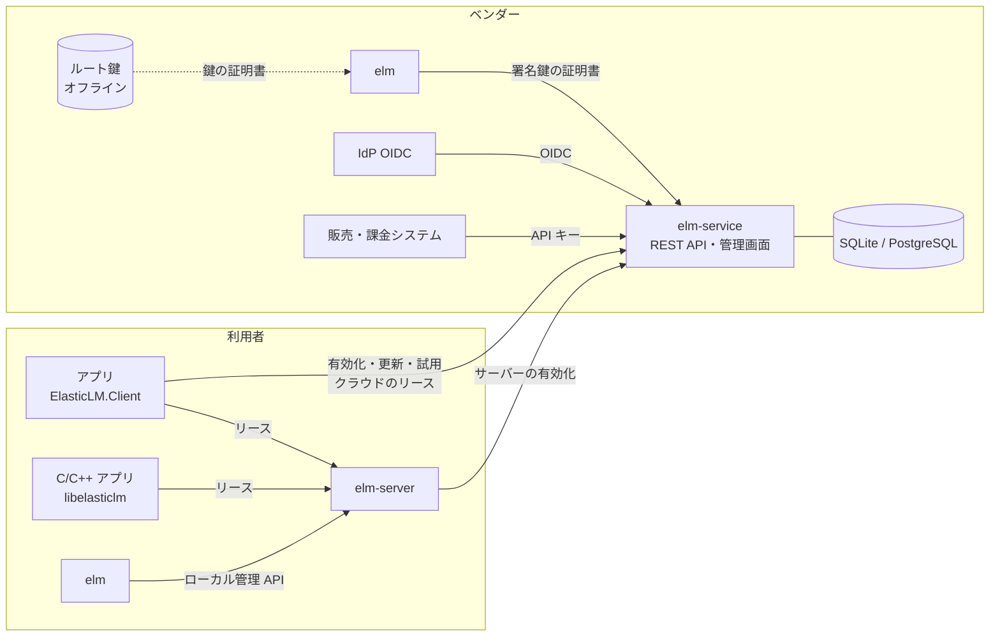
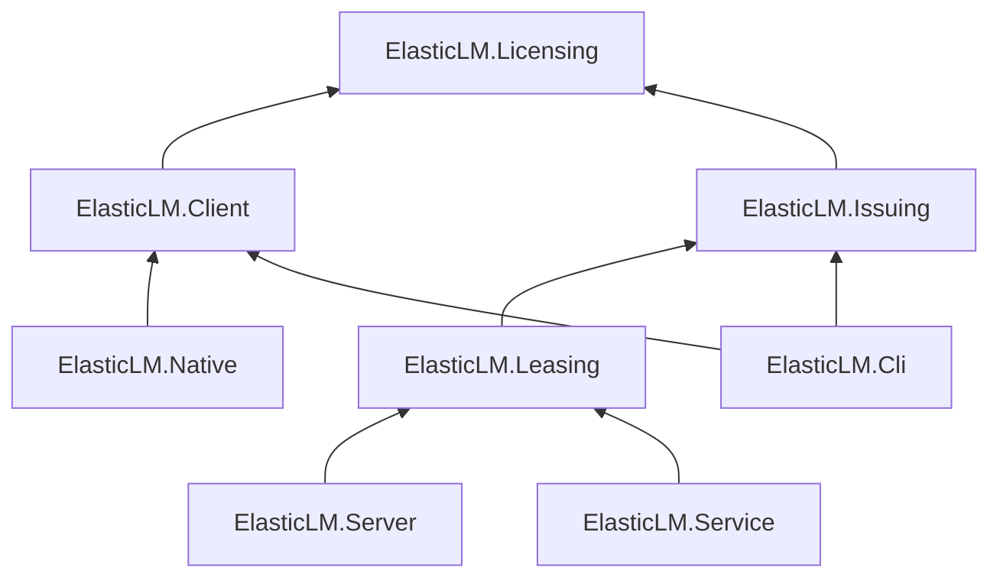
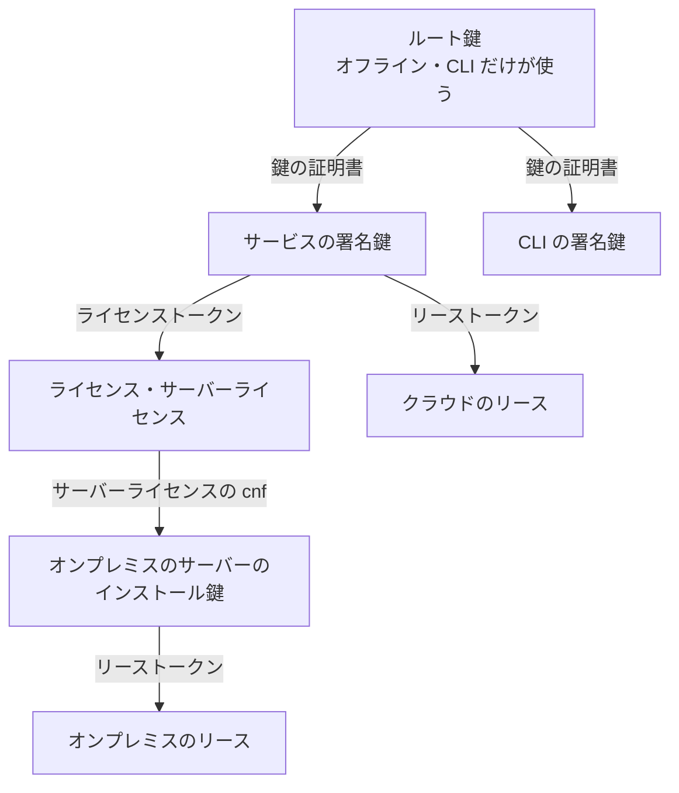
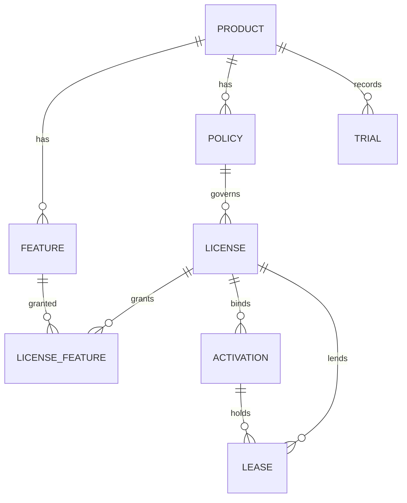
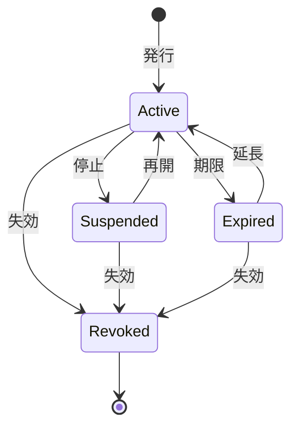
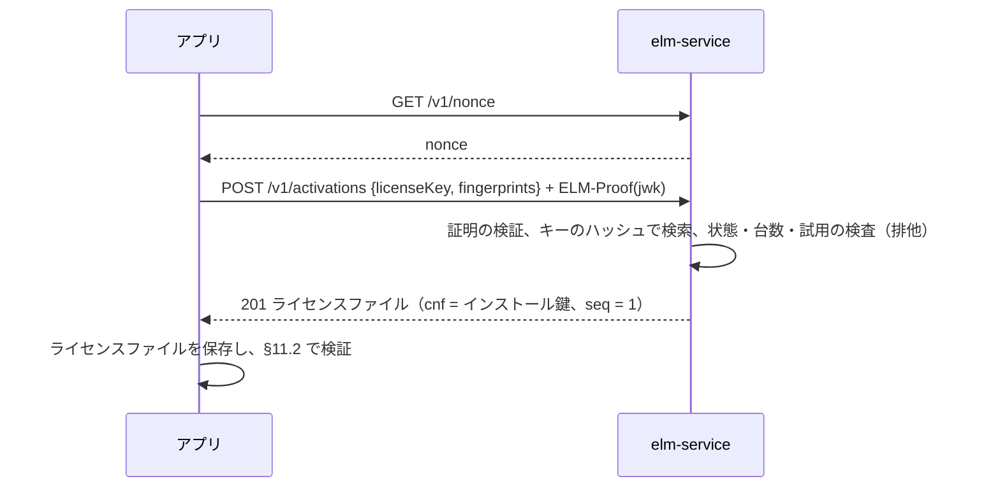
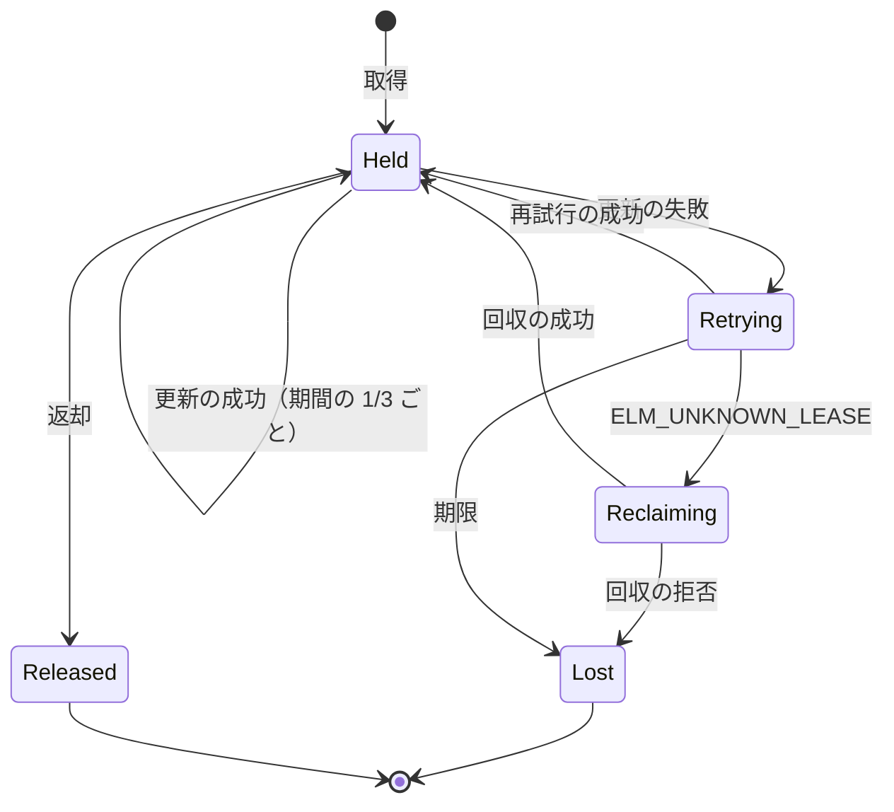

# ElasticLM 設計書

ElasticLM の正本の設計。要件・脅威モデル・形式・プロトコル・契約・段階をここに書く。進め方は `.cursor/rules/design-docs.mdc`、作業の順序は [roadmap.md](./roadmap.md)、採らなかった案は [design-decisions.md](./design-decisions.md) にある。

本書の §0 は Grill で持ち主が決めた前提、§1 以降はそれを具体化した設計である。§1 以降と §0 が食い違うときは §0 が正しく、本書を直す。

## 0. 決定済みの前提

2026-10-26 の Grill（Round 1）で持ち主が決めた。

| # | 項目 | 決定 |
| --- | --- | --- |
| 0.1 | 対象 | `net10.0` だけ。NativeAOT と単一バイナリで配布できること |
| 0.2 | 構成 | 中核は、署名付きライセンスをオフラインで検証するライブラリ（依存なし、AOT 対応、端末への紐づけは任意）。その上に、オンプレミスのフローティングライセンスサーバー（単一バイナリ）と、SaaS 型の有効化サービスを載せる |
| 0.3 | v1 の範囲 | 最初の公開（v1）に、オフライン検証・オンプレミスのフローティングサーバー・SaaS 型の有効化サービスの三つを含める |
| 0.4 | 署名 | ECDSA P-256。運ばれるバイト列そのものに署名し、JSON の正規化に頼らない。アルゴリズムと鍵 ID を示す欄を持ち、将来のアルゴリズム（ML-DSA など）へ移れるようにする。秘密鍵は実行ファイルに埋め込まない |
| 0.5 | 通信 | HTTPS と JSON（ASP.NET Core の Slim ビルダー、System.Text.Json のソース生成）。gRPC は使わない。全クライアントが持つ共有秘密は使わない。貸出は、サーバーが署名した期限付きのリースをハートビートで延長する |
| 0.6 | オンプレミスの状態 | 貸出の状態はメモリに持ち、データベースは持たない。サーバーが再起動したら、クライアントが借り直す |
| 0.7 | 端末の識別 | OS 標準のマシン ID（Windows: MachineGuid、Linux: `/etc/machine-id`、macOS: IOPlatformUUID）。紐づけは任意。使い方は 0.32 で具体化した |
| 0.8 | クライアント | .NET の SDK と、C / C++ から呼ぶネイティブライブラリ（C ABI、NativeAOT の共有ライブラリ）。Round 3 で C ABI も v1 に含めた（0.19） |
| 0.9 | 配布物 | NuGet パッケージ（検証ライブラリ、クライアント）、サーバーの単一バイナリ、CLI（鍵の生成・署名・内容の表示） |
| 0.10 | ライセンス | MIT |

SaaS 型を v1 に含めたことで、0.6（データベースを持たない）はオンプレミスのサーバーに限った決定になる。

### 0.A SaaS 型の前提

2026-10-26 の Grill（Round 2）で持ち主が決めた。

| # | 項目 | 決定 |
| --- | --- | --- |
| 0.11 | 運用者 | ソフトウェアのベンダー（ElasticLM の利用者）が自分で立てる OSS のサービス。単一バイナリまたはコンテナで配る。ElasticLM として商用 SaaS を運営する前提にはしない |
| 0.12 | テナント | 1 デプロイを 1 ベンダーが使い、その中で複数の製品を扱う。複数ベンダーの相乗りは v1 の範囲外 |
| 0.13 | 機能 | ライセンスキーの発行、端末単位の有効化と解除（台数上限つき）、ファイルを介したオフライン有効化、失効、管理用の REST API と CLI |
| 0.14 | フローティング | クラウドからの同時利用数の貸出も v1 に含める。貸出の仕組みはオンプレミスのサーバーと共通にし、状態の持ち方だけを変える |
| 0.15 | 保存先 | SQLite と PostgreSQL。ORM を使わない薄い層の上に載せる |
| 0.16 | 管理 API の認証 | 機械向けの API キー（範囲を絞れ、サーバーはハッシュだけを持つ）と、人向けの OIDC の両方。CLI はデバイス認可フロー（RFC 8628） |
| 0.17 | オフラインのトークン | ライセンスごとのポリシーで決める。既定は期限付き（30 日）でオンラインで更新し、期限後も猶予期間内は使える。期限なしのトークンは CLI での手動発行に限る |
| 0.18 | 対象外の脅威 | クライアント側のバイナリの改ざん（検証処理を書き換えて飛ばすこと）と難読化は対象外と明記する。守るのはライセンスの偽造、リクエストの偽造と再送、席数を超えた利用 |

### 0.B v1 の範囲の追加

2026-10-26 の Grill（Round 3）で持ち主が決めた。Round 1・2 の推奨のうち、作業量だけを理由に外していたものと、検討から漏れていたものを見直した結果である。

| # | 項目 | 決定 |
| --- | --- | --- |
| 0.19 | C ABI | C / C++ のアプリも対象に含め、ネイティブライブラリを v1 に含める |
| 0.20 | 管理画面 | v1 に含める。静的な SPA をサービスのバイナリに埋め込む。Blazor はサーバー側の NativeAOT で使えないため採らない（§20.4） |
| 0.21 | 借り出し | フローティングの席を期限付きで端末に固定して持ち出す機能を v1 に含める |
| 0.22 | 試用ライセンス | ライセンスのポリシーの一種として v1 に含める。1 台 1 回の制限は SaaS 型が管理する |
| 0.23 | 監査ログ | 発行・解除・失効などの管理操作を、操作者つきで記録する |
| 0.24 | 利用状況の記録 | オンプレミスのサーバーと SaaS 型が、利用のイベントを 1 行 1 件の JSON で出力する |
| 0.25 | オンプレミスの冗長化 | v1 では作らない。根拠は §13.6 |
| 0.26 | 仮想マシンの複製 | 対策は §10.4 |
| 0.27 | Webhook | v1 の後の段階（ロードマップ A-1） |

### 0.C 形式と方式

2026-10-26 の Grill（Round 4）で持ち主が決めた。調査の出典は各節に書く。

| # | 項目 | 決定 |
| --- | --- | --- |
| 0.28 | トークン形式 | JWS コンパクト形式（ES256）を用途を絞った形で使う（§8） |
| 0.29 | リクエスト認証 | 端末ごとの鍵ペアで、DPoP（RFC 9449）の形の証明を各リクエストに付ける。本文のハッシュを証明に含める（§12.2） |
| 0.30 | 管理画面のログイン | BFF。サービスが OIDC の認可コードフロー（PKCE）を行い、ブラウザには HttpOnly の Cookie だけを渡す（§15.3） |
| 0.31 | SQLite | ソースの版とハッシュを固定し、各 OS 向けに静的ライブラリとしてビルドして実行ファイルに組み込む（§14.2） |
| 0.32 | 端末の識別 | 本当の識別は有効化のときに作る端末ごとの鍵（インストール鍵）。OS のマシン ID はアプリごとの値でハッシュした補助の手がかりにする（§10） |
| 0.33 | 暗号化 | ライセンスファイルは署名だけで、暗号化しない |
| 0.34 | 時計の巻き戻し | 発行時刻が未来のトークンを拒否し、最後に確認した時刻を端末に保存して、それより戻った時計を拒否する（§11.4） |
| 0.35 | 利用ログ | 区切りごとにサーバーの鍵で署名を挟み、改ざんを検出できる JSON Lines にする（§18.1） |
| 0.36 | ポリシー | 真偽値の組ではなく、名前付きの選択肢（列挙）の集まりにする（§9.3） |

### 0.D 設計のレビューで決めたこと

2026-10-26 の Grill（Round 5）で持ち主が決めた。D0 の設計の独立したレビューで見つかった、要件と受け入れる危険に関わる点である。

| # | 項目 | 決定 |
| --- | --- | --- |
| 0.37 | オンプレミスのサーバーの信頼 | サーバーライセンスに期限（ポリシーで設定、既定 30 日）を持たせ、SaaS 型のサービスから更新させる。更新のたびに複製を検出する。サーバーの鍵の取り出しは受け入れる脅威とし、クライアント側でリースがサーバーライセンスの範囲内かを確かめて被害を抑える（§5.4, §9.6, §12.7.5） |
| 0.38 | 借り出しと再起動 | 借り出しの記録だけを、追記だけの署名つきファイルに残し、再起動で戻す（§13.4）。データベースは持たない（0.6 のまま） |
| 0.39 | 鍵の証明書の期限 | トークンを発行した時点（`iat`）で証明書が有効だったかで判定する。漏れた鍵は、トラストストアの無効にした鍵 ID の一覧で、アプリの更新により無効にする（§7.5, §11.2） |
| 0.40 | 借り出しの早期返却 | 認める。回数の上限をポリシーで決める。残る危険は受け入れる（§5.4, §12.7.4） |
| 0.41 | ネットワークのない端末の更新 | オフライン有効化と同じファイルのやり取りでトークンを更新できる。サーバーライセンスの更新にも使う（§12.8.3） |

## 1. 目的と利用者

### 1.1 目的

.NET（と C / C++）で作られたアプリのベンダーが、自分の製品のライセンスを発行し、利用者の端末で確かめ、同時利用数を数えられるようにする。そのための部品一式を、NativeAOT の単一バイナリと NuGet パッケージで OSS として配る。

前身（`_ElasticLM`, `_ElasticLM2`）は FlexLM 風のフローティングサーバーだけを目指し、認証が成り立っていなかった（[design-decisions.md](./design-decisions.md)）。本設計は、ライセンスの偽造・リクエストの偽造と再送・席数を超えた利用を、暗号で防ぐことを第一にする。

### 1.2 登場する人と物

| 名前 | 説明 |
| --- | --- |
| ベンダー（発行者） | ElasticLM を使って製品のライセンスを発行する組織。ルート鍵を持ち、SaaS 型のサービスを運用する |
| ベンダーの管理者 | ベンダーの社員。管理画面・CLI・管理 API で発行や解除を行う。役割（§14.6）で権限が分かれる |
| ベンダーのシステム | ベンダーの販売・課金システムや CI。API キーで管理 API を呼ぶ |
| 利用者（顧客） | 製品を買った組織または個人 |
| 利用者の管理者 | 利用者の社内でオンプレミスのライセンスサーバーを運用する人 |
| アプリ | ベンダーの製品。検証ライブラリかクライアント（.NET または C ABI）を組み込む |
| 攻撃者 | §5.2 |

### 1.3 配る物

| 配布物 | 形 | 使う人 |
| --- | --- | --- |
| `ElasticLM.Licensing` | NuGet パッケージ。オフラインの検証 | アプリ |
| `ElasticLM.Client` | NuGet パッケージ。有効化・リース・借り出し・試用の通信 | アプリ |
| `libelasticlm` | NativeAOT の共有ライブラリ（`.dll` / `.so` / `.dylib`）と C ヘッダ | C / C++ のアプリ |
| `elm-server` | オンプレミスのライセンスサーバー。単一バイナリ | 利用者の管理者 |
| `elm-service` | SaaS 型の有効化サービス（管理画面を含む）。単一バイナリとコンテナイメージ | ベンダー |
| `elm` | CLI。鍵・発行・検査・管理 API の操作 | ベンダーと利用者の管理者 |

## 2. 用語

英語の表記は `.agents/skills/english-writing/SKILL.md` の用語表に合わせる。

| 用語 | 意味 |
| --- | --- |
| ルート鍵（root key） | ベンダーがオフラインで保管する署名鍵。署名鍵の証明書だけに署名する（§7） |
| 署名鍵（signing key） | ライセンスやリースに署名する鍵。ルート鍵が証明書で認める |
| 鍵の証明書（key certificate） | 署名鍵の公開鍵・用途・期限に、ルート鍵が署名したトークン（§8.4.1） |
| トラストストア（trust store） | アプリが信じるルート鍵の公開鍵の集まり。アプリに組み込む |
| ライセンス（license） | ある利用者に、ある製品の機能を、あるポリシーで使わせる権利。SaaS 型のデータとしての実体 |
| ライセンスキー（license key） | 人が入力する、ライセンスを指す秘密の文字列（§9.5） |
| ライセンストークン（license token） | ライセンスの中身を署名鍵で署名したトークン。オフラインで検証できる（§8.4.2） |
| ライセンスファイル（license file） | ライセンストークンと、それを検証するための鍵の証明書を一つにまとめたファイル（§8.5） |
| インストール鍵（installation key） | 端末上のアプリが最初の有効化か借り受けのときに作る鍵ペア。端末の本当の識別子（§10.2） |
| マシン指紋（machine fingerprint） | OS のマシン ID をアプリごとの値でハッシュした補助の手がかり（§10.3） |
| 有効化（activation） | ライセンスとインストール鍵を結びつけ、台数を 1 つ使うこと |
| リース（lease） | フローティングの席を、期限付きで 1 つのインストール鍵に貸すこと。サーバーが署名したリーストークンで表す（§8.4.3） |
| 借り出し（borrow） | 期限の長いリース。ネットワークから離れても使える（§12.7） |
| 回収（reclaim） | 再起動したサーバーに、まだ有効なリースを申告して席を取り戻すこと（§13.4） |
| 証明（proof） | リクエストごとにインストール鍵で署名する DPoP 形式の JWS（§12.2） |
| 管理者トークン | オンプレミスのサーバーの、ローカル管理 API に使う秘密（§13.7） |

## 3. 機能要件

### 3.1 オフラインの検証（`ElasticLM.Licensing`）

1. ライセンスファイルを読み、トラストストアのルート鍵から署名鍵の証明書、ライセンストークンの順に検証する（§11.2）。
2. 期限・猶予期間・発行時刻・対象の製品・機能・端末の紐づけを、§11.2 の順で判定し、結果を理由つきで返す。
3. 時計の巻き戻しを検出する（§11.4）。
4. ネットワークにも、ファイル以外の外部資源にも触れない。時計は `TimeProvider` から読む。

### 3.2 クライアント（`ElasticLM.Client`）

1. SaaS 型のサービスに対して、オンラインの有効化・解除・トークンの更新・試用の開始を行う（§12.4〜§12.6、§12.9）。
2. オフライン有効化・更新・解除のファイルを作り、応答ファイルを取り込む（§12.8）。
3. オンプレミスのサーバーと SaaS 型のサービスに対して、リースの取得・更新・返却・借り出し・返却を行う（§12.7）。プロトコルは両者で同じ。
4. リースを期限の 1/3 ごとに自動で更新し、失敗したら §12.7.3 の規則で再試行する。
5. インストール鍵を作り、OS ごとの方法で保管する（§10.2）。

### 3.3 オンプレミスのライセンスサーバー（`elm-server`）

1. サーバーライセンス（§9.6）を読み、その機能と席数の範囲でリースを貸す。
2. 貸出の状態はメモリだけに持つ。再起動の後は回収で状態を戻す（§13.4）。
3. 借り出しを、ベンダー・利用者の管理者・残す席数の三段の上限で制御する（§12.7.4）。
4. 応答のない端末の席を、リースの期限で解放する。
5. 利用ログを出す（§18.1）。借り出しを署名つきの記録に残し、再起動で戻す（§13.4）。
6. サーバーライセンスを、オンラインかファイルのやり取りで更新する（§9.6, §12.8.3）。
7. 利用者の管理者向けに、状態の表示・強制返却・ライセンスの再読み込みを、ローカル管理 API と `elm` で提供する（§13.7）。
8. TLS の証明書を、運用者が渡すか、サーバー自身の鍵で自己署名する。後者のとき、クライアントはサーバーライセンスに書かれた公開鍵で TLS の相手を確かめる（§13.5）。

### 3.4 SaaS 型の有効化サービス（`elm-service`）

1. 製品・機能・ポリシー・ライセンスを管理し、ライセンスキーを発行する（§9）。
2. 端末単位の有効化と解除、台数上限、オンラインのトークン更新、試用、オフライン有効化、失効を提供する（§12）。
3. クラウドからのフローティング（リースと借り出し）を、オンプレミスと同じプロトコルで提供する。状態はデータベースに持つ（§14.4）。
4. オンプレミスのサーバーの有効化（サーバーライセンスの発行）を提供する（§9.6）。
5. 管理用の REST API（§14.5）、管理画面（§15）、監査ログ（§18.2）、利用ログ（§18.1）を提供する。
6. 管理 API は API キーと OIDC の両方で認証し、役割で認可する（§14.6）。
7. SQLite と PostgreSQL のどちらでも動く（§14.2）。
8. 仮想マシンの複製を検出する（§10.4）。

### 3.5 CLI（`elm`）

1. ルート鍵と署名鍵の生成、鍵の証明書の発行（§7.3）。
2. ライセンストークンの発行（SaaS 型を使わない運用のため）と、トークン・ファイル・利用ログの内容表示と検証（§16）。
3. 管理 API の操作。人はデバイス認可フロー、機械は API キーで認証する。
4. オンプレミスのサーバーのローカル管理 API の操作。

### 3.6 ネイティブライブラリ（`libelasticlm`）

1. `ElasticLM.Licensing` と `ElasticLM.Client` の機能を C ABI で公開する（§17）。
2. メモリの所有権・スレッド・エラーの規則を §17 のとおりに守る。

## 4. 非機能要件

### 4.1 配布の形

- 実行ファイル（`elm-server`, `elm-service`, `elm`）は NativeAOT の単一バイナリで、横に置くファイルなしで動く。設定ファイルは任意。
- 対象の RID: `win-x64`, `win-arm64`, `linux-x64`, `linux-arm64`, `linux-musl-x64`, `osx-arm64`, `osx-x64`。`libelasticlm` も同じ。
- NuGet パッケージは `IsAotCompatible` で、アプリの NativeAOT 公開で警告を 0 件に保つ。

### 4.2 大きさと速さ

数値は目標で、各行の PR で測る（`.cursor/rules/open-ends.mdc`）。D0 の調査で、Windows（win-x64、.NET 10.0.13）の NativeAOT について次を実測した。

| 物 | D0 の実測 | 目標 |
| --- | --- | --- |
| HTTPS・JwtBearer・Npgsql・SQLite（静的リンク）・埋め込みファイルを持つ ASP.NET Core | 25.3 MB | `elm-service` 40 MB 以下 |
| OIDC と Cookie 認証を持つ Slim ビルダーのサーバー | 17.6 MB | — |
| `webapiaot` テンプレート | 12.2 MB | `elm-server` 30 MB 以下 |
| HttpClient と ECDSA を持つ共有ライブラリ | 4.7 MB | `libelasticlm` 8 MB 以下 |

| 処理 | 目標 |
| --- | --- |
| ライセンスファイル 1 件の検証（鍵の証明書を含む、2 回目以降） | 1 ms 以下（参照機: GitHub Actions の `ubuntu-latest`） |
| `elm-server` の起動から待ち受けまで | 1 秒以下 |
| `elm-server` が同時に持つリース | 10,000 件で、更新の p99 が 50 ms 以下、メモリ 200 MB 以下（2 vCPU） |
| `elm-service` の有効化（SQLite、1 ノード） | 50 件/秒を持続して p99 が 200 ms 以下 |

10,000 件のリースを既定のリース期間 10 分・更新間隔 1/3 で持つと、更新は $10000 / 200\,\mathrm{s} = 50$ 件/秒になる。

### 4.3 安全性

- §5 の脅威モデルの対策をすべて満たす。`.cursor/rules/security.mdc` を守る。
- 暗号は `System.Security.Cryptography` だけを使う。
- 秘密鍵・秘密・ライセンスキーの平文をログに書かない。

### 4.4 プライバシー

- OS のマシン ID の生の値を端末の外へ出さない。送るのはマシン指紋（§10.3）だけである。
- クライアントが送る端末情報（ホスト名、OS のユーザー名）は、ポリシーで送るかどうかを選べる（§9.3 の `ClientInfoStrategy`）。既定は送らない。

### 4.5 可用性

- アプリは、リースの期限内、オフラインのトークンの期限と猶予期間の内では、サーバーにつながらなくても動き続ける。
- オンプレミスのサーバーの可用性は §13.6 のとおり、冗長化なしで満たす。
- SaaS 型のサービスは、PostgreSQL を使えば複数ノードで動かせる（§14.3）。

## 5. 脅威モデル

### 5.1 守るもの

| 資産 | 説明 |
| --- | --- |
| ルート鍵・署名鍵 | 漏れれば任意のライセンスを作れる |
| ライセンスの効力 | 期限・機能・台数・席数の制限 |
| ライセンスキー | 知れば有効化できる |
| インストール鍵 | 知れば、その端末になりすませる |
| 管理 API の権限 | 発行・解除・失効ができる |
| 利用ログ・監査ログ | 課金や紛争の証拠になる |

### 5.2 攻撃者

| 記号 | 攻撃者 | 持っているもの |
| --- | --- | --- |
| A1 | 不正な利用者 | アプリ、正規のライセンスファイルかライセンスキー、自分の端末の管理者権限 |
| A2 | ネットワーク上の攻撃者 | 通信の盗聴・改ざん・再送 |
| A3 | 利用者の社内の別の人 | オンプレミスのサーバーに届くネットワーク |
| A4 | 管理 API への外部の攻撃者 | インターネットからサービスに届く |
| A5 | 退職した、または権限を越えようとするベンダーの管理者 | 過去の資格情報、低い役割 |

### 5.3 脅威と対策

| # | 脅威 | 攻撃者 | 対策 |
| --- | --- | --- | --- |
| T1 | ライセンスの偽造・改ざん | A1 | ES256 の署名を、運ばれたバイト列のまま検証する。鍵はトラストストアのルート鍵から証明書でたどったものだけを使う（§8, §11.2） |
| T2 | アルゴリズムの差し替え（`none`、別アルゴリズム） | A1, A2 | ヘッダーの `alg` は鍵の記録と一致するときだけ受け付ける。`alg` で鍵やアルゴリズムを選ばない（§8.2） |
| T3 | トークンの種類の取り違え（リースをライセンスとして使う等） | A1 | `typ` で種類を固定し、検証する関数ごとに 1 つの `typ` だけを受け付ける（§8.2） |
| T4 | 別の端末へのライセンスの持ち出し | A1 | 端末に紐づくトークンはインストール鍵の拇印（`cnf.jkt`）とマシン指紋を持つ。リースと更新は、その鍵の証明がなければ受け付けない（§10, §12.2） |
| T5 | 期限切れのライセンスを時計を戻して使う | A1 | §11.4 |
| T6 | リクエストの再送 | A2, A3 | 証明はサーバーのノンスと本文のハッシュを持ち、`jti` を一度だけ受け付ける（§12.2） |
| T7 | リクエストの偽造 | A2, A3 | 状態を変えるリクエストはすべてインストール鍵の証明を持つ。共有秘密は使わない |
| T8 | 席数を超えた利用 | A1, A3 | 席の数え上げを排他して行う（§13.3, §14.4）。要求の席数は 1 以上（§12.7.2）。再起動の後は回収の時間内に新しい貸出を止め、借り出しは記録から戻す（§13.4）。クライアントはリースがサーバーライセンスの範囲内かを確かめる（§12.7.5） |
| T9 | 仮想マシンの複製で台数を増やす | A1 | §10.4 |
| T10 | オフライン有効化の応答の使い回し | A1 | 応答は要求のインストール鍵に紐づき、要求のノンスは一度だけ受け付ける（§12.8） |
| T11 | 試用の繰り返し | A1 | 製品とマシン指紋の組で 1 回に限る（§12.9） |
| T12 | 署名鍵の漏えい | — | 漏れた鍵の ID をトラストストアの無効の一覧に入れたアプリの版を配り、正当なライセンスをオンラインの更新で新しい鍵に移す（§7.5）。ルート鍵はオフラインに置く（§7.2）。証明書の期限は新しい署名を止めるだけで、漏れた鍵が `iat` を偽ったトークンは止めない（0.39） |
| T13 | 管理 API の不正利用 | A4, A5 | API キーは範囲と期限を持ちハッシュだけを保存する。OIDC は IdP 側で停止できる。全操作を監査ログに残す（§14.6, §18.2） |
| T14 | 管理画面への CSRF・XSS | A4 | BFF でブラウザにトークンを渡さない。Cookie は `__Host-`・`HttpOnly`・`Secure`・`SameSite=Lax`。状態を変える API は独自ヘッダーを要求し、GET は状態を変えない。CSP を厳しくする（§15） |
| T15 | 利用ログの改ざん | A3 | 区切りごとの署名と、ファイルをまたぐ連なり（§18.1）。サーバーの鍵を持つ利用者の管理者（A1）による書き直しは防げない（§5.4） |
| T16 | 大きな入力やトークンでの資源の枯渇 | A2, A3, A4 | 入力の大きさ・深さ・数に上限を置く（§8.6, §14.7）。リクエストの頻度を制限する |
| T17 | オンプレミスのサーバーのなりすまし | A1, A3 | クライアントはサーバーライセンスをルート鍵からたどって検証し、`kind: server` であること、設定で指定したサーバーであることを確かめ、リースをその公開鍵で検証する。自己署名の TLS のときは、接続のたびに TLS の公開鍵とサーバーライセンスの公開鍵の一致を確かめる（§13.5） |
| T18 | 試用・通常のライセンスを使った偽のサーバー | A1 | クライアントは `kind: server` 以外のライセンスを持つサーバーのリースを受け付けない（§11.2, §12.7.5） |
| T19 | 他人の有効化の解除・更新 | A2, A3 | 有効化に関わるすべての要求で、証明の鍵が有効化のインストール鍵と一致することを求める（§12.5, §12.6, §12.8） |

### 5.4 受け入れる脅威

| 脅威 | 受け入れる理由 |
| --- | --- |
| アプリのバイナリを改ざんして検証を飛ばす | クライアント側では原理的に防げない（0.18）。難読化も対象外 |
| 端末の管理者がインストール鍵と状態ファイルを別の端末へ写す | 端末の管理者権限を持つ攻撃者からは、OS の保護でも守り切れない。写した端末が同時に動けばサーバー側で検出する（§10.4）。オフラインだけで動く写しは検出できない |
| 端末の管理者が OS のマシン ID を書き換える | マシン指紋は補助の手がかりで、本当の識別はインストール鍵である（0.32）。ただし試用の 1 台 1 回はマシン指紋に頼るため、書き換えれば試用を繰り返せる（§12.9） |
| 利用者の管理者がオンプレミスのサーバーの鍵を取り出す | 管理者は端末の root を持つ。鍵があれば、席数を無視したリースの署名と、利用ログの書き直しができる。被害は、クライアントがリースをサーバーライセンスの範囲（期間・機能・席数・期限）に限ること（§12.7.5）と、サーバーライセンスの期限（既定 30 日、0.37）で抑える |
| オンプレミスのサーバーの端末を複製する | 複製は、サーバーライセンスの更新でサービスが更新番号の巻き戻りとして検出する（§10.4）。次の更新までの間（既定で最長 30 日）は検出できない |
| 返却・早期返却の後もリーストークンを残して使う | トークンは期限まで有効である。通常のリースは期間が短い（既定 10 分）ため、被害は 1 期間分に限られる。借り出しは早期返却の回数をポリシーで絞る（0.40） |
| 無効の鍵の一覧はアプリの更新でしか届かない | 漏れた署名鍵で `iat` を偽ったトークンは、無効の一覧を持つ版に更新していないアプリでは止められない（§7.5）。この表の「オフラインのトークンは期限まで失効が届かない」と同じく、失効リストを配らない決定から受け入れる |
| 時計の守りの状態を消すか書き換える | 状態を消しても、時計はトークンの `iat` より前には戻せない（§11.4）。実際の上限はトークンの期限なので、短い `TokenLifetime` で抑える |
| `allow` / `deny` のホスト名とユーザー名を偽る | クライアントが申告する値で、確かめられない。確実なのは IP の範囲の規則だけである（§13.8） |
| オフラインのトークンは期限まで失効が届かない | CRL のような失効リストを配る製品は調べた範囲になく、期限の短いトークンとオンラインの更新で失効を届ける（Keygen: https://keygen.sh/docs/api/cryptography/ 、Cryptlex: https://cryptlex.com/docs/sdks-and-apis/best-practices ）。期限はポリシーで短くできる |
| 期限なしのトークンは失効できない | CLI の手動発行に限り（0.17）、発行時に警告を出す |

## 6. 全体構成

### 6.1 構成図



### 6.2 プロジェクト

`src/` のプロジェクトと依存の向き。矢印は参照の向きである。プロジェクトは、それを必要とする行の PR で作る（`docs/conventions.md`）。



| プロジェクト | 出力 | 責務 |
| --- | --- | --- |
| `ElasticLM.Licensing` | NuGet | JWS の用途を絞った形（§8）、トークンの型、トラストストア、検証（§11）、時計の守り（§11.4）、マシン指紋（§10.3）。外部の依存なし |
| `ElasticLM.Client` | NuGet | 通信（§12）、証明の作成、インストール鍵の保管（§10.2）、リースの自動更新 |
| `ElasticLM.Native` | `libelasticlm` | C ABI（§17） |
| `ElasticLM.Issuing` | 内部 | 署名側。鍵の読み込み、鍵の証明書・トークンの発行、証明の検証、ノンス |
| `ElasticLM.Leasing` | 内部 | リースの規則（席の数え上げ・借り出し・回収・期限）。状態の置き場は差し替えられる（メモリ／データベース） |
| `ElasticLM.Server` | `elm-server` | オンプレミスのサーバー（§13） |
| `ElasticLM.Service` | `elm-service` | SaaS 型のサービス（§14, §15） |
| `ElasticLM.Cli` | `elm` | CLI（§16） |

アプリが組み込むのは `ElasticLM.Licensing` と `ElasticLM.Client`（または `libelasticlm`）だけである。署名側のコード（`ElasticLM.Issuing` 以降）はアプリに入らない。

管理画面の SPA のソースは `web/admin/` に置き、ビルド結果を `ElasticLM.Service` に埋め込む（§15.2）。SQLite のソースとビルドスクリプトは `vendor/sqlite/` に置く（§14.2）。

### 6.3 運用の形

| 形 | 使う部品 | 説明 |
| --- | --- | --- |
| オフラインだけ | `elm`、`ElasticLM.Licensing` | ベンダーが CLI でライセンスファイルを作って渡す。サービスなし |
| SaaS 型の有効化 | `elm-service`、`ElasticLM.Client` | 利用者はライセンスキーで有効化し、トークンを定期的に更新する |
| クラウドのフローティング | `elm-service`、`ElasticLM.Client` | リースを SaaS 型のサービスから借りる |
| オンプレミスのフローティング | `elm-server`、`ElasticLM.Client`、（サーバーの有効化に `elm-service` か `elm`） | 利用者の社内のサーバーから借りる |

## 7. 鍵と信頼

### 7.1 鍵の階層



- アプリのトラストストアには、ルート鍵の公開鍵だけを入れる。署名鍵が変わってもアプリを作り直さなくてよい。
- 署名鍵は用途（`use`: `license`, `lease`, `log`）と期限を持つ証明書で認める。証明書の期限は既定で 1 年、上限は 2 年とする。期限はその鍵で新しく署名できる期間を表し、署名済みのトークンは期限の後も検証できる（§7.5）。
- オンプレミスのサーバーは自分のインストール鍵でリースに署名する。その鍵の権限は、署名鍵が発行したサーバーライセンス（§9.6）の `cnf` で与えられる。

この 2 段の階層は、Keygen がアカウントの公開鍵をアプリに直接埋め込む方式（https://keygen.sh/docs/api/cryptography/ ）と比べて、署名鍵の入れ替えと漏えいからの回復をアプリの更新なしで行うために選んだ。

### 7.2 鍵の置き場所

- ルート鍵: ベンダーが `elm` の実行時にファイルで渡す。PKCS#8 の PEM を、パスフレーズで暗号化して保管する（`EncryptedPrivateKeyInfo`、PBES2）。オンラインのサービスには置かない。
- サービスの署名鍵: 運用者がファイルか環境変数で `elm-service` に渡す（§14.8）。
- オンプレミスのサーバーのインストール鍵: サーバーが初回起動で作り、§10.2 の方法で保管する。
- どの秘密鍵も、実行ファイルのリソースや定数に入れない（`.cursor/rules/security.mdc`）。

### 7.3 鍵の入れ替え

1. 新しい署名鍵を作り、ルート鍵で証明書を発行する。
2. サービスに新旧両方の鍵を渡し、新しい鍵で署名を始める。古い鍵で署名済みのトークンは、その鍵が無効の一覧に入らない限り、証明書の期限の後も検証できる（§7.5）。
3. ルート鍵の入れ替えは、新しいルート鍵の公開鍵をトラストストアに加えたアプリの版を配ってから行う。トラストストアは複数のルート鍵を持てる。

### 7.4 鍵 ID

鍵 ID（`kid`）は、公開鍵の JWK 拇印（RFC 7638、SHA-256、base64url）とする。どの公開鍵からも同じ値が計算でき、`kid` の偽装は拇印の不一致で分かる。

### 7.5 証明書の期限と鍵の無効化

- 証明書は、トークンの `iat` が証明書の `nbf` から `exp` の間にあれば有効とみなす（0.39）。コード署名のタイムスタンプと同じ考え方で、期限なしのライセンスも証明書の期限の後に検証できる。
- 代わりに、漏れた署名鍵では `iat` を過去に偽ったトークンを作れる。これに対し、トラストストアは「無効にした鍵 ID」の一覧を持ち、その鍵の証明書と、その鍵で署名したトークンを拒否する（`ELM_KEY_REVOKED`）。一覧はアプリの更新で配る。
- 署名鍵が漏れたら、ベンダーは新しい署名鍵に入れ替え（§7.3）、漏れた鍵の ID を無効の一覧に入れたアプリの版を配り、正当なライセンスを新しい鍵で発行し直す。オンラインで更新する端末は、更新で新しい鍵のトークンに移る。

## 8. トークン形式

### 8.1 方針

JWS コンパクト形式（RFC 7515）を、ElasticLM 用に絞った形で使う。JOSE 一般の実装は行わない。選んだ理由と却下した案は [design-decisions.md](./design-decisions.md) にある。

### 8.2 ヘッダー

ヘッダーは、次の 3 つのメンバーだけを持つ JSON オブジェクトである。

| メンバー | 値 |
| --- | --- |
| `alg` | `ES256` だけ（v1） |
| `kid` | 署名した公開鍵の JWK 拇印（§7.4） |
| `typ` | §8.4 の種類のどれか |

検証の規則:

1. コンパクト形式（`.` で区切った 3 つの base64url）だけを受け付ける。JSON 形式は受け付けない。
2. ヘッダーに上の 3 つ以外のメンバー（`crit`, `jku`, `jwk`, `x5u`, `x5c` を含む）があれば拒否する（RFC 8725 §3.10 の鍵の注入を避ける）。
3. `kid` で鍵を引く。鍵の記録が持つアルゴリズムと `alg` が一致しなければ拒否する（RFC 8725 §2.1, §3.1）。
4. 検証する関数は受け付ける `typ` を 1 つだけ持ち、一致しなければ拒否する（RFC 8725 §3.11）。
5. 署名は IEEE P1363 形式（`r || s`、64 バイト）である（RFC 7518 §3.4）。DER は受け付けない。
6. 署名は、受け取った `header.payload` の ASCII バイト列に対して検証する。ペイロードは署名の検証が済むまで JSON として解釈しない。
   - 例外: `elm-proof+jws` と `elm-actreq+jws` で、検証する側が `kid` の公開鍵をまだ知らないとき（§12.2 の最初の要求、§12.8）だけ、次の順で読む。(1) §8.6 の上限の中でペイロードを読み、`jwk` だけを取り出す。(2) `jwk` の拇印がヘッダーの `kid` と一致し、点が P-256 の曲線上にあることを確かめる。(3) その鍵で署名を検証する。(4) 検証が済むまで、`jwk` 以外のクレームは使わない。
   - `elm-cert+jws` の `jwk` は、ルート鍵（トラストストアにある）で署名を検証した後に読むので、この例外に当たらない。

ECDSA の署名は可鍛性を持つ（`(r, n - s)` も有効）。署名のバイト列を ID・キャッシュのキー・再送の判定に使わない。必要なら署名対象のバイト列のハッシュを使う。

将来の ML-DSA は RFC 9964 の `alg`（`ML-DSA-65` など）で表す。.NET 10 の `MLDsa` は `[Experimental]`（SYSLIB5006）で macOS では動かない（https://learn.microsoft.com/en-us/dotnet/standard/security/cross-platform-cryptography ）ため、v1 は ES256 だけとし、移行はロードマップ A-3 で扱う。

### 8.3 ペイロードの共通の決まり

- UTF-8 の JSON オブジェクト。System.Text.Json のソース生成で読み書きする。
- 時刻は UNIX 秒（整数）。
- すべての種類が持つクレーム: `ver`（形式の版。v1 は `1`、必須）、`iat`（発行時刻、必須）、`jti`（トークン ID、128 ビットの乱数を base64url、必須）。
- `exp`（期限）は、`elm-cert+jws`、`elm-lease+jws`、`elm-actreq+jws` で必須、`elm-license+jws` で任意（省略は期限なし）、`elm-proof+jws`、`elm-deact+jws`、`elm-log+jws` では持たない（鮮度はノンスと連番で保つ）。
- `iss`（発行者の `kid`）は、`elm-license+jws` と `elm-lease+jws` で必須、ほかの種類では持たない。
- 知らないクレームは無視する。`ver` が知らない値なら拒否する。
- 必須のクレームが欠けていれば拒否する。

### 8.4 トークンの種類

| `typ` | 署名する鍵 | 用途 |
| --- | --- | --- |
| `elm-cert+jws` | ルート鍵 | 鍵の証明書 |
| `elm-license+jws` | 署名鍵（`use: license`） | ライセンストークン |
| `elm-lease+jws` | 署名鍵（`use: lease`）かオンプレミスのサーバーのインストール鍵 | リーストークン |
| `elm-proof+jws` | クライアントのインストール鍵 | リクエストの証明（§12.2） |
| `elm-actreq+jws` | クライアントのインストール鍵 | オフライン有効化・更新の要求（§12.8） |
| `elm-deact+jws` | クライアントのインストール鍵 | オフライン解除の証明（§12.8） |
| `elm-log+jws` | 署名鍵（`use: log`）かオンプレミスのサーバーのインストール鍵 | 利用ログの区切りの署名と、借り出しの記録（§13.4, §18.1） |

ペイロードに公開鍵（`jwk`、EC P-256 の `kty`, `crv`, `x`, `y` だけ）を入れてよいのは、`elm-cert+jws`、`elm-proof+jws`、`elm-actreq+jws` だけである。検証する側は、`jwk` の拇印が対応する `kid`（証明書なら `sub`）と一致することと、点が P-256 の曲線上にあること（`ECDsa.ImportParameters` の検査）を確かめる。

#### 8.4.1 鍵の証明書（`elm-cert+jws`）

| クレーム | 型 | 意味 |
| --- | --- | --- |
| `sub` | string | 認める公開鍵の `kid` |
| `jwk` | object | 認める公開鍵（EC P-256 の `kty`, `crv`, `x`, `y` だけ） |
| `use` | string[] | `license`, `lease`, `log` のどれか以上 |
| `nbf` | int | 有効になる時刻 |
| `exp` | int | 期限（必須） |

検証では、`jwk` の拇印が `sub` と一致することを確かめる。

#### 8.4.2 ライセンストークン（`elm-license+jws`）

§8.3 のクレームに加えて、次を持つ。`exp` を省略できる（期限なし）のは、トークンの種類のうちこれだけである。`exp` のないライセンストークンは §11.2 の手順 11 で期限を判定せず、`grace` を使わない。

| クレーム | 型 | 必須 | 意味 |
| --- | --- | --- | --- |
| `lic` | string | 必須 | ライセンス ID |
| `prd` | string | 必須 | 製品 ID |
| `kind` | string | 必須 | `standard`, `trial`, `server`（§9.6） |
| `feat` | object[] | 必須（空でよい） | 機能。各要素は `id`（string、必須）、`ver`（string、任意。許す版の範囲 §9.2）、`seats`（int、`kind: server` のとき必須）、`exp`（int、任意。機能ごとの期限） |
| `cnf` | object | 端末に紐づくとき | `{"jkt": "<インストール鍵の拇印>"}` |
| `fp` | string[] | 端末に紐づき、`fpm` が `ignore` でないとき | マシン指紋（§10.3） |
| `fpm` | string | `fp` があるとき | 指紋の照合方法（§9.3 の `FingerprintMatching`） |
| `grace` | int | `exp` があるとき | 期限の後に使える秒数。`kind: trial` では 0 |
| `refresh` | int | オンラインで更新するとき | 更新を試み始める、期限までの残り秒数 |
| `seq` | int | 有効化から出したとき | 有効化の更新番号（§10.4）。`elm` の手動発行では省略 |
| `areq` | string | オフラインの応答のとき | 要求の `nonce`（§12.8） |
| `lease` | int | `kind: server` のとき | リースの期間の秒数（ポリシーの `LeaseDuration`）。回収の時間にも使う（§13.4） |
| `borrow` | int | `kind: server` のとき | 借り出しの上限の秒数。0 なら借り出しを許さない |
| `overage` | int | `kind: server` のとき | 席数を超えて貸せる割合（百分率）。0 なら超えない |
| `meta` | object | 任意 | ベンダーが自由に入れる文字列の組。検証では解釈しない |

#### 8.4.3 リーストークン（`elm-lease+jws`）

§8.3 のクレームに加えて、次を持つ。`exp` は必須で、ないリーストークンは拒否する。

| クレーム | 型 | 必須 | 意味 |
| --- | --- | --- | --- |
| `lse` | string | 必須 | リース ID |
| `prd` | string | 必須 | 製品 ID |
| `lic` | string | 必須 | ライセンス ID（オンプレミスではサーバーライセンスの `lic`） |
| `feat` | string | 必須 | 機能 ID |
| `n` | int | 必須 | 借りた席の数（1 以上） |
| `cnf` | object | 必須 | `{"jkt": "<借りたインストール鍵の拇印>"}` |
| `brw` | bool | 必須 | 借り出しなら `true` |
| `srv` | string | 必須 | 発行したサーバーの `kid` |
| `slic` | string | オンプレミスのとき | 発行に使ったサーバーライセンスの `jti`（§13.5） |
| `seq` | int | 必須 | リースの更新番号。更新のたびに 1 増える |

#### 8.4.4 オフラインの要求（`elm-actreq+jws`）

| クレーム | 型 | 必須 | 意味 |
| --- | --- | --- | --- |
| `op` | string | 必須 | `activate` か `refresh` |
| `key` | string | `activate` のとき | ライセンスキー（§9.5） |
| `act` | string | `refresh` のとき | 有効化 ID |
| `seq` | int | `refresh` のとき | 最後に受け取った更新番号 |
| `fp` | string[] | 必須（作れた分） | マシン指紋。8 個まで |
| `jwk` | object | 必須 | インストール鍵の公開鍵 |
| `nonce` | string | 必須 | 128 ビットの乱数 |
| `iat` | int | 必須 | 作った時刻 |
| `exp` | int | 必須 | `iat` + 7 日 |

#### 8.4.5 オフライン解除の証明（`elm-deact+jws`）

| クレーム | 型 | 必須 | 意味 |
| --- | --- | --- | --- |
| `act` | string | 必須 | 有効化 ID |
| `seq` | int | 必須 | 最後に受け取った更新番号 |
| `iat` | int | 必須 | 作った時刻 |

#### 8.4.6 ログの署名（`elm-log+jws`）

| クレーム | 型 | 必須 | 意味 |
| --- | --- | --- | --- |
| `stream` | string | 必須 | `usage` か `borrows` |
| `n` | int | 必須 | 連番（ストリームの中で 1 から） |
| `prev` | string | 必須 | 前の署名の行の SHA-256（base64url）。最初は空文字列 |
| `digest` | string | 必須 | 前の署名の行の次から、この行の前までの全行のバイト列の SHA-256 |
| `lines` | int | 必須 | `digest` に含めた行の数 |
| `iat` | int | 必須 | 署名した時刻 |

### 8.5 ライセンスファイル

ライセンスファイルは UTF-8 の JSON で、署名されたトークンと、それを検証するための鍵の証明書を一つにまとめる。ファイルの外側は署名されないが、中身の各トークンはそれぞれ署名で守られる。

```json
{
  "format": "elasticlm-license",
  "version": 1,
  "license": "<elm-license+jws>",
  "certificates": ["<elm-cert+jws>"]
}
```

拡張子は `.elmlic` とする。

### 8.6 上限

| 対象 | 上限 |
| --- | --- |
| 1 つのトークン | 16 KiB |
| ライセンスファイル | 64 KiB |
| `certificates` の数 | 4 |
| `feat` の数 | 256 |
| `fp` の数 | 8 |
| `meta` の組の数 | 32（キー 64 バイト、値 1 KiB まで） |
| JSON の入れ子の深さ | 8 |
| 要求の `fingerprints` の数 | 8（各 32 文字の 16 進） |
| 要求の `client` のホスト名・ユーザー名 | 各 255 バイト |
| 要求の `app` | 64 バイト |
| 回収の要求のリーストークンの数 | 64 |
| 時刻のクレーム（`iat`, `exp`, `nbf`, 機能の `exp`） | 0 以上、253,402,300,799（9999-12-31T23:59:59Z、`DateTimeOffset` が表せる最後の秒）以下 |
| 期間のクレーム（`grace`, `refresh`, `lease`, `borrow`） | 0 以上、100 年（3,162,240,000 秒、1 年を 366 日として）以下 |
| `overage` | 0 以上、1,000（百分率）以下 |

時刻と期間の上限は、検証の中の足し算（`exp + grace` など）が桁あふれせず、時刻の型への変換が例外を投げないためのものである。

16 KiB は、将来の ML-DSA-87 の署名 4,627 バイト（RFC 9964）を base64url にした約 6.2 KB に、ヘッダーとペイロードを足しても収まる大きさとして選んだ。

## 9. ライセンスのモデル

### 9.1 実体



| 実体 | 説明 |
| --- | --- |
| 製品（product） | ベンダーの製品。ID は英小文字・数字・`-` の 64 文字以内 |
| 機能（feature） | 製品の中で個別に許す単位。ID は製品の中で一意 |
| ポリシー（policy） | ライセンスの規則の雛形（§9.3） |
| ライセンス（license） | 利用者に与える権利。ポリシーと機能の組、台数・席数、期限を持つ |
| 有効化（activation） | ライセンスとインストール鍵の結びつき |
| リース（lease） | 席の期限付きの貸出 |
| 試用（trial） | 製品とマシン指紋の組で一度だけの記録 |

### 9.2 機能の版

機能の `ver` は、アプリが求める版を許すかどうかを決める。書き方は `>=2.0 <3.0` の形の範囲とし、版は `major.minor[.patch]` の数字だけとする。省略すればすべての版を許す。前身は「メジャーが同じで、ライセンスの版以上」の固定規則だったが、メジャー版をまたぐ許可を表せなかった。

### 9.3 ポリシー

ポリシーは次の選択肢を持つ。真偽値の組にせず、列挙で表す（0.36）。

| 項目 | 選択肢 | 既定 | 意味 |
| --- | --- | --- | --- |
| `LicenseKind` | `Standard`, `Trial`, `Server` | `Standard` | §9.6 |
| `Binding` | `Unbound`, `NodeLocked` | `NodeLocked` | 端末に紐づけるか |
| `MaxActivations` | 整数 | 1 | 有効化できる台数 |
| `DeactivationLimit` | 整数か `Unlimited` | `Unlimited` | 解除できる回数 |
| `ExpirationBasis` | `FromIssue`, `FromFirstActivation` | `FromIssue` | ライセンスの期限の起点 |
| `Duration` | 期間か `Perpetual` | `Perpetual` | ライセンスの期間 |
| `TokenLifetime` | 期間 | 30 日 | オフラインのトークンの期限（0.17） |
| `RefreshWindow` | 期間 | 20 日 | 期限までの残りがこれを下回ったら更新を試みる |
| `GracePeriod` | 期間 | 7 日 | トークンの期限の後に使える期間 |
| `FingerprintMatching` | `Ignore`, `Any`, `All` | `Any` | 指紋の照合（§10.3） |
| `CloneStrategy` | `Deny`, `Flag` | `Deny` | 複製を検出したとき（§10.4） |
| `Floating` | `None`, `OnPremises`, `Cloud` | `None` | フローティングの種類 |
| `LeaseDuration` | 期間（2 分〜24 時間） | 10 分 | リースの期間 |
| `Overage` | `None`, `Percent(n)` | `None` | 席数を超えて貸せる割合 |
| `BorrowLimit` | 期間か `Disabled` | `Disabled` | 借り出しの上限 |
| `BorrowReturnLimit` | 整数 | 2 | 1 つのインストール鍵が、30 日の間に借り出しを早期に返却できる回数（0.40） |
| `ClientInfoStrategy` | `None`, `HostAndUser` | `None` | ホスト名と OS のユーザー名を送るか（§4.4） |
| `TrialDuration` | 期間 | 14 日 | `LicenseKind: Trial` のときの期間 |

`Overage` で許す席数は $\lfloor \mathit{seats} \times (100 + \mathit{overage}) / 100 \rfloor$ とする（切り捨て）。これを超える要求は、その要求だけを断る。Keygen は厳しい上限を超えると全席を無効にする（https://keygen.sh/docs/api/machines/ ）が、ElasticLM はすでに貸した席に影響させない。

`LicenseKind: Trial` のポリシーには次の制約がある。

- `FingerprintMatching` は `Any` か `All`。`Ignore` は選べない。起動ごとに変えられる指紋では 1 台 1 回を守れないためである。
- `GracePeriod` は 0。
- 製品は試用に使うポリシーを 1 つ指定する（`Product.TrialPolicy`）。指定がなければ、その製品は試用を出さない。

`LicenseKind: Server` のポリシーでは、`TokenLifetime` と `RefreshWindow` がサーバーライセンスの更新の周期になる（0.37）。`Binding` は `NodeLocked` に固定する。

### 9.4 ライセンスの状態



- `Suspended` と `Revoked` のライセンスには、新しいトークンもリースも出さない。`Suspended` は戻せるが、`Revoked` は戻せない。
- 端末に渡したトークンは期限まで有効である（§5.4）。

### 9.5 ライセンスキー

- 形式: `ELM-` に続けて、Crockford の base32 の 5 文字を 4 組、`-` でつなぐ（例: `ELM-7Q2KX-M9D4R-HV0T8-3NPWZ`）。100 ビットの乱数を `RandomNumberGenerator` で作る。
- サービスは SHA-256 のハッシュだけを保存し、表示は発行のときに一度だけ行う。100 ビットの乱数なので、塩なしのハッシュで総当たりに耐える。
- 入力では大文字小文字と `-` の有無を区別しない。

### 9.6 サーバーライセンス

オンプレミスのサーバーに与えるライセンスは、`kind: server` のライセンストークンである。

- `cnf.jkt` はサーバーのインストール鍵の拇印、`fp` はサーバーのマシン指紋。
- `feat` の各要素は `seats` を持ち、サーバーはその数までリースを貸す。
- 発行は、SaaS 型のサービスでのサーバーの有効化（オンラインかオフライン、§12.4, §12.8）か、`elm` の手動発行で行う。
- 期限は、サーバー用のポリシーの `TokenLifetime`（既定 30 日）である。`elm-server` は、期限までの残りが `RefreshWindow` を下回ったら、サービスにオンラインで更新を求める（§12.5）。つながらない環境では、利用者の管理者が `elm server refresh-request` で要求ファイルを作り、ファイルのやり取りで更新する（§12.8.3）。サービスは更新のたびに更新番号を調べ、複製を検出する（§10.4）。
- `elm` の手動発行のサーバーライセンスは更新の仕組みを持たない。期限なしにすると複製を検出できないため、発行時に警告を出す。

## 10. 端末の識別

### 10.1 方針

本当の識別子はインストール鍵である（0.32）。OS のマシン ID は書き換えや複製で重なるため、識別子にはしない。

| OS の ID | 性質 | 出典 |
| --- | --- | --- |
| Windows の MachineGuid | `HKLM\SOFTWARE\Microsoft\Cryptography` の値。レジストリの値なので管理者が書き換えられる。32 ビットのプロセスはリダイレクトされた別のビューを読むため、64 ビットのビューを指定して読む | https://learn.microsoft.com/en-us/windows/win32/winprog64/shared-registry-keys |
| Linux の `/etc/machine-id` | 初回起動で作られる。イメージは空で配るべきとされ、空でないイメージからの複製では重なる。生の値は秘密として扱い、アプリごとの鍵でハッシュして使うことが勧められている | https://www.freedesktop.org/software/systemd/man/latest/machine-id.html |
| macOS の IOPlatformUUID | IOKit の `IOPlatformExpertDevice` の `IOPlatformUUID` | https://opensource.apple.com/source/xnu/xnu-7195.141.2/iokit/IOKit/IOKitKeys.h.auto.html |

どの OS の ID も、複製や書き換えで重なりうるものとして扱う。設計はそれが重ならないことに頼らない。

### 10.2 インストール鍵

- 最初の有効化・リース・試用のときに、ECDSA P-256 の鍵ペアを作る。
- 保管の場所と方法:

| OS | 方法 | 場所 |
| --- | --- | --- |
| Windows | DPAPI（`CryptProtectData`、`LibraryImport` で `crypt32.dll` を呼ぶ）。範囲はユーザーか端末を選べる | ユーザー: `%LOCALAPPDATA%\ElasticLM\<製品 ID>\`、端末: `%ProgramData%\ElasticLM\<製品 ID>\` |
| Linux | ファイルの権限 `0600`（ディレクトリは `0700`） | ユーザー: `$XDG_DATA_HOME/elasticlm/<製品 ID>/`（未設定なら `~/.local/share/...`）、端末: `/var/lib/elasticlm/<製品 ID>/` |
| macOS | ファイルの権限 `0600` | ユーザー: `~/Library/Application Support/ElasticLM/<製品 ID>/`、端末: `/Library/Application Support/ElasticLM/<製品 ID>/` |

- 範囲（ユーザーか端末か）は、アプリが `ElasticLM.Client` の設定で選ぶ。既定はユーザーである。端末の範囲は書き込みに管理者権限が要るため、サービスとして動くアプリ向けとする。
- 鍵が読めない（壊れた、別ユーザーの DPAPI で保護された）ときは、新しい鍵を作らずにエラー `ELM_INSTALLATION_KEY_UNREADABLE` を返す。黙って作り直すと、台数を 1 つ余計に使うためである。アプリは利用者に再有効化を促す。

### 10.3 マシン指紋

マシン指紋は、OS の ID をアプリごとの値でハッシュした 16 バイトを、小文字の 16 進で表した文字列である。systemd の `sd_id128_get_machine_app_specific` と同じ作り方にする（https://github.com/systemd/systemd/blob/main/src/libsystemd/sd-id128/sd-id128.c ）。

$$
\mathrm{fp} = \mathrm{UUIDv4}\bigl(\mathrm{first}_{16}(\mathrm{HMAC\text{-}SHA256}(\mathit{key} = \mathrm{osid}_{16},\ \mathit{msg} = \mathrm{appid}_{16}))\bigr)
$$

- $\mathrm{osid}_{16}$: OS の ID の 16 バイト。Windows は MachineGuid（64 ビットのレジストリビューで読む）、Linux は `/etc/machine-id` の 32 桁の 16 進を復号した値、macOS は IOPlatformUUID。
- $\mathrm{appid}_{16}$: 製品 ID の SHA-256 の先頭 16 バイト。製品ごとに指紋が変わり、製品をまたいで端末を追跡できない。
- $\mathrm{UUIDv4}$: 7 バイト目を `(b & 0x0F) | 0x40`、9 バイト目を `(b & 0x3F) | 0x80` にする。

Windows では、2 つ目の指紋として SMBIOS の UUID（`GetSystemFirmwareTable('RSMB')`、管理者権限は不要）から同じ方法で作った値を加える。Linux の `/sys/class/dmi/id/product_uuid` は root しか読めないため使わない。

`FingerprintMatching` が `Any` なら、トークンの `fp` のどれか 1 つが現在の指紋と一致すれば通す。`All` ならすべて一致を要する。`Ignore` は照合しない。

OS の ID が読めないとき（ファイルがない、`uninitialized`、全ゼロ）は、その指紋を作らない。1 つも作れなければ、`Ignore` 以外のポリシーでは `ELM_FINGERPRINT_UNAVAILABLE` を返す。

読む時期: OS の ID は、プロセスの中で最初に指紋が要るときに読み、プロセスの終わりまで覚えておく。検証のたびには読まない。OS の ID が動いている間に変わることは想定しない。

コンテナ: `/etc/machine-id` のないコンテナ（`linux-musl-x64` のイメージに多い）では指紋を作れない。コンテナで動かすアプリと `elm-server` には、次のどちらかを使う。

1. ホストの `/etc/machine-id` を読み取り専用でマウントする。
2. ポリシーの `FingerprintMatching` を `Ignore` にして、インストール鍵だけで紐づける。インストール鍵を置くディレクトリは、コンテナを作り直しても残るボリュームにする。残さなければ、作り直すたびに台数を 1 つ使う。

### 10.4 仮想マシンの複製の検出

複製された端末は同じインストール鍵を持つため、サーバー側で更新番号の巻き戻りから検出する。OAuth のリフレッシュトークンの回転（RFC 9700 §4.14）と同じ考え方である。

1. 有効化（サーバーライセンスを含む）とリースは更新番号（`seq`）を持つ。サービスとサーバーは、更新のたびに 1 増やしてトークンに入れ、最後に出した値と、そのトークンを覚える。
2. クライアントは、更新・解除・再有効化の要求に、最後に受け取った `seq` を入れる。
3. 判定:
   - 要求の `seq` が最後に出した値と同じ: 正しい更新。`seq` を 1 増やして新しいトークンを出す。
   - 要求の `seq` が最後に出した値より 1 小さい: 前の応答が届かなかった再試行とみなし、最後に出したトークンをそのまま返す（冪等）。
   - それ以外（2 以上小さい、大きい、省略）: 別の写しが先に進んだとみなし、複製として扱う。
4. 同じインストール鍵での再有効化（§12.4）も、既存の有効化があれば 3 の判定を行う。`seq` を省いた再有効化は複製として扱う。ライセンスファイルをなくした正当な利用者は、管理者による解除の後に有効化し直す。

検出したら、ポリシーの `CloneStrategy` に従う。`Deny` は、その有効化の新しいトークンとリースを止め、監査ログに記録し、エラー `ELM_CLONE_DETECTED` を返す。利用者は解除と再有効化で戻る。`Flag` は記録だけを行い、通常どおり応答する。

オンプレミスのサーバーは、リースの更新で同じ判定を行う（メモリの状態に対して）。複製された 2 つのクライアントが同じリースを更新し合えば、2 回目で検出する。オンプレミスでの検出は、サーバーライセンスの `CloneStrategy` に従う。

複製を「同時の利用」で検出する案は採らない。同じ端末で複数のプロセスが同じインストール鍵を使うのは正当であり、区別できないためである。

Windows の VM Generation ID は管理者権限が要り、Linux ではユーザー空間から読めない（https://learn.microsoft.com/en-us/windows/win32/hyperv_v2/virtual-machine-generation-identifier 、https://github.com/torvalds/linux/blob/master/drivers/virt/vmgenid.c ）。すべての OS で使えないため、v1 では使わない。

## 11. オフラインの検証

### 11.1 公開 API の形

```csharp
public sealed class TrustStore
{
    public static TrustStore Create(ReadOnlySpan<string> rootPublicKeysPem, ReadOnlySpan<string> revokedKeyIds);
}

public sealed class LicenseVerifier(TrustStore trust, TimeProvider time, IClockGuard clockGuard)
{
    public LicenseVerificationResult Verify(ReadOnlySpan<byte> licenseFile, LicenseRequirement requirement);
}

public readonly record struct LicenseRequirement(
    string ProductId,
    LicenseKind Kind,
    string? FeatureId,
    string? FeatureVersion,
    InstallationIdentity? Installation);

public abstract record LicenseVerificationResult
{
    public sealed record Valid(VerifiedLicense License, bool InGracePeriod) : LicenseVerificationResult;
    public sealed record Invalid(LicenseError Error) : LicenseVerificationResult;
}
```

型の中身:

| 型 | 中身 |
| --- | --- |
| `LicenseKind` | `Standard`, `Trial`, `Server` の列挙（§9.3 の `LicenseKind`） |
| `InstallationIdentity` | インストール鍵の拇印と、現在のマシン指紋の組。指紋は `ElasticLM.Licensing` が §10.3 で作り、インストール鍵は `ElasticLM.Client` が §10.2 で持つ。オフラインだけの運用で端末に紐づけないときは `null` |
| `VerifiedLicense` | 署名の検証と §11.2 の判定に通ったライセンストークンのクレーム（§8.4.2）を、型つきで持つ。検証を経ずには作れない |
| `LicenseError` | §19 のエラーコードと、人が読む一文の組 |

- 検証前の値と検証済みの値（`VerifiedLicense`）は別の型にする（`.cursor/rules/csharp.mdc`）。
- 失敗は例外ではなく `Invalid` と理由で返す。引数の誤り（`null` 等）だけが例外になる。
- 正確な型と名前は M1 の行で決め、本節を直す。

### 11.2 検証の手順

次の順に調べ、最初に失敗した段の理由を返す。

1. ファイルの大きさと形式（§8.5, §8.6）。違えば `ELM_MALFORMED`。
2. ライセンストークンのヘッダーを読む（ペイロードはまだ読まない）。その `kid` が無効の一覧にあれば `ELM_KEY_REVOKED`。
3. 証明書を選ぶ。各証明書について、ヘッダーの `kid` がトラストストアのルート鍵で、無効の一覧になく、署名が正しいものだけを候補にする。候補のうち、`sub` がライセンストークンの `kid` と一致し、`use` に `license` を持つものを 1 つ選ぶ。選べなければ `ELM_UNTRUSTED_KEY`。候補にならなかった証明書は飛ばし、ファイル全体は失敗させない（入れ替えのために残した古い証明書が、ほかを巻き込まないため）。
4. ライセンストークンの署名（§8.2）。違えば `ELM_BAD_SIGNATURE`。
5. 証明書の期間: ライセンストークンの `iat` が証明書の `nbf` から `exp` の間（許容のずれ込み、§11.3）になければ `ELM_CERTIFICATE_EXPIRED`（§7.5）。
6. 発行時刻: `iat` が「現在 + 許容のずれ」より未来なら `ELM_CLOCK_TAMPERED`。
7. 時計の守り（§11.4）。巻き戻りを検出したら `ELM_CLOCK_TAMPERED`。
8. 種類: `kind` が要求の `Kind` と違えば `ELM_WRONG_KIND`。`Standard` を求める検証は `Trial` も受け付けるかを、要求で選べる（既定は受け付ける）。`Server` は `Server` を求める検証だけが受け付ける。
9. 製品: `prd` が要求と違えば `ELM_WRONG_PRODUCT`。
10. 端末: `cnf` があれば、要求のインストール鍵の拇印と一致しなければ `ELM_WRONG_INSTALLATION`。`fp` を `fpm` で照合し、合わなければ `ELM_FINGERPRINT_MISMATCH`。
11. 期限: `exp` がなければ期限なしとして通す。`exp` を過ぎて `exp + grace` 以内なら `Valid` で `InGracePeriod = true`。`exp + grace` も過ぎていれば `ELM_EXPIRED`。
12. 機能: 要求の機能がなければ `ELM_FEATURE_NOT_LICENSED`、版が範囲外なら `ELM_FEATURE_VERSION_NOT_LICENSED`、機能の `exp` を過ぎていれば `ELM_FEATURE_EXPIRED`。

### 11.3 許容のずれ

端末とサーバーの時計の差として、既定で 300 秒を許す。アプリが設定で 0〜3,600 秒に変えられる。

### 11.4 時計の守り

1. 検証に成功するたびに、そのときの時刻と、検証したトークンの `iat` の大きいほうを「最後に確認した時刻」として保存する。トークンの `iat` は署名鍵の時計なので、端末の時計を進めて戻しても、`iat` より前には戻せない。
2. 現在の時刻が「最後に確認した時刻 − 許容のずれ」より前なら、巻き戻りとみなす。
3. 状態はアプリが指定する場所（既定はインストール鍵と同じ場所、§10.2）に置く。インストール鍵があれば状態に署名し、署名が合わなければ書き換えとみなす。端末に紐づかないライセンスにはインストール鍵がないため、署名しない。状態が書き換えられた、消された、読めないときは、最後に確認した時刻を「検証中のトークンの `iat`」とみなして続ける。どの場合も、時計をトークンの `iat` より前には戻せない。
4. FlexNet Embedded は、時計を進めて使い、戻すと、本当の時刻が追いつくまで使えなくなると書いている（https://community.revenera.com/s/article/clock-windback-detection-with-an-flexnet-embedded-client ）。ElasticLM も同じ振る舞いになる。オンラインの更新に成功すれば、サーバーの時刻を「最後に確認した時刻」として上書きし、戻せる。

5. 対象: 時計の守りは、ライセンストークンの検証と、リーストークン（借り出しを含む）の検証の両方で行う（§12.7.5）。借り出したリースはオフラインで端末の時計と比べるため、リースにも行わなければ、時計を戻して期限を延ばせる。
6. 書き込み: 状態は「最後に確認した時刻」が 60 秒以上進んだときだけ書き込む。§4.2 の 1 ms の目標は、書き込まない検証で測る。書き込みは一時ファイルへの書き込みと置き換え（アトミックな改名）で行い、複数のプロセスが同時に書いても壊れた状態を残さない。読み込んだ値と書き込む値の大きいほうを残すので、どのプロセスの書き込みが残っても巻き戻らない。

`IClockGuard` はアプリが差し替えられる。状態を持たない実装（手順 1〜3 を行わず、§11.2 の手順 6 の `iat` の検査だけ）も用意する。

## 12. プロトコル

### 12.1 共通

- HTTPS 上の JSON。パスは `/v1/` で始める。
- エラーは RFC 9457 の `application/problem+json` で返し、`code` に §19 のエラーコードを入れる。遠くの呼び出し元には、§19 の分類以上の内部の理由を返さない。
- リクエストの本文は 64 KiB まで。超えれば `413` と `ELM_PAYLOAD_TOO_LARGE`。
- 時刻は UNIX 秒。
- サーバーは自分の公開 URL（`publicUrls`、§13.8, §14.8）を設定で持つ。証明の `htu` は、要求の `Host` ヘッダーではなく、この設定と比べる。リバースプロキシの後ろでも同じ値になるためである。

`htu` の正規化（クライアントとサーバーの両方で同じ手順）:

1. スキームとホストを小文字にする。
2. 既定のポート（https の 443）を省く。
3. パスは、パーセントエンコードを大文字の 16 進にそろえ、それ以外は変えない。
4. クエリと断片を除く。

### 12.2 証明（DPoP 形式）

状態を変えるリクエストと、端末に紐づく情報を返すリクエストは、ヘッダー `ELM-Proof` に `elm-proof+jws` を付ける。DPoP（RFC 9449 §4.2）の形に、本文のハッシュを加えたものである。

| ヘッダー | 値 |
| --- | --- |
| `alg` | `ES256` |
| `kid` | インストール鍵の拇印 |
| `typ` | `elm-proof+jws` |

検証する側が `kid` の公開鍵を知らない最初のリクエスト（有効化、リースの取得、回収、試用）では、ペイロードに `jwk`（公開鍵）を入れる。確かめ方は §8.4 の末尾のとおり。ヘッダーに `jwk` を置かないのは、§8.2 の規則 2 を全種類で同じにするためである。

| クレーム | 意味 |
| --- | --- |
| `jti` | 128 ビットの乱数 |
| `htm` | HTTP メソッド |
| `htu` | 要求の URI（クエリと断片を除く。RFC 9449 §4.2） |
| `iat` | 作った時刻 |
| `nonce` | サーバーのノンス |
| `bdy` | 本文の SHA-256 の base64url。本文がなければ空文字列の SHA-256 |
| `jwk` | インストール鍵の公開鍵（最初のリクエストだけ） |

検証の規則:

1. §8.2 のとおり署名を検証する。
2. `htm` と `htu` が実際の要求と一致する。
3. `bdy` が、受け取った本文のバイト列の SHA-256 と一致する。
4. `nonce` がサーバーの出した有効なノンスである。
5. `jti` が、ノンスの有効期間内に一度も使われていない。
6. `iat` は鮮度の判定に使わない。端末の時計がずれていても、鮮度はノンスで保つ。

ノンス:

- サーバーは `GET /v1/nonce` と、`401` の応答の `ELM-Nonce` ヘッダーでノンスを出す（RFC 9449 §8, §9 と同じ流れ）。
- ノンスは、作った時刻と 128 ビットの乱数を、サーバーの秘密で HMAC-SHA256 したものを含む。有効期間は 300 秒。サーバーはノンス自体を保存しない。
- `jti` は、ノンスの有効期間のあいだ保存して重複を断る。オンプレミスはメモリ、SaaS 型はデータベース（一意制約）に置く。
- 複数ノードの SaaS 型では、HMAC の秘密を全ノードで共有する（§14.8）。

### 12.3 端末の情報

有効化とリースの取得の本文は、次を持つ。

| フィールド | 意味 |
| --- | --- |
| `fingerprints` | マシン指紋（§10.3） |
| `seq` | 最後に受け取った更新番号（初回は省略） |
| `client` | `ClientInfoStrategy: HostAndUser` のときだけ、ホスト名と OS のユーザー名 |
| `app` | アプリの版（任意。監査と利用ログのため） |

### 12.4 オンラインの有効化



- 同じインストール鍵の 2 回目の有効化は、台数を増やさない。本文の `seq` を §10.4 の手順 3 で判定し、正しければ新しいライセンスファイルを返す。
- 台数を超えれば `409` と `ELM_ACTIVATION_LIMIT`。
- サーバーの有効化（`LicenseKind: Server` のライセンス）も同じ要求で行い、`elm-server` がインストール鍵で証明を付ける。

### 12.5 トークンの更新

- アプリは、トークンの期限までの残りが `refresh` を下回ったら、`POST /v1/activations/{id}/refresh {seq}` を証明つきで送る。
- サービスは、証明の鍵（`kid`）が有効化のインストール鍵の拇印と一致することを確かめる。違えば `ELM_PROOF_INVALID`。
- サービスは、ライセンスの状態と `seq`（§10.4）を調べ、新しいライセンスファイル（`seq` を 1 増やす）を返す。
- 同じ端末の複数のプロセスが同時に更新しないよう、クライアントはライセンスファイルの横のロックファイルで更新を直列にし、更新の直前に保存済みの最新のライセンスファイルを読み直して、その `seq` を使う。古い `seq` での更新が複製と誤って判定されるのを防ぐためである。
- 失敗しても、手元のトークンが期限と猶予期間の内なら、アプリは動き続ける。再試行は 1 時間ごと。

### 12.6 解除

- オンライン: `POST /v1/activations/{id}/deactivate {seq}` を証明つきで送る。`seq` を本文に置くのは、証明の `bdy` で守るためである（クエリは `htu` から除かれ、§12.1）。サービスは、証明の鍵が有効化のインストール鍵と一致することと `seq`（§10.4）を確かめ、台数を戻す。アプリはライセンスファイルとインストール鍵を消す。
- 管理者による解除（管理 API、§14.5）は、証明なしで行える。
- `DeactivationLimit` を超えれば `ELM_DEACTIVATION_LIMIT`。
- オフラインの解除は §12.8。

### 12.7 リースと借り出し

オンプレミスのサーバーと SaaS 型のサービスで同じプロトコルを使う（0.14）。

#### 12.7.1 取得・更新・返却

| 操作 | 要求 |
| --- | --- |
| 取得 | `POST /v1/leases {feature, version, count, borrow?}` + 証明 |
| 更新 | `POST /v1/leases/{id}/renew {seq}` + 証明 |
| 返却 | `DELETE /v1/leases/{id}` + 証明 |

- `count` は 1 以上で、その機能の席数以下。`borrow` を入れるなら 1 秒以上。外れれば `ELM_INVALID_ARGUMENT`。
- SaaS 型では、取得の本文にライセンス ID かライセンスキーを入れる。オンプレミスでは、サーバーライセンスの機能から貸す。
- 更新の `seq` は §10.4 の手順 3 で判定する。
- オンプレミスのサーバーは、リースの `exp` を自分のサーバーライセンスの `exp + grace` を超えない値に切り詰める（§12.7.5 の手順 5 を満たすため）。
- 応答は `{"lease": "<elm-lease+jws>", "certificates": ["<elm-cert+jws>"]}` である。SaaS 型は `use: lease` の署名鍵の証明書を `certificates` に入れ、オンプレミスは空にする（サーバーライセンスで検証するため）。借り出しをオフラインで使うときも、クライアントは手元の証明書で検証できる。
- 応答はヘッダー `ELM-Server-License` に、発行に使ったサーバーライセンスの `jti` を入れる（オンプレミスだけ）。リーストークンの `slic` にも同じ値が入る（§8.4.3）。
- クライアントは §12.7.5 で検証する。
- 更新と返却は、`cnf.jkt` のインストール鍵の証明がなければ断る（前身の「誰でも他人のセッションを返却できる」問題への対策）。
- 返却は冪等で、すでに返却されたリースには `204` を返す。

#### 12.7.2 席の数え上げ

- 機能ごとに、期限内のリースの `n` の合計を数える。合計 + 要求の `count` が `seats × (1 + Overage)` を超えれば `409` と `ELM_NO_SEATS`。
- 数え上げと追加は排他して行う（§13.3, §14.4）。

#### 12.7.3 更新の間隔と再試行



- クライアントは、リース期間の 1/3 ごとに更新する。既定の 10 分なら約 200 秒ごとである。
- 失敗したら、15 秒から始めて倍にし、60 秒を上限として、期限まで再試行する。Cryptlex が「期限の 30 秒以上前に同期せよ」と書く（https://cryptlex.com/docs/licensing-models/floating-licenses/hosted-floating-licenses ）ように、1 回の遅れで席を失わない間隔にする。
- 期限が来たら `Lost` にし、アプリに通知する。アプリが何をするか（保存を促す、機能を止める）はアプリが決める。

#### 12.7.4 借り出し

- 借り出しは `borrow` に期間を入れたリースの取得である。リーストークンの `brw` が `true` になる。
- 期間の上限は、次の最小値とする（FlexNet の `MAX_BORROW_HOURS` と `BORROW_LOWWATER` を参考にした: https://docs.revenera.com/fnp/2024r1/LicAdmin_Guide/Content/helplibrary/Initiating_License_Borrowing.htm ）。
  1. ポリシーの `BorrowLimit`（ベンダーが決める）
  2. サーバーの設定の `borrow.maxDuration`（利用者の管理者が決める。オンプレミスだけ）
- サーバーの設定の `borrow.reserve` 席は、借り出しに使わず残す。
- 借り出したリースは更新しない。期限まで有効である。
- 早期の返却は、同じインストール鍵の証明つきの返却で行う。次のときは断り（`ELM_RETURN_NOT_ALLOWED`）、期限まで待つ。
  - そのインストール鍵の 30 日の間の早期返却が、ポリシーの `BorrowReturnLimit` に達している（0.40）。
  - 借り出した後にサーバーライセンスが変わった。「変わった」は内容で決める: `lic` が違う、または借り出した機能が新しいライセンスにない、その機能の `seats` か `borrow` が減った。定期の更新で `jti` と `exp` が変わっただけでは「変わった」としない。RLM も、サーバーのライセンスが変わった後の早期返却を断る（https://docs.reprisesoftware.com/docs/admin/how-to-use-roaming.html ）。判定のため、借り出しの記録（§13.4）は、借り出した時点のその機能の `seats` と `borrow` を持つ。
- オンプレミスでは、借り出しと早期返却を記録に残し、再起動で戻す（§13.4）。

#### 12.7.5 クライアントによるリースの確かめ方

クライアントは、リーストークンを受け取ったときと、借り出したリースを使う前に、次を確かめる。1 つでも外れれば、そのリースを使わない（`ELM_LEASE_OUT_OF_BOUNDS`）。

1. 署名: オンプレミスでは、リーストークンの `slic` と同じ `jti` を持つ、検証済みのサーバーライセンス（`kind: server`、§13.5）の `cnf.jkt` の鍵で。SaaS 型では、ライセンスファイルと同じ方法（§11.2 の手順 2〜5、`use: lease`）で。
2. `prd` が自分の製品、`cnf.jkt` が自分のインストール鍵である。
3. オンプレミスでは、`lic` がサーバーライセンスの `lic` と一致し、`feat` がサーバーライセンスの `feat` にあって `n` がその `seats` 以下である。
4. 期間: `exp - iat` が、借り出しでなければサーバーライセンスの `lease`、借り出しなら `borrow` 以下である（SaaS 型ではライセンスのポリシーの値）。
5. `exp` が、手順 1 のサーバーライセンスの `exp + grace` を超えない。
6. 時計の守り（§11.4）と、`iat` が未来でないこと（§11.2 の手順 6）。

これで、試用や通常のライセンスで立てた偽のサーバー（T18）や、鍵を取り出したサーバーの管理者（§5.4）が出すリースを、サーバーライセンスの範囲に限る。

### 12.8 オフライン有効化

ネットワークにつながらない端末のために、ファイルを人が運ぶ。

#### 12.8.1 有効化

1. アプリが要求ファイル `elm-actreq+jws` を作る。ペイロードは、ライセンスキー、マシン指紋、インストール鍵の公開鍵（`jwk`）、128 ビットの乱数 `nonce`、`iat`。アプリは `nonce` を「待っている要求」として保存する。
2. 利用者がファイルを、つながる端末から管理画面か `elm` でサービスに渡す（ベンダーの管理者が代わりに受けてもよい）。
3. サービスは署名と内容を検証し、要求の `nonce` を一度だけ受け付ける（一意制約）。オンラインの有効化と同じ検査をして、ライセンスファイルを返す。ライセンスファイルは要求のインストール鍵に紐づき、ライセンストークンのクレーム `areq` に要求の `nonce` を入れる。
4. アプリは応答を取り込み、`areq` が待っている要求と一致するときだけ受け付け、待っている要求を消す。一致しなければ `ELM_REQUEST_MISMATCH`。

- 応答を別の端末で取り込んでも、インストール鍵が違うので使えない。同じ端末での取り込み直しは無害である。LicenseSpring が「使用済みの印」で防いでいる使い回し（https://docs.licensespring.com/license-entitlements/license-activation-types/air-gapped-license-activation ）は、鍵への紐づけと一度だけのノンスで防ぐ。
- 要求ファイルの期限（`exp`、7 日）を過ぎた要求をサービスは断る（`ELM_REQUEST_EXPIRED`）。

#### 12.8.2 オフラインの解除

1. アプリは、有効化 ID と最後の `seq` を持つ `elm-deact+jws`（§8.4.5）をインストール鍵で署名して書き出し、インストール鍵とライセンスファイルを消す。
2. 利用者がファイルをサービスに渡すと、サービスは、署名の鍵（`kid`）が有効化のインストール鍵の拇印と一致することと、署名と `seq` を確かめて、台数を戻す。
3. アプリが鍵の写しを残すことは防げない（§5.4）。`DeactivationLimit` で回数を絞れる。

#### 12.8.3 オフラインの更新

ネットワークのない端末と `elm-server` のトークンの更新（0.41）。

1. アプリ（または `elm server refresh-request`）が、`op: refresh`、有効化 ID、最後の `seq` を持つ `elm-actreq+jws` を書き出す。
2. サービスは、署名の鍵が有効化のインストール鍵と一致することを確かめ、オンラインの更新（§12.5）と同じ検査（状態、`seq` による複製の検出）をして、新しいライセンスファイルを返す。`areq` は要求の `nonce` である。
3. 取り込みは §12.8 の手順 4 と同じである。

既定のトークンの期限 30 日と猶予 7 日のもとでは、つながらない端末も 37 日に 1 回ファイルを運べば使い続けられる。ベンダーは、つながらない顧客向けのポリシーで `TokenLifetime` を延ばせる。

### 12.9 試用

- `POST /v1/trials {product, fingerprints}` + 証明。オンラインだけで行う。
- サービスは、製品とマシン指紋の組（`fp` のどれか）で、過去の試用を探す。あれば `409` と `ELM_TRIAL_USED`。
- なければ、製品の試用のポリシー（`Product.TrialPolicy`、§9.3）で、`TrialDuration` を期限とする `kind: trial` のライセンスファイルを返す。猶予期間は 0 で、機能はそのポリシーが決める。試用のポリシーがない製品には `ELM_TRIAL_NOT_OFFERED` を返す。
- OS のマシン ID を書き換えれば試用を繰り返せることは、受け入れる脅威である（§5.4）。
- マシン指紋が 1 つも作れない端末には試用を出さない。Keygen が書くとおり、起動ごとに変わる識別子では「1 台 1 回」を守れない（https://keygen.sh/docs/choosing-a-licensing-model/timed-licenses/ ）。

## 13. オンプレミスのライセンスサーバー

### 13.1 起動

1. 設定ファイル（任意、JSON）と環境変数を読む。
2. インストール鍵を読む。なければ作る（§10.2 の端末の範囲）。
3. サーバーライセンスを読み、§11.2 で検証する。`cnf.jkt` が自分のインストール鍵と一致しなければ起動しない。
4. TLS の証明書を用意する（§13.5）。
5. 回収の時間（§13.4）を始め、待ち受ける。

サーバーライセンスの検証に失敗したら、エラーを出して終了する。前身は「機能を絞って動き続ける」としていたが、管理者が失敗に気づかないため採らない。

動いている間のサーバーライセンス:

- 期限までの残りが `RefreshWindow` を下回ったら、1 時間ごとにオンラインの更新を試みる（§9.6）。
- `exp` を過ぎて `exp + grace` 以内は通常どおり貸す。`exp + grace` を過ぎたら、新しい取得と更新を `ELM_EXPIRED` で断り、利用ログに記録する。すでに貸したリースは期限まで有効である。
- 再読み込み（更新や、管理者の操作による）で読む新しいファイルは、起動時と同じ検査をする。`cnf.jkt` が自分の鍵と違えば読み込まず、古いライセンスを使い続ける。
- 新しいライセンスで機能が減ったか席数が減ったときは、減った分のリースの更新を断り（`ELM_FEATURE_NOT_LICENSED` か `ELM_NO_SEATS`）、期限で自然に消す。すでに貸したリースを途中で取り消すことはしない。
- 早期返却の判定での「ライセンスが変わった」は、§12.7.4 の内容による定義に従う。

### 13.2 状態

メモリに次を持つ（0.6）。

- リース: ID、ライセンスの機能、`n`、インストール鍵の拇印、期限、`seq`、借り出しかどうか。
- 使った `jti`: ノンスの有効期間（300 秒）のあいだ。上限は 100,000 件とし、超えたら新しい証明を `503` と `ELM_SERVER_BUSY` で断る。100,000 件は、§4.2 の 50 件/秒の 300 秒分（15,000 件）の約 6.7 倍である。
- 期限の切れたリースと `jti` は、30 秒ごとの掃除で消す。

タイマーの寿命: 掃除・利用ログの区切り（§18.1）・サーバーライセンスの更新のタイマーは、`TimeProvider.CreateTimer` で起動時に作り、停止の処理（ホストの `ApplicationStopping`）で止めて破棄する。止めた後に、返却されていないリースは利用ログに `server.stopped` とともに件数だけを書く（状態は残さない）。

### 13.3 排他

機能ごとに 1 つの排他（`lock`）の中で、数え上げと追加を行う。全体で 1 つの排他にしないのは、機能をまたぐ要求を待たせないためである。前身の「全セッションを読み、全行を消して入れ直す」実装は排他がなく、同時の要求で席数を超えた。

### 13.4 再起動と回収

再起動したサーバーは、どのリースが有効かを知らない。

1. 起動から「回収の時間」のあいだ、新しいリースの取得を `503` と `ELM_SERVER_RECOVERING`（`Retry-After` つき）で断る。
2. その間、クライアントは手元の有効なリーストークンを `POST /v1/leases/reclaim` で申告する。サーバーは、トークンの署名が自分のインストール鍵であること、期限内であること、証明のインストール鍵が `cnf.jkt` と一致することを確かめて、状態に戻す。
3. 回収の時間は、サーバーライセンスの `lease`（リースの期間）とする。既定のポリシーなら 10 分である。回収した席と借り出しの記録から戻した席の合計が、すべての機能で席数に達したら、その時点で回収の時間を終える（それ以上の回収は来ないか、来ても席がないため）。
4. クライアントは、更新が `ELM_UNKNOWN_LEASE` で断られたら回収を送る。
5. 回収の時間が終わった後に届いた回収（ネットワークが遅れた端末、スリープから戻った端末）も、手順 2 と同じ検査をして受け付ける。ただし、その時点の空き席に収まるときだけで、収まらなければ `ELM_NO_SEATS` を返す。クライアントは回収が断られたら、そのリースを `Lost` にする（§12.7.3）。

借り出しの記録（0.38）:

- 借り出したクライアントはネットワークから離れているため、回収を送れない。そこで、借り出しと早期返却だけを、ファイル `borrows.jsonl` に追記する。1 行が 1 件で、借り出しの行はリーストークンそのものと、借り出した時点のその機能の `seats` と `borrow`（§12.7.4 の判定のため）を持ち、早期返却の行はリース ID と時刻を持つ。
- 利用ログと同じ方法（§18.1、`stream: borrows`）で、区切りごとにインストール鍵で署名する。借り出しは件数が少ないため、1 件ごとに署名の行を書く。
- 起動時に記録を読み、署名の連なりを確かめ、期限内で返却されていない借り出しを状態に戻してから、回収の時間を始める。連なりが壊れていれば起動を止め、管理者に知らせる（`elm server ...` で、壊れた記録を退けて起動する操作を用意する）。
- 期限を過ぎた借り出しの行は、起動時に新しいファイルへ書き出し直さず、日ごとの切り替えで落とす。
- これはデータベースではなく、署名つきの追記だけの記録である（0.6 のまま）。

この方式で、サーバーが状態を失っても、すでに貸した席を他の端末に貸し直さない。

### 13.5 TLS とサーバーの確かめ方

| 方式 | 説明 |
| --- | --- |
| 運用者の証明書 | 運用者が PEM か PFX を渡す。クライアントは OS の通常の検証を行う |
| 自己署名（既定） | サーバーが自分のインストール鍵で自己署名の証明書を作る。クライアントは次の手順で確かめる |

どちらの方式でも、クライアントは次を行う。

1. `GET /v1/server/license` でサーバーライセンスのファイルを受け取る（自己署名のときは TLS の検証を保留する）。
2. ルート鍵から §11.2 で検証する。要求の `Kind` は `Server` である（T18）。
3. クライアントの設定は、接続するサーバーの URL と、期待するサーバーライセンスの `lic` を持つ。`lic` を設定しないときは、最初に受け取った `lic` と `cnf.jkt` を保存し、以後それと一致することを求める（最初の接続を信じる方式）。一致しなければ `ELM_SERVER_PIN_MISMATCH`。
4. 以後、そのサーバーのリーストークンを `cnf.jkt` の鍵で検証する（§12.7.5）。

サーバーライセンスの写しを取り直す時期: サーバーは定期の更新（§9.6）でサーバーライセンスを入れ替える。クライアントは、リースの応答のヘッダー `ELM-Server-License`（§12.7.1）の `jti` が手元の写しと違えば、手順 1〜3 をやり直して新しい写しを得る。古い写しは、それを `slic` で指すリース（借り出しを含む）が期限切れになるまで残す。

ピンの保存: 手順 3 で保存する `lic` と `cnf.jkt` は、インストール鍵と同じ場所（§10.2）に、サーバーの URL ごとに置く。サーバーを正当に入れ替えた（別の端末に移した）ときは `cnf.jkt` が変わるため、`ElasticLM.Client` の `ResetServerPin`（C ABI にも同じ関数）でピンを消してから接続し直す。`lic` を設定で指定していれば、入れ替えた後も `lic` が同じ限り、`cnf.jkt` の変化を受け入れて保存し直す。

自己署名のときは、さらに次を行う。

- 最初の接続: TLS の検証を保留したハンドシェイクで得た相手の公開鍵を覚えておき、手順 2 でサーバーライセンスを検証して `cnf.jkt` が分かった後に照合する。違えば、その接続で受け取ったものをすべて捨て、`ELM_SERVER_PIN_MISMATCH` で終える。
- 以後の接続: TLS の接続のたびに（接続の再利用・再接続を含め、`HttpClient` の証明書の検証のコールバックで）、相手の公開鍵の拇印がサーバーライセンスの `cnf.jkt` と一致することを確かめる。一致しなければ接続を切り、`ELM_SERVER_PIN_MISMATCH` を返す。

これで、社内に証明書の仕組みがなくても、サーバーのなりすまし（T17）を防ぐ。

Windows で PEM から読んだ鍵は一時的な鍵になり、SChannel の TLS で失敗することを D0 で確かめた（https://github.com/dotnet/aspnetcore/issues/40020 ）。PKCS#12 に書き出して読み直すと動く。実装は M3 の行で行う。

### 13.6 冗長化を作らない根拠

0.25 の根拠を示す。

- クライアントは期間の 1/3 ごとに更新するので、サーバーが止まった時点でリースは少なくとも期間の 2/3 を残している。既定の 10 分なら約 6 分 40 秒である。
- `elm-server` は単一バイナリで、起動から待ち受けまで 1 秒以下を目標とする（§4.2）。OS のサービス管理（Windows サービス、systemd、launchd）で自動で再起動させる。
- 再起動のあとは回収（§13.4）で状態が戻る。
- したがって、プロセスの異常終了や更新のための再起動では、アプリは止まらない。止まるのは、サーバーの端末そのものが 6 分以上落ちたときである。
- `LeaseDuration` を延ばせば、この猶予は伸びる（上限 24 時間）。ただし回収の時間も同じだけ伸び、その間は、席がすべて回収されない限り新しい取得を断る（§13.4）。長いリースは「落ちても動き続ける時間」と「再起動の後に新しい利用者が待つ時間」を同時に伸ばす。ベンダーは、この両方を見てポリシーを決める。既定の 10 分では、どちらも最長 10 分である。

FlexNet の 3 台構成は 3 台中 2 台の合意を要し、安定した LAN が前提である（https://community.flexera.com/s/article/three-server-redundancy-basics ）。サーバーを独立に並べる方式は席数をサーバーごとに分ける。どちらも v1 の要件に対して重いため、冗長化はロードマップ A-2 とする。

### 13.7 ローカル管理

- 管理 API は既定で `127.0.0.1` だけで待ち受ける。
- 初回起動で 256 ビットの管理者トークンを作り、§10.2 の端末の範囲の場所に権限 `0600`（Windows は DPAPI）で保存する。`elm` はそれを読んで `Authorization: Bearer` に入れる。
- 操作: 状態の表示、リースの一覧、強制返却、サーバーライセンスの再読み込み、利用ログの区切りの強制、オフラインの更新の要求ファイルの作成と応答の取り込み（§12.8.3）。
- すべての操作を利用ログに記録する。

ノンスの秘密: `elm-server` は、ノンスの HMAC の秘密（§12.2）を起動のたびに `RandomNumberGenerator` で作り、保存しない。`jti` の記録はメモリだけにあり再起動で消えるため、秘密を残すと、再起動の直前に使われた証明を再起動の後 300 秒以内に再送できてしまう。秘密を作り直せば、古いノンスはすべて無効になる。

### 13.8 設定

主な設定（JSON か環境変数 `ELM_` + 大文字のキー）:

| キー | 既定 | 意味 |
| --- | --- | --- |
| `listen` | `https://0.0.0.0:7070` | 待ち受け |
| `publicUrls` | `listen` から作る | クライアントが使う URL。証明の `htu` と比べる（§12.1） |
| `rateLimit.perIp` | 毎秒 20 件 | 送信元 IP ごとの要求の上限 |
| `license` | 実行ファイルと同じ場所の `server.elmlic` | サーバーライセンス |
| `trust.rootKeys` | なし（必須） | ベンダーのルート鍵の公開鍵（PEM のファイルのパス、または環境変数 `ELM_TRUST_ROOT_KEYS` に PEM）。`elm-server` は汎用のバイナリでベンダーのルート鍵を持たないため、運用者が渡す。未設定なら起動しない |
| `trust.revokedKeyIds` | なし | 無効にした鍵 ID の一覧（§7.5） |
| `tls.certificate` | なし（自己署名） | §13.5 |
| `borrow.maxDuration` | ポリシーの上限 | §12.7.4 |
| `borrow.reserve` | 0 | §12.7.4 |
| `log.usage` | `usage.jsonl` | §18.1 |
| `allow` / `deny` | なし | IP 範囲での許可と拒否。ホスト名・ユーザー名の規則も書ける（`ClientInfoStrategy: HostAndUser` のとき）が、クライアントの申告で確かめられないため、確実に効くのは IP の規則だけである（§5.4） |

## 14. SaaS 型の有効化サービス

### 14.1 構成

`elm-service` は ASP.NET Core の Slim ビルダー（`WebApplication.CreateSlimBuilder`）で作る。D0 の調査で、HTTPS（PEM の証明書）、JwtBearer（OIDC の設定情報の取得を含む）、Npgsql、SQLite、埋め込みファイルを持つ構成が、Windows の NativeAOT 公開で警告 0 件になることを確かめた。Linux と macOS は M4 の行で確かめる。

### 14.2 保存先

- SQL を手で書き、`DbConnection` の上の薄い層で SQLite と PostgreSQL を切り替える。ORM は使わない（前身で EF Core が足かせになった。[design-decisions.md](./design-decisions.md)）。
- PostgreSQL: Npgsql の `NpgsqlSlimDataSourceBuilder` を使う。Npgsql 8.0 以降は NativeAOT に対応する（https://www.npgsql.org/doc/compatibility.html ）。D0 で Npgsql 10.0.3 の公開が警告 0 件だった。
- SQLite: `Microsoft.Data.Sqlite.Core` と `SQLitePCLRaw.provider.e_sqlite3` を使い、SQLite 本体は `vendor/sqlite/` で版と SHA-256 を固定したアマルガムから、各 OS 向けの静的ライブラリにビルドして、`DirectPInvoke` と `NativeLibrary` で実行ファイルに組み込む（https://learn.microsoft.com/en-us/dotnet/core/deploying/native-aot/interop ）。D0 で SQLite 3.54.1 を win-x64 で組み込み、横に DLL のない 25.3 MB の実行ファイルで `sqlite_version()` が動くことを確かめた。Linux と macOS は M4 の行で確かめる。
- スキーマの移行は、版の番号つきの SQL ファイルを実行ファイルに埋め込み、起動時に順に流す。前身はマイグレーションが消えて新しい環境で表が作られなかったため、移行は起動時に必ず行い、テストで空のデータベースから最新まで流す。

### 14.3 複数ノード

- SQLite は 1 ノードだけとする。
- PostgreSQL では複数ノードで動かせる。ノード間で共有するのはデータベースと、ノンスの HMAC の秘密・署名鍵・Data Protection の鍵（§14.8）である。

### 14.4 席と台数の排他

- PostgreSQL: ライセンスの行を `SELECT ... FOR UPDATE` で固定してから、数え上げと追加を同じトランザクションで行う。
- SQLite: `BEGIN IMMEDIATE` で書き込みを直列にする。
- クラウドのフローティングのリースも同じ表と排他で扱う。期限の切れたリースは、数え上げの条件（`expires_at > now`）で除き、掃除は 1 分ごとに行う。同じ掃除で、期限の切れた `jti`（§12.2）とノンスの有効期間を過ぎた記録も消す。掃除のタイマーは `TimeProvider.CreateTimer` で起動時に作り、停止の処理で止める。複数ノードでは各ノードが掃除してよい（消す条件が同じで、重なっても結果は変わらない）。

### 14.5 管理 API

- パスは `/v1/admin/` で始める。JSON で、一覧はカーソルで区切る。
- 対象: 製品、機能、ポリシー、ライセンス（発行・停止・再開・失効・延長）、有効化（一覧・解除）、リース（一覧・強制返却）、試用（一覧・消去）、オフライン有効化の処理、署名鍵の状態、API キー、監査ログ、利用ログ。
- 正確なエンドポイントの一覧は M4 の行で決め、本節に表で書く。

### 14.6 管理の認証と認可

| 呼び出し元 | 方式 |
| --- | --- |
| 機械（販売・課金システム、CI） | API キー |
| 人（CLI） | OIDC のデバイス認可フロー（RFC 8628）で得たアクセストークンを JwtBearer で検証 |
| 人（管理画面） | BFF のセッション Cookie（§15.3） |

API キー:

- 形式は `elm_` に 256 ビットの乱数の base64url。サービスは SHA-256 のハッシュと、先頭 8 文字（表示用）だけを保存する。表示は作成のときに一度だけ。
- 範囲（許可の集合）と期限を持つ。期限は既定 90 日、上限 1 年とする。
- キーは作った管理者に結びつく。使うたびに、キーの許可と、作った管理者の現在の役割の許可の共通部分だけを認める。作った管理者を無効にすると（§14.6 の管理者の一覧）、そのキーも使えなくなる。サービスは IdP から退職を知らされないため、`owner` が管理者を無効にする操作と、90 日ログインのない管理者のキーを止める設定（既定で有効）を持つ。

役割と許可:

- 許可は `resource.action` の形（例: `license.read`, `license.revoke`）とし、Keygen の方式にならう（https://keygen.sh/docs/api/authorization/ ）。
- 役割: `owner`（すべて）、`admin`（API キーと役割の管理を除くすべて）、`support`（読み取り、解除、強制返却、オフライン有効化の処理）、`viewer`（読み取りだけ）。
- API キーの許可は、作った人の許可を超えられない。
- OIDC の利用者の役割は、IdP のクレーム（設定で指定。例: `groups`）から設定の対応表で決める。対応しない利用者は拒否する。
- サービスは、ログインした管理者の一覧（OIDC の `iss` と `sub`、役割、最後のログイン、有効か無効か）を持つ。無効の管理者は、IdP で認証できてもログインできない。
- 最初の `owner` は、起動時の設定（`bootstrapOwner`: IdP の `iss` と `sub`）で決める。

### 14.7 入力の上限と頻度の制限

- 本文は 64 KiB まで（§12.1）。一覧の 1 ページは 200 件まで。
- 頻度の制限（ASP.NET Core の RateLimiting。NativeAOT に対応: https://learn.microsoft.com/en-us/aspnet/core/fundamentals/native-aot?view=aspnetcore-10.0 ）: 有効化と試用はインストール鍵と送信元 IP ごと、管理 API は認証された主体ごとに制限する。値は設定で変えられる。

### 14.8 秘密の受け渡し

| 秘密 | 渡し方 |
| --- | --- |
| 署名鍵 | ファイル（PKCS#8 PEM。パスフレーズは環境変数）と、その鍵の証明書のファイル |
| ノンスの HMAC の秘密 | 環境変数かファイル。未設定なら起動しない（複数ノードで食い違わないため、黙って作らない） |
| OIDC のクライアントの秘密 | 環境変数かファイル |
| データベースの接続文字列 | 環境変数かファイル |
| Data Protection の鍵（Cookie と OIDC の状態の保護） | データベースに保存する。保存する鍵は、運用者が環境変数かファイルで渡す鍵暗号化鍵（256 ビット、`ELM_DATAPROTECTION_KEK`）で AES-256-GCM により暗号化する。未設定なら起動しない。D0 で、認証を足すと Data Protection が `%LOCALAPPDATA%` に鍵を作ることを確かめたため、置き場所を明示する |
| 公開 URL（`publicUrls`） | 設定。証明の `htu` と、OIDC のリダイレクト URI に使う（§12.1） |

鍵管理サービス（クラウドの KMS）からの署名鍵の利用は、ロードマップ A-4 とする。

## 15. 管理画面

### 15.1 要件

- 日々の操作（顧客とライセンスの検索、発行、有効化の解除、失効、オフライン有効化の処理、監査ログの閲覧）を、エンジニアでない担当者が行える。
- 外部の CDN に頼らない。CSP は `default-src 'self'` を基本にし、インラインのスクリプトを使わない。
- 管理 API と同じ認可（§14.6）に従う。画面で隠すだけでなく、API が断る。

### 15.2 形

- 静的な SPA を `web/admin/` で作り、ビルド結果を `ElasticLM.Service` の埋め込みリソースにする。`ManifestEmbeddedFileProvider` と `UseStaticFiles` で配る。D0 で、この構成が NativeAOT で警告 0 件で、実行ファイルだけで `index.html` を返すことを確かめた。`MapStaticAssets` は埋め込みリソースに使えない（https://learn.microsoft.com/en-us/aspnet/core/fundamentals/map-static-files?view=aspnetcore-10.0 ）。
- SPA の技術（フレームワークとビルドの道具）は、ロードマップ W0 の行で選ぶ。条件は、ビルド結果が圧縮後 1 MB 以下であること、`build.ps1` と CI で再現してビルドできること、依存の数と保守の状態を `.cursor/rules/dependencies.mdc` と同じ観点で比べること。

### 15.3 ログイン（BFF）

RFC 10017（OAuth 2.0 for Browser-Based Applications、BCP 212）は、業務アプリに BFF を強く勧めている（https://www.rfc-editor.org/info/rfc10017/ ）。

1. ブラウザが `/auth/login` を開くと、サービスが IdP へ認可コードフロー（PKCE、S256）で転送する。
2. IdP からの戻りを `/auth/callback` で受け、サービスがコードをトークンに交換し、ID トークンを検証して、役割を決める（§14.6）。
3. サービスはセッションを作り、Cookie `__Host-elm-session`（`HttpOnly`, `Secure`, `SameSite=Lax`, `Path=/`）だけをブラウザに渡す。アクセストークンはブラウザに渡さない。
4. セッションは、操作がなければ 30 分、最長 12 時間で切れる。
5. 状態を変える API の呼び出しは、ヘッダー `X-ELM-CSRF: 1` を要求する。独自ヘッダーは別のサイトのフォームやリンクからは付けられないため、`SameSite=Lax` と合わせて CSRF を防ぐ。GET の API は状態を変えない。

`SameSite=Strict` にしないのは、IdP からの戻り（別のサイトからの最上位の移動）の後の最初の画面で Cookie が送られず、ログインしていないように見えるためである。

セッションはデータベースに置く（複数ノードで共有するため）。Cookie の値は 256 ビットの乱数で、データベースには SHA-256 のハッシュだけを置く。`owner` は管理者のセッションを一覧して取り消せる。管理者を無効にすると、その人のセッションをすべて消す。

実装には ASP.NET Core の OpenIdConnect と Cookie の認証ハンドラーを使う。公式の表は「その他の認証」を NativeAOT 非対応としている（https://learn.microsoft.com/en-us/aspnet/core/fundamentals/native-aot?view=aspnetcore-10.0 ）が、D0 で次を確かめた（.NET 10.0.13、win-x64）。

- `Microsoft.AspNetCore.Authentication.OpenIdConnect` 10.0.0 と Cookie 認証を持つ Slim ビルダーの公開で、トリムと AOT の警告が 0 件、実行ファイルは 17.6 MB。
- 未認証の要求が IdP へ `code_challenge_method=S256` つきで `302` 転送される。
- Cookie でのサインインと、その Cookie での認証が動く。

IdP からの戻りでのコードの交換と ID トークンの検証は、IdP がないため D0 では確かめていない。M5 の行の受け入れ条件に、Keycloak を相手にした端から端までのテストを入れる。そこで動かなければ、コードの交換とセッションを BCL と `Microsoft.IdentityModel`（NativeAOT 対応）で書く案に切り替え、本節を直す。

## 16. CLI

`elm` の主なコマンド:

| コマンド | 内容 |
| --- | --- |
| `elm key root create` / `elm key signing create` | ルート鍵・署名鍵を作る（PKCS#8 PEM、パスフレーズで暗号化） |
| `elm key certify` | ルート鍵で署名鍵の証明書を発行する |
| `elm license issue` | ライセンスファイルを発行する（サービスなしの運用。期限なしを選ぶと警告） |
| `elm license inspect` / `elm license verify` | ライセンスファイルの中身の表示と、トラストストアでの検証 |
| `elm log verify` | 利用ログの署名の連なりを検証する（§18.1） |
| `elm admin login` | OIDC のデバイス認可フローで管理 API にログインする |
| `elm admin ...` | 管理 API の操作。API キーは環境変数 `ELM_API_KEY` で渡す |
| `elm offline process` | オフライン有効化・解除のファイルをサービスに渡す |
| `elm server ...` | オンプレミスのサーバーのローカル管理（§13.7） |

トラストストアを要するコマンド（`elm license verify`、`elm log verify`、`elm server ...` の一部）は、`--trust <PEM のファイル>`（複数可）と `--revoked <鍵 ID>`（複数可）か、環境変数 `ELM_TRUST_ROOT_KEYS` で受け取る。`elm` も汎用のバイナリで、ベンダーのルート鍵を持たない。

サーバー側の `trust.rootKeys` は運用者の設定の誤りを早く知らせるためのもので、安全性の要ではない。利用者の管理者が自分のルート鍵を設定して自分でサーバーライセンスを作っても、アプリはベンダーのルート鍵だけを信じるため、そのサーバーのリースを受け付けない（§12.7.5）。

出力は既定で人が読む形、`--json` で JSON にする。終了コードは、成功 0、検証の失敗 1、引数の誤り 2、通信の失敗 3 とする。

## 17. C ABI

### 17.1 方針

- `ElasticLM.Native` を NativeAOT の共有ライブラリとして公開し、`[UnmanagedCallersOnly(EntryPoint = "elm_...")]` で関数を出す。公開されるのは、公開するアセンブリ自身の関数だけである（https://learn.microsoft.com/en-us/dotnet/core/deploying/native-aot/interop ）。
- 引数と戻り値は blittable な型だけにする。.NET 11 からは blittable でない署名がプロセスを終了させる（同上）。
- ライブラリの解放（`dlclose`, `FreeLibrary`）はできない（https://learn.microsoft.com/en-us/dotnet/core/deploying/native-aot/libraries ）。ヘッダーに書く。
- 1 つのプロセスに複数の NativeAOT ライブラリを読み込むと、それぞれが自分のランタイムを持つ。D0 で、`libelasticlm` 相当の DLL 2 つを 1 つのプロセスで読み込み、両方で HTTPS と ECDSA が動くことを確かめた。

### 17.2 関数の形

```c
typedef struct elm_verifier elm_verifier;   /* 不透明なハンドル */
typedef struct elm_client elm_client;

int32_t elm_verifier_create(const char* root_keys_pem,
                            const char* const* revoked_key_ids, size_t revoked_count,
                            elm_verifier** out);
int32_t elm_verifier_verify(elm_verifier* v, const uint8_t* file, size_t len,
                            const elm_requirement* req, elm_result** out);
void    elm_verifier_destroy(elm_verifier* v);

int32_t elm_client_create(const elm_client_options* options, elm_client** out);
int32_t elm_client_activate(elm_client* c, const char* license_key, elm_result** out);
int32_t elm_client_lease_acquire(elm_client* c, const char* feature, const char* version,
                                 int32_t count, elm_lease** out);
int32_t elm_client_lease_release(elm_client* c, elm_lease* lease);
int32_t elm_client_reset_server_pin(elm_client* c, const char* server_url);
void    elm_client_destroy(elm_client* c);

const char* elm_result_error_code(const elm_result* r);
void        elm_result_free(elm_result* r);
const char* elm_last_error_message(void);
```

- 戻り値の `int32_t` は §19 のエラーコードの番号で、0 が成功である。
- `elm_verifier_create` は、.NET の `TrustStore.Create` と同じく、ルート鍵と無効にした鍵 ID の両方を受け取る（§7.5）。C ABI だけ鍵の無効化が効かない、ということがないようにする。
- ライブラリが返したメモリは、対応する `_free` / `_destroy` で解放する。呼び出し側のメモリをライブラリが保持し続けることはない。
- 文字列は UTF-8 で NUL 終端する。前身は NUL 終端しない文字列を返し、呼び出し側の解放も未定義動作だった。
- `elm_last_error_message` はスレッドごとに持ち、次の呼び出しまで有効である。
- 出力引数が `NULL` なら `ELM_INVALID_ARGUMENT` を返す。前身は `NULL` を確かめずに書き込んでいた。
- ハンドルは複数のスレッドから同時に使ってよい。
- リースの自動更新は、`elm_client` が持つバックグラウンドのスレッドで行い、期限切れはコールバックで通知する。
- スレッドとコールバックの規則:
  - 更新のスレッドは `elm_client_create` で作り、`elm_client_destroy` で止める。`destroy` は、スレッドに止まるよう伝え、最長 5 秒待って合流し、持っているリースを返却する（失敗しても続ける）。
  - コールバックはライブラリのスレッドから呼ばれる。コールバックの中から、同じ `elm_client` の `destroy` と `lease_release` を呼んではいけない。呼べば `ELM_INVALID_STATE` を返し、何もしない。
  - `destroy` の後に、そのハンドルでコールバックは呼ばれない。
  - プロセスの終了時に `destroy` を呼ばなかった場合、リースは返却されず、サーバーの期限で消える。
- 正確な関数の一覧と構造体は M6 の行で決め、本節を直す。

.NET のクライアント（`ElasticLM.Client`）も同じ寿命の規則に従う。リースの自動更新は `TimeProvider.CreateTimer` で行い、クライアントの `DisposeAsync` でタイマーを止め、持っているリースを返却する。

## 18. ログ

### 18.1 利用ログ

- `elm-server` と `elm-service` が、利用のイベントを 1 行 1 件の JSON（JSON Lines）で書く。
- イベント: `lease.acquired`, `lease.renewed`, `lease.released`, `lease.expired`, `lease.reclaimed`, `lease.denied`, `borrow.started`, `borrow.returned`, `server.started`, `server.stopped`, `admin.action`, `overage`。
- 各行は `ts`、`type`、`lic`、`feat`、`n`、インストール鍵の拇印、（許されていれば）ホスト名とユーザー名を持つ。
- 区切りの署名: 100 行ごとか 60 秒ごと（行があるとき）に、`type: "auth"` の行を挟む。その行は `elm-log+jws`（§8.4.6）を持ち、サーバーの鍵（オンプレミスはインストール鍵、SaaS 型は `use: log` の署名鍵）で署名する。RLM の利用ログの `AUTH` 行（https://docs.reprisesoftware.com/docs/admin/reportlog-format.html ）と同じ考え方で、中身は読める形のまま改ざんを検出できる。
- 署名を確かめる鍵: 各ファイルの `chain.start` の行は、署名に使う鍵を確かめるためのもの（SaaS 型は `use: log` の署名鍵の証明書、オンプレミスはサーバーライセンスのファイル）を持つ。動いている間に鍵が変わったら（署名鍵の入れ替え、サーバーライセンスの更新）、`key.changed` の行に新しいものを書いてから、新しい鍵で署名する。`elm log verify` は、これらをトラストストア（`--trust`）から §11.2 の手順で検証してから、`auth` 行を確かめる。
- ファイルをまたぐ連なり:
  - ファイルは日ごとに切り替える。切り替えの直前に、その日の最後の `auth` 行を必ず書く。
  - 新しいファイルの最初の行は `chain.start` で、前のファイルの名前と、その最後の `auth` 行の SHA-256 を持つ。最初の `auth` 行の `prev` もその値である。
  - 起動時は、前のファイルの最後の `auth` 行を読んで連なりを続ける。読めない（消えた、壊れた）ときは `chain.reset` の行に理由を書いてから始める。
  - 停止の処理では、最後の `auth` 行を書いてから終わる。
- `elm log verify` は、ファイルの中と、ファイルをまたぐ連なりを検証し、`chain.reset`、末尾の署名のない行、欠けたファイルを報告する。末尾の切り詰めは、次のファイルの `chain.start` の値との不一致で分かる。
- 古いファイルの削除は運用者が行う。
- 書き込みのタイマー（60 秒）の寿命は §13.2 に従う。

### 18.2 監査ログ

- `elm-service` の管理操作を、データベースの追記だけの表に記録する。行は、時刻、操作者（API キーの ID か OIDC の `sub`）、操作、対象、結果、送信元 IP を持つ。
- 各行は、前の行のハッシュを含めた SHA-256 を持ち、連なりで改ざんを検出できる。
- 管理画面と管理 API で読める。保管期間は設定で決め、既定は無期限とする。

## 19. エラーコード

| 番号 | コード | 意味 | HTTP |
| --- | --- | --- | --- |
| 0 | `ELM_OK` | 成功 | 2xx |
| 1 | `ELM_INVALID_ARGUMENT` | 引数の誤り | 400 |
| 2 | `ELM_MALFORMED` | 形式・大きさの誤り | 400 |
| 3 | `ELM_UNTRUSTED_KEY` | 信頼できない鍵 | — |
| 4 | `ELM_BAD_SIGNATURE` | 署名が合わない | 401 |
| 5 | `ELM_CERTIFICATE_EXPIRED` | 鍵の証明書の期限外 | — |
| 6 | `ELM_CLOCK_TAMPERED` | 時計の巻き戻し | — |
| 7 | `ELM_WRONG_PRODUCT` | 製品が違う | — |
| 8 | `ELM_WRONG_INSTALLATION` | インストール鍵が違う | — |
| 9 | `ELM_FINGERPRINT_MISMATCH` | マシン指紋が合わない | — |
| 10 | `ELM_EXPIRED` | 期限と猶予期間を過ぎた（サーバー側ではサーバーライセンスの期限切れ） | 403 |
| 11 | `ELM_FEATURE_NOT_LICENSED` | 機能がない | 403 |
| 12 | `ELM_FEATURE_VERSION_NOT_LICENSED` | 機能の版が範囲外 | 403 |
| 13 | `ELM_FEATURE_EXPIRED` | 機能の期限切れ | 403 |
| 14 | `ELM_FINGERPRINT_UNAVAILABLE` | マシン指紋を作れない | 400 |
| 15 | `ELM_INSTALLATION_KEY_UNREADABLE` | インストール鍵が読めない | — |
| 16 | `ELM_WRONG_KIND` | ライセンスの種類が違う（試用をサーバーライセンスとして使う等） | — |
| 17 | `ELM_KEY_REVOKED` | 無効にした鍵 | — |
| 18 | `ELM_LEASE_OUT_OF_BOUNDS` | リースがサーバーライセンスの範囲外（§12.7.5） | — |
| 19 | `ELM_INVALID_STATE` | 呼び出してはいけない状態での呼び出し（C ABI のコールバックの中など） | — |
| 20 | `ELM_PROOF_INVALID` | 証明が無効（署名・メソッド・URI・本文） | 401 |
| 21 | `ELM_NONCE_REQUIRED` | ノンスがないか期限切れ（`ELM-Nonce` で新しいノンスを返す） | 401 |
| 22 | `ELM_REPLAYED` | `jti` の再利用 | 401 |
| 23 | `ELM_SERVER_PIN_MISMATCH` | オンプレミスのサーバーが期待したものと違う（§13.5） | — |
| 24 | `ELM_PAYLOAD_TOO_LARGE` | 本文が上限を超えた | 413 |
| 30 | `ELM_LICENSE_NOT_FOUND` | ライセンスキーかライセンスがない | 404 |
| 31 | `ELM_LICENSE_SUSPENDED` | 停止中 | 403 |
| 32 | `ELM_LICENSE_REVOKED` | 失効 | 403 |
| 33 | `ELM_ACTIVATION_LIMIT` | 台数の上限 | 409 |
| 34 | `ELM_DEACTIVATION_LIMIT` | 解除の回数の上限 | 409 |
| 35 | `ELM_TRIAL_USED` | 試用済み | 409 |
| 36 | `ELM_CLONE_DETECTED` | 複製を検出 | 409 |
| 37 | `ELM_REQUEST_EXPIRED` | オフラインの要求ファイルの期限切れ | 400 |
| 38 | `ELM_REQUEST_MISMATCH` | オフラインの応答が待っている要求と一致しない | — |
| 39 | `ELM_TRIAL_NOT_OFFERED` | 製品が試用を出していない | 404 |
| 40 | `ELM_NO_SEATS` | 空き席なし | 409 |
| 41 | `ELM_UNKNOWN_LEASE` | リースを知らない（回収を送る） | 404 |
| 42 | `ELM_BORROW_NOT_ALLOWED` | 借り出しが許されない、または上限超え | 403 |
| 43 | `ELM_SERVER_RECOVERING` | 回収の時間中 | 503 |
| 44 | `ELM_RETURN_NOT_ALLOWED` | 早期返却が許されない（回数の上限、ライセンスの変更） | 409 |
| 50 | `ELM_UNAUTHORIZED` | 管理の認証の失敗 | 401 |
| 51 | `ELM_FORBIDDEN` | 管理の権限なし | 403 |
| 52 | `ELM_RATE_LIMITED` | 頻度の制限 | 429 |
| 53 | `ELM_SERVER_BUSY` | サーバーの記録の上限（`jti` の記録など）に達した | 503 |
| 90 | `ELM_NETWORK_ERROR` | 通信の失敗（クライアント側） | — |
| 99 | `ELM_INTERNAL_ERROR` | 内部の誤り | 500 |

番号とコードは公開後に変えない。新しいコードは空いている番号に足す。

## 20. 品質の保証

### 20.1 テストの層

| 層 | 内容 | 場所 |
| --- | --- | --- |
| 単体 | 形式・検証・規則。偽の `TimeProvider`、テストで作る鍵 | `tests/<Project>.Tests` |
| 結合 | サーバーとサービスを同じプロセスでループバックの OS が選ぶポートに立て、クライアントから呼ぶ | 同上 |
| データベース | SQLite と PostgreSQL の両方で、空のデータベースからの移行と、排他（同時の有効化・リース）を確かめる。PostgreSQL は CI のサービスコンテナで動かす | `tests/ElasticLM.Service.Tests` |
| 端から端まで | NativeAOT で公開した `elm-server`・`elm-service`・`elm`・`libelasticlm` を、各 OS で動かす | `tests/ElasticLM.E2E`（V1 の行で作る） |

### 20.2 安全性のテスト

`.cursor/rules/spec-checks.mdc` と `.cursor/rules/security.mdc` に従い、少なくとも次を持つ。

- トークンの各クレームを 1 つずつ変え、署名を保ったまま拒否されること。
- 別の正しいトークンの署名への差し替え、`alg` の差し替え、`typ` の差し替え、ヘッダーへの余計なメンバーの追加が拒否されること。
- 証明の再送（同じ本文、別の本文、ノンスの期限後）が拒否されること。
- 期限・猶予・`nbf`・許容のずれの境界の直前・ちょうど・直後。
- 席数・台数の上限ちょうどと超え、同時の要求で上限を超えないこと。
- 回収の時間中の新しい取得が断られること、他人のリースを回収・返却できないこと、借り出しが再起動の後に記録から戻ること。
- 試用・通常のライセンスで立てた偽のサーバーのリースと、サーバーライセンスの範囲外（機能・席数・期間・期限・製品）のリースを、クライアントが拒否すること（§12.7.5）。
- 有効化の更新・解除・オフラインの解除が、別のインストール鍵の証明で断られること。
- 更新番号: 同じ値・1 小さい値（再試行）・2 以上小さい値（複製）のそれぞれの応答。
- `count` が 0・負・席数超えのときに断られること。
- 無効にした鍵 ID の証明書とトークンが拒否されること、期限の切れた古い証明書がファイルにあっても正しい証明書で検証できること、`iat` が証明書の期間外のトークンが拒否されること。
- 自己署名の TLS で、接続のたびに公開鍵の一致を確かめること（再接続で別の鍵に変わったら切ること）。
- 利用ログと借り出しの記録で、行の書き換え・削除・末尾の切り詰め・ファイルの欠けが `elm log verify` で見つかること。
- 入力の上限ちょうどと超え。
- 各安全性の検査に、PR の前のミューテーション確認を行う。

### 20.3 NativeAOT の確認

CI で、各 OS（Windows・Linux・macOS）で 3 つの実行ファイルと `libelasticlm` を NativeAOT で公開し、警告 0 件と大きさを記録する。M3 以降の行で、各行が自分の出力を CI に足す。

### 20.4 D0 で確かめたことの一覧

| 確かめたこと | 結果 | 環境 |
| --- | --- | --- |
| HTTPS・JwtBearer・Npgsql・SQLite・埋め込みファイルの NativeAOT 公開 | 警告 0 件、24.0 MB（SQLite の静的リンクで 25.3 MB） | win-x64、.NET 10.0.13 |
| SQLite の静的リンク | 横に DLL なしで `sqlite_version()` が 3.54.1 を返す | win-x64、MSVC |
| OpenIdConnect と Cookie 認証の NativeAOT 公開と動作 | 警告 0 件、17.6 MB。PKCE つきの転送、Cookie のサインインと認証が動く | win-x64 |
| 埋め込みファイルの配信 | 警告 0 件、実行ファイルだけで `index.html` を返す | win-x64 |
| C エクスポートの共有ライブラリ | 4.7 MB。2 つを 1 プロセスに読み込み、両方で HTTPS と ECDSA が動く | win-x64 |
| Blazor | Blazor Server はサーバー側の NativeAOT で公式に非対応。静的 SSR は公式の表に載っていない | https://learn.microsoft.com/en-us/aspnet/core/fundamentals/native-aot?view=aspnetcore-10.0 |

Linux と macOS での同じ確認は、各行（M3〜M6）の受け入れ条件に入れる。

## 21. 依存

`.cursor/rules/dependencies.mdc` に従い、依存を足す PR はこの表に行を足す。

| パッケージ | 使う場所 | 理由 | AOT |
| --- | --- | --- | --- |
| （BCL のみ） | `ElasticLM.Licensing`, `ElasticLM.Client`, `ElasticLM.Native` | アプリに入る部品は外部の依存を持たない | — |
| ASP.NET Core（共有フレームワーク） | `ElasticLM.Server`, `ElasticLM.Service` | HTTP サーバー | 対応（Slim ビルダー） |
| `Microsoft.AspNetCore.Authentication.JwtBearer` | `ElasticLM.Service` | CLI のアクセストークンの検証 | D0 で警告 0 件 |
| `Microsoft.AspNetCore.Authentication.OpenIdConnect` | `ElasticLM.Service` | 管理画面の BFF | D0 で警告 0 件（§15.3） |
| `Microsoft.Extensions.FileProviders.Embedded` | `ElasticLM.Service` | 管理画面の配信 | D0 で警告 0 件 |
| `Npgsql` | `ElasticLM.Service` | PostgreSQL | D0 で警告 0 件（10.0.3） |
| `Microsoft.Data.Sqlite.Core`, `SQLitePCLRaw.provider.e_sqlite3` | `ElasticLM.Service` | SQLite | D0 で警告 0 件 |
| SQLite（アマルガム、`vendor/sqlite/`） | `ElasticLM.Service` | 静的リンク | — |
| `xunit.v3`, `Microsoft.Extensions.TimeProvider.Testing` | テスト | テスト | 対象外 |

管理画面の SPA の依存は W0 の行で決め、この表に足す。

## 22. 段階

v1 までの行。行の ID と状態は [roadmap.md](./roadmap.md) が正本で、ここは各行が受け持つ節を示す。

| 行 | 内容 | 節 |
| --- | --- | --- |
| M1 | `ElasticLM.Licensing`: JWS、トークン、トラストストア、検証、時計の守り、マシン指紋（3 OS） | §7.4, §8, §10.3, §11 |
| M2 | `ElasticLM.Issuing` と `elm` の鍵・発行・検査 | §7, §16 |
| M3 | `ElasticLM.Leasing`、`elm-server`、`ElasticLM.Client` のリース・借り出し・回収、利用ログ | §10.2, §12.2, §12.7, §13, §18.1 |
| M4 | `elm-service`: 保存先（SQLite の静的ビルドを含む）、モデル、管理 API（API キー）、有効化・更新・解除・試用・オフライン（有効化・更新・解除）・クラウドのリース・複製の検出、監査ログ。`ElasticLM.Client` の有効化・更新・解除・オフラインのファイル・試用 | §3.2, §9, §10.4, §12, §14, §18.2 |
| W0 | 管理画面の技術の選定 | §15.2 |
| M5 | 管理の OIDC（JwtBearer と BFF）と管理画面 | §14.6, §15 |
| M6 | `libelasticlm` | §17 |
| F1 | リリース基盤 | — |
| V1 | 端から端までのテスト、文書、サンプル、安全性の見直し、v1 の公開 | §20 |

## 23. v1 の範囲外

| 項目 | 扱い |
| --- | --- |
| Webhook | ロードマップ A-1（0.27） |
| オンプレミスの冗長化 | ロードマップ A-2（§13.6） |
| ML-DSA への移行 | ロードマップ A-3。.NET の `MLDsa` が試験扱いでなくなり、3 つの OS で動くようになったら（§8.2） |
| 鍵管理サービス（KMS）の署名鍵 | ロードマップ A-4（§14.8） |
| 複数ベンダーの相乗り | 範囲外（0.12） |
| クライアントのバイナリの改ざん対策・難読化 | 範囲外（0.18） |
| ドングル（ハードウェアキー） | 範囲外 |
| 失効リスト（CRL）の配布 | 範囲外（§5.4） |
