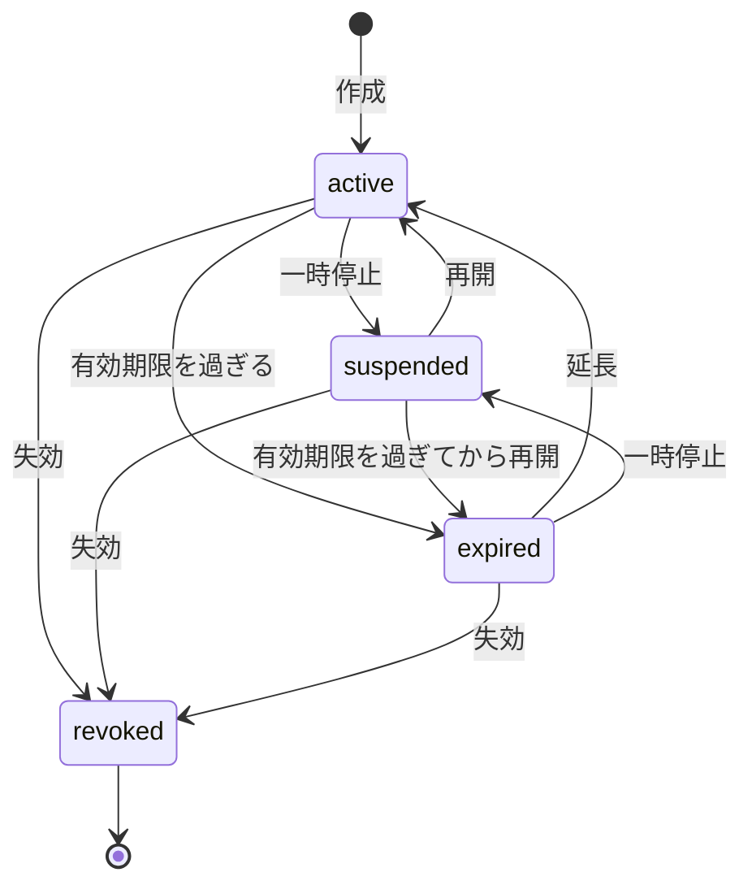
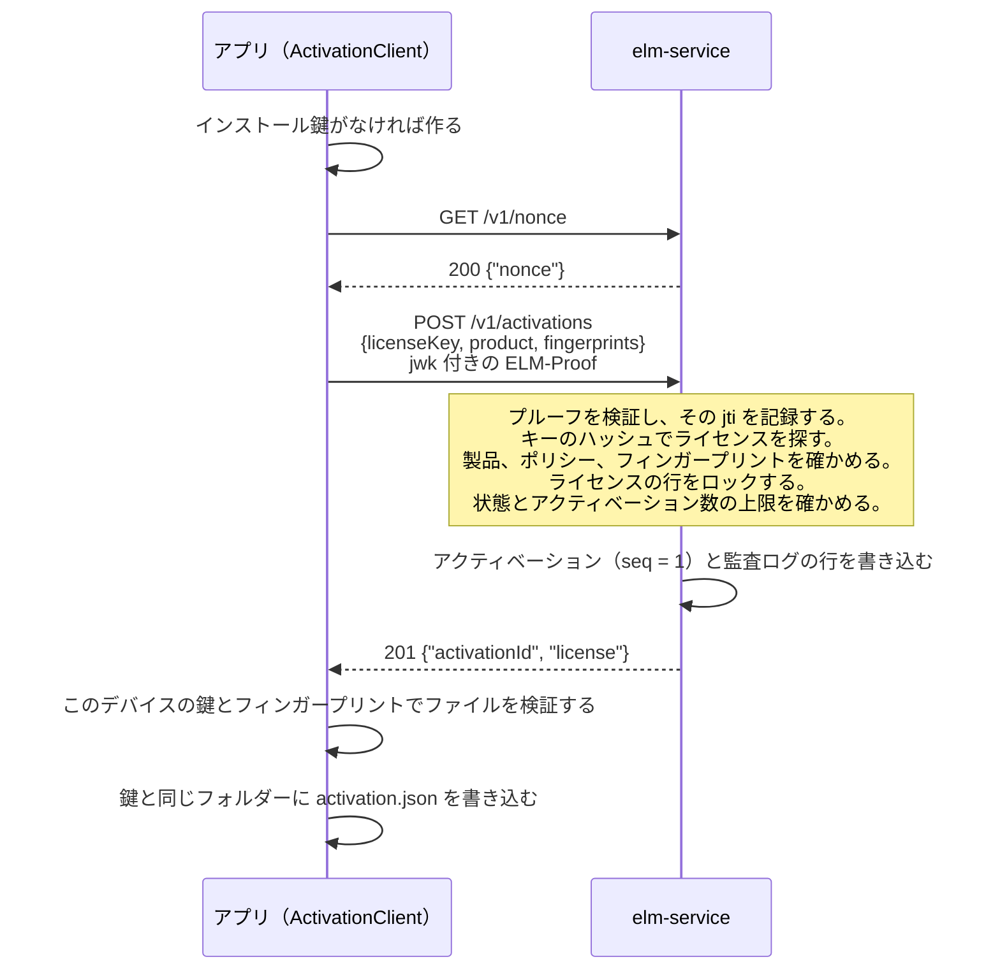
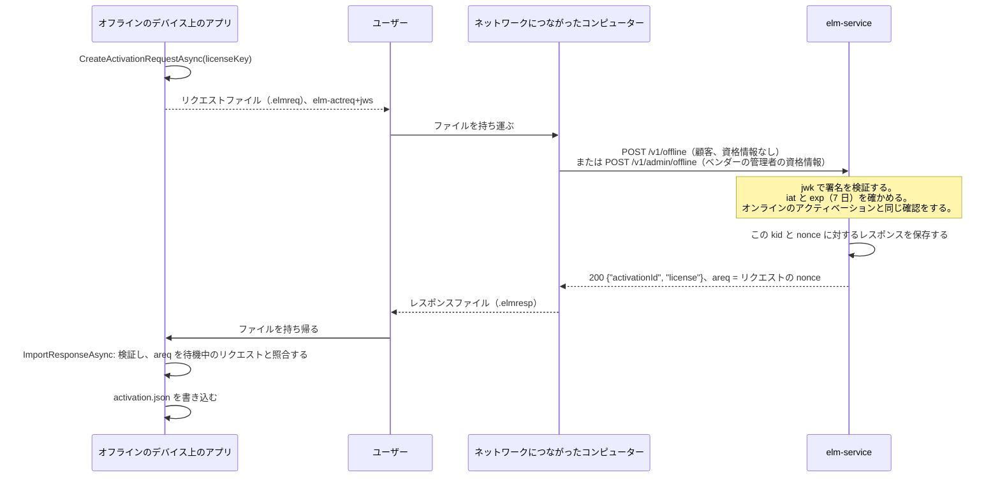
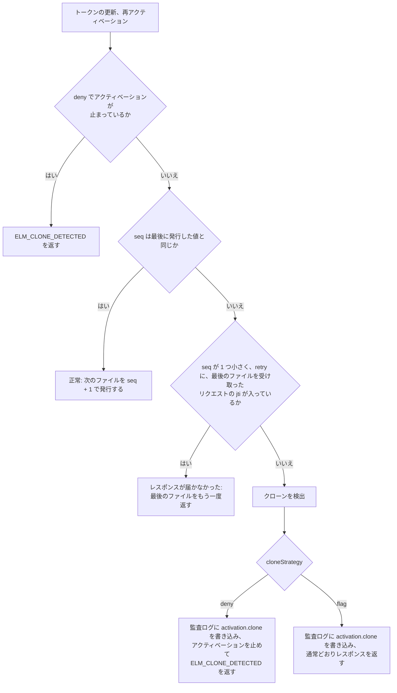

# アクティベーション

このページの読者は、SaaS 型のアクティベーションサービス（`elm-service`）を運用し、ポリシーを選び、販売・課金システムをつなぐベンダーと、`ElasticLM.Client` の `ActivationClient` や `libelasticlm` の `elm_activation_*` 関数をアプリに組み込む開発者だ（[.NET API](../reference/dotnet-api.md#activationclient) と [C API](../reference/c-api.md#アクティベーション) を参照）。このページでは、サービスが製品とライセンスについて何を保持するか、ライセンスキーがどのようにして 1 台のデバイスに紐付いたライセンスファイルになるか、そのファイルをどう更新し、どう返すかを説明する。ネットワークのないデバイスがどう加わるか、クローンした仮想マシンをどう見つけるかも扱う。アクティベーションはインストール鍵と署名付きリクエストを土台にしているので、先に[デバイスとプルーフ](devices-and-proofs.md)を読んでおくとよい。

## アクティベーションの目的

ベンダーは、上限付きのライセンスを販売する。たとえば「この顧客は 3 台のデバイスで製品を使える」というライセンスだ。顧客は、`ELM-7Q2KX-M9D4R-HV0T8-3NPWZ` のような秘密の文字列であるライセンスキーを受け取る。アクティベーションでは、このキーを、アプリがオフラインで検証できるライセンスファイルに換え、そのデバイスを上限の 1 台として数える。

- **アクティベーション**は、ライセンスと 1 つのインストール鍵の結び付きだ。1 件ごとに、ライセンスのアクティベーション数の枠を 1 つ使う。
- サービスが返す**ライセンスファイル**は、そのインストール鍵とデバイスのマシンフィンガープリントに紐付いている。そのため、そのデバイスでしか検証に通らない。
- ファイルの有効期限は短い（既定で 30 日）。そのため、アプリはときどきサービスに接続して**トークンの更新**をする。失効、一時停止、ポリシーの変更がデバイスに届くのはトークンの更新のときで、サービスがクローンしたデバイスに気づくのもこのときだ。
- **アクティベーション解除**をすると、アクティベーションの枠が返る。顧客は、これでライセンスを別のデバイスに移せる。

## サービスから見た製品、ポリシー、ライセンス

`elm-service` が保持するデータのモデルは小さい。ベンダーの販売・課金システムか、管理画面を使う人が、[管理 API](../reference/administration-api.md) を通してこのモデルを作る。

- **製品**は、ベンダーが販売するものだ。製品の `code`（英小文字、数字、`-`）は、アプリがアクティベーションのときに指定する値で、ライセンストークンにも入る。
- **機能**は、製品の一部で、ライセンスが個別に付与できるものだ。機能も `code` で指定し、アプリはこのコードで機能の有無を確かめる。
- **ポリシー**は、1 つの製品のライセンスに適用するルールの組だ。ライセンスの種類、使えるデバイスの台数、ライセンスファイルの有効期間、デバイスへの紐付け方、シートをフローティングにするかを決める。1 つの製品には、ふつう複数のポリシーを用意する。たとえば「標準、1 台」「サイト、10 台」「トライアル」だ。
- **ライセンス**は、顧客が購入したものだ。1 つのポリシーに従い、付与する機能を列挙する。機能ごとに、バージョンの範囲と有効期限を任意で設定できる。ライセンスには、名前（たとえば顧客名）を付ける。任意で、有効期限、ポリシーの値を上書きする `maxActivations`、トークンにそのままコピーされる `meta` の値も持てる。サービスは顧客の情報を独自には持たない。どの顧客にどのライセンス ID を渡したかは、課金システムが管理する。
- **アクティベーション**は、ライセンスを保持する 1 台のデバイスを表し、インストール鍵の[サムプリント](devices-and-proofs.md#インストール鍵)で識別する。フローティングのシートは、アクティベーションでなくリースとして貸し出す（[フローティングライセンス](floating-licenses.md)を参照）。

### ライセンスキー

ライセンスを作成すると、そのレスポンスに一度だけライセンスキーが入る。サービスはキーの SHA-256 しか保存しないので、あとからキーを表示できない。そのため、課金システムはこの時点でキーを顧客に渡す必要がある。たとえば注文確認のメールに記載する。キーは 100 ビットの乱数を含むので、キーを総当たりで試してもハッシュからキーは割り出せない。クライアントもキーを保存しない。

### ライセンスの状態

ライセンスの状態は `active`、`suspended`、`expired`、`revoked` のいずれかだ。複数の状態に当てはまるときは、revoked、suspended、expired の順に優先する。一時停止は再開で元に戻せるが、失効は戻せない。`expired` という状態は保存しない。有効期限を過ぎたライセンスが expired で、有効期限を延長すれば active に戻る。一時停止中や失効したライセンスには、新しいライセンスファイルもリースも発行しない。すでにデバイスにあるファイルは、有効期限まで有効なままだ（[セキュリティモデル](security-model.md)を参照）。

### 販売・課金システムができること

販売・課金システムは、管理 API を通して次のことができる。

- 製品、機能、ポリシーを最初に一度作成し、注文ごとにライセンスを作成する。作成のレスポンスにライセンスキーが入る。
- 状態、名前、または顧客が伝えてきたライセンスキーのハッシュでライセンスを検索する。
- ライセンスの名前、機能、`meta`、`maxActivations` を変更する。サブスクリプションの更新時に有効期限を延長する。支払いに失敗したら一時停止し、支払われたら再開する。契約の終了時や返金時に失効させる。
- ライセンスのアクティベーションを参照し、管理者としてデバイスのアクティベーションを解除する。たとえば顧客がデバイスを紛失したときに使う。
- 顧客に代わってオフラインのリクエストファイル（後述）を提出する。トライアルの記録を参照・削除する。
- アクティベーションをしない `unbound` のライセンスのライセンスファイルを作成する。

変更はどれも、サービスが次に発行するファイルから反映される。すでにデバイスにあるファイルは、有効期限まで元の値のままだ。課金システムは、必要な権限だけを持つ API キーで API を呼び出す。人はロールを持ってログインする。どちらについても、想定する脅威とあわせて[セキュリティモデル](security-model.md)で説明している。各ルートの権限、リクエスト、レスポンスは[管理 API](../reference/administration-api.md) にある。

### ポリシーの設定

ベンダーは、ポリシーごとに次の設定を選ぶ。名前と値は管理 API での表記のとおりだ。

| 設定 | 値 | 既定 | 決めること |
| --- | --- | --- | --- |
| `licenseKind` | `standard`、`trial`、`server` | `standard` | トークンの種類。`server` は `elm-server` 用（[フローティングライセンス](floating-licenses.md)を参照） |
| `binding` | `unbound`、`nodeLocked` | `nodeLocked` | ライセンスをデバイスに紐付けるか。`unbound` のライセンスはアクティベーションをせず、ファイルは管理 API から発行する（[`POST /v1/admin/licenses/{id}/file`](../reference/administration-api.md#post-v1adminlicensesidfile)） |
| `maxActivations` | 1〜100,000 | 1 | 同時にアクティベーションを保持できるデバイスの台数。ライセンスごとに別の値を設定できる |
| `deactivationLimit` | 0〜100,000、またはなし | なし（無制限） | デバイスがこのライセンスのアクティベーション解除をできる回数の合計 |
| `expirationBasis` | `fromIssue`、`fromFirstActivation` | `fromIssue` | ライセンスの `duration` を、作成時から数えるか、最初のアクティベーションから数えるか |
| `duration` | 秒、またはなし | なし（無期限） | ライセンスの有効期間 |
| `tokenLifetime` | 秒 | 30 日 | 1 つのライセンスファイルの有効期間 |
| `refreshWindow` | 秒 | 20 日 | ファイルの有効期限までの残りがこれより短くなると、アプリがトークンの更新をする |
| `gracePeriod` | 秒 | 7 日 | ファイルの有効期限が切れたあと、アプリが動き続けられる期間 |
| `fingerprintMatching` | `ignore`、`any`、`all` | `any` | マシンフィンガープリントの照合方法（[デバイスとプルーフ](devices-and-proofs.md)を参照） |
| `cloneStrategy` | `deny`、`flag` | `deny` | クローンを検出したときの動作（後述）。クラウドのフローティングのポリシーは、クローンされたリースにもこれを適用する。サーバーライセンス用のポリシーは、これをサーバーライセンスに書き込むこともする（[再試行とクローン](floating-licenses.md#再試行とクローン)） |
| `floating` | `none`、`onPremises`、`cloud` | `none` | シートをリースとして貸し出すか。貸し出すなら、顧客の `elm-server` と `elm-service` のどちらが貸し出すか |
| `leaseDuration` | 2 分〜24 時間（秒で指定） | 10 分 | 1 つのリースの有効期間。この期間内にリースの更新が必要になる |
| `overage` | パーセント、またはなし | なし | 購入したシート数を超えて貸し出せるシートの数 |
| `borrowLimit` | 秒、またはなし | なし（借用できない） | ネットワークから離れて使うためにリースを借用できる最長の期間 |
| `borrowReturnLimit` | 0〜1,000 | 2 | 30 日間に借用を早期返却できる回数 |
| `clientInfoStrategy` | `none`、`hostAndUser` | `none` | アプリが送るホスト名と OS のユーザー名をサービスが保存するか |
| `trialDuration` | 秒 | 14 日 | `trial` のポリシーでのトライアルの期間 |

フローティングの設定は[フローティングライセンス](floating-licenses.md)で説明している。製品でトライアルを提供するには、製品の `trialPolicyId` に `trial` のポリシーを 1 つ指定する（後述の「トライアル」を参照）。

ポリシーは、ライセンスを発行したあとでも変更できる。ただし `licenseKind` と `binding` は変更できない。発行済みのトークンの形式が変わってしまうからだ。

## オンラインでのアクティベーション

アプリは、ユーザーが入力したキーを渡して `ActivateAsync` を呼ぶ。リクエストには、製品のコード、デバイスのすべてのフィンガープリント、公開鍵（`jwk`）を含むプルーフ（所有証明）が入る。任意のメンバーは `client` と `app` だ。`client` はホスト名と OS のユーザー名で、アプリが `SendClientInfo` を設定したときだけ送り、ポリシーが `hostAndUser` のときだけ保存する。`app` はアプリのバージョンで、ログに使う。

サービスは次の順に確かめる。

1. 送信元のアドレスごとのレート制限（`rateLimit.clientPerIp`、既定は毎秒 20 リクエスト）。プルーフを確かめたあとは、インストール鍵ごとのレート制限（`rateLimit.clientPerKey`、既定は毎秒 2 リクエスト）。
2. プルーフ（[デバイスとプルーフ](devices-and-proofs.md)を参照）。
3. ライセンス。形式の正しくないキーも、登録されていないキーも、`404` と `ELM_LICENSE_NOT_FOUND` になる。別の製品のキーは、アクティベーションを作る前に `ELM_WRONG_PRODUCT` になる。そのため、キーを間違ったアプリに入力しても、そのアプリでは返せないアクティベーションを使ってしまうことはない。
4. ポリシー。`unbound` のライセンスと、`floating` が `cloud` のポリシーは、`409` と `ELM_CONFLICT` になる。フィンガープリントを照合するポリシーなのにフィンガープリントが送られていなければ、`ELM_FINGERPRINT_UNAVAILABLE` になる。
5. ライセンスの状態。ライセンスの行をロックしてから確かめる。結果は `ELM_LICENSE_REVOKED`、`ELM_LICENSE_SUSPENDED`、`ELM_EXPIRED` のいずれかになる。
6. この鍵が、このライセンスのアクティベーションをすでに持っているか。持っていれば、このリクエストは再アクティベーションだ。アクティベーション数には重ねて数えず、`seq` を後述の「シーケンス番号によるクローン検出」のとおりに確かめる。
7. 上限。ライセンスのアクティベーションがすでに `maxActivations` 件あれば、`409` と `ELM_ACTIVATION_LIMIT` になる。あとで `maxActivations` を下げても、既存のアクティベーションは消えない。
8. `fromFirstActivation` のライセンスにまだ有効期限がなければ、現在時刻に `duration` を足した時刻を有効期限にする。

そのうえでサービスは、ライセンスファイルに署名する。このファイルのトークンには、鍵のサムプリント、フィンガープリント、シーケンス番号（`seq` = 1）が入る。有効期限は、現在時刻に `tokenLifetime` を足した時刻と、ライセンス自体の有効期限のうち早いほうだ。アクティベーションは行をロックしたうえで数えるので、最後の 1 枠を 2 台のデバイスが同時に取りにきても、両方が取ることはない。クライアントは、ファイルを保存する前に、このデバイスの鍵とフィンガープリントで検証する。そのため、壊れたレスポンスや改ざんされたレスポンスで、正しいファイルが置き換わることはない。

### アプリが保存するアクティベーションファイル

クライアントは、インストール鍵のフォルダーに `activation.json` を保存する。中身は、アクティベーション ID、最後に受け取った `seq`、ライセンスファイル、再試行とオフラインのリクエストに使う管理情報だ。ライセンスキーは入らない。`Check` はこのファイルを読み、鍵、現在のフィンガープリント、時刻巻き戻し対策を使ってオフラインで検証する。アクティベーションがなければ `ELM_LICENSE_NOT_FOUND` を返す。

1 台のデバイスで同じアプリのプロセスが複数動くときは、このファイルを共有する。同じ場所に置くロックファイル `activation.lock` によって、アクティベーション、トークンの更新、アクティベーション解除を一度に実行できるのは 1 つのプロセスだけになる。各プロセスは、ロックを取ってから最新の `seq` を読む。ロックが効かないファイルシステム（一部のネットワークファイルシステム）では、複数のプロセスが同時にトークンを更新すると、クローンと誤って判定されることがある。

トライアル以外のアクティベーションを保存しているアプリは、アクティベーション解除をするまで別のライセンスをアクティベーションできない。`ActivateAsync` は `ELM_INVALID_STATE` を返す。トライアルを保存しているアプリは、購入したライセンスをアクティベーションできる。そのデバイスのトライアルは、購入したライセンスに置き換わる。

## トークンの更新

クライアントは、ファイルの有効期限から `refreshWindow` を引いた時刻にタイマーを設定する。既定の値では、ファイルの発行から 10 日後だ。その時刻になると、クライアントは本文に `{seq}` を入れ、プルーフを付けて [`POST /v1/activations/{id}/refresh`](../reference/device-protocol.md#post-v1activationsidrefresh) を送る。アプリが `RefreshAsync` を呼んでもよい。

サービスは、プルーフの鍵がアクティベーションの鍵と一致するか（一致しなければ `ELM_PROOF_INVALID`）、ライセンスの状態、クローン検出のための `seq`（後述）を確かめる。問題がなければ、`seq` を 1 つ上げた新しいファイルを返す。ポリシーの変更、延長した有効期限、一時停止、失効がデバイスに届くのはこのときだ。クライアントは新しいファイルを受け入れるときに、トークンの `iat` を時刻巻き戻し対策にも渡す。そのため、時計を進めてから戻したユーザーも、動けない状態から抜け出せる。

## アクティベーション解除

アプリが `DeactivateAsync` を呼ぶと、`{seq}` とプルーフを付けた [`POST /v1/activations/{id}/deactivate`](../reference/device-protocol.md#post-v1activationsiddeactivate) が送られる。サービスは鍵と `seq` を確かめ、アクティベーションの枠を空けて `204` を返す。クライアントはそのあと `activation.json` を削除する。インストール鍵は削除しない。同じフォルダーにある借用中のリース、サーバーのピン、時刻巻き戻し対策の状態が、この鍵を必要とするからだ。

ベンダーの管理者も、管理画面か管理 API（[`POST /v1/admin/activations/{id}/deactivate`](../reference/administration-api.md#post-v1adminactivationsiddeactivate)）から、どのアクティベーションでもプルーフなしで解除できる。デバイスを紛失したとき、`activation.json` が壊れたとき、クローン検出で止まったデバイスを戻すときは、この方法を使う。

`deactivationLimit` は、デバイス自身によるアクティベーション解除を、オンラインとオフラインの両方について、ライセンスの全期間を通して数える。管理者によるアクティベーション解除は数えないので、運用上の移し替えは制限されない。上限に達すると、デバイスには `409` と `ELM_DEACTIVATION_LIMIT` が返る。

## ファイルの受け渡しによるオフラインのアクティベーション

インターネットに一度もつながらないデバイスもある。そうしたデバイスでは、人がファイルを持ち運び、デバイスとサービスにつながるコンピューターとの間で受け渡す。

リクエストファイルは、種類が `elm-actreq+jws` の JWS で、プルーフの代わりにインストール鍵で署名する。中身は、ライセンスキー、製品、フィンガープリント、公開鍵、128 ビットの乱数の `nonce`、作成から 7 日後の有効期限だ。ライセンスキーを含むので、ほかの人が読める場所に置いたままにしないこと。

ファイルを提出する方法は 2 つある。

- **顧客**が、ネットワークにつながったコンピューターで `elm offline process --url <service URL> --in <request file> --out <response file>` を実行する。資格情報がなければ、このコマンドは公開エンドポイントの [`POST /v1/offline`](../reference/device-protocol.md#post-v1offline) を使う。
- **ベンダーの管理者**が顧客に代わって提出する。管理画面のオフラインのページを使うか、`elm offline process` を API キー（`ELM_API_KEY`）付きで、または `elm admin login` のあとに実行する。どちらも [`POST /v1/admin/offline`](../reference/administration-api.md#post-v1adminoffline) を使い、ファイルごとに監査ログに 1 行を書き込む。

公開エンドポイントが資格情報を求めないのは、ファイルがオンラインのリクエストと同じだけのことを証明するからだ。アクティベーションのリクエストはインストール鍵で署名され、ライセンスキーを含む。トークンの更新のリクエストは、アクティベーションに記録された鍵で署名されていなければならない。

次のルールにより、この受け渡しは何度繰り返しても安全だ。

- サービスは、リクエストごとに返したレスポンスを、鍵のサムプリントと `nonce` で引けるように保存する。レスポンスをなくしたユーザーは、同じリクエストファイルをもう一度提出すれば、同じレスポンスを受け取れる。同じ鍵から、同じ `nonce` の別のリクエストが来たら `ELM_REPLAYED` になる。
- レスポンスはリクエストに署名した鍵に紐付くので、別のデバイスでは失敗する。同じデバイスで 2 回取り込んでも問題はない。
- アプリがレスポンスを取り込むのは、トークンの `areq` クレームが、待機中のリクエストの `nonce` と一致するときだけだ。一致しなければ `ELM_REQUEST_MISMATCH` になる。
- レスポンスを取り込むまで、アプリは新しいリクエストを作らず、待機中の同じリクエストをもう一度渡す。待機中のリクエストがデバイスの時計で 7 日より古くなると、アプリは古いリクエストを `retry` に指定した新しいリクエストを作る。こうすれば、サービスが処理済みのリクエストがクローンと誤って判定されない。デバイスの時計が遅れていて、サービスが `ELM_REQUEST_EXPIRED` でリクエストを拒否したときは、アプリは `renew` を渡して、すぐに新しいリクエストを作れる。

**オフラインでのトークンの更新**も同じ手順だ。`CreateRefreshRequestAsync` が、アクティベーション ID と最後に受け取った `seq` を入れたリクエストを書き出す。既定の値（ファイルは 30 日、猶予期間は 7 日）では、一度もオンラインにならないデバイスでも、少なくとも 37 日ごとに誰かがトークンの更新のリクエストとそのレスポンスを運べば動き続ける。ベンダーは、オフラインの顧客に `tokenLifetime` の長いポリシーを割り当ててもよい。`elm-server` の場合は、顧客の管理者が `elm server refresh-request` で同じことをする。

**オフラインでのアクティベーション解除**では、`CreateDeactivationProofAsync` がアクティベーション ID と最後に受け取った `seq` を入れた `elm-deact+jws` に署名し、保存していたライセンスファイルを削除して、プルーフを保存する。サービスは、このプルーフが提出されたときにアクティベーションの枠を空ける。アプリには、プルーフがいつ提出されたかを知る方法がない。サービスにまだ古いアクティベーションが残っている間にもう一度アクティベーションすると、クローンに見えてしまう。そのため、ユーザーがプルーフを提出したと伝え、アプリが `ForgetDeactivationProofAsync` を呼ぶまで、アプリは新しいアクティベーションを拒否する。

サービスの URL を指定せずに作ったクライアントは、オフラインでだけ動き、トークンの更新のタイマーを設定しない。トークンの更新のリクエストをいつ作るかは、ライセンスの `ExpiresAt` と `RefreshWindow` を見てアプリが決める。

`elm offline process` と `elm admin login` のオプションは、[elm コマンドリファレンス](../reference/elm-cli.md)を参照。

## トライアル

トライアルでは、デバイスがキーなしで、期間を限って製品を使える。アプリが `StartTrialAsync` を呼ぶと、製品のコード、フィンガープリント、公開鍵付きのプルーフを入れた [`POST /v1/trials`](../reference/device-protocol.md#post-v1trials) が送られる。トライアルはオンラインでしか始められない。

- 製品にトライアルのポリシー（`trialPolicyId`）が指定されている必要がある。指定がないときや、登録されていない製品のときは、`404` と `ELM_TRIAL_NOT_OFFERED` が返る。
- サービスは、トライアルを製品とフィンガープリントの組ごとに記録する。デバイスのフィンガープリントのどれかで、この製品のトライアルがすでに記録されていれば、同じインストール鍵からでも `409` と `ELM_TRIAL_USED` が返る。
- そうでなければ、キーのないライセンスを作成する。名前は `trial`、有効期間は `trialDuration` で、その時点の製品の機能をすべて含む。サービスはこのライセンスを、この鍵でアクティベーションする。ファイルに猶予期間はない。
- トライアルのポリシーは、`nodeLocked` で、フィンガープリントを照合する設定（`any` か `all`）にし、`gracePeriod` を 0 にする必要がある。フィンガープリントを 1 つも作れないデバイスでは、トライアルを始められない。
- トライアルも、ほかのアクティベーションと同じようにトークンの更新とクローンの確認を受ける。アクティベーション解除をしたり、`deny` で止まったりすると、トライアルは終わる。トライアルのライセンスには、もう一度アクティベーションするためのキーがないからだ。そのデバイスで新しいトライアルを始められるのは、管理者がトライアルの記録を削除したときだけだ。

OS のマシン ID を書き換えると、デバイスのフィンガープリントが変わり、新しいトライアルを始められる。これを許容している理由は[セキュリティモデル](security-model.md)で説明している。

## シーケンス番号によるクローン検出

仮想マシンをコピーすると、インストール鍵、マシン ID、`activation.json` もコピーされる。そのため、2 つのコピーが同じアクティベーションを持つ。クローンを見つけるために、サービスはマシン ID ではなくシーケンス番号（`seq`）を監視する。この方法は、OAuth のリフレッシュトークンのローテーション（RFC 9700）と同じだ。新しいファイルを発行するたびに `seq` を 1 つ上げ、最後に発行した値と、それを受け取ったリクエストを記録しておく。トークンの更新、アクティベーション解除、再アクティベーションでは、デバイスが最後に受け取った `seq` を毎回送る。先に進めるのは、どちらか一方のコピーだけだ。コピー A がトークンの更新で 5 から 6 に進むと、コピー B は 5 のままになる。B が次にリクエストを送った時点で、別のコピーが先に進んだことが分かる。

トークンの更新、アクティベーション解除、再アクティベーションのたびに、サービスは受け取った `seq` を、最後に発行した値と比べる。リクエストはそれぞれ自分の ID（`jti`）を持ち、リクエストの `retry` のリストには、レスポンスが届かなかった前のリクエストの `jti` が入る（後述）。トークンの更新と再アクティベーションでは、次のように判定する。

1. 両者が等しければ、正常なリクエストだ。サービスは `seq` を 1 つ上げた次のファイルを発行する。
2. 受け取った `seq` が 1 つ小さく、`retry` に最後のファイルを受け取ったリクエストの `jti` が入っていれば、そのリクエストへのレスポンスが届かなかったと判断する。サービスは最後のファイルをもう一度返す。こう判定されたオフラインのリクエストファイルには、代わりに次のファイルを返す。
3. それ以外はクローンの検出だ。そのあとの動作は、ポリシーの `cloneStrategy` で決まる（後述）。

アクティベーション解除も同じ確認を通る。`seq` が最後の値のとき、または 1 つ小さく `retry` が合うときは、ファイルを発行する代わりにアクティベーションを削除する。`deny` で止まったアクティベーションでは、最後に発行した `seq` を付けたアクティベーション解除だけが通る（後述）。

レスポンスが届かなかっただけで、クローンと判定してはいけない。トークンの更新のレスポンスが届かなかった場合、サービスは次の `seq` に進んでいるのに、デバイスは古い `seq` を持ったままになる。そこでクライアントは、レスポンスを受け取れなかったリクエストの `jti` を、本文の `retry` のリストに入れて送る（16 個まで）。サービスが「1 つ小さい」を再試行として扱うのは、最後のファイルを受け取ったリクエストそのものが `retry` に入っているときだけだ。クローンしたコピーはこの確認を通れない。もう一方のコピーが送ったリクエストの `jti` を知りようがないからだ。`seq` が 2 つ以上小さいとき、大きいとき、ないときは、常にクローンと判定する。

そのあとの動作は、ポリシーの `cloneStrategy` が決める。

- **`deny`**（既定）は、アクティベーションを止める。以降のトークンの更新と再アクティベーションはすべて `ELM_CLONE_DETECTED` になる。クライアントは状態を `CloneDetected` にして、トークンの更新をやめる。受け付けるのは、先に進んだコピーから、最後に発行した `seq` を付けて送られたアクティベーション解除だけだ。これも、デバイスによるほかのアクティベーション解除と同じく `deactivationLimit` に数える。もう一方のコピーは、管理者しか削除できない。そうしないと、古いコピーがアクティベーションの枠を空け、もう一度アクティベーションして、今度は相手のコピーを止めることができてしまう。これを繰り返せば、2 つのコピーが 1 つのアクティベーションをいつまでも共有できる。
- **`flag`** は、監査ログに行（`activation.clone`）を書き込み、通常どおりレスポンスを返す。ベンダーはクローンを把握し、どう対処するかを決める。

## ネットワークにつながらないとき

アプリは、手元のファイルで動き続ける。`Check` にネットワークは要らない。トークンの更新に失敗すると、クライアントの状態は `RefreshFailing` になる。クライアントは 1 時間ごとに再試行する。サービスが `Retry-After` を返したときは、その時間が経ってから再試行する（最長 24 時間）。既定の値では、最初にトークンを更新する時期は 10 日目だ。ファイルは 30 日目まで有効で、猶予期間は 37 日目まで続く。猶予期間中は検証の結果が `InGracePeriod` になるので、アプリはユーザーに警告を出せる。猶予期間を過ぎると、トークンの更新が成功するまで `Check` は `ELM_EXPIRED` を返す。

レスポンスによっては、状態の変わり方が異なる。

| トークンの更新へのレスポンス | 保存したファイル | 状態 |
| --- | --- | --- |
| `ELM_ACTIVATION_NOT_FOUND`（管理者が削除した） | 削除する | `None` |
| `ELM_CLONE_DETECTED` | 残す | `CloneDetected`。以後、トークンを自動では更新しない |
| `ELM_LICENSE_REVOKED`、`ELM_LICENSE_SUSPENDED`、`ELM_EXPIRED` | 残す | `Refused` |
| `ELM_PROOF_INVALID`（鍵が変わった） | 残す | `RefreshFailing`。以後、トークンを自動では更新しない |
| ネットワークのエラー、`5xx`、`429` | 残す | `RefreshFailing` |
| 成功のレスポンスだが保存できない（検証に通らない、または書き込めない） | 残す。リクエストの `jti` は `retry` に残る | `RefreshFailing` |

最後の行の場合、サービスはすでに `seq` を進めている。そのため、次のリクエストでは、クローンでなく再試行と判定されるように、その `jti` を指定する必要がある。保存したファイルは、有効期限に猶予期間を足した時点まで使える。アプリは状態の変化を `StateChanged` イベントで知る。

## 起こりうる問題と対処

- **失効と一時停止はすぐには反映されない。** デバイスにあるファイルは、有効期限に猶予期間を足した時点（既定で 37 日）まで有効だ。もっと早く止める必要があるベンダーは、`tokenLifetime` と `gracePeriod` を短くする。[セキュリティモデル](security-model.md)を参照。
- **オフラインのままのコピーしたデバイスや、アクティベーション解除のあとに戻したライセンスファイルのコピーは検出できない。** `tokenLifetime` を短くし、`deactivationLimit`（既定では制限しない）を設定すれば、被害を抑えられる。[セキュリティモデル](security-model.md)を参照。
- **新しいオフラインのリクエストファイルを提出したあとに古いものを提出すると、クローンに見える。** サービスは、アクティベーションごとに最新のオフラインのレスポンスしか保存しない。そのため、古いリクエストは 2 つ遅れていると判定され、`deny` ならアクティベーションが止まる。ユーザーは、新しいリクエストファイルを作ったら古いものを捨てる必要がある。待機中のリクエストが置き換わったときは、アプリに通知が届く（`Replaced`）。1 台のデバイスでオンラインとオフラインのトークンの更新を混ぜるときも、同じ注意が必要だ。
- **`activation.json` が壊れた場合、アクティベーションが止まった場合。** ファイルが壊れていると、`Check` は `ELM_MALFORMED` を返す。もう一度アクティベーションしても最後の `seq` を送れないので、クローンに見える。`deny` で `ELM_CLONE_DETECTED` になったあとは、遅れているほうのコピーは自力では戻れない。どちらの場合も、管理者が古いアクティベーションを解除し、ユーザーがもう一度アクティベーションする。その前に、監査ログで `activation.clone` の行を確認する。この行には、鍵のサムプリント、送られた `seq`、最後に発行した `seq` が記録されている。
- **コンテナ。** マシン ID のないコンテナでは `ELM_FINGERPRINT_UNAVAILABLE` になる。再起動のたびに鍵のフォルダーを失うコンテナは、そのたびに新しいアクティベーションを使う。[デバイスとプルーフ](devices-and-proofs.md)を参照。

すべてのエラーコードとその対処は、[エラーコード](../reference/error-codes.md)を参照。`activation.clone` などの監査ログの行とアクションは、[ログ](../reference/logs.md)を参照。
