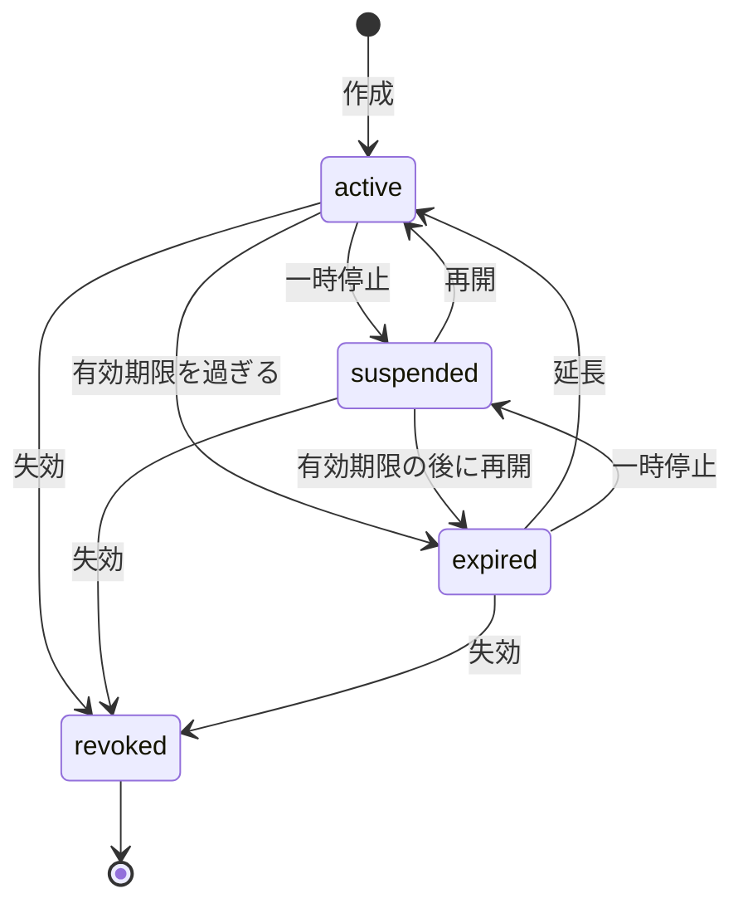
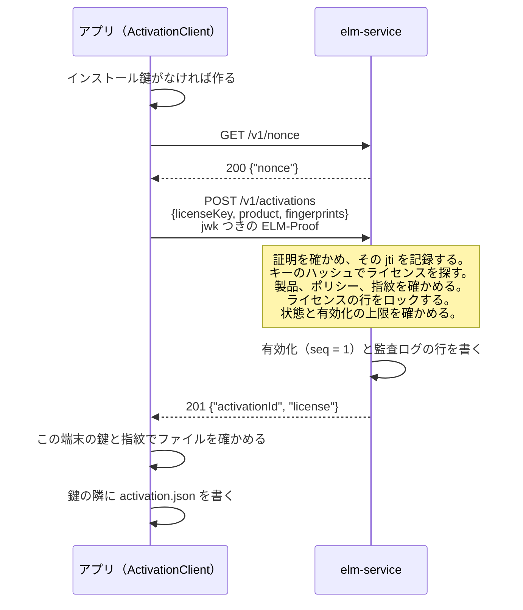
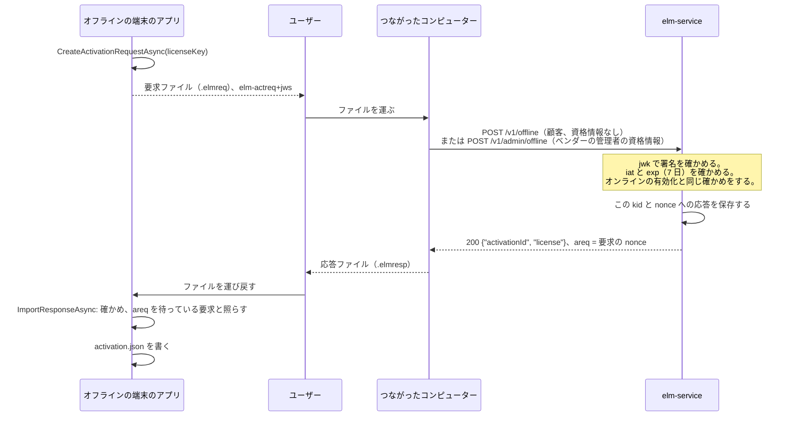

# 有効化

このページは、SaaS 型の認証サーバー（`elm-service`）を動かし、ポリシーを選び、販売や課金のシステムをつなぐベンダーと、`ElasticLM.Client` の `ActivationClient` や `libelasticlm` の `elm_activation_*` 関数を組み込むアプリの開発者に向けたものだ。まず、サービスが製品とライセンスについて何を持つかと、ライセンスキーがどうやって 1 台の端末に紐づいたライセンスファイルになるかを説明する。続いて、そのファイルをどう更新し、どう返すか、ネットワークのない端末がどう加わるか、複製した仮想マシンをどう見つけるかを説明する。先に [端末と証明](devices-and-proofs.md) を読んでほしい。有効化は、インストール鍵と署名つきの要求の上に成り立っている。

## 有効化は何のためにあるか

ベンダーは、上限つきのライセンスを売る。たとえば「この顧客は 3 台の端末で製品を使ってよい」というものだ。顧客はライセンスキーを受け取る。ライセンスキーは `ELM-7Q2KX-M9D4R-HV0T8-3NPWZ` のような秘密の文字列だ。有効化は、このキーを、アプリがオフラインで確かめられるライセンスファイルに変え、その端末を上限の 1 台として数える。

- **有効化**は、ライセンスと 1 つのインストール鍵の結びつきだ。ライセンスの有効化の枠を 1 つ使う。
- サービスが返す**ライセンスファイル**は、そのインストール鍵と端末のマシン指紋に紐づいているので、その端末でしか検証に通らない。
- ファイルの有効期限は短い（既定で 30 日）。そのため、アプリはときどきサービスに戻ってファイルを**更新**する。失効、一時停止、ポリシーの変更が端末に届くのは更新のときで、サービスが複製した端末に気づくのも更新のときだ。
- **解除**は有効化の枠を返す。顧客はそれでライセンスを別の端末に移せる。

## サービスから見た製品、ポリシー、ライセンス

`elm-service` が持つモデルは小さい。ベンダーの販売や課金のシステム、または管理画面を使う人が、管理 API を通してこれを組み立てる。

- **製品**は、ベンダーが売るものだ。製品の `code`（英小文字、数字、`-`）は、アプリが有効化のときに名指しするもので、ライセンストークンにも入る。
- **機能**は、製品の一部で、ライセンスが単独で与えられるものだ。これも `code` で名指しする。アプリは、このコードで機能があるかを確かめる。
- **ポリシー**は、1 つの製品のライセンスのための規則の組だ。どんな種類のライセンスか、何台の端末で使えるか、ライセンスファイルがどれだけ持つか、端末にどう紐づけるか、席がフローティングかを決める。1 つの製品は、ふつういくつかのポリシーを持つ。たとえば「標準、1 台」「サイト、10 台」「試用」だ。
- **ライセンス**は、顧客が買ったものだ。1 つのポリシーに従い、与える機能を並べる。機能ごとに、任意でバージョンの範囲と有効期限を持てる。ライセンスは名前（たとえば顧客の名前）、任意の有効期限、ポリシーの値を上書きする任意の `maxActivations`、トークンに写される任意の `meta` の値を持つ。サービスは顧客の記録を持たない。課金システムが、自分の顧客とライセンスの ID の結びつきを持つ。
- **有効化**は、ライセンスを持つ 1 台の端末で、インストール鍵の拇印で名指しする。フローティングの席は、有効化ではなくリースとして貸す（[フローティングライセンス](floating-licenses.md) を参照）。

### ライセンスキー

ライセンスを作ると、その答えにライセンスキーが一度だけ入る。サービスはキーの SHA-256 だけを保存し、キーを二度と見せられない。そのため、課金システムはその時点でキーを顧客に渡す必要がある。たとえば注文のメールに入れる。キーは 100 ビットの乱数を持つので、キーを片端から試しても、ハッシュからキーを割り出せない。クライアントもキーを保存しない。

### ライセンスの状態

ライセンスの状態は `active`、`suspended`、`expired`、`revoked` のどれかだ。複数が当てはまるときは、revoked、suspended、expired の順で先のものになる。一時停止は再開で元に戻せるが、失効は戻せない。`expired` は保存しない。有効期限を過ぎたライセンスが expired で、有効期限を延ばせば、また active になる。一時停止したライセンスと失効したライセンスは、新しいライセンスファイルもリースも受け取れない。既に端末にあるファイルは、有効期限まで有効なままだ（[安全性のモデル](security-model.md) を参照）。

### 販売や課金のシステムがすること

販売や課金のシステムは、管理 API を通して次のことができる。

- 製品、機能、ポリシーを一度作り、注文ごとにライセンスを作る。作成の答えにライセンスキーが入る。
- 状態、名前、または顧客が伝えてきたライセンスキーのハッシュで、ライセンスを探す。
- ライセンスの名前、機能、`meta`、`maxActivations` を変える。サブスクリプションが続けば有効期限を延ばし、支払いに失敗すれば一時停止し、支払われれば再開し、契約が終わるか返金したら失効させる。
- ライセンスの有効化を読み、管理者として端末の有効化を解除する。たとえば顧客が端末をなくしたときだ。
- 顧客に代わってオフラインの要求ファイル（後述）を渡し、試用の記録を読んで消す。
- 有効化しない `unbound` のライセンスのために、ライセンスファイルを作る。

どの変更も、サービスが次に出すファイルから効く。既に端末にあるファイルは、有効期限まで元の値を持つ。課金システムは、必要な許可だけを持つ API キーで API を呼び、人は役割を持ってログインする。どちらも、それを狙う脅威とあわせて [安全性のモデル](security-model.md) で説明している。

### ポリシーの設定

ベンダーは、ポリシーごとに次の設定を選ぶ。名前と値は、管理 API での書き方のとおりだ。

| 設定 | 値 | 既定 | 決めること |
| --- | --- | --- | --- |
| `licenseKind` | `standard`、`trial`、`server` | `standard` | トークンの種類。`server` は `elm-server` 用（[フローティングライセンス](floating-licenses.md) を参照） |
| `binding` | `unbound`、`nodeLocked` | `nodeLocked` | ライセンスを端末に紐づけるか。`unbound` のライセンスは有効化せず、ファイルは管理 API から受け取る |
| `maxActivations` | 1〜100,000 | 1 | 同時に有効化を持てる端末の数。ライセンスが自分の値を持てる |
| `deactivationLimit` | 0〜100,000、またはなし | なし（無制限） | 端末がこのライセンスを解除できる回数の合計 |
| `expirationBasis` | `fromIssue`、`fromFirstActivation` | `fromIssue` | ライセンスの `duration` を、作ったときから数えるか、最初の有効化から数えるか |
| `duration` | 秒、またはなし | なし（無期限） | ライセンスの長さ |
| `tokenLifetime` | 秒 | 30 日 | 1 つのライセンスファイルが有効な長さ |
| `refreshWindow` | 秒 | 20 日 | ファイルの有効期限までの残りがこれより短くなると、アプリが更新する |
| `gracePeriod` | 秒 | 7 日 | ファイルの有効期限の後、アプリが動き続ける長さ |
| `fingerprintMatching` | `ignore`、`any`、`all` | `any` | マシン指紋の照合のしかた（[端末と証明](devices-and-proofs.md) を参照） |
| `cloneStrategy` | `deny`、`flag` | `deny` | 複製を検出したときにどうするか（後述） |
| `floating` | `none`、`onPremises`、`cloud` | `none` | 席をリースとして貸すか。貸すなら顧客の `elm-server` か `elm-service` のどちらが貸すか |
| `leaseDuration` | 2 分〜24 時間、秒で指定 | 10 分 | 1 つのリースが、更新が必要になるまで続く長さ |
| `overage` | パーセント、またはなし | なし | 買った席の数を超えて貸せる席の数 |
| `borrowLimit` | 秒、またはなし | なし（借り出しなし） | ネットワークから離れて使うためにリースを借り出せる最長の時間 |
| `borrowReturnLimit` | 0〜1,000 | 2 | 30 日の間に借り出しを早期返却できる回数 |
| `clientInfoStrategy` | `none`、`hostAndUser` | `none` | アプリが送るホスト名と OS のユーザー名をサービスが保存するか |
| `trialDuration` | 秒 | 14 日 | `trial` のポリシーでの試用の長さ |

フローティングの設定は [フローティングライセンス](floating-licenses.md) で説明している。製品は、`trialPolicyId` に `trial` のポリシーを 1 つ指定すると試用を出せる（後述の「試用」を参照）。

ポリシーは、ライセンスを出した後でも変えられる。ただし `licenseKind` と `binding` は変えられない。既に出したトークンの形が変わってしまうからだ。

## オンラインの有効化

アプリは、ユーザーが入力したキーで `ActivateAsync` を呼ぶ。要求は、製品のコード、端末のすべての指紋、公開鍵（`jwk`）を含む証明を持つ。任意のメンバーは `client` と `app` だ。`client` はホスト名と OS のユーザー名で、アプリが `SendClientInfo` を設定したときだけ送り、ポリシーが `hostAndUser` のときだけ保存する。`app` はアプリのバージョンで、ログのためのものだ。

サービスは次の順に確かめる。

1. 送信元のアドレスごとの頻度の制限（`rateLimit.clientPerIp`、既定は毎秒 20 要求）と、証明の後に確かめるインストール鍵ごとの頻度の制限（`rateLimit.clientPerKey`、既定は毎秒 2 要求）。
2. 証明（[端末と証明](devices-and-proofs.md) を参照）。
3. ライセンス。形の誤ったキーと知らないキーは、どちらも `404` と `ELM_LICENSE_NOT_FOUND` になる。別の製品のキーは、有効化を作る前に `ELM_WRONG_PRODUCT` になる。そのため、間違ったアプリに入力したキーが、そのアプリでは決して返せない有効化を使ってしまうことはない。
4. ポリシー。`unbound` のライセンスと、`floating` が `cloud` のポリシーは、`409` と `ELM_CONFLICT` になる。指紋を照合するポリシーで指紋が送られていなければ、`ELM_FINGERPRINT_UNAVAILABLE` になる。
5. ライセンスの状態。ライセンスの行のロックの下で確かめ、`ELM_LICENSE_REVOKED`、`ELM_LICENSE_SUSPENDED`、`ELM_EXPIRED` のどれかになる。
6. この鍵が、このライセンスの有効化を既に持っているか。持っていれば、要求は再有効化だ。もう一度数えることはなく、その `seq` は後述の「複製の検出」のとおりに確かめる。
7. 上限。ライセンスが既に `maxActivations` 個の有効化を持っていれば、`409` と `ELM_ACTIVATION_LIMIT` になる。後で `maxActivations` を下げても、既にある有効化は消えない。
8. `fromFirstActivation` のライセンスで、まだ有効期限がなければ、有効期限を今に `duration` を足した時刻にする。

そのうえでサービスは、トークンが鍵の拇印、指紋、更新番号（`seq` = 1）を名指しするライセンスファイルに署名する。有効期限は、今に `tokenLifetime` を足した時刻か、ライセンス自身の有効期限のうち早いほうだ。有効化は行のロックの下で数えるので、最後の 1 枠を 2 台の端末が同時に取りに来ても、両方が取ることはない。クライアントは、ファイルを保存する前に、この端末の鍵と指紋で確かめる。そのため、壊れた応答や改ざんされた応答が正しいファイルを置き換えることはない。

### アプリが持つ有効化のファイル

クライアントは、インストール鍵のフォルダーに `activation.json` を持つ。中身は、有効化の ID、最後の `seq`、ライセンスファイル、再試行とオフラインの要求に使う記録で、ライセンスキーは含まない。`Check` はこれを読み、鍵、今の指紋、時計の守りを使ってオフラインで確かめる。有効化がなければ `ELM_LICENSE_NOT_FOUND` を返す。

1 台の端末で同じアプリのプロセスが複数動くときは、このファイルを共有する。隣に置くロックのファイル `activation.lock` で、一度に 1 つのプロセスだけが有効化、更新、解除をする。各プロセスは、ロックを取った後に最新の `seq` を読む。ロックが効かないファイルシステム（一部のネットワークファイルシステム）では、同時の更新が複製と取り違えられることがある。

試用でない有効化を持つアプリは、解除するまで別のライセンスを有効化できない。`ActivateAsync` は `ELM_INVALID_STATE` を返す。試用を持つアプリは、購入したライセンスを有効化でき、その端末の試用はそれに置き換わる。

## 更新

クライアントは、ファイルの有効期限から更新の時間枠を引いた時刻にタイマーを置く。既定では、ファイルを出してから 10 日後だ。その時刻になると、クライアントは `POST /v1/activations/{id}/refresh` を、本文の `{seq}` と証明とともに送る。アプリが `RefreshAsync` を呼んでもよい。

サービスは、証明の鍵が有効化の鍵であること（違えば `ELM_PROOF_INVALID`）、ライセンスの状態、複製のための `seq`（後述）を確かめる。問題がなければ、`seq` を 1 つ上げた新しいファイルを返す。ポリシーの変更、延ばした有効期限、一時停止、失効が端末に届くのはここだ。クライアントは新しいファイルを受け入れるとき、トークンの `iat` を時計の守りにも渡す。そのため、時計を進めてから戻したユーザーも、止まったままにはならない。

## 解除

アプリは `DeactivateAsync` を呼ぶ。これは `POST /v1/activations/{id}/deactivate` を `{seq}` と証明とともに送る。サービスは鍵と `seq` を確かめ、有効化を外し、`204` を返す。クライアントはその後 `activation.json` を消す。インストール鍵は消さない。同じフォルダーにある借り出したリース、サーバーのピン、時計の守りの状態が、鍵に頼っているからだ。

ベンダーの管理者も、管理画面か管理 API から、どの有効化でも証明なしで解除できる。端末をなくしたとき、`activation.json` が壊れたとき、複製の検出で止められた端末を戻すときは、この方法を使う。

`deactivationLimit` は、端末が行った解除を、オンラインとオフラインの両方について、ライセンスの全期間を通して数える。管理者による解除は数えないので、運用での移し替えは制限されない。上限に達すると、端末には `409` と `ELM_DEACTIVATION_LIMIT` が返る。

## ファイルのやり取りによるオフラインの有効化

インターネットに一度もつながらない端末もある。そうした端末では、その端末とサービスにつながるコンピューターの間で、人がファイルを運ぶ。

要求ファイルは型が `elm-actreq+jws` の JWS で、証明の代わりにインストール鍵で署名する。中身は、ライセンスキー、製品、指紋、公開鍵、128 ビットの乱数の `nonce`、作ってから 7 日後の有効期限だ。ライセンスキーを含むので、ほかの人が読める場所に置いたままにしない。

ファイルを渡す方法は 2 つある。

- **顧客**が、つながったコンピューターで `elm offline process --url <service URL> --in <request file> --out <response file>` を実行する。資格情報がなければ、このコマンドは公開の入口 `POST /v1/offline` を使う。
- **ベンダーの管理者**が、顧客に代わって渡す。管理画面のオフラインのページを使うか、`elm offline process` を API キー（`ELM_API_KEY`）とともに、または `elm admin login` の後に使う。どちらも `POST /v1/admin/offline` を使い、ファイルごとに監査ログの行を書く。

公開の入口が資格情報を求めないのは、ファイルがオンラインの要求と同じだけのことを証明するからだ。有効化の要求はインストール鍵で署名され、ライセンスキーを含む。更新の要求は、有効化が覚えている鍵で署名されている必要がある。

いくつかの規則によって、このやり取りは繰り返しても安全になる。

- サービスは、要求ごとに返した応答を、鍵の拇印と `nonce` で引けるように保存する。応答をなくしたユーザーは、同じ要求ファイルをもう一度渡せば、同じ応答を受け取れる。同じ鍵からの、同じ `nonce` を持つ別の要求は `ELM_REPLAYED` になる。
- 応答は要求に署名した鍵に紐づくので、別の端末では失敗する。同じ端末で 2 回取り込んでも害はない。
- アプリが応答を取り込むのは、トークンの `areq` クレームが、待っている要求の `nonce` と等しいときだけだ。等しくなければ `ELM_REQUEST_MISMATCH` になる。
- 応答を取り込むまで、アプリは新しい要求を作らず、同じ待っている要求を渡し直す。待っている要求が端末の時計で 7 日より古くなると、アプリは古い要求を `retry` で名指しした新しい要求を作る。こうすると、サービスが既に処理した要求が複製と取り違えられない。端末の時計が遅れていて、サービスが要求を `ELM_REQUEST_EXPIRED` で断ったときは、アプリは `renew` を渡して、すぐに新しい要求を作れる。

**オフラインの更新**も同じやり方だ。`CreateRefreshRequestAsync` が、有効化の ID と最後の `seq` を持つ要求を書く。既定（30 日のファイル、7 日の猶予期間）では、一度もオンラインにならない端末は、少なくとも 37 日ごとに誰かが更新の要求とその応答を運べば動き続ける。ベンダーは、オフラインの顧客に `tokenLifetime` の長いポリシーを与えてもよい。`elm-server` では、顧客の管理者が `elm server refresh-request` で同じことをする。

**オフラインの解除**では、`CreateDeactivationProofAsync` が有効化の ID と最後の `seq` を持つ `elm-deact+jws` に署名し、保存していたライセンスファイルを消し、証明を保存する。サービスは、証明が渡されたときに有効化を外す。アプリは、それがいつ起きたかを知れない。サービスがまだ古い有効化を持っている間にもう一度有効化すると、複製に見えてしまう。そのため、アプリは、ユーザーが証明を渡したと伝え、アプリが `ForgetDeactivationProofAsync` を呼ぶまで、新しい有効化を断る。

サービスの URL なしで作ったクライアントは、オフラインでだけ動き、更新のタイマーを置かない。更新の要求をいつ求めるかは、アプリがライセンスの `ExpiresAt` と `RefreshWindow` から決める。

## 試用

試用では、端末がキーなしで、限られた期間だけ製品を使える。アプリは `StartTrialAsync` を呼ぶ。これは `POST /v1/trials` を、製品のコード、指紋、公開鍵つきの証明とともに送る。試用はオンラインでしか受けられない。

- 製品は試用のポリシー（`trialPolicyId`）を指定している必要がある。指定がないときと、知らない製品のときは、`404` と `ELM_TRIAL_NOT_OFFERED` が返る。
- サービスは、試用を製品と指紋ごとに記録する。端末の指紋のどれかが、この製品の試用を既に受けていれば、同じインストール鍵からでも `409` と `ELM_TRIAL_USED` が返る。
- そうでなければ、キーのないライセンスを作る。名前は `trial` で、`trialDuration` の間続き、製品の今の機能をすべて持つ。サービスはこれをこの鍵のために有効化する。ファイルに猶予期間はない。
- 試用のポリシーは、`nodeLocked` で、指紋を照合し（`any` か `all`）、`gracePeriod` は 0 である必要がある。指紋を 1 つも作れない端末は試用を受けられない。
- 試用も、ほかの有効化と同じように更新され、複製を確かめられる。解除するか `deny` で止められると、試用は終わる。試用のライセンスには、もう一度有効化するためのキーがないからだ。端末が新しい試用を始められるのは、管理者が試用の記録を消したときだけだ。

OS のマシン ID を書き換えると、端末は新しい指紋を持ち、新しい試用を受けられる。これを受け入れる理由は [安全性のモデル](security-model.md) で説明している。

## 更新番号による複製の検出

仮想マシンを複製すると、インストール鍵、マシン ID、`activation.json` も写るので、2 つの写しが同じ有効化を持つ。サービスは、マシン ID ではなく更新番号（`seq`）を見張る。やり方は OAuth のリフレッシュトークンのローテーション（RFC 9700）と同じだ。新しいファイルは `seq` を 1 つずつ上げて持ち、サービスは最後の値と、それを受け取った要求を覚えている。更新、解除、再有効化はどれも、端末が最後に受け取った `seq` を送る。前に進めるのは片方の写しだけだ。写し A が 5 から 6 に更新しても、写し B は 5 のままなので、B の次の要求で、別の写しが先に進んだと分かる。

更新、解除、再有効化のたびに、サービスは受け取った `seq` を、自分が最後に出したものと比べる。

1. 両者が等しければ、通常の要求だ。サービスは `seq` を 1 つ上げた次のファイルを出す。
2. 受け取った `seq` が 1 つ小さく、`retry` が最後のファイルを受け取った要求の `jti` を名指ししていれば、その要求への答えが失われたということだ。サービスは最後のファイルをもう一度返す。
3. それ以外は複製の検出になり、ポリシーの `cloneStrategy` でどうするかが決まる。`deny` なら、サービスは有効化を止め、監査ログを書き、`ELM_CLONE_DETECTED` を返す。`flag` なら、監査ログを書き、通常どおり答える。

失われた応答を複製に見せてはいけない。更新への答えが届かなかったとき、サービスは次の `seq` に進んでいるのに、端末は古い `seq` を持ったままだ。そこでクライアントは、答えを受け取れなかった要求の `jti` を、本文の `retry` の一覧に入れて送る（16 個まで）。サービスは、`retry` が最後のファイルを受け取った要求そのものを名指ししているときだけ、「1 つ小さい」を再試行として扱う。複製した写しはこの確かめを通れない。もう片方の写しが送った要求の `jti` を知りえないからだ。`seq` が 2 つ以上小さいとき、大きいとき、ないときは、常に複製になる。

その後どうするかは、ポリシーの `cloneStrategy` が決める。

- **`deny`**（既定）は有効化を止める。その後の更新と再有効化はすべて `ELM_CLONE_DETECTED` になり、クライアントは状態を `CloneDetected` に変えて更新をやめる。受け付けるのは、先に進んだ写しからの、最後に出した `seq` を持つ端末の解除だけで、これもほかの端末の解除と同じく `deactivationLimit` に数える。もう片方の写しは、管理者しか外せない。そうしないと、古い写しが有効化を外してもう一度有効化し、今度はもう片方の写しを止められてしまう。そうなると、2 つの写しは 1 つの有効化をいつまでも分け合うことになる。
- **`flag`** は監査ログの行（`activation.clone`）を書き、通常どおり答える。ベンダーは複製に気づき、どうするかを決める。

## ネットワークが止まっているとき

アプリは、持っているファイルで動き続ける。`Check` にネットワークは要らない。更新に失敗すると、クライアントの状態は `RefreshFailing` になり、クライアントは 1 時間ごとに（またはサービスの `Retry-After` の後に。最長 24 時間）もう一度試す。既定では、最初の更新は 10 日目に来て、ファイルは 30 日目まで有効で、猶予期間は 37 日目まで続く。猶予期間の間は、検証の結果が `InGracePeriod` を示すので、アプリはユーザーに警告できる。その後は、更新が成功するまで `Check` が `ELM_EXPIRED` を返す。

ほかの答えでは、状態の変わり方が違う。

| 更新への答え | 保存したファイル | 状態 |
| --- | --- | --- |
| `ELM_ACTIVATION_NOT_FOUND`（管理者が外した） | 消す | `None` |
| `ELM_CLONE_DETECTED` | 残す | `CloneDetected`、自動の更新はもうしない |
| `ELM_LICENSE_REVOKED`、`ELM_LICENSE_SUSPENDED`、`ELM_EXPIRED` | 残す | `Refused` |
| `ELM_PROOF_INVALID`（鍵が変わった） | 残す | `RefreshFailing`、自動の更新はもうしない |
| ネットワークのエラー、`5xx`、`429` | 残す | `RefreshFailing` |
| 成功の答えだが保存できない（検証に通らないか、書き込めない） | 残す。要求の `jti` は `retry` に残る | `RefreshFailing` |

最後の行では、サービスは既に `seq` を進めている。そのため、次の要求は、複製ではなく再試行として扱われるように、その `jti` を名指しする必要がある。保存したファイルは、有効期限に猶予期間を足した時点まで使える。アプリは状態の変化を `StateChanged` イベントで知る。

## 起こりうる問題と対処

- **失効と一時停止はすぐには効かない。** 端末にあるファイルは、有効期限に猶予期間を足した時点（既定で 37 日）まで有効だ。もっと早く止める必要のあるベンダーは、`tokenLifetime` と `gracePeriod` を短くする。[安全性のモデル](security-model.md) を参照。
- **オフラインのままの写した端末や、解除の後に戻したライセンスファイルの写しは検出されない。** `tokenLifetime` を短くし、`deactivationLimit` を使えば、被害を抑えられる。[安全性のモデル](security-model.md) を参照。
- **新しいオフラインの要求ファイルの後に古いものを渡すと、複製に見える。** サービスは有効化ごとに最新のオフラインの応答しか持たないので、古い要求は 2 つ遅れていると見なされ、`deny` なら有効化が止まる。ユーザーは、新しい要求ファイルを作ったら古いものを捨てる必要がある。待っている要求が置き換えられたときは、アプリに知らせが来る（`Replaced`）。1 台の端末でオンラインとオフラインの更新を混ぜるときも、同じ注意が要る。
- **`activation.json` が壊れたとき、有効化が止められたとき。** 壊れたファイルには `Check` が `ELM_MALFORMED` を返す。もう一度有効化しても最後の `seq` を送れないので、複製に見える。`deny` で `ELM_CLONE_DETECTED` になった後は、遅れているほうの写しは自力では戻れない。どちらの場合も、管理者が古い有効化を解除し、ユーザーがもう一度有効化する。その前に、監査ログで `activation.clone` の行を確かめる。行には、鍵の拇印、送られた `seq`、最後の `seq` が入っている。
- **コンテナ。** マシン ID のないコンテナは `ELM_FINGERPRINT_UNAVAILABLE` になる。再起動のたびに鍵のフォルダーを失うコンテナは、そのたびに新しい有効化を使う。[端末と証明](devices-and-proofs.md) を参照。
