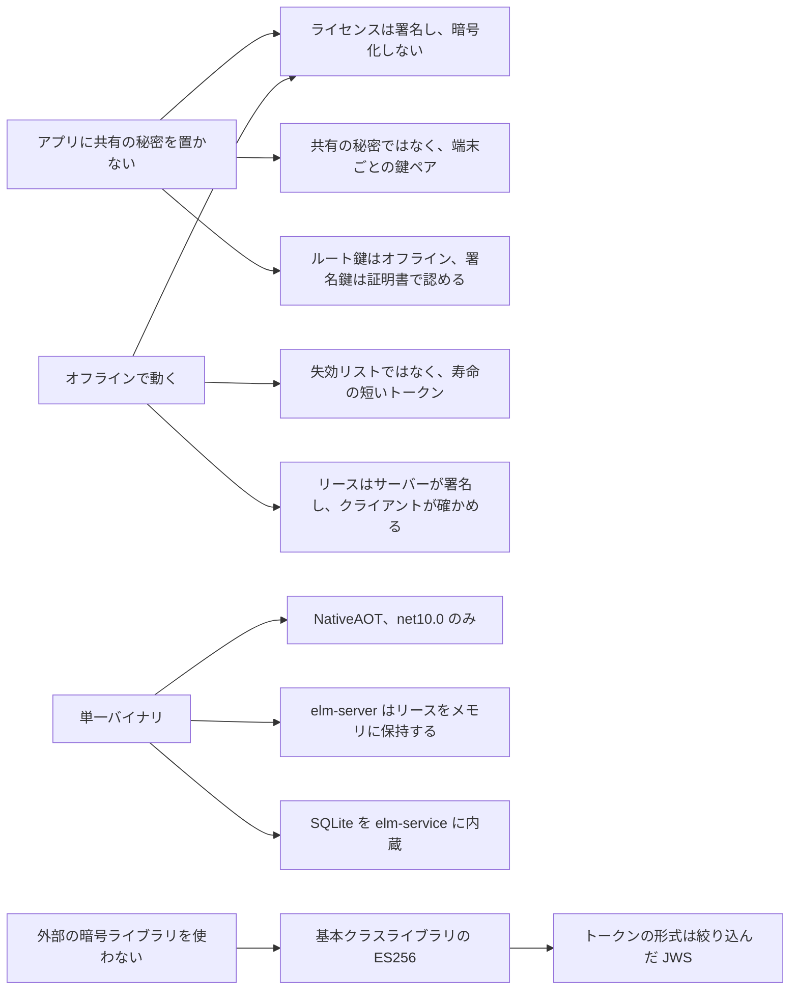

# 設計の選択

このページは、ElasticLM がなぜこう作られているのかを知りたい人に向けたものだ。ほかのライセンス製品と比べているベンダー、API がなぜこの形なのかを疑問に思うアプリの開発者、既定値が何を守っているのかを知りたい管理者が対象になる。先に[概要](overview.md)を読んでおく。主な選択ごとに、その理由、退けた案、あなたが負う代償を書く。仕組みそのものは、ほかの解説ページで説明する。

## 選択の土台になる要件

ほとんどの選択は、いくつかの要件から決まる。

- **顧客の側に、共有の秘密もベンダーの秘密も置かない。** アプリが持つのは公開鍵だけだ。アプリのどのコピーにも入っている秘密は、顧客の誰か一人が取り出せてしまう。顧客のマシンにある秘密鍵、つまりインストール鍵は、マシンごとにその場で作られ、マシンごとに異なる。
- **オフラインで動く。** アプリは、ネットワークがなくても、決まった期間は動き続けなければならない。その期間は、トークン、猶予期間、リースのどれかが終わるまでだ。
- **単一バイナリ。** `elm`、`elm-server`、`elm-service` は、横にほかのファイルを置かなくても動く NativeAOT の実行ファイルだ。クライアントライブラリは、アプリが同じように発行されるのを妨げてはならない。
- **外部の暗号ライブラリを使わない。** 使うのは .NET の基本クラスライブラリの `System.Security.Cryptography` だけだ。

図は、これらの要件がどのように主な選択につながるかを示す。

## ライセンスは署名し、暗号化しない

**選択。** ライセンスファイルには ECDSA P-256 で署名し、暗号化はしない。

**理由。** 暗号化するには、顧客のマシンに復号の鍵を置く必要がある。そこでは顧客がその鍵を読めるので、暗号化してもほとんど何も隠せない。大事なのは、誰もライセンスを変えられないことで、それは署名で得られる。端末への紐づけにも秘密は要らない。署名したトークンが端末のインストール鍵とマシン指紋を記しているので、トークンを書き換えれば署名の検証に失敗する。

**退けた案。** 一部のライセンス製品のように、ライセンスキーとマシン指紋から導いた鍵でファイルを暗号化する。

**代償。** ライセンスファイルを持っている人は誰でも、その中身を読める。製品、機能、日付、ベンダーが自由に書ける `meta` の値が読める。顧客に見られては困るものを `meta` に入れてはいけない。

## トークンは絞り込んだ JWS で、届いたバイト列のまま検証する

**選択。** トークンはすべてコンパクト形式の JWS で、ES256 で署名する。ヘッダーのメンバーはちょうど 3 つ、`alg`、`kid`、`typ` で、それ以外のメンバーがあれば拒否する。検証する関数は、それぞれちょうど 1 つの `typ` だけを受け入れる。署名は受け取ったバイト列のまま検証し、署名の検証が通るまで、ペイロードを JSON として読まない。

**理由。** JWS は基本クラスライブラリだけで作れ、NativeAOT で動き、既存のツールでトークンの中身を見られる。余分なヘッダーメンバーを拒否すると、JWS で知られている鍵の注入攻撃（ヘッダーに自前の鍵を入れる攻撃）を防げる。関数ごとに `typ` を 1 つに限ると、リースがライセンスとして受け入れられることがなくなる。受け取ったバイト列のまま検証すれば、誰も JSON を組み立て直さずに済む。組み立て直すと、シリアライザーのインデントや日付の書き方が変わっただけで、正しいライセンスが検証に失敗してしまう。

**退けた案。** COSE_Sign1。.NET 向けのパッケージが基本クラスライブラリの外にある。PASETO v4.public。Ed25519 が必要だが、.NET 10 の基本クラスライブラリにはない。独自の形式。約 5% 小さくなるが、既存のツールがすべて使えなくなる。

**今後。** `alg` フィールドと 16 KiB というトークンサイズの上限は、耐量子の ML-DSA 署名を入れる余地を残している。.NET 10 は、ML-DSA をまだすべてのプラットフォームでは使えない。

## 署名鍵を証明するだけのルート鍵

**選択。** ベンダーのルート鍵はオフラインで保管し、鍵の証明書にだけ署名する。鍵の証明書は、署名鍵が一定の期間（既定は 1 年、最長 2 年）ライセンス、リース、ログに署名することを認める。アプリのトラストストアが持つのは、ルート公開鍵だけだ。

**理由。** 署名鍵は、動いているサーバー（`elm-service`）に置く必要があり、そこでは危険にさらされやすい。間に証明書を挟めば、ベンダーは新しいアプリを出さずに署名鍵を入れ替えたり、漏れた鍵から立て直したりできる。

**退けた案。** 署名鍵の公開鍵をアプリに組み込む。これでは、鍵を変えるたびにアプリの更新が要ることになる。

鍵の入れ替えの仕組みは[信頼の鎖](trust-chain.md)を参照。

## 証明書は、トークンを発行した時点で判断する

**選択。** 鍵の証明書がトークンに対して有効かどうかは、トークンの発行時刻（`iat`）が証明書の有効期間に入っているかで判断する。現在時刻が入っているかでは判断しない。

**理由。** 永続ライセンスは、それに署名した鍵の証明書が切れたあとも使い続けられなければならない。現在時刻で判断すると、永続ライセンスはすべて 2 年以内に使えなくなる。コード署名のタイムスタンプも同じ考え方で動いている。

**退けた案。** 現在時刻で判断し、証明書が切れる前に永続ライセンスを発行し直す。

**代償。** 漏れた署名鍵を手にした者は、古い `iat` を書いて、証明書が有効だった間に署名したように見えるトークンを作れる。これを防ぐのはトラストストアの失効した鍵 ID の一覧で、これが端末に届くのはアプリの新しいバージョンでだけだ。署名鍵が漏れたベンダーは、鍵を入れ替え、失効した鍵 ID を入れたアプリの更新を出し、新しい鍵でライセンスを発行し直さなければならない。

## 失効リストの代わりに、寿命の短いトークン

**選択。** ElasticLM は、失効したライセンスの一覧を公開しない。失効が端末に届くのは、トークンの有効期限が切れるからだ。既定では、トークンの寿命は 30 日（`tokenLifetime`）で、クライアントは期限の 20 日前に更新を始め（`refreshWindow`）、トークンは期限のあと 7 日間はまだ使える（`gracePeriod`）。一時停止したライセンスや失効したライセンスには、新しいトークンが発行されない。

**理由。** 一覧は取りに行かなければならないので、オフラインの端末には役に立たない。ほかのライセンス製品も、トークンの寿命を短くしてオンラインで更新する方法に頼っている。失効を早く届けたい場合は、ベンダーがポリシーで寿命を短くできる。

**代償。** トークンは、そのあとライセンスがどうなっても、有効期限に猶予期間を足した時点まで有効だ。有効期限のないトークンは、それに署名した鍵を失効させる以外に失効させる方法がない。この注意点は[安全性のモデル](security-model.md)で説明する。

## 端末ごとの鍵ペアと、すべてのリクエストに付ける署名付きの証明

**選択。** クライアントは、初めて使うときに端末用の ECDSA P-256 の鍵ペア、つまり**インストール鍵**を作り、秘密鍵を端末に保管する。状態を変えるリクエストには、すべて**証明**を付ける。証明は、その鍵で署名した小さな JWS で、DPoP（RFC 9449）の形をしている。中身は、HTTP メソッド、URL、本文のハッシュ、サーバーの新しいノンス、1 回限りの ID（`jti`）だ。[端末と証明](devices-and-proofs.md)を参照。

**理由。** リクエストを偽造できるのは、その端末の秘密鍵を持つ人だけになる。本文のハッシュは、本文を対象にしない DPoP の穴をふさぐ。ノンスと 1 回限りの ID があるので、盗み取ったリクエストをもう一度送っても通らない。新しさの判断は端末の時計に頼らない。サーバーが自分のノンスで判断するからだ。

**退けた案。** すべてのクライアントが共有する秘密で、リクエストに HMAC をかける。これでは、顧客の一人がアプリから秘密を取り出し、誰の代わりにでもリクエストに署名できてしまう。HTTP Message Signatures（RFC 9421）。署名の基になる文字列（構造化フィールド、RFC 8941）を基本クラスライブラリだけで正しく組み立てるのはずっと難しい。この方式で得られるプロキシとの相互運用性は、要件に含まれていない。

**代償。** インストール鍵は端末の身元である。端末の管理者が、鍵と状態ファイルを別のマシンに写せば、身元も写る。ElasticLM がこれに気づくのは、両方の写しがサーバーと通信したときだけだ（このあとの節を参照）。

## マシン ID は手がかりであって、身元ではない

**選択。** OS のマシン ID は、そのままの形では決して送らない。クライアントが送るのは**マシン指紋**で、これはマシン ID と製品 ID を混ぜたハッシュだ。マシン指紋は補助の確認にすぎず、身元はインストール鍵である。

**理由。** マシン ID は、複製した仮想マシンや、消去しないまま作ったイメージでは重複し、管理者は書き換えることもできる。そのままの値を送ると、それを見た人が、製品をまたいで 1 台のマシンを追跡できてしまう。製品を混ぜれば、製品ごとに違う値になる。

**退けた案。** そのままのマシン ID を端末の身元として使う。

**代償。** 試用は製品とマシン指紋ごとに 1 回なので、マシン ID を書き換えた人は、もう一度試用を始められる。ElasticLM はこれを受け入れている。

## 複製は更新番号で見つける

**選択。** 有効化とリースには、どれも更新番号（`seq`）が付く。更新のたびに、クライアントは最後に受け取った `seq` を送り、サーバーはそれを 1 つ上げる。古い `seq` のリクエストが届いたら、別の写しが先に進んでいるので、サーバーはそれを複製として扱う。そのあとどうするかは、ポリシーの `cloneStrategy` で決まる。`deny` は有効化を止め、`flag` は記録するだけだ。OAuth のリフレッシュトークンのローテーションも同じ考え方を使っている。

**理由。** 複製した仮想マシンは同じインストール鍵を持つので、鍵だけでは写しを見分けられない。しかし、両方の写しが最新の `seq` を持ち続けることはできない。応答がネットワークで失われたクライアントは、再送であることを証明できるので、応答が失われても複製とはみなされない。複製には、この証明ができない。

**退けた案。** 同時に使われていることで複製を見つける。1 台のマシンで動く複数のプロセスが、正当に 1 つのインストール鍵を共有することがあるからだ。`seq` が 1 つ遅れたリクエストなら何でも認める。これでは、同じ瞬間に更新した 2 つの複製が、気づかれないまま 1 つの席を共有できてしまう。

**代償。** オフラインでしか動かない写しは、決して見つからない。[安全性のモデル](security-model.md)を参照。詳しくは[有効化](activation.md)のページにある。

## elm-server はリースをメモリに保持する

**選択。** `elm-server` はデータベースを持たない。リースはメモリに保持する。再起動したあとは、リース期間 1 回分（既定は 10 分）の回収の期間の間、新しいリースを断る。その間に、クライアントはまだ有効なリーストークンをサーバーに渡し直す。[フローティングライセンス](floating-licenses.md)を参照。

**理由。** データベースのないサーバーなら、インストールするファイルは 1 つで、バックアップも修復も要らない。リーストークンにはサーバーのインストール鍵で署名してあるので、状態を立て直すのに要るものはすべてクライアントが持っている。回収の期間に新しいリースを断るのは、まだ使われている席をサーバーがもう一度貸さないようにするためだ。

**退けた案。** 再起動の直後から新しいリースを受け付ける。古いリースと合わせると、席数を超えてしまう。

**代償。** 再起動のあと、最長でリース期間 1 回分、新しい利用者が待たされることがある（どれだけ待つかは応答に入っている）。リース期間を長くすると、利用者に気づかれずにサーバーを再起動しやすくなるが、その待ち時間も同じだけ長くなる。

## elm-server の借り出し中の席は、署名付きの記録に書く

**選択。** ネットワークの外に出る借り出し中のリースは、`elm-server` がディスクに書く唯一のものだ。書き込み先は追記専用の記録で、各行にサーバーのインストール鍵で署名する。サーバーは起動するときに記録を確かめ、まだ終わっていない借り出しを復元する。

**理由。** 借り出している端末はネットワークから離れているので、回収に参加できない。記録がなければ、再起動のたびにその席が空き、サーバーが同じ席を二重に貸してしまうおそれがある。

**退けた案。** オンプレミスでは借り出しをなくす。

**代償。** 顧客の管理者はマシンを管理しているので、記録を消したり、時計を進めたりできる。ElasticLM はこれを受け入れている。被害は本来の借り出しが終わる時点で終わり、利用ログに跡が残る。

## elm-server に高可用性のペア構成はない

**選択。** v1 には、`elm-server` を冗長にする構成がない。サーバーは OS のサービスマネージャーが再起動する。

**理由。** クライアントはリース期間の 3 分の 1 ごとに更新するので、サーバーが止まった時点で、どのリースにも期間の 3 分の 2 以上が残っている。既定の 10 分なら約 6 分 40 秒だ。`elm-server` は、起動から 1 秒以内に待ち受けを始めることを目標にしており（Linux のテスト機では約 0.1 秒だった）、そのあと回収で状態が戻る。アプリが止まるのは、マシンが約 6 分を超えて止まったままのときだけだ。

**退けた案。** 合意を取り合うサーバーのクラスター、または席を分け合う独立したサーバー群。どちらも v1 には重すぎる。

## サーバー自身の鍵でできることを限る

**選択。** 顧客の管理者は `elm-server` が動くマシンを管理しており、そのインストール鍵を取り出せる。そのため ElasticLM は、ベンダーが署名した範囲を超えてその鍵を信頼しない。

- クライアントは、リースをすべてサーバーライセンスと照らし合わせる。製品とサーバーが正しいか、機能と席数がライセンスの範囲内か、期間がライセンスの許す長さ以下か、終了日時がサーバーライセンス自身の終了日時に猶予期間を足した時点より後でないかを確かめる。
- サーバーライセンスには有効期限があり（既定では 30 日後）、`elm-service` から更新する。更新のたびにサーバーの `seq` を確かめるので、サーバーの写しが見つかる。
- クライアントがサーバーの TLS 証明書を受け入れるのは、OS がその証明書を信頼しているとき、または証明書の鍵がサーバーライセンスに記された鍵と一致するときだ。どちらにするかは、サーバーの管理者が決める。アプリの開発者にはそれを知りようがないので、開発者は決めない。

**理由。** 鍵を取られたサーバーが署名できるリースは、サーバーライセンスの範囲内に限られる。サーバーの写しは、次の更新のときに見つかる。

**退けた案。** 寿命の長いサーバーライセンス。これでは、取られた鍵やサーバーの写しをずっと使えてしまう。

**代償。** 更新できないサーバーは、サーバーライセンスの猶予期間が終わると席を貸せなくなる。サーバーの写しが見つかるのは次の更新のときだけで、既定値では最長 30 日先になる。`elm` で手作業で発行したサーバーライセンスは更新されないので、写しの利用を終わらせるのは有効期限だけだ。

## gRPC ではなく HTTPS と JSON

**選択。** クライアントとサーバーは、`/v1/` の下で HTTPS 上の JSON でやり取りする。エラーは RFC 9457 の problem 形式で返す。

**理由。** HTTPS と JSON は、プロキシや企業のネットワークを通り、重い依存を必要とせず、NativeAOT で動く。gRPC は、増える依存と、企業のネットワークを通りにくいことを理由に退けた。

## NativeAOT の単一バイナリ、net10.0 のみ

**選択。** すべてを `net10.0` 向けの C# で書き、NativeAOT で発行する。`libelasticlm` は、.NET のクライアントを C ABI の NativeAOT 共有ライブラリとして発行したものだ。SQLite のエンジンは `elm-service` に内蔵する。

**理由。** 単一バイナリは、インストールも、コピーも、公開されたハッシュとの照合も簡単だ。Linux x64 のビルドでは、`elm-service` が約 27 MB、`elm-server` が 13 MB、`elm` が 8 MB、`libelasticlm` が 7 MB で、ライセンスファイル 1 つの検証にかかる時間は約 0.1 ms だ。

**退けた案。** .NET 8 も対象にする。サポートが 2026 年 11 月に終わり、.NET 10 のほうが NativeAOT への対応が進んでいる。一部を別の言語で書く（たとえば、クライアントや鍵のライブラリを Rust で書く）。別の言語で書いたライブラリを読み込むサーバーは単一バイナリにできず、境界をまたぐ文字列やバッファーのすべてに、終端と解放の決まりを取り決める必要がある。ネイティブの呼び出し側には、代わりに `libelasticlm` を用意している。これは .NET のコードを NativeAOT の共有ライブラリとして発行したものだ。SQLite を `elm-service` の横に別のライブラリとして置く。これでは単一バイナリでなくなる。

**代償。** Linux のビルドには glibc 2.28 以降、macOS のビルドには macOS 12.0 以降が必要だ。v1 の実行ファイルと `libelasticlm` にはコード署名がない。代わりに、公開された `SHA256SUMS` とビルドの来歴の証明で確かめる。

## 暗号は基本クラスライブラリのものだけを使う

**選択。** 暗号はすべて `System.Security.Cryptography` のものを使う。アプリに入って出荷される部分（`ElasticLM.Licensing`、`ElasticLM.Client`、`libelasticlm`）は、外部のパッケージを一切使わない。

**理由。** 暗号のパッケージはどれも、ベンダーのアプリが信頼しなければならないコードとサプライチェーンになる。基本クラスライブラリはランタイムと一緒に保守され、すでにすべての .NET アプリに入っている。

**代償。** 基本クラスライブラリにないアルゴリズムは使えない。そのため Ed25519 は使えず、ML-DSA も今のところ使えない。

## elm-service の保存先: SQLite か PostgreSQL

**選択。** `elm-service` は、SQLite（1 ノード）か PostgreSQL（1 ノード以上）で動く。席と有効化の数は、ロックをかけて数える。PostgreSQL では、ライセンスの行への `UPDATE` が、トランザクションの間その行をロックする。SQLite では、トランザクションの開始時に書き込みロックを取る（`BEGIN IMMEDIATE`）。

**理由。** ロックをかけずに数えると、同時に来た 2 つのリクエストがどちらも空き席を見つけて、席数を超えてしまう。SQLite はバイナリのほかに何も要らない。PostgreSQL なら、複数のノードが 1 つのデータベースを共有できる。

**代償。** SQLite は 1 ノードでしか動かない。複数のノードで動かすなら、PostgreSQL を使う。

## 管理画面: backend for frontend のログインと小さな SPA

**選択。** 管理画面は、Preact で作った静的なシングルページアプリで、`elm-service` に組み込んである。ログインはサービスを経由する（backend for frontend）。サービスが PKCE 付きの OIDC 認可コードフローを実行し、ブラウザーに渡すのは `HttpOnly` のセッション Cookie `__Host-elm-session` だけだ。

**理由。** ブラウザーにトークンがないので、ページに注入されたスクリプトが盗めるものはない。RFC 10017 は、業務アプリにこの形を強く推奨している。ある試作で比べた選択肢のうち、目的にいちばん合ったのは Preact だった（56 パッケージ、brotli 圧縮で 6,771 バイト）。これより小さかったのはフレームワークを使わない案だけで、その場合は状態の管理と描画を自分で書くことになる。

**退けた案。** アクセストークンを自分で持つシングルページアプリ。`SameSite=Strict` の Cookie。IdP が利用者を戻した直後の最初のページでは送られないからだ。サービスは `SameSite=Lax` を使い、状態を変えるリクエストにはすべて独自のヘッダーを求める。

## これらの選択があなたに求めること

| 選択 | 代償 | すべきこと |
| --- | --- | --- |
| 署名し、暗号化しない | ライセンスの中身を読まれる。 | 見られては困るデータを `meta` に入れない。 |
| 証明書を `iat` で判断する | 漏れた署名鍵で、日付をさかのぼったトークンを作れる。 | トラストストアの失効した鍵の一覧を最新に保ち、鍵が漏れたらアプリの更新を出す。 |
| 寿命の短いトークン | 失効はトークンの終わりまで待つ。有効期限のないトークンは失効させられない。 | 失効をどれだけ早く届けたいかに合わせて `tokenLifetime` と `gracePeriod` を選ぶ。有効期限のないトークンは避ける。 |
| インストール鍵を身元にする | 端末の管理者が作った写しは、同じ端末として扱われる。 | 写すことが問題になる場合は `deny` を使う。オフラインでしか動かない写しは見つからないことを知っておく。 |
| `elm-server` はリースをメモリに保持する | 再起動のあと、新しい利用者が最長でリース期間 1 回分待つことがある。 | サーバーをサービスマネージャーの下で動かす。両方の待ち時間を考えて `leaseDuration` を選ぶ。 |
| 有効期限のあるサーバーライセンス | 更新できないサーバーは席を貸せなくなる。 | サーバーにオンラインで更新させるか、更新ファイルを期限に間に合うように運ぶ。 |
| v1 にはコード署名がない | OS が発行元を表示できない。 | ダウンロードしたファイルを `SHA256SUMS` とその来歴の証明で確かめる。 |

受け入れている脅威の一覧は、[安全性のモデル](security-model.md)にまとめてある。
