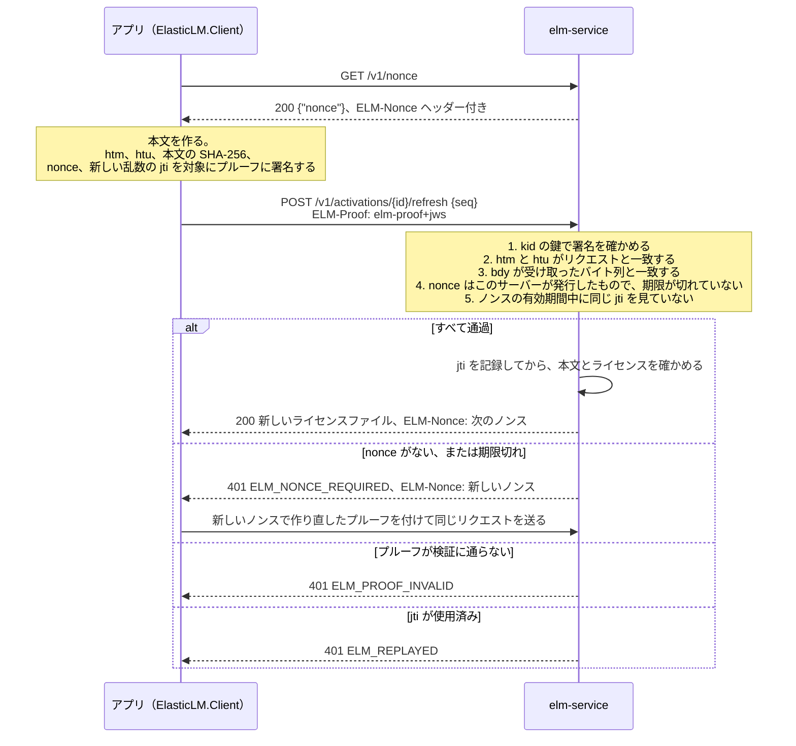

# デバイスとプルーフ

このページの読者は、`ElasticLM.Client` や `libelasticlm` を組み込むアプリ開発者、ライセンスをデバイスにどう紐付けるかを決めるベンダー、`elm-server` を運用したりコンテナでアプリを動かしたりする顧客側の管理者だ。ElasticLM がデバイスをどう見分けるか、リクエストが本当にそのデバイスから来たことをサーバーがどう確かめるかを説明する。先に[トラストチェーン](trust-chain.md)と[ライセンスファイルと検証](license-files-and-verification.md)を読んでおくとよい。このページは、ライセンストークンにはベンダーの署名が付いていて、アプリがオフラインで確かめることを知っている前提で書いている。

## デバイスを識別する目的

ノードロックのライセンスは 1 台のデバイスで使うためのものだ。フローティングライセンスは、実行中のアプリ 1 つに対して、一度に 1 シートを貸し出す。どちらの場合も、次の 2 つの問いに答えられなければならない。

1. これはどのデバイスか。ライセンストークンには、それを使うデバイスを書いておく必要がある。そうすれば、ファイルを別のデバイスにコピーしても検証に通らない。
2. このリクエストはそのデバイスから来たのか。アプリが SaaS 型のアクティベーションサービス（`elm-service`）やオンプレミスのライセンスサーバー（`elm-server`）に、新しいトークン、リース、アクティベーション解除を求めるとき、サーバーはリクエストを出したのがそのデバイスであることを知る必要がある。ネットワーク上の誰かがリクエストを書き換えたり再送したりしていないことも確かめる必要がある。

ElasticLM は、どちらの問いにも、アプリがデバイス上で作る鍵ペアで答える。これがインストール鍵だ。トークンにはこの鍵を書き込み、状態を変えるリクエストにはすべてこの鍵で署名する。これとは別に、もっと弱い手がかりとしてマシンフィンガープリントがある。OS のマシン ID から導く値で、ライセンスファイルが別のデバイスにコピーされたことに気づく助けになり、トライアルと借用の早期返却の回数を制限するのにも使う。ただし、デバイスの識別には一切使わない。

OS のマシン ID で識別しないのは、デバイスを確実には見分けられないからだ。仮想マシンをクローンしたりディスクイメージをコピーしたりすると、2 台のデバイスが同じ ID を持つ。管理者が ID を書き換えることもできる。さらに、ID をそのまま送ると、別々の製品が同じデバイスを追跡できてしまう。ほかの方式との比較は[設計上の選択](design-choices.md)にある。

## インストール鍵

インストール鍵は ECDSA P-256 の鍵ペアで、アプリが最初のアクティベーション、リース、トライアルのときに作る。秘密鍵はデバイスの外に出ない。公開鍵は、それを必要とする最初の署名付きリクエストに入れてサーバーに送り、サーバーが保存する。

鍵の識別子はサムプリントだ。公開鍵の JWK サムプリント（RFC 7638、SHA-256、base64url）で、公開鍵から誰でも計算できる。そのため、あるサムプリントを名乗りながら別の鍵を持ってきたリクエストは、両者を比べれば見抜ける。デバイスに紐付いたライセンストークンは、サムプリントを `cnf.jkt` クレームに持つ。アプリ自身の鍵のサムプリントがこれと違えば、検証は `ELM_WRONG_INSTALLATION` で失敗する。

### 鍵の保存場所

アプリは、クライアントの設定（`ElasticLM.Client` の `KeyScope`）で 2 つのスコープのどちらかを選ぶ。既定はユーザースコープだ。マシンスコープは書き込みに管理者権限が必要で、サービスとして動くアプリや `elm-server` 向けだ。

| OS | 保護 | ユーザースコープ | マシンスコープ |
| --- | --- | --- | --- |
| Windows | DPAPI（`CryptProtectData`） | `%LOCALAPPDATA%\ElasticLM\<product>\` | `%ProgramData%\ElasticLM\<product>\` |
| Linux | ファイルのモード `0600`、フォルダーは `0700` | `$XDG_DATA_HOME/elasticlm/<product>/`（または `~/.local/share/elasticlm/<product>/`） | `/var/lib/elasticlm/<product>/` |
| macOS | ファイルのモード `0600`、フォルダーは `0700` | `~/Library/Application Support/ElasticLM/<product>/` | `/Library/Application Support/ElasticLM/<product>/` |

`<product>` は製品のコードで、使える文字は英小文字、数字、`-` だけだ。そのため、`..` や `/` でフォルダーの外には出られない。鍵のファイル名は `installation.key` だ。アプリが独自のフォルダーを指定することもできる。

マシンスコープは、扱いにより注意が要る。デバイスのどのユーザーも `%ProgramData%` を読めて、DPAPI のマシンスコープを開けるうえ、アプリが初めて動く前にそこにフォルダーを作れてしまうからだ。そこで Windows では、クライアントがマシンスコープのフォルダーを作るときにアクセス制御リストを付け、アクセスを Administrators、SYSTEM、作成したユーザーだけに許す。また、OS を問わず、既存のマシンスコープのフォルダーを使う前に、ほかのユーザーが所有者になっていないこと、ほかのユーザーが書き込めないことを確かめる。どちらかに当てはまれば `ELM_INSTALLATION_KEY_UNREADABLE` で止まる。ユーザースコープはこの確認をしない。ユーザー自身のプロファイルで、すでにアクセスが絞られているからだ。

同じフォルダーには、鍵に結び付いたほかのファイルも置く。保存したアクティベーション（`activation.json`）、借用したリース、オンプレミスのサーバーのピン、時刻巻き戻し対策の状態、そしてサーバー上なら `elm-server` の管理者トークンだ。

### 鍵を読めないとき

鍵のファイルが壊れていたり、別のユーザーの DPAPI で保護されていたりすると、クライアントは `ELM_INSTALLATION_KEY_UNREADABLE` を返し、新しい鍵は作らない。新しい鍵を作ると、ユーザーが気づかないうちにアクティベーションを 1 つ余分に使ってしまうからだ。アプリは、もう一度アクティベーションするようユーザーに伝えるべきだ。その前に、ベンダーが古いアクティベーションを解除しなければならない場合もある（[アクティベーション](activation.md)を参照）。

### 鍵こそがデバイスの識別子である理由

サーバーがデバイスについて判断することは、すべて鍵に結び付いている。アクティベーションはライセンスと鍵のサムプリントの組なので、同じ鍵でアクティベーションし直しても、アクティベーションの数は増えない。トークンの更新とアクティベーション解除は、アクティベーションに記録した鍵で署名したプルーフ（所有証明）がある場合だけ受け付ける。トークンには鍵が書かれているので、その鍵のないデバイスではファイルが検証に通らない。クローン検出（[アクティベーション](activation.md)を参照）が働くのも鍵のおかげだ。クローンしたデバイスは 1 つの鍵と 1 つのアクティベーションを共有するので、互いのシーケンス番号が衝突する。

## プルーフ

プルーフは、ある HTTP リクエストを、インストール鍵の持ち主が、このサーバーに宛てて、今作ったことを示す。形式は DPoP（RFC 9449）に従い、リクエスト本文のハッシュというクレームを 1 つ加えている。アプリに組み込んだ共有の秘密なら、アプリのコピーのどれからでも漏れてしまう。それに対して、プルーフに署名する秘密鍵は、デバイスの上にしかない。

状態を変えるリクエストと、デバイスに紐付いた情報を返すリクエストには、すべて `ELM-Proof` ヘッダーでプルーフを付ける。`elm-service` に対するアクティベーション、トークンの更新、アクティベーション解除、トライアルと、`elm-service` と `elm-server` の両方に対するリースがこれに当たる。

### プルーフの署名対象

プルーフは、種類が `elm-proof+jws` のコンパクト形式の JWS で、インストール鍵による ES256 の署名を持つ。ヘッダーでは、鍵をサムプリント（`kid`）で示す。ペイロードのクレームは次のとおり。

| クレーム | 中身 | 防ぐこと |
| --- | --- | --- |
| `htm` | HTTP メソッド | プルーフを別の操作に流用すること |
| `htu` | 正規化したリクエスト URI。クエリーとフラグメントは除く | プルーフを別のパスや別のサーバーに送ること |
| `bdy` | 本文のバイト列の SHA-256 を base64url にしたもの（本文がなければ空文字列の SHA-256） | 本文の書き換え。たとえば、トークンを更新するときに送る `seq` を変えること |
| `nonce` | サーバーが発行したノンス | ずっと前に作ったプルーフを使うこと |
| `jti` | 128 ビットの乱数 | 同じプルーフを 2 回送ること |
| `iat` | プルーフを作った時刻 | なし。新しさの判定には使わない |
| `jwk` | 公開鍵。サーバーが鍵を知らない可能性のあるリクエストで付ける | なし。サーバーが鍵を知るために使う |

サーバーが鍵を知らない可能性のあるリクエストでは、公開鍵を `jwk` に入れる。アクティベーション、トライアル、すべてのリースの取得、リースの再登録、借用の早期返却がこれに当たる。（借用は `elm-server` の再起動をまたいで続くことがあり、再起動後のサーバーは取得時の鍵をもう持っていない。）サーバーは鍵を使う前に、鍵のサムプリントが `kid` と一致すること、鍵の点が P-256 曲線の上にあることを確かめる。トークンの更新、アクティベーション解除、リースの更新、通常のリースの返却では `jwk` を付けない。サーバーは、アクティベーションやリースに記録した鍵を使う。

`bdy` は DPoP にはない部分だ。これがないと、通信の途中に割り込んだ攻撃者が、プルーフはそのままに本文だけを書き換えられる。トークンの更新で、アクティベーション ID をパスに、シーケンス番号を本文に入れるのもこのためだ。クエリー文字列は `htu` に含まれないので、そこに入れた値は守られない。

比べる前に、クライアントとサーバーの両方が同じ方法で URI を正規化する（スキームとホストを小文字にする、既定のポートを省く、パスを正規化する、クエリーとフラグメントを除く）。サーバーは `htu` を、リクエストの `Host` ヘッダーではなく、自身に設定した公開 URL（`publicUrls`）と比べる。そのため、リバースプロキシの後ろでもプルーフは有効なままで、運用者が登録していないホストに向けたプルーフは通らない。

### サーバーがプルーフを確かめる流れ

図は `elm-service` でのトークンの更新の例だ。`elm-server` も、リースのリクエストを同じ方法で確かめる。署名は、プルーフの中の `jwk` か、サーバーが記録している鍵で確かめる。`iat` は新しさの判定に使わないので、時計がずれたデバイスでも問題なく動く。新しさはノンスで判定する。

トークンの更新とアクティベーション解除では、`elm-service` はさらに、プルーフの鍵がパスで指定したアクティベーションの鍵であることを確かめる。別のデバイスの鍵で作った正しいプルーフは `ELM_PROOF_INVALID` になる。そのため、ある顧客がほかの顧客のアクティベーション ID を知ったとしても、そのアクティベーションのトークンを更新したり、アクティベーション解除したりはできない。

`elm-service` は、署名、ノンス、鍵ごとのレート制限の確認を通った後、本文とライセンスを確かめる前に、`jti` を一意制約付きでデータベースに記録する。この時点より後で拒否されたリクエストも `jti` を使い切るので、同じプルーフは二度と送れない。この時点より前に拒否されたリクエストは `jti` を記録しない。`elm-server` は、プルーフを確かめる最後の手順として `jti` をメモリに記録する。こちらも本文を確かめる前だ。いずれにしても、クライアントはリクエストごとに新しいプルーフを作る。

## ノンス

ノンスは、プルーフを前もって作れないように、サーバーが渡す短い値だ。

- **クライアントが受け取る方法。** `GET /v1/nonce` のほか、`ELM-Nonce` ヘッダーからも受け取れる。このヘッダーは、`elm-service` ならデバイスからのリクエストへのすべてのレスポンスに、`elm-server` ならリースのリクエストへのすべてのレスポンスに付く。そのため、クライアントが `GET /v1/nonce` を呼ぶのは、ノンスを持っていないときだけだ。リクエストが `ELM_NONCE_REQUIRED` で拒否されたら、クライアントはそのレスポンスのノンスを使って一度だけ送り直す。
- **中身と有効期間。** 作成時刻と 128 ビットの乱数に、サーバーの秘密を鍵にした HMAC-SHA256 を付けたものだ。そのため、サーバーはノンスを保存しなくても確かめられる。ノンスの有効期間は 300 秒だ。
- **再送を防ぐ方法。** サーバーは、使用済みの `jti` を、そのノンスが有効でありうる間だけ保持する（`elm-service` は、ノード間の時計の差を見込んで 60 秒を足す）。その期間を過ぎれば、古いプルーフの中のノンスは期限が切れているので、いずれにせよプルーフは拒否される。
- **秘密。** `elm-service` は、秘密を `ELM_NONCE_SECRET`（base64）か、`nonce.secretFile` で指定したファイルから読む。32 バイト以上が必要で、秘密がなければ起動しない。複数ノードで動かすサービスでは、どのノードもほかのノードが発行したノンスを受け付けなければならないからだ。`elm-server` は起動のたびに新しい秘密を作る。使用済みの `jti` の記録がメモリにしかないので、再起動するとその記録と一緒に古いノンスも無効になる。

オフラインのリクエストファイル（[アクティベーション](activation.md)を参照）は、サーバーとの往復がないので、サーバーのノンスを使えない。代わりに公開鍵と、自分で作ったランダムな `nonce` を持ち、7 日で期限が切れる。

## マシンフィンガープリント

マシンフィンガープリントは、OS のマシン ID から製品ごとに導く値で、小文字の 16 進数 32 文字で表す。マシン ID そのものは決して送らない。同じデバイスでも製品が違えばフィンガープリントも違うので、製品どうしがフィンガープリントを使ってデバイスを追跡することはできない。

マシン ID には、Windows ではレジストリの `MachineGuid`、Linux では `/etc/machine-id`、macOS では `IOPlatformUUID` を使う。Windows では、ファームウェアの SMBIOS UUID からもう 1 つフィンガープリントを作る。そのため、Windows のデバイスはフィンガープリントを 2 つ、Linux と macOS のデバイスは 1 つ持つ。

### フィンガープリントの用途

- **コピーの検出。** デバイスに紐付いたトークンは、フィンガープリントを `fp` に並べて持つ。アプリがトークンを検証するときは、現在のフィンガープリントがポリシーの `fingerprintMatching` に従って一致しなければならない。`any`（既定）なら、トークンのフィンガープリントのどれか 1 つが現在のものに含まれていればよい。`all` なら、すべてが含まれている必要がある。`ignore` なら、何も確かめない。一致しなければ、検証は `ELM_FINGERPRINT_MISMATCH` で失敗する。
- **トライアルはデバイスごとに 1 回。** `elm-service` はトライアルを製品とフィンガープリントの組で記録し、同じフィンガープリントを 1 つでも持つデバイスからの 2 回目のトライアルを拒否する（`ELM_TRIAL_USED`）。
- **借用の早期返却。** 借用したリースを 30 日の間に早期返却した回数を、インストール鍵ごととフィンガープリントごとに数える。どちらかの回数がポリシーの `borrowReturnLimit` に達すると、返却を拒否する。鍵だけで数えると、デバイスは新しい鍵を作るだけで回数をリセットできてしまう。そのため、借用にはフィンガープリントが 1 つ以上必要だ（[フローティングライセンス](floating-licenses.md)を参照）。

### フィンガープリントが手がかりにすぎない理由

OS のマシン ID は、どれも重複することがあり、書き換えることもできる。仮想マシンをクローンすれば `/etc/machine-id` は重複し、管理者は `MachineGuid` を書き換えられる。ElasticLM は、フィンガープリントが一意であることを前提にしない。フィンガープリントの不一致で見つけられるのは、ライセンスファイルと鍵を不用意に別のデバイスにコピーした場合だ。コピー先のデバイスのマシン ID を書き換えて一致させる相手は見つけられない。

### フィンガープリントを作れないとき

OS の ID を読めない場合（ファイルがない、`uninitialized`、すべて 0）は、そのフィンガープリントは作らない。1 つも作れなければ、`ignore` 以外のポリシーではすべて `ELM_FINGERPRINT_UNAVAILABLE` になり、トライアルも受けられず、リースの借用もできない。

これがいちばんよく起きるのはコンテナだ。多くのイメージ、特に `linux-musl-x64` 向けのイメージには `/etc/machine-id` がない。コンテナでアプリや `elm-server` を動かすときは、次のどちらかにする。

1. ホストの `/etc/machine-id` を、読み取り専用でコンテナにマウントする。
2. `fingerprintMatching` を `ignore` にしたポリシーを使い、インストール鍵だけでライセンスを紐付ける。この場合は、鍵のフォルダーを、コンテナを作り直しても消えないボリュームに置く。そうしないと、新しいコンテナを作るたびに新しい鍵ができ、アクティベーションを 1 つずつ余分に使う。

## デバイスの管理者権限を持つ攻撃者にできること

ここで想定する攻撃者は、不正をはたらくライセンシーだ。アプリと、正規のライセンスファイルかライセンスキーを持ち、自分のデバイスの管理者権限か root 権限を持っている。OS による保護は、この相手には効かない。この攻撃者にできることを ElasticLM が許容する理由は、[セキュリティモデル](security-model.md)で説明している。

この攻撃者にできることは次のとおり。

- **インストール鍵と保存したファイルを読み出してコピーする。** DPAPI やファイルのモードで締め出せるのはほかのユーザーで、管理者は締め出せない。別のデバイスにコピーしたものは、マシン ID も一致するかポリシーが `ignore` なら、トークンの期限が切れるまでそのデバイスで動く。両方がオンラインになれば、サービスがクローンとして報告する（[アクティベーション](activation.md)を参照）。オフラインのままのコピーは検出できない。
- **OS のマシン ID を書き換える。** これで、コピー先のデバイスでフィンガープリントの照合をすり抜けたり、トライアルをもう一度受けたり、借用の早期返却の回数をリセットしたりできる。
- **アクティベーション解除の後もライセンスファイルを持ち続ける。** アクティベーション解除で消えるのは `activation.json` だけで、鍵は消えない。そのため、保存しておいたファイルのコピーは、トークンの有効期限に猶予期間を足した時点まで使える。これを繰り返せる回数は、ベンダーが `deactivationLimit` で制限する。
- **アプリを改変して検証を飛ばす。** これはクライアント側のどんな確認でも止められない。

一方で、この攻撃者はライセンストークンを偽造することも書き換えることもできない。ベンダーの署名鍵がデバイスにないからだ。鍵なしでライセンスを別のデバイスに移すこともできない。トークンには鍵が書かれていて、サーバーはその鍵で署名したプルーフがなければトークンの更新もリースも受け付けないからだ。別のデバイスになりすますこともできない。そのデバイスのサムプリント、フィンガープリント、アクティベーション ID を知っていても、秘密鍵がなければ足りない。時計を戻してトークンの期限を延ばすこともできない。時刻巻き戻し対策が、最後に確認した時刻より前の時刻を拒否するからだ（[ライセンスファイルと検証](license-files-and-verification.md)を参照）。

## 起こりうる問題

通信を読み、書き換え、再送できるネットワーク上の攻撃者でも、プルーフから悪用できるものは得られない。本文、メソッド、パスを書き換えればプルーフは無効になり、再送したプルーフは拒否され（`ELM_REPLAYED`、またはノンスの期限切れ）、`htu` には宛先のサーバーが書かれている。ただし、プルーフはリクエストの中身を隠さない。デバイスが信頼している社内プロキシのように TLS を復号できる者は、アクティベーションの本文に入っているライセンスキーを読める（[セキュリティモデル](security-model.md)を参照）。

ElasticLM を扱う立場ごとに、すべきことを挙げる。

- **アプリ開発者。** 鍵のスコープは意図して選ぶ。ユーザースコープでは、OS のユーザーごとに鍵とアクティベーションが分かれる。マシンスコープでは、鍵はデバイスに 1 つになるが、管理者権限が必要になる。`ELM_INSTALLATION_KEY_UNREADABLE` は「アクティベーションし直す」合図として扱い、ファイルを消す理由にはしない。配布の手順の中で、鍵のフォルダーをデバイス間でコピーしてはいけない。
- **ベンダー。** `fingerprintMatching` は製品ごとに選ぶ。Windows では、`any`（既定）なら 2 つの ID の片方が変わってもトークンは検証に通り、`all` ならどちらかが変わると失敗する。Linux と macOS では、どちらの規則でも動きは同じだ。`ignore` はコンテナや ID を読めないデバイス向けの選択肢で、トライアルには使えない。
- **`elm-service` の運用者。** ノンスの秘密は 32 バイト以上の乱数で作り、すべてのノードに同じ秘密を渡し、ノード間の時計の差を 60 秒以内に保つ（NTP）。`publicUrls` には、クライアントが使う URL をすべて設定する。一覧にない URL に向けたプルーフは拒否される。
- **コンテナでアプリや `elm-server` を動かす人。** 上で説明したとおり、鍵のフォルダーを永続ボリュームに置き、マシン ID を用意する。
