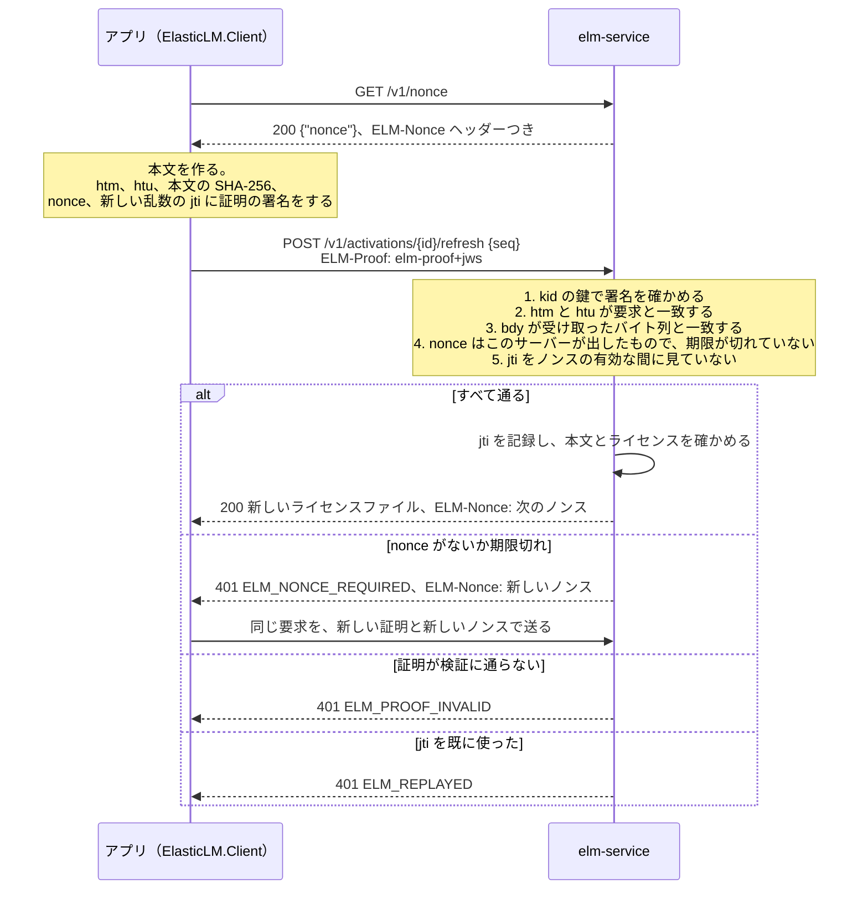

# 端末と証明

このページは、`ElasticLM.Client` や `libelasticlm` を組み込むアプリの開発者、ライセンスを端末にどう紐づけるかを決めるベンダー、`elm-server` を動かしたりコンテナでアプリを動かし続けたりする顧客の管理者に向けたものだ。ElasticLM が端末をどう見分けるのか、そして要求が本当にその端末から来たことをサーバーがどう確かめるのかを説明する。先に [信頼の鎖](trust-chain.md) と [ライセンスファイルと検証](license-files-and-verification.md) を読んでほしい。このページは、ライセンストークンがベンダーの署名を持ち、アプリがオフラインで確かめることを知っている前提で書いている。

## 端末の身元は何のためにあるか

端末紐づけのライセンスは、1 台の端末で使うものだ。フローティングライセンスは、動いているアプリ 1 つに、一度に 1 席を貸す。どちらも、次の 2 つの問いに答える必要がある。

1. これはどの端末か。ライセンストークンは、自分が属する端末を名指しする必要がある。そうすれば、ファイルを別の端末に写しても検証に通らない。
2. この要求はその端末から来たのか。アプリが SaaS 型のサービス（`elm-service`）やオンプレミスのライセンスサーバー（`elm-server`）に、新しいトークン、リース、解除を求めるとき、サーバーは、その端末が要求したことと、ネットワーク上の誰も要求を書き換えたり送り直したりしていないことを知る必要がある。

ElasticLM は、どちらの問いにも、アプリが端末の上で作る鍵ペアで答える。これがインストール鍵だ。トークンはこの鍵を名指しし、状態を変える要求はすべてこの鍵で署名する。もう 1 つ、より弱い手がかりとしてマシン指紋がある。マシン指紋は OS のマシン ID から導く。別の端末に写されたライセンスファイルに気づく助けになり、試用と借り出しの早期返却を制限するが、端末の身元には決して使わない。

OS のマシン ID を身元にしないのは、端末を確実には見分けられないからだ。仮想マシンを複製したりイメージを写したりすると、2 台の端末が同じ ID を持つ。管理者は ID を書き換えることもできる。生の ID を送ると、別々の製品が同じ端末を追跡できてしまうという問題もある。ほかの案との比較は [設計の選択](design-choices.md) にある。

## インストール鍵

インストール鍵は ECDSA P-256 の鍵ペアだ。アプリは、最初の有効化、リース、試用のときにこれを作る。秘密鍵は端末から出ない。公開鍵は、それを必要とする最初の署名つきの要求に入れてサーバーに送り、サーバーはそれを保存する。

鍵の識別子は拇印だ。拇印は公開鍵の JWK 拇印（RFC 7638、SHA-256、base64url）で、公開鍵から誰でも計算できる。そのため、ある拇印を名乗りながら別の鍵を持ってきた要求は、両者を比べれば見抜ける。端末に紐づいたライセンストークンは、拇印を `cnf.jkt` クレームに持つ。アプリ自身の鍵の拇印がこれと違えば、検証は `ELM_WRONG_INSTALLATION` で失敗する。

### 鍵を置く場所

アプリは、クライアントの設定（`ElasticLM.Client` の `KeyScope`）で 2 つの範囲のどちらかを選ぶ。既定はユーザーの範囲だ。端末の範囲は、書き込みに管理者の権限が要り、サービスとして動くアプリと `elm-server` のためのものだ。

| OS | 保護 | ユーザーの範囲 | 端末の範囲 |
| --- | --- | --- | --- |
| Windows | DPAPI（`CryptProtectData`） | `%LOCALAPPDATA%\ElasticLM\<product>\` | `%ProgramData%\ElasticLM\<product>\` |
| Linux | ファイルのモード `0600`、フォルダーは `0700` | `$XDG_DATA_HOME/elasticlm/<product>/`（または `~/.local/share/elasticlm/<product>/`） | `/var/lib/elasticlm/<product>/` |
| macOS | ファイルのモード `0600`、フォルダーは `0700` | `~/Library/Application Support/ElasticLM/<product>/` | `/Library/Application Support/ElasticLM/<product>/` |

`<product>` は製品のコードで、使える文字は英小文字、数字、`-` に限る。そのため、`..` や `/` でフォルダーの外へは出られない。鍵のファイルは `installation.key` だ。アプリが自分のフォルダーを渡すこともできる。

端末の範囲には、より注意が要る。端末のどのユーザーも `%ProgramData%` を読め、DPAPI の端末の範囲を開け、アプリが初めて動く前にそこにフォルダーを作れるからだ。そこで Windows では、クライアントが端末の範囲のフォルダーを作るときにアクセスリストを付ける。許すのは Administrators、SYSTEM、フォルダーを作ったユーザーだけだ。どの OS でも、既にある端末の範囲のフォルダーを使う前に、ほかのユーザーが持ち主でないこと、ほかのユーザーが書き込めないことを確かめ、そうでなければ `ELM_INSTALLATION_KEY_UNREADABLE` で止まる。ユーザーの範囲は確かめない。ユーザー自身のプロファイルが、既にアクセスを絞っているからだ。

同じフォルダーには、鍵に結びついたほかのファイルも置く。保存した有効化（`activation.json`）、借り出したリース、オンプレミスのサーバーのピン、時計の守りの状態、サーバーであれば `elm-server` の管理者トークンだ。

### 鍵を読めないとき

鍵のファイルが壊れているか、別のユーザーの DPAPI で保護されていたときは、クライアントは `ELM_INSTALLATION_KEY_UNREADABLE` を返し、新しい鍵は作らない。新しい鍵を作ると、知らないうちに有効化を 1 つ余分に使ってしまうからだ。アプリは、もう一度有効化するようユーザーに伝える。ベンダーが先に古い有効化を解除する必要があるかもしれない（[有効化](activation.md) を参照）。

### 鍵が本当の身元である理由

サーバーが端末について決めることは、すべて鍵に結びついている。有効化はライセンスと鍵の拇印の組なので、同じ鍵でもう一度有効化しても、有効化をもう 1 つ使うことはない。更新と解除は、有効化が覚えている鍵で署名した証明があるときだけ受け付ける。トークンは鍵を名指しするので、その鍵のない端末ではファイルが検証に通らない。そして複製の検出（[有効化](activation.md) を参照）がうまくいくのも、複製した端末の写しどうしが 1 つの鍵と 1 つの有効化を共有するので、互いの更新番号がぶつかるからだ。

## 証明

証明は、1 つの HTTP 要求を、インストール鍵の持ち主が、このサーバーに向けて、いま作ったことを示す。形は DPoP（RFC 9449）に沿い、クレームを 1 つ足している。要求の本文のハッシュだ。アプリに組み込んだ共有の秘密は、アプリのどの写しからも漏れてしまうが、証明に署名する秘密鍵は端末の上にしかない。

状態を変える要求と、端末に結びついた情報を返す要求は、すべて `ELM-Proof` ヘッダーに証明を持つ。`elm-service` の有効化、更新、解除、試用と、`elm-service` と `elm-server` の両方のリースがこれに当たる。

### 証明は何に署名するか

証明は、型が `elm-proof+jws` のコンパクトな JWS で、インストール鍵で ES256 の署名をする。ヘッダーは鍵を拇印（`kid`）で名指しする。ペイロードは次のクレームを持つ。

| クレーム | 中身 | 防ぐもの |
| --- | --- | --- |
| `htm` | HTTP メソッド | 証明を別の操作に使うこと |
| `htu` | 正規化した要求の URI。クエリーとフラグメントは含まない | 証明を別のパスや別のサーバーに送ること |
| `bdy` | 本文のバイト列の SHA-256 を base64url にしたもの（本文がなければ空の文字列の SHA-256） | 本文を書き換えること。たとえば更新の `seq` |
| `nonce` | サーバーが出したノンス | ずっと前に作った証明を使うこと |
| `jti` | 128 ビットの乱数 | 同じ証明を 2 回送ること |
| `iat` | 証明を作った時刻 | なし。新しさの確かめには使わない |
| `jwk` | 公開鍵。サーバーが鍵を知らないかもしれない要求で持つ | サーバーが鍵を知るためのもの |

サーバーが鍵を知らないかもしれない要求は、公開鍵を `jwk` に持つ。有効化、試用、すべてのリースの取得、回収、借り出しの早期返却がこれに当たる。（借り出しは `elm-server` の再起動をまたいで続くことがあり、再起動の後のサーバーは取得のときの鍵をもう持っていない。）サーバーは鍵を使う前に、鍵の拇印が `kid` と等しいことと、点が P-256 の曲線の上にあることを確かめる。更新、解除、貸出の更新、通常のリースの返却は `jwk` を持たない。サーバーは、有効化やリースが覚えている鍵を使う。

`bdy` は DPoP にない部分だ。これがなければ、間に入った攻撃者が証明はそのままにして本文を書き換えられる。更新で、有効化の ID をパスに、更新番号を本文に置くのもこのためだ。クエリー文字列は `htu` に含まれないので、そこに置いた値は守られない。

両側は、比べる前に URI を同じやり方で正規化する（スキームとホストを小文字にし、既定のポートを外し、パスを正規化し、クエリーとフラグメントを外す）。サーバーは `htu` を、要求の `Host` ヘッダーではなく、自分に設定した公開の URL（`publicUrls`）と比べる。そのため、リバースプロキシの後ろでも証明は有効なままで、運用者が挙げていないホストに向けた証明は通らない。

### サーバーが証明を確かめる流れ

図は `elm-service` での更新を示している。`elm-server` もリースの要求を同じやり方で確かめる。署名は、証明の中の `jwk` か、サーバーが覚えている鍵で確かめる。`iat` は新しさの確かめに使わないので、時計のずれた端末でも動く。新しさはノンスで確かめる。

更新と解除では、`elm-service` は、証明の鍵がパスで名指しされた有効化の鍵であることも確かめる。別の端末の鍵による正しい証明は `ELM_PROOF_INVALID` になる。そのため、ある顧客が、別の顧客が持つ有効化の ID を知っても、その有効化を更新したり解除したりはできない。

`elm-service` は、署名、ノンス、鍵ごとの頻度の制限を通った後、本文とライセンスを確かめる前に、`jti` を一意の制約つきでデータベースに記録する。この時点より後で断られた要求も `jti` を使い切るので、同じ証明は二度と送れない。この時点より前に断られた要求は `jti` を記録しない。`elm-server` は、証明を確かめる最後の手順として `jti` をメモリに記録する。これも本文の前だ。いずれにせよ、クライアントは要求のたびに新しい証明を作る。

## ノンス

ノンスは、証明を前もって作れないように、サーバーが渡す短い値だ。

- **クライアントが受け取る方法。** `GET /v1/nonce` から受け取るほか、`ELM-Nonce` ヘッダーからも受け取る。このヘッダーは、`elm-service` なら端末の要求へのすべての応答に、`elm-server` ならリースの要求へのすべての応答に付く。そのため、クライアントが `GET /v1/nonce` を呼ぶのは、ノンスを持っていないときだけだ。要求が `ELM_NONCE_REQUIRED` で断られたら、クライアントはその応答のノンスでもう一度だけ送る。
- **中身と有効な時間。** 作った時刻と 128 ビットの乱数に、サーバーの秘密による HMAC-SHA256 を付けたものだ。そのため、サーバーはノンスを保存せずに確かめられる。ノンスは 300 秒有効だ。
- **再送を止める方法。** サーバーは、使った `jti` を、そのノンスが有効でありうる間だけ持つ（`elm-service` はノードどうしの時計の差のために 60 秒を足す）。その後は古い証明の中のノンスの期限が切れているので、いずれにせよ証明は断られる。
- **秘密。** `elm-service` は秘密を `ELM_NONCE_SECRET`（base64）か、`nonce.secretFile` が名指しするファイルから読む。長さは 32 バイト以上で、秘密がなければ起動しない。複数のノードで動くサービスでは、すべてのノードが互いのノンスを受け付ける必要があるからだ。`elm-server` は起動のたびに新しい秘密を作る。使った `jti` の記録がメモリにしかないからで、再起動するとその記録と一緒に古いノンスも無効になる。

オフラインの要求ファイル（[有効化](activation.md) を参照）は、やり取りの往復がないので、サーバーのノンスを使えない。代わりに公開鍵と自分で作った乱数の `nonce` を持ち、7 日で期限が切れる。

## マシン指紋

マシン指紋は、OS のマシン ID から導く製品ごとの値で、32 文字の小文字の 16 進数で書く。生のマシン ID は決して送らない。同じ端末でも製品が違えば指紋も違うので、製品どうしが指紋を使って端末を追跡できない。

マシン ID は、Windows ではレジストリーの `MachineGuid`、Linux では `/etc/machine-id`、macOS では `IOPlatformUUID` だ。Windows では、ファームウェアの SMBIOS UUID からもう 1 つの指紋を作る。そのため、Windows の端末は指紋を 2 つ持ち、Linux と macOS の端末は 1 つ持つ。

### 指紋の使い道

- **写しの検出。** 端末に紐づいたトークンは、指紋を `fp` に並べる。アプリがトークンを確かめるとき、今の指紋は、ポリシーの `fingerprintMatching` に従って一致する必要がある。`any`（既定）なら、トークンの指紋のどれか 1 つが今の指紋の中にあればよい。`all` なら、すべてがある必要がある。`ignore` なら、何も確かめない。一致しなければ、検証は `ELM_FINGERPRINT_MISMATCH` で失敗する。
- **端末ごとに試用は 1 回。** `elm-service` は試用を製品と指紋ごとに記録し、同じ指紋を 1 つでも持つ 2 回目の試用を断る（`ELM_TRIAL_USED`）。
- **借り出しの早期返却。** 借り出したリースの 30 日間の早期返却の回数は、インストール鍵ごとと指紋ごとに数える。どちらかの回数がポリシーの `borrowReturnLimit` に達すると、返却を断る。鍵だけで数えると、端末は新しい鍵を作れば回数を戻せてしまう。そのため、借り出しには指紋が 1 つ以上要る（[フローティングライセンス](floating-licenses.md) を参照）。

### 指紋が手がかりにすぎない理由

OS のマシン ID は、どれも重なることがあり、書き換えることもできる。仮想マシンを複製すると `/etc/machine-id` は重なり、管理者は `MachineGuid` を書き換えられる。ElasticLM は、指紋が一意であることに決して頼らない。指紋の不一致で捕まえられるのは、ライセンスファイルと鍵を不用意に別の端末へ写した場合だ。写す先の端末のマシン ID を一致するように書き換える人は捕まえられない。

### 指紋を作れないとき

OS の ID を読めないとき（ファイルがない、`uninitialized`、すべて 0）は、その指紋は作らない。1 つも作れなければ、`ignore` 以外のすべてのポリシーで `ELM_FINGERPRINT_UNAVAILABLE` になり、試用は受けられず、リースも借り出せない。

これが最もよく起きるのはコンテナだ。多くのイメージ、とくに `linux-musl-x64` のものは `/etc/machine-id` を持たない。コンテナの中のアプリや `elm-server` には、次のどちらかをする。

1. ホストの `/etc/machine-id` を、読み取り専用でコンテナにマウントする。
2. `fingerprintMatching` を `ignore` にしたポリシーを使い、インストール鍵だけでライセンスを紐づける。そのうえで、鍵のフォルダーを、コンテナを作り直しても残るボリュームに置く。そうしないと、新しいコンテナが新しい鍵を作るたびに、有効化を 1 つ余分に使う。

## 端末の管理者の権限を持つ攻撃者にできること

ここでの攻撃者は不正な利用者だ。アプリ、本物のライセンスファイルかライセンスキー、そして自分の端末の管理者か root の権限を持っている。OS の保護は、この攻撃者には効かない。ElasticLM がこの攻撃者にできることを受け入れる理由は、[安全性のモデル](security-model.md) で説明している。

この攻撃者にできることは次のとおりだ。

- **インストール鍵と保存したファイルを読んで写す。** DPAPI とファイルのモードが締め出すのはほかのユーザーで、管理者は締め出せない。別の端末に写したものは、マシン ID も一致するかポリシーが `ignore` なら、トークンが有効な間はその端末で動く。両方の写しがオンラインになれば、サービスが複製を報告する（[有効化](activation.md) を参照）。オフラインのままの写しは検出されない。
- **OS のマシン ID を書き換える。** これで、写した端末で指紋の照合をすり抜けたり、試用をもう一度受けたり、借り出しの早期返却の回数を最初から数え直させたりできる。
- **解除の後もライセンスファイルを持ち続ける。** 解除は `activation.json` を消すが、鍵は消さない。そのため、保存しておいたファイルの写しは、トークンの有効期限に猶予期間を足した時点まで動く。ベンダーは、これを繰り返せる回数を `deactivationLimit` で制限する。
- **検証を飛ばすようにアプリを書き換える。** これはクライアント側のどんな確かめでも止められない。

一方で、この攻撃者はライセンストークンを偽造も編集もできない。ベンダーの署名鍵が端末にないからだ。鍵なしでライセンスを別の端末へ移すこともできない。トークンは鍵を名指しし、サーバーは更新とリースを、その鍵で署名した証明があるときだけ受け付けるからだ。別の端末になりすますこともできない。その端末の拇印、指紋、有効化の ID を知っていても、秘密鍵がなければ足りない。時計を戻してトークンを延ばすこともできない。時計の守りが、最後に見た時刻より前の時刻を断るからだ（[ライセンスファイルと検証](license-files-and-verification.md) を参照）。

## 起こりうる問題

通信を読み、書き換え、送り直せるネットワークの攻撃者は、証明から使えるものを何も得られない。本文、メソッド、パスを書き換えれば証明は壊れ、送り直した証明は断られ（`ELM_REPLAYED`、またはノンスの期限切れ）、`htu` は証明を作った相手のサーバーを名指ししている。ただし、証明は要求の中身を隠さない。端末が信頼している企業のプロキシのように TLS を破れる者は、有効化の本文に入っているライセンスキーを読める（[安全性のモデル](security-model.md) を参照）。

ElasticLM を動かす人ごとに、すべきことを挙げる。

- **アプリの開発者。** 鍵の範囲は意図して選ぶ。ユーザーの範囲では、OS のユーザーごとに鍵と有効化が分かれる。端末の範囲では、端末に鍵が 1 つになるが、管理者の権限が要る。`ELM_INSTALLATION_KEY_UNREADABLE` は「もう一度有効化する」という意味に扱い、ファイルを消す理由にはしない。配布の手順の一部として、鍵のフォルダーを端末どうしで写すことは決してしない。
- **ベンダー。** `fingerprintMatching` は製品ごとに選ぶ。Windows では、`any`（既定）なら 2 つの ID の片方が変わってもトークンは検証に通り、`all` ならどちらかが変わると失敗する。Linux と macOS では、2 つの規則は同じに振る舞う。`ignore` は、コンテナと、ID を読めない端末のための選択肢で、試用には使えない。
- **`elm-service` の運用者。** ノンスの秘密は 32 バイト以上の乱数で作り、すべてのノードに同じ秘密を渡し、ノードどうしの時計の差を 60 秒以内に保つ（NTP）。`publicUrls` には、クライアントが使う URL をすべて設定する。一覧にない URL に向けた証明は断られる。
- **コンテナでアプリや `elm-server` を動かすすべての人。** 上で説明したとおり、鍵のフォルダーを永続するボリュームに置き、マシン ID を用意する。
