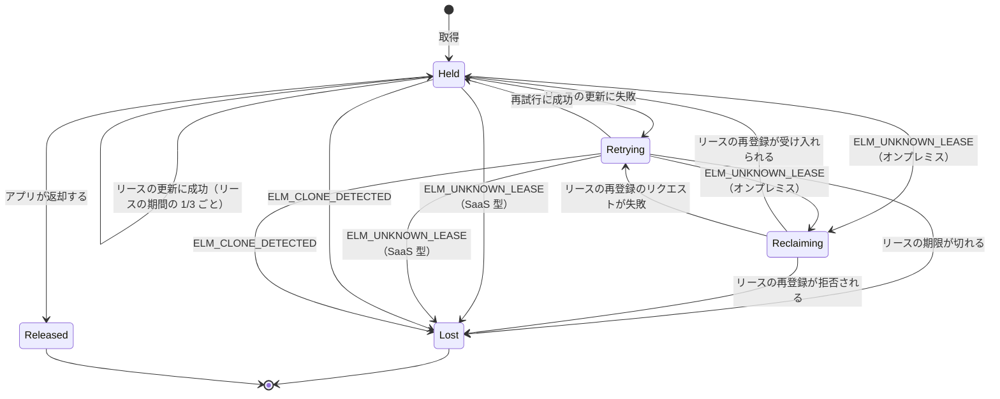
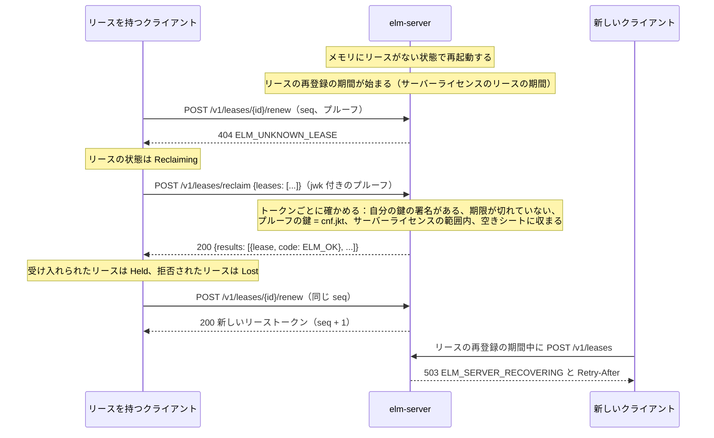

# フローティングライセンス

このページの読者は、同時使用シート数でライセンスを販売するベンダー、シートを借りるために `ElasticLM.Client` や `libelasticlm` をアプリに組み込む開発者（[.NET API](../reference/dotnet-api.md#licenseclient) と [C API](../reference/c-api.md#クライアントとリース) を参照）、`elm-server` を運用する顧客の管理者だ。オンプレミスのライセンスサーバーと SaaS 型のサービスのそれぞれで、シートを貸し出し、保持し、返却し、取り戻す仕組みを説明する。このページから読み始めてもよい。読むのに必要な用語は 3 つある。署名付きトークンは、ベンダーかサーバーの署名が付いたデータで、誰でも検証できるが誰も書き換えられない（[トラストチェーン](trust-chain.md)を参照）。インストール鍵は、アプリがデバイスごとに作る鍵ペアで、そのデバイスを識別する。プルーフ（所有証明）は、リクエストのたびにその鍵で作る署名で、どのデバイスが送ったかをサーバーが知るために使う（インストール鍵とプルーフは[デバイスとプルーフ](devices-and-proofs.md)で説明している）。

## フローティングライセンスの目的

フローティングライセンスでは、顧客は製品を何台のマシンにでも入れて動かせる。ただし、ある機能を同時に使えるマシンの数には上限がある。この数が、その機能の同時使用シート数だ。ノードロックのライセンス（[アクティベーション](activation.md)を参照）はマシンの台数を数えるが、フローティングライセンスは、いまその機能を使っているマシンの数を数える。

ElasticLM は、同じプロトコルで 2 か所からシートを貸し出す。

| 場所 | 運用する人 | シート数を保持する場所 |
| --- | --- | --- |
| `elm-server`（オンプレミスのライセンスサーバー） | 顧客の管理者が、顧客のネットワーク内で運用する | サーバーのメモリ |
| `elm-service`（SaaS 型のサービス） | ベンダー | サービスのデータベース（SQLite または PostgreSQL） |

どちらの場合も、顧客は購入した数より多くのシートを使えない。シートを得るためにリクエストを偽造したり再送したりすることも、シートをいくらでも配る偽のサーバーを立てることもできない。また、ネットワークやサーバーが短時間止まっても、アプリは動き続ける。ただし、オンプレミスでは、サーバーの鍵を取り出した管理者には、購入した数より多くのシートを使えない、という点が当てはまらない。その管理者は、サーバーライセンスが認めるより多くのシートのリースに署名できる（[セキュリティモデル](security-model.md#顧客のライセンスサーバー上)）。

## リースとリーストークン

リースとは、1 つの機能の 1 つ以上のシートを、1 つのインストール鍵に期限付きで貸し出したものだ。アプリは、インストール鍵が初めて必要になったとき（最初のアクティベーション、最初のリース、最初のトライアルのいずれか）に鍵を作る。

サーバーは、リースをリーストークン（種類は `elm-lease+jws`）として渡す。リーストークンにはサーバーが署名する。トークンに入るのは次の情報だ。

- リース（`lse`）
- 製品、ライセンス、機能（`prd`、`lic`、`feat`）
- シートの数（`n`）
- リースを保持するインストール鍵（`cnf.jkt`、鍵の[サムプリント](devices-and-proofs.md#インストール鍵)）
- 借用かどうか（`brw`）
- 発行したサーバーと、オンプレミスの場合はそのサーバーライセンス（`srv`、`slic`）
- リースの更新のたびに増えるシーケンス番号（`seq`）
- このトークンが応えたリクエストのプルーフ ID（`areq`）
- 発行時刻と有効期限（`iat`、`exp`）

すべてのクレームと、その型と範囲は[トークンとファイルの形式](../reference/formats.md#リーストークン-elm-leasejws)に挙げている。

トークンには署名があるので、アプリはどこにも問い合わせずに検証できる。また、`cnf.jkt` は 1 つの鍵を指すので、トークンを別のマシンにコピーしても使えない。リースの更新にも返却にも、その鍵で作ったプルーフが必要だからだ。インストール鍵も一緒にコピーすれば（デバイスの管理者のほか、既定のユーザースコープならそのデバイスのユーザーもできる）、コピー先のマシンでも使える。通常のリースで使えるのは、コピーどうしのリースの更新でクローンが見つかるまでだ。借用は更新しないので、終わるまで両方のマシンで使える（[セキュリティモデル](security-model.md#ライセンシーのマシン上)）。

リースの期間がどこで決まるかは、サーバーによって違う。`elm-service` では、ポリシーの `leaseDuration` で決まる。既定は 10 分で、2 分から 24 時間の範囲で設定できる。`elm-server` では、サーバーライセンスにあるリースの期間で決まる。`elm-service` が発行したサーバーライセンスには、ポリシーの `leaseDuration` が入る。`elm license issue` で作ったサーバーライセンスには `--lease-minutes` の値が入り、既定は 10 分だ。この値は 1 秒以上であればよいので、2 分より短くもできる（[`elm license issue`](../reference/elm-cli.md#elm-license-issue) を参照）。

どちらのサーバーも、リースと借用が、ライセンスの終わりと機能の終わりを過ぎないように、期間を短くする。`elm-server` では、その終わりは、次の 2 つの時点の早いほうだ。1 つは、サーバーライセンスの有効期限に猶予期間を足した時点だ。猶予期間は、有効期限のあとも、ライセンスがしばらく使える期間である（[有効期限と猶予期間](license-files-and-verification.md#有効期限と猶予期間)を参照）。もう 1 つは、機能自体の有効期限だ。これは、ライセンスが自分の有効期限とは別に、機能ごとに付けられる期限で、猶予期間はない。`elm-service` では、ライセンスの有効期限と機能の有効期限の早いほうで、猶予期間はない。

そのため、借用は、頼んだ期間より短くなることがある。借用の `ExpiresAt`（C では `elm_lease_expires_at`）を確かめること。保持しているリースを更新しても、その終わりより後にはならない。`elm-server` では、その終わりちょうどの秒に届いた更新は `ELM_EXPIRED` で断られ、リースは `Retrying` になり、期限が切れた時点で `Lost` になる。`elm-service` では、その終わりでリースがなくなるので、そのあとの更新は `ELM_UNKNOWN_LEASE` になり、リースはすぐに `Lost` になる。機能の有効期限ちょうどの秒に届いた新しいリースのリクエストは、リースの期間が 1 秒に満たないので、`403` と `ELM_EXPIRED` で断られる。その秒を過ぎると `ELM_FEATURE_EXPIRED` になり、ライセンスそのものが終わると（`elm-server` では、有効期限に猶予期間を足した時点を過ぎると）`ELM_EXPIRED` になる。

## シートの数え方

サーバーは機能ごとに、期限の切れていないすべてのリースの `n` を合計する。`count` 個のシートを求めるリクエストは、この合計に `count` を足した値が次の値を超えると、`409` と `ELM_NO_SEATS` で拒否される。

```text
allowed = floor(seats × (100 + overage) / 100)
```

`seats` はライセンスの値を使う。`overage` はポリシーの `overage` で、パーセントで表し、既定は 0 だ。数を数えて新しいリースを加える処理は、`elm-server` では機能ごとに 1 つのロックの下で、`elm-service` ではライセンスの行をロックする 1 つのデータベーストランザクションの中で実行する。同時に届いた 2 つのリクエストが、どちらも最後の 1 シートを取ることはない。

借用（後述）は、その期間中ずっとシートを使い続ける。サーバーがクローンを見つけて止めたリースも、期限が切れるまでシートを使ったままになる。

## リースのライフサイクル

アプリがリースを求めたあとは、ライフサイクル全体をクライアントが進める。アプリは各リースの状態を参照でき、状態が変わるとイベントを受け取る（.NET では `LeaseStateChanged`、C では `on_lease` コールバック）。



状態は `LeaseState` の値で、`Held`、`Retrying`、`Reclaiming`、`Lost`、`Released` の 5 つだ。

### 取得

クライアントは、機能、アプリが使うその機能のバージョン、`count` を指定して `POST /v1/leases` を送る。サーバーはまだその鍵を知らないので、プルーフには公開鍵を入れる。サーバーは `201` とリーストークンを返す。`count` は 1 からその機能のシート数までの値でなければならず、範囲外なら `ELM_INVALID_ARGUMENT` が返る。オンプレミスでは、最初の取得のときにサーバーが本物かどうかも確かめる（後述）。両方のプログラムのすべてのリースのルートと、その本文とレスポンスは、[デバイスのプロトコル](../reference/device-protocol.md)にある。

### リースの更新と再試行

クライアントは、リースの期間の 3 分の 1 が経つごとに、各リースを更新する。既定の 10 分なら約 200 秒ごとだ。リースの更新では、最後に受け取った `seq` と、同じ鍵で作ったプルーフを付けて `POST /v1/leases/{id}/renew` を送る。

3 分の 1 ごとに更新するので、リースの更新が 1 回遅れたり届かなかったりしても、シートは失われない。リースの更新が `ELM_CLONE_DETECTED` と `ELM_UNKNOWN_LEASE` 以外の理由（ネットワークの障害、`5xx` のレスポンス、サーバーのピンの不一致、クライアントが拒否したレスポンス、ほかのエラーコード）で失敗すると、リースは `Retrying` になる。クライアントは 15 秒後、次に 30 秒後、そのあとは 60 秒ごとに再試行する。その前にリースの期限が切れたら `Lost` になる。`ELM_CLONE_DETECTED` のときは再試行しない。`ELM_UNKNOWN_LEASE` は、サーバーがそのリースを知らないという意味だ。オンプレミスでは、再起動したサーバーがこれを返し、クライアントはリースの再登録をする（後述）。SaaS 型のサービスはリースを忘れることがないので、この場合はすぐに `Lost` になる。

リースが `Lost` になったときにどうするかは、アプリが決める。たとえば、ユーザーに作業の保存を促す、機能を無効にする、もう一度取得を試みる、といった対応がある。

### 再試行とクローン

サーバーは `seq` を使って、再試行とコピーされたマシンを見分ける。リースの更新のレスポンスがクライアントに届かなかった場合、サーバーはもう次の `seq` に進んでいるのに、クライアントは古い `seq` を持ったままになる。そこでクライアントは、レスポンスのなかったリクエストと、レスポンスを拒否したリクエストのプルーフ ID（`jti`）を記録しておき、次のリクエストの `retry` フィールドに入れる。サーバーは、そこに自分が受けた以前のリクエストを見つけると、同じトークンをもう一度返す。そのトークンの `areq` は以前のリクエストを指していて、クライアントは、そのリクエストが記録にあるので受け入れる。[アクティベーション](activation.md)も同じルールを使う。

仮想マシンをインストール鍵ごとコピーすると、両方のコピーが同じリースを更新する。2 番目のコピーが送る `seq` は、サーバーがすでに先に進めた値で、しかも `retry` にはもう一方のコピーのリクエストが入っていない。この場合サーバーは、サーバーライセンスの `clone` クレーム（SaaS 型のサービスではポリシーの `cloneStrategy`）に従う。既定の `deny` なら、リースを止め、期限が切れるまでそのシートを使用中のままにして、`ELM_CLONE_DETECTED` を返す。`flag` なら、クローンを記録して通常どおりリースを更新する（`elm-server` は[利用ログ](../reference/logs.md#elm-server-のイベント)に `cloneFlagged` を書く）。止めたリースは、リースの更新も、リースの再登録も、返却もできないので、どちらのコピーもシートを取り戻せない。サーバーの再起動のあとでコピーがリースを再登録したときにどうなるかも、同じクレームで決まる。

### 返却

アプリは `ReleaseLeaseAsync`（C では `elm_client_release_lease`）でリースを返却する。このとき、リースの鍵で作ったプルーフを付けた `DELETE /v1/leases/{id}` が送られる。ほかの誰もこのリースを返却できない。サーバーが知らないリースなら `204` が返る。

通常のリースは、サーバーに接続できなくても、呼び出しのあとは `Released` になる。この場合、シートはリースの期限が切れた時点で空く。クライアントを破棄すると（`DisposeAsync`、`elm_client_destroy`）、レスポンスが届かなかったか受け取らなかった取得と借用について、まだ送れていない返却を送り（[レスポンスが届かなかったとき](#レスポンスが届かなかったとき)を参照）、借用以外のリースをすべて返却する。5 秒以内に返却できなかったリースは、期限が切れた時点で終わる。

### レスポンスが届かなかったとき

取得や借用のリクエストがサーバーに届いても、そのレスポンスがアプリに届かないことがある。帰り道でネットワークが切れた、30 秒以内にレスポンスが全部届かなかった、アプリが呼び出しをキャンセルした、クライアントが受け取らない成功のレスポンスだった（256 KiB より大きい、検証に通らないトークン、別のリクエストへのレスポンス）、借用をクライアントが保存できなかった、といった場合だ。エラーのレスポンスのときは何も送らない。サーバーは、そのリクエストにリースを発行していない。

レスポンスが届かないとき、サーバーは、誰も持っていないリースを発行しているかもしれない。そのリースは、期限が切れるまでシートを使う。借用なら、借用の期間のあいだずっと使う。そのあとのリクエストがこのリースを指すことはなく、クライアントはリース ID も知らない。

そこでクライアントは、呼び出しがエラーを返す前に、レスポンスを受け取らなかったリクエストのプルーフ ID（`jti`）を指定して `DELETE /v1/leases/requests/{jti}` を送る。サーバーは、そのリクエストに発行したリースを消す。消すのは、リースが同じインストール鍵に紐付いていて、その後に更新されていないときだけだ。レスポンスが別のリクエストのリースを運んできた場合、そのリースは消えない。この方法で返却した借用は早期返却として数えられ、[早期返却](#早期返却)と同じ上限がかかる。拒否されたら、借用は期限が切れるまでシートを使う。止まったリースは、ほかの返却と同じく `ELM_CLONE_DETECTED` で拒否される。

どちらの場合も、呼び出しは取得や借用のエラーを返し、この返却で `LeaseStateChanged` のイベントは発生しない。返却にも 30 秒の上限があるので、接続できないサーバーへの取得は、60 秒ほどかかることがある。

返却は、サーバーが `429` と `5xx` 以外の状態で応えれば届いたとみなす。サーバーが `ELM_RETURN_NOT_ALLOWED` や `ELM_CLONE_DETECTED` で拒否した返却も届いたとみなし、送り直さない。返却が届かなかったときは、クライアントはプルーフ ID をメモリーに 16 個まで残す。16 個を超えたら古いものから捨て、そのリースのシートは期限が切れた時点で空く。残したものは、サーバーへの次のリクエストの前に、いちばん古いものを 1 つだけ送り直す。その返却が届いても届かなくても、そのあとでもとのリクエストを送る。クライアントを破棄するときは、残したものを古いものから全部送り、届かないものがあればそこでやめて、残りを捨てる。キャンセルされた呼び出しは返却を待たず、返却は次のリクエストの前に送る。この一覧はディスクに書かないので、返却が届く前にアプリが終了すると、シートはリースの期限が切れた時点で空く。このルートと、サーバーが確かめる内容は[デバイスのプロトコル](../reference/device-protocol.md#delete-v1leasesrequestsjti)にある。

## クライアントがリースごとに確かめること

クライアントは、サーバーから送られてきたというだけではリースを信用しない。リーストークンを受け取るたびと、借用中のリースをディスクから読むたびに、次の点を確かめる。

1. 署名。オンプレミスでは、検証済みのサーバーライセンスが指すサーバーの鍵で確かめる（後述）。SaaS 型のサービスでは、アプリのトラストストアにあるルート鍵がリース用として証明した、ベンダーの署名鍵で確かめる。
2. `prd` がアプリの製品で、`cnf.jkt` がこのデバイスのインストール鍵であること。
3. オンプレミスの場合は、ライセンス、機能とシート数、リースまたは借用の期間、終了日が、すべてサーバーライセンスの範囲内にあること。終了日は、サーバーライセンスの有効期限に猶予期間を足した時点より後でなく、サーバーライセンスにある機能自体の有効期限より後でもないこと。機能の有効期限には猶予期間がない。
4. 時刻の確認。ライセンスファイルの場合と同じだ（[ライセンスファイルと検証](license-files-and-verification.md)を参照）。

確認に失敗したリースは使わない（`ELM_LEASE_OUT_OF_BOUNDS`、または失敗した手順のエラーになる）。手順 3 は、オンプレミスのサーバーに不正をさせないためのものだ。サーバーの鍵をマシンから取り出した管理者は、どんなリースにも署名できる。それでもアプリは、ベンダーのサーバーライセンスが許していないリースを拒否する。アプリはリースを 1 つずつ確かめるので、その管理者は、サーバーライセンスが認めるより多くのシートのリースに署名できる（[セキュリティモデル](security-model.md#顧客のライセンスサーバー上)）。

クライアントは、レスポンスを、自分が送ったリクエストとも比べる。通信経路の途中にいる中継が、別のリクエストに応えた本物のリースを渡すことがあるからだ。たとえば、同じインストール鍵を使う別のプロセスが受け取ったレスポンスがそうだ。リースの取得と借用では、返ってきたリースが、借用を頼んだときにだけ借用であり、頼んだ機能とシート数のものであること、借用なら頼んだ期間より長くないこと、`areq` がこのリクエストのプルーフ ID であることを確かめる。リースの更新では、借用でないこと、機能、シート数、ID が保持しているリースと同じであること、`seq` が保持している値より大きいこと、`areq` が、今回の更新のリクエストか、クライアントの `retry` のリストにある、このリースの以前の更新のリクエストのプルーフ ID であることを確かめる。どれかが違えば `ELM_REQUEST_MISMATCH` になる。このとき、リースの取得と借用ではリースを得られず、クライアントは、レスポンスにあったリースを返却しない。そのリースは期限が切れた時点で終わる。リースの更新は失敗として扱い、リースは `Retrying` になる。ディスクから読んだ借用中のリースには、比べるリクエストがない。借用したときに比べてある。

オンプレミスでは、クライアントはリースの取得と借用で、バージョンも確かめる。リーストークンにはバージョンが入っていないからだ。アプリが機能のバージョン（`version`、C では `feature_version`）を渡し、サーバーライセンスがその機能にバージョンの範囲（[`ver`](../reference/formats.md#ライセンストークン-elm-licensejws)）を決めているときは、そのバージョンが範囲内になければならない。アプリがバージョンを渡さなければ、サーバーもクライアントも範囲を確かめない。範囲外なら、呼び出しは `ELM_FEATURE_VERSION_NOT_LICENSED` で失敗する。クライアントはリースを保持も保存もせず、このリクエストに対してサーバーが出したものを返却するよう、サーバーに頼む（[レスポンスが届かなかったとき](#レスポンスが届かなかったとき)を参照）。ライセンスに従うサーバーは、範囲外のバージョンを自分でも同じコードで断る。そのため、この確認が効くのは、ライセンスに従わないサーバー（鍵を取り出されたサーバーや、書き換えられたサーバー）を相手にしたときだけだ。SaaS 型のサービスでは、クライアントはバージョンも機能の有効期限も確かめない。`elm-service` が確かめる。

## サーバーライセンス: クライアントがオンプレミスのサーバーを信頼する仕組み

`elm-server` は、どのベンダーでも使える共通のバイナリだ。これを特定のベンダーの製品用のサーバーにするのが、サーバーライセンスだ。サーバーライセンスは、`kind: server` を持つライセンストークンで、ベンダーが署名する。中身は次のとおりだ。

- サーバーのインストール鍵と、ベンダーが紐付けた場合はマシンフィンガープリント（`cnf.jkt`、`fp`）。これにより、そのマシンでしか使えない。
- 機能。機能ごとに、シート数と、ベンダーが決めたときはバージョンの範囲と機能自体の有効期限を持つ（`feat`: `id`、`seats`、`ver`、`exp`）。
- リースの期間、借用の最長期間（0 は借用なし）、超過を許すパーセント、30 日間に許す借用の早期返却の回数、コピーされたアプリのインストールがリースを更新したときの動作（`lease`、`borrow`、`overage`、`brl`、`clone`）。
- 有効期限と猶予期間（`exp`、`grace`）。有効期限は、既定ではサーバー用ポリシーの `tokenLifetime` に従い、発行の 30 日後になる。

サーバーライセンスが持たなければならないクレームと、`GET /v1/server/license` のレスポンスは、[トークンとファイルの形式](../reference/formats.md#サーバーライセンス)に書いている。

クライアントは、サーバーからリースを受け取る前に、そのサーバーを確かめる。

1. [`GET /v1/server/license`](../reference/device-protocol.md#get-v1serverlicense) を呼び、サーバーライセンスとサーバーの公開鍵を受け取る。
2. サーバーライセンスをルート鍵から検証し、`kind: server` であることと、公開鍵のサムプリントが `cnf.jkt` と一致することを確かめる。一致しなければ `ELM_SERVER_PIN_MISMATCH` になる。
3. ピンを確かめる。アプリが `ExpectedServerLicenseId`（C では `expected_server_license_id`）を設定していれば、ライセンス ID がその値と一致しなければならない。設定していなければ、クライアントはその URL で最初に受け取ったサーバーライセンスを信頼する。そのライセンス ID と `cnf.jkt` をインストール鍵と同じ場所に保存し、以降の接続のたびに一致を求める。
4. 以降は、そのサーバーのリースを `cnf.jkt` の鍵で検証する。

トライアルや標準のライセンスで偽のサーバーを動かすことはできない。手順 2 で `kind: server` を求めるからだ。本物のサーバーライセンスを別のマシンにコピーしても使えない。リースは `cnf.jkt` が指す鍵で署名されていなければならず、その鍵はライセンスを受けたサーバーの外に出ないからだ。管理者がその鍵もライセンスと一緒にコピーすれば、サーバーのコピーが動く。それが見つかるのは、`elm-service` からの次のサーバーライセンスの更新のときだけで、手作業で発行したライセンスなら見つからない（[起こりうる問題と対処](#起こりうる問題と対処)）。サーバーがライセンスを更新すると、そのあとのレスポンスの `ELM-Server-License` ヘッダーに新しいトークン ID が入り、クライアントは手順 1〜3 をやり直す。

管理者がサーバーを別のマシンに移すと、鍵が変わる。`ExpectedServerLicenseId` を設定していれば、ライセンス ID が同じである限り、クライアントは新しい鍵を受け入れる。設定していなければ、アプリが `ResetServerPin`（C では `elm_client_reset_server_pin`）を呼ぶまで、ピンの確認で新しいサーバーは拒否される。

### TLS

既定では、サーバーは自分のインストール鍵で自己署名の証明書を作る。管理者は代わりに、自分で用意した証明書（PKCS#12、または `tls.key` と組み合わせた PEM）を `tls.certificate` に設定できる。クライアントは、この証明書を OS の通常の検証で確かめる。アプリ開発者が選ぶ設定はない。クライアントは接続のたびに、OS の検証に通る証明書か、鍵のサムプリントが検証済みのサーバーライセンスの `cnf.jkt` と一致する証明書を受け入れる。最初の接続では、サーバーライセンスを検証してから比べ、一致しなければ、その接続で受け取ったものをすべて捨てる。そのため、自社の認証局を持たない顧客でも、ベンダーがライセンスを与えたサーバーと暗号化した通信ができる。社内の認証局が発行した証明書を使う決まりがある場合や、監視用のプローブなどほかのツールもサーバーに接続する場合は、自分の証明書を使う。

## `elm-server` の運用

顧客の管理者がサーバーに渡すものと、サーバーが保存するものは次のとおりだ。

- **ベンダーから受け取るもの。** ベンダーのルート公開鍵（`trust.rootKeys` に指定する PEM ファイル、または `ELM_TRUST_ROOT_KEYS` に入れる PEM のテキスト）とサーバーライセンスだ。ルート公開鍵がないと、サーバーは起動しない。サーバーライセンスは `license` で指定した場所から読む（既定は実行ファイルと同じ場所の `server.elmlic`）。ライセンスがない状態で初めて起動すると、サーバーはインストール鍵を作り、そのサムプリントとマシンフィンガープリントを表示して停止する。これをベンダーに送ってサーバーライセンスを発行してもらうか、ベンダーのライセンスキーでアクティベーションする。オンラインなら `elm server activate`、オフラインなら `elm server activate-request` と `elm server import` を使う。
- **待ち受けるアドレス。** リースのプロトコルは `listen` で待ち受ける。既定は `https://0.0.0.0:7070` だ。クライアントがマシンのホスト名以外の名前でサーバーに接続するなら、その URL を `publicUrls` に書く。プルーフには、送り先の URL が入るからだ。
- **データフォルダー。** 1 つのフォルダーに、サーバーのインストール鍵、時刻の状態、`elm-service` から受け取ったアクティベーション（`activation.json`）、管理者トークン、ローカルの管理 API のソケットのファイル（同じマシンのプログラムどうしが、ポートの代わりに接続に使うファイル）、ロックファイル `server.lock`、借用の記録、既定では利用ログを置く。データフォルダーは、ローカルのファイルシステムに置く。場所は `dataDirectory` の設定で指定する。指定しなければ、サーバーはその `product` のマシンスコープの鍵のフォルダーを使う。たとえば `%ProgramData%\ElasticLM\<product>\` や `/var/lib/elasticlm/<product>/` だ（[デバイスとプルーフ](devices-and-proofs.md)を参照）。同じマシンでマシンスコープを使う同じ製品のアプリも、このフォルダーを使う。そのため、両者が 1 つのインストール鍵と 1 つの `activation.json` を共有してしまう。保存されたアクティベーションがサーバーライセンスでなければ、`elm server` のアクティベーションのコマンドも、サーバー自身によるライセンスの更新も、`ELM_INVALID_STATE` で止まる。サーバーには専用の `dataDirectory` を指定すること。
- **利用ログ。** サーバーは、リース、借用、返却、管理操作のすべてと、1 分ごとに数えた拒否の数を、日ごとのファイル `usage-<UTC time>.jsonl` に書き込む。既定の場所はデータフォルダーだ（`log.usage`）。ファイルはブロックごとにサーバーの鍵で署名され、各ファイルは前のファイルとチェーンでつながっている。そのため、書き換えられたファイル、欠けたファイル、途中で切られたファイルを `elm log verify` で見つけられる。ただし、次のものは見つけられない。最新のファイルの削除や、最後の署名のあとでの切り詰め。サーバーの鍵を持つ者が書き直したログ（[セキュリティモデル](security-model.md#顧客のライセンスサーバー上)）。いちばん古いファイルの削除（[利用ログを検証する](../how-to/verify-the-usage-log.md#書き終えたファイルのコピーを取っておく)）。利用ログは監査や課金の問い合わせのための記録で、シートの数え方はこのログに依存しない。ElasticLM はこのログをベンダーにもほかのどこにも送らない。古いファイルは、削除するまで残る。ベンダーから求められたときは、ベンダーも `elm log verify` でログを検証できる。

Windows では、`elm-server` に、Windows 10 バージョン 1803 か Windows Server 2019、またはそれ以降が要る（[elm-server の設定](../reference/server-configuration.md)）。

`service.url` にベンダーの `elm-service` を指定していれば、サーバーはライセンスをオンラインで更新する。指定していなければ、管理者が `elm server refresh-request` と `elm server import` で更新する（[elm-service でサーバーライセンスをアクティベーションする](../how-to/activate-a-server-license-with-elm-service.md)）。この更新のたびに、サービスは `seq` を使って、コピーされたサーバーマシンを見つけられる。`elm-service` に接続できない間も、サーバーはライセンスの有効期限に猶予期間を足した時点まではシートを貸し出し続け、それを過ぎると新しい取得とリースの更新を拒否する。手作業で発行したサーバーライセンスは、サービスを通じて更新されることがないので、コピーされたサーバーは検出されない。コピーが動く期間を限るのは、ライセンスの有効期限だ。有効期限のないサーバーライセンスを手作業で発行するとき、`elm` は警告を 2 つ出す（[`elm license issue`](../reference/elm-cli.md#elm-license-issue)）。更新するには、ベンダーが新しいファイルを発行し、管理者がそれを `elm server reload` で読み込ませる（[サーバーライセンスを更新する](../how-to/renew-a-server-license.md)）。手作業で発行したファイルには `seq` がないので、サーバーはそのファイルを置き換える前のファイルと比べない。そのため、与えるものを減らす更新のあとでも、管理者は古いファイルを、その期限が切れるまではもう一度読み込ませることができる。サーバーのシートを減らせるようにしておく必要があるベンダーは、期限を短くしてファイルを発行するか、サーバーを `elm-service` でアクティベーションする。

`elm-server` のすべての設定、コマンドライン、終了コードは、[elm-server の設定](../reference/server-configuration.md)を参照。利用ログのファイルとイベントは、[ログ](../reference/logs.md)を参照。

## 再起動とリースの再登録

`elm-server` は、リースをメモリにしか保持しない。そのおかげでサーバーは、データベースを持たない単一のバイナリで済む。しかし再起動のあとは、どのリースが有効なのかが分からない。そこで、クライアントがリースの再登録をして、サーバーに伝える。



リースの再登録の期間に新しくリースを取得しようとすると、`503` と `ELM_SERVER_RECOVERING` が `Retry-After` ヘッダー付きで返る。動いているアプリがまだ使っているシートを、サーバーがほかに貸し出さないためだ。クライアントは、1 回のリースの再登録のリクエストで最大 64 個のトークンを送る。サーバーは、図に示した確認をして、トークンごとにリースを復元する。結果はトークンごとに、`ELM_OK` か、`ELM_NO_SEATS` のような拒否の理由になる。リースの再登録のリクエスト自体が失敗したら、リースは `Retrying` になる。

リースの再登録を受け付ける期間は、サーバーライセンスが定めるリースの期間と同じ長さだ。既定のポリシーなら 10 分になる。再登録されたシートと復元された借用で、すべての機能のシートが埋まれば、期間は早めに終わる。この期間が終わってからのリースの再登録（スリープしていたマシンからのものなど）も、空きシートが残っていれば受け入れる。また、サーバーは起動のたびにノンス用の秘密の値を作り直す。そのため、再起動の前に作ったプルーフを再起動のあとに再送しても通らない。

### 待機系のサーバーを置かない理由

クライアントはリースの期間の 3 分の 1 ごとにリースを更新する。そのため、サーバーが止まった時点で、リースには期間の 3 分の 2 以上が残っている。既定の 10 分なら約 6 分 40 秒だ。`elm-server` は起動から 1 秒以内に待ち受けを始めることを目標にしており、計測では約 0.1 秒だった。OS のサービスマネージャーで自動的に再起動するようにしておけば、クラッシュやアップグレードでアプリが止まることはない。アプリが止まるのは、リースの残り時間より長くマシンが止まったときだけだ。`leaseDuration` を長くすると、両方の時間が延びる。アプリはより長い停止に耐えられるが、新しいユーザーが再起動のあとに待つ時間も長くなる。サーバー 2 台による高可用性の構成は、1.0 には含まれない。

## 借用

借用は、アプリがネットワークから離れて使える長いリースだ。たとえば出張に持っていくノート PC で使う。アプリは期間を指定して `BorrowLeaseAsync`（C では `elm_client_borrow_lease`）を呼ぶ。トークンには `brw: true` が入る。

借用はリースの更新をせず、`exp` まで有効だ。クライアントは借用を、その検証に必要なものと一緒に、インストール鍵と同じ場所に保存する（[クライアントが保存するファイル](../reference/formats.md#クライアントが保存するファイル)を参照）。アプリの再起動後は、`GetBorrowedLeases` がサーバーに問い合わせずにこれらのファイルを読み、もう一度確かめる。ファイルを保存できなければ、借用は `ELM_INTERNAL_ERROR` で失敗し、クライアントはサーバーにその借用の返却を頼む（[レスポンスが届かなかったとき](#レスポンスが届かなかったとき)を参照）。この返却は早期返却として数えられ、サーバーが拒否したら、シートは借用の期限まで使用中のままになる。借用の期限が切れてもイベントは発生せず、状態は `Held` のままなので、アプリは借用に頼る前に、`ExpiresAt`（C では `elm_lease_expires_at`）を現在時刻と比べる必要がある。クライアントを破棄しても、借用は返却されない。リクエストにはマシンフィンガープリントが必要だ（ないと `400` と `ELM_FINGERPRINT_UNAVAILABLE` になる）。

### 3 つの上限

オンプレミスでは、2 者が設定する 3 つの上限がある。

| 上限 | 設定する人 | 設定する場所 |
| --- | --- | --- |
| 借用の最長期間 | ベンダー | ポリシーの `borrowLimit`。サーバーライセンスには `borrow` として入る。既定は未設定で、この場合は借用できない。 |
| さらに短い借用の最長期間 | 顧客の管理者 | `borrow.maxDuration`（形式は `d.hh:mm:ss`、たとえば `7.00:00:00`）。サーバーは 2 つのうち短いほうを使う。 |
| 通常のリース用に残しておくシート | 顧客の管理者 | `borrow.reserve`。既定は 0。借用によって空きシートがこの数より少なくなる場合は、`409` と `ELM_NO_SEATS` で拒否する。 |

上限より長い借用は、`403` と `ELM_BORROW_NOT_ALLOWED` で拒否される。管理者は、借用の条件をベンダーが許す範囲より厳しくはできるが、緩くはできない。サーバーライセンスの `borrow` より長い借用は、クライアントが拒否するからだ。

### 早期返却

アプリは `ReleaseLeaseAsync` で借用を期限前に返却できる。ただし次の 2 つの場合、サーバーは `409` と `ELM_RETURN_NOT_ALLOWED` で拒否し、借用は期限まで有効なままになる。

- インストール鍵、または借用したときのマシンフィンガープリントのどれかで、過去 30 日間にすでに `borrowReturnLimit` 回の早期返却をしている（サーバーライセンスの `brl`、既定は 2）。マシンフィンガープリントでも数えるので、ユーザーが新しい鍵を作るだけでは回数はリセットされない。ただし、マシンフィンガープリントはクライアントが申告する値で、サーバーは確かめられない。そのため、新しい鍵と作ったマシンフィンガープリントを送れば、回数はリセットされる（[セキュリティモデル](security-model.md#ライセンシーのマシン上)）。
- 借用のあとに、サーバーライセンスが影響のある形で変わった。具体的には、別のライセンスになった、機能がなくなった、シート数が減った、`borrow` が短くなった、のどれかだ。定期的な更新はこれに当たらない。

この上限があるのは、返却した借用のトークンが `exp` まで有効なままだからだ。上限がなければ、ユーザーは借用と返却を何度も繰り返し、数の上では 1 シートなのに、有効なトークンをいくつも持ててしまう。

### 借用と再起動

借用中のクライアントはネットワークから離れているので、リースの再登録ができない。そこで `elm-server` は、借用と早期返却を、反映する前にすべて借用の記録に書き込む（データフォルダーの `borrows-<UTC time>.jsonl`。1 行ずつサーバーの鍵で署名する）。起動時には、この記録から期限の切れていない借用を復元する。記録が壊れていると、サーバーは起動しない。`elm-server --set-aside-broken-records` で起動すると、壊れた記録を別の場所に移し、その記録にあった借用なしで起動する。利用ログには、これが `records.set_aside` として記録される。

借用の記録の行と、`elm log verify --stream borrows` での検証方法は、[ログ](../reference/logs.md)を参照。

## SaaS 型のサービスも同じプロトコル

`elm-service` も、同じリクエストと、同じリースの更新・再試行・借用・早期返却のルールでシートを貸し出す。違いは次のとおりだ。

- ポリシーの `floating` を `cloud` にする必要がある。アプリは `LicenseClientOptions` の `LicenseKey`（C では `license_key`）を設定する。クライアントは、ライセンスキーを取得のときにだけ送る。
- TLS は OS が信頼する証明書で確かめる。サーバーライセンスもピンもなく、クライアントは前述の手順 1、2、4 を確かめる。
- 状態はデータベースにあるので、再起動しても何も失われず、リースの再登録もない。PostgreSQL を使えば、サービスを複数のノードで動かしても、シートの数は正確に保たれる。
- リースは、遅くともライセンスと機能の期限で終わる。猶予期間は加えず、ライセンスの期限が切れたあとはリースを貸し出さない（`ELM_EXPIRED`）。借用の上限は、ポリシーの `borrowLimit` だけだ。

## 顧客の管理者にできること・できないこと

`elm server` のコマンドは、ローカルの管理 API を通して動く。この API は、TCP のポートでは待ち受けず、サーバーのデータフォルダーにあるソケットのファイル（`admin.sock`）でだけ待ち受ける。また、サーバーが起動のたびにそのフォルダーに作り直す 256 ビットの管理者トークンを求める。コマンドは、サーバーのマシンで、サーバーのユーザーとして実行する。この API のルートは[管理 API](../reference/administration-api.md#elm-server-のローカルの管理-api) にある。

管理者は次のことができる。サーバーの状態とリースを確認する（`elm server status`、`elm server leases`）。通常のリースを強制的に返却する（`elm server release <ID>`。たとえばクラッシュしたマシンのリース）。サーバーライセンスの再読み込み、アクティベーション、更新をする。IP アドレスやその範囲で、クライアントを許可・拒否する（`allow`、`deny`）。IP ごとのリクエスト数の上限を設定する（`rateLimit.perIp`、既定は毎秒 20）。借用を制限する。TLS の証明書を選ぶ。管理操作はすべて、利用ログに `admin.action` として記録される。

一方、管理者はサーバーを通して次のことはできない。サーバーライセンスが許すより多く貸し出すこと（サーバーがサーバーライセンスに照らしてシートを数え、クライアントはその範囲外のリースを拒否する）。ライセンスの有効期限に猶予期間を足した時点を過ぎて貸し出すこと（`ELM_EXPIRED`）や、機能自体の有効期限を過ぎて貸し出すこと（`ELM_FEATURE_EXPIRED`。リースは遅くともその有効期限で終わる）。借用を強制的に返却すること（`409`、`ELM_RETURN_NOT_ALLOWED`）。借用したマシンはオフラインなので、サーバーがそのシートをほかに貸し出しても、そのマシンはシートを使い続けてしまうからだ。

ホスト名とユーザー名によるルール（`host:<name>`、`user:<name>`）は、クライアントが自己申告し、サーバーが確かめられない名前を使う。信頼できるのは IP のルールだけだ。リバースプロキシの後ろでは、IP のルールとレート制限にはプロキシのアドレスが見える。`elm-server` は `X-Forwarded-For` を信用しないからだ。

SaaS 型のサービスでは、`lease.release` の権限を持つベンダーの管理者が、ライセンスのリースを一覧し、借用を含むどのリースでも強制的に返却できる。強制返却はそのたびに監査ログに記録される。

`elm server` のコマンドの正確な書き方とオプションは、[elm コマンドリファレンス](../reference/elm-cli.md)を参照。

## 起こりうる問題と対処

- **返却したリーストークンは、期限が切れるまで使える。** 通常のリースなら、リースの期間 1 回分だ。借用の早期返却を制限しているのはこのためだ。
- **管理者は、借用中のシートを強制的に空けられる。** 方法は、借用の記録を削除する、時計を進める、`--set-aside-broken-records` で起動する、のいずれかだ。利用ログには痕跡（`records.set_aside`、欠けたファイル、新しいチェーンで始まるログファイル）が残り、被害は借用の期限が切れた時点で終わる。
- **サーバーマシンの root 権限を持つ管理者は、サーバーの鍵を取り出せる。** そうすれば、サーバーライセンスが認めるより多くのシートのリースに署名できる。利用ログも書き換えられるので確かな痕跡は残らず、ベンダーにも見えない。リースが終わるのは、ベンダーがサーバーライセンスの更新をやめ、その有効期限に猶予期間を足した時点を過ぎてからだ。サーバー用ポリシーの `tokenLifetime` を短くすれば、更新が止まったあとにリースが残る長さは短くなるが、余分なリースが見えるようにはならない（[セキュリティモデル](security-model.md#顧客のライセンスサーバー上)）。
- **コピーされたサーバーマシン**は、`elm-service` からの次のサーバーライセンスの更新のときまで見つからない。既定では最大 30 日後だ。手作業で発行したライセンスのサーバーのコピーは見つからない。
- **OS が信頼する、TLS の通信を検査するプロキシ**は、`ELM_CLONE_DETECTED` のようなエラーを偽装してアプリにリースを失わせることができる。ただし、リースは偽装できない。[セキュリティモデル](security-model.md)を参照。
- **アプリが `ExpectedServerLicenseId` を設定していないと、最初の接続先を信頼する。** 攻撃者が、同じ製品の別の本物のサーバーライセンスと、そのサーバーのインストール鍵を両方持っているとする。たとえば同じベンダーの別の顧客だ。クライアントが本物のサーバーより先にこの攻撃者のサーバーに接続すると、本物ではなく攻撃者のサーバーがピンとして記録される。するとクライアントはそのサーバーのシートを借り、アプリが `ResetServerPin` を呼ぶまで本物のサーバーを拒否する。顧客のサーバーライセンス ID を知っているアプリ開発者は、それを設定すること。
- **再起動のあと、新しいユーザーは待たされる。** 最大でリースの期間だけ待つ。`ELM_SERVER_RECOVERING` と一緒に返る `Retry-After` の時間をユーザーに表示する。
- **アプリは `Lost` に対処する必要がある。** 借用の `ExpiresAt` も、アプリ自身で確かめる。
- **同じ製品のアプリが同じマシンで動くときは、サーバーに専用のデータフォルダーが必要だ**（[`elm-server` の運用](#elm-server-の運用)を参照）。

ElasticLM が何を守り、何を守らないかは、役割ごとに[セキュリティモデル](security-model.md)にまとめている。サーバーが状態をメモリに保持する理由は[設計上の選択](design-choices.md)にある。すべてのエラーコードとその対処は、[エラーコード](../reference/error-codes.md)を参照。
