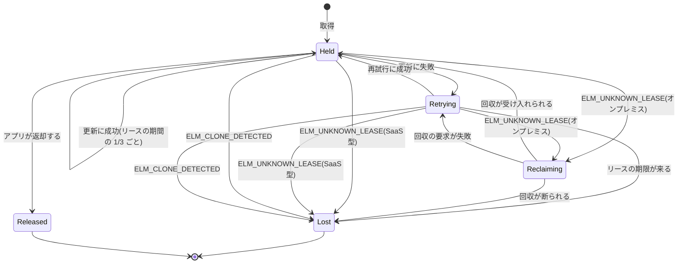
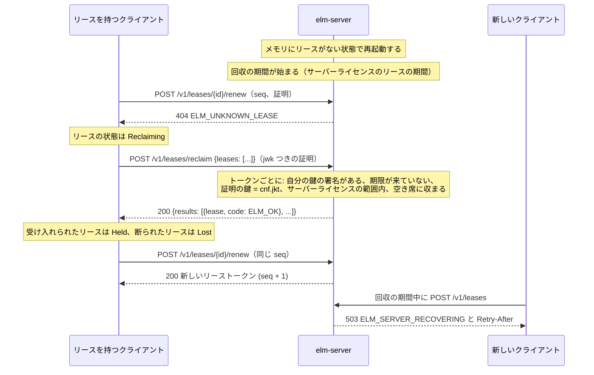

# フローティングライセンス

このページは、同時利用数で販売するベンダー、席を借りるために `ElasticLM.Client` や `libelasticlm` を組み込むアプリの開発者、`elm-server` を動かす顧客の管理者に向けたものだ。オンプレミスのライセンスサーバーと SaaS 型のサービスで、席をどう貸し、保ち、返し、回収するかを説明する。このページから読み始めてよい。読むには 3 つの用語が要る。署名つきトークンは、ベンダーかサーバーの署名がついたデータで、誰でも確かめられるが誰も書き換えられない（[信頼の鎖](trust-chain.md)を参照）。インストール鍵は、アプリが端末ごとに作る鍵ペアで、その端末の身元になる。証明は、要求のたびにその鍵で作る署名で、どの端末が送ったかをサーバーが知るためのものだ（この 2 つは[端末と証明](devices-and-proofs.md)で説明する）。

## フローティングライセンスの役割

フローティングライセンスでは、顧客は製品を何台のマシンでも動かせる。ただし、ある機能を同時に使うマシンは決まった数までに限られる。この数が、その機能の同時利用数（席数）だ。端末紐づけのライセンス（[有効化](activation.md)を参照）はマシンの台数を数え、フローティングライセンスはいまその機能を使っているマシンを数える。

ElasticLM は、同じプロトコルで 2 か所から席を貸す。

| 場所 | 動かす人 | 席の数を持つ場所 |
| --- | --- | --- |
| `elm-server`（オンプレミスのライセンスサーバー） | 顧客の管理者が、顧客のネットワークの中で動かす | サーバーのメモリ |
| `elm-service`（SaaS 型のサービス） | ベンダー | サービスのデータベース（SQLite か PostgreSQL） |

どちらでも、顧客は買った数より多くの席を使えない。席を得るために要求を偽造したり再送したりすることも、席を自由に配る偽のサーバーを立てることもできない。また、ネットワークやサーバーが短い間止まっても、アプリは動き続ける。

## リースとリーストークン

リースは、1 つの機能の 1 つ以上の席を、1 つのインストール鍵に期限つきで貸したものだ。アプリは、インストール鍵が初めて要るとき（最初の有効化、最初のリース、最初の試用）に鍵を作る。

サーバーは、リースをそれぞれリーストークン（型は `elm-lease+jws`）として渡し、自分で署名する。トークンには次が入る。リース(`lse`)、製品・ライセンス・機能（`prd`、`lic`、`feat`）、席の数(`n`)、リースを持つインストール鍵（`cnf.jkt`、鍵の拇印）、借り出しかどうか(`brw`)、発行したサーバーと、オンプレミスならそのサーバーライセンス（`srv`、`slic`）、更新のたびに増える更新番号(`seq`)、発行の時刻と期限（`iat`、`exp`）。

トークンには署名があるので、アプリは誰にも問い合わせずに確かめられる。また `cnf.jkt` は 1 つの鍵を指すので、トークンを別のマシンに写しても使えない。更新にも返却にも、その鍵で作った証明が要るからだ。

リースの期間はポリシーの `leaseDuration` で決まる。既定は 10 分で、2 分から 24 時間までの値を取る。

## 席の数え方

サーバーは機能ごとに、期限の来ていないすべてのリースの `n` を足す。`count` 席の要求は、その和に `count` を足した値が次の値を超えると、`409` と `ELM_NO_SEATS` で断られる。

```text
allowed = floor(seats × (100 + overage) / 100)
```

`seats` はライセンスから取る。`overage` はポリシーの `overage` で、既定が 0 の百分率だ。数えることと新しいリースを足すことは、`elm-server` では機能ごとに 1 つのロックの下で行い、`elm-service` ではライセンスの行をロックする 1 つのデータベーストランザクションの中で行う。同時に届いた 2 つの要求が、どちらも最後の 1 席を取ることはない。

借り出し（後述）は、期間の間ずっと席を持つ。複製を見つけたサーバーが止めたリースも、期限が来るまで席を持ち続ける。

## リースのライフサイクル

アプリがリースを求めると、そのあとのライフサイクルはすべてクライアントが進める。アプリには、リースごとの状態と、状態が変わったときのイベントが見える（.NET では `LeaseStateChanged`、C では `on_lease` のコールバック）。



状態は `LeaseState` の値で、`Held`、`Retrying`、`Reclaiming`、`Lost`、`Released` がある。

### 取得

クライアントは、機能、アプリが使うその機能のバージョン、`count` をつけて `POST /v1/leases` を送る。サーバーはまだ鍵を知らないので、証明には公開鍵を入れる。サーバーは `201` とリーストークンを返す。`count` は 1 からその機能の席数までで、外れると `ELM_INVALID_ARGUMENT` が返る。オンプレミスでは、最初の取得のときにサーバーの身元も確かめる（後述）。

### 更新と再試行

クライアントは、各リースをリースの期間の 3 分の 1 ごとに更新する。既定の 10 分なら約 200 秒ごとだ。更新では、最後に受け取った `seq` と、同じ鍵で作った証明をつけて `POST /v1/leases/{id}/renew` を送る。

3 分の 1 で更新するので、更新が 1 回遅れたり失われたりしても席は失わない。ネットワークの障害や `5xx` の応答のあと、またはサーバーのピンが一致しなかったときは、リースは `Retrying` に移る。クライアントは 15 秒後、次に 30 秒後、そのあとは 60 秒ごとに再試行し、先にリースの期限が来たら `Lost` になる。`ELM_CLONE_DETECTED` は再試行しない。`ELM_UNKNOWN_LEASE` は、サーバーがそのリースを知らないという意味だ。オンプレミスでは再起動したサーバーがこれを返し、クライアントは回収する（後述）。SaaS 型のサービスはリースを忘れないので、そこではすぐに `Lost` になる。

リースが `Lost` になったら、どうするかはアプリが決める。ユーザーに作業の保存を促す、機能を止める、もう一度取得を試みる、などだ。

### 再試行と複製

サーバーは `seq` で、再試行と写したマシンを見分ける。更新の応答が帰り道で失われると、サーバーはもう次の `seq` に進んでいるのに、クライアントは古い `seq` を持ったままになる。そこでクライアントは、応答のなかった要求の証明 ID(`jti`)を覚えておき、次の要求の `retry` フィールドに並べる。サーバーはそこに自分が受けた前の要求を見つけ、同じトークンをもう一度返す。[有効化](activation.md)も同じ規則を使う。

仮想マシンがインストール鍵ごと写されると、両方の写しが同じリースを更新する。2 番目の写しは、サーバーがもう先に進んだ `seq` を送り、しかも `retry` にもう一方の写しの要求が入っていない。するとサーバーは、サーバーライセンスの `clone` クレーム（SaaS 型のサービスではポリシーの `cloneStrategy`）に従う。既定の `deny` なら、リースを止め、期限が来るまでその席を持たせたまま、`ELM_CLONE_DETECTED` を返す。`flag` なら、複製を記録していつもどおり更新する。止めたリースは更新も回収も返却もできないので、どちらの写しも席を取り戻せない。

### 返却

アプリは `ReleaseLeaseAsync`（C では `elm_client_release_lease`）でリースを返す。これはリースの鍵で作った証明をつけて `DELETE /v1/leases/{id}` を送る。ほかの誰もそのリースを返せない。サーバーが知らないリースなら `204` が返る。

通常のリースは、サーバーに届かなくても呼び出しのあとは `Released` になる。その場合、席はリースの期限に空く。クライアントを破棄すると（`DisposeAsync`、`elm_client_destroy`）、借り出しでないリースをすべて返す。5 秒以内に返せなかったリースは、期限で終わる。

## クライアントがリースのたびに確かめること

クライアントは、サーバーが送ってきたからといってリースを信じない。リーストークンを受け取るたびと、借り出したリースをディスクから読むたびに、次を確かめる。

1. 署名。オンプレミスでは、検証したサーバーライセンスが指すサーバーの鍵で確かめる（後述）。SaaS 型のサービスでは、アプリのトラストストアにあるルート鍵がリース用に証明したベンダーの署名鍵で確かめる。
2. `prd` がアプリの製品で、`cnf.jkt` がこの端末のインストール鍵であること。
3. オンプレミスでは、ライセンス、機能と席数、リースか借り出しの長さ、終わりの日付が、すべてサーバーライセンスの範囲内にあること（遅くともその有効期限に猶予期間を足した日まで）。
4. 時計の確かめ。ライセンスファイルと同じだ（[ライセンスファイルと検証](license-files-and-verification.md)を参照）。

確かめに失敗したリースは使わない（`ELM_LEASE_OUT_OF_BOUNDS` か、失敗した手順のエラー）。手順 3 は、オンプレミスのサーバーに不正をさせないためにある。サーバーの鍵をマシンから抜き出した管理者は、どんなリースにも署名できる。それでもアプリは、ベンダーのサーバーライセンスが許さないリースを断る。

## サーバーライセンス:クライアントがオンプレミスのサーバーを信じる仕組み

`elm-server` は汎用のバイナリだ。これを、あるベンダーの製品のためのサーバーにするのは、サーバーライセンスである。サーバーライセンスは `kind: server` を持つライセンストークンで、ベンダーが署名する。中には次が入る。サーバーのインストール鍵とマシン指紋（`cnf.jkt`、`fp`）。これで、そのマシンでしか使えない。機能とその席数(`feat`)。リースの期間、借り出しの最長（0 は借り出しなし）、超過の百分率、30 日に認める借り出しの早期返却の回数、複製への対応（`lease`、`borrow`、`overage`、`brl`、`clone`）。有効期限と猶予期間（`exp`、`grace`）。有効期限の既定は、サーバー用ポリシーの `tokenLifetime` から決まる発行の 30 日後だ。

クライアントは、サーバーからリースを受け取る前に、そのサーバーを確かめる。

1. `GET /v1/server/license` を呼び、サーバーライセンスとサーバーの公開鍵を受け取る。
2. ルート鍵からサーバーライセンスを検証し、`kind: server` を求め、公開鍵の拇印が `cnf.jkt` と同じことを確かめる。違えば `ELM_SERVER_PIN_MISMATCH` になる。
3. ピンを確かめる。アプリが `ExpectedServerLicenseId`（C では `expected_server_license_id`）を設定していれば、ライセンス ID がそれと同じでなければならない。設定していなければ、クライアントはその URL で最初に見たサーバーライセンスを信じる。そのライセンス ID と `cnf.jkt` をインストール鍵の隣に保存し、以後の接続のたびにそれを求める。
4. それからは、そのサーバーのリースを `cnf.jkt` の鍵で検証する。

試用ライセンスや通常のライセンスでは偽のサーバーを動かせない。手順 2 が `kind: server` を求めるからだ。本物のサーバーライセンスを別のマシンに写しても使えない。リースは `cnf.jkt` が指す鍵で署名されていなければならず、その鍵はライセンスを受けたサーバーから出ないからだ。サーバーがライセンスを更新すると、応答の `ELM-Server-License` ヘッダーに新しいトークン ID が入り、クライアントは手順 1 から 3 をやり直す。

管理者がサーバーを別のマシンに移すと、鍵が変わる。`ExpectedServerLicenseId` を設定していれば、クライアントはライセンス ID が同じである限り新しい鍵を受け入れる。設定していなければ、アプリが `ResetServerPin`（C では `elm_client_reset_server_pin`）を呼ぶまで、ピンが新しいサーバーを断る。

### TLS

既定では、サーバーは自分のインストール鍵で自己署名の証明書を作る。代わりに、管理者は `tls.certificate` に自分の証明書（PKCS#12、または `tls.key` とあわせて PEM）を設定できる。クライアントはこれを OS の通常の検証で確かめる。アプリの開発者が選ぶ設定はない。クライアントは接続のたびに、OS の検証に通るか、証明書の鍵の拇印が検証したサーバーライセンスの `cnf.jkt` と同じなら、証明書を受け入れる。最初の接続では、サーバーライセンスを検証してから比べ、一致しなければその接続で返されたものをすべて捨てる。そのため、自社の認証局を持たない顧客でも、ベンダーがライセンスを与えたサーバーと暗号化された接続を結べる。自社の認証局の証明書を求める方針があるときや、監視のプローブのようなほかの道具がサーバーにつなぐときは、自分の証明書を使う。

## `elm-server` を動かす

顧客の管理者がサーバーに渡すものと、サーバーが持つものは次のとおりだ。

- **ベンダーから受け取るもの。** ベンダーのルート公開鍵（`trust.rootKeys` に書いた PEM ファイル、または `ELM_TRUST_ROOT_KEYS` の PEM のテキスト）と、サーバーライセンスだ。ルート公開鍵がないとサーバーは起動しない。サーバーライセンスは `license` から読む（既定は実行ファイルの隣の `server.elmlic`）。ライセンスがないまま初めて起動すると、サーバーはインストール鍵を作り、その拇印とマシン指紋を表示して止まる。これをベンダーに送ってサーバーライセンスを発行してもらうか、ベンダーのライセンスキーで有効化する。オンラインなら `elm server activate`、オフラインなら `elm server activate-request` と `elm server import` を使う。
- **待ち受ける場所。** リースのプロトコルは `listen` で待ち受ける。既定は `https://0.0.0.0:7070` だ。クライアントがマシンのホスト名と違う名前でサーバーにつなぐなら、その URL を `publicUrls` に書く。証明には、それを作った宛先の URL が入るからだ。
- **データのフォルダー。** 1 つのフォルダーに、サーバーのインストール鍵、時計の状態、`elm-service` から受けた有効化(`activation.json`)、管理者トークン、借り出しの記録、既定では利用ログを置く。フォルダーは `dataDirectory` の設定で選ぶ。設定しなければ、サーバーはその `product` の、端末の範囲の鍵のフォルダーを使う。たとえば `%ProgramData%\ElasticLM\<product>\` や `/var/lib/elasticlm/<product>/` だ（[端末と証明](devices-and-proofs.md)を参照）。同じマシンで端末の範囲を使う同じ製品のアプリも同じフォルダーを使うので、両者が 1 つのインストール鍵と 1 つの `activation.json` を共有してしまう。保存されている有効化がサーバーライセンスでなければ、`elm server` の有効化のコマンドと、サーバー自身によるライセンスの更新は `ELM_INVALID_STATE` で止まる。サーバーには専用の `dataDirectory` を与える。
- **利用ログ。** サーバーは、すべてのリース、借り出し、返却、拒否、管理操作を日ごとのファイル `usage-<UTC time>.jsonl` に書く。既定の置き場所はデータのフォルダーだ(`log.usage`)。ファイルはサーバーの鍵でブロックごとに署名され、鎖でつながっているので、書き換えたファイル、欠けたファイル、途中で切ったファイルを `elm log verify` が見つける。ログは監査や課金の問い合わせのための記録で、席の数え方はログに頼らない。ElasticLM はログをベンダーにもほかのどこにも送らず、古いファイルは消すまで残る。ベンダーに求められたら、ベンダーは `elm log verify` でログを確かめられる。

`service.url` がベンダーの `elm-service` を指していれば、サーバーはライセンスをオンラインで更新する。指していなければ、管理者が `elm server refresh-request` と `elm server import` で更新する。更新のたびに、サービスは `seq` で写されたサーバーマシンを見つけられる。`elm-service` に届かない間も、サーバーはライセンスの有効期限に猶予期間を足した日まで貸し続け、そのあとは新しい取得と更新を断る。手で発行したサーバーライセンスには更新がない。有効期限のないサーバーライセンスでは写したサーバーを見つけられないので、`elm` はそれを発行するときに警告する。

## 再起動と回収

`elm-server` は、リースをメモリにだけ持つ。そのおかげでサーバーはデータベースのない単一のバイナリで済むが、再起動のあとはどのリースが有効かを知らない。回収は、それをクライアントからサーバーに伝える仕組みだ。



回収の期間中、新しい取得には `503` と `ELM_SERVER_RECOVERING` が `Retry-After` ヘッダーつきで返る。動いているアプリがまだ持っている席を、サーバーが貸してしまわないためだ。クライアントは 1 回の回収の要求で最大 64 個のトークンを送り、サーバーは図の確かめを通してそれぞれを戻す。結果はそれぞれ `ELM_OK` か、`ELM_NO_SEATS` のような拒否の理由だ。回収の要求そのものが失敗したら、リースは `Retrying` に移る。

回収の期間は、サーバーライセンスのリースの期間だけ続く。既定のポリシーでは 10 分だ。回収した席と戻した借り出しですべての機能の席が埋まれば、早く終わる。期間のあとの回収（スリープしていたマシンからのもの）も、空き席が残っていれば受け入れる。また、サーバーは起動のたびに新しいノンスの秘密を作るので、再起動の前に作った証明を再起動のあとに再送しても通らない。

### 待機系のサーバーがない理由

クライアントはリースの期間の 3 分の 1 で更新するので、サーバーが止まった時点で、リースには期間の 3 分の 2 以上が残っている。既定の 10 分なら約 6 分 40 秒だ。`elm-server` は起動から 1 秒以内に待ち受けることを目標にしており、計測では約 0.1 秒だった。OS のサービスマネージャーが再起動するようにしておけば、クラッシュやアップグレードでアプリは止まらない。アプリが止まるのは、リースの残りの時間より長くマシンが止まったときだけだ。`leaseDuration` を長くすると、両側が長くなる。アプリはより長い停止に耐えられるが、新しいユーザーは再起動のあとにより長く待つ。サーバーを 2 台組にした高可用性の構成は、1.0 には含まれない。

## 借り出し

借り出しは、アプリがネットワークから離れて使える長いリースだ。たとえば出張に持っていくノート PC で使う。アプリは期間をつけて `BorrowLeaseAsync` を呼び（C では `elm_client_borrow_lease`）、トークンには `brw: true` が入る。

借り出しは更新せず、`exp` まで有効だ。クライアントは借り出しを、それを検証するのに要るものとあわせてインストール鍵の隣に保存する。アプリを再起動したあとは、`GetBorrowedLeases` がサーバーに問い合わせずにこれらのファイルを読み、もう一度確かめる。ファイルを保存できなければ、借り出しは `ELM_INTERNAL_ERROR` で失敗し、席は借り出しの期限まで使用中のままになる。借り出しの期限が来てもイベントは起きず、状態は `Held` のままだ。そのため、アプリは借り出しに頼る前に `ExpiresAt`（C では `elm_lease_expires_at`）を現在の時刻と比べなければならない。クライアントを破棄しても、借り出しは返さない。要求にはマシン指紋が必須だ（ないと `400` と `ELM_FINGERPRINT_UNAVAILABLE`）。

### 3 つの上限

オンプレミスでは、2 者が決める 3 つの上限がかかる。

| 上限 | 決める人 | 場所 |
| --- | --- | --- |
| 借り出しの最長 | ベンダー | ポリシーの `borrowLimit`。サーバーライセンスの `borrow` として運ばれる。既定は未設定で、借り出しはできない。 |
| それより短い借り出しの最長 | 顧客の管理者 | `borrow.maxDuration`（形式は `d.hh:mm:ss`、たとえば `7.00:00:00`）。サーバーは 2 つのうち小さいほうを使う。 |
| 通常のリース用に残す席 | 顧客の管理者 | `borrow.reserve`。既定は 0。借り出したあとの空き席がこの数より少なくなるなら、`409` と `ELM_NO_SEATS` で断る。 |

上限より長い借り出しは、`403` と `ELM_BORROW_NOT_ALLOWED` で断られる。管理者は借り出しをベンダーが許すより厳しくはできるが、緩くはできない。サーバーライセンスの `borrow` より長い借り出しは、クライアントが断るからだ。

### 早期返却

アプリは `ReleaseLeaseAsync` で借り出しを早めに返せる。ただし次の 2 つの場合、サーバーは `409` と `ELM_RETURN_NOT_ALLOWED` で断り、借り出しは期限まで有効なままになる。

- インストール鍵か、借り出したときのマシン指紋のどれかが、過去 30 日にすでに `borrowReturnLimit` 回の早期返却をしている（サーバーライセンスの `brl`、既定は 2）。マシン指紋でも数えるので、ユーザーが新しい鍵を作って回数を数え直すことはできない。
- 借り出したあとに、サーバーライセンスが意味のある形で変わった。別のライセンスになった、機能が外れた、席数が減った、`borrow` が短くなった、のどれかだ。定期の更新は含まない。

この上限があるのは、返した借り出しのトークンが `exp` まで有効なままだからだ。上限がなければ、ユーザーは借り出しと返却を何度も繰り返し、数えられる 1 席に対して有効なトークンを何個も持てる。

### 借り出しと再起動

借り出したクライアントはネットワークから離れているので、回収できない。そこで `elm-server` は、すべての借り出しと早期返却を、効力を持つ前に借り出しの記録に書く（データのフォルダーの `borrows-<UTC time>.jsonl` で、サーバーの鍵で 1 行ずつ署名する）。起動時には、そこから期限の来ていない借り出しを戻す。記録が壊れていると、サーバーは起動しない。`elm-server --set-aside-broken-records` は、壊れた記録を脇に移し、その借り出しなしで起動する。利用ログはこれを `records.set_aside` として記録する。

## SaaS 型のサービスでも同じプロトコル

`elm-service` は、同じ要求と、同じ更新・再試行・借り出し・早期返却の規則で席を貸す。違いは次のとおりだ。

- ポリシーの `floating` を `cloud` にしなければならない。アプリは `LicenseClientOptions` の `LicenseKey`（C では `license_key`）を設定し、クライアントはライセンスキーを取得のときだけ送る。
- TLS は OS の信頼で確かめる。サーバーライセンスもピンもなく、クライアントは上の手順 1、2、4 を確かめる。
- 状態はデータベースにあるので、再起動しても何も失わず、回収もない。PostgreSQL なら、サービスを複数のノードで動かしても数は正確なままだ。
- リースの終わりは、ライセンスと機能の終わりより遅くならない。猶予期間は足さない。借り出しの上限は、ポリシーの `borrowLimit` だけだ。

## 顧客の管理者にできること、できないこと

`elm server` のコマンドは、ローカルの管理 API を通して動く。この API はループバックでだけ待ち受け（`admin.listen`、既定は `http://127.0.0.1:7071`）、サーバーが最初の起動でデータのフォルダーに作る 256 ビットの管理者トークンを求める。

管理者にできるのは次のことだ。サーバーの状態とリースを見る（`elm server status`、`elm server leases`）。通常のリースを強制的に返す（`elm server release <ID>`。たとえばクラッシュしたマシンのリース）。サーバーライセンスを読み直す、有効化する、更新する。IP アドレスかその範囲でクライアントを許可・拒否する（`allow`、`deny`）。IP ごとの要求の上限を決める（`rateLimit.perIp`、既定は毎秒 20）。借り出しを制限する。TLS の証明書を選ぶ。管理操作はすべて、利用ログに `admin.action` として書かれる。

管理者がサーバーを通してできないことは次のとおりだ。サーバーライセンスが許すより多く貸すこと（クライアントが断る）。ライセンスの有効期限に猶予期間を足した日を過ぎて貸すこと(`ELM_EXPIRED`)。借り出しを強制的に返すこと（`409`、`ELM_RETURN_NOT_ALLOWED`）。借り出したマシンはオフラインなので、サーバーがその席をほかに貸しても、そのマシンは席を使い続けてしまうからだ。

ホスト名とユーザー名の規則（`host:<name>`、`user:<name>`）は、クライアントが申告し、サーバーが確かめられない名前を使う。信頼できるのは IP の規則だけだ。リバースプロキシの後ろでは、IP の規則と要求の上限にはプロキシのアドレスが見える。`elm-server` は `X-Forwarded-For` を信じないからだ。

SaaS 型のサービスでは、ベンダーの管理者が `lease.release` の権限で、ライセンスのリースを一覧し、借り出しを含むどのリースも強制的に返せる。強制返却はそれぞれ監査ログに書かれる。

## 起こりうる問題と対処

- **返したリーストークンは、期限まで使える。** 通常のリースなら、リースの期間 1 つ分だ。借り出しの早期返却を制限しているのはこのためだ。
- **管理者は、借り出した席を強制的に空けられる。** 借り出しの記録を消す、時計を進める、`--set-aside-broken-records` で起動する、の方法がある。サーバーマシンの root 権限があれば、サーバーの鍵も抜き出せる。利用ログには痕跡が残り（`records.set_aside`、欠けたファイル、新しい鎖で始まるログファイル）、被害は借り出しとサーバーライセンスの期限で終わる。これを気にするベンダーは、サーバー用ポリシーの `tokenLifetime` を短くする。
- **写したサーバーマシン** は、次のサーバーライセンスの更新のときにしか見つからない。既定では最大 30 日後になる。
- **OS が信頼する TLS 検査のプロキシ** は、`ELM_CLONE_DETECTED` のようなエラーを偽ってアプリにリースを失わせられる。ただし、リースは偽れない。[安全性のモデル](security-model.md)を参照。
- **アプリが `ExpectedServerLicenseId` を設定していないと、最初の接続を信じる。** 同じ製品の本物のサーバーライセンスを別に持ち、そのサーバーのインストール鍵もあわせて持つ攻撃者（たとえば同じベンダーの別の顧客）が、クライアントが本物のサーバーに最初につなぐ前にクライアントに届けば、本物の代わりにそちらがピンされる。するとクライアントはそのサーバーの席を借り、アプリが `ResetServerPin` を呼ぶまで本物のサーバーを断る。顧客のサーバーライセンス ID を知っているアプリの開発者は、それを設定する。
- **再起動のあと、新しいユーザーは待たされる。** 最大でリースの期間だけ待つ。`ELM_SERVER_RECOVERING` とともに返る `Retry-After` の時間をユーザーに見せる。
- **アプリは `Lost` を扱わなければならない。** 借り出しの `ExpiresAt` も自分で確かめる。
- **サーバーには専用のデータのフォルダーが要る。** 同じ製品のアプリが同じマシンで動くときだ（上の「`elm-server` を動かす」の節を参照）。

ElasticLM が何を守り何を守らないかは、役割ごとに[安全性のモデル](security-model.md)にある。サーバーが状態をメモリに持つ理由は[設計の選択](design-choices.md)にある。
