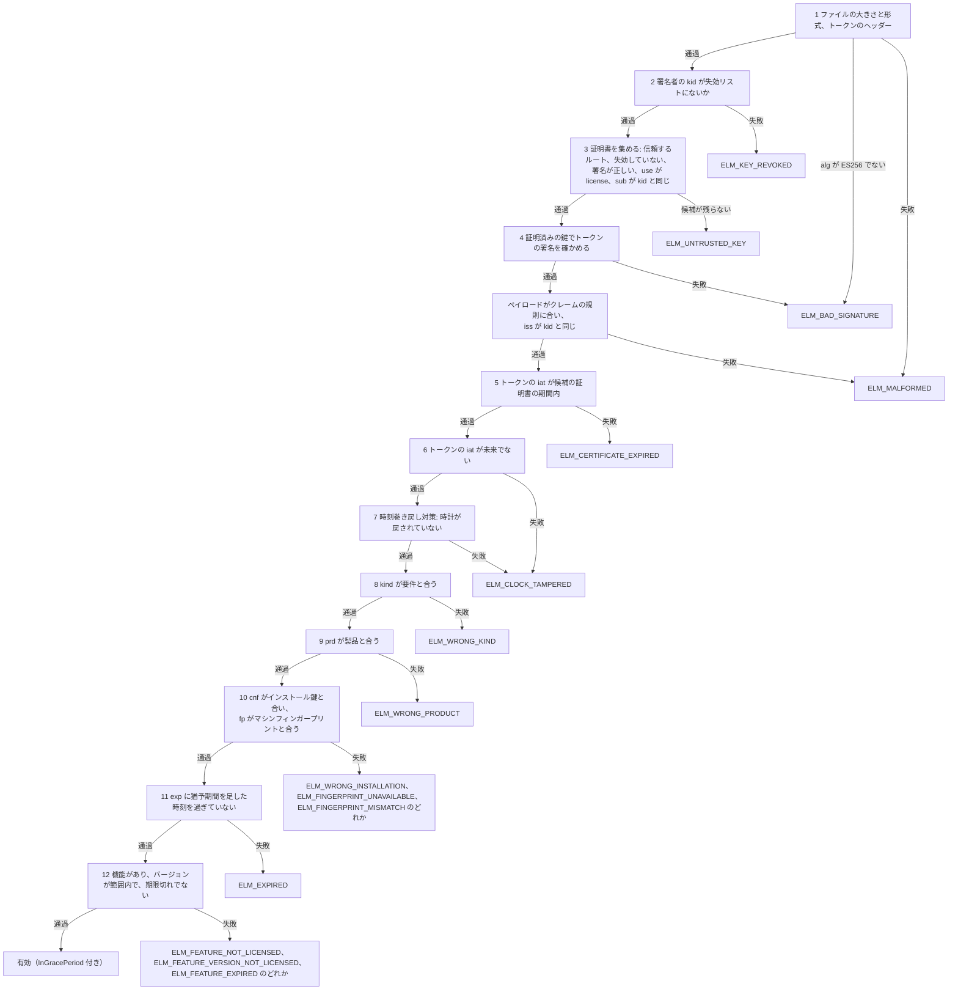

# ライセンスファイルと検証

このページの読者は、ライセンスファイルを発行してその元になるポリシーを決めるベンダーと、`ElasticLM.Licensing` や `libelasticlm` を使ってアプリの中でライセンスファイルを検証するアプリ開発者だ（すべての型と関数は [.NET API](../reference/dotnet-api.md) と [C API](../reference/c-api.md) にある）。ライセンストークンとライセンスファイルの中身、検証側が確かめる順序、有効期限・猶予期間・時刻巻き戻しの検出の仕組み、検証結果として返るものを説明する。先に[トラストチェーン](trust-chain.md)を読んでおくとよい。このページは、ルート鍵、署名鍵、鍵証明書、鍵 ID（`kid`）、トラストストアが何かを知っている前提で書いている。

## ライセンスファイルの役割

ライセンスファイルがあれば、アプリはネットワークにつながずに、このマシンでこの製品・この機能を今使ってよいかを判断できる。アプリはファイルを読み、アプリに組み込んだトラストストアで確かめる。結果は、検証済みのライセンスか、拒否の理由のどちらかになる。

ファイルの入手元は 3 つある。

- `elm-service` は、デバイスがオンラインでアクティベーションやトークンの更新をしたときと、オフラインのリクエストに応えるときにファイルを返す（[アクティベーション](activation.md)を参照）。
- `elm-service` の管理 API は、マシンに紐付けないライセンス（ポリシーの `binding` が `unbound` のライセンス）のファイルを出す。
- `elm license issue` は、サービスを使わずにファイルを書き出す。完全にオフラインで運用するベンダー向けだ。

どれも形式は同じで、アプリは同じ方法で検証する。

`elm license issue` のオプションと、ファイルを読む `elm license inspect` と `elm license verify` のオプションは、[elm コマンドリファレンス](../reference/elm-cli.md)を参照。

## ライセンストークン

ライセンストークンはコンパクト形式の JWS で、base64url の 3 つの部分を `.` でつないだものだ。中身はヘッダー、JSON のペイロード、署名の 3 つになる。ElasticLM が使うのは JWS を絞り込んだ形だけで、JOSE 全般には対応しない。

### ヘッダー

ヘッダーのメンバーは `alg`、`kid`、`typ` の 3 つだけだ。`alg` は必ず `ES256`、`kid` は署名鍵の鍵 ID、`typ` はトークンの種類で、ライセンストークンなら `elm-license+jws` になる。

ほかのメンバー（`jwk`、`x5c`、`crit` など何であれ）があるヘッダーは拒否する。そのため、トークンは自前の鍵を持ち込めない。検証側は鍵もアルゴリズムもトークンから取らない。鍵は証明書をたどって見つけ、`alg` は `ES256` に限る。また、検証の関数はそれぞれ 1 つの `typ` しか受け付けないので、リーストークンをライセンスとして通すこともできない。

署名は、受け取ったバイト列そのものに対して確かめる。ペイロードを JSON として解析するのは、署名を確かめた後だ。それまでは、ペイロードの中身を信頼しないどころか、読みもしない。すべてのトークンが従う規則と 7 種類のトークンは、[トークンとファイルの形式](../reference/formats.md#jws-の規則)にある。

### クレーム

どのトークンにも `ver`（形式のバージョンで、`1`）、`iat`（発行時刻）、`jti`（ランダムなトークン ID）がある。ライセンストークンにはさらに `iss` があり、署名鍵の鍵 ID としてヘッダーの `kid` と一致しなければならない。時刻は UNIX 秒で表す。知らないクレームは無視するが、知らない `ver` や、必須のクレームが欠けたトークンは拒否する。

ライセンスのクレームには次のものがある。

- `lic`: ライセンス ID。`prd`: 製品 ID（製品の `code`）。`kind`: `standard`、`trial`、`server` のどれか。
- `feat`: 機能の一覧で、空のこともある。各機能は `id` を持ち、`ver`（許可するバージョンの範囲）と `exp`（その機能だけの有効期限）を持つこともある。機能が `seats` を持つのは、ライセンスが `kind: server` のときだけで、そのときは必ず持つ。
- `exp`: トークンの有効期限。ないこともある。`exp` があれば `grace`（`exp` を過ぎてからライセンスを使える期間。トライアルでは `0`）も付き、オンラインでトークンを更新する場合は `refresh`（`exp` のどれだけ前からクライアントがトークンの更新を始めるか）も付く。
- `cnf`、`fp`、`fpm`: ノードロックのトークンを特定のマシンに紐付ける情報。`cnf` にはデバイスのインストール鍵の[サムプリント](devices-and-proofs.md#インストール鍵)が入る。`fp` にはマシンフィンガープリントが入り、`fpm` はその比べ方を示す。
- `seq`: アクティベーションのシーケンス番号で、クローン検出に使う。`areq`: このトークンが応えるオフラインのリクエストのノンス。
- サーバーライセンスの場合は、オンプレミスのサーバーが守るべきリース期間、借用の上限、超過の扱い、クローンへの対処方法。
- `meta`: ベンダーが自由に入れる文字列。検証側は中身を解釈しない。

`cnf`、`fp`、`seq` は[デバイスとプルーフ](devices-and-proofs.md)と[アクティベーション](activation.md)で、サーバーライセンスの値は[フローティングライセンス](floating-licenses.md)で説明する。すべてのクレームと、その型、範囲、必須になる条件は、[トークンとファイルの形式](../reference/formats.md#ライセンストークン-elm-licensejws)に挙げている。

### 署名だけで、暗号化はしない

ライセンストークンは署名してあるだけで、暗号化はしていない。ファイルを持っていれば誰でも、`meta` も含めてすべてのクレームを読める。秘密の情報を入れてはいけない。マシンへの紐付けは、秘密にしなくても守れる。`cnf` と `fp` に署名がかかっているからだ。暗号化しても何も隠せない。復号の鍵をクライアントに置くしかないからだ（[設計上の選択](design-choices.md)を参照）。

## ライセンスファイル

ライセンスファイルは、拡張子が `.elmlic` の UTF-8 の JSON だ。

```json
{
  "format": "elasticlm-license",
  "version": 1,
  "license": "<elm-license+jws>",
  "certificates": ["<elm-cert+jws>"]
}
```

`certificates` には、トークンに署名した鍵の鍵証明書が 1〜4 個入る。そのため、ほかに何もなくても、ルート鍵からファイルを検証できる。外側の JSON には署名がなく、中のトークンがそれぞれ署名されている。外側の JSON を書き換えると検証が失敗するだけで、通るようにはならない。

悪意のあるファイルにメモリや時間を食いつぶされないように、検証側はファイルのサイズ、各リストの要素数、入れ子の深さに上限を設けている。ファイルは 64 KiB までだ。ファイルのメンバーは[トークンとファイルの形式](../reference/formats.md#ライセンスファイル-elmlic)に、上限の一覧は[サイズの上限](../reference/formats.md#サイズの上限)にある。

## 確かめる順序

検証側は決まった順序でファイルを確かめ、最初に失敗した項目の理由を返す。

確かめるときは、トークンをアプリの**要件**と照らし合わせる。要件とは、アプリがライセンスに求める条件のことだ。.NET では、アプリが呼び出しのたびに渡す `LicenseRequirement` がこれに当たる。製品 ID とライセンスの種類を持ち、必要に応じて機能、アプリ自身のバージョン、デバイスのインストール識別情報も持つ。C では `elm_requirement` を使う。



1. **大きさと形式。** ファイルが上限に収まっていて、`format` が `elasticlm-license`、`version` が `1` の、上に示した JSON であり、証明書が 1〜4 個あること。トークンのヘッダーには `alg`、`kid`、`typ`（`elm-license+jws`）の 3 つだけがあること。失敗すると `ELM_MALFORMED` になるが、`alg` が `ES256` でない場合だけは `ELM_BAD_SIGNATURE` になる。この段階で読むのはヘッダーだけだ。
2. **署名者の失効。** トークンの `kid` がトラストストアの失効した鍵 ID の一覧に載っていれば、`ELM_KEY_REVOKED` になる。
3. **証明書。** 次の条件をすべて満たす証明書が候補になる。ヘッダーで指定したルート鍵がトラストストアにあって失効していない、そのルート鍵による署名が正しい、`use` に `license` が含まれる、`sub` がトークンの `kid` と同じ。条件を満たさない証明書は、エラーにせず読み飛ばす。だから、鍵の入れ替えのために古い証明書を残しておいても問題ない。候補が 1 つも残らなければ `ELM_UNTRUSTED_KEY` になる。
4. **署名。** 証明済みの鍵でトークンの署名を 1 回だけ確かめる。失敗すると `ELM_BAD_SIGNATURE` になる。ペイロードを読むのはここが初めてだ。ペイロードがクレームの規則に反しているか、`iss` が `kid` と違えば `ELM_MALFORMED` になる。
5. **証明書の有効期間。** 候補のうち少なくとも 1 つの有効期間（`nbf` から `exp` まで。許容する時刻のずれの分だけ広げる）に、トークンの `iat` が入っていなければならない。入っていなければ `ELM_CERTIFICATE_EXPIRED` になる。現在時刻ではなく発行時刻と比べる理由は[トラストチェーン](trust-chain.md)で説明している。
6. **発行時刻。** `iat` が「現在時刻＋許容するずれ」より後なら `ELM_CLOCK_TAMPERED` になる。
7. **時刻巻き戻し対策。** 時計が戻されていれば（後述）、`ELM_CLOCK_TAMPERED` になる。
8. **種類。** ライセンスの `kind` が要件の求める種類と違えば `ELM_WRONG_KIND` になる。ただし、検証側の `AcceptTrialAsStandard` オプションがオンの間は、`standard` を求める要件でも `trial` のライセンスを受け付ける。このオプションは既定でオンだ。オフにすると、標準のライセンスを求める場面ではトライアルを拒否する。`server` のライセンスを受け付けるのは `server` を求める要件だけで、`server` を求める要件もほかの種類は受け付けない。
9. **製品。** `prd` が要件の製品 ID と違えば `ELM_WRONG_PRODUCT` になる。
10. **マシン。** トークンに `cnf` があれば、要件のインストール識別情報が同じ鍵のサムプリントを持っていなければならない。違えば `ELM_WRONG_INSTALLATION` になる。次に、`fpm` が `ignore` でなければ、`fp` をマシンのフィンガープリントと比べる。マシンからフィンガープリントが 1 つも得られなければ `ELM_FINGERPRINT_UNAVAILABLE`、`fpm` の示す比べ方で一致しなければ `ELM_FINGERPRINT_MISMATCH` になる。
11. **有効期限。** `exp` がなければ通る。`exp` から `exp + grace` までは、猶予期間中として通る。`exp + grace` を過ぎていれば `ELM_EXPIRED` になる。
12. **機能。** 要件が機能を指定している場合、その機能が `feat` になければ `ELM_FEATURE_NOT_LICENSED`、バージョンが範囲外なら `ELM_FEATURE_VERSION_NOT_LICENSED`、機能自身の `exp` を過ぎていれば `ELM_FEATURE_EXPIRED` になる。

この順序で押さえておきたい点は 2 つある。1 つ目は、署名を確かめ終わるまで（手順 1〜4）、ペイロードの値を一切使わないこと。2 つ目は、手順 7 の時刻巻き戻し対策が、手順 1〜6 を通ったトークンをすべて記録することだ。その後の製品や有効期限の手順で失敗するトークンも記録する。`iat` にはベンダーの署名が付いているので、記録しても安全だ。

**時刻のずれ。** 検証側は、デバイスの時計と発行元の時計の小さなずれを許容する。許容するずれは、証明書の有効期間（手順 5）、未来の `iat` の判定（手順 6）、時刻巻き戻し対策（手順 7）の幅を広げる。`exp` には足さない。

- .NET では `LicenseVerifierOptions.ClockSkew` で設定する。既定は 5 分で、0 から 1 時間の範囲で変えられる。0 にすると、ずれを一切許容しない。
- C では `clock_skew_seconds` で設定する。`0` なら既定の 300 秒になり、それ以外の値は 1〜3,600 秒でなければならない。

## 有効期限と猶予期間

サービスは、ノードロックのトークンを短い有効期限で発行し、オンラインで更新させる。これを決めるポリシーの設定は 3 つある。

- `tokenLifetime`（既定は 30 日）: `exp` を決める。
- `refreshWindow`（既定は 20 日）: `refresh` を決める。残りの期間がこの値を下回ると、クライアントがトークンの更新を始める。
- `gracePeriod`（既定は 7 日）: `grace` を決める。

既定値のままなら、デバイスはトークンを受け取ってから 10 日後にトークンの更新を始める。サービスにつながらなくても、トークンが有効期限と猶予期間の内にある間はアプリは動き続け、クライアントは 1 時間ごとに再試行する。既定値では、トークンを更新できないデバイスは、最後の更新から最長 37 日（トークンの有効期間 30 日＋猶予期間 7 日）動き続ける。その後は、トークンを更新するまで `ELM_EXPIRED` で止まる。

猶予期間があるのは、有効期限の間際に短いネットワーク障害が起きても、ユーザーの作業を止めないためだ。検証側は猶予期間中であること（`InGracePeriod`）を返すので、アプリはネットワークへの接続が必要だとユーザーに警告できる。トライアルのライセンスの猶予期間は常に `0` だ。

機能ごとの `exp` には猶予期間がない。期限を過ぎると、トークン全体はまだ有効でも、その機能は `ELM_FEATURE_EXPIRED` で失敗する。

`exp` のないトークンは期限切れにならない。`exp` がないのは、`elm license issue --expires never` で手作業で発行したライセンスファイルと、有効期限がなくマシンに紐付けないライセンスのファイルだけだ。サービスでライセンスを失効させたり一時停止したりしても、デバイスにすでにあるトークンには、そのトークンの期限が切れるまで反映されない。失効が実際に効くまでの時間は、`tokenLifetime` の短さで決まる。この制約は[セキュリティモデル](security-model.md)で、有効期限のないトークンを止める唯一の方法は[トラストチェーン](trust-chain.md)で説明する。

## 製品、機能、マシンへの紐付け

**製品。** `prd` は要件の製品 ID と完全に一致しなければならない。同じベンダーの製品でも、別の製品のライセンスでは失敗する。

**機能。** 要件では、機能と、アプリ自身のバージョンを指定できる。機能の `ver` は `>=2.0 <3.0` のような範囲で、バージョンは `major.minor[.patch]` の形で書く。`ver` がなければ、どのバージョンも許可する。範囲で書けるので、ベンダーはメジャーバージョンをまたいで許可を出せる。「メジャーバージョンが同じなら可」という固定の規則では、これは表せない。要件が機能を指定していなければ、手順 12 は飛ばす。バージョンを指定していなければ、範囲は確かめない。

**マシン。** ノードロックのトークンは、2 種類の情報でマシンに紐付く。

- `cnf.jkt`: デバイスのインストール鍵のサムプリント。これがデバイスの本当の識別子だ。要件には、鍵のサムプリントを持つ `InstallationIdentity` を渡す。トークンに `cnf` があるのに要件が識別情報を渡さなければ、検証は `ELM_WRONG_INSTALLATION` で失敗する。
- `fp`: マシンフィンガープリント。`fpm` の指定に従って比べる。`any` はトークンのフィンガープリントのどれか 1 つがマシンと一致すれば通り、`all` はすべての一致が必要で、`ignore` は比べない。`fpm` はポリシーの設定 `fingerprintMatching` で決まる。

どちらのクレームにも署名が付いているので、ライセンシーは書き換えられない。ファイルを別のマシンにコピーしても、そのマシンのインストール鍵が違うので失敗する。インストール鍵とフィンガープリントの作り方や、OS のマシン ID ではなく鍵を識別子にする理由は[デバイスとプルーフ](devices-and-proofs.md)で説明する。

マシンに紐付けないライセンスには `cnf` も `fp` もなく、どのマシンでも検証に通る。どのマシンでも使えるライセンスとして売る場合にだけ使う。

## 時刻巻き戻しの検出と、その限界

ライセンシーがデバイスの時計を戻して、期限切れのトークンを使い続けようとすることがある。時刻巻き戻し対策は、これを次の仕組みで検出する。

1. 手順 1〜6 を通ったトークンごとに、現在時刻とトークンの `iat` のうち遅いほうを「最後に確認した時刻」として記録する。
2. 現在時刻が「最後に確認した時刻 − 許容するずれ」より前なら、時計が戻されたと判断し、`ELM_CLOCK_TAMPERED` を返す。
3. 状態はファイルに保存する（.NET では `FileClockGuard`。C では、`clock_guard_path` で別のファイルを指定しない限り、インストールのフォルダーにある `clock` というファイル）。インストール鍵が使えるときは、状態にその鍵で署名する。署名の検証に失敗した状態は、存在しないものとして扱う。それぞれのクライアントが状態をどこに保存するかは、[クライアントが保存するファイル](../reference/formats.md#クライアントが保存するファイル)にある。
4. 状態がない、書き換えられている、読めない場合は、検証中のトークンの `iat` を代わりに使う。トークンの `iat` は署名した側の時計で決まるので、状態がどうなっても、トークンの発行時刻より前に時計を戻すことはできない。
5. この対策は、リーストークンの検証でも働く。借用したリースも対象で、オフラインの間はデバイスの時計で確かめる（[フローティングライセンス](floating-licenses.md)を参照）。

時計がいったん先に進んでから戻ったユーザーは、実際の時刻が記録した時刻に追いつくまで使えなくなる。オンラインでトークンの更新に成功すれば、すぐに解消する。クライアントは新しいトークンの `iat` をサービスの時刻とみなし、記録を上書きするからだ。オフラインのレスポンスを取り込んだときは、記録を上書きしない。レスポンスは手で運ぶ間に古くなることがあるからだ。

時刻巻き戻し対策で防げないものは次のとおり。

- **状態の削除や書き換え。** この場合はトークンの `iat` に戻る。ライセンシーは `iat` より後なら好きな時刻に時計を戻せるので、実質的な限界はトークンの有効期限になる。`tokenLifetime` は短くしておくこと。
- **署名のない状態。** インストール鍵がない場合（マシンに紐付けないライセンス）は、状態に署名しない。ファイルに書き込める人なら誰でも、記録を `iat` の時点まで戻せる。
- **状態を持たない対策。** `StatelessClockGuard` は状態を持たず、`iat` が未来でないこと（手順 6）だけを確かめる。C では、インストールも `clock_guard_path` も渡さないとこれになる。
- **アプリを改変して**検証を飛ばすこと。これは対象外で、理由は[セキュリティモデル](security-model.md)で説明する。

状態を書き込めなくても、メモリ上の値とトークンの `iat` で検証を続け、例外は投げない。

## 検証の結果

.NET では、`LicenseVerifier.Verify` は次のどちらかを返す。

- `LicenseVerificationResult.Valid`: ライセンスと、猶予期間中かどうか（`InGracePeriod`）を持つ。ライセンスは `VerifiedLicense` で、ライセンス ID、製品、種類、機能、有効期限、紐付けなどのクレームを型付きで持つ。これを作れるのは検証側だけなので、`VerifiedLicense` を受け取ったコードは、すべての確認に通ったと分かる。
- `LicenseVerificationResult.Invalid`: `LicenseError` を持つ。`LicenseError` には、エラーコード、通信で使う名前（`ELM_EXPIRED` など）、一文のメッセージが入る。メッセージに鍵の情報やトークン全体が含まれることはない。

壊れたファイルを渡しても、中身が何であれ例外は投げない。例外が出るのは呼び出し方を誤ったときだけで、製品 ID が空、求めるバージョンが `major.minor[.patch]` の形でない、時刻のずれが範囲外、トラストストアの鍵が不正、といった場合だ。

C では、`elm_verifier_verify` がエラーコードを返し、成功すれば `elm_license` のハンドルも返す。猶予期間中かどうかは `elm_license_in_grace_period` で分かる。

アプリがどう振る舞うかは、検証側では決めない。`Invalid` のときに、止めるか、機能を絞って動かすか、もう一度アクティベーションするようユーザーに求めるかは、アプリが選ぶ。`Valid` で `InGracePeriod` のときは、ネットワークにつなぐようユーザーに伝えるべきだ。

## 起こりうる問題と対処

| コード | よくある原因 | 対処 |
| --- | --- | --- |
| `ELM_MALFORMED` | ファイルが途中で切れている、書き換えられている、またはライセンスファイルではない | 入手元からファイルを取り直す |
| `ELM_UNTRUSTED_KEY`、`ELM_CERTIFICATE_EXPIRED`、`ELM_KEY_REVOKED` | トラストチェーンの問題 | [トラストチェーン](trust-chain.md)を参照 |
| `ELM_BAD_SIGNATURE` | 署名の後でトークンが書き換えられた | ファイルを取り直す。書き換えたファイルが検証に通ることはない |
| `ELM_CLOCK_TAMPERED` | 時計が発行時刻か、最後に確認した時刻より遅れている | 時計を合わせる。オンラインでトークンを更新して記録をリセットする |
| `ELM_WRONG_KIND` | ライセンスの `kind` が要件の求める種類と違う。たとえば、サーバーライセンスが必要な場面でトライアルを使った、`AcceptTrialAsStandard` がオフなのに標準のライセンスが必要な場面でトライアルを使った | アプリが求める種類と `AcceptTrialAsStandard` オプションを確かめる。正しい種類のライセンスを発行する |
| `ELM_WRONG_PRODUCT` | 別の製品のファイルである | アプリが渡す製品 ID と製品の `code` を見比べる |
| `ELM_WRONG_INSTALLATION` | 別のデバイス向けに作ったファイルである。またはアプリがインストール識別情報を渡していない | このデバイスでアクティベーションする。インストール識別情報を渡す |
| `ELM_FINGERPRINT_MISMATCH` | OS の再インストールや VM の移動などで、マシンのフィンガープリントが変わった | デバイスをアクティベーション解除してからアクティベーションし直し、今のフィンガープリントを持つトークンを受け取る（このアクティベーション解除はポリシーの `deactivationLimit` に数える）。または、アクティベーションし直す前にベンダーにアクティベーション解除してもらう。オンラインでトークンを更新しても、フィンガープリントは古いままになる（[アクティベーション](activation.md)を参照） |
| `ELM_FINGERPRINT_UNAVAILABLE` | マシンからフィンガープリントが得られない。`/etc/machine-id` のないコンテナでよく起きる | ホストの `/etc/machine-id` を読み取り専用でマウントする。または `fingerprintMatching` を `ignore` にしたポリシーを使う |
| `ELM_EXPIRED` | `exp + grace` を過ぎた | オンラインでトークンを更新する。またはオフラインでのトークンの更新で新しいファイルを持ち込む |
| `ELM_FEATURE_NOT_LICENSED`、`ELM_FEATURE_VERSION_NOT_LICENSED`、`ELM_FEATURE_EXPIRED` | ライセンスにこの機能やバージョンが含まれない。または機能の期限が切れた | その機能、そのバージョン範囲、またはより後の機能の有効期限を含むライセンスを発行する |

番号とサーバーが送る HTTP の状態を含め、すべてのエラーコードは[エラーコード](../reference/error-codes.md)を参照。

役割ごとにすべきことは次のとおり。

- **ベンダー:** 失効が間に合うように、トークンの有効期間を十分短くする。有効期限のないトークンは避ける。`meta` に秘密の情報を入れない。マシンに紐付けないライセンスは、どのマシンで使われてもよい場合にだけ発行する。
- **アプリ開発者:** 製品 ID、求める種類、必要な機能とバージョンを渡す。ノードロックのライセンスでは、インストール識別情報を渡す。状態を持つ時刻巻き戻し対策を使う。`InGracePeriod` と `Invalid` の各コードは、ひとまとめにせず個別に処理する。
