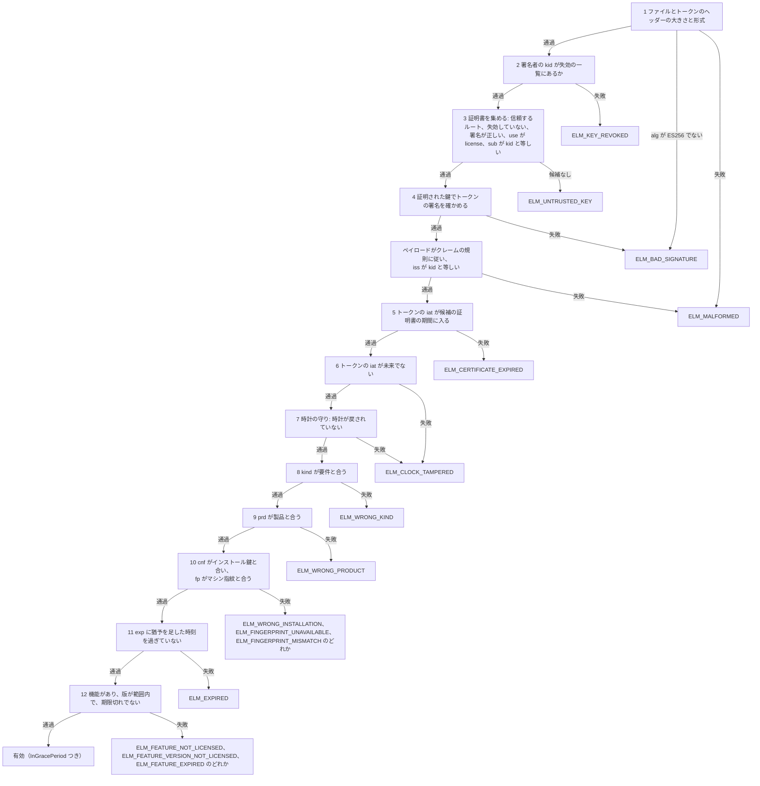

# ライセンスファイルと検証

このページは、ライセンスファイルを発行し、その元になるポリシーを決めるベンダーと、`ElasticLM.Licensing` か `libelasticlm` でアプリの中でライセンスファイルを検証するアプリ開発者に向けたものだ。ライセンストークンとライセンスファイルが何を持つか、検証する側がどの順序で確かめるか、有効期限・猶予期間・時計の巻き戻しの検出がどう働くか、検証の結果として何が返るかを説明する。先に[信頼の鎖](trust-chain.md)を読んでほしい。このページは、ルート鍵、署名鍵、鍵の証明書、鍵 ID（`kid`）、トラストストアが何かを知っている前提で書いている。

## ライセンスファイルの役割

ライセンスファイルがあれば、アプリはネットワークなしで、このマシンがこの製品とこの機能を今使ってよいかを決められる。アプリはファイルを読み、アプリに組み込んだトラストストアで確かめる。結果は、検証済みのライセンスか、拒んだ理由のどちらかだ。

ファイルの出どころは 3 つある。

- `elm-service` は、端末がオンラインで有効化や更新をしたとき、またオフラインの要求への答えとして、ライセンスファイルを返す（[有効化](activation.md)を参照）。
- `elm-service` の管理 API は、紐づけなしのライセンス（ポリシーの `binding` が `unbound` のライセンス）のライセンスファイルを出す。このライセンスはマシンに結びつかない。
- `elm license issue` は、サービスを使わずにライセンスファイルを書く。完全にオフラインで運用するベンダー向けだ。

3 つとも同じ形式で、アプリは同じように検証する。

## ライセンストークン

ライセンストークンは、コンパクト形式の JWS である。base64url の 3 つの部分を `.` で区切ったもので、ヘッダー、JSON のペイロード、署名を持つ。ElasticLM が使うのは JWS を絞り込んだ形で、JOSE 全般ではない。

### ヘッダー

ヘッダーのメンバーはちょうど 3 つだ。`alg` は `ES256` でなければならない。`kid` は署名鍵の鍵 ID である。`typ` はトークンの種類で、ライセンストークンでは `elm-license+jws` だ。

ほかのメンバー（`jwk`、`x5c`、`crit` など何でも）を持つヘッダーは拒まれる。そのため、トークンが自分の鍵を持ち込むことはできない。検証する側は、鍵もアルゴリズムもトークンから取らない。鍵は証明書を通じて探し、`alg` は `ES256` でなければならない。検証の関数はどれも `typ` を 1 つしか受け入れないので、リーストークンをライセンスとして通すことはできない。

署名は、受け取ったとおりのバイト列に対して確かめる。署名を確かめ終わるまで、ペイロードを JSON として解析しない。それまでは、ペイロードの何も信頼しないし、読みもしない。

### クレーム

どのトークンも、`ver`（形式の版、`1`）、`iat`（発行した時刻）、`jti`（ランダムなトークン ID）を持つ。ライセンストークンは、さらに `iss` を持つ。これは署名鍵の鍵 ID で、ヘッダーの `kid` と等しくなければならない。時刻は UNIX 秒で表す。知らないクレームは無視する。知らない `ver` や、必須のクレームが欠けたトークンは拒む。

ライセンスのクレームは次を持つ。

- `lic`: ライセンス ID。`prd`: 製品 ID（製品の `code`）。`kind`: `standard`、`trial`、`server` のどれか。
- `feat`: 機能。1 つもないこともある。どの機能も `id` を持ち、`ver`（許す版の範囲）と `exp`（その機能自身の有効期限）を持つこともある。機能が `seats` を持つのは、ライセンスが `kind: server` のときで、そのときに限る。
- `exp`: トークンの有効期限。ない場合もある。`exp` があるときは `grace`（`exp` の後もライセンスを使える長さ。試用では `0`）を持ち、オンラインで更新するトークンでは `refresh`（`exp` のどれだけ前にクライアントが更新を始めるか）も持つ。
- `cnf` と `fp`、`fpm`: 端末紐づけのトークンが持つ、マシンへの紐づけ。`cnf` は端末のインストール鍵の拇印を持つ。`fp` はマシン指紋を持ち、`fpm` はその比べ方を示す。
- `seq`: 有効化の更新番号で、複製の検出に使う。`areq`: このトークンが答えるオフラインの要求のノンス。
- サーバーライセンスでは、オンプレミスのサーバーが守るべきリースの期間、借り出しの上限、超過の割合、複製の扱い。
- `meta`: 検証する側が解釈しない、ベンダーの文字列。

`cnf`、`fp`、`seq` は[端末と証明](devices-and-proofs.md)と[有効化](activation.md)で、サーバーライセンスの値は[フローティングライセンス](floating-licenses.md)で説明する。

### 署名はするが暗号化はしない

ライセンストークンは署名されているが、暗号化はされていない。ファイルを持っていれば誰でも、`meta` を含むすべてのクレームを読める。秘密を入れてはいけない。マシンへの紐づけは秘密であることに頼っておらず、`cnf` と `fp` にかかる署名で守られている。暗号化しても何も隠せない。復号の鍵をクライアントに置かなければならないからだ（[設計の選択](design-choices.md)を参照）。

## ライセンスファイル

ライセンスファイルは、拡張子 `.elmlic` の UTF-8 の JSON である。

```json
{
  "format": "elasticlm-license",
  "version": 1,
  "license": "<elm-license+jws>",
  "certificates": ["<elm-cert+jws>"]
}
```

`certificates` は、トークンに署名した鍵の証明書を 1〜4 個持つ。そのため、ほかに何もなくても、ルート鍵からファイルを検証できる。外側の JSON には署名がなく、中の各トークンがそれぞれ署名されている。外側の JSON を書き換えても、ファイルを失敗させることしかできず、通すことはできない。

悪意のあるファイルにメモリや時間を使い果たされないように、検証する側は、ファイルの大きさ、各リストの項目数、入れ子の深さに上限を設けている。ファイルは 64 KiB までだ。上限の一覧はリファレンスで扱う。

## 確かめる順序

検証する側は、決まった順序でファイルを確かめ、最初に失敗した確かめの理由を返す。

確かめでは、トークンをアプリの**要件**と比べる。要件とは、アプリがライセンスに求めるものだ。.NET では、アプリが呼び出しのたびに渡す `LicenseRequirement` で、製品 ID とライセンスの種類を持ち、必要なら機能、アプリ自身の版、端末のインストールの識別情報も持つ。C では `elm_requirement` である。



1. **大きさと形式。** ファイルが上限に収まり、`format` が `elasticlm-license`、`version` が `1` の上の JSON で、証明書を 1〜4 個持つ。トークンのヘッダーは、`alg`、`kid`、`typ` `elm-license+jws` をちょうど持つ。失敗は `ELM_MALFORMED` だが、`alg` が `ES256` でないときだけは `ELM_BAD_SIGNATURE` になる。ここで読むのはヘッダーだけだ。
2. **失効した署名者。** トークンの `kid` がトラストストアの失効した鍵 ID の一覧にあれば、結果は `ELM_KEY_REVOKED` になる。
3. **証明書。** 証明書が候補になるのは、ヘッダーが名指すルート鍵がトラストストアにあって失効しておらず、証明書に対するルートの署名が正しく、`use` が `license` を含み、`sub` がトークンの `kid` と等しいときだ。条件を満たさない証明書は、失敗にせずに飛ばす。そのため、入れ替えのために残した古い証明書があっても害はない。候補が 1 つも残らなければ、結果は `ELM_UNTRUSTED_KEY` になる。
4. **署名。** トークンの署名を、証明された鍵で 1 回確かめる。失敗は `ELM_BAD_SIGNATURE` だ。ここで初めてペイロードを読む。クレームの規則に反するペイロードや、`iss` が `kid` と違うペイロードは `ELM_MALFORMED` になる。
5. **証明書の期間。** 少なくとも 1 つの候補の期間（`nbf` から `exp` まで。許容する時計のずれの分だけ広げる）が、トークンの `iat` を含まなければならない。含まなければ、結果は `ELM_CERTIFICATE_EXPIRED` になる。現在の時刻ではなく発行時刻と比べる理由は、[信頼の鎖](trust-chain.md)で説明している。
6. **発行時刻。** `iat` が、現在の時刻に許容のずれを足した時刻より後なら、結果は `ELM_CLOCK_TAMPERED` になる。
7. **時計の守り。** 時計が戻されていれば（後述）、結果は `ELM_CLOCK_TAMPERED` になる。
8. **種類。** ライセンスの `kind` は要件が求めるものでなければならず、違えば結果は `ELM_WRONG_KIND` になる。`standard` の要件は、検証する側の `AcceptTrialAsStandard` オプションがオンの間は `trial` のライセンスも受け入れる。既定はオンだ。オフにすると、標準のライセンスを求める場面で試用は拒まれる。`server` のライセンスを受け入れるのは `server` の要件だけで、`server` の要件はほかのものを受け入れない。
9. **製品。** `prd` は要件の製品 ID と等しくなければならず、違えば結果は `ELM_WRONG_PRODUCT` になる。
10. **マシン。** トークンが `cnf` を持つなら、要件のインストールの識別情報が同じ鍵の拇印を持たなければならない。持たなければ、結果は `ELM_WRONG_INSTALLATION` になる。続いて、`fpm` が `ignore` でなければ、`fp` をマシンの指紋と比べる。マシンから指紋が 1 つも取れなければ、結果は `ELM_FINGERPRINT_UNAVAILABLE` になる。`fpm` の示す比べ方で一致しなければ、`ELM_FINGERPRINT_MISMATCH` になる。
11. **有効期限。** `exp` がなければ、トークンは通る。`exp` から `exp + grace` の間は、猶予期間の中として通る。`exp + grace` を過ぎると、結果は `ELM_EXPIRED` になる。
12. **機能。** 要件が機能を名指すとき、`feat` にない機能は `ELM_FEATURE_NOT_LICENSED`、版が範囲外なら `ELM_FEATURE_VERSION_NOT_LICENSED`、機能自身の `exp` を過ぎていれば `ELM_FEATURE_EXPIRED` になる。

この順序で大事な点が 2 つある。1 つは、署名が確かめられるまで（手順 1〜4）、ペイロードの何も使わないことだ。もう 1 つは、手順 7 の時計の守りが、手順 1〜6 を通ったトークンをすべて記録することである。その後の製品や有効期限のような手順で失敗するトークンでも記録する。その `iat` はベンダーが署名したものなので、記録しても安全だ。

**時計のずれ。** 検証する側は、端末の時計と発行者の時計の小さな違いを許す。許容のずれは、証明書の期間（手順 5）、未来の `iat` の確かめ（手順 6）、時計の守り（手順 7）を広げる。`exp` には足さない。

- .NET では、`LicenseVerifierOptions.ClockSkew` が既定で 5 分で、0 から 1 時間の範囲で設定できる。0 にすると、ずれをまったく許さない。
- C では、`clock_skew_seconds` が `0` なら既定の 300 秒になる。それ以外の値は 1〜3,600 秒でなければならない。

## 有効期限と猶予期間

サービスは、端末紐づけのトークンを短い有効期限で発行し、オンラインで更新する。これを決めるポリシーの設定は 3 つある。

- `tokenLifetime`（既定は 30 日）は `exp` を決める。
- `refreshWindow`（既定は 20 日）は `refresh` を決める。残りがこれを下回ると、クライアントは更新を始める。
- `gracePeriod`（既定は 7 日）は `grace` を決める。

既定の値では、端末はトークンを受け取ってから 10 日後に更新を始める。サービスにつながらなくても、トークンが有効期限と猶予期間の中にある間はアプリが動き続け、クライアントは 1 時間ごとに試し直す。既定の値では、更新できない端末は最後の更新から最長 37 日（トークンの有効期間 30 日と猶予の 7 日）動き続け、その後は更新するまで `ELM_EXPIRED` で止まる。

猶予期間は、有効期限の近くで短いネットワーク障害が起きても利用者を止めないためにある。検証する側が猶予期間の中であること（`InGracePeriod`）を知らせるので、アプリは、接続が必要だと利用者に警告できる。試用のライセンスの猶予期間は、いつも `0` だ。

機能自身の `exp` には猶予期間がない。それを過ぎると、トークン全体はまだ有効でも、その機能は `ELM_FEATURE_EXPIRED` で失敗する。

`exp` のないトークンは期限が切れない。`exp` を持たないのは、`elm license issue --expires never` で手で発行したライセンスファイルと、有効期限のないライセンスの紐づけなしのライセンスファイルだけだ。サービスでライセンスを失効させたり停止したりしても、すでに端末にあるトークンには、その有効期限が切れるまで届かない。そのため、失効を効かせるのは短い `tokenLifetime` である。この限界は[安全性のモデル](security-model.md)で、有効期限のないトークンを止める唯一の方法は[信頼の鎖](trust-chain.md)で説明する。

## 製品、機能、マシンへの紐づけ

**製品。** `prd` は要件の製品 ID と完全に一致しなければならない。そのため、同じベンダーでも別の製品のライセンスは失敗する。

**機能。** 要件は、機能と、アプリ自身の版を名指せる。機能の `ver` は `>=2.0 <3.0` のような範囲で、版は `major.minor[.patch]` で書く。`ver` がなければ、どの版も許す。範囲を使うと、ベンダーはメジャーバージョンをまたいで許可できる。「メジャーバージョンが同じ」という固定の規則では、これを表せない。要件が機能を名指さなければ、手順 12 は飛ばす。版を名指さなければ、範囲は確かめない。

**マシン。** 端末紐づけのトークンは、2 種類の紐づけを持つ。

- `cnf.jkt`。端末のインストール鍵の拇印で、これが端末の本当の識別子である。要件は、鍵の拇印を持つ `InstallationIdentity` を渡す。トークンが `cnf` を持つのに要件が識別情報を渡さなければ、検証は `ELM_WRONG_INSTALLATION` で失敗する。
- `fp`。マシン指紋で、`fpm` の示すとおりに比べる。`any` は、トークンの指紋のどれか 1 つがマシンと一致すれば通る。`all` は、すべてが一致しなければならない。`ignore` は比べない。`fpm` を決めるのは、ポリシーの設定 `fingerprintMatching` である。

どちらのクレームも署名されているので、利用者は書き換えられない。ファイルを別のマシンに写しても、そのマシンのインストール鍵が違うので失敗する。インストール鍵と指紋をどう作るか、OS のマシン ID ではなく鍵を識別子にする理由は、[端末と証明](devices-and-proofs.md)にある。

紐づけなしのライセンスは `cnf` も `fp` も持たず、どのマシンでも通る。どのマシンでも使えること自体を売る場合にだけ使う。

## 時計の巻き戻しの検出と、その限界

利用者は、端末の時計を戻して、期限の切れたトークンを使い続けようとするかもしれない。時計の守りがこれを検出する。

1. 手順 1〜6 を通ったトークンごとに、時計の守りは、現在の時刻とトークンの `iat` の遅いほうを「最後に確認した時刻」として記録する。
2. 現在の時刻が、最後に確認した時刻から許容のずれを引いた時刻より前なら、時計が戻されたとみなし、結果は `ELM_CLOCK_TAMPERED` になる。
3. 状態はファイルに保存する（.NET では `FileClockGuard`。C では、`clock_guard_path` で別のファイルを指定しない限り、インストールのフォルダーの `clock` というファイル）。インストール鍵を使えるときは、状態にその鍵で署名する。署名が通らない状態は、ないものとして扱う。
4. 状態がない、書き換えられている、読めないときは、検証しているトークンの `iat` に戻る。トークンの `iat` は署名した側の時計から来るので、状態に何が起きても、トークンが発行された時刻より前に時計を戻すことはできない。
5. 時計の守りは、リーストークンを検証するときにも働く。借り出したリースも含む。借り出したリースは、オフラインの間、端末の時計で確かめる（[フローティングライセンス](floating-licenses.md)を参照）。

時計が先に進んでから戻った利用者は、実際の時刻が記録した時刻に追いつくまで締め出される。オンラインの更新が成功すれば、すぐに直る。クライアントは新しいトークンの `iat` をサービスの時刻とみなし、記録を上書きするからだ。オフラインの応答を取り込んでも、記録は上書きしない。応答は、手で運ぶ間に古くなることがあるからだ。

時計の守りが防がないものは次のとおり。

- **状態の削除や書き換え。** このとき時計の守りはトークンの `iat` に戻る。利用者は、`iat` より後のどの時刻にも時計を戻せるので、本当の限界はトークンの有効期限になる。`tokenLifetime` は短くしておくこと。
- **署名されていない状態。** インストール鍵がない（紐づけなしのライセンスの）場合、状態は署名されない。ファイルに書き込める人なら誰でも、時計の守りを `iat` の下限まで戻せる。
- **状態を持たない時計の守り。** `StatelessClockGuard` は状態を持たず、`iat` が未来でないこと（手順 6）だけを確かめる。C では、インストールも `clock_guard_path` も渡さないとこれになる。
- **アプリの改造**による確かめの迂回。これは対象外で、[安全性のモデル](security-model.md)で説明する。

状態を書き込めなくても、検証はメモリの中の値とトークンの `iat` で続き、例外は投げない。

## 検証の結果

.NET では、`LicenseVerifier.Verify` は 2 つの結果のどちらかを返す。

- `LicenseVerificationResult.Valid`。ライセンスと、それが猶予期間の中かどうか（`InGracePeriod`）を持つ。ライセンスは `VerifiedLicense` で、クレームを型のついた形で持つ。ライセンス ID、製品、種類、機能、有効期限、紐づけなどだ。これを作れるのは検証する側だけなので、`VerifiedLicense` を持つコードは、確かめが通ったと分かる。
- `LicenseVerificationResult.Invalid`。`LicenseError` を持ち、これはエラーコード、その通信上の名前（`ELM_EXPIRED` など）、一文のメッセージを示す。メッセージに鍵の情報やトークン全体が入ることはない。

壊れたファイルは、中身が何であっても例外を投げない。例外が出るのは、呼び出し方の誤りだけだ。空の製品 ID、`major.minor[.patch]` でない要求の版、範囲外の時計のずれ、トラストストアの不正な鍵がこれに当たる。

C では、`elm_verifier_verify` がエラーコードを返し、成功したときは `elm_license` のハンドルも返す。猶予期間の中かどうかは `elm_license_in_grace_period` で分かる。

アプリがどうするかは、検証する側は決めない。`Invalid` のとき、止めるか、機能を絞った動作に切り替えるか、もう一度有効化するよう利用者に求めるかは、アプリが選ぶ。`Valid` で `InGracePeriod` のときは、接続するよう利用者に伝えるべきだ。

## 起こりうる問題と対処

| コード | よくある原因 | 対処 |
| --- | --- | --- |
| `ELM_MALFORMED` | ファイルが途中で切れている、書き換えられている、またはライセンスファイルでない | 出どころからファイルを取り直す |
| `ELM_UNTRUSTED_KEY`、`ELM_CERTIFICATE_EXPIRED`、`ELM_KEY_REVOKED` | 信頼の鎖の問題 | [信頼の鎖](trust-chain.md)を参照 |
| `ELM_BAD_SIGNATURE` | 署名の後にトークンが書き換えられた | ファイルを取り直す。書き換えたファイルが検証に通ることはない |
| `ELM_CLOCK_TAMPERED` | 時計が発行時刻か、最後に確認した時刻より遅れている | 時計を直す。オンラインで更新して記録を直す |
| `ELM_WRONG_KIND` | ライセンスの `kind` が要件の求めるものでない。たとえば、サーバーライセンスを求める場面の試用や、`AcceptTrialAsStandard` がオフで標準のライセンスを求める場面の試用 | アプリが求める種類と `AcceptTrialAsStandard` オプションを確かめる。正しい種類のライセンスを発行する |
| `ELM_WRONG_PRODUCT` | ファイルが別の製品のものである | アプリが渡す製品 ID を、製品の `code` と照らし合わせる |
| `ELM_WRONG_INSTALLATION` | ファイルが別の端末向けに作られた。またはアプリがインストールの識別情報を渡していない | この端末を有効化する。インストールの識別情報を渡す |
| `ELM_FINGERPRINT_MISMATCH` | マシンの指紋が変わった。たとえば OS を入れ直した、VM を移した | 端末を解除してからもう一度有効化し、今の指紋を持つトークンを受け取る（この解除はポリシーの `deactivationLimit` に数える）。または、もう一度有効化する前にベンダーに解除してもらう。オンラインの更新では古い指紋のままになる（[有効化](activation.md)を参照） |
| `ELM_FINGERPRINT_UNAVAILABLE` | マシンから指紋が取れない。`/etc/machine-id` のないコンテナーでよく起きる | ホストの `/etc/machine-id` を読み取り専用でマウントする。または `fingerprintMatching` を `ignore` にしたポリシーを使う |
| `ELM_EXPIRED` | `exp + grace` を過ぎた | オンラインで更新する。またはオフラインの更新で新しいファイルを持ち込む |
| `ELM_FEATURE_NOT_LICENSED`、`ELM_FEATURE_VERSION_NOT_LICENSED`、`ELM_FEATURE_EXPIRED` | ライセンスがこの機能や版を含まない。または機能の期限が切れた | その機能、その範囲、またはより後の機能の有効期限を持つライセンスを発行する |

役割ごとにすべきことは次のとおり。

- **ベンダー:** 失効が間に合って効くように、トークンの有効期間を十分に短くする。有効期限のないトークンは避ける。`meta` に秘密を入れない。紐づけなしのライセンスは、どのマシンで使われてもよいときだけ発行する。
- **アプリ開発者:** 製品 ID、求める種類、必要な機能と版を渡す。端末紐づけのライセンスでは、インストールの識別情報を渡す。状態を持つ時計の守りを使う。`InGracePeriod` とそれぞれの `Invalid` のコードを、ひとまとめに扱わずに処理する。
