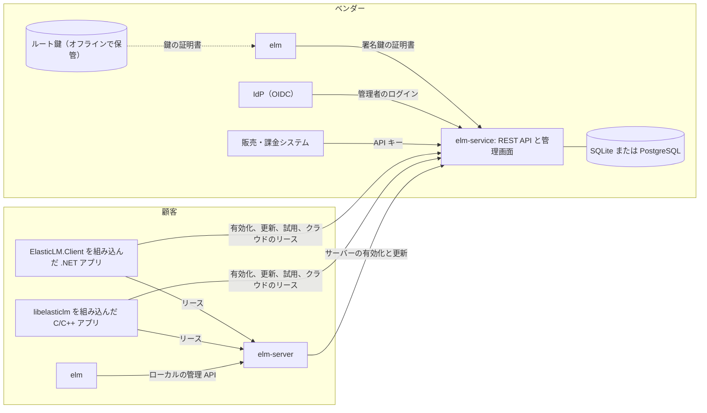

# 概要

このページは、ElasticLM に初めて触れるすべての人に向けたものだ。ライセンスを発行するベンダー、.NET や C のアプリにクライアントを組み込む開発者、ライセンスサーバーを運用する顧客の管理者が対象になる。ElasticLM の知識は要らない。公開鍵と秘密鍵が何かを知っていると読みやすい。このページでは、ElasticLM が何のためのものか、6つの成果物は何か、誰がどれを運用するか、どう組み合わせられるかを説明する。各部分の詳しい説明は、ほかの解説ページにある。

## ElasticLM の目的

ElasticLM を使うと、.NET や C/C++ のアプリのベンダーは、自社製品のライセンスを発行し、そのライセンスを顧客のマシンで検証し、製品を同時に使っている人数を数えられる。オープンソース（MIT）で、NativeAOT の単一バイナリと NuGet パッケージとして配布する。まだ何もリリースされていない。1.0 はこれから出る。

ElasticLM がいちばん大事にする目標は、3種類の不正を、秘密にしておくことではなく暗号で止めることだ。

- **偽造・改ざんされたライセンス。** ライセンスにはベンダーが署名する。アプリが受け入れるのは、署名をたどると、アプリが信頼するよう作られた鍵に行き着くライセンスだけだ。
- **偽造・再送されたリクエスト。** サーバーの状態を変えるリクエストには、すべて、アプリの1つのインストールに属する鍵で署名する。リクエストには、サーバーの新しいノンス（少し前にサーバーが渡した乱数）と、1回限りの ID も入る。そのため、盗み取ったリクエストをもう一度送っても通らない。
- **購入した席数を超える利用。** サーバーはロックをかけて席を数える。クライアントは、サーバーから貸し出されたものが、ベンダーの署名したライセンスの範囲に収まっているかを確かめる。

ElasticLM は、検証を飛ばすようにアプリのバイナリ自体を書き換える人を止めようとはしない。その理由と、守るもの・守らないものの一覧は[安全性のモデル](security-model.md)にある。

## 登場する人

このガイドでは、次の呼び名を使う。

| 呼び名 | 誰・何か |
| --- | --- |
| ベンダー（発行者） | ElasticLM を使って自社製品のライセンスを扱う組織。ルート鍵を持ち、SaaS 型の認証サーバーを運用する。 |
| ベンダーの管理者 | ベンダーの社員。管理画面、`elm` CLI、管理 API でライセンスを発行・失効させる。各自にできることは、ロールで制限される。 |
| ベンダーのシステム | ベンダーの販売、課金、CI のシステム。API キーで管理 API を呼ぶ。 |
| 利用者（顧客） | 製品を購入した組織または個人。 |
| 顧客の管理者 | 顧客側でオンプレミスのライセンスサーバーを運用する人。 |
| アプリ | ベンダーの製品。検証ライブラリか、クライアント（.NET または C）を組み込む。 |

## 6つの成果物

| 成果物 | 形態 | 使う人 | 役割 |
| --- | --- | --- | --- |
| `ElasticLM.Licensing` | NuGet パッケージ | アプリ | ライセンスファイルをオフラインで検証する。.NET の基本クラスライブラリのほかには依存せず、ネットワークには一切触れない。 |
| `ElasticLM.Client` | NuGet パッケージ | アプリ | サーバーと通信する。オンラインとオフラインの有効化、更新、解除、試用、リース、借り出しを扱う。インストール鍵を作って保管する。 |
| `libelasticlm` | NativeAOT の共有ライブラリ（`.dll`、`.so`、`.dylib`）と C ヘッダー `elasticlm.h` | C と C++ のアプリ | 両パッケージの機能を C ABI で提供する。 |
| `elm-server` | 単一バイナリ | 顧客の管理者 | オンプレミスのライセンスサーバー。顧客のネットワークの中でフローティングの席を貸し出す。 |
| `elm-service` | 単一バイナリとコンテナイメージ | ベンダー | SaaS 型の認証サーバー。ライセンスキー、有効化、試用、クラウドのリース、管理 API、管理画面を扱う。 |
| `elm` | 単一バイナリ（CLI） | ベンダーと顧客の管理者 | 鍵と鍵の証明書を作り、ライセンスファイルを発行・確認し、ログを検証し、管理 API を呼び、ローカルの `elm-server` を管理する。 |

実行ファイルは、横にほかのファイルを置かなくても動く。設定ファイルは任意だ。ビルドの対象は `win-x64`、`win-arm64`、`linux-x64`、`linux-arm64`、`linux-musl-x64`、`osx-arm64`、`osx-x64` で、`libelasticlm` も同じ対象向けにビルドする。NuGet パッケージは AOT 互換なので、それを組み込んだアプリ自体も、警告なしに NativeAOT で発行できる。

アプリに組み込むのは `ElasticLM.Licensing` と `ElasticLM.Client`、または `libelasticlm` だけだ。ライセンスに署名するコードは `elm`、`elm-server`、`elm-service` にしかなく、アプリに入って出荷されることはない。

## 基本の考え方: 署名したライセンスをオフラインで検証する

ほかのすべては、一つの仕組みの上に作られている。**ライセンストークン**は小さな JSON 文書で、どの製品か、どの機能か、いつまでか、そして端末紐づけのライセンスならどの端末かを記す。ベンダーはこれに ECDSA P-256（ES256）で署名する。**ライセンスファイル**（`.elmlic`）には、ライセンストークンと、その検証に要る鍵の証明書が入る。

アプリがライセンスファイルを検証するのに使うのは、ファイルと時計と**トラストストア**だけだ。トラストストアは、アプリに組み込んだベンダーのルート公開鍵である。鎖は短い。

1. **ルート鍵**は、ベンダーの最上位の鍵だ。オフラインで保管し、鍵の証明書にだけ署名する。
2. **鍵の証明書**は、「この署名鍵は、この日までライセンス（またはリース、ログ）に署名してよい」と述べるもので、ルート鍵が署名する。
3. **署名鍵**は、ライセンストークンに署名する。`elm-service` や `elm` が持つのはこの鍵だ。

アプリが信頼するのはルート鍵だけなので、ベンダーは新しいアプリを出さずに署名鍵を入れ替えられる。詳しくは[信頼の鎖](trust-chain.md)で説明し、検証の順序は[ライセンスファイルと検証](license-files-and-verification.md)に書いてある。

ライセンスは署名されているが、暗号化はされていない。ファイルを持っている人は誰でも中身を読める。署名鍵を持たない人は、中身を変えることも、新しく作ることもできない。

ElasticLM のオンラインの部分は、この署名済みトークンを発行・更新するためと、席を貸し出すためにある。ネットワークがなくなっても、アプリは、トークン、猶予期間、リースが許す間は動き続ける。

## 各部分のつながり

図は、すべての成果物と、どれがどれと通信するかを示す。左がベンダー側、右が顧客側だ。

図は次のように読む。

- ベンダーは `elm` とルート鍵で署名鍵とその鍵の証明書を作り、両方を `elm-service` に渡す。
- `elm-service` は、製品、機能、ポリシー、ライセンス、有効化、リースを SQLite か PostgreSQL に保存する。ベンダーの管理者はベンダーの IdP でログインし、ベンダーのシステムは API キーを使う。
- アプリは `elm-service` と通信して、ライセンスキーを有効化し、トークンを更新し、試用を始め、クラウドから席を借りる。
- 顧客側の `elm-server` は、ほかの端末と同じように `elm-service` で有効化される。そのあとは顧客のネットワーク上のアプリに席を貸し出す。顧客の管理者は、同じマシンから `elm` でサーバーを管理する。

## 構成の形

すべての部分を動かす必要はない。形は4つあり、ベンダーは複数を同時に使ってもよい。いちばんよくある組み合わせ、つまり SaaS 型のサービスがオンプレミスのサーバーを有効化する形は、4つの説明のあとに書く。

| 形 | 使う部分 | 概要 |
| --- | --- | --- |
| オフラインのみ | `elm`、`ElasticLM.Licensing` | ベンダーが CLI でライセンスファイルを作って渡す。サービスは動かさない。 |
| SaaS 型の有効化 | `elm-service`、`ElasticLM.Client` | 顧客はライセンスキーで有効化し、アプリはときどきトークンを更新する。 |
| クラウドのフローティング | `elm-service`、`ElasticLM.Client` | アプリはベンダーのサービスから席を借りる（リース）。 |
| オンプレミスのフローティング | `elm-server`、`ElasticLM.Client`、サーバーの有効化に使う `elm-service` か `elm` | アプリは顧客のネットワーク内のサーバーから席を借りる。 |

「リース」は、短い決まった時間だけ貸し出す席のことだ。形は次のように選ぶ。

- ライセンスで制限するのが、誰がどの端末でいつまでアプリを動かせるかだけなら、ベンダーがサービスを動かさない場合は**オフラインのみ**、動かす場合は**SaaS 型の有効化**を使う。
- ライセンスで同時利用者数（席数）を制限するなら、アプリがベンダーのサービスに届く場合は**クラウドのフローティング**を使う。届かない場合や、顧客が席を手元に置きたい場合は**オンプレミスのフローティング**を使う。
- オンプレミスのサーバーは、サーバーライセンスを `elm-service` から受け取るか（後述の「elm-service を使うオンプレミスのフローティング」を参照）、`elm` で手作業で発行されたものを使う。

### オフラインのみ

ベンダーが `elm license issue` を実行し、`.elmlic` ファイルを顧客に送る。アプリは `ElasticLM.Licensing`（または `libelasticlm`）でそれを検証する。

ファイルは1台の端末に紐づけられる。各端末には**インストール鍵**がある。クライアントが端末の上で作ってそこに保管する鍵ペアで、その**拇印**（公開鍵の短いハッシュ）が端末を表す名前になる。各端末には**マシン指紋**もある。OS のマシン ID から導いた値だ。どちらも[端末と証明](devices-and-proofs.md)で説明する。`elm license issue` は `--bind-key`（拇印）と `--fingerprint`（指紋）を受け取る。ベンダーは、これらを先に顧客の端末から手に入れなければならない。`elm` には、アプリが動く端末についてこれらの値を表示するコマンドがないので、アプリが表示する必要がある。.NET では `InstallationKeyStore` から得た `InstallationKey.Thumbprint` と、`MachineFingerprint.Compute(productId)` を使う。C が公開しているのは拇印だけで、`elm_installation_thumbprint` で得る。`--bind-key` と `--fingerprint` を付けなければ、ファイルはどの端末でも使える。

この形には更新も失効もない。ファイルは、有効期限に猶予期間を足した時点まで使える（猶予期間は `elm license issue --grace-days` で決め、既定は7日。試用は常に0）。`--expires never` で発行したファイルは永久に使える。`elm` は、そうしたファイルを書き出すときに警告を出す。有効期限は、このことを踏まえて決める。

### SaaS 型の有効化

ベンダーは `elm-service` を動かし、製品とポリシーを定義し、販売ごとに**ライセンスキー**（`ELM-7Q2KX-M9D4R-HV0T8-3NPWZ` のような文字列）を発行する。サービスが保存するのはキーの SHA-256 ハッシュだけで、キーを表示するのは発行するときの1回だけだ。アプリの側では、`ElasticLM.Client`（`ActivationClient`）がそのキーを有効化する。端末のインストール鍵を作り、その鍵でリクエストに署名し、その鍵に紐づいたライセンスファイルを受け取る。1つのライセンスで何台の端末を有効化できるかは、ポリシーの `maxActivations` で制限する。

そのファイルのトークンには有効期限があり（既定では30日後、`tokenLifetime`）、クライアントは期限が来る前にオンラインで更新する。更新できなくても、ライセンスは猶予期間の間は使える（既定は7日、`gracePeriod`）。失効が端末に届くのは、この短い寿命があるからだ。失効したライセンスや一時停止したライセンスには、新しいトークンが発行されない。同じサービスが、解除、試用（製品とマシンごとに1回）、リクエストとレスポンスのファイルを手で運ぶオフラインの有効化も扱う。[端末と証明](devices-and-proofs.md)と[有効化](activation.md)を参照。

`elm-service` は、どの端末にも紐づかないライセンスファイル（`binding`: `unbound`）を管理 API から作ることもできる。オンラインにならない顧客のためのものだ。

### クラウドのフローティング

`floating`: `cloud` のポリシーは、機能ごとに席数を決める。アプリの `LicenseClient` は、ライセンスキーを渡されると `elm-service` にリースを求め、リース期間の3分の1ごとに更新し（既定のリース期間は10分）、使い終わったら返す。サービスはリースをデータベースに保存するので、サービスを再起動してもリースは失われない。[フローティングライセンス](floating-licenses.md)を参照。

### オンプレミスのフローティング

顧客の管理者は、自社のネットワーク内のマシンで `elm-server` を動かす。サーバーは自分のインストール鍵と**サーバーライセンス**を持つ。サーバーライセンスは種類が `server` のライセンストークンで、サーバーの鍵、機能、機能ごとの席数を記す。`elm-server` は、ライセンスがないまま初めて起動したときに自分の拇印と指紋を表示する。管理者はそれをベンダーに送ればよい。サーバーはそのライセンスの範囲内でだけ席を貸し出し、各リースに自分のインストール鍵で署名する。アプリは接続先をサーバーにした `LicenseClient` を使い、リースをすべてサーバーライセンスと照らし合わせる。

この照らし合わせで、盗まれたサーバー鍵でできることが限られる。サーバーのインストール鍵をマシンから持ち出した人が署名できるリースは、サーバーライセンスの製品、機能、リースあたりの席数、リース期間、終了日時の範囲内に限られる。ただし、同じ席を、購入した数より多くのクライアントに貸せてしまう。たとえば、サーバーの写しから貸す場合だ。それを終わらせるのは、サーバーライセンスの有効期限と、それを延ばす更新である。

`elm-server` はリースをメモリに保持し、データベースを持たない。再起動したあと、クライアントは短い回収の期間のうちに、まだ有効なリースをサーバーに渡し直す。ディスク上の署名付きの記録に書くのは、ネットワークの外に出る借り出し中の席だけだ。高可用性のためのペア構成はない。OS のサービスマネージャーがサーバーを再起動し、動いているアプリは再起動の間を乗り切れるだけの長さのリースを持っている。

### elm-service を使うオンプレミスのフローティング

ベンダーが `elm-service` を動かし、顧客が `elm-server` を動かす場合、サーバーはほかの端末と同じように、サービスでサーバーライセンスを有効化する（`elm server activate` を使う。サーバーがインターネットにつながらない場合はリクエストファイルを使う）。サーバーライセンスには有効期限があり（既定では30日後）、サーバーはサービスからそれを更新する。`service.url` を設定していればオンラインで、あるいはファイルを使って（`elm server refresh-request` のあと `elm server import`）更新する。更新のたびに、サービスはサーバーの写しに気づける。

`elm-service` がない場合、ベンダーは `elm license issue --kind server` でサーバーライセンスを手作業で発行する。このライセンスは更新されないので、サーバーの写しは検出されない。写しの利用を終わらせるのは、ライセンスの有効期限だけだ。有効期限のないライセンスには、`elm` が警告を出す。

## 誰がどの秘密を持つか

ElasticLM の安全性の大部分は、秘密鍵と秘密がどこに置かれるかで決まる。主なものを表にまとめる。

| 秘密 | 持つ人 | 置き場所 |
| --- | --- | --- |
| ルート鍵 | ベンダー | パスフレーズで保護した PKCS#8 PEM ファイル。オフラインで保管する。読むのは鍵の証明書に署名する `elm` だけで、サーバーには一度も置かない。 |
| 署名鍵 | ベンダー | 暗号化したファイルとそのパスフレーズとして `elm-service` に渡す。または、ライセンスファイルを発行するときに `elm` が読む。 |
| インストール鍵 | 各端末 | 初めて使うときにクライアントが作り、製品ごとに保存する。Windows では DPAPI で、Linux と macOS ではファイルモード `0600` で保護する。 |
| `elm-server` のインストール鍵と管理者トークン | 顧客の管理者 | サーバーのデータのフォルダー。読めるのは、Windows では Administrators、SYSTEM、それを作ったアカウントだけで、Linux と macOS では所有者だけだ。 |
| ライセンスキー | 顧客 | 人が入力する。`elm-service` が保存するのはそのハッシュだけだ。 |

ベンダーの秘密鍵は、どのバイナリにもリソースにも組み込まない。アプリが持つのは、ベンダーのルート公開鍵だけだ。顧客の端末にある秘密鍵は、その端末自身のインストール鍵だけで、これはクライアントがその端末で作る。`elm-server` も同じように、自分のインストール鍵と管理者トークンを自分で作る。

## 起こりうる問題と、すべきこと

ロールごとに、そのロールにしかできないことがいくつかある。その理由は、このあとのページで説明する。

**ベンダー**

- ルート鍵をオフラインに置き、そのパスフレーズを秘密にする。ルート鍵があれば、誰でも署名鍵を証明し、どんなライセンスでも作れる。
- 自分のルート公開鍵を、アプリのトラストストアに組み込む。署名鍵が漏れたら、その鍵 ID をトラストストアに載せて失効させる。これが端末に届くのは、アプリの更新を通してだけだ。[信頼の鎖](trust-chain.md)を参照。
- トークンの寿命とリース期間は、意図して選ぶ。失効したライセンスは、トークンと猶予期間が切れるまで使い続けられる。有効期限のないトークンは、それに署名した鍵を失効させる以外に失効させる方法がない。[安全性のモデル](security-model.md)で詳しく説明する。
- サーバーライセンスを手作業で発行するなら、有効期限を付ける。そうしたライセンスは更新されないので、サーバーの写しの利用を終わらせるのは有効期限だけだ。

**アプリの開発者**

- 組み込むのは、ベンダーのルート公開鍵だけにする。アプリに秘密鍵が入っていると、アプリを持つ人は誰でもライセンスを作れてしまう。
- 検証に失敗したとき、猶予期間に入っているとき、リースを失ったときに、アプリがどうするかを決める。ElasticLM はこれらの状態を知らせ、何を止めるかはアプリが決める。
- 手作業で発行する端末紐づけのライセンスファイルのために、端末のインストール鍵の拇印とマシン指紋をアプリに表示する。顧客がそれをベンダーに送れるようにするためだ。
- バイナリを書き換える人を ElasticLM が止めてくれるとは考えない。[安全性のモデル](security-model.md)を参照。

**顧客の管理者**

- `elm-server` を OS のサービスマネージャー（Windows サービス、systemd、launchd）の下で動かし、自動で再起動するようにする。既定の10分のリースなら、サーバーが約6分40秒以内に戻れば、アプリは動き続ける。`elm-server` は、起動から1秒以内に待ち受けを始めることを目標にしている。Linux のテスト機では約0.1秒だった。
- サーバーライセンスを新しく保つ。サーバーにオンラインで更新させるか、既定の30日のトークンと7日の猶予期間なら、少なくとも37日に1回は更新ファイルを運ぶ。
- サーバーのデータのフォルダーを、ほかの人に読ませない。そこには、サーバーのインストール鍵、管理者トークン、借り出しの記録がある。

**ネットワークがなくなったとき**

| 形 | アプリが動き続ける期間 |
| --- | --- |
| オフラインのみ | 影響を受けない。ファイルはネットワークを必要とせず、有効期限に猶予期間を足した時点まで使える。 |
| SaaS 型の有効化 | 最後のトークンの有効期限に猶予期間を足した時点まで。既定値では、最後の更新から最大37日。 |
| クラウドまたはオンプレミスのフローティング | 今のリースが終わるまで。長くてもリース期間1回分で、既定では10分。借り出したリースは、そのリース自身の終了まで使える。 |

## 次に読むページ

- [信頼の鎖](trust-chain.md): ルート鍵、署名鍵、鍵の証明書、トラストストア、鍵の入れ替えと失効。
- [ライセンスファイルと検証](license-files-and-verification.md): ファイル形式、検証の順序、猶予期間、時計の巻き戻し。
- [端末と証明](devices-and-proofs.md): インストール鍵、署名付きリクエスト、ノンス、マシン指紋。
- [有効化](activation.md): オンラインとオフラインの有効化、更新、解除、複製の検出。
- [フローティングライセンス](floating-licenses.md): リース、再起動後の回収、借り出し、席数の上限。
- [安全性のモデル](security-model.md): 何を、誰から守り、何を守らないか。
- [設計の選択](design-choices.md): ElasticLM がなぜこう作られているか。
