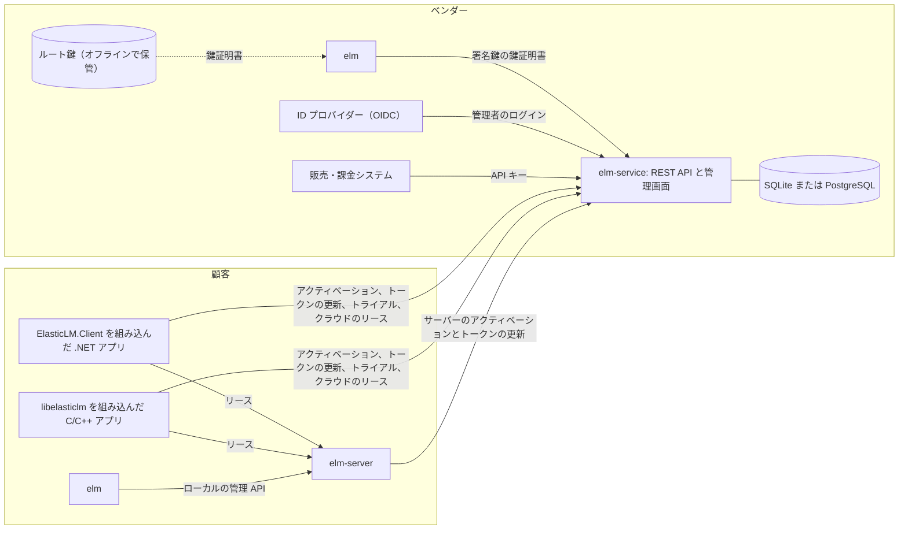
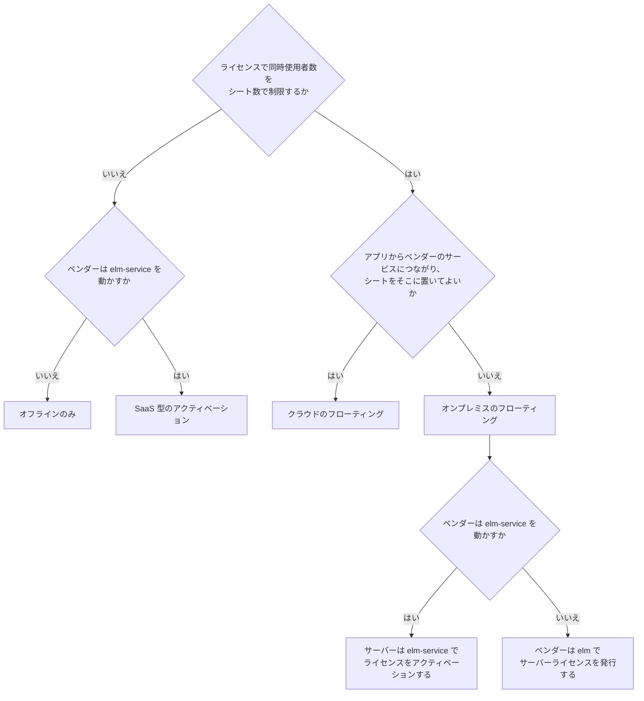

# 概要

このページは、ElasticLM に初めて触れるすべての読者に向けたものだ。ライセンスを発行するベンダー、.NET や C のアプリにクライアントを組み込む開発者、ライセンスサーバーを運用する顧客の管理者を想定している。ElasticLM の知識は要らないが、公開鍵と秘密鍵が何かを知っていると読みやすい。ここでは、ElasticLM の目的、6 つの成果物、それぞれを誰が運用するか、どんな組み合わせ方があるかを説明する。各部分の詳しい説明は、ほかの解説ページにある。

## ElasticLM の目的

ElasticLM を使うと、.NET や C/C++ アプリのベンダーは、自社製品のライセンスを発行し、顧客のマシンでそのライセンスを検証し、製品を同時に使っている人数を数えられる。オープンソース（MIT）で、NativeAOT の単一バイナリと NuGet パッケージとして配布する。

ElasticLM が何より重視するのは、次の 3 種類の不正を、秘密を隠すことではなく暗号で防ぐことだ。

- **偽造・改ざんされたライセンス。** ライセンスにはベンダーが署名する。アプリが受け入れるのは、署名をたどると、アプリが信頼するよう組み込まれた鍵に行き着くライセンスだけだ。
- **偽造・再送されたリクエスト。** サーバーの状態を変えるリクエストには、どれもアプリの 1 つのインストールに属する鍵で署名する。リクエストには、サーバーが少し前に渡したノンス（乱数）と、1 回限りの ID も入れる。そのため、盗み取ったリクエストを送り直しても通らない。
- **購入したシート数を超える利用。** サーバーはロックをかけてシートを数える。クライアントは、サーバーから貸し出されたものが、ベンダーの署名したライセンスの範囲に収まっているかを確かめる。

ElasticLM は、アプリのバイナリ自体を書き換えて検証を飛ばす攻撃は防ごうとしない。その理由と、守るもの・守らないものの一覧は[セキュリティモデル](security-model.md)にある。

## 登場する立場

このガイドでは、以降次の呼び名を使う。

| 呼び名 | 指すもの |
| --- | --- |
| ベンダー（発行元） | ElasticLM を使って自社製品にライセンスを付ける組織。ルート鍵を持ち、SaaS 型のアクティベーションサービスを運用する。 |
| ベンダーの管理者 | ベンダーの社員。管理画面、`elm` CLI、管理 API でライセンスを発行・失効させる。各自にできることはロールで制限する。 |
| ベンダーのシステム | ベンダーの販売、課金、CI のシステム。API キーで管理 API を呼び出す。 |
| ライセンシー（顧客） | 製品を購入した組織または個人。 |
| 顧客の管理者 | 顧客側でオンプレミスのライセンスサーバーを運用する担当者。 |
| アプリ | ベンダーの製品。検証ライブラリか、クライアント（.NET または C）を組み込む。 |

## 6 つの成果物

| 成果物 | 形態 | 使う側 | 役割 |
| --- | --- | --- | --- |
| `ElasticLM.Licensing` | NuGet パッケージ | アプリ | ライセンスファイルをオフラインで検証する。.NET の基本クラスライブラリ以外には依存せず、ネットワークには一切アクセスしない。 |
| `ElasticLM.Client` | NuGet パッケージ | アプリ | サーバーと通信する。オンラインとオフラインのアクティベーション、トークンの更新、アクティベーション解除、トライアル、リース、借用を扱う。インストール鍵を作って保管する。 |
| `libelasticlm` | NativeAOT の共有ライブラリ（`.dll`、`.so`、`.dylib`）と C ヘッダー `elasticlm.h`（Windows では、インポートライブラリ `elasticlm.lib` も） | C と C++ のアプリ | 2 つのパッケージの機能を C ABI で提供する。 |
| `elm-server` | 単一バイナリ | 顧客の管理者 | オンプレミスのライセンスサーバー。顧客のネットワーク内で、フローティングライセンスのシートを貸し出す。 |
| `elm-service` | 単一バイナリとコンテナイメージ | ベンダー | SaaS 型のアクティベーションサービス。ライセンスキー、アクティベーション、トライアル、クラウドのリース、管理 API、管理画面を扱う。 |
| `elm` | 単一バイナリ（CLI） | ベンダーと顧客の管理者 | 鍵と鍵証明書を作る。ライセンスファイルを発行して中身を確認する。ログを検証する。管理 API を呼び出す。ローカルの `elm-server` を管理する。 |

[.NET API](../reference/dotnet-api.md) には 2 つのパッケージの型を、[C API](../reference/c-api.md) には `libelasticlm` の関数とそのリンクの方法を挙げている。

実行ファイルは、同じ場所にほかのファイルを置かなくても動く。設定ファイルは任意だ。対象のプラットフォームは `win-x64`、`win-arm64`、`linux-x64`、`linux-arm64`、`linux-musl-x64`、`osx-arm64`、`osx-x64` で、`libelasticlm` も同じ対象向けにビルドする。NuGet パッケージは AOT 互換なので、組み込んだアプリ自体も警告なしに NativeAOT で発行できる。

アプリに組み込むのは、`ElasticLM.Licensing` と `ElasticLM.Client`、または `libelasticlm` だけだ。ライセンスに署名するコードは `elm`、`elm-server`、`elm-service` にしかなく、アプリと一緒に出荷されることはない。

3 つの実行ファイルのコマンドと設定の正確な書き方は、[elm コマンドリファレンス](../reference/elm-cli.md)、[elm-server の設定](../reference/server-configuration.md)、[elm-service の設定](../reference/service-configuration.md)を参照。

## 基本の仕組み: 署名したライセンスをオフラインで検証する

ElasticLM のほかの機能は、すべて 1 つの仕組みの上に成り立っている。**ライセンストークン**は小さな JSON 文書で、どの製品のどの機能をいつまで使えるかを記す。ノードロックのライセンスなら、どのデバイスで使えるかも記す。ベンダーはこのトークンに ECDSA P-256（ES256）で署名する。**ライセンスファイル**（`.elmlic`）には、ライセンストークンと、その検証に必要な鍵証明書が入っている。

アプリがライセンスファイルの検証に使うのは、ファイルと時計と**トラストストア**だけだ。トラストストアは、アプリに組み込んだベンダーのルート公開鍵である。このトラストチェーンは短い。

1. **ルート鍵**は、ベンダーの最上位の鍵だ。オフラインで保管し、鍵証明書にだけ署名する。
2. **鍵証明書**は、「この署名鍵は、この日までライセンス（またはリース、ログ）に署名してよい」という内容をルート鍵で署名したものだ。
3. **署名鍵**は、ライセンストークンに署名する。`elm-service` や `elm` が持つのはこの鍵だ。

アプリが信頼するのはルート鍵だけなので、ベンダーはアプリを出し直さずに署名鍵を入れ替えられる。詳しくは[トラストチェーン](trust-chain.md)で説明する。検証の順序は[ライセンスファイルと検証](license-files-and-verification.md)にある。

ライセンスは署名してあるだけで、暗号化はしていない。ファイルを持っていれば誰でも中身を読めるが、署名鍵がなければ中身を変えることも、新しく作ることもできない。

ElasticLM のオンラインの部分は、この署名済みのトークンを発行・更新することと、シートを貸し出すことのためにある。ネットワークにつながらなくなっても、アプリはトークン、猶予期間、リースの期限が来るまで動き続ける。

## 各部分のつながり

次の図は、すべての成果物と、どれがどれと通信するかを示す。左がベンダー側、右が顧客側だ。

図の読み方は次のとおり。

- ベンダーは `elm` とルート鍵で署名鍵とその鍵証明書を作り、両方を `elm-service` に渡す。
- `elm-service` は、製品、機能、ポリシー、ライセンス、アクティベーション、リースを SQLite か PostgreSQL に保存する。ベンダーの管理者はベンダーの ID プロバイダーでログインし、ベンダーのシステムは API キーを使う。
- アプリは、ライセンスキーをアクティベーションするとき、トークンを更新するとき、トライアルを始めるとき、クラウドからシートを借りるときに `elm-service` と通信する。
- 顧客側の `elm-server` は、ほかのデバイスと同じように `elm-service` でアクティベーションする。そのあとは顧客のネットワーク上のアプリにシートを貸し出す。顧客の管理者は、同じマシンから `elm` でサーバーを管理する。

## 構成のパターン

すべての部分を動かす必要はない。構成のパターンは 4 つあり、ベンダーは複数を同時に使ってもよい。いちばんよく使う組み合わせ、つまり SaaS 型のサービスでオンプレミスのサーバーをアクティベーションする構成は、4 つの説明のあとで取り上げる。

| パターン | 使う部分 | 概略 |
| --- | --- | --- |
| オフラインのみ | `elm`、`ElasticLM.Licensing` | ベンダーが CLI でライセンスファイルを作って渡す。サービスは動かさない。 |
| SaaS 型のアクティベーション | `elm-service`、`ElasticLM.Client` | 顧客はライセンスキーでアクティベーションし、アプリはときどきトークンを更新する。 |
| クラウドのフローティング | `elm-service`、`ElasticLM.Client` | アプリはベンダーのサービスからシートを借りる（リース）。 |
| オンプレミスのフローティング | `elm-server`、`ElasticLM.Client`、サーバーのアクティベーションに使う `elm-service` か `elm` | アプリは顧客のネットワーク内のサーバーからシートを借りる。 |

「リース」は、決まった短い時間だけ貸し出すシートのことだ。パターンは次のように選ぶ。

- ライセンスで制限するのが「誰が、どのデバイスで、いつまでアプリを動かせるか」だけなら、ベンダーがサービスを動かさない場合は**オフラインのみ**、動かす場合は**SaaS 型のアクティベーション**を使う。
- ライセンスで同時使用者数（シート数）を制限するなら、アプリからベンダーのサービスにつながる場合は**クラウドのフローティング**を使う。つながらない場合や、顧客がシートを社内に置きたい場合は**オンプレミスのフローティング**を使う。
- オンプレミスのサーバーは、サーバーライセンスを `elm-service` から受け取る（後述の「elm-service を使うオンプレミスのフローティング」を参照）か、`elm` で手作業で発行したものを使う。

### オフラインのみ

ベンダーが `elm license issue` を実行し、`.elmlic` ファイルを顧客に送る。アプリは `ElasticLM.Licensing`（または `libelasticlm`）でそのファイルを検証する。

ファイルは 1 台のデバイスにノードロックできる。各デバイスには**インストール鍵**がある。クライアントがデバイス上で作り、そのデバイスに保管する鍵ペアで、その**サムプリント**（公開鍵の短いハッシュ）がデバイスの名前になる。各デバイスには**マシンフィンガープリント**もある。OS のマシン ID から導いた値だ。どちらも[デバイスとプルーフ](devices-and-proofs.md)で説明する。`elm license issue` には `--bind-key`（サムプリント）と `--fingerprint`（マシンフィンガープリント）を渡す。ベンダーは、この 2 つを先に顧客のデバイスから入手しておく必要がある。アプリが動くデバイスのこれらの値を表示するコマンドは `elm` にないので、アプリ側で表示しなければならない。.NET では `InstallationKeyStore` から得た `InstallationKey.Thumbprint` と、`MachineFingerprint.Compute(productId)` を使う。C で取得できるのはサムプリントだけで、`elm_installation_thumbprint` を使う。`--bind-key` と `--fingerprint` を付けなければ、ファイルはどのデバイスでも使える。

このパターンには、トークンの更新も失効もない。ファイルは、有効期限に猶予期間を足した時点まで使える（猶予期間は `elm license issue --grace-days` で指定し、既定は 7 日。トライアルは常に 0 日）。`--expires never` で発行したファイルは無期限に使える。`elm` は、そうしたファイルを書き出すときに警告する。有効期限は、このことを踏まえて決める。

### SaaS 型のアクティベーション

ベンダーは `elm-service` を動かし、製品とポリシーを定義し、販売ごとに**ライセンスキー**（`ELM-7Q2KX-M9D4R-HV0T8-3NPWZ` のような文字列）を発行する。サービスが保存するのはキーの SHA-256 ハッシュだけで、キーそのものは発行時に 1 回だけ表示する。アプリでは、`ElasticLM.Client`（`ActivationClient`）がそのキーをアクティベーションする。デバイスのインストール鍵を作り、その鍵でリクエストに署名し、その鍵に紐付いたライセンスファイルを受け取る。1 つのライセンスを何台のデバイスでアクティベーションできるかは、ポリシーの `maxActivations` で制限する。

このファイルのトークンには有効期限があり（既定では 30 日後、`tokenLifetime`）、クライアントは期限が来る前にオンラインでトークンを更新する。更新できなくても、ライセンスは猶予期間のあいだは使える（既定は 7 日、`gracePeriod`）。失効は、この短い寿命によってデバイスに届く。失効したライセンスや一時停止したライセンスには、新しいトークンを発行しない。同じサービスが、アクティベーション解除、トライアル（製品とマシンごとに 1 回）、リクエストとレスポンスのファイルを手で運ぶオフラインのアクティベーションも扱う。[デバイスとプルーフ](devices-and-proofs.md)と[アクティベーション](activation.md)を参照。

`elm-service` は、どのデバイスにも紐付かないライセンスファイル（`binding`: `unbound`）を管理 API で作ることもできる。オンラインにつながることのない顧客向けだ。

### クラウドのフローティング

`floating`: `cloud` のポリシーでは、機能ごとにシート数を決める。アプリの `LicenseClient` は、ライセンスキーを受け取ると `elm-service` にリースを求め、リース期間の 3 分の 1 ごとにリースを更新し（既定のリース期間は 10 分）、使い終わったら返す。サービスはリースをデータベースに保存するので、サービスを再起動してもリースは失われない。[フローティングライセンス](floating-licenses.md)を参照。

### オンプレミスのフローティング

顧客の管理者は、自社のネットワーク内のマシンで `elm-server` を動かす。サーバーは、自分のインストール鍵と**サーバーライセンス**を持つ。サーバーライセンスは種類が `server` のライセンストークンで、サーバーの鍵、機能、機能ごとのシート数を記す。`elm-server` は、ライセンスがない状態で初めて起動したときに、自分のサムプリントとマシンフィンガープリントを表示する。管理者はそれをベンダーに送ればよい。サーバーはそのライセンスの範囲内でだけシートを貸し出し、リースにはそれぞれ自分のインストール鍵で署名する。アプリは接続先をサーバーにした `LicenseClient` を使い、どのリースもサーバーライセンスと照合する。

この照合によって、盗まれたサーバー鍵でできることは限られる。サーバーのインストール鍵をマシンから持ち出しても、署名できるリースは、サーバーライセンスの製品、機能、リースあたりのシート数、リース期間、終了日時の範囲内に限られる。ただし、同じシートを購入した数より多くのクライアントに貸せてしまう。たとえば、コピーしたサーバーから貸す場合だ。これを止めるのは、サーバーライセンスの有効期限と、有効期限を延ばすトークンの更新である。

`elm-server` はリースをメモリに保持し、データベースを持たない。再起動したあとは、リースの再登録を受け付ける短い期間があり、そのあいだにクライアントがまだ有効なリースをサーバーに渡し直す。ディスク上の署名付きの記録に書くのは、ネットワークの外に持ち出される借用中のシートだけだ。高可用性のためのペア構成はない。OS のサービスマネージャーがサーバーを再起動し、動いているアプリは再起動のあいだを持ちこたえられる長さのリースを持っている。

### elm-service を使うオンプレミスのフローティング

ベンダーが `elm-service` を動かし、顧客が `elm-server` を動かす場合、サーバーはほかのデバイスと同じように、サービスでサーバーライセンスをアクティベーションする（`elm server activate` を使う。サーバーがインターネットにつながらない場合はリクエストファイルを使う）。サーバーライセンスには有効期限があり（既定では 30 日後）、サーバーはサービスからサーバーライセンスを更新する。`service.url` を設定していればオンラインで更新でき、ファイル（`elm server refresh-request` のあと `elm server import`）でも更新できる。更新のたびに、サービスはサーバーのコピーを見つけられる。

`elm-service` を使わない場合、ベンダーは `elm license issue --kind server` でサーバーライセンスを手作業で発行する。このライセンスは更新されないので、サーバーのコピーは検出されない。コピーの利用を終わらせるのは、ライセンスの有効期限だけだ。有効期限のないライセンスには、`elm` が警告を出す。

## 誰がどの秘密を持つか

ElasticLM の安全性の大部分は、秘密鍵などの秘密をどこに置くかで決まる。主なものを次の表にまとめる。

| 秘密 | 持つ側 | 置き場所 |
| --- | --- | --- |
| ルート鍵 | ベンダー | パスフレーズで保護した PKCS#8 PEM ファイル。オフラインで保管する。読むのは鍵証明書に署名する `elm` だけで、サーバーには置かない。 |
| 署名鍵 | ベンダー | 暗号化したファイルとそのパスフレーズを `elm-service` に渡す。または、ライセンスファイルを発行するときに `elm` が読む。 |
| インストール鍵 | 各デバイス | 初めて使うときにクライアントが作り、製品ごとに保存する。Windows では DPAPI で、Linux と macOS ではファイルモード `0600` で保護する。 |
| `elm-server` のインストール鍵と管理者トークン | 顧客の管理者 | サーバーのデータフォルダー。読めるのは、Windows では Administrators、SYSTEM、フォルダーを作ったアカウントだけ、Linux と macOS では所有者だけだ。 |
| ライセンスキー | 顧客 | 人が入力する。`elm-service` が保存するのはそのハッシュだけだ。 |

ベンダーの秘密鍵は、どのバイナリにもリソースにも組み込まない。アプリが持つのは、ベンダーのルート公開鍵だけだ。顧客のデバイスにある秘密鍵は、そのデバイス自身のインストール鍵だけで、クライアントがそのデバイスで作る。`elm-server` も同じように、自分のインストール鍵と管理者トークンを自分で作る。

## 起こりうる問題と、すべきこと

どの役割にも、その役割にしかできないことがいくつかある。理由は、このあとのページで説明する。

**ベンダー**

- ルート鍵をオフラインに置き、パスフレーズを秘密にする。ルート鍵があれば、誰でも署名鍵を証明でき、どんなライセンスでも作れる。
- 自社のルート公開鍵を、アプリのトラストストアに組み込む。署名鍵が漏れたら、その鍵 ID をトラストストアに載せて失効させる。この失効がデバイスに届くのは、アプリを更新したときだけだ。[トラストチェーン](trust-chain.md)を参照。
- トークンの寿命とリース期間は、よく考えて決める。失効したライセンスは、トークンと猶予期間が切れるまで使える。有効期限のないトークンは、署名した鍵ごと失効させる以外に失効させる方法がない。[セキュリティモデル](security-model.md)で詳しく説明する。
- サーバーライセンスを手作業で発行するなら、有効期限を付ける。そうしたライセンスは更新されないので、サーバーのコピーの利用を終わらせられるのは有効期限だけだ。

**アプリ開発者**

- アプリに組み込むのは、ベンダーのルート公開鍵だけにする。アプリに秘密鍵が入っていると、アプリを手に入れた人は誰でもライセンスを作れてしまう。
- 検証に失敗したとき、猶予期間に入ったとき、リースを失ったときに、アプリがどう振る舞うかを決める。ElasticLM はこうした状態を知らせ、何を止めるかはアプリが決める。
- 手作業で発行するノードロックのライセンスファイルのために、デバイスのインストール鍵のサムプリントとマシンフィンガープリントをアプリに表示する。顧客がその値をベンダーに送れるようにするためだ。
- バイナリを書き換える攻撃を ElasticLM が防ぐとは考えない。[セキュリティモデル](security-model.md)を参照。

**顧客の管理者**

- `elm-server` を OS のサービスマネージャー（Windows サービス、systemd、launchd）の管理下で動かし、自動で再起動するようにする。既定の 10 分のリースなら、サーバーが約 6 分 40 秒以内に復帰すれば、アプリは動き続ける。`elm-server` は、起動から 1 秒以内に待ち受けを始めることを目標にしている。Linux のテスト機では約 0.1 秒だった。
- サーバーライセンスの期限を切らさない。サーバーにオンラインでトークンを更新させるか、更新ファイルを運ぶ。既定の 30 日のトークンと 7 日の猶予期間なら、更新ファイルは少なくとも 37 日に 1 回は運ぶ。
- サーバーのデータフォルダーをほかの人に読ませない。そこには、サーバーのインストール鍵、管理者トークン、借用の記録がある。

**ネットワークにつながらなくなったとき**

| パターン | アプリが動き続ける期間 |
| --- | --- |
| オフラインのみ | 影響を受けない。ファイルはネットワークを必要とせず、有効期限に猶予期間を足した時点まで使える。 |
| SaaS 型のアクティベーション | 最後に受け取ったトークンの有効期限に猶予期間を足した時点まで。既定値では、最後の更新から最長 37 日。 |
| クラウドまたはオンプレミスのフローティング | 今のリースが切れるまで。長くてもリース期間 1 回分で、既定では 10 分。借用したリースは、そのリース自身の終了日時まで使える。 |

## 次に読むページ

- [トラストチェーン](trust-chain.md): ルート鍵、署名鍵、鍵証明書、トラストストア、鍵の入れ替えと失効。
- [ライセンスファイルと検証](license-files-and-verification.md): ファイル形式、検証の順序、猶予期間、時刻の巻き戻し。
- [デバイスとプルーフ](devices-and-proofs.md): インストール鍵、署名付きリクエスト、ノンス、マシンフィンガープリント。
- [アクティベーション](activation.md): オンラインとオフラインのアクティベーション、トークンの更新、アクティベーション解除、クローン検出。
- [フローティングライセンス](floating-licenses.md): リース、再起動後のリースの再登録、借用、シート数の上限。
- [セキュリティモデル](security-model.md): 何を、誰から守り、何を守らないか。
- [設計上の選択](design-choices.md): ElasticLM がなぜこう作られているか。
