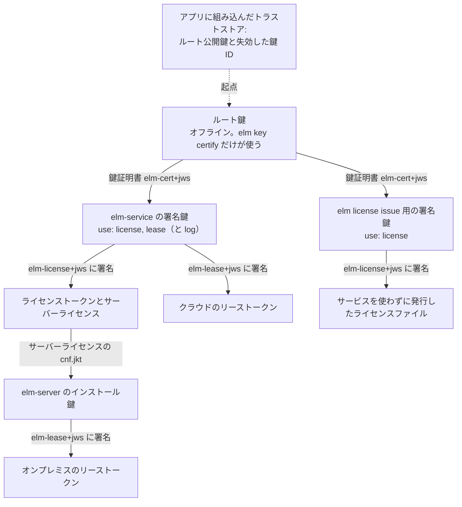

# トラストチェーン

このページの読者は、鍵を作って保管するベンダー、トラストストアをアプリに組み込むアプリ開発者、`elm-server` と `elm-service` にルート鍵を設定する管理者だ。どんな鍵があるか、鍵がなぜ 2 段になっているか、アプリが署名済みのトークンを信頼する鍵までどうたどるか、鍵をどう入れ替え、どう使用停止にするかを説明する。6 つの成果物をまだ知らなければ、先に[概要](overview.md)を読んでおくとよい。

## トラストチェーンの役割

ElasticLM のライセンスとリースは、どれもトークンだ。トークンは、ヘッダー、JSON のペイロード、署名からなる短いテキストである。形式は JWS（JSON Web Signature、RFC 7515）で、署名は ECDSA P-256（`ES256`）を使う。アプリがトークンを受け入れるのは、トークンに署名した鍵から署名をたどって、ベンダーがアプリに組み込んだ鍵に行き着くときだけだ。組み込んだ鍵からトークンまでのこの経路を、トラストチェーンと呼ぶ。

トラストチェーンが答える問いは、「アプリが受け入れるライセンスを作れるのは誰か」の 1 つだけだ。答えはベンダー（発行元）だけで、しかもベンダーが証明した鍵を使う場合に限られる。ライセンシー（顧客）が正規のライセンスファイルを書き換えても、一から書いても、アプリはそのファイルを受け入れない。トラストチェーンが行き着く秘密鍵を、ライセンシーは持っていないからだ。

トラストチェーンは 1 段ではなく 2 段になっている。

- **ルート鍵**。ベンダーがオフラインで保管する。署名するのは鍵証明書だけだ。
- **署名鍵**。ライセンス、リース、利用ログのレコードに日常的に署名する。ルート鍵は、署名鍵ごとに用途と期間を限って証明する。

アプリが信頼するのはルート鍵だけだ。そのため、アプリをビルドし直さなくても、署名鍵を入れ替えたり、漏れた署名鍵から復旧したりできる。署名鍵そのものをアプリに組み込む方法では、鍵を変えるたびにアプリの更新が必要になる（[設計上の選択](design-choices.md)を参照）。

## 鍵の種類

| 鍵 | 持つ側 | 置き場所 | 署名するもの |
| --- | --- | --- | --- |
| ルート鍵 | ベンダー | ベンダーがオフラインで保管し、必要なときだけ `elm` に渡すファイル | 鍵証明書 |
| `elm-service` の署名鍵 | ベンダーの運用担当者 | 起動時に `elm-service` に渡すファイル | ライセンストークン、クラウドのリーストークン、利用ログのレコード |
| `elm license issue` で使う署名鍵 | ベンダー | `elm` に渡すファイル | サービスを使わずに発行するライセンスファイル |
| `elm-server` のインストール鍵 | 顧客のサーバー | サーバーが初回起動時に作る | オンプレミスのリーストークンと、サーバーの利用ログ |

秘密鍵を実行ファイルのリソースや定数に入れることはない。`elm` は汎用のバイナリで、ベンダーの鍵を持たず、ルート鍵を実行のたびにファイルから読む。

### ルート鍵

ルート鍵は `elm key root create` で作る。`elm` が書き出すほかの秘密鍵と同じく、パスフレーズで暗号化した PKCS#8 の PEM ファイルとして保存する。新しい鍵のパスフレーズは 12 文字以上にする必要がある。秘密鍵と公開鍵のファイルの形式は、[トークンとファイルの形式](../reference/formats.md#鍵ファイルと鍵-id)にある。ルート鍵の保管のしかたと、コピーが使えるかの確かめ方は、[ルート鍵を安全に保管する](../how-to/keep-the-root-key-safe.md)にある。

ルート鍵をオンラインのサービスに置くことはない。ルート鍵の役目は、署名鍵の鍵証明書に署名する `elm key certify` だけだ。使う機会が少ないので、使わないあいだはオフラインのマシンやリムーバブルメディアに置いておける。

### 署名鍵

署名鍵は `elm key signing create` で作る。作っただけの署名鍵は、何からも信頼されない。ルート鍵が証明して初めて使えるようになる。

`elm-service` は、起動時に署名鍵をちょうど 1 つ読み込む。読み込むのは、`signing.key`（または `ELM_SIGNING_KEY`）とそのパスフレーズ、それに `signing.certificates` に指定した 1〜4 個の証明書ファイルだ。`license` と `lease` のそれぞれについて、`trust.rootKeys` のルート鍵につながる鍵証明書のどれかがこの鍵を証明していて、その有効期間が現在時刻を含んでいなければ、`elm-service` は起動しない。2 つの用途を 1 つの鍵証明書で兼ねても、別々の鍵証明書にしてもよい。`usageLog.directory` を設定したときは、`log` についても同じ条件を満たす必要がある。

オンプレミスのライセンスサーバーは、ベンダーの署名鍵をまったく使わない。リースには自分のインストール鍵で署名する。ベンダーは、サーバーライセンスを通じてその鍵に権限を与える（後述）。

### 鍵証明書

鍵証明書は、ルート鍵が署名したトークンだ。どのトークンも、自分の種類をヘッダーのメンバー `typ`（トークンの種類）で示す。鍵証明書は `elm-cert+jws`、ライセンストークンは `elm-license+jws`、リーストークンは `elm-lease+jws` だ。検証側は期待する種類しか受け入れないので、ある種類のトークンを別の種類と偽って通せない。

鍵証明書のペイロードには、次の値が入る。

- `sub`: 証明する公開鍵の鍵 ID（鍵 ID は後述）
- `jwk`: 証明する公開鍵そのもの
- `use`: その鍵が署名してよいもの。`license`、`lease`、`log` のうち 1 つ以上
- `nbf` と `exp`: 有効期間の開始と終了

鍵証明書は `elm key certify` で書き出す。`--use` で用途を指定し（既定は `license`）、`--not-before` で開始日時を指定し（既定は現在）、`--days` で長さを指定する。長さは既定で 365 日、最長で 731 日だ。鍵証明書のすべてのメンバーは[トークンとファイルの形式](../reference/formats.md#鍵証明書-elm-certjws)に、7 種類のトークンは[トークンの種類](../reference/formats.md#トークンの種類)に挙げている。

**用途。** 検証側が求める用途は、つねに 1 つだ。ライセンスの検証では `license` を含む鍵証明書だけを受け入れ、クラウドのリースの検証では `lease` だけを受け入れる。`elm log verify` は `log` を使う。ログ用にだけ証明された鍵では、アプリが受け入れるライセンスに署名できない。

**有効期間と発行時刻。** どのトークンにも、発行した時刻 `iat` が入っている。鍵証明書の有効期間が示すのは、その鍵で新しく署名してよい期間だ。その署名がいつまで有効かは示さない。トークンを受け入れるのは、`iat` が鍵証明書の `nbf` と `exp` のあいだにあるときで、両端には許容する時計のずれを加える。現在時刻を鍵証明書の `exp` と比べることはない。

コード署名のタイムスタンプと同じ考え方だ。この規則があるので、永続ライセンスや期間の長いライセンスは、署名鍵の鍵証明書が期限切れになったあとも使い続けられる。もし鍵証明書を現在時刻と比べたら、どのライセンスも長くて 2 年で使えなくなる。

この規則には代償がある。署名鍵の有効期間では、鍵を盗んだ相手を止められない。署名鍵を盗めば、`iat` を過去の有効期間内にしたトークンを書けるので、鍵証明書の確認は通ってしまう。これを防ぐのが、後述する失効した鍵 ID の一覧だ。

### 鍵 ID

鍵 ID（`kid`）は公開鍵の短い名前で、鍵そのものから計算する。中身は JWK のサムプリント（RFC 7638、SHA-256、base64url）だ。公開鍵があれば誰でも計算でき、`elm key thumbprint` で表示できる。トークンのヘッダーは署名鍵を `kid` で指定し、鍵証明書のヘッダーも同じ方法でルート鍵を指定する。鍵 ID は鍵から導くので、ある鍵 ID を名乗りながら別の鍵を持つ鍵証明書は見破れる。検証側が、`jwk` のサムプリントが `sub` と一致することを確かめるからだ。ハッシュを計算する正確なテキストは、[トークンとファイルの形式](../reference/formats.md#鍵-id)にある。

### トラストストア

トラストストアは、アプリが信頼するルート公開鍵の集まりと、失効した鍵 ID の一覧を合わせたものだ。アプリ開発者がアプリに組み込む。

- .NET では、`ElasticLM.Licensing` の `TrustStore.Create(rootPublicKeysPem, revokedKeyIds)` を使う。ルート鍵は、P-256 の公開鍵 1 つにつき PEM の `PUBLIC KEY` ブロック 1 つで表す。
- C では、`elm_verifier_options` の `root_keys_pem` と `revoked_key_ids` のフィールドを使う。

トラストストアには、ルート鍵を複数入れられる。中身は公開鍵だけなので、秘密にする必要はない。大事なのは改ざんされていないことだ。アプリがどのライセンスを受け入れるかは、アプリが使うトラストストアで決まる。

`elm-server`、`elm-service`、`elm` の一部のコマンドも、ルート鍵と失効した鍵 ID を受け取る（サーバーとサービスでは設定の `trust.rootKeys` と `trust.revokedKeyIds`、`elm` では `--trust`、`--revoked`、`ELM_TRUST_ROOT_KEYS`）。こちらは、そのプログラム自身が何を受け入れ、何を使うかを決める。`elm-service` は、自分の署名鍵の鍵証明書と、自分が発行するすべてのファイルをこれで確かめる。`elm-server` は、自分のサーバーライセンスをこれで確かめる。そのため、ルート鍵が署名していない鍵証明書のような設定の誤りに、起動時に気づける。ただし、アプリを守っているのはこの設定ではない。顧客の管理者が自分のルート鍵を `elm-server` に入れ、自分でサーバーライセンスを書いても、得るものはない。アプリが信頼するのはベンダーのルート鍵だけなので、そのサーバーのリースをアプリは拒否する。

`elm key` のコマンドの正確な書き方とオプションは、[elm コマンドリファレンス](../reference/elm-cli.md)を参照。`trust` の設定は、[elm-server の設定](../reference/server-configuration.md)と[elm-service の設定](../reference/service-configuration.md)を参照。

## トークンをルート鍵までたどる

`elm-service` の署名鍵に `log` が必要なのは、利用ログを有効にしたときだけだ。ライセンスファイルには、ライセンストークンと、トークンに署名した鍵の鍵証明書が入っている。そのため、アプリは経路全体をオフラインで確かめられる。

1. 鍵証明書のヘッダーが指定するルート鍵（`kid`）がトラストストアにあって失効しておらず、鍵証明書に対するルート鍵の署名が正しい。
2. 鍵証明書が、検証側の求める用途を許している（ライセンスファイルなら `license`）。
3. 鍵証明書の `sub` が、ライセンストークンのヘッダーの `kid` と一致する。
4. 証明された鍵で検証して、トークンの署名が正しい。
5. トークンの `iat` が、鍵証明書の有効期間に入っている。

確認の順序の全体と、それぞれの確認が返すエラーは[ライセンスファイルと検証](license-files-and-verification.md)にある。`elm-service` のクラウドのリースも、用途を `lease` にして同じように確かめる。

### オンプレミスのリースはサーバー自身の鍵で署名する

オンプレミスのリースに署名するのは、ベンダーの鍵ではない。顧客の `elm-server` のインストール鍵だ。ベンダーは、この鍵に**サーバーライセンス**で権限を与える。サーバーライセンスは `kind: server` のライセンストークンで、その `cnf.jkt` はサーバーのインストール鍵のサムプリントである。

クライアントは、`GET /v1/server/license` でサーバーライセンスとサーバーの公開鍵を取得する。そして、ほかのライセンスファイルと同じようにサーバーライセンスをルート鍵から検証し、公開鍵のサムプリントが `cnf.jkt` と一致することを確かめる。ここまで済んで初めて、その鍵が署名したリースを受け入れる。それも、サーバーライセンスが定める範囲の中に限る。範囲とは、製品、機能、シート数、リースと借用の期間、有効期限と猶予期間だ。クライアントはリースを 1 つずつ確かめるので、この範囲は、サーバーの鍵を取り出した者が署名できるリースの数を限らない（[セキュリティモデル](security-model.md#顧客のライセンスサーバー上)）。トライアルや標準のライセンスで動くサーバーは拒否されるので、ライセンシーは自分のライセンスでリースサーバーを立てられない。リースの仕組みは[フローティングライセンス](floating-licenses.md)で説明する。

## 鍵の入れ替え

`elm-service` を動かすベンダー向けの手順は、[署名鍵を入れ替える](../how-to/rotate-the-signing-key.md)にある。

### 鍵証明書を更新する

鍵証明書は、鍵を変えずに更新できる。同じ公開鍵を、新しい有効期間でもう一度証明すればよい。すると、ライセンスファイルに同じ鍵の鍵証明書が有効期間違いで複数入ることがある。検証側は、並び順にかかわらず、トークンの `iat` を含む鍵証明書を使う。ライセンスファイルに入れられる鍵証明書は 4 つまでだ。

どれかの確認に通らない鍵証明書は、ファイル全体を失敗させずに読み飛ばす。そのため、入れ替えのために残した古い鍵証明書があっても、有効な鍵証明書も入っているファイルが検証に失敗することはない。

管理 API でサービスの署名鍵の状態を取得すると、鍵 ID、鍵証明書の有効期限、用途が返り、残りが 30 日を切ると警告が出る。鍵証明書の期限が切れると、サービスでの発行は `500` と `ELM_INTERNAL_ERROR` で失敗し、理由がサービスのログに書かれる。その前に更新する。新しい鍵証明書のファイルを `signing.certificates` に入れ、サービスを再起動すればよい。

### 署名鍵を入れ替える

1. 新しい署名鍵を作り、ルート鍵で証明する。
2. `elm-service` に渡している署名鍵のファイルと鍵証明書のファイルを差し替え、サービスを再起動する。サービスは起動時に署名鍵を 1 つ読み込むので、再起動以降は新しい鍵で署名する。
3. 古い鍵で署名済みのトークンは、古い鍵証明書の期限が切れたあとも検証に通り続ける。どのライセンスファイルにも古い鍵証明書が入っていて、発行時刻の規則が適用されるからだ。これは、古い鍵が失効した鍵 ID の一覧に入らない限り続く。
4. オンラインでトークンを更新するデバイスは、次の更新で、新しい鍵で署名した新しいトークンを受け取る。

アプリの更新は要らない。アプリが信頼しているのは署名鍵ではなく、ルート鍵だからだ。

### ルート鍵を入れ替える

ルート鍵を変えるには、アプリの更新が必要だ。手順の順番も重要になる。

1. 古いルート公開鍵と新しいルート公開鍵の両方をトラストストアに入れたアプリのバージョンをリリースする。
2. 使われているアプリが、新しいルート鍵を持つバージョンに行き渡るまで待つ。
3. そのあとで初めて、新しいルート鍵で署名鍵を証明する。

先に新しいルート鍵で証明すると、新しいルート鍵をまだ知らないアプリは、新しいライセンスをすべて `ELM_UNTRUSTED_KEY` で拒否する。

## 署名鍵が漏れたとき

署名鍵が漏れると、盗んだ側は、トラストチェーンが受け入れるどんなライセンスにも署名できる。発行時刻の規則があるので、鍵証明書の有効期間では止められない。`iat` を過去の有効期間にさかのぼらせればよいからだ。漏れた鍵を入れ替えて失効させる手順は、[署名鍵を失効させる](../how-to/revoke-a-signing-key.md)にある。

対策は、トラストストアにある失効した鍵 ID の一覧だ。一覧に載った鍵 ID については、検証側は、その鍵で署名したライセンストークンやクラウドのリーストークンを、ペイロードを読む前に `ELM_KEY_REVOKED` で拒否する。その鍵の鍵証明書も無視する。失効したルート鍵 ID が署名した鍵証明書も無視する。

アプリを守るのは、アプリに組み込んだトラストストアだけだ。漏洩に対してベンダーがすることは次のとおり。

1. 前述の手順で署名鍵を入れ替える。
2. 正規のライセンスを、新しい鍵で発行し直す。オンラインでトークンを更新するデバイスは、次の更新で新しい鍵のトークンに切り替わる。ライセンスファイルを手作業で受け取ったライセンシーには、新しいファイルが必要だ。`elm-service` でアクティベーションしたサーバーは、次の更新（オンラインでも更新ファイルでもよい）で新しい鍵のサーバーライセンスを受け取る。`elm` で手作業で発行したサーバーライセンスは、発行し直す必要がある。
3. 漏れた鍵 ID を失効としてトラストストアに載せたアプリのバージョンをリリースする。アプリがそのバージョンになるまでは、漏れた鍵のトークンを、偽造されたものも含めて受け入れ続ける。失効した鍵 ID の一覧をネットワークから取得する仕組みはない。
4. 漏れた鍵 ID を、`elm-service` と、ベンダー自身や顧客が動かしている `elm-server` の `trust.revokedKeyIds` に追加する。これで、それらのプログラムはその鍵を使わなくなる。`elm-service` はその鍵では起動せず、`elm-server` はその鍵が署名したサーバーライセンスを拒否する。この設定はアプリには届かない。

失効した鍵で署名したトークンは、正規のものでも、猶予期間内でも検証に失敗する。失効した鍵 ID を載せたアプリの更新がデバイスに届くと、そのデバイスは、まだ持っている古い鍵のライセンスをすべて拒否する。タイミングは計画して決める。更新を早く出すほど偽造ライセンスも早く使えなくなるが、新しい鍵のライセンスをまだ受け取っていないライセンシーも、同時に使えなくなる。

有効期限のないトークン（`elm license issue --expires never` で発行したものや、有効期限のないライセンスから作った、マシンに紐付けないライセンスファイル）は、サービスではまったく失効させられない。止める方法は、署名鍵を失効させることだけだ。サービスでライセンスを失効させても、デバイスに反映されるのはトークンの有効期限が切れたときである。また、書き換えられたアプリのバイナリは対象外だ。どちらも[セキュリティモデル](security-model.md)で説明する。

### ルート鍵が漏れたとき

ルート鍵が漏れた場合は、さらに深刻だ。盗んだ側は自分の署名鍵を証明でき、そのルート鍵を信頼するアプリは、その鍵で署名したものをすべて受け入れる。ElasticLM は、これが起きないようにルート鍵をオフラインに置いている。アプリの更新以外に、復旧の手順は用意していない。

どう復旧するにしても、アプリの更新が必要だ。更新後のトラストストアでは、漏れたルート鍵を外すか、その鍵 ID を失効として載せ、新しいルート鍵を入れる。この更新のあとは、古いルート鍵を通じて証明されたライセンスファイルが、正規のものも含めてすべて `ELM_UNTRUSTED_KEY` で失敗する。新しいルート鍵だけを通じて証明されたライセンスも、まだ更新していないアプリではすべて失敗する。そのため、すべてのライセンスを、新しいルート鍵で証明した署名鍵で発行し直す必要がある。どのデバイスにも、アプリの更新と新しいライセンスを一緒に届けなければならない。片方しか届かなかったデバイスは動かなくなる。

## 起こりうる問題と対処

| 起きること | よくある原因 | 対処 |
| --- | --- | --- |
| `ELM_UNTRUSTED_KEY` | アプリのトラストストアにあるルート鍵が署名し、`license` を許し、トークンの鍵を証明している鍵証明書が、ファイルに 1 つもない | アプリのトラストストアに正しいルート公開鍵が入っているか、鍵証明書を `--use license` で作ったか、署名に使う鍵の鍵証明書をサービスに設定したかを確かめる |
| `ELM_CERTIFICATE_EXPIRED` | トークンの `iat` が、候補のどの鍵証明書の有効期間にも入らない | 鍵証明書を更新する。鍵証明書の期限が切れたあともサービスが署名を続けていなかったかを確かめる |
| `ELM_KEY_REVOKED` | アプリの失効した鍵 ID の一覧にある鍵で、トークンが署名されている | 現在の署名鍵でライセンスを発行し直す |
| `elm-service` が起動しない | `license` か `lease`、または `usageLog.directory` を設定したときの `log` について、現在時刻を含む鍵証明書がない。あるいは鍵証明書が鍵と一致しない | 正しい用途と有効期間で、鍵をもう一度証明する |
| ルート鍵を変えたあと、古いバージョンのアプリで新しいライセンスが失敗する | アプリに新しいルート鍵が行き渡る前に、新しいルート鍵を使った | 使われているアプリが新しいルート鍵を知るバージョンになるまで、古いルート鍵で証明し続ける |

すべてのエラーコードとその対処は、[エラーコード](../reference/error-codes.md)を参照。

役割ごとにすべきことは次のとおり。

- **ベンダー:** ルート鍵をオフラインに置き、パスフレーズをスクリプトやリポジトリに入れない。鍵証明書には、それぞれの鍵に必要な用途だけを与える。鍵証明書は期限が切れる前に更新する。鍵が漏れたら上の手順に従い、失効した鍵 ID を載せたアプリをいつリリースするかを決める。
- **アプリ開発者:** ベンダーのルート公開鍵と、現時点で失効している鍵 ID をアプリに組み込む。ベンダーが鍵を失効させたときや、ルート鍵を追加したときは、アプリの更新をリリースする。
- **顧客の管理者:** 設定の誤りに起動時に気づけるよう、`elm-server` の `trust.rootKeys` にベンダーのルート公開鍵を、`trust.revokedKeyIds` にベンダーから知らされた鍵 ID を設定する。
