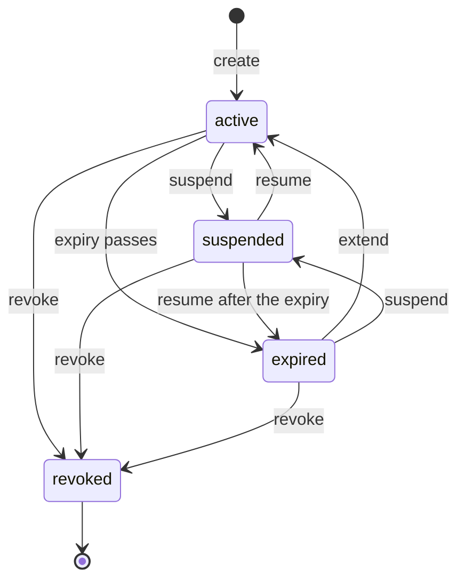
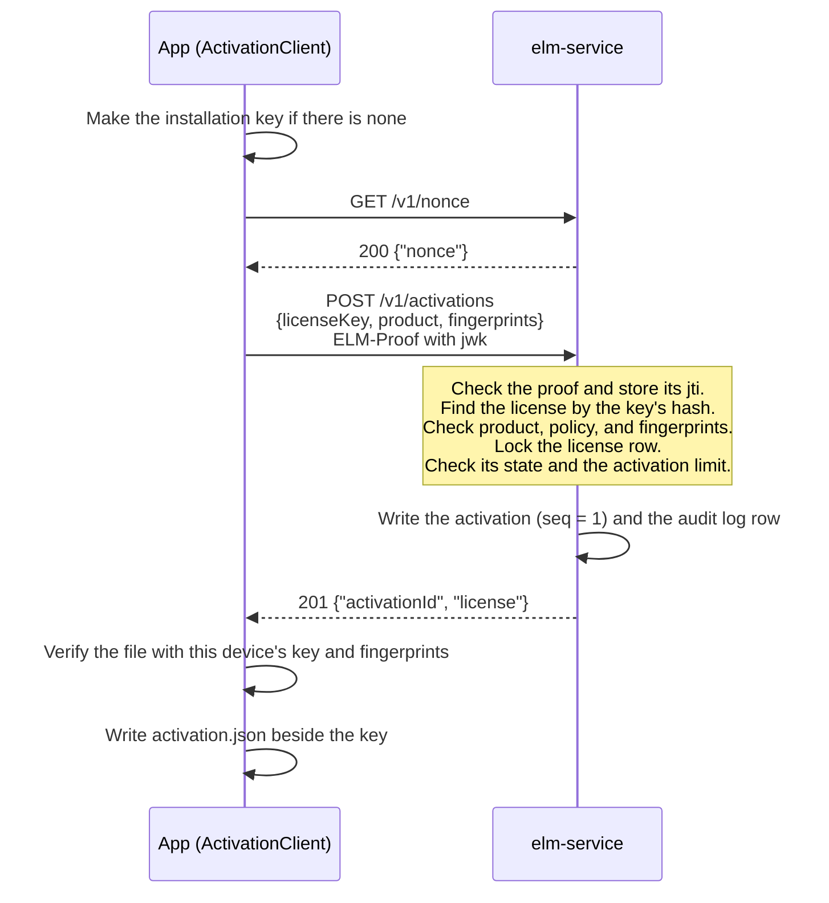
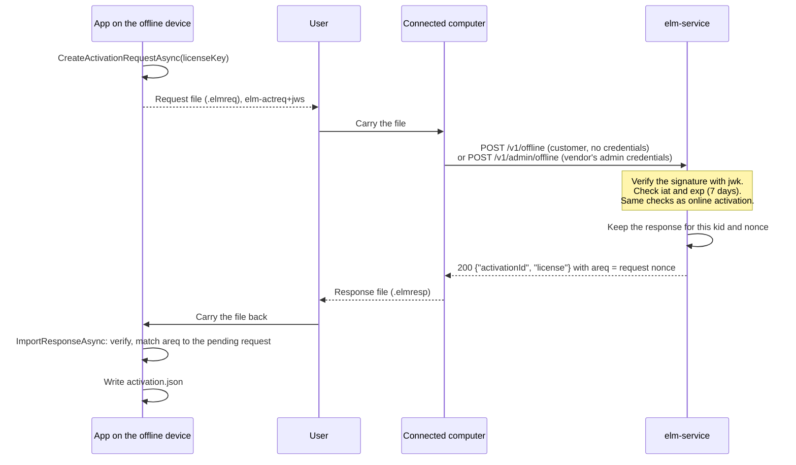

# Activation

This page is for vendors who run the hosted activation service (`elm-service`), choose policies, and connect a sales or billing system to it, and for app developers who embed `ActivationClient` from `ElasticLM.Client` or the `elm_activation_*` functions of `libelasticlm`. It explains what the service keeps about products and licenses, how a license key becomes a license file bound to one device, how that file is renewed and given back, how devices without a network take part, and how cloned virtual machines are caught. Read [Devices and proofs](devices-and-proofs.md) first: activation is built on the installation key and on signed requests.

## What activation is for

A vendor sells a license with a limit, for example "this customer may use the product on three devices". The customer gets a license key, a secret string such as `ELM-7Q2KX-M9D4R-HV0T8-3NPWZ`. Activation turns that key into a license file the app can verify offline, and counts the device against the limit:

- An **activation** is the link between a license and one installation key. It uses one of the license's activations.
- The **license file** the service returns is bound to that installation key and to the device's machine fingerprints, so it verifies only on that device.
- The file has a short expiry (by default 30 days), so the app goes back to the service now and then to **refresh** it. A refresh is how revocation, suspension, and policy changes reach the device, and how the service notices cloned devices.
- **Deactivation** gives the activation back, so the customer can move the license to another device.

## How the service sees products, policies, and licenses

`elm-service` keeps a small model. A vendor's sales or billing system, or a person in the admin UI, builds it through the administration API.

- A **product** is something the vendor sells. Its `code` (lowercase letters, digits, and `-`) is what the app names when it activates, and what the license token carries.
- A **feature** is a part of a product that a license can grant on its own, also named by a `code`. An app checks for a feature by that code.
- A **policy** is a set of rules for licenses of one product: what kind of license it is, how many devices may use it, how long a license file lasts, how it is bound to a device, and whether its seats float. One product usually has a few policies, for example "standard, one device", "site, ten devices", and "trial".
- A **license** is what a customer bought. It follows one policy and lists the features it grants, each with an optional version range and expiry. It has a name (for example the customer's), an optional expiry, an optional `maxActivations` that overrides the policy's, and optional `meta` values that are copied into the token. The service has no customer records of its own; the billing system keeps the link between its customer and the license ID.
- An **activation** is one device that holds the license, named by its installation key's thumbprint. Floating seats are lent as leases instead (see [Floating licenses](floating-licenses.md)).

### The license key

When a license is created, the answer carries its license key once. The service stores only the key's SHA-256 and cannot show the key again, so the billing system must hand it to the customer at that moment, for example in the order email. The key has 100 random bits, so the hash cannot be reversed by trying keys. The client does not store the key either.

### License states

A license is `active`, `suspended`, `expired`, or `revoked`. When several apply, the first of revoked, suspended, expired wins. Suspension can be undone with resume; revocation cannot. `expired` is not stored: a license whose expiry has passed is expired, and extending the expiry makes it active again. A suspended or revoked license gets no new license file and no lease. A file already on a device stays valid until it expires (see [Security model](security-model.md)).

### What a sales or billing system does

Through the administration API, a sales or billing system can:

- Create products, features, and policies once, and create a license for each order. The answer to the create carries the license key.
- Find a license by state, by name, or by the hash of a license key a customer quotes.
- Change a license's name, features, `meta`, or `maxActivations`; extend its expiry when a subscription renews; suspend it when a payment fails and resume it when it is paid; revoke it when a contract ends or a refund is given.
- Read a license's activations and deactivate a device as an administrator, for example when a customer has lost a device.
- Hand in an offline request file for a customer (below), and read and delete trial records.
- Create a license file for an `unbound` license, which is not activated.

Every change takes effect from the next file the service issues; files already on devices keep their values until they expire. The billing system calls the API with an API key that carries only the permissions it needs, and people log in with a role. Both are explained, with the threats against them, in [Security model](security-model.md).

### Policy settings

A vendor chooses these settings per policy. The names and values are as the administration API spells them.

| Setting | Values | Default | What it decides |
| --- | --- | --- | --- |
| `licenseKind` | `standard`, `trial`, `server` | `standard` | The kind of token; `server` is for `elm-server` (see [Floating licenses](floating-licenses.md)) |
| `binding` | `unbound`, `nodeLocked` | `nodeLocked` | Whether the license is bound to a device. An `unbound` license is not activated: its file comes from the administration API |
| `maxActivations` | 1 to 100,000 | 1 | How many devices may hold an activation at once. A license can set its own value |
| `deactivationLimit` | 0 to 100,000, or none | none (unlimited) | How many times devices may deactivate this license, in total |
| `expirationBasis` | `fromIssue`, `fromFirstActivation` | `fromIssue` | Whether the license's `duration` starts when it is created or at its first activation |
| `duration` | seconds, or none | none (perpetual) | How long the license lasts |
| `tokenLifetime` | seconds | 30 days | How long one license file is valid |
| `refreshWindow` | seconds | 20 days | When fewer than this remain before the file's expiry, the app refreshes |
| `gracePeriod` | seconds | 7 days | How long the app keeps working after the file's expiry |
| `fingerprintMatching` | `ignore`, `any`, `all` | `any` | How machine fingerprints are matched (see [Devices and proofs](devices-and-proofs.md)) |
| `cloneStrategy` | `deny`, `flag` | `deny` | What happens when a clone is detected (below) |
| `floating` | `none`, `onPremises`, `cloud` | `none` | Whether seats are lent as leases, by the customer's `elm-server` or by `elm-service` |
| `leaseDuration` | 2 minutes to 24 hours, in seconds | 10 minutes | How long one lease lasts before it must be renewed |
| `overage` | percent, or none | none | How many seats above the bought number may be lent |
| `borrowLimit` | seconds, or none | none (no borrowing) | The longest time a lease may be borrowed for use away from the network |
| `borrowReturnLimit` | 0 to 1,000 | 2 | How many borrows may be returned early in 30 days |
| `clientInfoStrategy` | `none`, `hostAndUser` | `none` | Whether the service keeps the host name and OS user name the app sends |
| `trialDuration` | seconds | 14 days | The length of a trial, for a `trial` policy |

The floating settings are explained in [Floating licenses](floating-licenses.md). A product offers trials by naming one `trial` policy in its `trialPolicyId` (see Trials below).

A policy can be changed after licenses were issued, except `licenseKind` and `binding`, which would change the form of tokens already issued.

## Online activation

The app calls `ActivateAsync` with the key the user typed. The request carries the product's code, all the device's fingerprints, and a proof that includes the public key (`jwk`). Optional members are `client` (host name and OS user name, sent only when the app sets `SendClientInfo`, and kept only when the policy is `hostAndUser`) and `app` (the app's version, for the logs).

The service checks, in this order:

1. Rate limits per source address (`rateLimit.clientPerIp`, default 20 requests per second) and, after the proof, per installation key (`rateLimit.clientPerKey`, default 2 per second).
2. The proof (see [Devices and proofs](devices-and-proofs.md)).
3. The license. A key in the wrong form and an unknown key both get `404` and `ELM_LICENSE_NOT_FOUND`. A key for another product gets `ELM_WRONG_PRODUCT` before any activation is made, so a key typed into the wrong app does not use an activation that app could never give back.
4. The policy. An `unbound` license, or a policy whose `floating` is `cloud`, gets `409` and `ELM_CONFLICT`. A policy that matches fingerprints, with no fingerprint sent, gets `ELM_FINGERPRINT_UNAVAILABLE`.
5. The license's state, under a lock on the license row: `ELM_LICENSE_REVOKED`, `ELM_LICENSE_SUSPENDED`, or `ELM_EXPIRED`.
6. Whether this key already has an activation of this license. If it has, the request is a reactivation: it does not count again, and its `seq` is checked as described in Clone detection below.
7. The limit: when the license already has `maxActivations` activations, `409` and `ELM_ACTIVATION_LIMIT`. Lowering `maxActivations` later does not remove existing activations.
8. For a `fromFirstActivation` license without an expiry yet, the expiry is set to now plus `duration`.

The service then signs a license file whose token names the key's thumbprint, the fingerprints, and the sequence number (`seq` = 1). Its expiry is now plus `tokenLifetime`, or the license's own expiry if that comes first. Because activations are counted under the row lock, two devices racing for the last activation cannot both get it. The client verifies the file with this device's key and fingerprints before it keeps it, so a broken or tampered response never replaces a good file.

### The activation file the app keeps

The client keeps `activation.json` in the installation key's folder. It holds the activation ID, the last `seq`, the license file, and the bookkeeping for retries and offline requests, but not the license key. `Check` reads it and verifies it offline with the key, the current fingerprints, and the clock guard. If there is no activation, it returns `ELM_LICENSE_NOT_FOUND`.

Several processes of the same app on one device share the file. A lock file beside it, `activation.lock`, lets only one of them activate, refresh, or deactivate at a time, and each reads the newest `seq` after taking the lock. On file systems where locking does not work (some network file systems), concurrent refreshes can be mistaken for a clone.

An app with a kept activation that is not a trial cannot activate another license until it deactivates: `ActivateAsync` returns `ELM_INVALID_STATE`. An app with a trial can activate a purchased license, which replaces the trial on the device.

## Refresh

The client sets a timer for the file's expiry minus its refresh window. With the defaults, that is 10 days after the file was issued. When it fires, the client sends `POST /v1/activations/{id}/refresh` with `{seq}` in the body and a proof. The app can also call `RefreshAsync`.

The service checks that the proof's key is the activation's key (`ELM_PROOF_INVALID` otherwise), checks the license's state, and checks `seq` for clones (below). If all is well, it returns a new file with `seq` one higher. This is where a policy change, an extended expiry, a suspension, or a revocation reaches the device. When the client accepts a new file, it also gives the token's `iat` to the clock guard, so a user who moved the clock forward and back again gets unstuck.

## Deactivation

The app calls `DeactivateAsync`, which sends `POST /v1/activations/{id}/deactivate` with `{seq}` and a proof. The service checks the key and `seq`, frees the activation, and answers `204`. The client then deletes `activation.json`. It does not delete the installation key, because borrowed leases, server pins, and the clock guard's state in the same folder depend on it.

A vendor's administrator can also deactivate any activation from the admin UI or the administration API, without a proof. This is the way back for a lost device, a damaged `activation.json`, or a device stopped by clone detection.

`deactivationLimit` counts deactivations made by devices, online and offline, over the life of the license. Deactivations by an administrator are not counted, so operational moves are not limited. When the limit is reached, a device gets `409` and `ELM_DEACTIVATION_LIMIT`.

## Offline activation by file exchange

Some devices never reach the internet. For them, a person carries files between the device and a computer that can reach the service.

The request file is a JWS of type `elm-actreq+jws`, signed with the installation key in place of a proof. It holds the license key, the product, the fingerprints, the public key, a random 128-bit `nonce`, and an expiry 7 days after it was made. Because it contains the license key, it should not be left where others can read it.

There are two ways to hand the file in:

- **The customer** runs `elm offline process --url <service URL> --in <request file> --out <response file>` on the connected computer. Without credentials, the command uses the public endpoint `POST /v1/offline`.
- **A vendor's administrator** hands it in on the customer's behalf, through the admin UI's offline page, or with `elm offline process` and an API key (`ELM_API_KEY`) or after `elm admin login`. Both use `POST /v1/admin/offline`, which writes an audit log row for each file.

The public endpoint needs no credentials because the file proves as much as an online request. An activation request is signed by the installation key and contains the license key; a refresh request must be signed by the key the activation remembers.

Some rules make the exchange safe to repeat:

- The service keeps the response it gave for each request, found by key thumbprint and `nonce`. A user who loses the response hands in the same request file again and gets the same response. A different request with the same `nonce` from the same key gets `ELM_REPLAYED`.
- The response is bound to the key that signed the request, so it fails on another device. Importing it twice on the same device is harmless.
- The app imports a response only if the token's `areq` claim equals the `nonce` of the request it is waiting for; otherwise `ELM_REQUEST_MISMATCH`.
- Until a response is imported, the app hands out the same pending request again instead of making a new one. When the pending request is older than 7 days by the device's clock, the app makes a new request that names the old one in `retry`, so a request the service did process is not mistaken for a clone. If the device's clock is behind and the service refuses the request with `ELM_REQUEST_EXPIRED`, the app can pass `renew` to make a new one at once.

**Offline refresh** works the same way: `CreateRefreshRequestAsync` writes a request with the activation ID and the last `seq`. With the defaults (30-day files, 7-day grace), a device that never goes online keeps working if someone carries a refresh request and its response at least every 37 days. Vendors can give offline customers a policy with a longer `tokenLifetime`. For `elm-server`, the customer's administrator does the same with `elm server refresh-request`.

**Offline deactivation**: `CreateDeactivationProofAsync` signs an `elm-deact+jws` with the activation ID and the last `seq`, deletes the kept license file, and keeps the proof; the service frees the activation when the proof is handed in. The app cannot know when that happened, and activating again while the service still holds the old activation would look like a clone. So the app refuses a new activation until the user says the proof was handed in and the app calls `ForgetDeactivationProofAsync`.

A client created without a service URL works only offline and sets no refresh timer; the app decides when to ask for a refresh request from the license's `ExpiresAt` and `RefreshWindow`.

## Trials

A trial lets a device use the product for a limited time without a key. The app calls `StartTrialAsync`, which sends `POST /v1/trials` with the product's code, the fingerprints, and a proof with the public key. Trials are online only.

- The product must name a trial policy (`trialPolicyId`). Without one, or for an unknown product, the answer is `404` and `ELM_TRIAL_NOT_OFFERED`.
- The service records each trial by product and fingerprint. If any of the device's fingerprints already has a trial of this product, the answer is `409` and `ELM_TRIAL_USED`, even from the same installation key.
- Otherwise it creates a license without a key, named `trial`, that lasts `trialDuration`, with all of the product's current features, and activates it for this key. The file has no grace period.
- A trial policy must be `nodeLocked`, must match fingerprints (`any` or `all`), and has a `gracePeriod` of 0. A device that cannot make any fingerprint gets no trial.
- A trial is refreshed and checked for clones like any activation. Once it is deactivated or stopped by `deny`, it is over, because a trial license has no key to activate again with; only an administrator who deletes the trial record lets the device start a new one.

Rewriting the OS machine ID gives the device new fingerprints and so a new trial; [Security model](security-model.md) explains why this is accepted.

## Clone detection with the sequence number

Copying a virtual machine copies its installation key, its machine ID, and its `activation.json`, so both copies hold the same activation. Instead of the machine ID, the service watches the sequence number (`seq`), in the same way as refresh token rotation in OAuth (RFC 9700). Every new file carries `seq` one higher, the service remembers the last value and the request that got it, and every refresh, deactivation, and reactivation sends the last `seq` the device received. Only one copy can move forward: when copy A refreshes from 5 to 6, copy B still holds 5, and B's next request shows that another copy moved ahead.

For each refresh, deactivation, or reactivation, the service compares the `seq` it receives with the last one it issued:

1. If the two are equal, the request is normal: the service issues the next file with `seq` one higher.
2. If the received `seq` is one lower and `retry` names the `jti` of the request that got the last file, the answer to that request was lost: the service returns the last file again.
3. Otherwise a clone is detected, and the policy's `cloneStrategy` decides what happens next (below).

A lost response must not look like a clone. If the answer to a refresh never arrived, the service has moved to the next `seq` while the device still holds the old one. So the client sends the `jti` of each request whose answer it did not get in the body's `retry` list (up to 16), and the service treats "one lower" as a retry only if `retry` names the exact request that got the last file. A cloned copy cannot pass this test, because it cannot know the `jti` of the other copy's request. A `seq` two or more lower, higher, or missing is always a clone.

The policy's `cloneStrategy` decides what happens next:

- **`deny`** (the default) stops the activation. Every later refresh or reactivation gets `ELM_CLONE_DETECTED`, and the client changes its state to `CloneDetected` and stops refreshing. Only a device deactivation with the last issued `seq`, from the copy that moved ahead, is accepted, and it counts toward `deactivationLimit` like any device deactivation. The other copy can be removed only by an administrator. Otherwise the stale copy could free the activation, activate again, and stop the other copy in turn, and the two would share one activation forever.
- **`flag`** writes the audit log row (`activation.clone`) and answers as usual. The vendor sees the clone and decides what to do.

## When the network is down

The app keeps working from the file it has; `Check` needs no network. A failed refresh changes the client's state to `RefreshFailing`, and the client tries again every hour (or after the service's `Retry-After`, at most 24 hours). With the defaults, the first refresh is due on day 10, the file is valid until day 30, and the grace period lasts until day 37, during which the verification result says `InGracePeriod` so the app can warn the user. After that, `Check` returns `ELM_EXPIRED` until a refresh succeeds.

Other answers change the state differently:

| Answer to a refresh | Kept file | State |
| --- | --- | --- |
| `ELM_ACTIVATION_NOT_FOUND` (an administrator removed it) | deleted | `None` |
| `ELM_CLONE_DETECTED` | kept | `CloneDetected`, no more automatic refresh |
| `ELM_LICENSE_REVOKED`, `ELM_LICENSE_SUSPENDED`, `ELM_EXPIRED` | kept | `Refused` |
| `ELM_PROOF_INVALID` (the key changed) | kept | `RefreshFailing`, no more automatic refresh |
| Network errors, `5xx`, `429` | kept | `RefreshFailing` |
| A successful answer that cannot be saved (it does not verify or cannot be written) | kept; the request's `jti` stays in `retry` | `RefreshFailing` |

In the last row the service has already moved `seq` forward, so the next request must name that `jti` to be taken as a retry rather than a clone. A kept file is usable until its expiry plus grace period. The app learns of state changes from the `StateChanged` event.

## What can go wrong and what to do

- **Revocation and suspension are not instant.** A file on a device stays valid until it expires plus its grace period (by default 37 days). Vendors who need a faster stop choose a shorter `tokenLifetime` and `gracePeriod`. See [Security model](security-model.md).
- **A copied device that stays offline, or a saved copy of a license file restored after deactivation, is not detected.** A short `tokenLifetime` and `deactivationLimit` limit the harm. See [Security model](security-model.md).
- **An old offline request file handed in after a newer one looks like a clone.** The service keeps only the latest offline response per activation, so an old request is taken as two steps behind, and with `deny` the activation is stopped. Users must throw away old request files once they make a new one; the app is told when a pending request was replaced (`Replaced`). Mixing online and offline refreshes on one device needs the same care.
- **A damaged `activation.json` or a stopped activation.** `Check` returns `ELM_MALFORMED` for a damaged file, and activating again cannot send the last `seq`, which looks like a clone. After `ELM_CLONE_DETECTED` with `deny`, the copy that is behind cannot recover by itself. In both cases an administrator deactivates the old activation and the user activates again. Check the audit log for `activation.clone` rows first: they name the key thumbprint, the `seq` sent, and the last issued `seq`.
- **Containers.** A container without a machine ID gets `ELM_FINGERPRINT_UNAVAILABLE`, and one that loses its key folder on every restart uses a new activation each time. See [Devices and proofs](devices-and-proofs.md).
