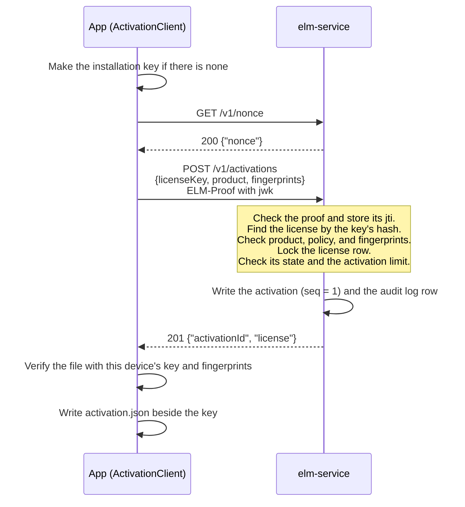
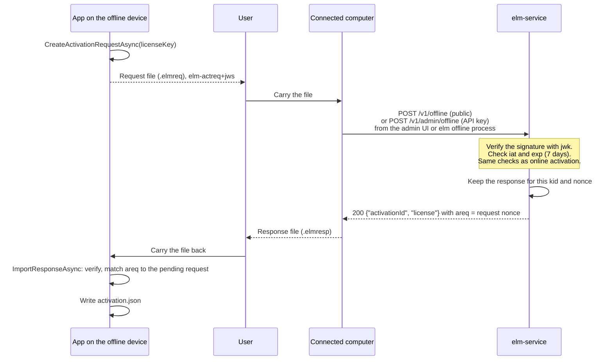
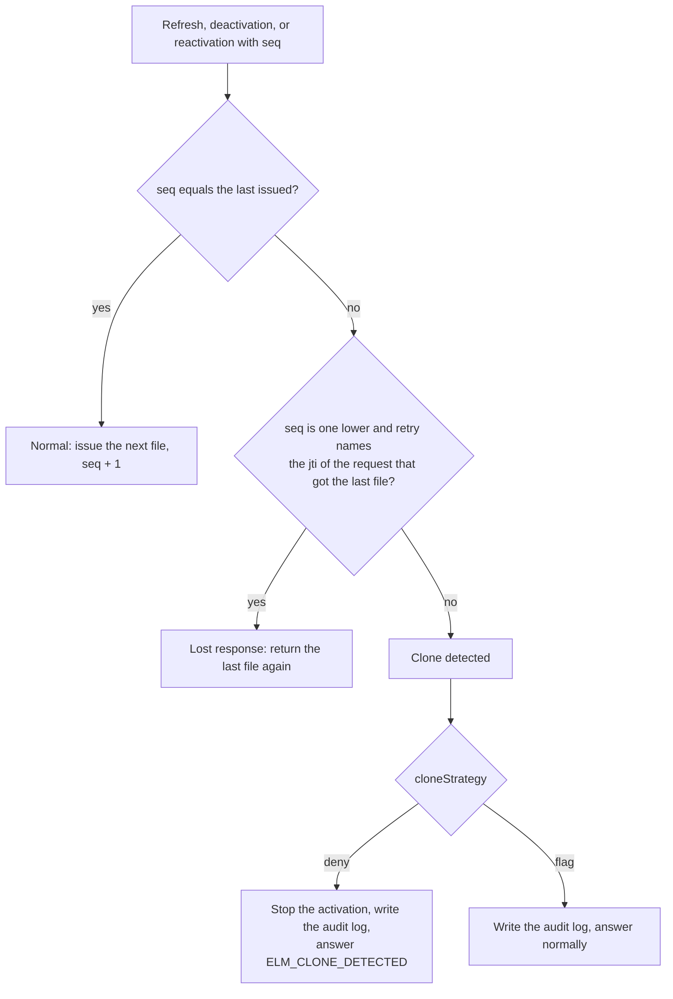

# Activation

This page is for vendors who run the hosted activation service (`elm-service`) and choose policies, and for app developers who embed `ActivationClient` from `ElasticLM.Client` or the `elm_activation_*` functions of `libelasticlm`. It explains how a license key becomes a license file bound to one device, how that file is renewed and given back, how devices without a network take part, and how cloned virtual machines are caught. Read [Devices and proofs](devices-and-proofs.md) first: activation is built on the installation key and on signed requests.

## What activation is for

A vendor sells a license with a limit, for example "this customer may use the product on three devices". The customer gets a license key, a secret string such as `ELM-7Q2KX-M9D4R-HV0T8-3NPWZ` (design §9.5). Activation turns that key into a license file the app can verify offline, and counts the device against the limit:

- An **activation** is the link between a license and one installation key. It uses one of the license's activations.
- The **license file** the service returns is bound to that installation key and to the device's machine fingerprints, so it verifies only on that device.
- The file has a short expiry (by default 30 days), so the app goes back to the service now and then to **refresh** it. A refresh is how revocation, suspension, and policy changes reach the device, and how the service notices cloned devices.
- **Deactivation** gives the activation back, so the customer can move the license to another device.

The service keeps only the SHA-256 of a license key, and shows the key once, when the license is issued (design §9.5). The client does not store the key either.

## Policies

Each license follows a policy, a set of rules the vendor defines per product (design §9.3). These are the rules that shape activation. Names are as the administration API has them (`src/ElasticLM.Service/Policies.cs`); the defaults are from design §9.3.

| Setting | Values | Default | What it decides |
| --- | --- | --- | --- |
| `licenseKind` | `standard`, `trial`, `server` | `standard` | The kind of token; `server` is for `elm-server` (see [Floating licenses](floating-licenses.md)) |
| `binding` | `unbound`, `nodeLocked` | `nodeLocked` | Whether the license is bound to a device. An `unbound` license is not activated: it is a license file issued by the administration API |
| `maxActivations` | 1 to 100,000 | 1 | How many devices may hold an activation at once. A license can set its own value |
| `deactivationLimit` | number, or none | none (unlimited) | How many times devices may deactivate this license, in total |
| `expirationBasis` | `fromIssue`, `fromFirstActivation` | `fromIssue` | Where the license's `duration` starts |
| `duration` | seconds, or none | none (perpetual) | How long the license lasts |
| `tokenLifetime` | seconds | 30 days | How long one license file is valid |
| `refreshWindow` | seconds | 20 days | When fewer than this remain before the file's expiry, the app refreshes |
| `gracePeriod` | seconds | 7 days | How long the app keeps working after the file's expiry |
| `fingerprintMatching` | `ignore`, `any`, `all` | `any` | How machine fingerprints are matched (see [Devices and proofs](devices-and-proofs.md)) |
| `cloneStrategy` | `deny`, `flag` | `deny` | What happens when a clone is detected (below) |
| `clientInfoStrategy` | `none`, `hostAndUser` | `none` | Whether the service keeps the host name and OS user name the app sends |
| `trialDuration` | seconds | 14 days | The length of a trial, for a `trial` policy |

A policy can be changed after licenses were issued, except `licenseKind` and `binding`. A change takes effect from the next file the service issues (a refresh or a new activation); files already on devices keep their values until they expire (design §9.3, decision 0.68).

## Online activation

The app calls `ActivateAsync` with the key the user typed. The request carries the product's code, all the device's fingerprints, and a proof that includes the public key (`jwk`), because the service has not seen this key before. Optional members are `client` (host name and OS user name, sent only when the app sets `SendClientInfo`, and kept only when the policy is `hostAndUser`) and `app` (the app's version, for the logs).

The service checks, in this order (design §12.6.1):

1. Rate limits per source address (`rateLimit.clientPerIp`, default 20 requests per second) and, after the proof, per installation key (`rateLimit.clientPerKey`, default 2 per second).
2. The proof (see [Devices and proofs](devices-and-proofs.md)). Its `jti` is written to the database before the body and the license are checked, so a request refused later cannot be sent again with the same proof.
3. The license. A key in the wrong form and an unknown key both get `404` and `ELM_LICENSE_NOT_FOUND`, so the answer says nothing about the key's form. A key for another product gets `ELM_WRONG_PRODUCT` before any activation is made, so a key typed into the wrong app does not use an activation that app could never give back.
4. The policy. An `unbound` license, or a policy whose seats are leased from the cloud, gets `409` and `ELM_CONFLICT`. A policy that matches fingerprints, with no fingerprint sent, gets `ELM_FINGERPRINT_UNAVAILABLE`.
5. The license's state, under a lock on the license row: `ELM_LICENSE_REVOKED`, `ELM_LICENSE_SUSPENDED`, or `ELM_EXPIRED`.
6. Whether this key already has an activation of this license. If it has, this is a reactivation (below) and does not count again.
7. The limit: when the license already has `maxActivations` activations, `409` and `ELM_ACTIVATION_LIMIT`. Lowering `maxActivations` later does not remove existing activations.
8. For a `fromFirstActivation` license without an expiry yet, the expiry is set to now plus `duration`.

The service then signs a license file whose token names the key's thumbprint (`cnf.jkt`), the fingerprints (`fp`), the sequence number (`seq` = 1), the grace period, and the refresh window, and returns it with the activation ID. Its expiry is now plus `tokenLifetime`, or the license's own expiry if that comes first. The activation and its audit log row are written in one transaction, and activations of the same license are counted one at a time under the row lock, so two devices racing for the last activation cannot both get it.

Before the client keeps the file, it verifies it with this device's key and current fingerprints. A file that does not verify is not written, so a broken or tampered response never replaces a good file on disk.

### The activation file the app keeps

The client keeps `activation.json` in the installation key's folder (design §12.6.2). It holds the activation ID, the last `seq`, the kind, the license file, and the bookkeeping for retries and offline requests. It does not hold the license key. It is written to a temporary file and then swapped in, so a reader never sees half a file.

`Check` reads this file on every call and verifies it offline with the key, the current fingerprints, and the clock guard. No network is used. If there is no activation, it returns `ELM_LICENSE_NOT_FOUND`.

Several processes of the same app on one device share the file. A lock file beside it, `activation.lock`, lets only one of them activate, refresh, or deactivate at a time. A caller waits at most 10 seconds for the lock and then gets `ELM_INVALID_STATE`. After taking the lock, the client reads the file again and uses its newest `seq`, so that one process does not send a stale number another process already used. On file systems where locking does not work (some network file systems, or with `DOTNET_SYSTEM_IO_DISABLEFILELOCKING`), concurrent refreshes can be mistaken for a clone (design §5.4).

An app with a kept activation that is not a trial cannot activate another license until it deactivates: `ActivateAsync` returns `ELM_INVALID_STATE`. An app with a trial can activate a purchased license, which replaces the trial on the device.

## Refresh

The client sets a timer for the file's expiry minus its refresh window. With the defaults, that is 10 days after the file was issued. When it fires, the client sends `POST /v1/activations/{id}/refresh` with `{seq}` in the body and a proof. The app can also call `RefreshAsync`.

The service checks that the proof's key is the activation's key (`ELM_PROOF_INVALID` otherwise), checks the license's state, and checks `seq` for clones (below). If all is well, it returns a new file with `seq` one higher. This is where a policy change, an extended expiry, a suspension, or a revocation reaches the device.

When the client accepts a new file from the service, it also gives the token's `iat` to the clock guard as the last confirmed time. A user who moved the clock forward and back again gets unstuck by a successful online refresh.

## Deactivation

The app calls `DeactivateAsync`, which sends `POST /v1/activations/{id}/deactivate` with `{seq}` and a proof. The service checks the key and `seq`, frees the activation, and answers `204`. The client then deletes `activation.json`. It does not delete the installation key, because borrowed leases, server pins, and the clock guard's state in the same folder depend on it.

A vendor's administrator can also deactivate any activation from the admin UI or the administration API, without a proof. This is the way back for a lost device, a damaged `activation.json`, or a device stopped by clone detection.

`deactivationLimit` counts deactivations made by devices, online and offline, over the life of the license. Deactivations by an administrator are not counted, so operational moves are not limited. When the limit is reached, a device gets `409` and `ELM_DEACTIVATION_LIMIT`.

## Offline activation by file exchange

Some devices never reach the internet. For them, a person carries files between the device and a computer that can reach the service (design §12.8).

The request file is a JWS of type `elm-actreq+jws`, signed with the installation key. It holds the license key, the product, the fingerprints, the public key, a random 128-bit `nonce`, and an expiry exactly 7 days after it was made. It takes the place of the server nonce and proof that an online request would use.

The file can be given to the service in three ways: in the admin UI's offline page, with `elm offline process --url <service URL> --in <request file> --out <response file>`, or by the vendor's administrator on the customer's behalf. The public endpoint needs no API key, because the file is signed by the installation key and contains the license key, which proves as much as an online activation does.

Some rules make the exchange safe to repeat:

- The service keeps the response it gave for each request, found by the pair of key thumbprint and `nonce`. If the user loses the response on the way, they hand in the same request file again and get the same response. A different request with the same `nonce` from the same key is refused with `ELM_REPLAYED`.
- The response is bound to the key that signed the request. Importing it on another device fails there, because the key differs. Importing it twice on the same device is harmless.
- The app imports a response only if the token's `areq` claim equals the `nonce` of the request it is waiting for; otherwise `ELM_REQUEST_MISMATCH`.
- Until a response is imported, the app hands out the same pending request again instead of making a new one. After 7 days the service refuses it with `ELM_REQUEST_EXPIRED`, and the app makes a new one that names the old one in `retry`, so a request the service did process is not mistaken for a clone. If the device's clock is behind and the service says the request has expired, the app can pass `renew` to make a new one at once.

**Offline refresh** works the same way: `CreateRefreshRequestAsync` writes a request with `op: refresh`, the activation ID, and the last `seq`. With the defaults (30-day files, 7-day grace), a device that never goes online keeps working if someone carries a refresh request and its response at least every 37 days. Vendors can give offline customers a policy with a longer `tokenLifetime`. For `elm-server`, the customer's administrator does the same with `elm server refresh-request`.

**Offline deactivation**: `CreateDeactivationProofAsync` signs an `elm-deact+jws` with the activation ID and the last `seq`, deletes the kept license file, and keeps the proof. The service frees the activation when the proof is handed in. The app cannot know when that happened, and activating again with the same key while the service still holds the old activation would look like a clone. So the app refuses a new activation while the proof is kept, until the user says it was handed in and the app calls `ForgetDeactivationProofAsync`.

A client created without a service URL works only offline. It sets no refresh timer; the app decides when to ask the user for a refresh request, using the `ExpiresAt` and `RefreshWindow` of the verified license.

## Trials

A trial lets a device use the product for a limited time without a key (design §12.9). The app calls `StartTrialAsync`, which sends `POST /v1/trials` with the product's code, the fingerprints, and a proof with the public key. Trials are online only.

- The product must name a trial policy (`trialPolicyId`). Without one, or for an unknown product, the answer is `404` and `ELM_TRIAL_NOT_OFFERED`.
- The service records each trial by product and fingerprint. If any of the device's fingerprints already has a trial of this product, the answer is `409` and `ELM_TRIAL_USED`, even from the same installation key.
- Otherwise it creates a license without a key, named `trial`, that lasts `trialDuration`, with all of the product's current features, and activates it for this key. The file has no grace period.
- A trial policy must be `nodeLocked`, must match fingerprints (`any` or `all`), and has a grace period of 0. A device that cannot make any fingerprint gets no trial, because an identifier that can change at every start cannot limit trials to one per device.
- A trial is refreshed and checked for clones like any activation. Once it is deactivated or stopped by `deny`, it is over: a trial license has no key to activate again with. Only an administrator who deletes the trial record lets the device start a new one.

Rewriting the OS machine ID gives the device new fingerprints and so a new trial. The design accepts this (design §5.4).

## Clone detection with the sequence number

Copying a virtual machine copies its installation key and its `activation.json`. Both copies hold the same activation. A machine ID cannot tell them apart, because it was copied too. Instead, the service watches the sequence number (`seq`), in the same way as refresh token rotation in OAuth (RFC 9700 §4.14; design §10.4):

1. Each activation has a sequence number. Every new file the service issues carries `seq` one higher, and the service remembers the last value and the request that got it.
2. Every refresh, deactivation, and reactivation sends the last `seq` the device received.
3. Only one copy can move forward. When copy A refreshes from 5 to 6, copy B still holds 5. When B refreshes, its `seq` is behind, and the service knows another copy moved ahead.

A lost response must not look like a clone. If the device sent a refresh and the answer never arrived, the service already moved to the next `seq`, while the device still holds the old one. So the client remembers the `jti` of every request whose answer it did not get, and sends them in the body's `retry` list (up to 16) with the next request. The service treats "one lower" as a retry only if `retry` contains the `jti` of the exact request that got the last file. Two copies of a VM whose timers fire at the same moment cannot pass this test: the late copy sends the lower `seq`, but it cannot know the `jti` of the other copy's request. A `seq` two or more lower, higher, or missing is always a clone. A reactivation without `seq` is treated as a clone too.

The policy's `cloneStrategy` decides what happens next:

- **`deny`** (the default) stops the activation. Every later refresh or reactivation, with any `seq`, gets `ELM_CLONE_DETECTED`, and the client changes its state to `CloneDetected` and stops refreshing. Only a device deactivation that sends the last issued `seq`, which is the copy that moved ahead, is accepted. The other copy can be removed only by an administrator. If any `seq` could deactivate, the stale copy could free the activation, activate again, and stop the other copy in turn, and the two copies would share one activation forever.
- **`flag`** writes the audit log row (`activation.clone`) and answers as usual. The vendor sees the clone and decides what to do.

## When the network is down

The app keeps working from the file it has. `Check` needs no network. A failed refresh changes the client's state to `RefreshFailing`, and the client tries again every hour (or after the service's `Retry-After`, at most 24 hours). With the defaults, the first refresh is due 10 days after a file is issued, and the file is valid until day 30 and, inside the grace period, until day 37. During the grace period the verification result says so (`InGracePeriod`), and the app can warn the user. After that, `Check` returns `ELM_EXPIRED` until a refresh succeeds.

Other answers change the state differently (design §12.6.2):

| Answer to a refresh | Kept file | State |
| --- | --- | --- |
| `ELM_ACTIVATION_NOT_FOUND` (an administrator removed it) | deleted | `None` |
| `ELM_CLONE_DETECTED` | kept | `CloneDetected`, no more automatic refresh |
| `ELM_LICENSE_REVOKED`, `ELM_LICENSE_SUSPENDED`, `ELM_EXPIRED` | kept | `Refused` |
| `ELM_PROOF_INVALID` (the key changed) | kept | `RefreshFailing`, no more automatic refresh |
| Network errors, `5xx`, `429` | kept | `RefreshFailing` |

A kept file is still usable until its expiry plus grace period. The app learns of state changes from the `StateChanged` event.

## What can go wrong and what to do

- **Revocation is not instant.** A file on a device stays valid until it expires, because ElasticLM does not distribute revocation lists. A revoked or suspended license stops at the next refresh, or at the latest when the file and its grace period run out (by default 37 days). Vendors who need a faster stop choose a shorter `tokenLifetime` and `gracePeriod` (design §5.4).
- **A copied device that stays offline is not detected.** Clone detection needs both copies to talk to the service. A dishonest licensee with administrator rights who copies the key and files to a device that never goes online can use it until the file expires (design §5.4). A short `tokenLifetime` limits this.
- **A kept copy of a license file outlives deactivation.** Deactivation does not delete the installation key, so a user who saved `activation.json` can restore it and use it until it expires. `deactivationLimit` limits how often this can be done.
- **An old offline request file handed in after a newer one looks like a clone.** The service keeps only the latest offline response per activation. An old request that arrives after a newer one was processed is taken as a new request two steps behind, and with `deny` the activation is stopped. Users must throw away old request files once they make a new one; the app is told when a pending request was replaced (`Replaced`). Mixing online and offline refreshes on one device needs the same care (design §5.4).
- **A damaged `activation.json`.** `Check` returns `ELM_MALFORMED`. Activating again cannot send the last `seq`, which the service treats as a clone while it still holds the old activation. The administrator deactivates the old activation, and the user activates again.
- **A stopped activation.** After `ELM_CLONE_DETECTED` with `deny`, the copy that is behind is recovered only by an administrator's deactivation followed by a new activation. Check the audit log for `activation.clone` rows first: they name the key thumbprint, the `seq` sent, and the last `seq`.
- **A proxy that intercepts TLS can fake error answers.** Problem responses are not signed. A device that trusts such a proxy can be sent a fake `ELM_ACTIVATION_NOT_FOUND`, which deletes its file; activating again recovers it. The same proxy can read the license key in an activation request. The design accepts both, because the harm stays on the customer's own device and a key alone does not give a signed file (design §5.4).
- **Containers.** A container without a machine ID gets `ELM_FINGERPRINT_UNAVAILABLE`, and one that loses its key folder on every restart uses a new activation each time. See [Devices and proofs](devices-and-proofs.md).
