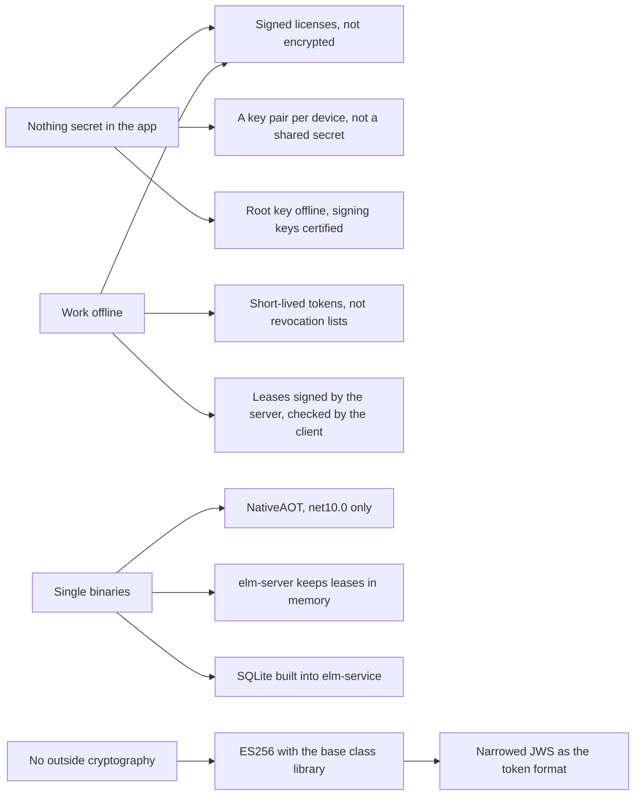

# Design choices

This page is for readers who want to know why ElasticLM is built the way it is: vendors weighing it against other licensing products, app developers who wonder why an API looks as it does, and administrators who want to know what a default protects. Read the [overview](overview.md) first. The page names each main choice, the reason for it, the alternative that was rejected, and what the choice costs you. Most choices refer to mechanisms that other explanation pages describe in full.

## What this page covers

ElasticLM is the third attempt at this product. The two earlier attempts were floating license servers in the style of FlexLM, and their authentication did not hold: every client carried the same secret, requests could be replayed, and seats could be over-counted. No code was carried over. The current design was written first, with a threat model, and every choice below answers a threat or a hard requirement (design §1.1, `docs/design-decisions.md`).

The requirements that shape most choices are few:

- **Nothing secret on the customer's side.** The app and the customer's machines hold public keys only. A secret that every copy of the app carries is a secret that any one customer can take out.
- **Work offline.** An app must keep running without a network for a known time: until its token, its grace period, or its lease ends (design §4.5).
- **Single binaries.** `elm`, `elm-server`, and `elm-service` are NativeAOT executables that run with no files beside them, and the client libraries must not stop an app from being published the same way (design §4.1).
- **No outside cryptography.** Only the .NET base class library's `System.Security.Cryptography` (design §4.3).

The figure shows how these requirements lead to the main choices.

## Licenses are signed, not encrypted

**Choice.** A license file is signed with ECDSA P-256 and is not encrypted (design decision 0.33).

**Reason.** Encryption would need a decryption key on the customer's machine, where the customer can read it, so it would hide almost nothing. What matters is that nobody can change the license, and a signature gives that. Binding to a device does not need secrecy either: the signed token names the device's installation key and machine fingerprints, and an edited token fails signature verification.

**Rejected.** Encrypting the file with AES-256-GCM under a key derived from the license key and the machine fingerprint, as Keygen does.

**Cost.** Anyone who holds a license file can read its contents: product, features, dates, and the vendor's free-form `meta` values. Do not put anything in `meta` that the customer may not see.

## Tokens are a narrowed JWS, verified over the bytes that travel

**Choice.** Every token is a JWS in compact form, signed with ES256. The header has exactly three members, `alg`, `kid`, and `typ`, and any other member is refused. Each verifying function accepts exactly one `typ`. The signature is checked over the bytes as received, and the payload is not read as JSON until the signature has passed (design §8.2).

**Reason.** JWS can be built from the base class library alone, works under NativeAOT, and existing tools can show what is inside a token. Refusing extra header members closes the known JWS key-injection attacks (a header that carries its own key), and fixing one `typ` per function stops a lease from being accepted as a license. Signing the exact bytes removes any need to rebuild JSON the same way on both sides: the earlier attempt signed re-serialized JSON, and a change in how the serializer wrote indentation or dates made valid licenses fail.

**Rejected.**

- COSE_Sign1: its .NET packages are outside the base class library, which adds dependencies to what ships in the app.
- PASETO v4.public: it needs Ed25519, which .NET 10's base class library does not have.
- A custom format: about 5% smaller, at the cost of every existing tool.

**Future.** The `alg` field is there so that a later version can move to ML-DSA (RFC 9964 defines its JWS names). .NET 10's ML-DSA type is experimental and does not run on macOS, so v1 signs with ES256 only; the move is roadmap row A-3. The size limits leave room: a token may be 16 KiB, enough for an ML-DSA-87 signature (design §8.6).

## A root key that only certifies signing keys

**Choice.** The vendor's root key is kept offline and signs only key certificates. A key certificate allows a signing key to sign licenses, leases, or logs for a period (by default one year, at most two). The app's trust store holds only root public keys (design §7.1).

**Reason.** The signing key must be on a running server (`elm-service`), where it is more exposed. With a certificate in between, the vendor can replace a signing key, or recover from a leaked one, without shipping a new app. Key IDs (`kid`) are JWK thumbprints of the public key, so a forged `kid` simply does not match the key (design §7.4).

**Rejected.** Building the signing key's public key into the app, as Keygen does. Every key change would then need an app update.

See the [trust chain](trust-chain.md) for how rotation works.

## Certificates are judged at the time a token was issued

**Choice.** A key certificate counts as valid for a token if the token's issue time (`iat`) falls inside the certificate's validity period, not if the current time does (design decision 0.39).

**Reason.** A perpetual license must keep working after the certificate of the key that signed it has expired. If certificates were judged at the current time, every perpetual license would stop within two years. Code signing time stamps work the same way.

**Rejected.** Judging at the current time, and re-issuing perpetual licenses before their certificates expire.

**Cost.** A thief who holds a leaked signing key can write an old `iat` and make tokens that look as if they were signed while the certificate was valid. The defense is the trust store's list of revoked key IDs: a token signed by a listed key fails with `ELM_KEY_REVOKED`. That list reaches devices only in a new version of the app (design §7.5). A vendor whose signing key leaks must rotate the key, ship an app update with the revoked key ID, and re-issue licenses with the new key.

## Short-lived tokens instead of revocation lists

**Choice.** ElasticLM does not publish a certificate revocation list or any other list of revoked licenses. Revocation reaches a device because its token expires: by default the token lives 30 days (`TokenLifetime`), the client starts refreshing 20 days before expiry (`RefreshWindow`), and the token still works for 7 days after expiry (`GracePeriod`). A suspended or revoked license gets no new token (design §9.3, §9.4).

**Reason.** A list would have to be fetched, so it does not help a device that is offline, and no licensing product the design looked at publishes one (Keygen and Cryptlex both rely on short token lifetimes and online refresh, design §5.4). The vendor can shorten the lifetime in the policy where faster revocation matters.

**Cost.**

- A token is valid until its expiry plus its grace period, whatever happens to the license afterwards. With the defaults that is up to 37 days.
- A token without an expiry can never be revoked. Only two paths make one: `elm license issue --expires never` (which warns) and an unbound license file for a license with no expiry, which `elm-service` records in its audit log each time (design decision 0.17, §5.4).

## A key pair per device, and a signed proof on every request

**Choice.** On first use, the client creates an ECDSA P-256 key pair for the device, the **installation key**, and keeps the private key on the device. Every request that changes state carries a **proof**: a small JWS signed by that key, in the shape of DPoP (RFC 9449), that names the HTTP method, the URL, a hash of the body (`bdy`), a server nonce, and a one-time ID (`jti`) (design §12.2). See [devices and proofs](devices-and-proofs.md).

**Reason.** A request can be forged only by someone who holds that device's private key. The body hash closes a gap in DPoP, which does not cover the body. The nonce and the one-time `jti` stop a captured request from being sent again, and freshness does not depend on the device's clock, because the server judges it by the nonce, not by the proof's `iat`.

**Rejected.**

- A secret shared by every client, used for an HMAC over the request. The earlier attempt did this: the secret was in every client binary, the server checked an HMAC over a string the client sent beside the request rather than the request itself, and there was no nonce or time, so one captured request could be replayed for any feature and seat count.
- HTTP Message Signatures (RFC 9421): building the signature base correctly with the base class library alone is a large job, and nothing requires interoperating with proxies that understand it.

**Cost.** The installation key is the device's identity. A device administrator who copies the key and the state files to another machine copies the identity; ElasticLM notices only when both copies talk to a server (see the next sections).

## Machine IDs are hints, not identities

**Choice.** The operating system's machine ID (`MachineGuid` on Windows, `/etc/machine-id` on Linux, `IOPlatformUUID` on macOS) is never sent as it is. The client sends a **machine fingerprint**: an HMAC-SHA256 that mixes the machine ID with a value derived from the product ID, cut to 16 bytes (design §10.3). It is a secondary check; the installation key is the identity (design decision 0.32).

**Reason.** Machine IDs repeat in cloned virtual machines and in images that were not cleared, and an administrator can rewrite them. The raw value would also let anyone who sees it follow one machine across products. Mixing in the product, the way systemd does for its app-specific machine IDs, gives each product a different value.

**Rejected.** Using the raw machine ID as the device's identity, which the earlier attempts did.

**Cost.** One limit leans on the fingerprint anyway: a trial is allowed once per product and machine fingerprint. Someone who rewrites the machine ID can start another trial. That is an accepted threat (design §5.4).

## Clones are found by sequence numbers

**Choice.** Every activation and every lease carries a sequence number (`seq`). Each refresh or renewal sends the last `seq` the client received, and the server raises it by one. If a request arrives with an older `seq`, another copy has moved ahead, and the server treats it as a clone. The policy's `CloneStrategy` decides what follows: `Deny` stops the activation with `ELM_CLONE_DETECTED`, and `Flag` only records it (design §10.4). OAuth refresh token rotation (RFC 9700) uses the same idea.

**Reason.** A cloned virtual machine has the same installation key, so the key alone cannot tell the copies apart, but the copies cannot both keep the latest `seq`. A request whose answer was lost must not count as a clone, so a request one `seq` behind is a retry only when its `retry` list names the proof `jti` of the request that received the answer. A clone running on the same timer cannot know that `jti` (design decision 0.47).

**Rejected.**

- Finding clones by simultaneous use. Several processes on one machine may lawfully share one installation key.
- Treating any request one behind as a retry, or allowing retries for a short time after issue. Two clones that refresh at the same moment would share one seat forever without being noticed.
- The virtual machine generation ID. It needs administrator rights on Windows and cannot be read from user space on Linux.

**Cost.** A copy that runs only offline is never seen. With `Deny`, on `elm-server`, a stopped lease is kept, not removed, until it expires, so its seat stays taken; removing it would let the other copy reclaim it with its own token (design decision 0.43). See [activation](activation.md).

## elm-server keeps leases in memory

**Choice.** `elm-server` has no database. It keeps leases in memory. After a restart it refuses new leases with `ELM_SERVER_RECOVERING` during a reclaim window as long as one lease length (10 minutes with the default policy), while clients hand their still-valid lease tokens back, up to 64 in one request (design decisions 0.6 and 0.44, §13.4). See [floating licenses](floating-licenses.md).

**Reason.** A server with no database is one file to install and nothing to back up or repair. The lease tokens themselves are signed by the server's installation key, so the clients hold everything needed to rebuild the state. Refusing new leases during the window stops the server from lending again seats that are still in use, a double count that FlexNet users have reported after network failures.

**Rejected.**

- Accepting new leases right after a restart. Together with the old leases, they would go over the seat count.
- Reclaiming leases one at a time. Every lease is affected by a restart at once, and one request per lease would flood the server with requests and proof checks.

**Cost.** For up to one lease length after a restart, a new user may have to wait (`Retry-After` says how long). A longer lease length makes the server easier to restart without users noticing, and makes that wait longer by the same amount.

## Borrowed seats on elm-server are written to a signed record

**Choice.** Borrowed leases, which leave the network, are the one thing `elm-server` writes to disk: an append-only record where each line is signed with the server's installation key. On start, the server checks the record's chain of signatures and restores the borrows that have not ended (design decision 0.38).

**Reason.** A borrowing device is away from the network and cannot reclaim. Without a record, every restart would free its seat and the server could lend it twice.

**Rejected.** Accepting the loss and letting vendors turn off borrowing on premises. That would drop a requirement (design decision 0.21).

**Cost.** The customer's administrator owns the machine and can delete the record, set the clock forward, or start with `--set-aside-broken-records`. The design accepts this: the damage ends when the borrow would have ended, and the usage log keeps a trace (design §5.4). The administrator cannot return a borrow through the admin API, because that would get around the early-return limit (design decision 0.56).

## No high-availability pair for elm-server

**Choice.** v1 has no redundant `elm-server` setup. The operating system's service manager restarts the server (design decision 0.25, §13.6).

**Reason.** Clients renew every third of the lease length, so when the server stops, every lease has at least two thirds of its length left: about 6 minutes 40 seconds with the default 10 minutes. The server starts quickly; on the reference machine it logged `server.started` 87 to 116 ms after it was launched, against a target of 1 second (design §4.2, V1b measurement on GitHub Actions `ubuntu-latest`). After the restart, reclaim restores the state. A crash or an update restart therefore does not stop the apps; only a machine that stays down for more than about six minutes does.

**Rejected.** FlexNet's three-server setup needs two of three servers to agree and a stable LAN; independent servers split the seats between them. Both are heavy for v1. Redundancy is roadmap row A-2.

## Limiting what a server's own key can do

**Choice.** The customer's administrator controls the machine `elm-server` runs on and can take out its installation key, so the design does not trust that key beyond what the vendor signed (design decision 0.37):

- The server license expires (by default after 30 days) and is refreshed from `elm-service`. Each refresh checks the server's `seq`, so a copied server machine is found.
- The client checks every lease against the server license: the right product and installation key, a feature and seat count within the license, a length no longer than the license's lease or borrow limit, and an end no later than the server license's own end plus its grace period. A lease outside that fails with `ELM_LEASE_OUT_OF_BOUNDS` (design §12.7.5).
- The client accepts only a server license of kind `server` that chains to the vendor's root key, and pins the server: it accepts the TLS connection when the operating system trusts the certificate, or when the certificate's key matches the key the server license names (`cnf.jkt`) (design decision 0.45).

**Reason.** These checks keep the damage small: a server whose key has been taken can lend more than the license's seats only until the server license expires.

**Rejected.** A long-lived server license that accepts both key extraction and copying for good. An app setting that makes the developer choose between "operator's certificate" and "self-signed": the server's administrator decides that, and the app developer does not know it.

**Cost.** A server that cannot refresh stops lending when its server license's grace period ends. A copied server is found only at its next refresh, which can be up to 30 days away with the defaults (design §5.4).

## HTTPS and JSON, not gRPC

**Choice.** Clients and servers talk JSON over HTTPS under `/v1/`, with errors in RFC 9457 problem form (design §12.1). Servers use ASP.NET Core's slim builder, and all JSON goes through System.Text.Json source generation.

**Reason.** HTTPS and JSON pass through proxies and company networks, and need no heavy dependency. Source-generated JSON works under NativeAOT.

**Rejected.** gRPC. The earlier attempt ran it without TLS on localhost only, so other machines could not reach it, and its error fields went unused.

## NativeAOT single binaries, net10.0 only

**Choice.** Everything is written in C# for `net10.0` and published with NativeAOT. `libelasticlm` is the .NET client published as a NativeAOT shared library with a C ABI. `elm-service` builds SQLite from a vendored source file whose version and hash are fixed, and links it into the executable (design §14.2).

**Reason.** A single binary is easy to install, copy, and check against its published hash. On the reference machine the release builds measured 26,657,912 bytes for `elm-service`, 13,163,776 for `elm-server`, 8,353,288 for `elm`, and 7,155,080 for `libelasticlm`, and verifying one license file took 86.1 to 107.9 µs, against a 1 ms target (design §4.2, V1b measurement on `ubuntu-latest`, `linux-x64`). NativeAOT forbids runtime reflection, which also keeps the shipped code free of surprises in what it loads.

**Rejected.**

- Targeting .NET 8 as well. Its support ends on 2026-11-10, and NativeAOT support in .NET 10 is further along.
- Several languages. The earlier attempt loaded a Rust library from the server, could not be a single binary, and had memory-ownership bugs across the boundary.
- Shipping SQLite as a separate library beside `elm-service` (that breaks the single binary), a small third-party static build of it (a supply chain the design could not trust), or prebuilt libraries in the repository (binaries that cannot be reviewed).

**Cost.** The Linux builds need glibc 2.28 or later, and macOS 12.0 or later (design §4.1). The executables and `libelasticlm` carry no code signature in v1; you check them with the published `SHA256SUMS` and the build provenance attestations instead (design §5.3 T24, §5.4).

## Cryptography from the base class library only

**Choice.** All cryptography comes from `System.Security.Cryptography`: ECDSA P-256, SHA-256, HMAC-SHA256, PBKDF2 and AES for the encrypted key files, and `RandomNumberGenerator` for every ID and nonce. The parts that ship in the app (`ElasticLM.Licensing`, `ElasticLM.Client`, `libelasticlm`) have no outside package at all (design §4.3, §21).

**Reason.** Every cryptography package is code and a supply chain that the vendor's app must trust. The base class library is maintained with the runtime and is already in every .NET app.

**Cost.** Algorithms the base class library lacks are out of reach. That ruled out PASETO's Ed25519 and, for now, ML-DSA. It also shaped small things: `elm-server` has its own per-IP rate limiter, because the base class library's limiters cannot be driven by a `TimeProvider`, which ElasticLM uses for every time decision so that tests can run on fake time (design decision 0.46).

## elm-service storage: SQLite or PostgreSQL, without an ORM

**Choice.** `elm-service` runs on SQLite (one node) or PostgreSQL (one or more nodes). SQL is built with a small typed query builder (AuraORM), not with an ORM such as EF Core. Seat and activation counts are made under a lock: `SELECT ... FOR UPDATE` on PostgreSQL and `BEGIN IMMEDIATE` on SQLite (design §14.2 to §14.4).

**Reason.** The earlier attempt used EF Core only to open connections, lost its migrations, and counted seats without a lock, so concurrent requests went over the count. A query builder keeps the SQL plain, turns wrong column names and types into compile errors, and adds no runtime dependency under NativeAOT.

**Rejected.** EF Core; hand-written SQL over a thin `DbConnection` layer, which the first version used.

## The admin UI: a backend-for-frontend login and a small SPA

**Choice.** The admin UI is a static single-page app built with Preact and embedded in `elm-service`. Login goes through the service (a backend for frontend): the service runs the OIDC authorization code flow with PKCE and gives the browser only an `HttpOnly` session cookie, `__Host-elm-session` (design §15.3).

**Reason.** No token is in the browser, so script injected into the page has nothing to steal. The design follows the IETF guidance for browser-based apps, which the design cites as RFC 10017 and which recommends this pattern for business apps. Preact had the fewest dependencies and the smallest output of the frameworks tried.

**Rejected.** A single-page app that holds the access token itself (the weakest pattern in that guidance). Blazor, which cannot run server-side under NativeAOT. `SameSite=Strict` cookies, which are not sent on the first page after the identity provider sends the user back; the service uses `SameSite=Lax` and requires a custom header on every request that changes state.

## Policies are named choices

**Choice.** A policy is a set of named options, each with fixed values (`Binding: NodeLocked`, `CloneStrategy: Deny`, `Floating: OnPremises`), not a set of true-or-false flags (design decision 0.36, §9.3).

**Reason.** Named options cannot contradict each other the way independent flags can, and a later value can be added to an option without changing its meaning.

## What these choices ask of you

| Choice | What it costs | What you must do |
| --- | --- | --- |
| Signed, not encrypted | License contents are readable. | Keep private data out of `meta`. |
| Certificates judged at `iat` | A leaked signing key can backdate tokens. | Keep the revoked key list in the trust store current, and ship app updates when a key leaks. |
| Short-lived tokens | Revocation waits for the token's end; perpetual tokens cannot be revoked. | Choose `TokenLifetime` and `GracePeriod` for how fast revocation must work; avoid perpetual tokens. |
| Installation key as identity | A copy made by a device administrator is the same device. | Use `Deny` where copying matters; know that offline-only copies are not found. |
| Leases in memory on `elm-server` | New users can wait up to one lease length after a restart. | Run the server under a service manager; pick `LeaseDuration` with both waits in mind. |
| Server license with an expiry | A server that cannot refresh stops lending. | Let the server refresh online, or carry refresh files in time. |
| No code signing in v1 | The operating system cannot name the publisher. | Check downloads against `SHA256SUMS` and their attestations. |

The [security model](security-model.md) lists every accepted threat in one place.
