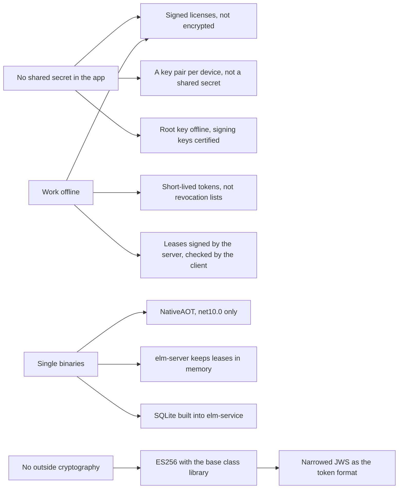

# Design choices

This page is for readers who want to know why ElasticLM is built the way it is: vendors weighing it against other licensing products, app developers who wonder why an API looks as it does, and administrators who want to know what a default protects. Read the [overview](overview.md) first. For each main choice, the page gives the reason, the rejected alternative, and the cost to you; the other explanation pages explain the mechanisms.

## The requirements behind the choices

A few requirements shape most choices:

- **No shared or vendor secret on the customer's side.** The app carries only public keys. A secret that every copy of the app carries is a secret that any one customer can take out. The private keys on customers' machines, the installation keys, are made on each machine and differ for each.
- **Work offline.** An app must keep running without a network for a known time: until its token, its grace period, or its lease ends.
- **Single binaries.** `elm`, `elm-server`, and `elm-service` are NativeAOT executables that run with no files beside them, and the client libraries must not stop an app from being published the same way.
- **No outside cryptography.** Only the .NET base class library's `System.Security.Cryptography`.

The figure shows how these requirements lead to the main choices.

## Licenses are signed, not encrypted

**Choice.** A license file is signed with ECDSA P-256 and is not encrypted.

**Reason.** Encryption would need a decryption key on the customer's machine, where the customer can read it, so it would hide almost nothing. What matters is that nobody can change the license, and a signature gives that. Binding to a device does not need secrecy either: the signed token names the device's installation key and machine fingerprints, and an edited token fails signature verification.

**Rejected.** Encrypting the file under a key derived from the license key and the machine fingerprint, as some licensing products do.

**Cost.** Anyone who holds a license file can read its contents: product, features, dates, and the vendor's free-form `meta` values. Do not put anything in `meta` that the customer may not see.

## Tokens are a narrowed JWS, verified over the bytes that travel

**Choice.** Every token is a JWS in compact form, signed with ES256. The header has exactly three members, `alg`, `kid`, and `typ`, and any other member is refused. Each verifying function accepts exactly one `typ`. The signature is checked over the bytes as received, and the payload is not read as JSON until the signature has passed.

**Reason.** JWS can be built from the base class library alone, works under NativeAOT, and existing tools can show what is inside a token. Refusing extra header members closes the known JWS key-injection attacks (a header that carries its own key), and one `typ` per function stops a lease from being accepted as a license. Checking the exact bytes means nobody rebuilds the JSON; if it were rebuilt, a change in how a serializer wrote indentation or dates would make valid licenses fail.

**Rejected.** COSE_Sign1, whose .NET packages are outside the base class library; PASETO v4.public, which needs Ed25519, missing from .NET 10's base class library; a custom format, about 5% smaller at the cost of every existing tool.

**Later.** The `alg` field and the 16 KiB token size limit leave room for post-quantum ML-DSA signatures, which .NET 10 does not yet support on every platform.

## A root key that only certifies signing keys

**Choice.** The vendor's root key is kept offline and signs only key certificates. A key certificate allows a signing key to sign licenses, leases, or logs for a period (by default one year, at most two). The app's trust store holds only root public keys.

**Reason.** The signing key must be on a running server (`elm-service`), where it is more exposed. With a certificate in between, the vendor can replace a signing key, or recover from a leaked one, without shipping a new app.

**Rejected.** Building the signing key's public key into the app. Every key change would then need an app update.

See the [trust chain](trust-chain.md) for how rotation works.

## Certificates are judged at the time a token was issued

**Choice.** A key certificate counts as valid for a token if the token's issue time (`iat`) falls inside the certificate's validity period, not if the current time does.

**Reason.** A perpetual license must keep working after the certificate of the key that signed it has expired. If certificates were judged at the current time, every perpetual license would stop within two years. Code signing time stamps work the same way.

**Rejected.** Judging at the current time, and re-issuing perpetual licenses before their certificates expire.

**Cost.** A thief who holds a leaked signing key can write an old `iat` and make tokens that look as if they were signed while the certificate was valid. The defense is the trust store's list of revoked key IDs, which reaches devices only in a new version of the app. A vendor whose signing key leaks must rotate the key, ship an app update with the revoked key ID, and re-issue licenses with the new key.

## Short-lived tokens instead of revocation lists

**Choice.** ElasticLM publishes no list of revoked licenses. Revocation reaches a device because its token expires: by default the token lives 30 days (`tokenLifetime`), the client starts refreshing 20 days before expiry (`refreshWindow`), and the token still works for 7 days after expiry (`gracePeriod`). A suspended or revoked license gets no new token.

**Reason.** A list would have to be fetched, so it does not help a device that is offline. Other licensing products also rely on short token lifetimes and online refresh. The vendor can shorten the lifetime in the policy where faster revocation matters.

**Cost.** A token is valid until its expiry plus its grace period, whatever happens to the license afterwards, and a token without an expiry cannot be revoked except by revoking the key that signed it. The [security model](security-model.md) explains this caveat.

## A key pair per device, and a signed proof on every request

**Choice.** On first use, the client creates an ECDSA P-256 key pair for the device, the **installation key**, and keeps the private key on the device. Every request that changes state carries a **proof**: a small JWS signed by that key, in the shape of DPoP (RFC 9449), that names the HTTP method, the URL, a hash of the body, a recent server nonce, and a one-time ID (`jti`). See [devices and proofs](devices-and-proofs.md).

**Reason.** A request can be forged only by someone who holds that device's private key. The body hash closes a gap in DPoP, which does not cover the body. The nonce and the one-time ID stop a captured request from being sent again, and freshness does not depend on the device's clock, because the server judges it by its own nonce.

**Rejected.** A secret shared by every client, used for an HMAC over the request: one customer could take it out of the app and sign requests for anyone. HTTP Message Signatures (RFC 9421): building its signature base (structured fields, RFC 8941) correctly with the base class library alone is much harder, and the proxy interoperability it offers is not a requirement.

**Cost.** The installation key is the device's identity. A device administrator who copies the key and the state files to another machine copies the identity; ElasticLM notices only when both copies talk to a server (see the next sections).

## Machine IDs are hints, not identities

**Choice.** The operating system's machine ID is never sent as it is. The client sends a **machine fingerprint**: a hash that mixes the machine ID with the product ID. It is a secondary check; the installation key is the identity.

**Reason.** Machine IDs repeat in cloned virtual machines and in images that were not cleared, and an administrator can rewrite them. The raw value would also let anyone who sees it follow one machine across products; mixing in the product gives each product a different value.

**Rejected.** Using the raw machine ID as the device's identity.

**Cost.** A trial is allowed once per product and machine fingerprint, so someone who rewrites the machine ID can start another trial. ElasticLM accepts this.

## Clones are found by sequence numbers

**Choice.** Every activation and every lease carries a sequence number (`seq`). Each refresh or renewal sends the last `seq` the client received, and the server raises it by one. If a request arrives with an older `seq`, another copy has moved ahead, and the server treats it as a clone. The policy's `cloneStrategy` decides what follows: `deny` stops the activation, and `flag` only records it. OAuth refresh token rotation uses the same idea.

**Reason.** A cloned virtual machine has the same installation key, so the key alone cannot tell the copies apart, but the copies cannot both keep the latest `seq`. A client whose answer was lost in the network can prove it is retrying, so a lost answer does not count as a clone; a clone cannot make that proof.

**Rejected.** Finding clones by simultaneous use, because several processes on one machine may lawfully share one installation key. Allowing any request one `seq` behind, because two clones that refresh at the same moment would then share one seat unnoticed.

**Cost.** A copy that runs only offline is never seen; see the [security model](security-model.md). Details are on the [activation](activation.md) page.

## elm-server keeps leases in memory

**Choice.** `elm-server` has no database. It keeps leases in memory. After a restart it refuses new leases during a reclaim window as long as one lease length (10 minutes by default), while clients hand their still-valid lease tokens back. See [floating licenses](floating-licenses.md).

**Reason.** A server with no database is one file to install and nothing to back up or repair. The lease tokens are signed by the server's installation key, so the clients hold everything needed to rebuild the state. Refusing new leases during the window stops the server from lending again seats that are still in use.

**Rejected.** Accepting new leases right after a restart: together with the old leases, they would go over the seat count.

**Cost.** For up to one lease length after a restart, a new user may have to wait (the response says how long). A longer lease length makes the server easier to restart without users noticing, and makes that wait longer by the same amount.

## Borrowed seats on elm-server are written to a signed record

**Choice.** Borrowed leases, which leave the network, are the one thing `elm-server` writes to disk: an append-only record where each line is signed with the server's installation key. On start, the server checks the record and restores the borrows that have not ended.

**Reason.** A borrowing device is away from the network and cannot reclaim. Without a record, every restart would free its seat and the server could lend it twice.

**Rejected.** Dropping borrowing on premises.

**Cost.** The customer's administrator owns the machine and can delete the record or set the clock forward. ElasticLM accepts this: the damage ends when the borrow would have ended, and the usage log keeps a trace.

For the record's files, lines, and how to verify it, see [Logs](../reference/logs.md).

## No high-availability pair for elm-server

**Choice.** v1 has no redundant `elm-server` setup. The operating system's service manager restarts the server.

**Reason.** Clients renew every third of the lease length, so when the server stops, every lease has at least two thirds of its length left: about 6 minutes 40 seconds with the default 10 minutes. `elm-server` aims to listen within 1 second of starting (on a Linux test machine it took about 0.1 s), and reclaim then restores the state. Only a machine that stays down for more than about 6 minutes 40 seconds stops the apps.

**Rejected.** A cluster of servers that must agree, or independent servers that split the seats between them. Both are heavy for v1.

## Limiting what a server's own key can do

**Choice.** The customer's administrator controls the machine `elm-server` runs on and can take out its installation key, so ElasticLM does not trust that key beyond what the vendor signed:

- The client checks every lease against the server license: the right product and server, a feature and seat count within the license, a length no longer than the license allows, and an end no later than the server license's own end plus its grace period.
- The server license expires (by default after 30 days) and is refreshed from `elm-service`. Each refresh checks the server's `seq`, so a copied server is found.
- The client accepts the server's TLS certificate when the operating system trusts it, or when its key matches the key the server license names. The server's administrator decides which, not the app developer, who cannot know.

**Reason.** A server whose key has been taken can sign leases only inside the server license's bounds, and a copied server is found at its next refresh.

**Rejected.** A long-lived server license, which would let a taken key or a copied server be used for good.

**Cost.** A server that cannot refresh stops lending when its server license's grace period ends. A copied server is found only at its next refresh, which can be up to 30 days away with the defaults. A server license issued by hand with `elm` is never refreshed, so only its expiry ends a copy's use.

## HTTPS and JSON, not gRPC

**Choice.** Clients and servers talk JSON over HTTPS under `/v1/`, with errors in RFC 9457 problem form.

**Reason.** HTTPS and JSON pass through proxies and company networks, need no heavy dependency, and work under NativeAOT. gRPC was rejected for the dependency it adds and for passing less easily through company networks.

## NativeAOT single binaries, net10.0 only

**Choice.** Everything is written in C# for `net10.0` and published with NativeAOT. `libelasticlm` is the .NET client published as a NativeAOT shared library with a C ABI. The SQLite engine is built into `elm-service`.

**Reason.** A single binary is easy to install, copy, and check against its published hash. On a Linux x64 build, `elm-service` is about 27 MB, `elm-server` 13 MB, `elm` 8 MB, and `libelasticlm` 7 MB, and verifying one license file takes about 0.1 ms.

**Rejected.** Targeting .NET 8 as well: its support ends in November 2026, and NativeAOT support in .NET 10 is further along. Writing parts in another language, such as a client or a key library in Rust: a server that loads a library written in another language cannot be a single binary, and every string and buffer that crosses the boundary needs agreed rules for termination and freeing. Native callers get `libelasticlm` instead, which is .NET code published as a NativeAOT shared library. SQLite as a separate library beside `elm-service`: that breaks the single binary.

**Cost.** The Linux builds need glibc 2.28 or later, and the macOS builds macOS 12.0 or later. The executables and `libelasticlm` carry no code signature in v1; you check them with the published `SHA256SUMS` and the build provenance attestations instead.

## Cryptography from the base class library only

**Choice.** All cryptography comes from `System.Security.Cryptography`. The parts that ship in the app (`ElasticLM.Licensing`, `ElasticLM.Client`, `libelasticlm`) have no outside package at all.

**Reason.** Every cryptography package is code and a supply chain that the vendor's app must trust. The base class library is maintained with the runtime and is already in every .NET app.

**Cost.** Algorithms the base class library lacks are out of reach: that ruled out Ed25519 and, for now, ML-DSA.

## elm-service storage: SQLite or PostgreSQL

**Choice.** `elm-service` runs on SQLite (one node) or PostgreSQL (one or more nodes). Seat and activation counts are made under a lock: on PostgreSQL, an `UPDATE` of the license row locks it for the transaction; on SQLite, the transaction takes the write lock at once (`BEGIN IMMEDIATE`).

**Reason.** Counting without a lock lets two concurrent requests both see a free seat and go over the count. SQLite needs nothing beside the binary; PostgreSQL lets several nodes share one database.

**Cost.** SQLite runs on one node only; for more than one node, run PostgreSQL.

## The admin UI: a backend-for-frontend login and a small SPA

**Choice.** The admin UI is a static single-page app built with Preact and embedded in `elm-service`. Login goes through the service (a backend for frontend): the service runs the OIDC authorization code flow with PKCE and gives the browser only an `HttpOnly` session cookie, `__Host-elm-session`.

**Reason.** No token is in the browser, so script injected into the page has nothing to steal. RFC 10017 strongly recommends this pattern for business apps. Of the options compared in one prototype, Preact fit the aims best (56 packages, 6,771 bytes with brotli); only using no framework was smaller, at the cost of writing state and rendering by hand.

**Rejected.** A single-page app that holds the access token itself. `SameSite=Strict` cookies, which are not sent on the first page after the identity provider sends the user back; the service uses `SameSite=Lax` and requires a custom header on every request that changes state.

## What these choices ask of you

| Choice | What it costs | What you must do |
| --- | --- | --- |
| Signed, not encrypted | License contents are readable. | Keep private data out of `meta`. |
| Certificates judged at `iat` | A leaked signing key can backdate tokens. | Keep the revoked key list in the trust store current, and ship app updates when a key leaks. |
| Short-lived tokens | Revocation waits for the token's end; tokens without an expiry cannot be revoked. | Choose `tokenLifetime` and `gracePeriod` for how fast revocation must work; avoid tokens without an expiry. |
| Installation key as identity | A copy made by a device administrator is the same device. | Use `deny` where copying matters; know that offline-only copies are not found. |
| Leases in memory on `elm-server` | New users can wait up to one lease length after a restart. | Run the server under a service manager; pick `leaseDuration` with both waits in mind. |
| Server license with an expiry | A server that cannot refresh stops lending. | Let the server refresh online, or carry refresh files in time. |
| No code signing in v1 | The operating system cannot name the publisher. | Check downloads against `SHA256SUMS` and their attestations. |

The [security model](security-model.md) lists every accepted threat in one place.
