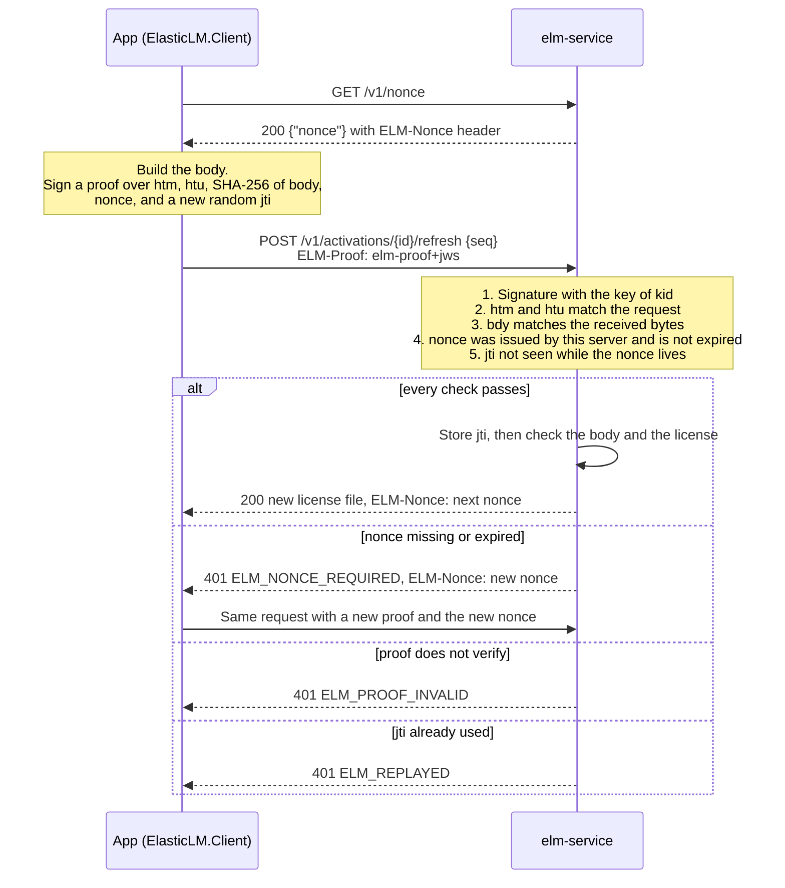

# Devices and proofs

This page is for app developers who embed `ElasticLM.Client` or `libelasticlm` ([.NET API](../reference/dotnet-api.md), [C API](../reference/c-api.md)), for vendors who decide how licenses are bound to devices, and for customers' administrators who run `elm-server` or keep apps running in containers. It explains how ElasticLM tells one device from another, and how a server knows that a request really comes from that device. Read [Trust chain](trust-chain.md) and [License files and verification](license-files-and-verification.md) first: this page assumes you know that a license token is signed by the vendor and checked offline by the app.

## What device identity is for

A node-locked license is meant for one device. A floating license lends a seat to one running app at a time. Both need an answer to two questions:

1. Which device is this? The license token must name the device it belongs to, so that a copy of the file on another device does not verify.
2. Is this request from that device? When the app asks the hosted activation service (`elm-service`) or the on-premises license server (`elm-server`) for a new token, a lease, or a deactivation, the server must know that the device made the request, and that nobody on the network changed it or sent it again.

ElasticLM answers both with a key pair that the app makes on the device, the installation key. The token names the key, and every request that changes state is signed with it. A second, weaker signal, the machine fingerprint, is derived from the operating system's machine ID. It helps to notice a license file that was copied to another device, and it limits trials and early borrow returns, but it is never the identity.

The operating system's machine ID is not the identity because it does not tell devices apart reliably: a cloned virtual machine or a copied image gives two devices the same ID, and an administrator can rewrite it. Sending the raw ID would also let different products track the same device. [Design choices](design-choices.md) compares the alternatives.

## The installation key

The installation key is an ECDSA P-256 key pair. The app makes it at the first activation, lease, or trial. The private key never leaves the device. The public key is sent to the server inside the first signed request that needs it, and the server keeps it. `elm-server` has an installation key of its own, which it makes when it first starts; the [server license](floating-licenses.md#the-server-license-how-the-client-trusts-an-on-premises-server) is bound to that key ([Running `elm-server`](floating-licenses.md#running-elm-server)).

The key's identifier is its thumbprint: the JWK thumbprint of the public key (RFC 7638, SHA-256, base64url; see [Key IDs](../reference/formats.md#key-ids)), 43 characters long. Anyone can compute it from the public key, so a request that claims a thumbprint but carries a different key is caught by comparing the two. A license token bound to a device carries the thumbprint in its `cnf.jkt` claim, and verification fails with `ELM_WRONG_INSTALLATION` when the app's own key has a different thumbprint.

### Where the key is stored

The app chooses one of two scopes in its client settings (`KeyScope` in `ElasticLM.Client`). The default is the user scope. The machine scope needs administrator rights to write and is meant for apps that run as a service, and for `elm-server`.

| OS | Protection | User scope | Machine scope |
| --- | --- | --- | --- |
| Windows | DPAPI (`CryptProtectData`) | `%LOCALAPPDATA%\ElasticLM\<product>\` | `%ProgramData%\ElasticLM\<product>\` |
| Linux | File mode `0600`, folder `0700` | `$XDG_DATA_HOME/elasticlm/<product>/` (or `~/.local/share/elasticlm/<product>/`) | `/var/lib/elasticlm/<product>/` |
| macOS | File mode `0600`, folder `0700` | `~/Library/Application Support/ElasticLM/<product>/` | `/Library/Application Support/ElasticLM/<product>/` |

`<product>` is the product's code, limited to lowercase letters, digits, and `-`, so it cannot climb out of the folder with `..` or `/`. The key file is `installation.key`. An app can also pass its own folder.

The machine scope needs more care, because every user of a device can read `%ProgramData%` and open DPAPI's machine scope, and any user can create a folder there before the app first runs. So on Windows the client creates the machine-scope folder with an access list that allows only Administrators, SYSTEM, and the user who made it. Before it uses an existing machine-scope folder, on any OS, it checks that no other user could read or replace it. If another user could, it stops with `ELM_INSTALLATION_KEY_UNREADABLE`. The check is the same for the default folder and for a folder the app passes. On Windows, the folder and its parent must each be owned by the Administrators group, SYSTEM, or the user running the app, and the folder's access list must admit no one else and must not be inherited from its parent. On Linux and macOS, the folder and its parent must each be owned by the user running the app or by root, the folder must give group and others no access, and its parent must not be writable by them. So create the folder as the user that runs the app, and run the app as that one user, such as a service's own account: a folder of mode `0700` that root owns passes the check, but only root can then use it. The user scope is not checked, because the user's own profile already limits access.

The same folder holds other files tied to the key: the kept activation (`activation.json`), borrowed leases, the pins of on-premises servers, the clock guard's state, and on a server, `elm-server`'s administrator token ([Data folder](../reference/server-configuration.md#data-folder) lists the rest of a server's folder). [Files the client keeps](../reference/formats.md#files-the-client-keeps) lists the client's files, with whether each may be copied or deleted.

### When the key cannot be read

If the key file is damaged, or was protected by another user's DPAPI, the client returns `ELM_INSTALLATION_KEY_UNREADABLE` and does not make a new key, which would silently use one more activation. The app should tell the user to activate again; the vendor may need to deactivate the old activation first (see [Activation](activation.md)). The same code also comes when a machine-scope folder fails the check above; its message starts `The folder '<folder>' is not safe for secrets`. Activating again does not help then: correct the owner or the permissions of the folder that the message names, or run the app as the user that owns it.

### Why the key is the real identity

Everything the server decides about a device is tied to the key. An activation is the pair of a license and a key thumbprint, so activating again with the same key does not use another activation. A refresh or a deactivation is accepted only with a proof signed by the key the activation remembers. A token names the key, so the file does not verify on a device without it. And clone detection (see [Activation](activation.md)) works because the copies of a cloned device share one key and one activation, and so step on each other's sequence numbers.

## Proofs

A proof shows that one HTTP request was made by the holder of an installation key, for this server, now. Its form follows DPoP (RFC 9449), with one claim added: the hash of the request body. Unlike a shared secret built into the app, which any copy of the app would leak, the private key that signs a proof exists only on the device.

Every request that changes state, and every request that returns information bound to a device, carries a proof in the `ELM-Proof` header. That covers activation, refresh, deactivation, and trials on `elm-service`, and leases on both `elm-service` and `elm-server`.

### What a proof is signed over

A proof is a compact JWS with the type `elm-proof+jws`, signed with ES256 by the installation key. Its header names the key by thumbprint (`kid`). Its payload has these claims:

| Claim | What it holds | What it stops |
| --- | --- | --- |
| `htm` | The HTTP method | Using a proof for a different operation |
| `htu` | The request URI, normalized, without query and fragment | Sending the proof to another path or another server |
| `bdy` | The SHA-256 of the body bytes, base64url (of the empty string when there is no body) | Changing the body, for example the `seq` of a refresh |
| `nonce` | A nonce the server issued | Using a proof made long ago |
| `jti` | 128 random bits | Sending the same proof twice |
| `iat` | When the proof was made | Nothing; it is not used for freshness |
| `jwk` | The public key, in requests for which the server may not know the key | Nothing; it lets the server learn the key |

A request for which the server may not know the key carries the public key in `jwk`: an activation, a trial, every lease acquire, a reclaim, and the early return of a borrow. (A borrow can outlive a restart of `elm-server`, after which the server no longer has the key of the acquire.) The server checks that the key's thumbprint equals `kid` and that the point is on the P-256 curve before it uses the key. Refreshes, deactivations, lease renewals, and returns of normal leases do not carry `jwk`: the server uses the key the activation or lease remembers.

`bdy` is the part DPoP lacks. Without it, an attacker in the middle could keep the proof and change the body. This is also why the activation ID goes in the path and the sequence number goes in the body of a refresh: the query string is not part of `htu`, so a value there would not be protected.

Both sides normalize the URI the same way before comparing it (lowercase scheme and host, no default port, a normalized path, no query or fragment). The server compares `htu` with its own configured public URLs (`publicUrls`), not with the request's `Host` header, so a proof stays valid behind a reverse proxy and cannot be aimed at a host the operator did not list. The exact header, claims, and limits of a proof are in [Device protocol](../reference/device-protocol.md#the-proof).

### How the server checks a proof

The figure shows a refresh on `elm-service`; `elm-server` checks lease requests the same way. The signature is checked with the `jwk` in the proof or with the key the server remembers. `iat` is not used for freshness, so a device with a wrong clock still works: freshness comes from the nonce.

For refresh and deactivation, `elm-service` also checks that the proof's key is the key of the activation named in the path. A valid proof from another device's key gets `ELM_PROOF_INVALID`, so one customer cannot refresh or deactivate another customer's activation even if they learn its ID.

`elm-service` records the `jti` in its database, with a unique constraint, after the signature, the nonce, and the per-key rate limit have passed, and before it checks the body and the license. A request refused after that point still uses up its `jti`, so the same proof can never be sent again; a request refused earlier does not record its `jti`. `elm-server` records the `jti` in memory as the last step of the proof check, also before the body. The client makes a new proof for every request anyway.

## Nonces

A nonce is a short value the server hands out so that a proof cannot be made in advance.

- **How a client gets one.** From `GET /v1/nonce` (see [Device protocol](../reference/device-protocol.md#nonces)), and from the `ELM-Nonce` header, which `elm-service` puts on every response to a device request and `elm-server` on every response to a lease request. So a client calls `GET /v1/nonce` only when it has no nonce. When a request is refused with `ELM_NONCE_REQUIRED`, the client sends it once more with the nonce from that response.
- **What it contains and how long it lives.** The time it was made and 128 random bits, with an HMAC-SHA256 under a server secret, so the server can check a nonce without storing it. A nonce is valid for 300 seconds.
- **How replay is stopped.** The server keeps each used `jti` for as long as its nonce can be valid, and 60 seconds more (on `elm-service`, for clock differences between nodes; on `elm-server`, for a request whose nonce was checked just before it expired). After that, the nonce inside the old proof has expired, so the proof is refused anyway.
- **The secret.** `elm-service` reads it from `ELM_NONCE_SECRET` (base64) or from the file named by `nonce.secretFile`, at least 32 bytes, and does not start without one, because all nodes of a multi-node service must accept each other's nonces. `elm-server` makes a new secret at every start, because its record of used `jti` values lives only in memory; a restart invalidates old nonces along with that record.

Offline request files (see [Activation](activation.md)) cannot use a server nonce, because there is no round trip. They carry the public key, their own random `nonce`, and expire after 7 days. Their claims are listed in [Token and file formats](../reference/formats.md#offline-request-elm-actreqjws).

For how to give `elm-service` the nonce secret, see [elm-service configuration](../reference/service-configuration.md).

## Machine fingerprints

A machine fingerprint is a per-product value derived from the operating system's machine ID, written as 32 lowercase hex characters. The raw machine ID is never sent, and the same device gives different fingerprints for different products, so products cannot use them to track a device across each other.

The machine ID is `MachineGuid` in the registry on Windows, `/etc/machine-id` on Linux, and `IOPlatformUUID` on macOS. On Windows a second fingerprint comes from the firmware's SMBIOS UUID, so a Windows device has two fingerprints and Linux and macOS devices have one.

### What fingerprints are used for

- **Copy detection.** A token bound to a device lists the fingerprints in `fp`. When the app verifies it, the current fingerprints must match by the policy's `fingerprintMatching`: with `any` (the default), one of the token's fingerprints must be among the current ones; with `all`, all must be; with `ignore`, none is checked. Otherwise verification fails with `ELM_FINGERPRINT_MISMATCH`.
- **One trial per device.** `elm-service` records each trial by product and fingerprint, and refuses a second trial with any of the same fingerprints (`ELM_TRIAL_USED`).
- **Early borrow returns.** The number of early returns of borrowed leases in 30 days is counted per installation key and per fingerprint, and a return is refused when either count reaches the policy's `borrowReturnLimit`. Counting by key alone would let a device reset the count by making a new key. So a borrow needs at least one fingerprint (see [Floating licenses](floating-licenses.md)).

### Why a fingerprint is only a hint

Every OS machine ID can repeat or be changed: a cloned virtual machine repeats `/etc/machine-id`, and an administrator can rewrite `MachineGuid`. ElasticLM never relies on fingerprints being unique. A mismatch catches a careless copy of a license file and key to another device, but not someone who rewrites the target device's machine ID to match.

### When no fingerprint can be made

If the OS ID cannot be read (no file, `uninitialized`, or all zeros), that fingerprint is not made. If none can be made, every policy except `ignore` fails with `ELM_FINGERPRINT_UNAVAILABLE`, no trial is given, and no lease can be borrowed.

This happens most often in containers: many images, especially `linux-musl-x64` ones, have no `/etc/machine-id`. For an app or `elm-server` in a container, do one of these:

1. Mount the host's `/etc/machine-id` read-only into the container.
2. Use a policy with `fingerprintMatching` set to `ignore`, so that only the installation key binds the license. Then put the key's folder on a volume that survives when the container is recreated. Otherwise every new container makes a new key and uses one more activation.

## What an attacker with administrator rights on the device can do

The attacker here is a dishonest licensee: they hold the app, a real license file or license key, and administrator or root rights on their own device. Operating-system protection does not hold against them. [Security model](security-model.md) explains why ElasticLM accepts what they can do.

They can:

- **Read and copy the installation key and the kept files.** DPAPI and file modes keep other users out, not the administrator. A copy on another device works there while the token lasts, if the machine ID also matches or the policy is `ignore`. If both copies go online, the service reports a clone (see [Activation](activation.md)); a copy that stays offline is not detected.
- **Rewrite the OS machine IDs.** This defeats fingerprint matching on a copied device; with the default `any`, one matching ID is enough. Changing every ID that the fingerprints come from (on Windows both) gives new fingerprints, which allow another trial and restart the count of early borrow returns. The count can be restarted without rewriting too: the client reports its fingerprints, so someone who builds requests with the device protocol can send made-up ones with a new installation key.
- **Keep a license file after deactivation.** Deactivation deletes `activation.json` but not the key, so a saved copy of the file works until the token's expiry plus the grace period. The vendor can limit how often this can be repeated with `deactivationLimit`, which sets no limit by default.
- **Patch the app so that it skips verification.** No client-side check can stop this.

They cannot forge or edit a license token, because the vendor's signing key is not on the device. They cannot move a license to another device without the key, because the token names the key and the server accepts refreshes and leases only with proofs signed by it. They cannot act as another device: knowing its thumbprint, fingerprints, or activation ID is not enough without its private key. While the clock guard's state is kept, they cannot extend a token by turning the clock back, because the guard refuses a time earlier than the last one it saw (see [License files and verification](license-files-and-verification.md)). By deleting the state each time, they can keep the clock anywhere between the token's issue time and its expiry, for as long as they stay offline ([Security model](security-model.md#on-the-licensees-machine)).

## What can go wrong

A network attacker who can read, change, and resend traffic gets nothing usable from a proof: a changed body, method, or path breaks it, a resent proof is refused (`ELM_REPLAYED`, or an expired nonce), and `htu` names the server it was made for. A proof does not hide the request: a party that can break TLS, such as a corporate proxy the device trusts, can still read the license key in the body of an activation or a lease request, and use it as a new device within the license's limits (see [Security model](security-model.md#on-the-licensees-machine)).

For the people who run ElasticLM:

- **App developers.** Pick the key scope deliberately: user scope gives each OS user their own key and activation; machine scope gives one key for the device but needs administrator rights. Treat `ELM_INSTALLATION_KEY_UNREADABLE` as "activate again", not as a reason to delete files, unless its message says the folder is not safe for secrets: then correct the folder's owner or permissions, as [When the key cannot be read](#when-the-key-cannot-be-read) says. Never copy the key folder between devices as part of a deployment.
- **Vendors.** Choose `fingerprintMatching` per product. On Windows, with `any` (the default), the token still verifies when one of the two IDs changes; with `all`, it fails when either changes. On Linux and macOS the two rules behave the same. `ignore` is the choice for containers and for devices without readable IDs; it cannot be used for trials.
- **Operators of `elm-service`.** Generate the nonce secret with at least 32 random bytes, give the same secret to every node, and keep the nodes' clocks within 60 seconds of each other (NTP). Set `publicUrls` to every URL that clients use; a proof for a URL not in the list is refused.
- **Anyone running an app or `elm-server` in a container.** Keep the key folder on a persistent volume and provide a machine ID, as described above.

For every error code and what to do about it, see [Error codes](../reference/error-codes.md).
