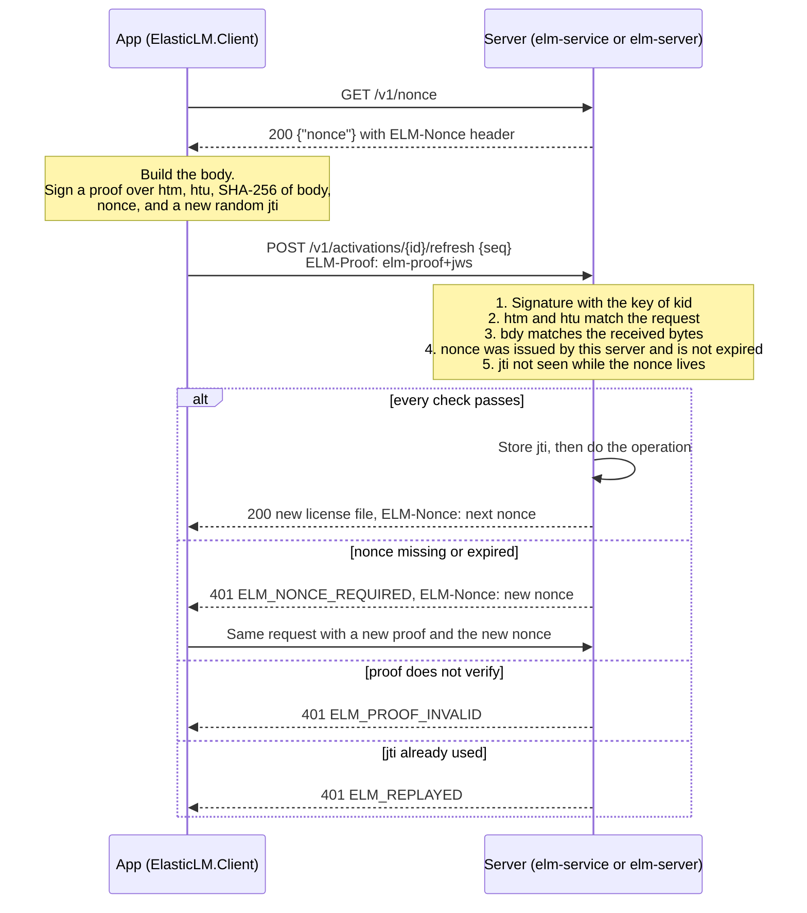

# Devices and proofs

This page is for app developers who embed `ElasticLM.Client` or `libelasticlm`, for vendors who decide how licenses are bound to devices, and for customers' administrators who run `elm-server` or keep apps running in containers. It explains how ElasticLM tells one device from another, and how a server knows that a request really comes from that device. Read [Trust chain](trust-chain.md) and [License files and verification](license-files-and-verification.md) first: this page assumes you know that a license token is signed by the vendor and checked offline by the app.

## What device identity is for

A node-locked license is meant for one device. A floating license lends a seat to one running app at a time. Both need an answer to two questions:

1. Which device is this? The license token must name the device it belongs to, so that a copy of the file on another device does not verify.
2. Is this request from that device? When the app asks the hosted activation service (`elm-service`) or the on-premises license server (`elm-server`) for a new token, a lease, or a deactivation, the server must know that the request was made by the device that holds the activation, and that nobody on the network changed it or sent it again.

ElasticLM answers both with a key pair that the app makes on the device, the installation key. The token names the key, and every request that changes state is signed with it. A second, weaker signal, the machine fingerprint, is derived from the operating system's machine ID. It helps to notice a license file that was copied to another device, and it is the only thing that limits trials to one per device, but it is never the identity.

The design rejected the operating system's machine ID as the identity (`docs/design-decisions.md`, "端末の識別子"): a virtual machine cloned without generalization, or an image that was not emptied before it was copied, gives two devices the same ID, and an administrator can rewrite it. Sending the raw ID would also let different products track the same device.

## The installation key

The installation key is an ECDSA P-256 key pair (design §10.2). The app makes it the first time it needs it: the first activation, the first lease, or the first trial. The private key never leaves the device. The public key is sent to the server once, inside the first signed request, and the server keeps it.

The key's identifier is its thumbprint: the JWK thumbprint of the public key (RFC 7638, SHA-256, base64url; design §7.4). Anyone can compute it from the public key, so a request that claims a thumbprint but carries a different key is caught by comparing the two. A license token bound to a device carries the thumbprint in its `cnf.jkt` claim, and verification fails with `ELM_WRONG_INSTALLATION` when the app's own key has a different thumbprint (design §11.2, step 10).

### Where the key is stored

The app chooses one of two scopes in its client settings (`KeyScope` in `ElasticLM.Client`, design §10.2). The default is the user scope. The machine scope needs administrator rights to write and is meant for apps that run as a service, and for `elm-server`.

| OS | Protection | User scope | Machine scope |
| --- | --- | --- | --- |
| Windows | DPAPI (`CryptProtectData`) | `%LOCALAPPDATA%\ElasticLM\<product>\` | `%ProgramData%\ElasticLM\<product>\` |
| Linux | File mode `0600`, folder `0700` | `$XDG_DATA_HOME/elasticlm/<product>/` (or `~/.local/share/elasticlm/<product>/`) | `/var/lib/elasticlm/<product>/` |
| macOS | File mode `0600`, folder `0700` | `~/Library/Application Support/ElasticLM/<product>/` | `/Library/Application Support/ElasticLM/<product>/` |

`<product>` is the product's code, limited to lowercase letters, digits, and `-` (1 to 64 characters), so it cannot climb out of the folder with `..` or `/`. The key file is `installation.key` (`src/ElasticLM.Client/InstallationKeyStore.cs`). An app can also pass its own folder.

Some details matter for security:

- On Windows, DPAPI gets an extra entropy value, `ElasticLM installation key v1`, so that a value another app of the same user protected with DPAPI cannot be mistaken for the key.
- DPAPI's machine scope can be opened by every user of the device, and `%ProgramData%` is readable by every user. So on Windows the machine-scope folder is created with an access list that is not inherited and allows only Administrators, SYSTEM, and the user who made it (design §10.2, decision 0.51).
- Any user can create a folder under `%ProgramData%` before the app first runs. So before the client writes or reads the key in an existing machine-scope folder, it checks the folder: on Windows the owner of the folder and its parent must be Administrators, SYSTEM, or the current user, the folder must not inherit its access list, and the list may name only those three; on Linux and macOS the folder must give nothing to group and others, and its parent must not let group or others write. If the check fails, the client stops with `ELM_INSTALLATION_KEY_UNREADABLE` and says why. The user scope is not checked, because the user's own profile already limits access.
- The same folder holds other files tied to the key: the kept activation (`activation.json`), borrowed leases, the pins of on-premises servers, the clock guard's state, and on a server, `elm-server`'s administrator token.

### When the key cannot be read

If the key file is damaged, or was protected by another user's DPAPI, the client returns `ELM_INSTALLATION_KEY_UNREADABLE` and does not make a new key. A new key would be a new device to the server, and would use one more activation of the license without anyone noticing. The app should tell the user to activate again; the vendor may need to deactivate the old activation first (see [Activation](activation.md)).

### Why the key is the real identity

Everything the server decides about a device is tied to the key:

- An activation is the pair of a license and a key thumbprint. One key has at most one activation per license, so activating again with the same key does not use another activation.
- A refresh or a deactivation is accepted only when its proof is signed by the key the activation remembers. Another key gets `ELM_PROOF_INVALID`.
- A license token issued to a device names the key in `cnf.jkt`. Moving the file to another device without the key fails verification there.
- Clone detection (see [Activation](activation.md)) works because two copies of a cloned device share the same key and the same activation, and so step on each other's sequence numbers.

## Proofs

A proof shows that one HTTP request was made by the holder of an installation key, for this server, now. Its form follows DPoP (RFC 9449 §4.2), with one claim added: the hash of the request body (design §12.2). The design chose it over a shared secret, which the earlier attempts used and which any copy of the app would leak, and over HTTP Message Signatures (RFC 9421), whose signature base is hard to build correctly with the .NET base library alone (`docs/design-decisions.md`, "リクエスト認証").

Every request that changes state, and every request that returns information bound to a device, carries a proof in the `ELM-Proof` header. That covers activation, refresh, deactivation, and trials on `elm-service`, and leases on both `elm-service` and `elm-server`.

### What a proof is signed over

A proof is a compact JWS with the type `elm-proof+jws`, signed with ES256 by the installation key. Its header names the key by thumbprint (`kid`). Its payload has these claims:

| Claim | What it holds | What it stops |
| --- | --- | --- |
| `htm` | The HTTP method | Using a proof for a different operation |
| `htu` | The request URI, normalized, without query and fragment | Sending the proof to another path or another server |
| `bdy` | The SHA-256 of the body bytes, base64url (of the empty string when there is no body) | Changing the body, for example the `seq` of a refresh |
| `nonce` | A nonce the server issued | Using a proof made long ago |
| `jti` | 128 random bits | Sending the same proof twice |
| `iat` | When the proof was made | Nothing; it is not used for freshness |
| `jwk` | The public key (only in the first request) | Lets the server learn the key it does not know yet |

The first request a server sees from a key (an activation, a trial, a new lease, or a reclaim after an `elm-server` restart) carries the public key in `jwk`. The server checks that the key's thumbprint equals `kid` and that the point is on the P-256 curve. Later requests do not carry it: the server uses the key the activation or lease remembers.

`bdy` is the part DPoP lacks. A plain DPoP proof covers the method and the URI but not the body, so an attacker in the middle could keep the proof and change the body. With `bdy`, any change to the body breaks the proof. This is also why the activation ID goes in the path and the sequence number goes in the body of a refresh: the query string is not part of `htu`, so a value there would not be protected.

The URI is normalized the same way on both sides before it is compared (design §12.1): lowercase scheme and host, no default port, the path normalized as `System.Uri` does it (unreserved percent-encodings decoded, `.` and `..` segments removed), remaining percent-encodings in uppercase hex, and no query or fragment. The server compares `htu` with its own configured public URLs (`publicUrls`), not with the request's `Host` header, so a proof stays valid behind a reverse proxy and cannot be aimed at a host the operator did not list.

### How the server checks a proof

The checks are in design §12.2:

1. The signature verifies with the key of `kid`: the `jwk` in the proof for a first request, or the key the server remembers.
2. `htm` and `htu` match the actual request.
3. `bdy` matches the SHA-256 of the body bytes the server received.
4. `nonce` is a valid nonce from this server.
5. `jti` has not been used while that nonce is valid.
6. `iat` is not used for freshness. A device with a wrong clock still works, because freshness comes from the nonce.

For refresh and deactivation, `elm-service` also checks that the proof's key is the key of the activation named in the path. A valid proof from another device's key gets `ELM_PROOF_INVALID` (threat T19 in the design).

`elm-service` writes the `jti` to its database with a unique constraint, in its own transaction, before the other checks of the request. A request refused by a later check still uses up its `jti`, so the same proof can never be sent again; the client makes a new proof each time. The server keeps a verified public key for each `kid` in memory (up to 10,000 keys, `src/ElasticLM.Issuing/ProofVerifier.cs`) to avoid parsing it again, but it still checks the signature on every request.

## Nonces

A nonce is a short value the server hands out so that a proof cannot be made in advance (design §12.2).

- **How a client gets one.** From `GET /v1/nonce`, and from the `ELM-Nonce` header. `elm-service` puts a new nonce on every response to a device request, success or failure. `elm-server` puts one on every response to a lease request. So a client calls `GET /v1/nonce` only the first time and after it has lost its nonce. When a request is refused with `ELM_NONCE_REQUIRED`, the client sends it once more with the nonce from that response.
- **What it contains.** The time it was made and 128 random bits, with an HMAC-SHA256 over them under a server secret. The server does not store nonces: it recomputes the HMAC to check one.
- **How long it lives.** 300 seconds (`NonceService.Lifetime` in `src/ElasticLM.Issuing/NonceService.cs`). A nonce whose time is in the future or more than 300 seconds old is refused.
- **How replay is stopped.** The server keeps each used `jti` for as long as its nonce can be valid. `elm-server` keeps them in memory; `elm-service` keeps them in the `proof_jtis` table for 300 + 60 seconds after writing, where the 60 seconds allow for clock differences between nodes. After that time the nonce inside the old proof has expired, so the proof is refused anyway.
- **The secret.** `elm-service` reads the secret from `ELM_NONCE_SECRET` (base64) or from the file named by `nonce.secretFile`, at least 32 bytes. It does not start without one and never makes one by itself, because all nodes of a multi-node service must accept each other's nonces. `elm-server` makes a new random secret at every start and does not keep it, because its record of used `jti` values lives only in memory; after a restart, old nonces become invalid along with that record.

Offline request files (see [Activation](activation.md)) cannot use a server nonce, because there is no round trip. They carry their own random `nonce` and expire after 7 days.

## Machine fingerprints

A machine fingerprint is a 32-character lowercase hex string derived from an operating-system machine ID and the product (design §10.3, `src/ElasticLM.Licensing/MachineFingerprint.cs`). It is built the same way as systemd's `sd_id128_get_machine_app_specific`:

1. Take the 16-byte OS machine ID.
2. Take the first 16 bytes of the SHA-256 of the product's code.
3. Compute HMAC-SHA256 with the machine ID as the key and the product value as the message, and keep the first 16 bytes.
4. Set the UUID version 4 and variant bits in those 16 bytes, and write them as lowercase hex.

The OS machine IDs are:

| OS | Source |
| --- | --- |
| Windows | `MachineGuid` under `HKLM\SOFTWARE\Microsoft\Cryptography`, read from the 64-bit registry view. A second fingerprint comes from the firmware's SMBIOS UUID (`GetSystemFirmwareTable('RSMB')`, no administrator rights needed). |
| Linux | `/etc/machine-id`. `/sys/class/dmi/id/product_uuid` is not used, because only root can read it. |
| macOS | `IOPlatformUUID` of `IOPlatformExpertDevice` |

Because the product is mixed in, the same device gives different fingerprints for different products, and the raw machine ID never leaves the device. Products cannot use fingerprints to track a device across each other. The IDs are read once per process, the first time a fingerprint is needed.

### What fingerprints are used for

- **Copy detection.** A token bound to a device lists the fingerprints in `fp` and the matching rule in `fpm`. When the app verifies it, the current fingerprints must match: with `any`, one of the token's fingerprints must be among the current ones; with `all`, all must be. Otherwise verification fails with `ELM_FINGERPRINT_MISMATCH`. The vendor sets the rule per policy with `fingerprintMatching` (`ignore`, `any`, or `all`; default `any`, design §9.3).
- **One trial per device.** `elm-service` records each trial by product and fingerprint, and refuses a second trial with any of the same fingerprints (`ELM_TRIAL_USED`). This is the only place where the fingerprint is the deciding fact.

### Why a fingerprint is only a hint

Every OS machine ID can repeat or be changed. A cloned virtual machine or a copied image that was not emptied repeats `/etc/machine-id`. An administrator can rewrite `MachineGuid` in the registry. The design never relies on fingerprints being unique (design §10.1). So a fingerprint mismatch catches a careless copy of a license file and key to another device, but it does not stop someone who controls the target device and rewrites its machine ID to match.

### When no fingerprint can be made

If the OS ID cannot be read (no file, `uninitialized`, or all zeros), that fingerprint is not made. If none can be made, every policy except `ignore` fails with `ELM_FINGERPRINT_UNAVAILABLE`, and no trial is given.

This happens most often in containers: many images, especially `linux-musl-x64` ones, have no `/etc/machine-id`. For an app or `elm-server` in a container, do one of these (design §10.3):

1. Mount the host's `/etc/machine-id` read-only into the container.
2. Use a policy with `fingerprintMatching` set to `ignore`, so that only the installation key binds the license. Then put the key's folder on a volume that survives when the container is recreated. Otherwise every new container makes a new key and uses one more activation.

## What an attacker with administrator rights on the device can do

The attacker here is a dishonest licensee (A1 in design §5.2): they hold the app, a real license file or license key, and administrator or root rights on their own device. Operating-system protection does not hold against them. This is what they can and cannot do.

They can:

- **Read and copy the installation key and the kept files.** DPAPI and file modes keep other users out, not the administrator. A copy of the key, `activation.json`, and the clock guard's state on another device works there while the token lasts, if the machine ID also matches or the policy is `ignore`. If both copies go online, the server sees their sequence numbers go backward and reports a clone (see [Activation](activation.md)). A copy that stays offline is not detected (design §5.4).
- **Rewrite the OS machine ID.** This defeats fingerprint matching on a copied device, and lets them take another trial. Repeated trials by rewriting the machine ID are an accepted threat (design §5.4, §12.9).
- **Keep a license file after deactivation.** Deactivation deletes `activation.json` but not the key. Restoring a saved copy of the file works until the token's expiry plus the grace period (by default 30 and 7 days). Deleting the key would not help, because they could copy the key file too. The vendor limits how often this can be repeated with `deactivationLimit`.
- **Patch the app so that it skips verification.** No client-side check can stop this, and obfuscation is out of scope (design §5.4, decision 0.18).

They cannot:

- **Forge or edit a license token.** The token is signed by the vendor's signing key, which is not on the device. An edited payload fails signature verification.
- **Move a license to another device without the key.** The token names the key's thumbprint, and the server accepts refreshes and leases only with proofs signed by that key.
- **Act as another device.** A proof needs that device's private key. Knowing its thumbprint, its fingerprints, or its activation ID is not enough.
- **Extend a token by turning the clock back.** The clock guard refuses a time earlier than the last time it saw, and never earlier than the token's own `iat`, which comes from the signing service's clock (see [License files and verification](license-files-and-verification.md)).

## What can go wrong

A network attacker (A2) who can read, change, and resend traffic gets nothing usable from a proof. A changed body, method, or path breaks the proof. A resent proof is refused with `ELM_REPLAYED` while its nonce lives, and refused for an expired nonce after that. A proof captured for one server does not work against another, because `htu` names the server. Requests also go over HTTPS. A proof does not hide the request: a party that can break TLS, such as a corporate proxy the device trusts, can still read the license key in an activation body (design §5.4).

For the people who run ElasticLM:

- **App developers.** Pick the key scope deliberately. User scope gives each OS user their own key, and so their own activation. Machine scope gives one key for the device, but needs administrator rights and the folder checks above. Treat `ELM_INSTALLATION_KEY_UNREADABLE` as "activate again", not as a reason to delete files. Never copy the key folder between devices as part of a deployment; each device must make its own key.
- **Vendors.** Choose `fingerprintMatching` per product. On Windows a device has two fingerprints: with `any` (the default), the token still verifies when one of the two IDs changes; with `all`, it fails when either changes. On Linux and macOS there is only one fingerprint, so the two rules behave the same. `ignore` is the choice for containers and for devices without readable IDs, and it cannot be used for trials.
- **Operators of `elm-service`.** Generate the nonce secret with at least 32 random bytes, give the same secret to every node, and keep the nodes' clocks within 60 seconds of each other (NTP). Set `publicUrls` to every URL that clients use; a proof for a URL not in the list is refused.
- **Customers' administrators running `elm-server` in a container.** Keep the key folder on a persistent volume and provide a machine ID, as described above.
