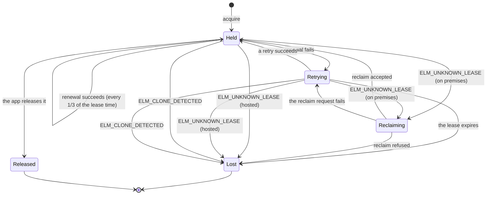
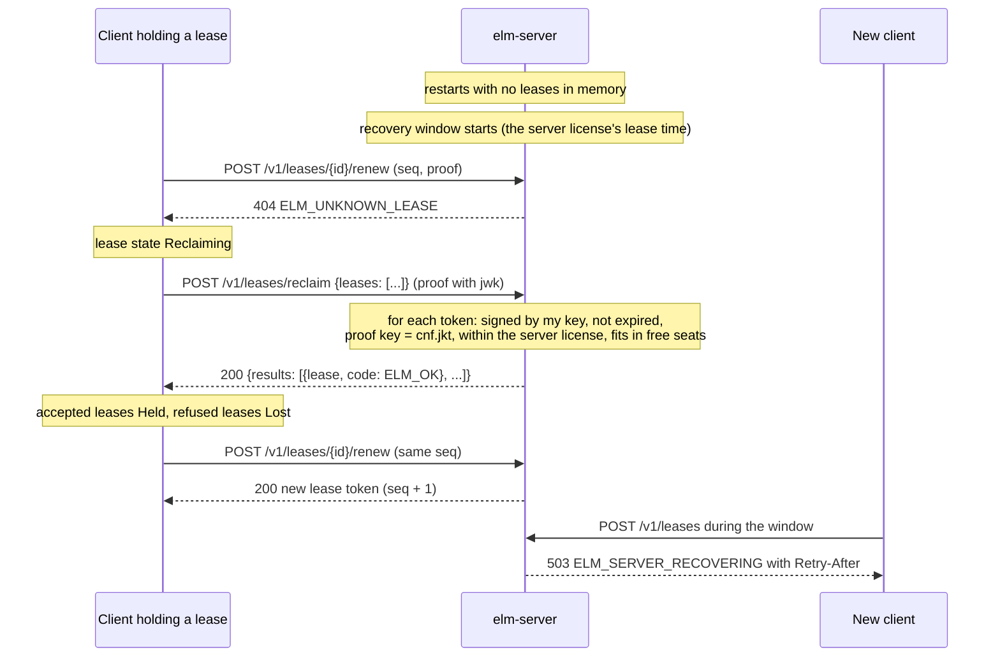

# Floating licenses

This page is for vendors who sell concurrent seats, app developers who embed `ElasticLM.Client` or `libelasticlm` to borrow seats, and the customer's administrators who run `elm-server`. It explains how a seat is lent, kept, returned, and recovered, on an on-premises license server and on the hosted activation service. Read [the trust chain](trust-chain.md) and [devices and proofs](devices-and-proofs.md) first: a lease is a signed token, and every lease request is signed with the device's installation key.

## What a floating license is for

A floating license lets a customer run a product on any number of machines, as long as no more than a fixed number of them use a feature at the same time. That fixed number is the feature's concurrent seats. A node-locked license (see [activation](activation.md)) counts machines; a floating license counts the machines that are using the feature right now.

ElasticLM lends seats from two places, with the same protocol:

| Where | Who runs it | Where the seat count lives |
| --- | --- | --- |
| `elm-server`, the on-premises license server | The customer's administrator, inside the customer's network | In the server's memory |
| `elm-service`, the hosted activation service | The vendor | In the service's database (SQLite or PostgreSQL) |

The goal is the one in design §1.1: a customer cannot use more seats than they bought, cannot forge or replay a request to get one, and cannot fake a server that hands out seats freely. The app keeps running while the network or the server is briefly down.

## Leases and lease tokens

A lease is one or more seats of one feature, lent for a limited time to one installation key. The installation key is the key pair the app makes on the device the first time it activates or borrows; it is the device's real identity (see [devices and proofs](devices-and-proofs.md)).

The server gives each lease as a lease token: a JWS with the type `elm-lease+jws`, signed by the server (design §8.4.3). Its claims say what the lease is:

| Claim | Meaning |
| --- | --- |
| `lse` | The lease ID: 128 random bits, 22 base64url characters |
| `prd` | The product ID |
| `lic` | The license ID (on premises, the `lic` of the server license) |
| `feat` | The feature ID |
| `n` | The number of seats, 1 or more |
| `cnf` | `{"jkt": ...}`, the thumbprint of the installation key that holds the lease |
| `brw` | `true` for a borrow |
| `srv` | The `kid` of the server that issued it |
| `slic` | On premises only: the `jti` of the server license the server used |
| `seq` | The lease's sequence number; it goes up by one at every renewal |
| `iat`, `exp` | When it was issued and when it expires. `exp` is required. |

Because the token is signed, the app can check it without asking anyone, and because `cnf.jkt` names one installation key, a token copied to another machine is of no use there: every renewal and return must carry a proof made with that key.

The lease time is the policy's `LeaseDuration`: 10 minutes by default, from 2 minutes to 24 hours (design §9.3).

## How seats are counted

For each feature, the server adds up the `n` of every lease that has not expired. A request for `count` seats is refused with `409` and `ELM_NO_SEATS` when that sum plus `count` is more than the allowed number (design §12.7.2):

```text
allowed = floor(seats × (100 + overage) / 100)
```

`seats` comes from the license; `overage` is the policy's `Overage`, a percentage that is 0 by default. The count and the new lease are added inside one lock per feature on `elm-server` (design §13.3), and inside one database transaction that locks the license row on `elm-service` (design §14.4). Two requests that arrive at the same moment therefore cannot both take the last seat. The earlier attempts at this product read and rewrote every session without a lock and went over the seat count under load; this lock is the fix.

A borrow (below) holds its seats for its whole period, so it counts the same way. Leases that the server stopped after it found a clone (below) also keep their seats until they expire.

## The lease lifecycle

The client does the whole lifecycle on its own after the app asks for a lease. The app sees the state of each lease and an event when it changes (`LeaseStateChanged` in .NET, the `on_lease` callback in C).



The states are the values of `LeaseState` in `ElasticLM.Client`: `Held`, `Retrying`, `Reclaiming`, `Lost`, and `Released` (design §12.7.3).

### Acquire

The client sends `POST /v1/leases` with the feature, the app's version of the feature, and `count` (design §12.7.1). The request carries a proof signed with the installation key; because the server does not know the key yet, the proof includes the public key. The server answers `201` with the lease token. `count` must be at least 1 and no more than the feature's seats; otherwise the answer is `ELM_INVALID_ARGUMENT`.

On premises, the first acquire also checks who the server is (see below) before the client accepts any lease from it.

### Automatic renewal and the retry rules

The client renews each lease every third of its lease time: about every 200 seconds for the default 10 minutes. A renewal is `POST /v1/leases/{id}/renew` with the last `seq` the client received, signed with the same installation key. The server remembers the public key from the acquire, so later proofs do not carry it.

Renewing at one third means a single late or lost renewal does not cost the seat. When a renewal fails, the lease moves to `Retrying` and the client tries again after 15 seconds, then 30, then every 60 seconds, until the lease expires (design §12.7.3; the 15- and 60-second figures are in `Lease.cs`). A network failure, a `5xx` answer, and a server pin mismatch are all retried this way. When the lease expires before a retry succeeds, it becomes `Lost`.

Two errors are not retried:

- `ELM_CLONE_DETECTED` will not change on a retry, so the lease becomes `Lost` at once.
- `ELM_UNKNOWN_LEASE` means the server does not know the lease. On premises, that is what a restarted server says, and the client reclaims (below). On the hosted service, the database never forgets a lease, so the lease is gone and becomes `Lost` at once.

When a lease becomes `Lost`, the app decides what to do: ask the user to save their work, turn the feature off, or try to acquire again. ElasticLM does not decide for the app.

### Retries and clones

`seq` lets the server tell a retry from a cloned machine (design §10.4). When a renewal's answer was lost on the way back, the client sends the next renewal with the old `seq` and names the earlier request's proof in `retry`; the server sees that and returns the same token again. When a virtual machine is copied with its installation key, the two copies renew the same lease, and the second one sends a `seq` the server has already moved past. The server then follows the server license's `clone` claim (on the hosted service, the policy's `CloneStrategy`): with `deny` (the default) it stops the lease, keeps its seats until it expires, and answers `ELM_CLONE_DETECTED`; with `flag` it only records the clone and renews as usual. A stopped lease cannot be renewed, reclaimed, or returned, so the other copy cannot win the seat back with its own token.

### Release

The app returns a lease with `ReleaseLeaseAsync` (C: `elm_client_release_lease`), which sends `DELETE /v1/leases/{id}` with a proof from the lease's installation key. Nobody else can return it: the earlier attempts let anyone end anyone's session, and this proof closes that. The return is idempotent: a lease the server does not know answers `204`.

A lease that is not a borrow is `Released` after the call even when the server could not be reached; the server then frees the seat at the lease's expiry. Disposing the client (`DisposeAsync`, `elm_client_destroy`) stops the timers and returns every lease that is not a borrow; leases it could not return within 5 seconds end at their expiry.

## What the client checks in every lease

The client does not trust a lease just because a server sent it. Each time it receives a lease token, and each time it reads a borrowed lease from disk, it checks the following (design §12.7.5). If any check fails, the lease is not used and the error is `ELM_LEASE_OUT_OF_BOUNDS` or the error of the failed step.

1. The signature. On premises, it must verify with the key named by `cnf.jkt` in the verified server license whose `jti` is the lease's `slic`. On the hosted service, it must verify with a vendor signing key whose key certificate has the use `lease` and chains to a root key in the app's trust store.
2. `prd` is the app's product and `cnf.jkt` is this device's installation key.
3. On premises: `lic` is the server license's `lic`, `feat` is a feature of the server license, and `n` is no more than that feature's `seats`.
4. On premises: `exp - iat` is no longer than the server license's `lease` (for a normal lease) or `borrow` (for a borrow).
5. On premises: `exp` is no later than the server license's `exp + grace`.
6. The clock guard and `iat` not in the future, as for license files (see [license files and verification](license-files-and-verification.md)).

Steps 3 to 5 are what keep an on-premises server honest. The server's key is on the customer's machine. A customer administrator who pulls the key out of that machine can sign any lease, but the app still refuses a lease for a feature, a seat count, a length, or an end date that the vendor's server license does not allow. A hosted lease skips steps 3 to 5 because it is signed by the vendor's own key, not by a machine the customer controls.

## The server license: how the client trusts an on-premises server

`elm-server` is a generic binary. What makes it a server for one vendor's product is its server license: a license token with `kind: server`, signed by the vendor (design §9.6). It carries:

- `cnf.jkt` and `fp`: the thumbprint of the server's installation key and the server machine's fingerprint, so the license works only on that machine.
- `feat`: the features, each with its `seats`.
- `lease`, `borrow`, `overage`, `brl`, and `clone`: the lease time in seconds, the longest borrow in seconds (0 means no borrowing), the overage percentage, the number of early borrow returns allowed in 30 days, and what to do with a clone.
- `exp` and `grace`: the server license expires after the server policy's `TokenLifetime`, 30 days by default.

The vendor issues it when the server activates on `elm-service` (online, or with request and response files), or by hand with `elm`. A server with a service URL (`service.url`) renews it online when less than `RefreshWindow` is left; otherwise the administrator renews it with `elm server refresh-request` and `elm server import`. Each renewal lets the service check the server's `seq` and find a copied server machine (design §10.4). A server license issued by hand has no renewal, and one without an expiry cannot reveal a copied server, so `elm` warns when it issues one.

Before the client takes any lease from a server, it checks the server (design §13.5):

1. It calls `GET /v1/server/license` and receives the server license file and the server's public key.
2. It verifies the server license from the trust store's root key, requires `kind: server`, and checks that the public key's thumbprint equals `cnf.jkt`. A mismatch is `ELM_SERVER_PIN_MISMATCH`.
3. It checks the pin. If the app set `ExpectedServerLicenseId` (C: `expected_server_license_id`), the server license's `lic` must equal it. If not, the client trusts the first server license it sees for that URL: it saves its `lic` and `cnf.jkt` next to the installation key and requires them on every later connection.
4. From then on, it verifies that server's leases with the `cnf.jkt` key.

A trial or standard license cannot be used to set up a fake server: step 2 requires `kind: server`. A real server license copied to another machine is no use either: the leases must be signed by the key that `cnf.jkt` names, and that key stays on the licensed server.

When the server renews its server license, its lease answers carry a new `jti` in the `ELM-Server-License` header; the client then repeats steps 1 to 3 and keeps the old copy while leases signed under it are still valid. When the administrator moves the server to another machine on purpose, the key changes. With `ExpectedServerLicenseId` set, the client accepts the new key as long as `lic` is the same. Without it, the pin refuses the new server until the app calls `ResetServerPin` (C: `elm_client_reset_server_pin`).

### TLS, including the self-signed default

The server has two TLS modes, chosen by the administrator in `tls.certificate` (design §13.5):

| Mode | How the client checks the connection |
| --- | --- |
| The operator's certificate (PKCS#12 or PEM) | The OS's normal certificate validation |
| Self-signed, the default | The server signs its own certificate with its installation key. The client checks that the certificate's public key has the thumbprint `cnf.jkt` from the verified server license. |

The app developer does not choose a mode: the client accepts a connection when the OS validates the certificate or when its key matches the pinned `cnf.jkt`, and it checks this on every TLS connection, including reconnections. On the very first connection, it only records the certificate's key, verifies the server license, and then compares; on a mismatch it throws away everything that connection returned and saves no pin. So a customer without its own certificate authority still gets an encrypted connection to the server the vendor licensed, and an attacker on the network (who does not hold the server's key) cannot pose as that server.

## Restarts and reclaim

`elm-server` keeps its leases only in memory (design §13.2). That keeps the server a single binary without a database, but after a restart the server does not know which leases are valid. Reclaim lets the clients tell it (design §13.4).



The steps:

1. For a recovery window after it starts, the server refuses every new acquire with `503` and `ELM_SERVER_RECOVERING`, with a `Retry-After` header that gives the seconds left in the window.
2. A client whose renewal gets `ELM_UNKNOWN_LEASE` moves the lease to `Reclaiming` and sends every lease token it holds from that server in `POST /v1/leases/reclaim`, up to 64 tokens per request.
3. The server checks each token: its own key signed it, it has not expired, the proof's key equals its `cnf.jkt`, it is within the current server license (features, seats, length, end date), and it fits in the free seats. A token that passes is restored with its `seq` and expiry. The result for each token is `ELM_OK` or the reason it was refused, such as `ELM_NO_SEATS` or `ELM_BAD_SIGNATURE`.
4. The client renews the accepted leases again and marks the refused ones `Lost`. If the reclaim request itself fails, the leases go to `Retrying`.

The recovery window lasts the server license's `lease` time, 10 minutes with the default policy. It ends early once reclaimed seats plus restored borrows fill every feature, since no further reclaim could fit. A reclaim that arrives after the window (a machine that was asleep, a slow network) is still accepted with the same checks, but only if free seats remain.

The window is why new users must wait after a restart. Without it, the server would lend a seat that a running app still holds, and the customer would briefly have more seats in use than they bought.

The server also creates a new nonce secret at each start, so a proof made before the restart cannot be replayed after it, even though the record of used proofs was in memory and is gone.

### Why the server has no standby copy

Because clients renew at one third of the lease time, a lease still has at least two thirds of its time left when the server stops: about 6 minutes 40 seconds for the default 10 minutes (design §13.6). The target for `elm-server` from start to listening is 1 second or less (design §4.2), and the V1b measurement on the reference machine (GitHub Actions `ubuntu-latest`) was 87 to 116 ms from start to the `server.started` log line. With the OS's service manager restarting it, a crash or an upgrade does not stop the apps. They stop only when the server machine is down for longer than the time left on their leases.

A longer `LeaseDuration` lengthens both sides at once: apps survive a longer outage, and new users wait longer after a restart. The vendor sets it with both in mind. Redundant servers are not in v1; they are roadmap row A-2.

## Borrowing

A borrow is a long lease that the app can use away from the network, for example on a laptop taken on a trip (design §12.7.4). The app calls `BorrowLeaseAsync` with a period (C: `elm_client_borrow_lease`). The request is an acquire with `borrow` set to the period in seconds, and the token has `brw: true`.

A borrow differs from a normal lease:

- It is not renewed. It is valid until its `exp`.
- The client saves it to disk (`borrows/<lease ID>.json` next to the installation key) together with what verifies it: the server license and the server's public key, or, from the hosted service, the service's key certificates. `GetBorrowedLeases` reads these files after the app restarts, with no request to the server, and checks each one again as above, including the clock guard. The folder holds at most 1,000 borrows. If the file cannot be saved, the borrow fails with `ELM_INTERNAL_ERROR`, and the seat stays used on the server until the borrow's expiry.
- The client raises no event when a borrow expires, and the lease stays `Held`. The app must compare `ExpiresAt` (C: `elm_lease_expires_at`) with the time before it relies on a borrow.
- Disposing the client does not return a borrow.
- A borrow request must include at least one machine fingerprint; without one the answer is `400` and `ELM_FINGERPRINT_UNAVAILABLE`.

### The three limits

On premises, three people limit borrowing, from the widest to the narrowest:

| Limit | Set by | Where |
| --- | --- | --- |
| The longest borrow | The vendor | The policy's `BorrowLimit`, carried in the server license as `borrow`. `Disabled` by default, so a vendor must turn borrowing on. |
| A shorter longest borrow | The customer's administrator | The server setting `borrow.maxDuration` (format `d.hh:mm:ss`, for example `7.00:00:00`). The server uses the smaller of the two. |
| Seats kept for normal leases | The customer's administrator | The server setting `borrow.reserve`, 0 by default. A borrow that would leave fewer free seats than this is refused with `409` and `ELM_NO_SEATS`. Normal leases may still use those seats. |

A borrow longer than the limit is refused with `403` and `ELM_BORROW_NOT_ALLOWED`. The administrator can only make borrowing stricter than the vendor allows, never looser: the client's step 4 refuses a borrow longer than the server license's `borrow`.

### Early return

The app can return a borrow before it expires with `ReleaseLeaseAsync`, signed by the same installation key. The server refuses with `409` and `ELM_RETURN_NOT_ALLOWED`, and the borrow stays valid until its expiry, in two cases:

- The installation key, or any machine fingerprint the borrow was made with, has already made `BorrowReturnLimit` early returns in the last 30 days (the server license's `brl`, 2 by default). Counting fingerprints as well as keys stops a user from making a new installation key to start the count again.
- The server license changed since the borrow in a way that matters: a different `lic`, the feature removed, or fewer `seats` or a shorter `borrow`. A routine renewal that only changes `jti` and `exp` does not count.

The limit exists because a returned borrow's token stays valid until its `exp` (see below). Without a limit, a user could borrow, return, and borrow again, and keep many valid tokens while the server counts one seat.

If the return is refused or the server cannot be reached, the client keeps the borrow and its file and returns the error.

### Borrows and restarts

A borrowed client is away from the network and cannot reclaim. So `elm-server` writes every borrow and every early return to a borrow record before it takes effect: a file `borrows-<UTC time>.jsonl` in its data folder, signed line by line with the server's installation key. At start it reads the newest record, checks the signature chain, and restores every borrow that has not expired before it opens the recovery window. If the record is broken, the server does not start. The administrator can start it with `elm-server --set-aside-broken-records`, which moves the broken record aside and starts without its borrows; this is logged as `records.set_aside`.

## The same protocol on the hosted service

`elm-service` lends seats with the same requests, the same renewal and retry rules, and the same borrow and early-return rules (design §12.7.6). Both servers call the same rule code (`LeaseRules` in `ElasticLM.Leasing`), so they give the same answer to the same request. The differences:

- The license's policy must have `Floating` set to `Cloud`. The app sets `LicenseKey` in `LicenseClientOptions` (C: `license_key`), and the client sends the license key and the product's code with each acquire. The key is kept only in memory and is not sent with renewals or returns.
- TLS is checked with the OS's trust. There is no server license, no pin, and no `ELM-Server-License` header. Each answer carries the service's key certificates, and the client checks the lease with steps 1, 2, and 6 above.
- The state is in the database, so a restart loses nothing and there is no reclaim. A renewal answered `ELM_UNKNOWN_LEASE` means the lease is gone; the client marks it `Lost` at once.
- A lease's expiry is cut at the license's expiry and the feature's expiry; the grace period is not added.
- There is no `borrow.maxDuration` and no `borrow.reserve`: the only borrow limit is the policy's `BorrowLimit`.
- With PostgreSQL, the service can run on several nodes; the license row lock keeps the seat count exact across them. Expired leases are deleted once a minute, and the count ignores them before that.

## What the customer's administrator can and cannot do

The administrator of `elm-server` works through a local admin API that listens only on loopback (`admin.listen`, default `http://127.0.0.1:7071`) and requires the 256-bit admin token the server created at first start, stored in its data folder (design §13.7). The `elm server` commands read the token and call that API.

The administrator can:

- See the server's state and its leases (`elm server status`, `elm server leases`).
- Force-return a normal lease (`elm server release <ID>`), for example for a machine that crashed.
- Reload the server license after it was renewed (`elm server reload`), and activate or renew the server license (`elm server activate`, `elm server refresh-request`, `elm server import`).
- Allow or deny clients by IP address or range (`allow` and `deny`), and set the per-IP request limit (`rateLimit.perIp`, 20 per second by default).
- Shorten borrows and keep seats back from borrowing (`borrow.maxDuration`, `borrow.reserve`).
- Choose the TLS certificate.

Every admin action is written to the signed usage log as `admin.action`.

The administrator cannot, through the server:

- Lend more seats, more features, longer leases, or longer borrows than the server license allows. These come from the vendor's signature, and the client refuses anything outside them.
- Force-return a borrow. The answer is `409` and `ELM_RETURN_NOT_ALLOWED`; a borrow ends only by the client's early return or its expiry, because the borrowed machine is offline and would otherwise keep using a seat the server lent again.
- Keep the server running past its license: after `exp + grace`, new acquires and renewals are refused with `ELM_EXPIRED`.

Host and user rules in `allow` and `deny` (`host:<name>`, `user:<name>`) use names the client reports and cannot check, so only IP rules are reliable. Behind a reverse proxy, IP rules and rate limits see the proxy's address, because `elm-server` does not trust `X-Forwarded-For`.

On the hosted service, the vendor's administrators can list a license's leases and force-return any lease, borrows included, with the `lease.release` permission; each force-return is written to the audit log.

## What happens when the network is lost

| Situation | What happens |
| --- | --- |
| A short network break, or the server restarts | The lease stays `Held` or `Retrying` and the app keeps running. A restarted server is reclaimed. |
| The server is unreachable for longer than the time left on a lease | The lease becomes `Lost` at its expiry, at least two thirds of the lease time after the last good renewal. The app decides what to do. |
| A borrowed machine is offline | The borrow works until its `exp`, checked against the device clock with the clock guard. |
| `elm-server` cannot reach `elm-service` | Nothing changes for leases. The server keeps lending under its server license, and in the grace period after `exp`, until `exp + grace`. Then it refuses new acquires and renewals; leases already lent stay valid until they expire. |
| A machine crashes while it holds a lease | Its seat comes back when the lease expires (10 minutes by default), or at once if the administrator force-returns it. |

## What can go wrong and what to do

- **A returned lease token still works until it expires.** Returning a lease frees the seat on the server, but the token in the app's memory stays valid until its `exp`. A normal lease is short (10 minutes by default), so the loss is one lease time. A borrow can be longer, which is why early returns are limited. This is an accepted threat (design §5.4).
- **The administrator can free borrowed seats by force.** Deleting the borrow record, moving the clock forward, or starting with `--set-aside-broken-records` frees those seats, and the administrator who has root on the server machine can also take the server's key out. ElasticLM cannot prevent this. The traces stay in the usage log (`records.set_aside`, `chain.reset`, missing files), and the damage is bounded by the client checks and the server license's expiry (30 days by default). Vendors who worry about this keep the server policy's `TokenLifetime` short.
- **A copied server machine** is found only at the next server license renewal, up to 30 days later by default.
- **A TLS inspection proxy the OS trusts** can read the traffic and fake an unsigned error answer, such as a false `ELM_CLONE_DETECTED`, to make the app lose a lease. It cannot fake a lease. This is the same as cutting the network, and it is accepted (design §5.3, T17).
- **The first connection is trusted** when the app does not set `ExpectedServerLicenseId`. An attacker who reaches the client first with a different real server license for the same product would be pinned. App developers who know the customer's server license ID set it.
- **New users wait after a restart.** Up to the lease time (10 minutes by default) unless every seat is reclaimed sooner. Tell users that `ELM_SERVER_RECOVERING` comes with a `Retry-After` time.
- **The app must handle `Lost`.** Subscribe to the state change, and decide what the user sees. For a borrow, check `ExpiresAt` yourself.
- **The server needs its own data folder.** If `elm-server` and an app of the same product share a machine, give the server its own `dataDirectory`, or `elm server` refuses to work with `ELM_INVALID_STATE`.

The full list of threats and what stops each one is on [the security model](security-model.md). Why the server keeps its state in memory, and the other choices on this page, are on [design choices](design-choices.md).
