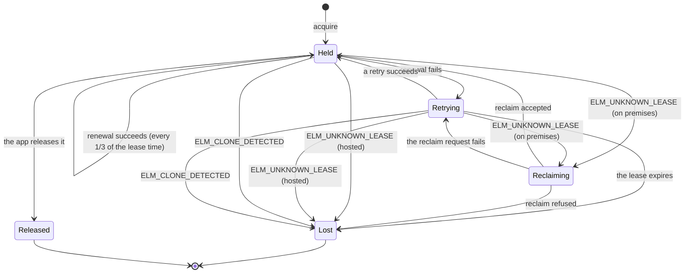
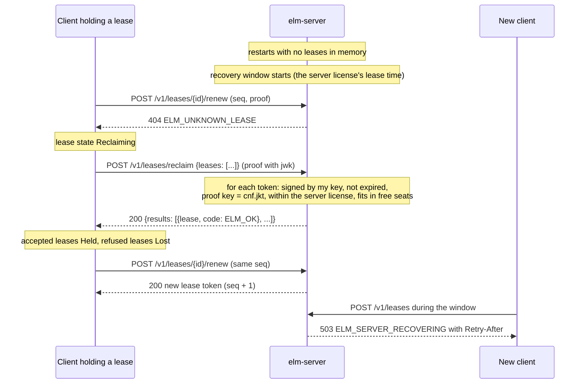

# Floating licenses

This page is for vendors who sell concurrent seats, app developers who embed `ElasticLM.Client` or `libelasticlm` to borrow seats (see [.NET API](../reference/dotnet-api.md#licenseclient) and [C API](../reference/c-api.md#client-and-leases)), and the customer's administrators who run `elm-server`. It explains how a seat is lent, kept, returned, and recovered, on an on-premises license server and on the hosted activation service. You can read it first. It needs three terms: a signed token is data with the vendor's or the server's signature, which anyone can check but nobody can change (see [the trust chain](trust-chain.md)); the installation key is a key pair the app makes on each device, which is the device's identity; and a proof is a signature made with that key on each request, so the server knows which device sent it (both in [devices and proofs](devices-and-proofs.md)).

## What a floating license is for

A floating license lets a customer run a product on any number of machines, as long as no more than a fixed number of them use a feature at the same time. That number is the feature's concurrent seats. A node-locked license (see [activation](activation.md)) counts machines; a floating license counts the machines that are using the feature right now.

ElasticLM lends seats from two places, with the same protocol:

| Where | Who runs it | Where the seat count lives |
| --- | --- | --- |
| `elm-server`, the on-premises license server | The customer's administrator, inside the customer's network | In the server's memory |
| `elm-service`, the hosted activation service | The vendor | In the service's database (SQLite or PostgreSQL) |

Either way, a customer cannot use more seats than they bought, forge or replay a request to get one, or fake a server that hands out seats freely, and the app keeps running while the network or the server is briefly down. The exception is on premises: an administrator who takes the server's key out of its machine can sign as many leases as they like, each inside the server license, until the vendor stops renewing the server license and it expires ([the security model](security-model.md#on-the-customers-license-server)).

## Leases and lease tokens

A lease is one or more seats of one feature, lent for a limited time to one installation key. The app makes its installation key the first time it needs one: at the first activation, the first lease, or the first trial.

The server gives each lease as a lease token (type `elm-lease+jws`), signed by the server. It names the lease (`lse`), the product, license, and feature (`prd`, `lic`, `feat`), the number of seats (`n`), the installation key that holds it (`cnf.jkt`, the key's [thumbprint](devices-and-proofs.md#the-installation-key)), whether it is a borrow (`brw`), the issuing server and, on premises, its server license (`srv`, `slic`), a sequence number that goes up at every renewal (`seq`), the ID of the request proof it answers (`areq`), and when it was issued and expires (`iat`, `exp`). [Token and file formats](../reference/formats.md#lease-token-elm-leasejws) lists every claim with its type and range.

Because the token is signed, the app can check it without asking anyone. Because `cnf.jkt` names one key, a token copied to another machine is of no use there: every renewal and return needs a proof made with that key. An administrator who copies the installation key with it makes it work on the other machine, until the copies' renewals reveal the clone ([the security model](security-model.md#on-the-licensees-machine)).

Where the lease time comes from depends on the server. On `elm-service`, it is the policy's `leaseDuration`: 10 minutes by default, from 2 minutes to 24 hours. On `elm-server`, it is the lease duration in the server license. A server license that `elm-service` issues holds the policy's `leaseDuration`. One that `elm license issue` makes holds the value of `--lease-minutes`, 10 minutes by default; it must be at least one second, so it can be shorter than 2 minutes (see [`elm license issue`](../reference/elm-cli.md#elm-license-issue)).

## How seats are counted

For each feature, the server adds up the `n` of every lease that has not expired. A request for `count` seats is refused with `409` and `ELM_NO_SEATS` when that sum plus `count` is more than:

```text
allowed = floor(seats × (100 + overage) / 100)
```

`seats` comes from the license; `overage` is the policy's `overage`, a percentage that is 0 by default. The count and the new lease are added under one lock per feature on `elm-server`, and inside one database transaction that locks the license row on `elm-service`. Two requests that arrive at the same moment cannot both take the last seat.

A borrow (below) holds its seats for its whole period. Leases that the server stopped after it found a clone also keep their seats until they expire.

## The lease lifecycle

The client runs the whole lifecycle once the app asks for a lease. The app sees the state of each lease and an event when it changes (`LeaseStateChanged` in .NET, the `on_lease` callback in C).



The states are the values of `LeaseState`: `Held`, `Retrying`, `Reclaiming`, `Lost`, and `Released`.

### Acquire

The client sends `POST /v1/leases` with the feature, the app's version of the feature, and `count`. The proof includes the public key, because the server does not know the key yet. The server answers `201` with the lease token. `count` must be from 1 to the feature's seats; otherwise the answer is `ELM_INVALID_ARGUMENT`. On premises, the first acquire also checks who the server is (see below). Every lease route of both programs, with its body and answer, is in [Device protocol](../reference/device-protocol.md).

### Renewal and retries

The client renews each lease every third of its lease time: about every 200 seconds for the default 10 minutes. A renewal is `POST /v1/leases/{id}/renew` with the last `seq` the client received and a proof from the same key.

Renewing at one third means one late or lost renewal does not cost the seat. When a renewal fails for any reason other than `ELM_CLONE_DETECTED` or `ELM_UNKNOWN_LEASE` (a network failure, a `5xx` answer, a server pin mismatch, an answer the client refuses, or another error code), the lease moves to `Retrying`, and the client tries again after 15 seconds, then 30, then every 60 seconds; if the lease expires first, it becomes `Lost`. `ELM_CLONE_DETECTED` is not retried. `ELM_UNKNOWN_LEASE` means the server does not know the lease: on premises a restarted server says this and the client reclaims (below); the hosted service never forgets a lease, so there it is `Lost` at once.

When a lease becomes `Lost`, the app decides what to do: ask the user to save their work, turn the feature off, or try to acquire again.

### Retries and clones

`seq` lets the server tell a retry from a copied machine. If the answer to a renewal was lost on the way back, the server has already moved to the next `seq` while the client still holds the old one. So the client remembers the proof ID (`jti`) of each request that got no answer, or whose answer it refused, and lists it in the next request's `retry` field; the server sees its own earlier request there and returns the same token again. That token names the earlier request in `areq`, and the client accepts it because the request is in its list. [Activation](activation.md) uses the same rule.

When a virtual machine is copied with its installation key, both copies renew the same lease, and the second sends a `seq` the server has moved past without the other copy's request in `retry`. The server then follows the server license's `clone` claim (on the hosted service, the policy's `cloneStrategy`): with `deny`, the default, it stops the lease, keeps its seats until it expires, and answers `ELM_CLONE_DETECTED`; with `flag` it records the clone and renews as usual (`elm-server` writes `cloneFlagged` in its [usage log](../reference/logs.md#events-of-elm-server)). A stopped lease cannot be renewed, reclaimed, or returned, so neither copy can win the seat back. The same claim decides what happens when a copy reclaims the lease after a server restart.

### Release

The app returns a lease with `ReleaseLeaseAsync` (C: `elm_client_release_lease`), which sends `DELETE /v1/leases/{id}` with a proof from the lease's key. Nobody else can return it. A lease the server does not know answers `204`.

A normal lease is `Released` after the call even if the server could not be reached; the seat is then freed at the lease's expiry. Disposing the client (`DisposeAsync`, `elm_client_destroy`) returns every lease that is not a borrow; leases it cannot return within 5 seconds end at their expiry.

## What the client checks in every lease

The client does not trust a lease because a server sent it. Each time it receives a lease token, and each time it reads a borrowed lease from disk, it checks:

1. The signature: on premises, with the server key that the verified server license names (below); on the hosted service, with a vendor signing key certified for leases by a root key in the app's trust store.
2. `prd` is the app's product and `cnf.jkt` is this device's installation key.
3. On premises: the license, feature, and seat count, the lease or borrow length, and the end date are all within the server license (its expiry plus grace period at the latest).
4. The clock checks, as for license files (see [license files and verification](license-files-and-verification.md)).

If a check fails, the lease is not used (`ELM_LEASE_OUT_OF_BOUNDS` or the error of the failed step). Step 3 keeps an on-premises server honest: an administrator who pulls the server's key out of the machine can sign any lease, but the app still refuses what the vendor's server license does not allow. The app checks each lease on its own, so it does not limit how many such leases there are ([the security model](security-model.md#on-the-customers-license-server)).

The client also compares each answer with the request it sent, because a relay on the network path could hand it a genuine lease that answers another request, such as the answer that another process with the same installation key received. For an acquisition or a borrow, the lease must be a borrow exactly when a borrow was asked for, be for the feature and the number of seats asked for, for a borrow be no longer than the period asked for, and its `areq` must be the proof ID of this request. For a renewal, it must not be a borrow, must have the feature, the seats, and the ID of the lease held and a higher `seq`, and its `areq` must be the proof ID of this renewal or of an earlier renewal of this lease in the client's `retry` list. Otherwise the result is `ELM_REQUEST_MISMATCH`. An acquisition or a borrow then gives no lease, and the client does not return the lease that the answer carried, which ends at its expiry. A renewal counts as failed, and the lease moves to `Retrying`. A borrowed lease read from disk has no request to compare with; it was compared when it was borrowed.

## The server license: how the client trusts an on-premises server

`elm-server` is a generic binary. What makes it a server for one vendor's product is its server license: a license token with `kind: server`, signed by the vendor. It names the server's installation key and, when the vendor binds them, its machine fingerprints (`cnf.jkt`, `fp`), so it works only on that machine; the features and their seats (`feat`); the lease time, longest borrow (0 means none), overage percentage, early borrow returns allowed in 30 days, and what to do when a copied app installation renews a lease (`lease`, `borrow`, `overage`, `brl`, `clone`); and its expiry and grace period (`exp`, `grace`), by default 30 days after issue from the server policy's `tokenLifetime`. The claims a server license must have, and the answer of `GET /v1/server/license`, are in [Token and file formats](../reference/formats.md#server-license).

Before the client takes any lease from a server, it checks the server:

1. It calls [`GET /v1/server/license`](../reference/device-protocol.md#get-v1serverlicense) and receives the server license and the server's public key.
2. It verifies the server license from the root key, requires `kind: server`, and checks that the public key's thumbprint equals `cnf.jkt`. A mismatch is `ELM_SERVER_PIN_MISMATCH`.
3. It checks the pin. If the app set `ExpectedServerLicenseId` (C: `expected_server_license_id`), the license ID must equal it. If not, the client trusts the first server license it sees at that URL: it saves its license ID and `cnf.jkt` next to the installation key and requires them on every later connection.
4. From then on, it verifies that server's leases with the `cnf.jkt` key.

A trial or standard license cannot run a fake server, because step 2 requires `kind: server`. A real server license copied to another machine is no use either: leases must be signed by the key `cnf.jkt` names, which stays on the licensed server. An administrator who copies that key with the license runs a copied server, which is found only at the next server license renewal ([What can go wrong](#what-can-go-wrong-and-what-to-do)). When the server renews its license, its answers carry the new token ID in the `ELM-Server-License` header, and the client repeats steps 1 to 3.

When the administrator moves the server to another machine, the key changes. With `ExpectedServerLicenseId` set, the client accepts the new key as long as the license ID is the same. Without it, the pin refuses the new server until the app calls `ResetServerPin` (C: `elm_client_reset_server_pin`).

### TLS

By default the server makes a self-signed certificate with its installation key. The administrator can instead set `tls.certificate` to their own certificate (PKCS#12, or PEM with `tls.key`), which clients check with the OS's normal validation. The app developer does not choose: on every connection the client accepts the certificate if the OS validates it or if its key has the thumbprint `cnf.jkt` from the verified server license. On the first connection it compares only after verifying the server license, and on a mismatch discards everything that connection returned. So a customer without its own certificate authority still gets an encrypted connection to the server the vendor licensed. Use your own certificate when your policy requires certificates from your company's authority, or when other tools, such as a monitoring probe, connect to the server.

## Running `elm-server`

What the customer's administrator gives the server, and what it keeps:

- **From the vendor.** The vendor's root public keys (PEM files named in `trust.rootKeys`, or PEM text in `ELM_TRUST_ROOT_KEYS`), without which the server does not start, and the server license, read from `license` (by default `server.elmlic` next to the executable). At first start without a license, the server makes its installation key, prints its thumbprint and the machine fingerprints, and stops. Send them to the vendor, who issues the server license, or activate with the vendor's license key: `elm server activate` online, or `elm server activate-request` and `elm server import` offline.
- **Where it listens.** The lease protocol listens on `listen`, `https://0.0.0.0:7070` by default. If clients reach the server under a name other than the machine's host name, put that URL in `publicUrls`, because each proof names the URL it was made for.
- **The data folder.** One folder holds the server's installation key, its clock state, the activation it got from `elm-service` (`activation.json`), the administrator token, the socket file of the local administration API (a file that programs on the same machine connect through, instead of a port), the lock file `server.lock`, the borrow record, and by default the usage log. Keep it on a local file system. The setting `dataDirectory` chooses it; without it, the server uses the machine-scope key folder of its `product`, such as `%ProgramData%\ElasticLM\<product>\` or `/var/lib/elasticlm/<product>/` (see [devices and proofs](devices-and-proofs.md)). An app of the same product that uses the machine scope on that machine uses the same folder, so the two would share one installation key and one `activation.json`. When the kept activation is not a server license, the `elm server` activation commands and the server's own license renewal stop with `ELM_INVALID_STATE`. Give the server its own `dataDirectory`.
- **The usage log.** The server writes every lease, borrow, return, and admin action, and the refusals counted each minute, to daily files, `usage-<UTC time>.jsonl`, in the data folder by default (`log.usage`). They are signed in blocks with the server's key, and each file is chained to the previous one, so `elm log verify` finds edited, missing, or cut files. It cannot find the newest file deleted or cut after its last signature, nor a log rewritten by someone who holds the server's key ([the security model](security-model.md#on-the-customers-license-server)). The log is a record for audits and billing questions; the seat count does not depend on it. ElasticLM does not send it to the vendor or anywhere else, and old files stay until you delete them. If the vendor asks for it, they can check it with `elm log verify`.

On Windows, `elm-server` needs Windows 10 version 1803 or Windows Server 2019, or later ([elm-server configuration](../reference/server-configuration.md)).

The server renews its license online when `service.url` names the vendor's `elm-service`; otherwise the administrator renews it with `elm server refresh-request` and `elm server import` ([Activate a server license with elm-service](../how-to/activate-a-server-license-with-elm-service.md)). Each renewal lets the service find a copied server machine by its `seq`. While `elm-service` cannot be reached, the server keeps lending until its license's expiry plus grace period, then refuses new acquires and renewals. A server license issued by hand is never renewed through the service, so a copied server is not detected; the license's expiry limits how long a copy works. `elm` prints two warnings when it issues one without an expiry ([`elm license issue`](../reference/elm-cli.md#elm-license-issue)). To renew it, the vendor issues a new file, and the administrator loads it with `elm server reload` ([Renew a server license](../how-to/renew-a-server-license.md)). The server does not compare that file with the one it replaces, since a file issued by hand has no `seq`: after a renewal that grants less, the administrator can load the older file again until it expires. A vendor who must be able to reduce a server's seats issues its files with a short expiry, or activates the server with `elm-service`.

For every setting, the command line, and the exit codes of `elm-server`, see [elm-server configuration](../reference/server-configuration.md). For the usage log's files and events, see [Logs](../reference/logs.md).

## Restarts and reclaim

`elm-server` keeps its leases only in memory. That keeps the server a single binary without a database, but after a restart it does not know which leases are valid. Reclaim lets the clients tell it.



During the recovery window, new acquires get `503` and `ELM_SERVER_RECOVERING` with a `Retry-After` header, so the server does not lend a seat that a running app still holds. A client sends up to 64 tokens per reclaim request, and the server restores each one with the checks in the figure; each result is `ELM_OK` or the reason for refusal, such as `ELM_NO_SEATS`. If the reclaim request itself fails, the leases go to `Retrying`.

The window lasts the server license's lease time, 10 minutes with the default policy, and ends early once reclaimed seats and restored borrows fill every feature. A reclaim after the window (from a machine that was asleep) is accepted if free seats remain. The server also makes a new nonce secret at each start, so a proof made before the restart cannot be replayed after it.

### Why there is no standby server

Because clients renew at one third of the lease time, a lease has at least two thirds of its time left when the server stops: about 6 minutes 40 seconds for the default 10 minutes. `elm-server` aims to listen within 1 second of starting; in measurements it took about 0.1 seconds. With the OS's service manager restarting it, a crash or an upgrade does not stop the apps; only a machine down longer than the time left on their leases does. A longer `leaseDuration` lengthens both sides: apps survive a longer outage, and new users wait longer after a restart. A high-availability pair of servers is not part of 1.0.

## Borrowing

A borrow is a long lease that the app can use away from the network, for example on a laptop taken on a trip. The app calls `BorrowLeaseAsync` with a period (C: `elm_client_borrow_lease`); the token has `brw: true`.

A borrow is not renewed and is valid until its `exp`. The client saves it next to the installation key with what verifies it (see [Files the client keeps](../reference/formats.md#files-the-client-keeps)), and `GetBorrowedLeases` reads and checks these files again after the app restarts, without asking the server. If the file cannot be saved, the borrow fails with `ELM_INTERNAL_ERROR` and the seat stays used until the borrow's expiry. No event is raised when a borrow expires and the state stays `Held`, so the app must compare `ExpiresAt` (C: `elm_lease_expires_at`) with the time before it relies on one. Disposing the client does not return a borrow. The request must include a machine fingerprint (otherwise `400` and `ELM_FINGERPRINT_UNAVAILABLE`).

### The three limits

On premises, three limits apply, set by two parties:

| Limit | Set by | Where |
| --- | --- | --- |
| The longest borrow | The vendor | The policy's `borrowLimit`, carried in the server license as `borrow`. Unset by default, which turns borrowing off. |
| A shorter longest borrow | The customer's administrator | `borrow.maxDuration` (format `d.hh:mm:ss`, for example `7.00:00:00`). The server uses the smaller of the two. |
| Seats kept for normal leases | The customer's administrator | `borrow.reserve`, 0 by default. A borrow that would leave fewer free seats than this is refused with `409` and `ELM_NO_SEATS`. |

A borrow longer than the limit is refused with `403` and `ELM_BORROW_NOT_ALLOWED`. The administrator can make borrowing stricter than the vendor allows, never looser: the client refuses a borrow longer than the server license's `borrow`.

### Early return

The app can return a borrow early with `ReleaseLeaseAsync`. The server refuses with `409` and `ELM_RETURN_NOT_ALLOWED`, and the borrow stays valid until its expiry, in two cases:

- The installation key, or any machine fingerprint the borrow was made with, has already made `borrowReturnLimit` early returns in the last 30 days (the server license's `brl`, 2 by default). Counting fingerprints stops a user from making a new key to reset the count. An administrator who also changes every machine ID that the fingerprints come from gets new fingerprints and resets it all the same ([the security model](security-model.md#on-the-licensees-machine)).
- The server license changed since the borrow in a way that matters: another license, the feature removed, fewer seats, or a shorter `borrow`. A routine renewal does not count.

The limit exists because a returned borrow's token stays valid until its `exp`; without it, a user could borrow and return again and again and hold many valid tokens for one counted seat.

### Borrows and restarts

A borrowing client is away and cannot reclaim. So `elm-server` writes every borrow and early return, before it takes effect, to the borrow record (`borrows-<UTC time>.jsonl` in its data folder, signed line by line with the server's key), and restores unexpired borrows from it at start. If the record is broken, the server does not start. `elm-server --set-aside-broken-records` moves the broken record aside and starts without its borrows; the usage log records this as `records.set_aside`.

For the borrow record's lines and how to verify it with `elm log verify --stream borrows`, see [Logs](../reference/logs.md).

## The same protocol on the hosted service

`elm-service` lends seats with the same requests and the same renewal, retry, borrow, and early-return rules. The differences:

- The policy must have `floating` set to `cloud`. The app sets `LicenseKey` in `LicenseClientOptions` (C: `license_key`), and the client sends the license key with each acquire only.
- TLS is checked with the OS's trust. There is no server license and no pin; the client checks steps 1, 2, and 4 above.
- The state is in the database, so a restart loses nothing and there is no reclaim. With PostgreSQL, the service can run on several nodes and the count stays exact.
- A lease ends no later than the license and the feature; no grace period is added. The only borrow limit is the policy's `borrowLimit`.

## What the customer's administrator can and cannot do

The `elm server` commands work through a local administration API that listens only on a socket file in the server's data folder (`admin.sock`), not on a TCP port, and requires the 256-bit administrator token that the server makes anew in that folder at every start. They run on the server's machine, as the server's user. The API's routes are in [Administration API](../reference/administration-api.md#elm-server-local-administration-api).

The administrator can see the server's state and leases (`elm server status`, `elm server leases`), force-return a normal lease (`elm server release <ID>`, for example for a machine that crashed), reload, activate, or renew the server license, allow or deny clients by IP address or range (`allow`, `deny`), set the per-IP request limit (`rateLimit.perIp`, 20 per second by default), limit borrowing, and choose the TLS certificate. Every admin action is written to the usage log as `admin.action`.

Through the server, the administrator cannot lend more than the server license allows (the server counts the seats against it, and the client refuses a lease outside it), cannot lend past the license's expiry plus grace period (`ELM_EXPIRED`), and cannot force-return a borrow (`409`, `ELM_RETURN_NOT_ALLOWED`), because the borrowed machine is offline and would keep using a seat the server lent again.

Rules on host and user names (`host:<name>`, `user:<name>`) use names the client reports and cannot check, so only IP rules are reliable. Behind a reverse proxy, IP rules and rate limits see the proxy's address, because `elm-server` does not trust `X-Forwarded-For`.

On the hosted service, the vendor's administrators can list a license's leases and force-return any lease, borrows included, with the `lease.release` permission; each force-return is written to the audit log.

For the exact `elm server` commands and their options, see the [elm command reference](../reference/elm-cli.md).

## What can go wrong and what to do

- **A returned lease token still works until it expires**: one lease time for a normal lease, which is why early returns of borrows are limited.
- **The administrator can free borrowed seats by force**, by deleting the borrow record, moving the clock forward, or starting with `--set-aside-broken-records`, and with root on the server machine can take the server's key out. The usage log keeps traces (`records.set_aside`, missing files, a log file that starts a new chain), and the damage ends at the borrows' and the server license's expiry. Vendors who worry about this keep the server policy's `tokenLifetime` short.
- **A copied server machine** is found only at the next server license renewal, up to 30 days later by default.
- **A TLS-inspecting proxy that the OS trusts** can fake an error such as `ELM_CLONE_DETECTED` and make the app lose a lease, but cannot fake a lease. See [the security model](security-model.md).
- **The first connection is trusted** when the app does not set `ExpectedServerLicenseId`. An attacker who holds another real server license for the same product together with that server's installation key, for example another customer of the same vendor, and who reaches the client before its first connection to the real server, would be pinned instead. The client would then lease that server's seats and refuse the real server until the app calls `ResetServerPin`. App developers who know the customer's server license ID should set it.
- **New users wait after a restart**, up to the lease time. Show them the `Retry-After` time that comes with `ELM_SERVER_RECOVERING`.
- **The app must handle `Lost`**, and check a borrow's `ExpiresAt` itself.
- **The server needs its own data folder** when an app of the same product runs on the same machine (see [Running `elm-server`](#running-elm-server)).

What ElasticLM protects and what it does not, for every role, is on [the security model](security-model.md). Why the server keeps its state in memory is on [design choices](design-choices.md). For every error code and what to do about it, see [Error codes](../reference/error-codes.md).
