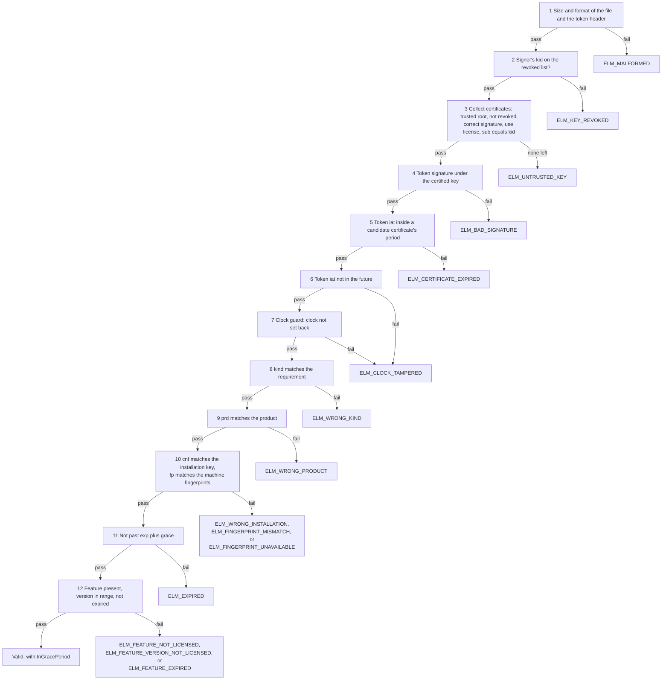

# License files and verification

This page is for vendors who issue license files and set the policies behind them, and for app developers who verify license files in their app with `ElasticLM.Licensing` or `libelasticlm`. It explains what a license token and a license file hold, the exact order in which a verifier checks them, how expiry, the grace period, and clock rollback detection work, and what the verifier reports. Read [the trust chain](trust-chain.md) first: this page assumes you know what a root key, a signing key, a key certificate, and the trust store are.

## What a license file is for

A license file lets an app decide, without a network, whether this machine may use this product and feature right now. The app reads the file, checks it against the trust store built into the app, and gets either a verified license or the reason it was refused.

The file can come from three places:

- `elm-service` returns one when a device activates or refreshes online, and as the answer to an offline request (see [activation](activation.md)).
- The administration API of `elm-service` produces one for an `Unbound` license, which is not tied to a machine.
- `elm license issue` writes one without any service, for vendors who run fully offline.

All three produce the same format and the app verifies them the same way.

## The license token

A license token is a JWS in compact serialization (RFC 7515): three base64url parts separated by `.`, holding a header, a JSON payload, and a signature. ElasticLM uses a narrowed form of JWS and does not implement JOSE in general (design §8.1).

### Header

The header has exactly three members (design §8.2):

| Member | Value |
| --- | --- |
| `alg` | `ES256` only |
| `kid` | The key ID of the signing key (its JWK thumbprint) |
| `typ` | `elm-license+jws` for a license token |

A header with any other member (`crit`, `jku`, `jwk`, `x5u`, `x5c`, or anything else) is rejected, so a token cannot bring its own key. The verifier never picks a key or an algorithm from `alg`; it looks up the key by `kid` and rejects an `alg` that does not match that key (threat T2). Each verifying function accepts one `typ` only, so a lease token cannot be passed off as a license (threat T3).

The signature is checked over the exact bytes received (`header.payload`), and the payload is not parsed as JSON until the signature has been checked. Nothing in the payload is trusted, or even read, before then. The signature is 64 bytes in IEEE P1363 form (`r || s`); DER is not accepted.

### Claims

Every token has `ver` (the format version, `1`), `iat` (issue time), and `jti` (a 128-bit random token ID). A license token also has `iss`, the `kid` of the signing key; the verifier rejects a token whose `iss` differs from the header's `kid`. Times are UNIX seconds. Unknown claims are ignored; an unknown `ver` or a missing required claim is rejected (design §8.3).

The license claims (design §8.4.2):

| Claim | Present | Meaning |
| --- | --- | --- |
| `lic` | Always | License ID |
| `prd` | Always | Product ID: the product's `code` |
| `kind` | Always | `standard`, `trial`, or `server` |
| `feat` | Always (may be empty) | Features. Each has `id`, and optionally `ver` (an allowed version range), `seats` (required for `kind: server`), and `exp` (the feature's own expiry) |
| `exp` | Optional | Token expiry. Without it the token never expires |
| `grace` | When `exp` is present | Seconds after `exp` during which the license is still usable. `0` for `kind: trial` |
| `refresh` | When the token is refreshed online | Seconds before `exp` at which the client starts to refresh |
| `cnf` | When node-locked | `{"jkt": "<installation key thumbprint>"}` |
| `fp` | When node-locked and fingerprints are compared | Machine fingerprints, at most 8 |
| `fpm` | When `fp` is present | How fingerprints are compared: `any`, `all`, or `ignore` |
| `seq` | When issued from an activation | The activation's sequence number, used for clone detection |
| `areq` | When answering an offline request | The request's `nonce` |
| `lease`, `borrow`, `overage`, `brl`, `clone` | When `kind: server` | Lease period, borrow limit, overage percentage, early-return limit, and clone strategy of a server license |
| `meta` | Optional | Vendor strings. The verifier does not interpret them |

`cnf`, `fp`, and `seq` are explained in [devices and proofs](devices-and-proofs.md) and [activation](activation.md); the server license claims in [floating licenses](floating-licenses.md).

### Signed, not encrypted

A license token is signed, not encrypted. Anyone holding the file can read every claim, including `meta`. Do not put secrets in it. The machine binding does not depend on secrecy: it is protected by the signature over `cnf` and `fp`. Encrypting would not hide anything either, because the decryption key would have to sit on the client (see [design choices](design-choices.md)).

## The license file

A license file is UTF-8 JSON with the extension `.elmlic` (design §8.5):

```json
{
  "format": "elasticlm-license",
  "version": 1,
  "license": "<elm-license+jws>",
  "certificates": ["<elm-cert+jws>"]
}
```

`certificates` holds the key certificates of the key that signed the token, so the file can be verified from the root key with nothing else. The outer JSON is not signed; each token inside it is signed on its own. Changing the outer JSON can only make the file fail, not make it pass.

Limits (design §8.6) keep a hostile file from using up memory or time: a license file is at most 64 KiB, one token at most 16 KiB, `certificates` holds 1 to 4 entries, `feat` at most 256, `fp` at most 8, `meta` at most 32 entries (keys up to 64 bytes, values up to 1 KiB), and JSON nesting at most 8 levels deep. Times and durations have upper bounds so that sums like `exp + grace` cannot overflow.

## The order of checks

The verifier checks the file in a fixed order and returns the reason for the first check that fails (design §11.2, implemented in `src/ElasticLM.Licensing/LicenseVerifier.cs`).



1. **Size and format.** The file is at most 64 KiB, is the JSON above with `format` `elasticlm-license` and `version` `1`, and has 1 to 4 certificates. The token is at most 16 KiB and its header has exactly `alg`, `kid`, and `typ` `elm-license+jws`. A failure is `ELM_MALFORMED`. One exception in the code: an `alg` other than `ES256` is reported as `ELM_BAD_SIGNATURE`. Only the header is read here.
2. **Revoked signer.** If the token's `kid` is on the trust store's list of revoked key IDs, the result is `ELM_KEY_REVOKED`.
3. **Certificates.** A certificate becomes a candidate when its header names a root key in the trust store that is not revoked, the root's signature on it is correct, its `use` includes `license`, and its `sub` equals the token's `kid`. A certificate that fails is skipped, not fatal, so an old certificate kept for rotation does no harm. With no candidate left, the result is `ELM_UNTRUSTED_KEY`.
4. **Signature.** The token's signature is checked once, with the certified key. A failure is `ELM_BAD_SIGNATURE`. Only now is the payload read. A payload that breaks the claim rules, or whose `iss` differs from the `kid`, is `ELM_MALFORMED`.
5. **Certificate period.** At least one candidate's period (`nbf` to `exp`, widened by the allowed clock skew) must contain the token's `iat`. Otherwise the result is `ELM_CERTIFICATE_EXPIRED`. This is the `iat` rule explained in [the trust chain](trust-chain.md).
6. **Issue time.** If `iat` is later than the current time plus the allowed skew, the result is `ELM_CLOCK_TAMPERED`.
7. **Clock guard.** If the clock has been set back (see below), the result is `ELM_CLOCK_TAMPERED`.
8. **Kind.** `kind` must be the requirement's kind, or the result is `ELM_WRONG_KIND`. A `standard` requirement also accepts a `trial` license unless the verifier is set otherwise. A `server` license is accepted only by a `server` requirement.
9. **Product.** `prd` must equal the requirement's product ID, or the result is `ELM_WRONG_PRODUCT`.
10. **Machine.** If the token has `cnf`, the requirement's installation key thumbprint must match it, or the result is `ELM_WRONG_INSTALLATION`. Then `fp` is compared as `fpm` says; a mismatch is `ELM_FINGERPRINT_MISMATCH`.
11. **Expiry.** Without `exp`, the token passes. Between `exp` and `exp + grace`, it passes in the grace period. After `exp + grace`, the result is `ELM_EXPIRED`.
12. **Feature.** If the requirement names a feature: a feature missing from `feat` is `ELM_FEATURE_NOT_LICENSED`, a version outside its range is `ELM_FEATURE_VERSION_NOT_LICENSED`, and a feature past its own `exp` is `ELM_FEATURE_EXPIRED`.

Two points of the order matter. Nothing from the payload is used until the signature is proven (steps 1 to 4). And the clock guard in step 7 records every token that passed steps 1 to 6, even one that then fails a later step such as product or expiry: its `iat` is signed by the vendor, so it is safe to record (design §11.4).

The allowed clock skew is 300 seconds by default and can be set from 0 to 3,600 seconds: `LicenseVerifierOptions.ClockSkew` in .NET, `clock_skew_seconds` in C, where `0` means the default and other values are 1 to 3,600 (design §11.3, `include/elasticlm.h`). The skew widens the certificate period, the future-`iat` check, and the clock guard. It is not added to `exp`.

## Expiry and grace period

The service issues node-locked tokens with a short life and refreshes them online. The policy defaults (design §9.3) are:

| Policy setting | Default | Effect on the token |
| --- | --- | --- |
| `tokenLifetime` | 30 days | Sets `exp` |
| `refreshWindow` | 20 days | Sets `refresh`: the client starts to refresh when less than this remains |
| `gracePeriod` | 7 days | Sets `grace` |

With the defaults, a device starts refreshing 10 days after it received its token. If the service cannot be reached, the app keeps working while the token is inside its expiry and grace period, and the client tries again every hour (design §12.5). A device that cannot refresh for more than 37 days after its last token was issued stops with `ELM_EXPIRED` until it refreshes.

The grace period exists so that a short network outage near the expiry does not stop users. The verifier reports it (`InGracePeriod`), so the app can warn the user that it needs to connect. A trial license always has a grace period of `0`.

A feature's own `exp` has no grace period: once it passes, that feature fails with `ELM_FEATURE_EXPIRED`, even if the token as a whole is still valid.

A token without `exp` never expires and cannot be revoked other than by revoking the signing key. Only license files issued by hand with `elm license issue --expires never`, and `Unbound` files of licenses without expiry, have no `exp` (decisions 0.17 and 0.86). Revoking or suspending a license in the service does not reach a token already on a device; the token stays valid until `exp + grace` (design §5.4). Short token lifetimes are what make revocation take effect.

## Product, feature, and machine binding

**Product.** The app passes its product ID in the requirement. `prd` must equal it exactly. A license for another product of the same vendor fails with `ELM_WRONG_PRODUCT`.

**Feature.** The requirement may name a feature and the version the app is. A feature's `ver` is a range such as `>=2.0 <3.0`, with versions written as `major.minor[.patch]` numbers (design §9.2). Without `ver`, every version is allowed. A range lets a vendor grant across major versions, which a fixed "same major" rule could not express. If the requirement names no feature, step 12 is skipped; if it names no version, the range is not checked.

**Machine.** A node-locked token carries two kinds of binding:

- `cnf.jkt`, the thumbprint of the device's installation key. This is the real identifier of the device. The requirement passes an `InstallationIdentity` with the key's thumbprint; if the token has `cnf` and the requirement passes no identity, verification fails with `ELM_WRONG_INSTALLATION`.
- `fp`, the machine fingerprints, compared as `fpm` says: `any` passes when one fingerprint in the token matches the machine, `all` needs every one to match, and `ignore` skips the comparison. When the machine yields no fingerprint at all, the result is `ELM_FINGERPRINT_UNAVAILABLE`.

Both claims are signed, so a licensee cannot edit them. Copying the file to another machine fails because that machine has a different installation key (threat T4). How the installation key and the fingerprints are made, and why the key is the identifier rather than the OS machine ID, is in [devices and proofs](devices-and-proofs.md).

An `Unbound` license has neither `cnf` nor `fp` and passes on any machine. Use it only when that is what you sell.

## Clock rollback detection and its limits

A licensee could set the device clock back to keep using an expired token (threat T5). The clock guard detects this (design §11.4):

1. For every token that passes steps 1 to 6, the guard records the later of the current time and the token's `iat` as the "last time seen".
2. If the current time is earlier than the last time seen minus the allowed skew, the clock has been set back, and the result is `ELM_CLOCK_TAMPERED`.
3. The state is kept in a file. In .NET this is `FileClockGuard`; in C, the file `clock` in the installation's folder unless `clock_guard_path` names another. When an installation key is available, the state is signed with it, and a state whose signature fails is treated as missing.
4. A state that is missing, edited, or unreadable falls back to the `iat` of the token being verified. The token's `iat` comes from the signer's clock, so whatever happens to the state, the clock can never be set back before the token was issued.
5. The guard also runs when lease tokens are verified, including borrowed leases, which are checked against the device clock while offline (see [floating licenses](floating-licenses.md)).

A user whose clock jumped forward and then came back is locked out until real time catches up with the recorded time. A successful online refresh fixes this at once: the client takes the new token's `iat` as the service's time and overwrites the record (`IClockGuard.AcceptServerTime`). Importing an offline response does not overwrite it, because a response can grow old while it is carried by hand.

What the guard does not stop (design §5.4):

- **Deleting or editing the state.** The clock then falls back to the token's `iat`. A licensee can still set the clock back to any time after `iat`, so the real limit is the token's expiry. Keep `tokenLifetime` short.
- **An unsigned state.** Without an installation key (an `Unbound` license), the state is not signed, and anyone who can write the file can reset the guard to the `iat` floor.
- **A stateless guard.** `StatelessClockGuard` keeps no state and checks only that `iat` is not in the future (step 6). In C you get it when you pass neither an installation nor a `clock_guard_path`.
- **Patching the app.** A licensee who edits the binary to skip the check is out of scope (decision 0.18).

The guard writes the state only when the last time seen moves forward by at least 60 seconds, so verification does not touch the disk every time. If the state cannot be written, verification continues with the value in memory and the token's `iat`, and does not throw.

## What the result reports

In .NET, `LicenseVerifier.Verify` returns one of two records (design §11.1):

- `LicenseVerificationResult.Valid(License, InGracePeriod)`. `License` is a `VerifiedLicense` with the claims in typed form: `LicenseId`, `ProductId`, `Kind`, `Features` (each with `Id`, `VersionRange`, `Seats`, `ExpiresAt`), `TokenId`, `SigningKeyId`, `IssuedAt`, `ExpiresAt`, `GracePeriod`, `RefreshWindow`, `InstallationKeyThumbprint`, `Fingerprints`, `Sequence`, `OfflineRequestNonce`, the server license values, and `Metadata`. A `VerifiedLicense` can only be made by the verifier, so code that holds one knows the checks passed.
- `LicenseVerificationResult.Invalid(Error)`. `Error` is a `LicenseError` with the `Code`, its wire name (`WireName`, such as `ELM_EXPIRED`), and a one-sentence `Message`. The message never contains key material or the full token.

A broken file never throws, whatever its content. Exceptions are only for mistakes in the call: an empty product ID, a required version that is not `major.minor[.patch]`, a clock skew out of range, or a bad trust store key.

In C, `elm_verifier_verify` returns the error code and, on success, an `elm_license` handle; `elm_license_in_grace_period` tells whether the license is in its grace period.

The verifier does not decide what the app does. On `Invalid`, the app chooses whether to stop, fall back to a limited mode, or ask the user to activate again. On `Valid` with `InGracePeriod`, it should tell the user to connect.

## What can go wrong and what to do

| Code | Usual cause | What to do |
| --- | --- | --- |
| `ELM_MALFORMED` | The file was truncated, edited, or is not a license file | Get the file again from its source |
| `ELM_UNTRUSTED_KEY`, `ELM_CERTIFICATE_EXPIRED`, `ELM_KEY_REVOKED` | A trust chain problem | See [the trust chain](trust-chain.md) |
| `ELM_BAD_SIGNATURE` | The token was edited after signing | Get the file again; an edited file never verifies |
| `ELM_CLOCK_TAMPERED` | The clock is behind the issue time or behind the last time seen | Correct the clock; refresh online to reset the record |
| `ELM_WRONG_KIND` | The app asks for a `server` license and got another kind, or trials are refused | Check the requirement's kind and `AcceptTrialAsStandard` |
| `ELM_WRONG_PRODUCT` | The file is for another product | Check the product ID the app passes against the product's `code` |
| `ELM_WRONG_INSTALLATION` | The file was made for another device, or the app passed no installation identity | Activate this device; pass the installation identity |
| `ELM_FINGERPRINT_MISMATCH` | The machine's fingerprints changed, for example after the OS was reinstalled or the VM was moved | Activate the device again so that it receives a token with its current fingerprints (see [activation](activation.md)) |
| `ELM_FINGERPRINT_UNAVAILABLE` | The machine yields no fingerprint, often a container without `/etc/machine-id` | Mount the host's `/etc/machine-id` read-only, or use a policy with `fingerprintMatching` set to `ignore` (design §10.3) |
| `ELM_EXPIRED` | Past `exp + grace` | Refresh online, or bring a new file by offline refresh |
| `ELM_FEATURE_NOT_LICENSED`, `ELM_FEATURE_VERSION_NOT_LICENSED`, `ELM_FEATURE_EXPIRED` | The license does not cover this feature or version, or the feature has ended | Issue a license with the feature, the range, or a later feature expiry |

What each role must do:

- **Vendor:** keep token lifetimes short enough that revocation takes effect in time; avoid tokens without expiry; do not put secrets in `meta`; issue `Unbound` licenses only when any machine may use them.
- **App developer:** pass the product ID, the required kind, and the feature and version you need; pass the installation identity for node-locked licenses; use a clock guard with state; handle `InGracePeriod` and every `Invalid` code instead of treating them all alike.
