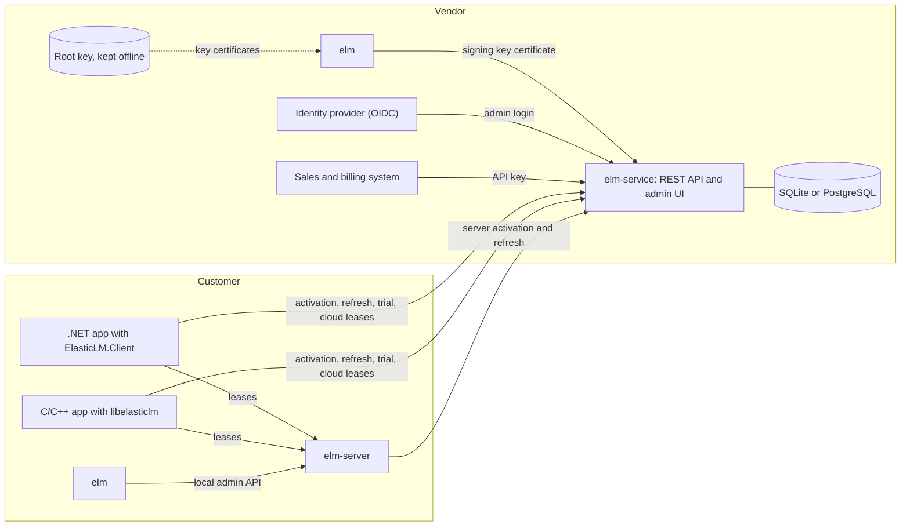

# Overview

This page is for everyone who meets ElasticLM for the first time: vendors who issue licenses, app developers who embed the client in a .NET or C app, and customers' administrators who run a license server. You need no knowledge of ElasticLM. It helps to know what a public and a private key are. The page says what ElasticLM is for, what the six deliverables are, who runs each one, and which ways you can put them together. The other explanation pages go deeper into each part.

## What ElasticLM is for

ElasticLM lets the vendor of a .NET or C/C++ app issue licenses for its products, check those licenses on the customer's machines, and count how many people use the product at the same time. It is open source (MIT) and ships as NativeAOT single binaries and NuGet packages. Nothing has been released yet; 1.0 is coming.

The design puts one goal first: stop three kinds of abuse with cryptography rather than with secrecy.

- **A forged or edited license.** A license is signed by the vendor. An app accepts only licenses whose signature leads back to a key the app was built to trust.
- **A forged or replayed request.** Every request that changes state on a server is signed by a key that belongs to one installation of the app, and carries a one-time server nonce.
- **Use beyond the seats that were bought.** Servers count seats under a lock, and a client checks that what a server lends it fits in the license the vendor signed.

ElasticLM does not try to stop a person who changes the app's own binary so that it skips the check. No client-side licensing can stop that, and obfuscation is out of scope too (design §5.4, §23). The [security model](security-model.md) lists everything that is and is not protected.

## The people

The design names these people and things (design §1.2). The rest of the guide uses the same names.

| Name | Who or what |
| --- | --- |
| Vendor (issuer) | The organization that uses ElasticLM to license its product. It holds the root key and runs the hosted activation service. |
| Vendor's administrators | The vendor's staff. They issue and revoke licenses in the admin UI, with the `elm` CLI, or through the management API. Their roles limit what each can do. |
| Vendor's systems | The vendor's sales, billing, or CI systems. They call the management API with an API key. |
| Licensee (customer) | The organization or person who bought the product. |
| Customer's administrator | The person at the customer who runs the on-premises license server. |
| App | The vendor's product. It embeds the verification library, or the client (.NET or C). |

## The six deliverables

| Deliverable | Form | Used by | What it does |
| --- | --- | --- | --- |
| `ElasticLM.Licensing` | NuGet package | The app | Verifies a license file offline. It has no dependency outside the .NET base class library and never touches the network. |
| `ElasticLM.Client` | NuGet package | The app | Talks to the servers: online and offline activation, refresh, deactivation, trials, leases, and borrowing. It creates and keeps the installation key. |
| `libelasticlm` | NativeAOT shared library (`.dll`, `.so`, `.dylib`) and the C header `elasticlm.h` | C and C++ apps | The functions of both packages behind a C ABI. |
| `elm-server` | Single binary | The customer's administrator | The on-premises license server. It lends floating seats inside the customer's network. |
| `elm-service` | Single binary and container image | The vendor | The hosted activation service: license keys, activations, trials, cloud leases, the management API, and the admin UI. |
| `elm` | Single binary (CLI) | The vendor and the customer's administrator | Creates keys and key certificates, issues and inspects license files, verifies logs, calls the management API, and administers a local `elm-server`. |

The executables run with no files beside them; a settings file is optional (design §4.1). They are built for `win-x64`, `win-arm64`, `linux-x64`, `linux-arm64`, `linux-musl-x64`, `osx-arm64`, and `osx-x64`, and `libelasticlm` for the same targets. The NuGet packages are AOT-compatible, so an app that embeds them can itself be published with NativeAOT without warnings.

The app embeds only `ElasticLM.Licensing` and `ElasticLM.Client`, or `libelasticlm`. The code that signs licenses lives only in `elm`, `elm-server`, and `elm-service`, and never ships inside the app (design §6.2).

## The core idea: a signed license, checked offline

Everything else is built on one mechanism. A **license token** is a small JSON document that says which product, which features, until when, and, if the license is node-locked, which device. The vendor signs it with ECDSA P-256 (ES256). A **license file** (`.elmlic`) holds the license token and the key certificate needed to check it.

The app checks the license file with nothing but the file, the clock, and a **trust store**: the vendor's root public keys, built into the app. The chain is short:

1. The **root key** is the vendor's top key. It is kept offline and signs only key certificates.
2. A **key certificate** says "this signing key may sign licenses (or leases, or logs) until this date", signed by the root key.
3. A **signing key** signs the license tokens. It is the key that `elm-service` or `elm` holds.

Because the app trusts only the root key, the vendor can replace a signing key without shipping a new app. The [trust chain](trust-chain.md) page explains this in full, and [license files and verification](license-files-and-verification.md) gives the order of checks.

The license is signed, not encrypted. Anyone who holds the file can read it; nobody without the signing key can change it or make a new one (design decision 0.33).

The online parts of ElasticLM exist to issue and refresh these signed tokens, and to lend seats. When the network is gone, an app keeps working for as long as its token, its grace period, or its lease allows (design §4.5).

## How the parts fit together

The figure shows every deliverable and who talks to whom. The vendor's side is on the left; the customer's side is on the right.

Read the figure like this (design §6.1):

- The vendor uses `elm` with the root key to create a signing key and its key certificate, and gives both to `elm-service`.
- `elm-service` keeps products, features, policies, licenses, activations, and leases in SQLite or PostgreSQL. Vendor administrators log in through the vendor's identity provider; the vendor's systems use API keys.
- Apps talk to `elm-service` to activate a license key, refresh their token, start a trial, or borrow a seat from the cloud.
- An `elm-server` at the customer is activated by `elm-service` like any other device. It then lends seats to the apps on the customer's network, and the customer's administrator manages it with `elm` from the same machine.

## Deployment shapes

You do not have to run every part. The design names four shapes (design §6.3), and a vendor may use more than one at once.

| Shape | Parts | In short |
| --- | --- | --- |
| Offline only | `elm`, `ElasticLM.Licensing` | The vendor makes license files with the CLI and hands them over. No service runs. |
| Hosted activation | `elm-service`, `ElasticLM.Client` | The customer activates with a license key and the app refreshes its token from time to time. |
| Cloud floating | `elm-service`, `ElasticLM.Client` | Apps borrow seats (leases) from the vendor's service. |
| On-premises floating | `elm-server`, `ElasticLM.Client`, and `elm-service` or `elm` to activate the server | Apps borrow seats from a server inside the customer's network. |

"Lease" means a seat lent for a short, fixed time. To pick a shape:

- If the license limits only who may run the app, on which device, and until when, use **offline only** when the vendor runs no service, or **hosted activation** when it does.
- If the license limits concurrent users (seats), use **cloud floating** when the apps can reach the vendor's service, or **on-premises floating** when they cannot or the customer wants the seats on site.
- An on-premises server gets its server license either from `elm-service` (the shape **both**, below) or from `elm`, issued by hand.
### Offline only

The vendor runs `elm license issue` and sends the `.elmlic` file to the customer. The app checks it with `ElasticLM.Licensing` (or `libelasticlm`). The file can be node-locked: `elm license issue` takes `--bind-key` (the thumbprint of the device's installation key) and `--fingerprint` (machine fingerprints), which the vendor must first get from the customer's device. Without them, the file works on any device.

There is no refresh and no revocation in this shape. A file is good until its expiry, and a file issued with `--expires never` is good forever; `elm` warns when it writes one (design §16). Choose expiry dates with that in mind.

### Hosted activation

The vendor runs `elm-service`, defines products and policies, and issues a **license key** (a string such as `ELM-7Q2KX-M9D4R-HV0T8-3NPWZ`) for each sale. The service stores only the SHA-256 hash of the key and shows the key once, when it is issued (design §9.5). In the app, `ElasticLM.Client` (`ActivationClient`) activates that key: it creates an **installation key** for the device, signs the request with it, and receives a license file bound to that key. The policy's `MaxActivations` limits how many devices can activate one license.

The token in that file expires (by default after 30 days, `TokenLifetime`), and the client refreshes it online before then; if it cannot, the license still works for the grace period (by default 7 days, `GracePeriod`) (design §9.3). This short life is how revocation reaches a device: a revoked or suspended license gets no new token. The same service handles deactivation, trials (one per product and machine), and offline activation by carrying request and response files by hand. See [devices and proofs](devices-and-proofs.md) and [activation](activation.md).

`elm-service` can also produce a license file that is not bound to any device (`Binding: Unbound`) from its management API, for customers who will never go online (design §9.3).

### Cloud floating

A policy with `Floating: Cloud` gives each feature a number of seats. The app's `LicenseClient`, given the license key, asks `elm-service` for a lease, renews it every third of the lease length (the default lease is 10 minutes), and returns it when done. The service keeps leases in its database, so a restart of the service does not lose them. See [floating licenses](floating-licenses.md).

### On-premises floating

The customer's administrator runs `elm-server` on a machine in their own network. The server has its own installation key and a **server license**: a license token of kind `server` that names the server's key, the features, and the seats for each. The server lends seats only within that license, and signs each lease with its own installation key. Apps use `LicenseClient` pointed at the server, and check every lease against the server license, so even a server whose key was taken out cannot lend more than the vendor signed (design §12.7.5).

`elm-server` keeps its leases in memory and has no database. After a restart, clients hand their still-valid leases back during a short reclaim window. Only borrowed seats, which leave the network, are written to a signed record on disk (design §13.4). There is no high-availability pair: the operating system's service manager restarts the server, and running apps hold leases long enough to ride out the restart (design §13.6).

### Both

When the vendor runs `elm-service` and a customer runs `elm-server`, the server activates its server license with the service like any device (`elm server activate`, or a request file when the server has no internet access). The server license expires (by default after 30 days) and the server refreshes it from the service, online when `service.url` is set, or through files (`elm server refresh-request`, then `elm server import`). Each refresh lets the service notice a copied server (design §9.6, §10.4).

Without `elm-service`, the vendor issues the server license by hand with `elm license issue --kind server`. Such a license has no refresh, so a copied server machine cannot be detected; `elm` warns when such a license has no expiry (design §9.6).

## Who holds which secret

Most of what keeps ElasticLM safe is about where private keys and secrets live. The table gives the main ones (design §7.2, §10.2, §13.7, §14.8).

| Secret | Who holds it | Where |
| --- | --- | --- |
| Root key | The vendor | A passphrase-protected PKCS#8 PEM file, kept offline. Only `elm` reads it, to sign key certificates. It never goes on a server. |
| Signing key | The vendor | Given to `elm-service` as an encrypted file with its passphrase, or read by `elm` to issue license files. |
| Installation key | Each device | Created by the client on first use and stored per product: with DPAPI on Windows, with file mode `0600` on Linux and macOS. |
| `elm-server`'s installation key and admin token | The customer's administrator | The server's data folder, readable only by Administrators, SYSTEM, and the account that created it (Windows), or by its owner (Linux and macOS). |
| License key | The customer | Typed in by a person. `elm-service` stores only its hash. |

No private key is ever built into a binary or a resource. The app holds only public keys.

## What can go wrong, and what you must do

Each role has a few things that only it can do. The pages that follow explain why.

**Vendors**

- Keep the root key offline and its passphrase secret. With the root key, anyone can certify a signing key and make any license.
- Build your root public key into the app's trust store. If a signing key leaks, you revoke it by listing its key ID in the trust store, which reaches devices only through an app update (design §7.5). See the [trust chain](trust-chain.md).
- Choose token lifetimes and lease lengths on purpose. A revoked license keeps working until its token and grace period run out, and a token with no expiry can never be revoked (design §5.4).
- If you issue server licenses by hand, give them an expiry; otherwise a copied server can never be found.

**App developers**

- Embed only public keys. A private key in an app lets anyone who has the app make licenses.
- Decide what the app does when verification fails, when it is in its grace period, and when a lease is lost. ElasticLM reports these states; the app decides what to stop.
- Do not count on ElasticLM to stop someone who patches your binary. That threat is accepted (design §5.4).

**Customers' administrators**

- Run `elm-server` under the operating system's service manager (a Windows service, systemd, or launchd) so that it restarts on its own. With the default 10-minute lease, apps keep working if the server is back within about 6 minutes 40 seconds (design §13.6).
- Keep the server license fresh: let the server refresh online, or carry refresh files at least once every 37 days with the default 30-day token and 7-day grace period (design §12.8.3).
- Keep the server's data folder private. It holds the server's installation key, the admin token, and the borrow record.

**When the network goes away**

| Shape | The app keeps working until |
| --- | --- |
| Offline only | Not affected: the file needs no network and works until it expires, plus its grace period. |
| Hosted activation | The token expires plus the grace period: 37 days with the defaults. |
| Cloud or on-premises floating | The current lease ends: at most one lease length, by default 10 minutes. A borrowed lease lasts until its own end. |

## Where to read next

- [Trust chain](trust-chain.md): root key, signing keys, key certificates, the trust store, rotation and revocation.
- [License files and verification](license-files-and-verification.md): the file format, the order of checks, the grace period, and clock rollback.
- [Devices and proofs](devices-and-proofs.md): installation keys, signed requests, nonces, and machine fingerprints.
- [Activation](activation.md): online and offline activation, refresh, deactivation, and clone detection.
- [Floating licenses](floating-licenses.md): leases, reclaim after a restart, borrowing, and seat limits.
- [Security model](security-model.md): what is protected, from whom, and what is not.
- [Design choices](design-choices.md): why ElasticLM is built this way.
