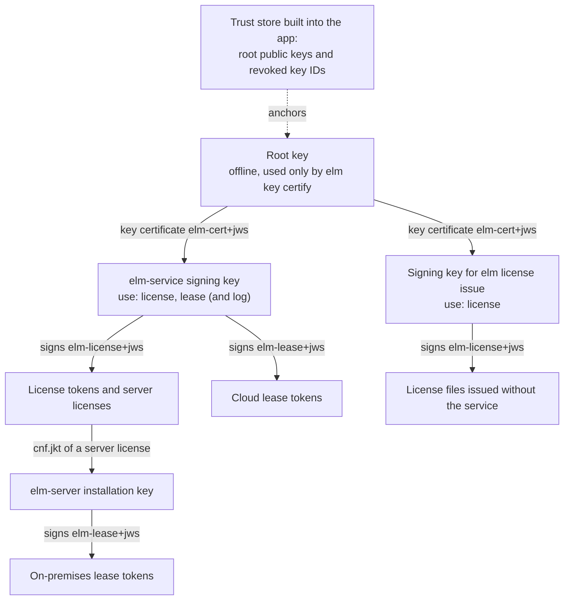

# Trust chain

This page is for vendors who create and keep the keys, for app developers who build the trust store into their app, and for administrators who configure `elm-server` and `elm-service` with root keys. It explains which keys exist, why there are two levels of them, how an app traces a signed token back to a key it trusts, and how keys are replaced or taken out of use. Read [the overview](overview.md) first if you do not yet know the six deliverables.

## What the chain is for

Every license and every lease in ElasticLM is a token: a short piece of text that holds a header, a JSON payload, and a signature. The format is JWS (JSON Web Signature, RFC 7515), and the signature is ECDSA P-256 (`ES256`). An app accepts a token only when the key that signed it can be traced, through signatures, to a key the vendor built into the app. That path from the built-in key to the token is the trust chain.

The chain answers one question: who may create a license that the app accepts? The answer is only the vendor (the issuer), and only through keys the vendor has certified. A licensee (the customer) who edits a valid license file, or writes a new one from nothing, cannot make the app accept it, because they do not hold a private key that the chain leads to.

The chain has two levels instead of one:

- A **root key** that the vendor keeps offline. It signs nothing but key certificates.
- **Signing keys** that sign licenses, leases, and usage log records day to day. The root key certifies each one for named uses and a limited period.

The app trusts only the root key. A signing key can therefore be replaced, and a leaked one recovered from, without rebuilding the app. The alternative, building the signing key itself into the app, would need an app update for every key change (see [design choices](design-choices.md)).

## The keys

| Key | Who holds it | Where it lives | What it signs |
| --- | --- | --- | --- |
| Root key | The vendor | A file the vendor keeps offline and passes to `elm` only when it is needed | Key certificates |
| Signing key of `elm-service` | The vendor's operators | A file given to `elm-service` at start | License tokens, cloud lease tokens, usage log records |
| Signing key used with `elm license issue` | The vendor | A file passed to `elm` | License files issued without the service |
| Installation key of `elm-server` | The customer's server | Created by the server on its first start | On-premises lease tokens and the server's usage log |

No private key is ever placed in an executable's resources or constants. `elm` is a generic binary: it holds no vendor key and reads the root key from a file each time.

### Root key

The root key is created with `elm key root create`. Like every private key `elm` writes, it is stored as a PKCS#8 PEM file encrypted with a passphrase; a new key's passphrase must be at least 12 characters. The formats of the private and public key files are in [Token and file formats](../reference/formats.md#key-files-and-key-ids). How to keep it and check a copy is in [Keep the root key safe](../how-to/keep-the-root-key-safe.md).

The root key never goes onto an online service. Its only job is `elm key certify`, which signs a key certificate for a signing key. Because it is used rarely, it can stay on an offline machine or removable media between uses.

### Signing keys

A signing key is created with `elm key signing create`. On its own it is trusted by nothing. It becomes useful only when the root key certifies it.

`elm-service` reads exactly one signing key at start: `signing.key` (or `ELM_SIGNING_KEY`), with its passphrase, and 1 to 4 certificate files in `signing.certificates`. It refuses to start unless, for `license` and for `lease`, some certificate that chains to a root key in `trust.rootKeys` certifies this key and covers the current time. One certificate may cover both uses, or separate ones may. When `usageLog.directory` is set, the same must hold for `log`.

The on-premises license server does not use a vendor signing key at all. It signs leases with its own installation key, and the vendor grants that key its authority through the server license (see below).

### Key certificates

A key certificate is a token signed by the root key. Each token says what it is in its header member `typ` (the token type): a key certificate is `elm-cert+jws`, a license token is `elm-license+jws`, and a lease token is `elm-lease+jws`. A verifier accepts only the type it expects, so one kind of token cannot be passed off as another.

A certificate's payload carries:

- `sub`: the key ID of the certified public key (key IDs are explained below);
- `jwk`: the certified public key itself;
- `use`: what the key may sign, one or more of `license`, `lease`, and `log`;
- `nbf` and `exp`: the start and end of the validity period.

`elm key certify` writes a certificate. `--use` names the uses (default `license`), `--not-before` sets the start (default: now), and `--days` sets the length: 365 by default, at most 731. Every member of a certificate is listed in [Token and file formats](../reference/formats.md#key-certificate-elm-certjws), and the seven token types in [Token types](../reference/formats.md#token-types).

**Uses.** A verifier asks for exactly one use. The license verifier accepts only certificates with `license`; the verifier for cloud leases accepts only `lease`; `elm log verify` uses `log`. A key certified only for logs cannot sign a license the app accepts.

**Validity and the issue time.** Every token carries `iat`, the time it was issued. A certificate's period says when the key may make new signatures. It does not say when those signatures stop being valid. A token is accepted when its `iat` falls between the certificate's `nbf` and `exp`, with the allowed clock skew on both ends. The current time is not compared with the certificate's `exp`.

This is the same idea as a timestamp on a code signature. It lets a perpetual or long license keep working after its signing key's certificate has ended. If the certificate were checked against the current time, every license would stop working within two years at most.

The cost of this rule is that a signing key's period does not limit a thief. Someone who steals a signing key can write a token with an `iat` inside the old period, and the certificate check passes. The defence against that is the list of revoked key IDs, described below.

### Key IDs

A key ID (`kid`) is a short name for a public key, computed from the key itself: its JWK thumbprint (RFC 7638, SHA-256, base64url). Anyone can compute it from the public key, and `elm key thumbprint` prints it. A token's header names the signing key by its `kid`, and a certificate's header names the root key the same way. Because the ID is derived from the key, a certificate that claims one key ID but carries a different key is caught: the verifier checks that the thumbprint of `jwk` equals `sub`. The exact text that is hashed is in [Token and file formats](../reference/formats.md#key-ids).

### The trust store

The trust store is the set of root public keys that an app trusts, together with a list of revoked key IDs. The app developer builds it into the app:

- In .NET, `TrustStore.Create(rootPublicKeysPem, revokedKeyIds)` in `ElasticLM.Licensing`. Each root key is one P-256 public key in one PEM `PUBLIC KEY` block.
- In C, the `root_keys_pem` and `revoked_key_ids` fields of `elm_verifier_options`.

A trust store can hold several root keys. It holds only public keys, so it is not a secret. Its integrity is what matters: the trust store an app uses decides which licenses it accepts.

`elm-server`, `elm-service`, and some `elm` commands also take root keys and revoked key IDs (`trust.rootKeys` and `trust.revokedKeyIds` in the server and service settings; `--trust`, `--revoked`, or `ELM_TRUST_ROOT_KEYS` for `elm`). There they decide what that program itself accepts and uses: `elm-service` checks its own signing key's certificates and every file it issues against them, and `elm-server` checks its server license against them. This catches configuration mistakes at start, for example a certificate that the root did not sign. It is not what protects the app. A customer administrator who puts their own root key into `elm-server` and writes their own server license gains nothing, because the apps trust only the vendor's root key and refuse that server's leases.

For the exact `elm key` commands and their options, see the [elm command reference](../reference/elm-cli.md); for the `trust` settings, see [elm-server configuration](../reference/server-configuration.md) and [elm-service configuration](../reference/service-configuration.md).

## How a token is traced to the root

The `elm-service` signing key needs `log` only when the usage log is turned on. A license file carries the license token and the certificates of the key that signed it, so the app can check the whole path offline:

1. The certificate's header names a root key (`kid`) that is in the trust store and not revoked, and the root key's signature on the certificate is correct.
2. The certificate allows the use the verifier needs (`license` for a license file).
3. The certificate's `sub` equals the `kid` in the license token's header.
4. The token's signature is correct under the certified key.
5. The token's `iat` lies in the certificate's period.

The full order of checks, with the error each one returns, is in [license files and verification](license-files-and-verification.md). A cloud lease from `elm-service` is checked the same way with the `lease` use.

### On-premises leases: the server's own key

An on-premises lease is not signed by a vendor key. It is signed by the installation key of the customer's `elm-server`. The vendor grants that key its authority with a **server license**: a license token of `kind: server` whose `cnf.jkt` is the thumbprint of the server's installation key.

The client fetches the server license and the server's public key from `GET /v1/server/license`, verifies the server license from the root like any license file, and checks that the public key's thumbprint equals `cnf.jkt`. Only then does it accept leases signed by that key, and only within the limits of the server license: its product, features, seat counts, lease and borrow periods, and its expiry plus grace period. The client checks each lease on its own, so an administrator who takes the server's key out can sign leases for more seats than the server license grants ([the security model](security-model.md#on-the-customers-license-server)). A server running on a trial or standard license is refused, so a licensee cannot turn their own license into a lease server. How leases work is explained in [floating licenses](floating-licenses.md).

## Rotating keys

The steps for a vendor who runs `elm-service` are in [Rotate the signing key](../how-to/rotate-the-signing-key.md).

### Renewing a certificate

A certificate can be renewed without changing the key: certify the same public key again with a new period. A license file may then carry several certificates for the same key with different periods, and the verifier uses whichever one holds the token's `iat`, in any order. A license file carries at most 4 certificates.

A certificate that fails any check is skipped instead of failing the whole file, so an old certificate kept for rotation cannot break a file that also carries a good one.

The service's signing key status in the administration API returns the key ID, the certificate's expiry, and its uses, and warns when fewer than 30 days remain. After the certificate ends, issuing from the service fails with `500` and `ELM_INTERNAL_ERROR`, and the reason is written to the service log. Renew before that: put the new certificate file into `signing.certificates` and restart the service.

### Replacing a signing key

1. Create a new signing key and certify it with the root key.
2. Replace the signing key file and its certificate files given to `elm-service`, and restart it. The service reads one signing key at start, so the new key signs from the restart on.
3. Tokens already signed by the old key keep verifying, even after the old certificate's period ends, because each license file carries the old certificate and the issue-time rule applies. This lasts as long as the old key is not on the revoked list.
4. Devices that refresh online receive new tokens signed by the new key at their next refresh.

No app update is needed, because the app trusts the root key, not the signing key.

### Replacing a root key

A root key change does need an app update, and the order matters:

1. Ship an app version whose trust store holds both the old and the new root public key.
2. Wait until the apps in use carry the new root.
3. Only then certify signing keys with the new root.

If you certify with the new root first, every app that does not yet know it rejects the new licenses with `ELM_UNTRUSTED_KEY`.

## When a signing key leaks

A leaked signing key lets the thief sign any license that the chain accepts. Because of the issue-time rule, the certificate's period does not stop them: they can back-date `iat` into the old period. The steps to replace and revoke a leaked key are in [Revoke a signing key](../how-to/revoke-a-signing-key.md).

The answer is the list of revoked key IDs in the trust store. When a key ID is on that list, the verifier rejects any license or cloud lease token signed by that key with `ELM_KEY_REVOKED` before it reads the payload, and it ignores certificates for that key. A certificate signed by a revoked root key ID is ignored too.

What protects apps is only the trust store built into them. The vendor's response to a leak:

1. Replace the signing key as described above.
2. Issue the legitimate licenses again with the new key. Devices that refresh online move to new-key tokens at their next refresh. Licensees who received license files by hand need new files. A server activated with `elm-service` gets a new-key server license at its next refresh, online or by refresh files; a server license issued by hand with `elm` must be issued again.
3. Ship an app version whose trust store lists the leaked key ID as revoked. Until an app runs that version, it keeps accepting tokens from the leaked key, forged ones included; there is no revocation list fetched over the network.
4. Add the leaked key ID to `trust.revokedKeyIds` on `elm-service` and on the `elm-server` installations you or your customers run. This makes those programs stop using the key: `elm-service` refuses to start with it, and `elm-server` refuses a server license signed by it. It does not reach any app.

A token signed by a revoked key fails even when it is legitimate, and even inside its grace period. Once the app update with the revoked ID reaches a device, that device rejects any old-key license it still holds. Plan the timing: the sooner the update ships, the sooner forged licenses stop working, but licensees who have not yet received a new-key license stop working at the same moment.

A token without expiry (from `elm license issue --expires never`, or an unbound license file of a license without expiry) cannot be revoked in the service at all; revoking its signing key is the only way to stop it. Revoking a license in the service reaches a device only when its token expires, and a patched app binary is out of scope; both are explained in [the security model](security-model.md).

### When the root key leaks

A leaked root key is worse: it lets the thief certify signing keys of their own, and every app that trusts that root accepts what they sign. ElasticLM keeps the root key offline so that this does not happen, and it offers no recovery procedure beyond the app update.

Any recovery needs an app update whose trust store drops the leaked root key, or lists its key ID as revoked, and holds a new root key. After that update, every license file certified through the old root fails with `ELM_UNTRUSTED_KEY`, legitimate ones included. A license certified only through the new root also fails on every app that does not yet have the update. Every license must therefore be issued again with signing keys certified by the new root, and each device needs the app update and its new license together: a device that gets only one of them stops working.

## What can go wrong and what to do

| What you see | Usual cause | What to do |
| --- | --- | --- |
| `ELM_UNTRUSTED_KEY` | No certificate in the file is signed by a root key in the app's trust store, allows `license`, and certifies the token's key | Check that the app's trust store holds the right root public key, that the certificate was made with `--use license`, and that the service is configured with the certificate of the key it signs with |
| `ELM_CERTIFICATE_EXPIRED` | The token's `iat` is outside every candidate certificate's period | Renew the certificate; check that the service did not keep signing after its certificate ended |
| `ELM_KEY_REVOKED` | The token was signed by a key ID on the app's revoked list | Issue the license again with the current signing key |
| `elm-service` does not start | No certificate covers the current time for `license`, for `lease`, or for `log` while `usageLog.directory` is set; or the certificates do not match the key | Certify the key again with the right uses and period |
| New licenses fail on older app versions after a root change | The new root was used before the apps carried it | Keep certifying with the old root until the app versions in use know the new one |

For every error code and what to do about it, see [Error codes](../reference/error-codes.md).

Your duties, by role:

- **Vendor:** keep the root key offline and its passphrase out of scripts and repositories; give certificates only the uses each key needs; renew certificates before they end; on a leak, follow the steps above and decide when to ship the revoked ID.
- **App developer:** build the vendor's root public keys and the current revoked key IDs into the app; ship app updates when the vendor revokes a key or adds a root key.
- **Customer administrator:** set `trust.rootKeys` on `elm-server` to the vendor's root public keys, and `trust.revokedKeyIds` to the IDs the vendor tells you, so that mistakes show at start.
